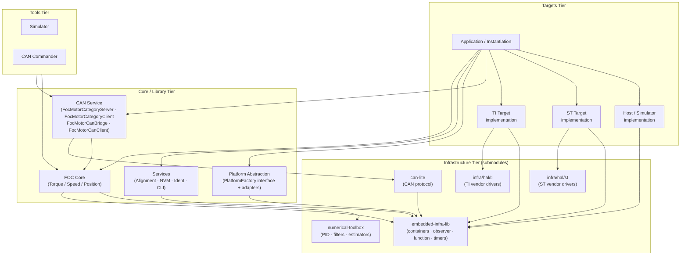
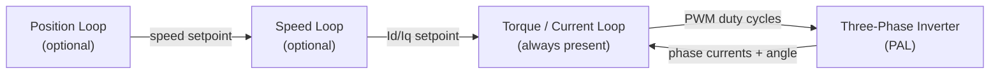
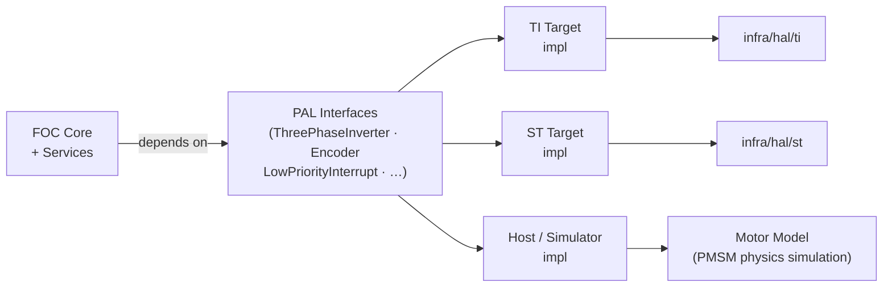
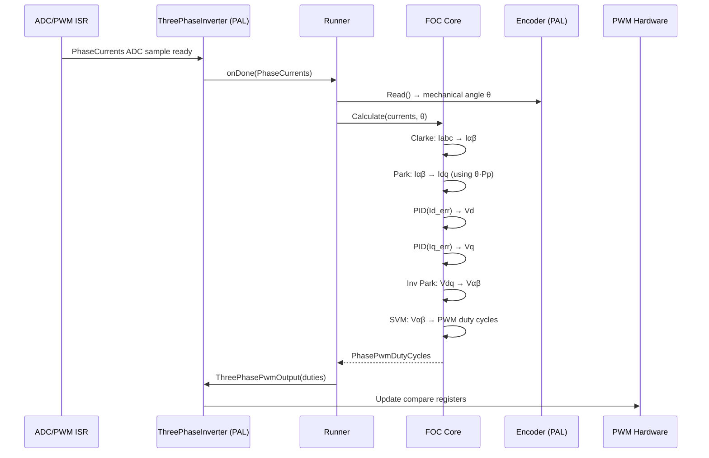
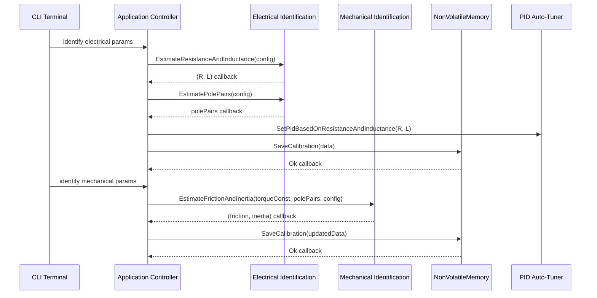
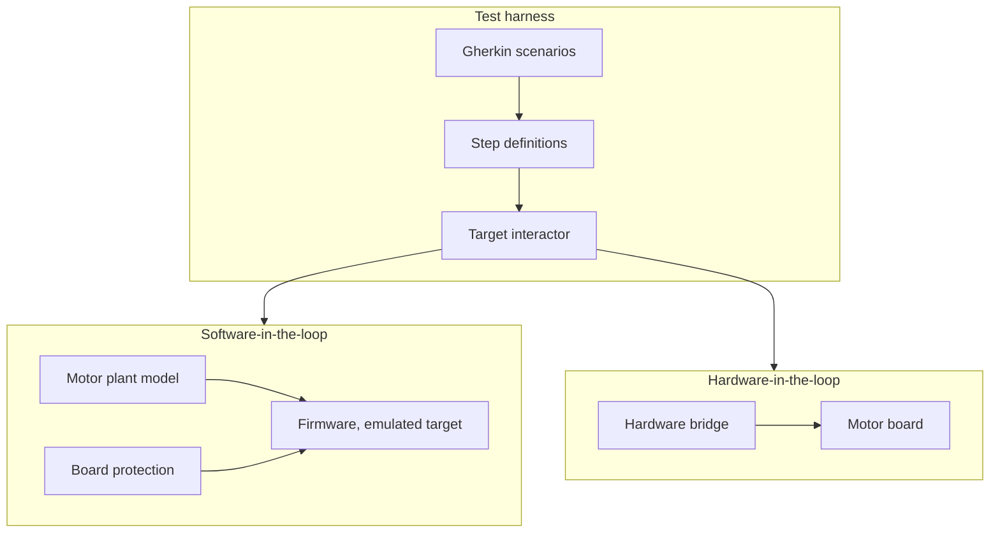

| Field     | Value                     |
|-----------|---------------------------|
| Title     | e-foc System Architecture |
| Type      | architecture              |
| Status    | draft                     |
| Version   | 0.1.2                     |
| Component | system                    |
| Date      | 2026-10-29                |

> **Note — Architecture-level document**: This document describes *what the system is and why it is structured this way*. Code must follow the architecture, not the opposite. Logical component and interface names are the vocabulary of architecture and belong here. What must be avoided: source file paths, implementation class names (e.g. `FooImpl`), and code-level algorithmic details.
>
> **Diagrams**: All visuals must be either a Mermaid fenced code block or ASCII art inline in the document.
> External image references (``) are **not allowed**.
>
> Sequence diagrams, block diagrams, component diagrams, and state machines (Mermaid syntax) are allowed and encouraged.

---

## Assumptions & Constraints

- **Constraint**: No dynamic memory allocation on the embedded target. All objects are stack- or statically-allocated for deterministic, bounded memory footprint.
- **Constraint**: The core FOC loop executes in an interrupt service routine at 20 kHz. The complete control cycle must not exceed 75 percent of the available CPU time per control period (<= 4500 cycles at 120 MHz / 20 kHz) to guarantee real-time deadlines.
- **Constraint**: No recursion in control-loop or ISR-reachable paths. Stack usage must be statically predictable.
- **Constraint**: No C++ exceptions. Error signalling uses status return values, `std::optional`, or asynchronous callbacks.
- **Constraint**: The system targets 32-bit ARM Cortex-M microcontrollers (STM32 and TI Tiva families). Host builds are supported for unit testing and simulation only.
- **Assumption**: A single motor is controlled per instantiation. Multi-motor configurations require multiple independent instantiations.
- **Assumption**: The motor is a BLDC or PMSM (surface or interior permanent magnet) with a sinusoidal back-EMF profile suitable for FOC.
- **Assumption**: Rotor position is measured by a quadrature encoder. Hall-sensor support is defined in the driver interface but is a secondary configuration.
- **Assumption**: All motor electrical and mechanical parameters (resistance, inductance, pole pairs, inertia, friction) can be identified at startup or loaded from non-volatile storage.
- **Constraint**: The build system produces a single unified binary (`e_foc.sync_foc_sensored.main`) that contains all three control modes. The active mode can be selected at runtime via CAN command (`SelectControlMode`) and persisted to NVM so it survives a power cycle. The CLI command `active_mode` reports the currently active mode. No mode switch is permitted while the motor is enabled.

---

## System Overview

e-foc is a Field-Oriented Control (FOC) firmware for BLDC and PMSM motors. Its purpose is to transform three-phase stator currents into a rotating reference frame so that torque and flux can be regulated independently with standard linear PIDs, then synthesise the three-phase PWM voltages via Space Vector Modulation.

The system is structured in four tiers:

1. **Infrastructure tier** — external repositories providing general-purpose utilities, numerical algorithms, and vendor HAL drivers. These are consumed as submodules and are never modified by this project.
2. **Core / Library tier** — the FOC algorithm library (`core/foc/`), service library (`core/services/`), and the Platform Abstraction Layer interface (`core/platform_abstraction/`). These are pure, portable libraries with no target-specific knowledge.
3. **Targets tier** — target-specific code that is NOT reusable across all environments: platform implementations (concrete `PlatformFactory` for TI, ST, and Host) and application entry points (`hardware_test`, `sync_foc_sensored`). Lives under `targets/`.
4. **Tools tier** — host-only desktop tools (simulator, CAN commander) that run on development machines only. Lives under `tools/`.

The simulator implements the same PAL contracts as real hardware. Control logic never needs to distinguish between running on a microcontroller or on the host; this enables full-fidelity closed-loop validation without hardware.

---

## Component Decomposition

### 1. FOC Core

The heart of the system. Decomposed into sub-layers following a strict separation of vocabulary, generic numerics, transform algorithms, orchestration, and wiring. Dependencies flow in one direction only — from wiring down towards vocabulary; no lower layer may depend on a higher one:

| Sub-component   | Responsibility                                                                                                                                                                                                                                                               |
|-----------------|------------------------------------------------------------------------------------------------------------------------------------------------------------------------------------------------------------------------------------------------------------------------------|
| Interfaces      | Define the FOC vocabulary (units, phase and frame signal types) and the abstract contracts for control modes (Torque, Speed, Position) and execution (low-priority interrupt, controllable). No algorithms. Hardware ports live in the platform abstraction layer, not here. |
| Math            | Generic numerical helpers that are not specific to field-oriented control — fast trigonometry by lookup table, angle wrap-around. Header-only, dependency-free.                                                                                                              |
| Transforms      | The field-oriented control mathematics proper: the Clarke and Park transforms in both directions, and Space Vector Modulation.                                                                                                                                               |
| Loop algorithms | Interchangeable control laws for each loop, under `current_loop/`, `speed_loop/` and `position_loop/`, together with their plant models and gain design.                                                                                                                     |
| Selection       | The `ControllerSelector` template that stores the active algorithm of a loop in a fixed-size `std::variant` and dispatches to it without allocation.                                                                                                                         |
| Cascade         | Orchestration of the control cascade — the per-mode control loops that combine the current, speed and position algorithms.                                                                                                                                                   |
| Instantiations  | Wiring that combines a control-mode cascade with the execution runner to produce a ready-to-use FOC controller.                                                                                                                                                              |

Because Interfaces, Math, and Transforms carry no dependency on the control cascade, the identification, alignment, and simulation components consume them directly without pulling in the control loops.

The three control modes are available in the same binary and are selected at runtime through `ControlModeStateMachine`. Only one mode is active at a time; switching is only permitted from `Idle` or `Ready` state and persists the new choice to NVM via `defaultControlMode`:

- **Torque control** — innermost loop: regulates phase currents to produce a commanded torque (specified as Id/Iq current setpoints).
- **Speed control** — outer loop on top of torque control: a PID regulates rotor angular velocity by commanding Id/Iq setpoints to the inner loop. The outer loop runs at a lower priority interrupt (typically 1 kHz) while the inner loop still runs at 20 kHz.
- **Position control** — outermost cascade: a PID regulates rotor position by commanding a speed setpoint to the speed loop. Builds on speed control.

#### Interrupt Priority Plan

On Cortex-M, equal priority means no preemption: a handler at the same level as the FOC ISR cannot be interrupted by it, so the FOC loop's worst-case latency is the duration of the longest other handler at or above its level. Leaving every source at the default therefore leaves the 20 kHz deadline hostage to a CAN receive or a UART DMA completion.

The TI target assigns priorities explicitly in `application::InterruptPriorities`:

| Source              | Priority  | Rationale                                                                                            |
|---------------------|-----------|------------------------------------------------------------------------------------------------------|
| Phase-current ADC   | `highest` | Carries the 20 kHz control deadline; must preempt everything else                                    |
| PWM fault           | `highest` | Hardware overcurrent/overvoltage trip; nothing may delay the response                                |
| CAN                 | `normal`  | Command and telemetry traffic; may be preempted by the control loop                                  |
| UART                | `low`     | Terminal and tracing; the least time-critical source on the board                                    |
| PendSV (outer loop) | `lowest`  | Set by `hal::cortex::LowPriorityInterrupt`; the 1 kHz outer loop must never preempt the current loop |

The outer loop runs on PendSV at the lowest configurable priority. It carries a 20 000-cycle budget against the inner loop's 4 500, so running it above the current loop would insert up to a full outer-loop execution of duty-update jitter once per millisecond.

The `Runner` is the only component that interacts with the PAL inverter and encoder at interrupt time. It registers the ADC-sampling callback and drives the `Calculate()` dispatch into the active control-mode implementation.

The dispatch carries no validation of the sample. Nothing in the 20 kHz path inspects the phase currents for
plausibility or for finiteness: at 4500 cycles a frame the budget is spent on the control law, and a failed
shunt or ADC channel is the hardware's fault detection to catch, not the control loop's.
`foc::SpaceVectorModulation` clamps each phase into [0, 1] once, as it converts its output to duty cycles,
and does nothing else.

On a board that senses its phases with low-side shunts the duty also decides whether a phase can be read at
all: a shunt carries its phase current only while that leg's low-side switch conducts around the PWM centre,
where the converter samples. The TI platform passes every duty set through `foc::KeepLowSideShuntsReadable`
with the motor board's limit (70 % on E-FOC-HARDWARE, none on FRDM-MC-LVPMSM). Above it all three duties move
down together, which keeps the line-to-line voltages and so the vector the current loop asked for. Without the
limit, a current loop that saturated drove a leg to the rail, read that phase near zero and held it there: on
the bench the real current reached 6 A against a 3 A reference and pulled the bus into the undervoltage trip.

Only two phases need to be read, since the winding's three currents sum to zero. A vector wider than the limit
takes the lowest duty to zero and keeps the middle one within the limit, and the highest may go up to the
board's maximum duty, 95 % on E-FOC-HARDWARE, where the FAN7888's bootstrap capacitors still charge in every
period. `foc::LowSideShuntReadout` remembers the duties of the last two periods, because the samples at a PWM
centre fall in the low-side pulse the period ending there shares with the one starting there, and gives a phase
that had a duty above the limit in either the negative sum of the other two. Only a vector whose middle duty, or
whose highest, is still above its limit is scaled down, along its own direction. With all three phases kept
readable the circle the modulator can trace shrank to 70 % of the hexagon's inner circle; now only the directions
where two phases share the highest duty are held to the limit. The bench motor in simulation, which stopped near
356 rad/s, reaches 420 rad/s with the same current ripple as at 340 rad/s and holds 460 rad/s within 1 rad/s
(REQ-TRQ-009). The over-current check of each sample uses the rebuilt current, since the hidden phase reads
whatever its shunt shows outside the pulse.

The window also has to hold every phase's conversion. The TI converter reads the three phases one after another in
a single sequence triggered at the PWM centre, ahead of the three fault-comparator steps, and averages each step
over two conversions, so a step lasts two sample-and-holds plus two 12-clock conversions and the last phase is
read the longest after the centre. With a 16-clock sample-and-hold it finished about 10 µs late, after the
low-side window of a leg above about 50 to 60 % duty had closed: on the bench the last phase in the sequence read
10 to 15 % low near the 50 % duty every leg holds in closed loop, and up to 34 % low at 65 %, and reversing the
sequence moved the error to whichever phase came last. The application asks for the shortest sample-and-hold, 4
clocks, which by the same count brings the last phase in at 5.25 µs, and keeps the averaging. All three phases
then read within 2.5 % up to 69 % duty, and the standard deviation of a zero-current sample fell from 60 to 79 mA
per phase to 31 to 39 mA. Dropping the averaging instead read the phases as cleanly but raised that noise by 15 to
25 %.

`foc::IsFiniteValue` survives for the places where validation is affordable and worth having —
`CurrentPlantModel::IsUsable` when the plant is configured, and the plausibility band the mechanical estimator
applies before publishing. Both run outside the hot path. It tests the float's exponent bits rather than
calling `std::isnan`, which `-ffinite-math-only` licenses the compiler to fold to a constant; the embedded builds
keep `-fno-finite-math-only`, but the check does not depend on it.

### 2. Services

Higher-level, non-real-time services that support commissioning and runtime operation. Each service is independently usable:

| Service                          | Responsibility                                                                                                                                                                                                                                                             |
|----------------------------------|----------------------------------------------------------------------------------------------------------------------------------------------------------------------------------------------------------------------------------------------------------------------------|
| Alignment                        | Forces a known electrical angle on the rotor at startup so the FOC reference frame is correctly initialised before normal operation.                                                                                                                                       |
| Electrical System Identification | Estimates phase resistance, d/q inductances, and pole pairs by injecting test signals and measuring the response.                                                                                                                                                          |
| Mechanical System Identification | Estimates rotor inertia and viscous friction coefficient from closed-loop speed response data.                                                                                                                                                                             |
| Non-Volatile Memory (NVM)        | Persists calibration data (R, L, pole pairs, encoder offset, PID gains) and configuration (including `defaultControlMode`) across power cycles.                                                                                                                            |
| CLI                              | A terminal-based command interface for triggering services, querying state, and setting parameters from a serial console.                                                                                                                                                  |
| Control Mode                     | Owns the three `FocStateMachine` instances (torque, speed, position) as a `std::variant`; only one is live at a time. Exposes `Select(mode, onDone)` which enforces the motor-stopped precondition, persists the selection to NVM, then switches the active state machine. |

### 3. CAN Service

The CAN service layer (`core/can/`) provides the FOC motor CAN category as a server/client pair and the bridge that connects the server to the `ControlModeStateMachine`. It is split into two halves:

**Server half** (runs on the embedded target):
- `FocMotorCategoryServer` — a `CanCategoryServer` subclass. Decodes incoming CAN frames into typed observer callbacks. Encodes typed results back into response frames. Wire scaling (int16 ↔ physical unit) is contained entirely here.
- `FocMotorCanBridge` — implements the server observer interface. Translates CAN motor commands (`Start`, `Stop`, `SelectControlMode`, `SetTorqueSetpoint`, `SetSpeedSetpoint`, `SetPositionSetpoint`, `ClearFault`, `EmergencyStop`) into the corresponding `ControlModeStateMachine` calls.
  It also implements the PID bandwidth, identification, telemetry, and encoder-resolution commands (`OnIdentifyElectrical`, `OnIdentifyMechanical`, `OnRequestTelemetry`, `OnSetEncoderResolution`, `OnConfigureTelemetryRate`), each reporting success or a specific `FocMotorCategoryError` on the response frame.

**Client half** (runs on the desktop host — CAN Commander, SIL tests):
- `FocMotorCategoryClient` — a `CanCategoryClient` subclass. Encodes typed setpoints into CAN frames and decodes response frames into typed callbacks.
- `FocMotorCanClient` — composes `CanFrameTransport`, `CanProtocolClient`, and `FocMotorCategoryClient` on one `hal::Can&`; callers send through its category client with a node ID per command.

Tracing is applied at every layer boundary via the `can-lite` tracing decorators (`TracingCan`, `TracingCanProtocolServerObserver`, `TracingCanProtocolClientObserver`).

Services communicate via asynchronous callbacks (zero-allocation closures from `embedded-infra-lib`), not return values. This allows long-running operations (identification, alignment) to yield the CPU and complete asynchronously without blocking.

### 3. Platform Abstraction Layer

The PAL provides a single platform-facing abstraction that groups creation and access to the hardware services needed by the control system:

| Peripheral                                  | Abstraction                                                     |
|---------------------------------------------|-----------------------------------------------------------------|
| Three-phase PWM + ADC triggered measurement | Power-stage drive and synchronised current-sampling interface   |
| Quadrature encoder                          | Rotor-position sensing and calibration interface                |
| Low-priority interrupt                      | Deferred scheduling interface for the speed/position outer loop |
| CAN bus                                     | CAN 2.0B communication interface                                |
| Performance timer                           | Cycle/timestamp measurement interface for profiling             |
| Serial terminal                             | Diagnostic trace and command-line interaction interface         |

Concrete implementations exist for:
- **TI Tiva (EK-TM4C1294XL, EK-TM4C123GXL)**: platform-specific peripheral adapters under `targets/platform_implementations/ti/`.
- **ST STM32 (NUCLEO-G474RE, NUCLEO-H563ZI)**: platform-specific peripheral adapters under `targets/platform_implementations/st/`. The NUCLEO-G474RE drives E-FOC-HARDWARE (see `documentation/design/platform-nucleo-g474re.md`); the NUCLEO-H563ZI still runs on peripheral stubs.
- **Host / Simulator**: a software-backed platform implementation that emulates the motor-control I/O needed to run the closed-loop algorithm on a development machine, located under `targets/platform_implementations/host/`.

On the Texas Instruments targets and the NUCLEO-G474RE the command console and the trace output are also mirrored on SEGGER RTT (channel 0) whenever RTT support is built (`EMIL_INCLUDE_SEGGER_RTT`, on in the embedded presets). `services::SerialCommunicationMirror` sends everything to both the UART and RTT and accepts input from either, with completion following the UART only.
A debug probe can then read and drive the console with the USB-serial link down, which is the situation in which a hardware failure most needs diagnosing.
RTT writes are non-blocking and drop when no probe is reading.

The TI boards size their console and event buffers in `Resources` (`PinsAndPeripherals.hpp`) to what the
application needs, because the EK-TM4C123GXL has 32 KiB of RAM. Each size has a reason, and growing a feature past
it should change the reason, not just the number:

| Buffer                                            | Size      | Why this size                                                                                                                                                                                                                                                                             |
|---------------------------------------------------|-----------|-------------------------------------------------------------------------------------------------------------------------------------------------------------------------------------------------------------------------------------------------------------------------------------------|
| Trace output (`tracerBufferSize`)                 | 2048 B    | Everything traced while the application is constructed is written before the event loop runs, and the UART only drains once it does: about 1.1 KB at boot, about 1.7 KB with a previous session's fault dump. Output that does not fit is dropped, so `help` (about 4.2 KB) is cut short. |
| RTT up buffer (`EMIL_SEGGER_RTT_BUFFER_SIZE_UP`)  | 2048 B    | The mirror hands RTT the same chunks as the UART and RTT drops what does not fit, so it matches the trace buffer.                                                                                                                                                                         |
| Terminal line (`terminalCommandLength`)           | 64 chars  | The longest command line is 34 characters.                                                                                                                                                                                                                                                |
| Terminal history (`terminalHistorySize`)          | 1         | Recalls the last command; every entry costs a whole line.                                                                                                                                                                                                                                 |
| Terminal input queue (`terminalQueueSize`)        | 128 B     | Must take a whole UART DMA half-buffer (a `static_assert`) and two command lines while the event loop is busy.                                                                                                                                                                            |
| UART receive DMA buffer (`uartReceiveBufferSize`) | 64 B      | 32-byte halves; the receive time-out delivers anything shorter.                                                                                                                                                                                                                           |
| Event dispatcher (`eventDispatcherSize`)          | 24        | The whole `@sil` suite peaks at 3 pending actions; the drivers add at most one per CAN error class (10), CAN receive and transmit, UART receive and transmit, and the timer service. The SIL target uses the same depth, so the suite runs within it.                                     |
| CAN receive buffer (`canReceiveBufferSize`)       | 16 frames | A client's transport queues at most 8 frames; an overflow is counted as `messageLost`, not lost silently.                                                                                                                                                                                 |
| Fault status (`faultStatusSize`)                  | 448 B     | `PersistentFaultData::kMaxFormattedSize` (444), enforced by a `static_assert`, so the boot fault dump is never truncated.                                                                                                                                                                 |

`sync_foc_sensored` sizes its CLI command table to the 24 commands it registers. The TI linker script places `.bss`
first, sorted by alignment, so the uDMA control table — which must be 1 KiB-aligned — starts at the beginning of RAM
instead of forcing up to 1 KiB of padding after `.data`.

Each platform also states the electrical facts of its board, which the control loops cannot discover:

| Board setting             | Meaning                                                                                                                                                                                                                                                                                                       |
|---------------------------|---------------------------------------------------------------------------------------------------------------------------------------------------------------------------------------------------------------------------------------------------------------------------------------------------------------|
| Maximum current supported | The largest phase current the loops may command (`MaxCurrentSupported`). It is the board's rated current: above it the supply collapses or the bus-total trip cuts the bridge, and the winding never sees what the loop asked for.                                                                            |
| Encoder phase inversion   | True when the encoder counts against the phase order A-B-C. Inverting channel A restores the electrical direction; a wrong direction makes torque commands hold the rotor instead of turning it. It is a build-time board setting today and is the natural candidate for a persisted configuration parameter. |

### 4. Application / Instantiation (was §3)

The wiring layer. Assembles the concrete PAL implementation, the selected FOC mode(s), and the services into a runnable system. This is the only layer that is aware of the specific combination in use — all other layers depend only on abstractions.

The `FocStateMachine` is the central lifecycle authority. It owns the full motor commissioning and operation
lifecycle: it enforces a formal five-state machine (`Idle → Calibrating → Ready ⇄ Enabled, Fault`),
orchestrates the sequential calibration chain (electrical identification, alignment, and mechanical
identification for speed/position modes), and responds to hardware fault notifications by immediately stopping
the inverter and entering the `Fault` state. Only after `FocStateMachine` has reached `Ready` can the motor be
enabled.

In CLI mode, `ControlModeStateMachine` registers the lifecycle commands `calibrate`, `enable`, `disable`, `clear_fault`, `clear_cal`, `apply_estimates`, and `active_mode` on the terminal. These commands delegate to the currently active state machine. It registers the setpoint, bandwidth and algorithm-selection commands on the same terminal and dispatches them to the active control mode.

### 5. Tools (was §4)

Host-only tools that do not run on the embedded target:

| Tool            | Responsibility                                                                                                                                                                                                                           |
|-----------------|------------------------------------------------------------------------------------------------------------------------------------------------------------------------------------------------------------------------------------------|
| Simulator       | Closed-loop software simulation: real FOC control code drives a physics-based PMSM model (Euler integration of the dq electrical equations). Used for validating control loops without hardware.                                         |
| CAN Commander   | Desktop application that commands and monitors the motor controllers on a CAN bus, one tab per node; keeps an issue log, checks for new releases and ships as Windows and Debian installers ([design](../design/tool-can-commander.md)). |
| Hardware Bridge | Desktop client that bridges the target's terminal (serial) and CAN bus to the host; the hardware-in-the-loop runner reaches the board through it.                                                                                        |

### 6. Infrastructure (was §5)

External repositories consumed as Git submodules. This project does not modify them.

| Submodule                         | Purpose                                                                                                                                                                                                                                                               |
|-----------------------------------|-----------------------------------------------------------------------------------------------------------------------------------------------------------------------------------------------------------------------------------------------------------------------|
| `infra/embedded-infra-lib` (emIL) | Heap-free C++ infrastructure: bounded containers (`BoundedVector`, `BoundedString`, `BoundedDeque`), `infra::Function<>` (zero-allocation closures), `infra::Observer`/`Subject` (type-safe observer pattern), timers, memory utilities, and build toolchain helpers. |
| `infra/numerical-toolbox`         | Numerical algorithms for control: incremental PID controllers with anti-windup, digital filters (FIR, IIR, Kalman), recursive least-squares estimators, and compiler-optimisation helpers (`OPTIMIZE_FOR_SPEED`).                                                     |
| `infra/can-lite`                  | Lightweight CAN 2.0B protocol stack: client-server model, category-based message dispatch, ISO-TP segmentation. Zero heap allocation.                                                                                                                                 |

#### Upstream dependencies of the position state feedback laws

Because submodules are never patched locally, an upstream defect has to be carried here as a
workaround until the fix lands. Two such defects shaped the position loop and are now resolved on
`numerical-toolbox` `main`, which is what the submodule tracks:

| Upstream                                                                          | Why it mattered                                                                                                                                                         |
|-----------------------------------------------------------------------------------|-------------------------------------------------------------------------------------------------------------------------------------------------------------------------|
| PR **#288** / **#289** — scale-invariant DARE convergence tolerance               | Without it the position LQR and LQI designs do not converge at all. The submodule must stay at or past this commit.                                                     |
| Issue **#291** — `IntegralStateFeedbackLqi` had no non-aborting construction path | Its constructor called `really_assert(converged)`, so a non-convergent solve aborted the firmware. `TryCreate` now exists and every state feedback design here uses it. |

Should a comparable defect appear again, record it in this table with the workaround and the
condition for retiring it, so a workaround does not quietly become permanent.

### 7. Vendor HAL (was §6)

Vendor-provided hardware abstraction libraries consumed as Git submodules. They supply the low-level peripheral register access and interrupt management that the PAL concrete implementations use.

| Directory      | Vendor / Board                      |
|----------------|-------------------------------------|
| `infra/hal/ti` | Texas Instruments Tiva (Cortex-M4F) |
| `infra/hal/st` | STMicroelectronics STM32            |

These are never used directly by the FOC core or services — only by the PAL concrete implementations.

---

## Interfaces & Contracts

### Provided Interfaces (exported by this system)

| Interface      | Direction | Purpose                                                                                             | Invariants                                                                                                                                |
|----------------|-----------|-----------------------------------------------------------------------------------------------------|-------------------------------------------------------------------------------------------------------------------------------------------|
| `FocTorque`    | provided  | Torque control mode — accepts Id/Iq current setpoints, yields PWM duty cycles each FOC cycle        | Must be called from the PWM/ADC interrupt context only. `Calculate()` must return within the worst-case cycle budget.                     |
| `FocSpeed`     | provided  | Speed control mode — accepts an angular-velocity setpoint in rad/s, cascades into the torque loop   | Outer loop runs at a separate lower-priority interrupt. `OuterLoopFrequency()` must be queried by the caller to configure that interrupt. |
| `FocPosition`  | provided  | Position control mode — accepts a rotor angle setpoint in radians, cascades into speed, then torque | Requires speed loop to be configured and running.                                                                                         |
| `Controllable` | provided  | Start/Stop lifecycle for a `FocController`                                                          | `Start()` arms the interrupt-driven loop. `Stop()` disarms it and leaves the motor coasting.                                              |

### Required Interfaces (consumed from the PAL)

| Interface              | Direction | Purpose                                                                                                                   | Invariants                                                                                                                                                                                                                               |
|------------------------|-----------|---------------------------------------------------------------------------------------------------------------------------|------------------------------------------------------------------------------------------------------------------------------------------------------------------------------------------------------------------------------------------|
| `ThreePhasePowerStage` | required  | Triggers ADC phase-current sampling and applies PWM duty cycles to the three-phase bridge; each platform implements it    | `PhaseCurrentsReady()` installs the callback the ADC interrupt invokes once every PWM period. Must be called before `Start()`.                                                                                                           |
| `ThreePhaseInverter`   | required  | What the FOC core and services sample through; the shared `DecimatingThreePhaseInverter` provides it over the power stage | `PhaseCurrentsReady(f)` delivers every Nth sample for a rate f that divides the PWM frequency; the PWM keeps switching at its own frequency. At the PWM frequency the platform invokes the caller directly.                              |
| `Encoder`              | required  | Reads rotor mechanical angle and supports zero-offset calibration                                                         | Read must be non-blocking and complete in <= a few cycles.                                                                                                                                                                               |
| `LowPriorityInterrupt` | required  | Schedules periodic execution of the speed and position outer loops at a lower rate than the FOC inner loop                | `Register()` installs the callback. `Trigger()` is called from the FOC inner loop at the configured prescale ratio. `Unregister()` detaches it: after it returns, neither an already queued nor a future trigger may invoke the handler. |
| `NonVolatileMemory`    | required  | Persists and retrieves calibration and configuration data                                                                 | All operations are asynchronous and invoke a callback on completion.                                                                                                                                                                     |

### SOLID Principles Applied

The interface design reflects explicit SOLID choices:

- **Single Responsibility**: Each interface (`FocTorque`, `FocSpeed`, `FocPosition`, `ThreePhaseInverter`, `Encoder`, `NonVolatileMemory`, …) is narrowly scoped to one concern. No interface carries unrelated responsibilities.
- **Open/Closed**: New control modes are added by implementing a new derived control interface, not by modifying existing implementations. The PAL is similarly extended by creating a new platform factory implementation for a new board without touching the core.
- **Liskov Substitution**: Every FOC controller instantiation (torque, speed, position) is fully substitutable wherever the base control interface is expected. The simulator's motor model is fully substitutable for the real PAL hardware.
- **Interface Segregation**: `FocBase` carries only the minimal common contract. Callers that need only torque control depend on `FocTorque`, not on `FocSpeed` or `FocPosition`. The PAL is similarly split — callers that only need an encoder do not depend on the PWM interface.
- **Dependency Inversion**: The FOC core and all services depend exclusively on abstract interfaces. Concrete implementations are injected at application wiring time via the platform factory and constructor arguments. No global variables; no direct peripheral access from the control layer.

---

## Data Flow

The primary data flow during closed-loop motor control is the 20 kHz FOC interrupt cycle:

The commissioning data flow (run once at startup or on command):

### Observer and Callback Patterns

The system uses two complementary asynchronous communication patterns, both supplied by `infra/embedded-infra-lib`:

- **Zero-allocation closures** (from `embedded-infra-lib`) — used for one-shot or single-subscriber callbacks. All service operations (NVM, identification, alignment) deliver their results through this mechanism.
- **Observer/Subject pattern** (from `embedded-infra-lib`) — a type-safe, heap-free mechanism where a subject notifies multiple observers. The simulator's motor model is a subject; views and loggers attach as observers. No raw event buses or dynamic dispatch lists are used.

These patterns eliminate polling, decouple producers from consumers, and allow the application to remain single-threaded and non-blocking.

---

## Cross-Cutting Concerns

| Concern               | Policy / Approach                                                                                                                                                                                                                     |
|-----------------------|---------------------------------------------------------------------------------------------------------------------------------------------------------------------------------------------------------------------------------------|
| Memory                | Absolutely no heap on the embedded target. All objects are statically or stack-allocated. Bounded containers from `embedded-infra-lib` replace STL heap-based containers. Host-side tools and tests may use the standard heap freely. |
| Real-time determinism | The FOC `Calculate()` path contains no virtual dispatch, no blocking calls, and no unpredictable branches. The outer loops run at lower-priority interrupts on a deterministic prescale ratio.                                        |
| Unit safety           | All physical quantities use typed unit aliases (`Ampere`, `Radians`, `Volts`, `RadiansPerSecond`, …) from `embedded-infra-lib`. Raw floating-point with no unit context is not used for motor quantities.                             |
| Compiler optimisation | Embedded builds compile all of e-foc with one option set: the configuration's level plus `-ffast-math -fno-finite-math-only`. No per-function pragmas; they block inlining. Debug builds use `-Og` for debuggability.                 |
| Error handling        | No C++ exceptions. Synchronous errors use `std::optional` (absent = error). Asynchronous errors are delivered as typed status codes in callbacks.                                                                                     |
| Portability           | The control core has no knowledge of the underlying MCU. Portability to a new board is achieved by implementing a platform factory for that board and providing the PAL concrete implementations.                                     |
| Testability           | All modules depend on abstract interfaces, enabling host-build unit tests with mock or stub implementations. The simulator provides closed-loop integration testing without hardware.                                                 |

---

## Open Questions & Decisions

| # | Question / Decision                                    | Status   | Options Considered                                                                                        | Rationale                                                                                                                                                                                                                                                                                   |
|---|--------------------------------------------------------|----------|-----------------------------------------------------------------------------------------------------------|---------------------------------------------------------------------------------------------------------------------------------------------------------------------------------------------------------------------------------------------------------------------------------------------|
| 1 | Rename `source/hardware/` and extract platform targets | resolved | Keep current name vs rename to PAL vs full extraction                                                     | Renamed to `core/platform_abstraction/` (interface + adapters only). Platform implementations (TI, ST, Host) and application targets moved to top-level `targets/`. Host-only tools moved to top-level `tools/`. Core tier is now purely libraries. `source/` directory renamed to `core/`. |
| 2 | Multi-motor support                                    | open     | Single instantiation per motor vs shared PAL with multiple FOC controllers                                | Current architecture supports one motor per binary. A shared PAL with multiple `FocController` instances is architecturally feasible but not yet required.                                                                                                                                  |
| 3 | Field-weakening                                        | open     | Extend `FocTorque` interface with flux-weakening setpoint vs separate `FocTorqueFieldWeakening` interface | Required for operation above base speed. Separate interface preferred (ISP) but not yet scoped.                                                                                                                                                                                             |

---

## Integration Testing

Integration testing drives the **real firmware** as a black box over the product's own CAN command
set. Nothing inside the firmware is mocked or reached into; the suite starts a target, sends
commands, and asserts on telemetry and traces.

Two targets implement scenarios, selected by tag:

1. **Software-in-the-loop** — the firmware built for an emulated Cortex-M4, running under an
   emulator against a simulated three-phase motor the firmware itself owns. Only the motor, the
   power stage and the board protection are simulated, because there is no hardware. The motor is
   described per scenario and handed to the firmware at boot, and non-volatile memory is pre-seeded
   so a scenario starts from a chosen calibration and configuration.
2. **Hardware-in-the-loop** — the same firmware on a real board, reached through the hardware
   bridge over serial and CAN.

Design detail: `documentation/design/integration-testing.md` for the shared structure, and
`documentation/design/software-in-the-loop.md` for the simulated target.

### Integration Boundaries

| Boundary                                                    | Software-in-the-loop                                   | Hardware-in-the-loop       |
|-------------------------------------------------------------|--------------------------------------------------------|----------------------------|
| Motor and power stage                                       | Simulated plant, described per scenario                | Real motor and inverter    |
| Board protection                                            | Simulated comparators, armed with the inverter         | Real comparators           |
| Non-volatile memory                                         | Host-written image, pre-seeded or deliberately damaged | Real device                |
| State machine, cascades, calibration, NVM stack, CAN server | Real firmware                                          | Real firmware              |
| Transport                                                   | CAN frames as text on the emulated UART                | Bridge over serial and CAN |

### Requirements Traceability

Each scenario carries the requirement identifiers it verifies as tags, alongside the tag naming the
target that implements it. The traceability matrix is generated from those tags at release time by
reading the feature directory, so the mapping lives with the scenarios rather than in a table here
that would drift away from them.

Requirements with no scenario are verified by unit tests under the owning library, or are
structural constraints discharged by design review; the generated matrix reports both.

