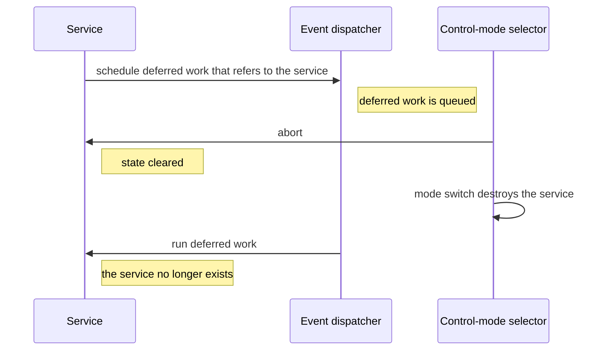
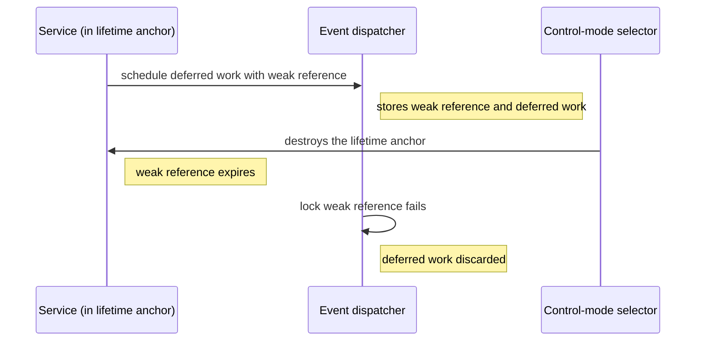
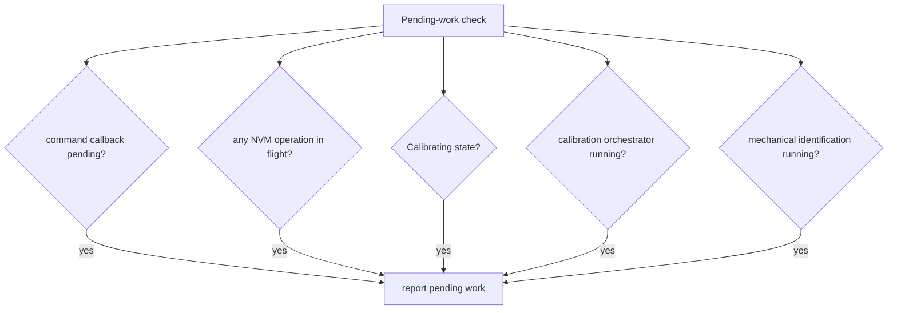
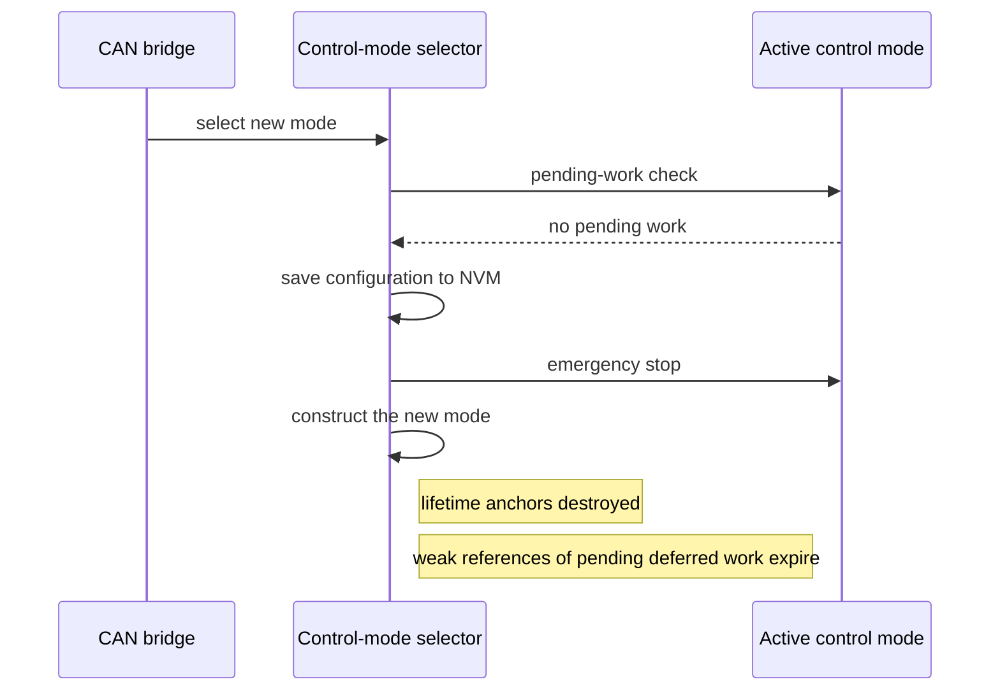
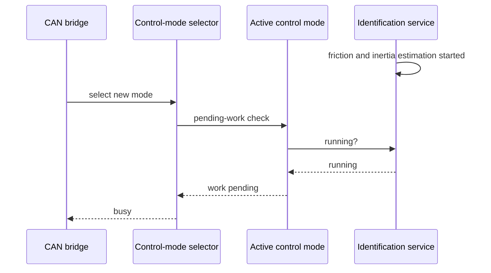
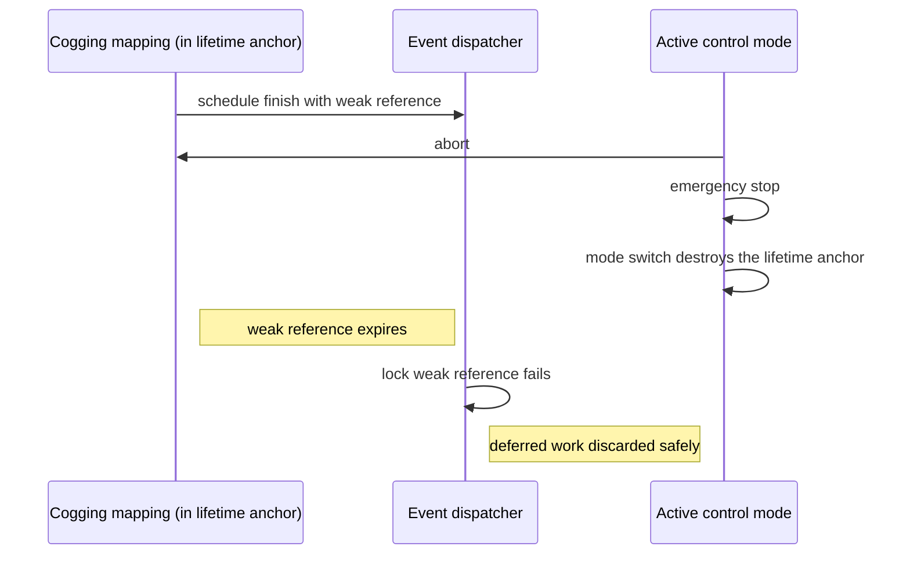

| Field     | Value                          |
|-----------|--------------------------------|
| Title     | Async Callback Lifetime Safety |
| Type      | design                         |
| Status    | accepted                       |
| Version   | 1.0.2                          |
| Component | async-safety                   |
| Date      | 2026-11-26                     |

---

## Responsibilities

**Is responsible for:**
- Defining the project-wide pattern for scheduling deferred work on the event dispatcher for objects whose lifetime may end before the deferred work runs
- Specifying when and how the pending-work check must be extended to reflect all active async operations
- Documenting the invariant that the lifetime anchor relies on, and how the firmware maintains it

---

## Background: The Use-After-Free Risk

Services and notifiers in e-foc schedule deferred work on the global event dispatcher. A typical flow:

The deferred work refers to the service directly. If it reads the service after the service is destroyed, the behaviour is undefined. The same risk applies when a mode switch replaces the active control mode while deferred work refers to a part of it.

---

## Solution: Two Layers

The firmware defends against this risk with two complementary mechanisms. They operate at different scopes.

### Layer 1 — Dispatch Safety: Weak-Reference-Bound Deferred Work

Each service that schedules deferred work is built inside a lifetime anchor. The anchor holds the service together with a reference-count block. The service gives out weak references to itself. Each weak reference expires exactly when the anchor is destroyed.

The service schedules deferred work together with a weak reference to itself. When the dispatcher takes the deferred work from the queue, it tries to lock the weak reference. If the service is already destroyed, the lock fails and the dispatcher discards the deferred work. No member is read, and no undefined behaviour occurs.

**Invariant of the lifetime anchor:** The anchor asserts that no weak reference is outstanding when it is destroyed. In production, the event dispatcher processes deferred work in FIFO order. Deferred work scheduled before the mode-switch NVM callback runs before the mode switch takes effect. It releases its weak reference in time. In tests, each fixture must drain the dispatcher at teardown before it destroys an anchored member.

### Layer 2 — Business-Logic Guard: The Pending-Work Check

The weak-reference mechanism gives memory safety for any timing. The second layer gives correct application behaviour. No mode switch must proceed while an identification service drives the hardware.

The pending-work check combines the running state of all asynchronous services:

The control-mode selector does the pending-work check before it starts a mode switch. If work is pending, the selection returns *busy* and the caller retries. If no work is pending, the mode switch proceeds.

The lifecycle transition table uses the same check as a guard. It guards Enable and each command that starts asynchronous work (Calibrate, ReAlign, ReserveExternalCalibration, ClearCalibration, SetFluxLinkage). Thus a request never overlaps outstanding work of an earlier request (see the transition table section of [state-machine.md](state-machine.md)).

Each identification service reports whether it is running. This report tells whether the service actively runs an identification sweep, not only whether deferred work is queued. The pending-work check at mode-switch time and the weak-reference discard at dispatch time together cover all failure scenarios.

---

## Component Details

### Lifetime Anchor

The lifetime anchor is a non-copyable value that contains, in this order:
- The reference-count block
- The service itself
- A strong reference that keeps the reference-count block alive for the lifetime of the anchor

The order of destruction is load-bearing. First the strong reference goes, which drops the strong count. Then the service goes, which releases its own weak reference to itself and leaves the block unreferenced. Last the block goes, and it asserts that nothing references it. A reversed order triggers the assertion.

The service must support weak references to itself. The anchor passes its construction arguments to the service.

### Pending-Work Check Contract

Each control-mode state machine that adds asynchronous operations must also extend the pending-work check to cover those operations.

The common part of all control-mode state machines covers:
- The pending command callback
- Every NVM operation from the call until its callback, the boot-time check and load included
- The Calibrating state
- The calibration orchestrator, from the moment a run starts until it succeeds, fails or is
  aborted, and for as long as the electrical identification reports itself running. The run
  covers the alignment step as well, which the electrical identification alone does not see

The outer-loop state machines (speed and position) also cover:
- The mechanical identification service, while it reports itself running

A new service that exposes identification or asynchronous operations outside the Calibrating state must add its running report to this check.

### Running Report

Each identification service interface reports whether an estimation is in progress. The service tracks whether its internal estimation state is populated. An abort resets the state, and the service reports itself not running immediately.

---

## Sequence Diagrams

### Normal Mode Switch (No Pending Work)

### Mode Switch Blocked (Identification Running)

### Emergency Stop During Pending Dispatch

---

## Interfaces

### Provided

| Interface       | Purpose                                                                   | Contract                                                                                           |
|-----------------|---------------------------------------------------------------------------|----------------------------------------------------------------------------------------------------|
| Lifetime anchor | Holds a service so that its weak references expire when the anchor goes   | The service supports weak references to itself; all weak references go before the anchor           |
| Running report  | Each identification service reports whether an estimation sweep is active | Running from the start request until the estimation completes, the done callback runs, or an abort |

### Required

| Interface                 | Purpose                                                                  | Contract                                                                                            |
|---------------------------|--------------------------------------------------------------------------|-----------------------------------------------------------------------------------------------------|
| Weak-reference dispatcher | Defers work and discards it if its weak reference expired before it runs | The globally active dispatcher; work is scheduled with a weak reference, never without one          |
| Weak references to self   | Lets the service give out weak references to itself                      | The service is built inside a lifetime anchor; a bare service gives null references                 |
| Pending-work check        | The control-mode selector checks it before a mode switch                 | Reports pending work while an identification service runs or an asynchronous command is outstanding |

The weak-reference dispatcher also accepts deferred work without a weak reference. That form does not check the lifetime, so this pattern does not use it. A bare service, built outside an anchor, gives null weak references, so the dispatcher always discards its deferred work. The control mode that owns an identification service adds the running report of that service to its pending-work check.

---

## Constraints & Limitations

| Constraint                       | Description                                                                               |
|----------------------------------|-------------------------------------------------------------------------------------------|
| Lifetime-anchor invariant        | All weak references go before the anchor. Test fixtures drain the dispatcher at teardown. |
| FIFO ordering required           | The production safety argument depends on FIFO processing of deferred work.               |
| Service supports weak references | Without this support, the anchor gives no benefit.                                        |
| Static objects exempt            | Objects with application-static lifetime do not need this pattern.                        |
| Callbacks an interrupt invokes   | Such a callback is a hot-swappable callback, never a plain callback.                      |

A test fixture that holds an anchored member must drain the dispatcher at teardown. A scheduler change that breaks FIFO ordering must be audited against this pattern.

If the service does not support weak references to itself, all its weak references are null. The dispatcher then discards all its deferred work, whatever the lifetime of the object.

Objects with application-static lifetime, such as the top-level application composite, are never destroyed while deferred work is pending. Thus they do not need this pattern.

The event loop replaces a callback that the sampling interrupt calls while that interrupt keeps firing. Thus such a callback must be hot-swappable. Setting and clearing it must happen from a context that the invoker preempts on a single core.

The code-level recipe for this pattern is in the repository AGENTS.md, section *Async callback lifetime*.
