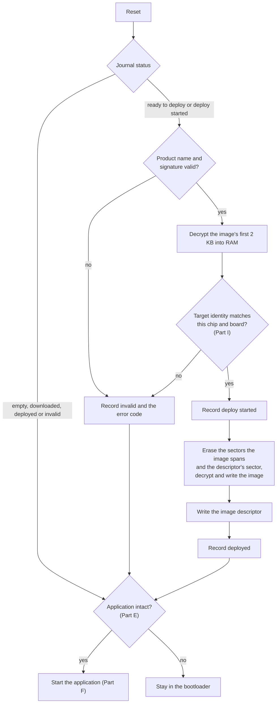
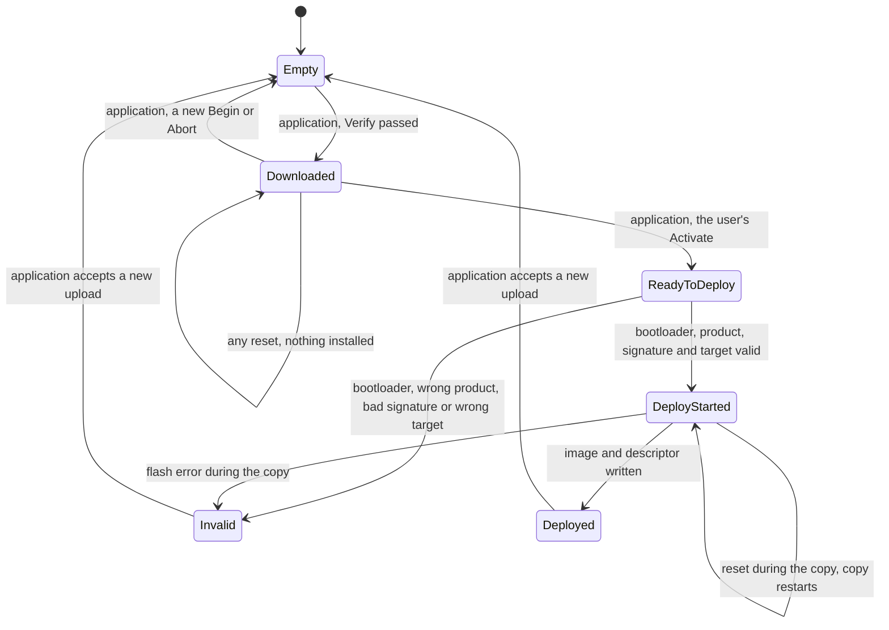
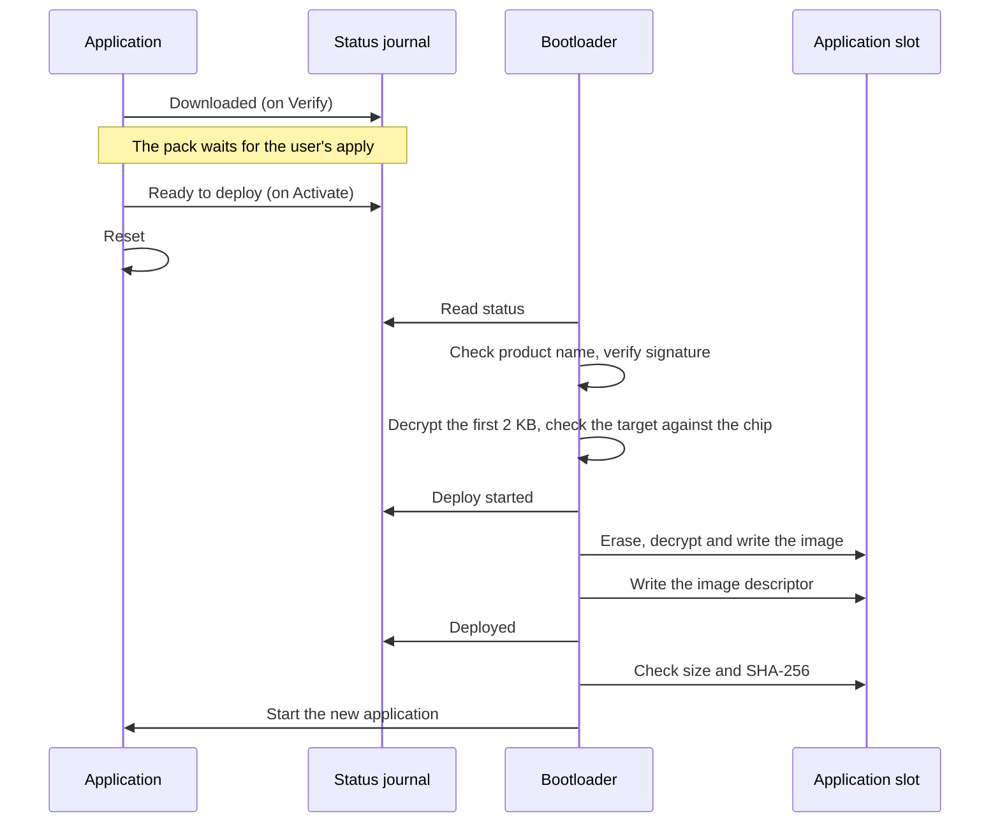

| Field     | Value      |
|-----------|------------|
| Title     | Bootloader |
| Type      | design     |
| Status    | draft      |
| Version   | 0.6.3      |
| Component | bootloader |
| Date      | 2026-11-05 |

> **IMPORTANT — Implementation-blind document**: This document describes *behavior, structure, and
> responsibilities* WITHOUT referencing code. **No code blocks using programming languages (C++, C,
> Python, CMake, shell, etc.) are allowed.** Use Mermaid diagrams to express behavior instead.
> Prose descriptions of algorithms are encouraged; source-level details are not.
>
> **Diagrams**: All visuals must be Mermaid (` ```mermaid `), TikZ via ` ```{=latex} ` raw blocks (source in
> `documentation/tikz/`), or ASCII art. External image references (``) are **not allowed**.

---

## Responsibilities

The bootloader is a single, small program at the start of flash. It runs at every reset, before the motor
controller application, and does two things only: it checks that the application is intact, and built for
this microcontroller and board, before starting it; and it installs a new application that the running one
staged and that the user applied. Receiving the firmware is the application's job
(`service-firmware-upgrade.md`); choosing it, and deciding when to download and when to apply it, is the user's,
through the CAN Commander (`tool-can-commander.md` Part M).

**Is responsible for:**
- Checking, at every reset, the application in the application slot against its image descriptor (size and
  SHA-256) and starting it only when they match.
- Installing an upgrade pack that the application staged and marked ready on the user's apply: checking that
  the pack was built for this board and microcontroller, verifying its ECDSA-P256 signature over SHA-256 with
  the public key built into the bootloader, decrypting the image with AES-128-CTR, writing it into the
  application slot and writing its image descriptor.
- Refusing an image built for another microcontroller or board before anything is erased, by comparing the
  target identity inside the image with the chip's own device identity (Part I).
- Recording each step of an installation in the status journal, so that a reset or a power loss during an
  installation resumes it at the next reset, and a pack that failed a check is never tried again.
- Starting the application: its vector table, its stack pointer and its reset handler.

**Is NOT responsible for:**
- Receiving firmware over CAN or any other channel. The bootloader has no CAN stack, no event loop and no
  interrupts.
- Updating itself. There is one stage only; the bootloader changes only with a debugger.
- Keeping the previous application, or refusing an older version. Once an installation has started, the old
  image is gone, and any validly signed pack for the board is accepted, newer or older.
- Recovering a board whose application slot is broken and which holds no valid staged pack. It stays in the
  bootloader, and a debugger restores it.
- The non-volatile calibration and configuration records. They live outside the flash slots
  (`service-nvm.md`), and an update leaves them untouched.

---

## Component Details

### Part A — flash layout

Flash is split into a bootloader region, an application slot and a staging slot. The application runs from
its slot; the staging slot holds the pack the application received, in internal flash where two copies of the
image fit and in external SPI NOR flash where they do not. The application and staging slots are 320 KB on every board, and no
larger: the application erases all of it before a download starts (`service-firmware-upgrade.md` Part B), so
its size bounds that erase. The status journal (Part D) is the erase unit after the staging slot; the last 64
bytes of the application slot are the image descriptor (Part E).

| Board         | Flash, erase unit       | Bootloader          | Application slot              | Staging slot                                 | Journal                 | Image today  |
|---------------|-------------------------|---------------------|-------------------------------|----------------------------------------------|-------------------------|--------------|
| EK-TM4C1294XL | 1 MB, 16 KB sectors     | `0x00000000`, 32 KB | `0x00008000`, 320 KB          | internal, `0x00080000`, 320 KB, upper half   | `0x000D0000`, 16 KB     | 246 KB       |
| NUCLEO-H563ZI | 2 MB in two banks, 8 KB | `0x08000000`, 32 KB | `0x08008000`, 320 KB (bank 1) | internal, `0x08100000`, 320 KB (bank 2)      | `0x08150000`, 8 KB      | not measured |
| NUCLEO-G474RE | 512 KB, 2 KB pages      | `0x08000000`, 32 KB | `0x08008000`, 320 KB          | external SPI NOR, from its address 0, 320 KB | the NOR sector after it | 259 KB       |
| Emulated      | 4 MB of code RAM        | `0x00000000`, 32 KB | `0x00008000`, 320 KB          | semihosting file `staging.bin`, 320 KB       | file `journal.bin`      | 242 KB       |

The EK-TM4C1294XL and the emulated board are built with this layout today. The NUCLEO-H563ZI and NUCLEO-G474RE
rows are the layout those boards take once they get the bootloader (Open Question 6); until then each is linked
standalone from the start of its flash, programmed with a debugger, carries no application header and has no
staging slot (`service-firmware-upgrade.md` Part I).

On the EK-TM4C1294XL:

```text
0x00000000 +--------------------------+
           | bootloader        32 KB  |
0x00008000 +--------------------------+
           | application slot 320 KB  |
           |   ...                    |
0x00057FC0 |   image descriptor 64 B  |
0x00058000 +--------------------------+
           | unused           160 KB  |
0x00080000 +==========================+  half boundary: banks 0 and 1 below, banks 2 and 3 above
           | staging slot     320 KB  |  pack received over CAN, erased while the application runs
0x000D0000 +--------------------------+
           | status journal    16 KB  |
0x000D4000 +--------------------------+
           | unused           176 KB  |
0x00100000 +--------------------------+
```

- The flash is two independent 512 KB halves, banks 0 and 1 below `0x00080000` and banks 2 and 3 above it.
  A sector erase stalls every read of its own half until it completes, instruction fetches and the
  watchdog's early-warning handler included, while the other half reads normally (datasheet 8.2.3.3, flash
  mirror mode: software runs from the lower banks while updating the upper). The application executes from
  the lower half and erases the staging slot and the journal while it runs, so both lie entirely in the upper
  half and no erase it performs can block the core or the watchdog; the linker script asserts it. A 16 KB
  erase takes about 17 ms on the bench and up to 40 ms with wear, against the 25 ms the watchdog hardware
  allows an unserviced early warning (`watchdog.md`), so a staging slot that crossed the boundary reset the
  board whenever an erase ran long. The bootloader's own erases of the application slot run with no watchdog.

- The application is linked at the start of its slot. It moves the vector table to the slot before it enables
  any interrupt, because neither the TI startup nor the ST system initialisation does: the TI startup leaves the
  table at address 0 and the H5 system initialisation sets it to the start of flash.
- On the NUCLEO-H563ZI the staging slot will be the second bank for the same reason, so the application
  programs it while running from the first bank without stalling. Bank swapping stays off: the bootloader
  copies the image instead.
- On the NUCLEO-G474RE the application slot will span both banks, and the staging slot an SPI NOR device on the
  motor board (Open Question 1).
- A pack may be as large as the staging slot, 327 680 bytes, which is below the 393 216 bytes a `can-lite`
  firmware-upgrade transfer can address. The image it carries may fill the application slot less its
  descriptor, and the pack's header, signature and image framing less than that: an update installs only an
  image whose pack fits the staging slot.
- The NUCLEO-G474RE image, 259 KB today, is larger than any pack the staging slot holds; that board gets updates
  only once its image fits (Open Question 5).
- `hardware_test` is linked standalone from the start of flash on every board, the EK-TM4C1294XL included:
  programming its hex image replaces the bootloader, and the board gets the bootloader back only when the
  bootloader and `sync_foc_sensored` images are programmed again (Part J). It carries no application header and
  no image descriptor, so it never travels as a pack and the bootloader would never start it.

### Part B — upgrade pack

A firmware update travels as an upgrade pack in the format of the embedded-infrastructure library's upgrade
components, with exactly one image:

| Part            | Content                                                                                                  | Signed | Encrypted |
|-----------------|----------------------------------------------------------------------------------------------------------|--------|-----------|
| Header prologue | status byte, magic `UPH`, error code, signed length, signature method 2 (ECDSA-256), signature length 64 | no     | no        |
| Signature       | ECDSA-P256 signature over the SHA-256 of the signed contents                                             | —      | no        |
| Header epilogue | header version 1, product name, product version, component name and version                              | yes    | no        |
| Image header    | target `app`, encryption method 1 (AES-128-CTR) with the image's 16-byte initial counter                 | yes    | no        |
| Image epilogue  | destination address (the start of the application slot) and image size                                   | yes    | yes       |
| Image           | the application binary, as the debugger would program it into the slot                                   | yes    | yes       |

- The **product name** field holds the **board identification**: `e-foc`, the board and the microcontroller
  part, as in `e-foc EK-TM4C1294XL TM4C1294NCPDT`,
  `e-foc NUCLEO-H563ZI STM32H563ZI`, `e-foc NUCLEO-G474RE STM32G474RE` and `e-foc emulated mps2-an386`. Every
  board has one, with a bootloader or not. It is defined once, in the board's definition in the build, beside
  the board kind, the board's name and whether it carries a bootloader; the build generates one header from
  those definitions, which the application, the
  bootloader, the software-in-the-loop harness and the CAN Commander read, and the packer takes it from the same
  definitions, never from a typed argument. The library names the field *product name*; the format does not
  change. The bootloader compares it with its own, so a pack for another board or microcontroller is refused
  before anything is written. The application checks the same identification when it verifies the pack, so the
  refusal comes before the user can apply it (`service-firmware-upgrade.md` Part D).
- The **product version** is the build's project version, the release tag without its leading `v`: the version
  the application reports as running once the pack is installed. The component is `sync_foc_sensored`.
- The prologue's status byte and error code are outside the signature and are not used: progress is kept in
  the status journal (Part D).
- An image whose destination is not the start of the application slot, or whose size exceeds the slot less
  its descriptor, is refused as invalid.

### Part C — boot flow



- The signature and the target are checked before anything is erased. A pack that fails either, or names
  another product, is marked invalid; the application slot is untouched, and the old application starts.
- An installation interrupted by a reset or a power loss finds the journal at *deploy started* at the next
  reset. The signature is checked again and the copy starts over; the copy only reads the staging slot, so it
  can be repeated as often as it takes.
- A flash error during the copy is recorded as invalid. The application slot is then incomplete, its check
  fails and the board stays in the bootloader.
- Staying in the bootloader means looping without starting anything, with the drive's outputs left at their
  reset state. The board needs a debugger.

### Part D — status journal

The embedded-infrastructure pack reader keeps an installation's progress in the pack's own status byte, which
it clears bit by bit as the installation advances. The ST internal flash cannot do that: it programs 64-bit
(G4) or 128-bit (H5) units with ECC, and a programmed unit cannot be programmed again until its page is
erased. Progress therefore goes to a journal instead, the erase unit after the staging slot, on every board:

- Each entry is one 16-byte unit: a marker, the status and the error code. A new status is written into the
  next erased unit; the current status is the last entry written, and an erased journal reads *empty*.
- The application erases the journal when it accepts a new download, writes *downloaded* when the pack passed
  its checks, and writes *ready to deploy* when the user applies it. The bootloader ignores *downloaded*, so a
  staged pack waits through any number of restarts; it writes *deploy started*, *deployed*, or *invalid* with
  the error code.
- The pack reader and the image installer of the library read and write the status through replaceable
  operations; the bootloader supplies ones that use the journal.
- An entry that a reset cut short is not valid and is skipped; the next status goes into the following erased
  unit, so no unit is ever programmed twice.
- A status equal to the current one is not written again, so an installation interrupted any number of times
  adds no entries. With the application erasing the journal at every download, one download and installation
  write at most five entries and the journal never fills. A full journal would be erased and restarted with the
  status being recorded.

### Part E — image descriptor and the check at every reset

The last 64 bytes of the application slot hold the image descriptor: a magic value, the image size and the
SHA-256 of that many bytes from the start of the slot. Before starting the application the bootloader checks
that:

1. the descriptor's magic is valid and its size leaves room for the descriptor in the slot,
2. the SHA-256 of the image matches the descriptor,
3. the first vector, the initial stack pointer, lies in RAM, and the second, the reset handler, lies in the
   application slot;
4. the application header's target identity matches this chip and this board (Part I).

The bootloader writes the descriptor after an installation, from the digest it computed while writing the
image. The build writes it into the application's own image, so a board programmed for the first time with a
debugger, the bootloader and the application each from its own hex file, starts in the same way.

### Part F — starting the application

The bootloader runs on the main stack alone, with 16 KB of RAM reserved for it at the top of RAM by its link:
the decrypted first 2 KB of an image, the signature verification and the digest contexts live there, and the
link fails if the bootloader's static data ever reaches into that reservation. The application reserves 1 KB
the same way. The bootloader uses no interrupt, no timer and no peripheral but the flash controller and the clock
tree. On the EK-TM4C1294XL it runs at the application's 120 MHz through the board's own clock bring-up, the
`Clocks::Initialize` the application calls too (`targets/platform_implementations/ti/EK-TM4C1294XL/Clocks.hpp`), so
its checks and an installation take the time they would in the application; the emulated board has no clock to set.
The PLL stays running at the hand-over: the application's bring-up re-runs the same sequence, which first returns to
the internal oscillator, so it starts from any clock state. Apart from these the processor is in its reset state; the
flash controller is locked again. It points the vector table at the
application slot, loads the stack pointer from the slot's first vector and branches to the reset handler in
the second, through the embedded-infrastructure library's Cortex-M jump. The watchdog is not running at that point: the TI watchdog and the ST window watchdog both start
only when software starts them, and the application does (`watchdog.md`).

### Part G — keys

- A key set is one file holding the AES-128 image key, the ECDSA-P256 public key and its private key; the
  firmware image tool (Part J) generates one from the host's random source.
- Two key sets exist. The development set is public: e-foc is open source, so it lives in the repository
  (`targets/bootloader/keys/development.keys`), and continuous integration, pull requests from forks, the
  release workflow's dry runs and local builds all use it. Anyone can sign a pack that a board with the
  development key accepts, so that key is for development boards only. The release set is the only secret, a
  repository secret that only the release workflow reads. A pack signed with the development key never
  installs on a board whose bootloader carries the release key.
- The bootloader links with the library's key slot, 80 bytes holding the public key and then the AES key,
  left erased. An erased slot holds no valid public key, and the library's verifier refuses a key that is not
  on the curve, so every pack fails its signature check and only the installed application ever starts: a
  build without keys is safe, but cannot update a board.
- Keys are not a build input: the build always produces a bootloader with an erased slot, and the image tool's
  key injection writes the public key and the AES key from a set into the finished bootloader, its ELF file
  and its hex file, afterwards. One build can therefore take the development
  set or the release set, and the two differ only in those 80 bytes. Continuous integration injects the
  development set into every build.
- A release fails when the release set cannot be read, rather than publish a bootloader that could never
  update a board; a dry run injects the development set.
- The public key only verifies, so reading it from a board gains nothing. The AES key hides nothing in an
  open-source product: anyone can build the plaintext image from the sources, and the release ships the
  bootloader with its key slot. The packs stay encrypted because the library's pack format carries the
  encryption. The signature is what keeps anyone without the release private key from installing an image on
  a release board; production boards are also locked against debug access (TM4C debug lock, ST read-out
  protection level 1).

### Part H — per board

| Board         | Application slot flash      | Staging flash                        | Bootloader                                                      |
|---------------|-----------------------------|--------------------------------------|-----------------------------------------------------------------|
| EK-TM4C1294XL | TI internal flash, blocking | TI internal flash, blocking          | yes                                                             |
| NUCLEO-H563ZI | ST internal flash, bank 1   | ST internal flash, bank 2            | planned (Open Question 6)                                       |
| NUCLEO-G474RE | ST internal flash           | SPI NOR on the motor board, blocking | planned, once the board has the device (Open Questions 1 and 6) |
| Emulated      | code RAM, refilled at reset | file in the scenario directory       | yes                                                             |

The emulated target boots through the bootloader like a board with one: every software-in-the-loop scenario
starts with the bootloader's check of the application slot, and the bootloader's own scenarios stage packs
and read the journal (`software-in-the-loop.md` Part P). Its code memory is RAM that the emulator fills again
at every reset, so an image the bootloader installs lasts until the next reset; staging and journal are files
in the scenario directory and last across resets and restarts. The emulator has no device-identity register
(Part I).

### Part I — target identity: never the wrong microcontroller

An image built for one microcontroller must never be written into another, an STM32 image into a Tiva board for
example. The bootloader cannot trust the pack's labels alone, because a label is written by the packer and can
be wrong; the image says itself what it was built for, and the chip says what it is.

**Application header.** Every application image built with the layout of Part A carries a 64-byte application
header at offset 1 KB from the start of its slot, past the vector table of every supported microcontroller. It
holds a magic value, the board kind (`service-can.md`, contract 2.6), the firmware version (the project version,
from the version header embedded-infra-lib generates at build time) and the target identity: the device
identity the image's microcontroller reports, as a family tag (TI Tiva or ST STM32) and the value its
device-identity register gives. The header is compiled from the board's definition, the one the rest of the image
is compiled from, so it cannot disagree with the code beside it. On the TI part the class field tells TM4C129 from
other Tiva classes but not one TM4C129 part from another; the board kind beside it does.

| Microcontroller | Device identity the header carries                    | Where the chip reports it                   |
|-----------------|-------------------------------------------------------|---------------------------------------------|
| TM4C1294NCPDT   | device class `0x0A` (TM4C129), with the TI family tag | system control `DID0`, class field          |
| STM32H563ZI     | device identifier `0x484`, with the ST family tag     | `DBGMCU` identity code, `DEV_ID`            |
| STM32G474RE     | device identifier `0x469`, with the ST family tag     | `DBGMCU` identity code, `DEV_ID`            |
| Emulated        | the constant `0x00000386`, with the emulated tag      | none: the bootloader uses the same constant |

The TI and emulated identities are in those boards' definitions in the build today. The ST rows are the values
the NUCLEO-H563ZI and NUCLEO-G474RE definitions take when those boards get the layout (Open Question 6); until
then their definitions carry no identity and their images no application header.

**Checks, in order.** A wrong pack is stopped at the first layer that can see the mistake; each later layer
holds even if an earlier one was skipped or its label was wrong:

| Layer                        | When                 | Checks                                                                                                                                  | A pack for another chip                    |
|------------------------------|----------------------|-----------------------------------------------------------------------------------------------------------------------------------------|--------------------------------------------|
| Release workflow             | when packs are built | the packer reads the application header from the built image; the product name and header must name the board the pack is published for | the release is not published               |
| CAN Commander                | before the download  | the pack's product name names the node's board kind and its microcontroller                                                             | not offered; the reason is shown           |
| Firmware, Verify             | end of the download  | the product name equals the running firmware's own (`service-firmware-upgrade.md` Part D)                                               | `NotReady`; nothing staged                 |
| Bootloader, before any erase | at the apply         | product name, signature, then the decrypted vector table and application header against the chip                                        | marked invalid; the old application starts |
| Bootloader, every reset      | before any start     | the application header against the chip and the board                                                                                   | not started                                |

Before erasing, the bootloader decrypts only the image's first 2 KB into RAM. AES-128-CTR decrypts any part of
the stream on its own, so this costs nothing in the copy that follows. It then checks that:

1. the initial stack pointer lies in this chip's RAM and the reset handler in this board's application slot,
   which a Tiva image (flash at `0x00000000`) fails on an STM32 (flash at `0x08000000`) and the other way round;
2. the application header's magic is valid, its board kind is this bootloader's board, and its target identity
   equals what this chip's device-identity register reports, read at that moment.

A failure is recorded as *invalid* with the bootloader's own *wrong target* error code, outside the range the
library reserves for its loaders, and the old application starts untouched.

### Part J — firmware image tool

The embedded-infrastructure library's `application.bootloader_image`, a host program built with its
bootloader package, so the firmware build needs no interpreter and e-foc keeps no tool of its own. The
library's tests cover it. The host build has it as a target, and an embedded build builds it first with the
host compiler, in the build directory's `_native_bootloader_image/bin`, where the workflows run it.

| Command           | Takes                                                | Gives                                                                    |
|-------------------|------------------------------------------------------|--------------------------------------------------------------------------|
| `generate-keys`   | nothing                                              | a new key set, from the host's random source                             |
| `bootloader-keys` | a key set                                            | the bootloader's 80-byte key slot (Part G)                               |
| `inject-keys`     | a key set, the bootloader's ELF and its hex files    | the key slot written into each, at the key slot section's place (Part G) |
| `descriptor`      | the application image, gaps filled with erased bytes | its 64-byte image descriptor (Part E)                                    |
| `pack`            | a key set, the application image and its product     | the upgrade pack of Part B, signed and encrypted with that set           |

`inject-keys` checks every file first and changes none unless all of them take the slot.

After the application links, the build copies it out as the bytes a debugger programs, every section but the
descriptor, gaps erased; the tool computes the descriptor of those bytes with the library's own descriptor
code, and the object copy writes it into the application's descriptor section. The bootloader's check at every
reset therefore passes on an image programmed with a debugger, exactly as on one the bootloader installed.

A key set file is 112 bytes: the AES key (16), the public key (64, the curve point's x and then y, most
significant byte first) and the private key (32). The tool refuses a file of another size, or one whose
public key is not the one its private key gives, so a damaged secret stops the build instead of producing a
bootloader that refuses every pack.

The image a pack carries is the application image the descriptor step copies out, without the descriptor: the
bootloader writes the descriptor itself after an installation (Part E). Its destination is the start of the
application slot.

Like the keys, the pack is made after the build. Beside each application image the build writes a small CMake
script that holds what the pack takes from the build: the image, the product name of Part B, the project
version, the component, and the application and staging slots of the board's flash layout. The release workflow
runs it with a key set and the asset's file name, and nothing else; continuous integration runs it with the
development set on every build of a board with a bootloader. Before it writes the pack, the script checks that
the project version is a release version of three decimal numbers, that the image fits the slot less its
descriptor, and that the application header at 1 KB carries this board's target identity (Part I) and the
project version. After, it checks that the pack fits the staging slot and names the board's product. A failed
check writes no pack and fails the workflow.

---

## Interfaces

### Provided

| Interface          | Purpose                                                     | Contract                                                                                                                   |
|--------------------|-------------------------------------------------------------|----------------------------------------------------------------------------------------------------------------------------|
| Reset entry        | First code to run after any reset                           | Starts the application only when it is intact and built for this chip and board (Parts E and I); never returns to a caller |
| Flash layout       | Where the application, the staged pack and the journal live | Part A; the application, the release build and the bootloader use the same addresses                                       |
| Status journal     | Progress of an installation, shared with the application    | Part D; the application writes *empty* (by erasing), *downloaded* and *ready to deploy*                                    |
| Application header | What an image was built for                                 | Part I; 64 bytes at offset 1 KB in the slot, compiled with the image                                                       |
| Image descriptor   | Integrity of the application slot                           | Part E; written by the bootloader after an installation and by the release build for debugger programming                  |

### Required

| Interface                | Purpose                                             | Contract                                                                                                                                                                                                                |
|--------------------------|-----------------------------------------------------|-------------------------------------------------------------------------------------------------------------------------------------------------------------------------------------------------------------------------|
| Blocking flash, internal | Read, erase and write the application slot          | TI and ST internal-flash drivers; erase per sector, write any byte range                                                                                                                                                |
| Blocking flash, staging  | Read the pack, write the journal                    | Internal flash, or the SPI NOR driver on the NUCLEO-G474RE                                                                                                                                                              |
| Upgrade pack components  | Pack reader, image installer                        | Embedded-infrastructure library; status kept through replaceable operations (Part D)                                                                                                                                    |
| Bootloader components    | Journal, image checks, checked installer, boot flow | Embedded-infrastructure library's bootloader package (Parts C, D, E and I); this product supplies the flash, keys, layout, the target its application header names and the check of it (Part I), and the start (Part F) |
| ECDSA-P256 verification  | Pack signature                                      | micro-ecc, over a SHA-256 computed in software without mbedTLS                                                                                                                                                          |
| AES-128-CTR decryption   | Image confidentiality                               | tiny-aes, through the library's AES decryptor                                                                                                                                                                           |
| SHA-256                  | Signature digest and the check at every reset       | The library's software SHA-256, fed in pieces read from flash                                                                                                                                                           |
| Device identity register | What the chip is                                    | TI system control `DID0` and `DID1`; ST `DBGMCU` identity code (Part I)                                                                                                                                                 |
| Cortex-M jump            | Start the application (Part F)                      | Embedded-infrastructure library; points the vector table at the slot, then loads the stack pointer and branches                                                                                                         |
| Image tool               | Write the key slot into the bootloader (Part G)     | The embedded-infrastructure library's `application.bootloader_image inject-keys` (Part J)                                                                                                                               |

---

## State Machine

The status journal, as both programs advance it:



---

## Sequence Diagrams

### Installing a staged pack



---

## Constraints & Limitations

| Constraint           | Value / Description                                                                                                                                                                                                                                                                                                                                                                                                             |
|----------------------|---------------------------------------------------------------------------------------------------------------------------------------------------------------------------------------------------------------------------------------------------------------------------------------------------------------------------------------------------------------------------------------------------------------------------------|
| Bootloader size      | a 32 KB region on every board; 17.1 KB on the EK-TM4C1294XL. 16 KB of RAM reserved for its stack, where the image's first 2 KB and the signature check live                                                                                                                                                                                                                                                                     |
| Largest pack         | the staging slot, 320 KB on every board; below the 393 216 bytes of the `can-lite` transfer limit                                                                                                                                                                                                                                                                                                                               |
| Largest image        | the application slot less its 64-byte descriptor                                                                                                                                                                                                                                                                                                                                                                                |
| Check at every reset | one SHA-256 over the image at the application's clock (Part F); on the EK-TM4C1294XL, 0.74 s from reset to the application's banner, against about 5 s at the 16 MHz reset clock the bootloader ran at before                                                                                                                                                                                                                   |
| Installation         | erase of the slot sectors the image spans and of the descriptor's sector, then decrypt and write; repeated from the start after any interruption. On the EK-TM4C1294XL, from Activate to the application's heartbeat for a 265 KB pack, the hardware apply scenario's `[METRIC]` line: 9.5 s, against 29.8 s at the 16 MHz reset clock the bootloader ran at before; programming the slot at the flash's own rate is most of it |
| Rollback             | none; any validly signed pack for the board installs, and the previous image is not kept                                                                                                                                                                                                                                                                                                                                        |
| Target               | an image runs only on the microcontroller and board its application header names; checked before any erase and at every reset                                                                                                                                                                                                                                                                                                   |
| Vector table         | ends before offset 1 KB of the image on every supported microcontroller, where the application header starts                                                                                                                                                                                                                                                                                                                    |
| Recovery             | a broken application slot with no valid pack needs a debugger                                                                                                                                                                                                                                                                                                                                                                   |
| Keys                 | one ECDSA-P256 key pair and one AES-128 key for every board, written into the bootloader after the link; a public development set and a secret release set                                                                                                                                                                                                                                                                      |
| Boards               | EK-TM4C1294XL and the emulated board; NUCLEO-H563ZI and NUCLEO-G474RE planned (Open Questions 6 and 1)                                                                                                                                                                                                                                                                                                                          |

---

## Open Questions

| # | Question                                                                                       | Options                                                                                     | Status                                                                                                                                                                                    |
|---|------------------------------------------------------------------------------------------------|---------------------------------------------------------------------------------------------|-------------------------------------------------------------------------------------------------------------------------------------------------------------------------------------------|
| 1 | Which SPI NOR device holds the NUCLEO-G474RE's staging slot, and on which SPI and chip-select? | A JEDEC serial NOR of 1 MB or more on the motor board / a flash board on the NUCLEO headers | open                                                                                                                                                                                      |
| 2 | Should the bootloader refuse a pack older than the installed application?                      | Monotonic version counter in the journal / accept any signed pack (current)                 | open                                                                                                                                                                                      |
| 3 | Should the software-in-the-loop runner also boot a staged pack under emulation?                | Bootloader and application as one emulated image / host tests of the install path only      | closed: every emulated scenario boots through the bootloader (`software-in-the-loop.md` Part P)                                                                                           |
| 4 | Should the bootloader raise the clock to shorten the check at every reset?                     | Keep the reset clock / start the PLL in the bootloader (current)                            | closed: at the 16 MHz reset clock the EK-TM4C1294XL took about 5 s for the check and 29.8 s from Activate to the heartbeat; at the application's clock (Part F) it takes 0.74 s and 9.5 s |
| 5 | How does the NUCLEO-G474RE image fit the slot a pack may hold?                                 | Trim the image / leave that board without updates (current)                                 | closed: the 320 KB slots hold its 259 KB image                                                                                                                                            |
| 6 | When do the NUCLEO-H563ZI and NUCLEO-G474RE get the bootloader and the application layout?     | An ST bootloader platform over the ST flash drivers with Part A's layout / stay standalone  | open: both boards are linked standalone today                                                                                                                                             |
