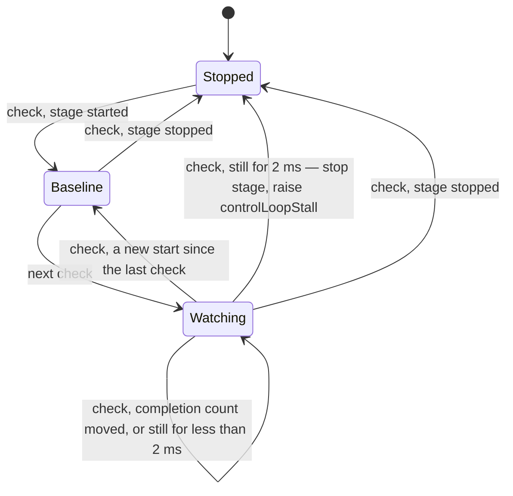
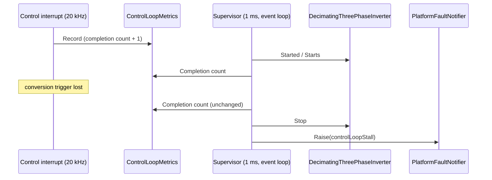

| Field     | Value                           |
|-----------|---------------------------------|
| Title     | Control-Loop Supervision Design |
| Type      | design                          |
| Status    | draft                           |
| Version   | 0.1.0                           |
| Component | supervision                     |
| Date      | 2026-10-30                      |

---

## Responsibilities

**Is responsible for:**
- Proving, from the event loop, that the 20 kHz control interrupt keeps completing while the power stage
  is started: every interrupt the bridge depends on — the closed-loop cascades and every calibration service
  that drives current — passes through it.
- Stopping the power stage and raising `controlLoopStall` through the platform fault notifier within 3 ms of
  the last completed control interrupt (REQ-EH-015), so a lost conversion trigger cannot leave the bridge
  applying its last duty.

**Is NOT responsible for:**
- An interrupt that never returns. It starves the event loop this supervisor runs on, and the MCU watchdog
  already answers that case ([Watchdog Design](watchdog.md), REQ-EH-008, REQ-EH-009).
- A control interrupt that completes late. Overruns and deadline misses are counted by the platform's
  control-loop statistics ([Error Handling Design](error-handling.md)).
- Judging the samples themselves. Plausibility of currents and duties is not checked per sample
  (REQ-PERF-003); sensor and power-stage failures belong to board protection and to the fault supervisor
  ([Fault Supervision Design](fault-supervision.md)).

---

## Component Details

### Part A — The completion count

`ControlLoopMetrics` already measures every control interrupt the platform completes. Next to its
saturating statistics it keeps a *completion count*: a 32-bit counter, incremented once per completed
interrupt, that wraps instead of saturating and that clearing the statistics does not reset. A saturating
counter would stop moving after 2³² interrupts — 59.6 hours at 20 kHz — and read as a stall; a reset to zero
reads as movement, which is what it is. The increment is the only work this supervision adds to the
interrupt.

A platform records a completion only where the application callback returned, so an interrupt that found
the previous one still running counts as no completion.

### Part B — Arming on the stage

`DecimatingThreePhaseInverter` is the one inverter every user of the 20 kHz path starts and stops the power
stage through, the cascades and the calibration services alike. It reports whether the stage is started
and how many times it has been started.

Every millisecond the supervisor reads both:

- With the stage stopped, it does nothing.
- On the first check of a start — a start count it has not seen — it notes the completion count and judges
  nothing. That one check is the grace a start needs before its first conversion arrives.
- On every later check it compares the completion count with the one it noted. A count that moved is noted
  again, with the time of the check; a count that has not moved for 2 ms of timer time since then is a
  stall.

The time is measured from the check that last saw the count move, not from the previous check, and it is
2 ms rather than 1 ms because of how coarse the event loop's view of time is. Timer time advances in whole
milliseconds, and the event loop can run a check late within one; the next check then comes on the next
millisecond, which can be a single control period later in real time while its timer time already reads a
whole millisecond on. Two milliseconds of timer time always contain more than one real millisecond, which
at 20 kHz is twenty control periods without a completion. A threshold of one would stop healthy drives on a
busy event loop, as the software-in-the-loop scenarios with heavy plant recording showed.

### Part C — Reaction

On a stall the supervisor stops the power stage through the inverter, the same `Stop` a disable makes, and
raises `controlLoopStall` through the platform fault notifier. The fault state machine enters `Fault`, which
disables the drive, and the CAN bridge broadcasts the code. The raw `CutPowerStage` register write stays with
the paths that run without an event loop: the HardFault handler, `abort()` and the watchdog early warning.

**Timing.** The check that last sees the count move runs within 1 ms of the last completion at *t₀*, and the
stall is called 2 ms of timer time after it, so the stage stops by *t₀* + 3 ms, on an event loop that runs its
checks on time. An event loop that runs late delays the answer but cannot cause a trip: the completion count
only grows while interrupts complete.

**Clearing.** With the stage stopped there is no conversion to watch, so whether the trigger works again
cannot be known before the next start. A drive whose trigger is still lost raises the fault again within
3 ms of that start; the fault-clear retry budget bounds the retries (REQ-SM-018).

---

## Interfaces

### Provided

| Interface | Purpose                                 | Contract                                           |
|-----------|-----------------------------------------|----------------------------------------------------|
| Fault     | Reports `controlLoopStall` to its owner | At most once per start; called from the event loop |

### Required

| Interface        | Purpose                                               | Contract                                                             |
|------------------|-------------------------------------------------------|----------------------------------------------------------------------|
| Stage            | Whether the stage is started, its start count, `Stop` | `DecimatingThreePhaseInverter`; read and stopped from the event loop |
| Completion count | Control interrupts completed so far                   | Written by the control interrupt, read by the event loop; wraps      |
| Repeating timer  | 1 ms check period                                     | Runs on the event loop                                               |

---

## Data Model

| Field           | Type                      | Description                                              |
|-----------------|---------------------------|----------------------------------------------------------|
| `armedStart`    | `std::optional<uint32_t>` | Start count the baseline belongs to; empty while stopped |
| `lastCompleted` | `uint32_t`                | Completion count at the previous check                   |
| `lastMoved`     | `infra::TimePoint`        | Time of the check that last saw the count move           |

---

## State Machine

---

## Sequence Diagrams

---

## Constraints & Limitations

- Up to 3 ms of the last duty reach the motor before the stage stops. On TI the over-current and over-voltage
  comparators are steps of the same conversion sequence, so a lost trigger silences them for that time too.
- The supervisor answers only while the event loop runs; see the watchdog for the case where it does not.

---

## Open Questions

None.
