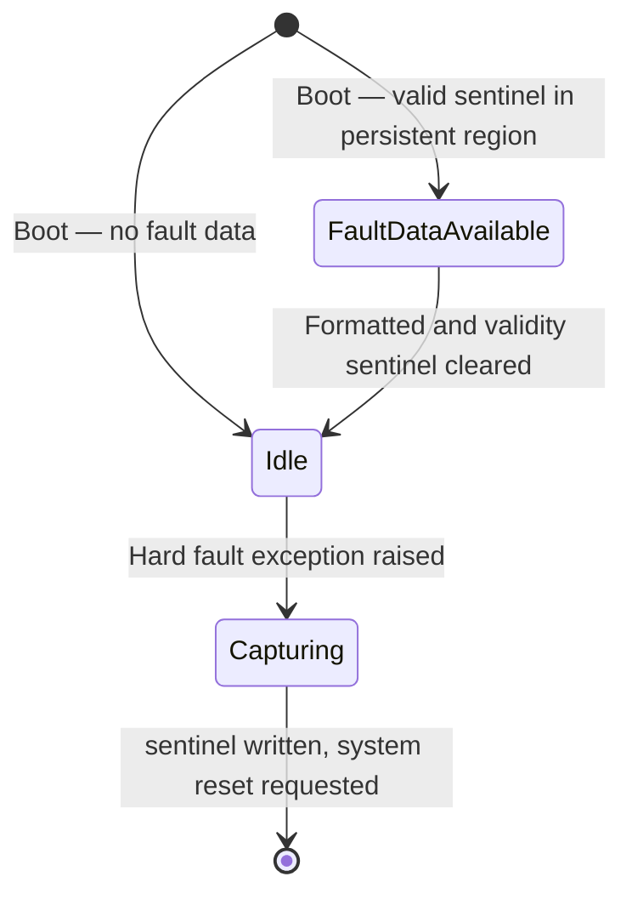
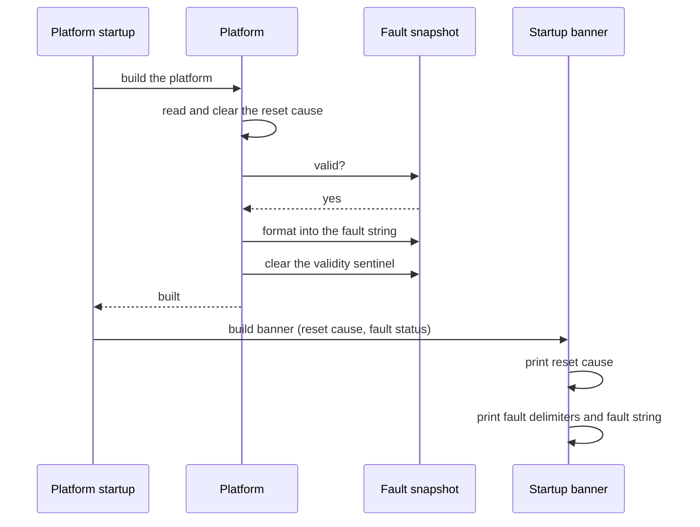
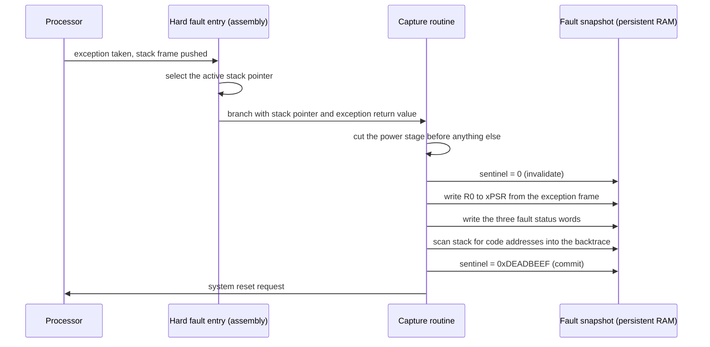

| Field     | Value                 |
|-----------|-----------------------|
| Title     | Error Handling Design |
| Type      | design                |
| Status    | stable                |
| Version   | 1.3.1                 |
| Component | error-handling        |
| Date      | 2026-11-26            |

---

## Responsibilities

**Is responsible for:**
- Capturing the processor state and a stack-address backtrace when a hard fault exception occurs, before the system resets.
- Cutting the power stage and resetting when an assertion fails.
- Persisting that diagnostic snapshot in a memory region that is not cleared on reset, so it survives the subsequent boot.
- Reporting the cause of the most recent reset (power-up, brown-out, software, hardware, or watchdog) to the application layer through the platform.
- Reporting the formatted fault snapshot and the reset cause in the startup banner at boot.
- Providing a platform-initiated software reset.

---

## Component Details

### Fault capture — hard fault handler

A short assembly entry runs in hard fault exception context before any compiled function starts. It determines whether the exception came from thread mode or from handler mode, and thus which stack pointer holds the stack frame. Then it passes that stack frame to the capture routine.

The memory-management, bus and usage fault exceptions use the same entry, so a
configurable fault is captured exactly like a hard fault. The configurable-fault status tells them
apart. Nothing enables them, so today each escalates to a hard fault and these entries never run. They exist for a
vector table that names all three. Without them, the default fault handlers of EmIL's fault tracer take their place.
Those bring about 3 KB of fault-dump code and strings into the image. That code could only reach the abort handler, because
nothing builds the fault tracer. A startup that points these vectors at a default handler needs no such entry.
There, the entry is only an extra name for the hard fault entry and costs nothing.

The capture routine's **first** action is to cut the power stage. Everything after it — the processor state
capture, the stack scan, the reset — takes time. During that time, six gate drivers otherwise hold whatever state
they had when the fault hit.

The fault handler requires the power-stage cut, and **each platform provides it**. There is deliberately no default.
A default would be the one that the build keeps, because nothing pulls in the platform's real cut.
The result would be a cut that runs on every fault and cuts nothing. Because the cut is required, a platform
that forgets it fails to build.

On a target where several PWM generators drive the bridge, the cut disables the output of each powered generator. This
drives every PWM output low and so turns all six gate signals off. It is a handful of instructions with no
loop and no dependency on driver state. It touches no unpowered peripheral. An access to one would fault
again, and a nested fault here is the lockup that this cut exists to prevent.

On some targets, one PWM generator with a main output enable drives the gate drivers. There, the cut disables that
main output when the generator is powered. The idle level of each gate input is then low, so all six FETs are off.
Like the cut above, it reads no driver state. On a target that does not drive a bridge yet, the cut is empty
and says so: there is no PWM generator to name.

### Board protection state — the board protection query

The board protection query answers *asserted*, *clear* or *unknown* for the board-protection
condition. It lets the state machine refuse to re-arm a drive whose hardware is still faulted
(REQ-LCY-003). It is a dispatcher-context query. An implementation may read a peripheral status,
but nothing calls it from an interrupt, so it need not be interrupt-safe.

*unknown* is a first-class answer, not a failure. A platform reports it whenever it cannot observe the
condition. The state machine then falls back to the retry budget alone, which is the behaviour of those
platforms before the query existed. An answer *clear* would claim a verification that the hardware never
performed. On a board with no protection comparators, the cleared fault came from software anyway.

The platforms answer as follows. One shared, host-tested decision serves them. The answer is
*asserted* while a latched trip is set. It is also *asserted* while a fresh bus-voltage reading is
outside the board's overvoltage and undervoltage thresholds. A reading that is not a number counts as outside.
Otherwise the answer is *clear*. A latched trip answers without reading the bus.

- **Comparator-based protection** — hardware comparators on the phase-current sampling chain watch the
  currents and the bus voltage, and their outputs drive the power stage's fault input. The comparator samples
  never reach the phase-current samples, so the phase-current sampling still delivers exactly three samples.
  The sampling driver empties its sample queue on every conversion run. It drops the first run after each arm,
  because the arm can land while a run is half converted. Any later run with a different number of samples fails an
  assertion (see Assertion failures below): it means a conversion was missed or overran. One comparator watches the
  total current. Two others watch the bus voltage against the overvoltage and the undervoltage threshold. Their
  outputs feed the power stage's fault input, which tristates every motor PWM output the instant a threshold is crossed.
  Their thresholds come from the motor board's characteristics. The total-current sense is biased to mid-scale, so the
  overcurrent threshold is an offset above half scale. On the reference board it is 6.6 A. This is 80 % of the +8.25 A that a
  5 A/V sense spans on a 3.3 V converter input. One conversion step feeds one comparator. Thus the bus voltage is
  sampled twice, once against the overvoltage trip and once against an undervoltage trip at 18 V.
  The board runs its gate driver and the controller from the same bus. A bus pulled down by the bridge would
  otherwise brown the controller out with nothing logged. At 18 V, the gate-drive supply is still in regulation, the
  bridge is cut and the fault reaches the state machine. The overcurrent comparator cannot see the bus current
  on the reference board. Its shunt returns the low-side current of all three legs. The sampling converts at the
  PWM counter's zero, where the low sides conduct and that current sums to zero. The phase currents are converted
  at that same instant, where each winding's current crosses its own shunt. Thus the conversion interrupt checks
  each of them against the same 6.6 A before it hands them on. A sample beyond it cuts the outputs
  at once, the way the watchdog's early warning does. From then on, the platform withholds the samples and
  refuses every duty command and start until the bridge is stopped. The hardware fault latch would do the same. It
  reports the over-current from the event loop, because the state machine's response stops the control loop.
  That response replaces the very sample callback that the interrupt is running. The check sees an over-current within
  one control period, 50 µs. In that time, the bench motor's winding current can rise by at most about 1.1 A from the
  24 V bus. The PWM generator triggers this conversion chain. Once the bridge is
  stopped, it stops converting and the comparators stop evaluating. No status distinguishes a cleared
  condition from an unevaluated one. The board protection query therefore does not read the comparators. It reports
  *asserted* while the over-current latch or the PWM-fault latch is set. The per-sample over-current check sets the
  first latch. The power-stage fault input sets the second when the overvoltage or undervoltage comparators drive it.
  Otherwise the query takes a fresh bus-voltage reading on a separately triggered converter. It reports *asserted*
  when the reading is above 58 V or below 18 V, and *clear* when it is between. The reading is blocking and takes
  about 134 µs. This is acceptable because the query runs on the event dispatcher at fault-clear time and never from
  an interrupt. Both latches hold until the bridge is stopped, which the fault response does at once. After that, the
  live bus reading is the evidence for an over- or undervoltage. Over-current is not observable while stopped,
  because no current flows through a disabled bridge. Monitoring the bus while the stage is stopped would show a
  condition that appears with no fault pending. That is out of scope here and belongs to #466.
- **Software-check protection** — the same decision. Its checks run on the PWM-triggered samples, which stop with the bridge.
  Thus a protection latch covers the trip until the bridge is stopped. The software checks and the watchdog set it.
  A fresh bus-voltage reading against the same thresholds covers the rest. The reading runs in the event loop,
  never in the interrupt.
- **Emulated target** — reports the real status of the simulated board protection, driven by the
  plant's over-current, overvoltage and undervoltage trip levels.
- **No protection wired** — the platform does not wire board protection, so there is no condition to observe.
- **Host** — settable, so tests can hold the condition asserted across a re-arm attempt.

**Verification.** The per-sample over-current decision is shared by both hardware platforms and unit-tested on the host.
The board-protection scenario of the integration tests covers the state machine's response to a board-protection fault
through the emulated board protection. The trip paths on the boards are verified
by review only, and no automated test is planned for them (#487). These paths are the comparators that drive the PWM
fault input, the per-sample over-current cut and the software checks. Exercising them takes a dedicated rig that
is out of scope here. The rig needs a programmable supply driven above 58 V and below 18 V, and a way to force a
phase current above 6.6 A. It also needs a scope to bound the gate cut. The CAN-only bench ([integration-testing.md](../verification_and_validation/integration-testing.md), *Commands and Verdicts over CAN Only*) has none of these.

The capture routine then writes all eight words of the processor's exception stack frame (R0–R3, R12, LR, PC, xPSR) into the
persistent region. It adds three processor fault status words (configurable-fault status, memory-management address, bus-fault address). It also scans the stack
above the exception frame. It records each word whose value falls within the code region as a probable
return address; this is the backtrace. The scan is bounded to a fixed number of words, not run to
the top of the stack. On a bus or memory-protection fault, the stack pointer itself can be the corrupt value. A read
through it can nest-fault into lockup, which leaves the motor energised indefinitely because the reset never happens. A
validity sentinel is written last; this is the atomic
commit point. If the processor loses power or watchdog-resets mid-write, the next boot detects and
discards the incomplete capture.

After capture, the handler resets the processor with a system reset request.

### Assertion failures — the abort handler

A failed assertion ends in the abort handler. EmIL's default abort handler stops at a breakpoint when a debugger is
attached. Otherwise it spins forever, with the gate drivers still switching at the last duty cycles. The watchdog does
not cut them when the failure happens in an interrupt. The hung interrupt starves the early warning, so nothing cuts
the stage before the hardware reset 25 to 50 ms later ([Watchdog Design](watchdog.md), Part C).

The fault handler therefore replaces this default on the hardware platforms. Its abort handler
cuts the power stage first, stops at a breakpoint when a debugger is attached, and otherwise resets with
a system reset request. It writes no fault record, so the next boot reports a software reset.

### Persistent fault region

The fault snapshot sits in a dedicated RAM region that the startup does not zero-fill. Thus its contents survive
a warm reset. The build of each hardware target places this region in RAM and keeps it out of the zero-filled data.
The snapshot holds 16 backtrace entries (116 bytes); the build asserts that the region stays within 1 KiB.

The backtrace length and the boot-time fault string are sized together. The maximum formatted length is the length of the formatted dump with every captured word at its widest and all 16 entries present. Each platform's fault string must hold at least that much, so the dump is never truncated (REQ-PLT-002). A longer capture only costs RAM: the previous 243-entry backtrace could not be printed past entry 68 through its 1 KiB string.

### Fault history

The persistent fault region keeps one hard fault snapshot, in RAM, until the next cold start. Faults that the drive
handles — a board protection trip, a supervision fault, a failed calibration — are kept apart in the non-volatile
fault history. It holds the last eight entries into Fault, with their power-up, uptime, control mode, bus voltage and
peak current, readable over CAN ([service-fault-history.md](service-fault-history.md)).

### Reset cause detection

Each platform reads the hardware reset cause during its construction, before anything else modifies it. It converts the raw hardware bits to the platform-agnostic reset cause and clears them, so that later resets are not misreported. The reset cause is then available for the lifetime of the application through the platform.

### Boot-time reporting

The startup banner ([service-cli.md](service-cli.md), Part B), which both applications trace as they start, reads the
reset cause and any pending fault snapshot from the platform. If a valid snapshot exists, the
platform formats it into a human-readable string during construction. It clears the validity sentinel
immediately after formatting, so the snapshot is consumed at most once. The banner prints the reset
cause unconditionally and surrounds fault data with visible delimiters. The motor application also
reports the reset cause over CAN (resetCause, 0xB0).

---

### Control-loop and bus statistics

Alongside the post-mortem fault record, the platform keeps two live sets of counters. The loop
statistics are read over CAN (0xA0–0xA7), and ClearDiagnostics resets both sets
([service-can.md](service-can.md)). No interface of the motor application reads the CAN error counters.

**Control-interrupt execution.** The processor's cycle counter (from EmIL, started once when the platform is built)
is left free-running. The platform reads it on entry to and exit from the application callback that executes inside
the control interrupt; the difference is one measured execution. Unsigned subtraction makes the measurement correct
across the counter's own wrap. The measured window covers the encoder read, the
control law and the application of the duty cycles to the power stage. The cycle budget applies to this work. Hardware ISR entry/exit overhead
is excluded; REQ-PLT-004 reserves 25% of the control period for that overhead. The measurement is
taken in the platform layer so it is consistent across targets. The emulated target has no cycle
counter and reads a free-running timer of its instruction-counted clock instead
([software-in-the-loop.md](../verification_and_validation/software-in-the-loop.md), Part B3).

From it the platform maintains the last, minimum, maximum and a filtered average duration, and the
execution count. It also maintains three failure counts:

- **overruns** (over the budget, margin gone, deadline still met);
- **deadline misses** (over the period itself);
- **re-entries** (a conversion arriving while the previous interrupt had not returned — the same failure
  observed as it happens rather than inferred afterwards).

An exception cannot preempt itself. Thus a flag set on entry and tested on the next entry
never sees a re-entry. The late conversion waits as pending and runs after the return. The hardware
platforms instead check, as the callback ends, whether the interrupt now running is pending again
in the interrupt controller (an EmIL query). Both drivers clear their interrupt flag and
pending state before the callback. Thus only a conversion or transfer that completed during the callback sets
the pending state.

**CAN errors.** Every error class the controller reports is counted, not only the bus-off condition
that raises a fault. On each platform, the monitored-bus layer of can-lite wraps the CAN driver and does the
counting, so no platform's reporting path can omit it. This is what separates a bus with marginal termination from one that is unplugged.

Both sets saturate rather than wrap. The cost on the control path is a pair of counter reads and
about two dozen inlined instructions. This is under one percent of the 20 kHz period.

### Fault indication on the LEDs

A drive in Fault shows its fault on the red board LED as a repeating group of flashes. The group has two flashes
for over-current, up to eight for a command timeout. A fault without a code of its own lights the LED steadily. The green LED goes out. The
status LEDs service drives the indication from the event loop. It reads the same state and fault code that the CAN
telemetry reports; see [Status LEDs](service-leds.md) for the code table.

---

## Interfaces

### Provided

| Interface      | Purpose                                               | Contract                                                                  |
|----------------|-------------------------------------------------------|---------------------------------------------------------------------------|
| Software reset | Trigger an immediate software reset                   | Called synchronously; does not return                                     |
| Reset cause    | Return the reset cause captured at boot               | Valid for the lifetime of the application; thread-safe by value semantics |
| Fault status   | Return the formatted fault string (empty if no fault) | Valid for the lifetime of the application once the platform is built      |

### Required

| Interface                 | Purpose                                                | Contract                             |
|---------------------------|--------------------------------------------------------|--------------------------------------|
| Persistent RAM region     | A RAM region for the fault snapshot that startup keeps | Must be outside the zero-filled data |
| Processor fault exception | Deliver the hard fault exception to the handler entry  | Always enabled; not configurable     |
| Hardware reset cause      | Provide the reset cause bits at boot                   | Read once; cleared after read        |

---

## Data Model

| Entity         | Field                    | Type / Unit           | Range                                             | Notes                                     |
|----------------|--------------------------|-----------------------|---------------------------------------------------|-------------------------------------------|
| Fault snapshot | validity sentinel        | 32-bit unsigned       | 0 or 0xDEADBEEF                                   | Written last to commit capture            |
| Fault snapshot | R0–R3, R12, LR, PC, xPSR | 32-bit unsigned       | Any                                               | Processor exception stack frame words     |
| Fault snapshot | fault status (3 words)   | 32-bit unsigned       | Any                                               | Processor fault status                    |
| Fault snapshot | backtrace (16 entries)   | 32-bit unsigned array | Any                                               | Addresses within the code region on stack |
| Fault snapshot | backtrace count          | 32-bit unsigned       | 0–16                                              | Number of valid backtrace entries         |
| Reset cause    | —                        | enumeration           | power-up, brown-out, software, hardware, watchdog | Processor-agnostic                        |

The watchdog reset cause comes from the hardware reset cause bits alone. The watchdog never resets by software. On
expiry it cuts the power stage and stops refreshing. The hardware watchdog's own reset then sets the watchdog bit.
No marker has to survive the reset on a processor. The emulated target has no reset cause bits, so it keeps a
semihosting marker file instead. See [Watchdog Design](watchdog.md).

---

## State Machine

---

## Sequence Diagrams

### Boot with prior fault

### HardFault capture

