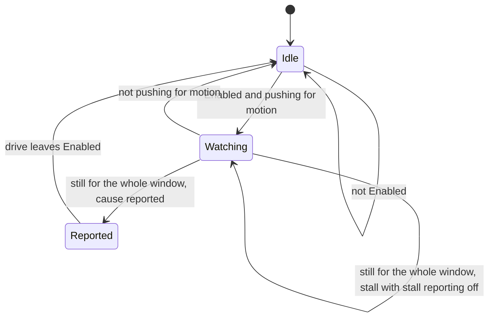
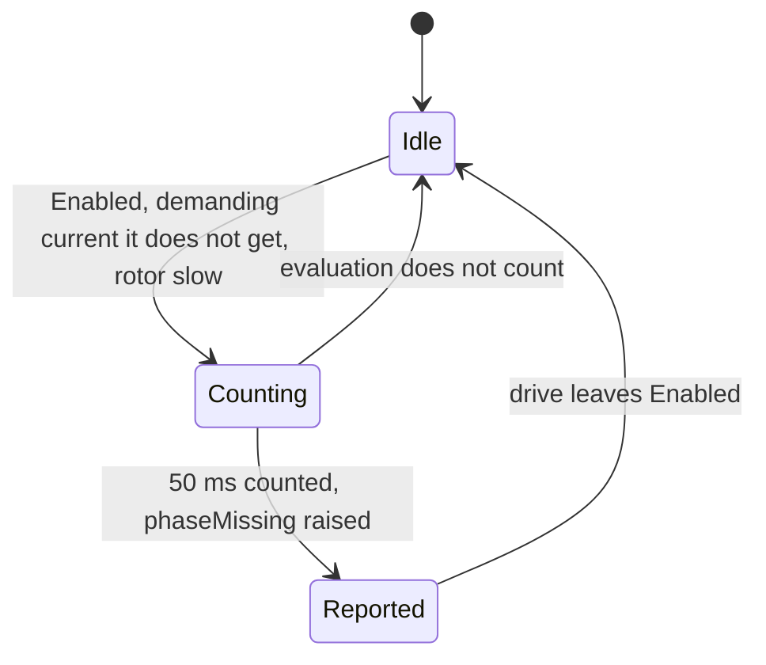
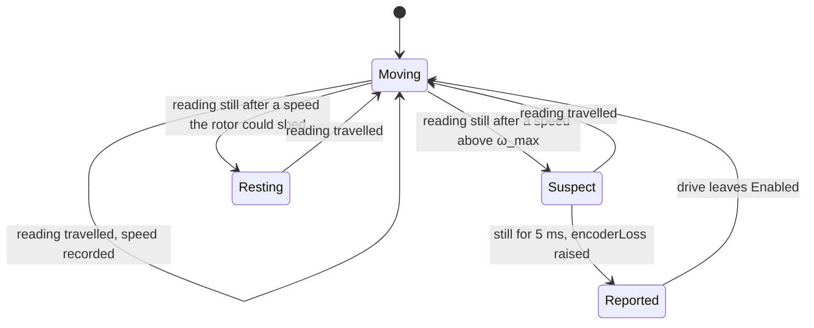

| Field     | Value                    |
|-----------|--------------------------|
| Title     | Fault Supervision Design |
| Type      | design                   |
| Status    | draft                    |
| Version   | 0.3.0                    |
| Component | supervision              |
| Date      | 2026-10-30               |

---

## Responsibilities

**Is responsible for:**
- Watching an enabled drive from the event loop for effort without motion: torque current that asks the
  rotor to move while the encoder reading stays put (REQ-SM-028).
- Telling the two causes it can tell apart: a rotor an outside force pushed against the drive and then
  held (`stall`), and everything else — an encoder that stopped reporting, or a rotor locked before it
  ever moved (`encoderLoss`).
- Raising the fault through the platform fault notifier, as a board protection trip is raised.
- Using the drive-wide supervision settings of the configuration record from its next evaluation, and
  leaving stall reporting off when the operator turned it off (REQ-SM-033).
- Watching an enabled drive for a current it demands but cannot make flow, and raising `phaseMissing` when the
  motor is disconnected while it runs (REQ-EH-016, Part E).
- Watching an enabled drive, in every control mode, for an encoder reading that stops dead faster than the rotor
  could physically stop, and raising `encoderLoss` (REQ-SM-028, Part F). This is the watch that covers torque
  mode, where the drive demands no motion for Parts A to C to judge.

**Is NOT responsible for:**
- Checking anything in the 20 kHz control interrupt. Per-sample plausibility checks are forbidden there
  (REQ-PERF-003); sensor and power-stage failures that need a faster answer belong to board protection.
- Telling a frozen encoder from a rotor locked before it moved. Both look the same from the drive — current
  flows, the error does not close, the reading does not change — so both are reported as `encoderLoss`.
- Storing or range-checking settings on the wire. The CAN settings bridge validates a write against the
  wire contract and stores it in the configuration record; the supervisor only reads the record.
- Detecting a single open phase while the motor runs. Two phases still carry current and turn the rotor, so
  the shortfall Part E watches for does not appear; an open phase is caught at the next alignment
  (`service-alignment.md`, phase continuity check), which runs at every power-up.
- Catching an encoder that freezes while the rotor turns slowly and the drive demands no motion, as torque mode
  at low speed. Part F needs a speed the rotor could not have shed, and Parts A to C need a demand; an encoder
  that stops below that speed in torque mode is found at the next alignment (`service-alignment.md`, encoder
  follow check).
- Protecting the motor from heat while a stall is not reported. With stall reporting off, a held rotor can
  carry up to the current limit; only the thermal protection of the board watches that.

---

## Component Details

### Part A — Pushing for motion

Every 10 ms the supervisor reads what the active drive observes of its own motion — the measured torque
current, the speed it demands and the position error it has not closed — and the encoder reading. The
drive *pushes for motion* when two things hold together:

- the torque current is at least the configured fraction of the drive's current limit, and
- the drive demands motion: a position error of at least the configured threshold or, without one, a
  demanded speed of at least the configured threshold.

The *direction* of the push is the sign of that position error or, without one, of the demanded speed. A
position law that commands the current demands no speed, so the stale speed reference it leaves in the
speed loop is not a demand. A drive holding its position against a load carries current but has no error
to close, so it does not push for motion.

### Part B — The still window

While the drive pushes for motion, the supervisor anchors the encoder reading and counts how long it
stays within the configured excursion of that anchor. Travel beyond the excursion moves the anchor and
starts the count again; noise within it does not. When the count reaches the configured window the
supervisor raises one fault and stays silent until the drive leaves `Enabled`. Any evaluation in which the
drive does not push for motion clears the count.

### Part C — Telling a stall from an encoder loss

An encoder that has stopped reporting cannot show the rotor moving against the drive. A rotor that an
outside force pushes away from where the drive is taking it, and then holds, can — the encoder saw the
push. The supervisor therefore remembers, for the latest travel of at least the configured excursion it
saw while the drive was enabled, whether that travel went against the direction the drive was pushing:

| Latest travel                              | Evidence    | Fault after a still window |
|--------------------------------------------|-------------|----------------------------|
| Against the push, while pushing for motion | overpowered | `stall`                    |
| Along the push, while pushing for motion   | none        | `encoderLoss`              |
| While not pushing for motion               | none        | `encoderLoss`              |
| None since the drive was enabled           | none        | `encoderLoss`              |

Travel is measured from its own anchor, independent of the still window's, and every evaluation takes
part, so a push that crosses the thresholds within one evaluation period is still seen as one. The
evidence is cleared whenever the drive leaves `Enabled`.

Braking does not count as being overpowered: a drive that brakes towards a position setpoint carries
current against the travel, but the travel still goes the way the position error points. A speed reversal
is the one case the rule reads wrong: while the rotor still turns the old way, the travel goes against the
new demand, so an encoder that freezes during a reversal is reported as a stall. The fault is raised either
way unless stall reporting is off.

### Part D — Settings

The supervisor keeps no settings of its own. It reads the supervision fields of the configuration record
(`service-nvm.md`) at each evaluation, so a value written over CAN (`service-can.md`, contract 2.4) is in
force from the next one, in any state. The fields are one set for the whole drive; no control mode has its
own.

| Setting          | Default  | Meaning                                                         |
|------------------|----------|-----------------------------------------------------------------|
| Window           | 0.1 s    | How long the reading has to stay still while the drive pushes   |
| Current fraction | 0.05     | Torque current, as a fraction of the current limit, that counts |
| Demanded speed   | 2 rad/s  | Speed reference that counts as a demand                         |
| Position error   | 0.2 rad  | Mechanical position error that counts as a demand               |
| Excursion        | 0.01 rad | Travel within which the reading counts as still                 |
| Stall reporting  | on       | Whether a stall is raised; encoder loss is always raised        |

A field outside its range — possible only if a record was written by a firmware with wider ranges and the
layout was not bumped — is replaced by its default when the record is loaded at boot (`service-nvm.md`), so
the supervisor never runs on a value the wire would refuse and a query answers the value in force. With stall reporting off, a still window that ends with the overpowered evidence starts
again instead of raising anything; the supervisor keeps watching, and an encoder that stops reporting after
the rotor is released is raised as `encoderLoss`.

### Part E — Phase loss while running

A second watch, the phase-loss monitor, runs on the same 10 ms period and reports `phaseMissing` through the
same notifier. It looks for a current the drive demands but cannot make flow: an evaluation counts when

- the drive is `Enabled`;
- the torque current it demands is at least 10 % of the current limit;
- the torque current it measures is below 20 % of that demand; and
- the rotor turns slower than 10 rad/s.

When counted evaluations span 50 ms without a break, the monitor raises the fault once and stays silent
until the drive leaves `Enabled`. An evaluation that does not count starts the span again.

The speed condition is what keeps a connected motor from tripping. At standstill there is no back-EMF and the
whole supply drives current through the winding resistance, many times the current limit for any motor the
drive is sized for, so a current loop that cannot reach a fifth of its demand for 50 ms is pushing into an
open circuit. At speed the back-EMF takes most of the voltage, and a speed loop asking for
more than the motor can reach legitimately demands the current limit while the measured current stays small.
The 10 rad/s bound leaves the back-EMF under 0.3 V on both reference motors.

A cable pulled while the rotor turns faster than that is reported once friction has slowed the rotor below
it. A single open phase is not reported: two phases still carry current and turn the rotor, so the shortfall
never appears. Both limits are recorded in REQ-EH-016.

The demanded current is what the active drive commands its current loop: the torque setpoint after the
current envelope in torque mode, the speed loop's output (or the current a position law commands directly)
in speed and position modes. The thresholds are fixed; the supervision settings of Part D do not apply.

### Part F — An encoder that stops dead

Parts A to C judge effort against motion, so they need the drive to demand motion. In torque mode it demands
none: a rotor held against its torque is the purpose of a tension or haptic drive, and still while pushing is
not a fault there. An encoder that freezes in torque mode is still visible, from kinematics alone. A turning
rotor cannot stop faster than the torques on it allow, while a frozen reading stops at once.

A third watch, the encoder-freeze monitor, reads the encoder every 1 ms on the event loop while the drive is
`Enabled`, in every mode. Between two readings it records the travel, and the speed that travel implies over
the longest the interval could have lasted: the timer advances in whole milliseconds, so a measured interval
of n ms lasted at most n + 1. A reading that moved less than half an encoder count is *still*.

When readings turn still right after an interval measured at a speed ω, the rotor must have shed ω within
that interval. Decelerating at the largest rate α it can reach, the speed it can have averaged over an
interval of at most T while ending slow enough to stay still is

  ω_max = α·T/2 + √(α·q)

with q one encoder count. √(α·q) is the speed from which it stops within half a count. An encoder that freezes
part-way through that interval leaves it only part of its travel, so the interval before it is judged as well:
measured at ω′ over at most T′, the rotor had T′/2 + T to shed it, and

  ω′_max = α·(T′/2 + T) + √(α·q)

If either speed exceeds its bound and is at least 20 rad/s, and the reading then stays still for 5 ms, the
monitor raises `encoderLoss` once and stays silent until the drive leaves `Enabled`. Any travel during the
5 ms starts the watch again.

α is twice the calibrated torque constant (`1.5·p·ψ`) times the current limit over the calibrated inertia.
The factor two allows for a load torque as large as the motor's own. When the calibration record has no
inertia or no flux linkage, as after a torque-mode calibration, α falls back to twice 2·10⁴ rad/s² per ampere
of current limit. That is about three times the torque-to-inertia ratio of either reference motor
(`documentation/theory/foc-plant-models.md`), so the fallback is looser than the truth for any motor that light or heavier.

| Drive                 | α (rad/s²) | ω_max at T = 2 ms |
|-----------------------|------------|-------------------|
| Teknic, 3 A board     | 32 600     | 40 rad/s          |
| Teknic, 20 A emulated | 217 600    | 236 rad/s         |
| Fallback, 3 A board   | 120 000    | 134 rad/s         |

Because the timer only bounds each interval to whole milliseconds, a measured speed can be half the real one.
On the emulated 20 A drive the monitor therefore needs a rotor faster than about 470 rad/s to catch a freeze
between two evaluations; the SIL scenario runs the bench plant, whose 3 A drive bounds α ten times lower.

The 20 rad/s floor is ten counts per millisecond on a 4000-count encoder, so one count of quantisation cannot
make a slow rotor look fast. The 5 ms confirmation lets a collision with an elastic stop show its rebound
before anything is raised. A rigid stop hit fast enough to stop within one interval without rebounding is
reported as `encoderLoss`. From the encoder that is indistinguishable from a freeze, and a fault is due
either way.

---

## Interfaces

### Provided

| Interface | Purpose                                                          | Contract                                                                               |
|-----------|------------------------------------------------------------------|----------------------------------------------------------------------------------------|
| Fault     | Reports a stall, an encoder loss or a missing phase to its owner | At most once per enable and watch; called from the event loop, never from an interrupt |

### Required

| Interface        | Purpose                                                                                    | Contract                                                                     |
|------------------|--------------------------------------------------------------------------------------------|------------------------------------------------------------------------------|
| Active drive     | Lifecycle state and the motion the drive observes                                          | Read every evaluation; the observation is written by the control interrupts  |
| Encoder          | Mechanical angle                                                                           | Read every evaluation while the drive is enabled                             |
| Settings         | The configuration record's supervision fields                                              | Read every evaluation                                                        |
| Repeating timer  | 10 ms evaluation period (1 ms for Part F)                                                  | Runs on the event loop                                                       |
| Kinematic limits | Current limit, encoder resolution, and the calibrated inertia, flux linkage and pole pairs | Read when a still reading follows travel; missing values select the fallback |
