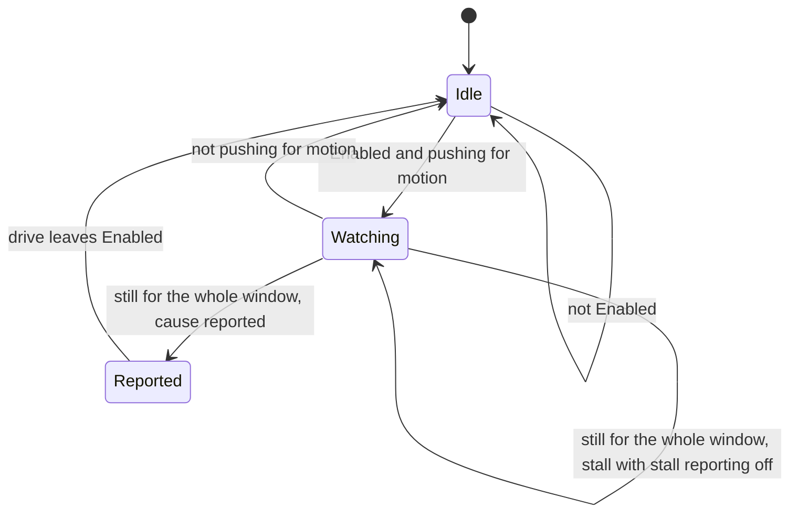

| Field     | Value                    |
|-----------|--------------------------|
| Title     | Fault Supervision Design |
| Type      | design                   |
| Status    | draft                    |
| Version   | 0.1.0                    |
| Component | supervision              |
| Date      | 2026-10-30               |

---

## Responsibilities

**Is responsible for:**
- Watching an enabled drive from the event loop for effort without motion: torque current that asks the
  rotor to move while the encoder reading stays put (REQ-SM-028).
- Telling the two causes it can tell apart: a rotor an outside force pushed against the drive and then
  held (`stall`), and everything else — an encoder that stopped reporting, or a rotor locked before it
  ever moved (`encoderLoss`).
- Raising the fault through the platform fault notifier, as a board protection trip is raised.
- Using the drive-wide supervision settings of the configuration record from its next evaluation, and
  leaving stall reporting off when the operator turned it off (REQ-SM-033).

**Is NOT responsible for:**
- Checking anything in the 20 kHz control interrupt. Per-sample plausibility checks are forbidden there
  (REQ-PERF-003); sensor and power-stage failures that need a faster answer belong to board protection.
- Telling a frozen encoder from a rotor locked before it moved. Both look the same from the drive — current
  flows, the error does not close, the reading does not change — so both are reported as `encoderLoss`.
- Storing or range-checking settings on the wire. The CAN settings bridge validates a write against the
  wire contract and stores it in the configuration record; the supervisor only reads the record.
- Protecting the motor from heat while a stall is not reported. With stall reporting off, a held rotor can
  carry up to the current limit; only the thermal protection of the board watches that.

---

## Component Details

### Part A — Pushing for motion

Every 10 ms the supervisor reads what the active drive observes of its own motion — the measured torque
current, the speed it demands and the position error it has not closed — and the encoder reading. The
drive *pushes for motion* when two things hold together:

- the torque current is at least the configured fraction of the drive's current limit, and
- the drive demands motion: a position error of at least the configured threshold or, without one, a
  demanded speed of at least the configured threshold.

The *direction* of the push is the sign of that position error or, without one, of the demanded speed. A
position law that commands the current demands no speed, so the stale speed reference it leaves in the
speed loop is not a demand. A drive holding its position against a load carries current but has no error
to close, so it does not push for motion.

### Part B — The still window

While the drive pushes for motion, the supervisor anchors the encoder reading and counts how long it
stays within the configured excursion of that anchor. Travel beyond the excursion moves the anchor and
starts the count again; noise within it does not. When the count reaches the configured window the
supervisor raises one fault and stays silent until the drive leaves `Enabled`. Any evaluation in which the
drive does not push for motion clears the count.

### Part C — Telling a stall from an encoder loss

An encoder that has stopped reporting cannot show the rotor moving against the drive. A rotor that an
outside force pushes away from where the drive is taking it, and then holds, can — the encoder saw the
push. The supervisor therefore remembers, for the latest travel of at least the configured excursion it
saw while the drive was enabled, whether that travel went against the direction the drive was pushing:

| Latest travel                              | Evidence    | Fault after a still window |
|--------------------------------------------|-------------|----------------------------|
| Against the push, while pushing for motion | overpowered | `stall`                    |
| Along the push, while pushing for motion   | none        | `encoderLoss`              |
| While not pushing for motion               | none        | `encoderLoss`              |
| None since the drive was enabled           | none        | `encoderLoss`              |

Travel is measured from its own anchor, independent of the still window's, and every evaluation takes
part, so a push that crosses the thresholds within one evaluation period is still seen as one. The
evidence is cleared whenever the drive leaves `Enabled`.

Braking does not count as being overpowered: a drive that brakes towards a position setpoint carries
current against the travel, but the travel still goes the way the position error points. A speed reversal
is the one case the rule reads wrong: while the rotor still turns the old way, the travel goes against the
new demand, so an encoder that freezes during a reversal is reported as a stall. The fault is raised either
way unless stall reporting is off.

### Part D — Settings

The supervisor keeps no settings of its own. It reads the supervision fields of the configuration record
(`service-nvm.md`) at each evaluation, so a value written over CAN (`service-can.md`, contract 2.4) is in
force from the next one, in any state. The fields are one set for the whole drive; no control mode has its
own.

| Setting          | Default  | Meaning                                                         |
|------------------|----------|-----------------------------------------------------------------|
| Window           | 0.1 s    | How long the reading has to stay still while the drive pushes   |
| Current fraction | 0.05     | Torque current, as a fraction of the current limit, that counts |
| Demanded speed   | 2 rad/s  | Speed reference that counts as a demand                         |
| Position error   | 0.2 rad  | Mechanical position error that counts as a demand               |
| Excursion        | 0.01 rad | Travel within which the reading counts as still                 |
| Stall reporting  | on       | Whether a stall is raised; encoder loss is always raised        |

A field outside its range — possible only if a record was written by a firmware with wider ranges and the
layout was not bumped — is replaced by its default when the record is loaded at boot (`service-nvm.md`), so
the supervisor never runs on a value the wire would refuse and a query answers the value in force. With stall reporting off, a still window that ends with the overpowered evidence starts
again instead of raising anything; the supervisor keeps watching, and an encoder that stops reporting after
the rotor is released is raised as `encoderLoss`.

---

## Interfaces

### Provided

| Interface | Purpose                                         | Contract                                                                     |
|-----------|-------------------------------------------------|------------------------------------------------------------------------------|
| Fault     | Reports a stall or an encoder loss to its owner | At most once per enable; called from the event loop, never from an interrupt |

### Required

| Interface       | Purpose                                           | Contract                                                                    |
|-----------------|---------------------------------------------------|-----------------------------------------------------------------------------|
| Active drive    | Lifecycle state and the motion the drive observes | Read every evaluation; the observation is written by the control interrupts |
| Encoder         | Mechanical angle                                  | Read every evaluation while the drive is enabled                            |
| Settings        | The configuration record's supervision fields     | Read every evaluation                                                       |
| Repeating timer | 10 ms evaluation period                           | Runs on the event loop                                                      |
