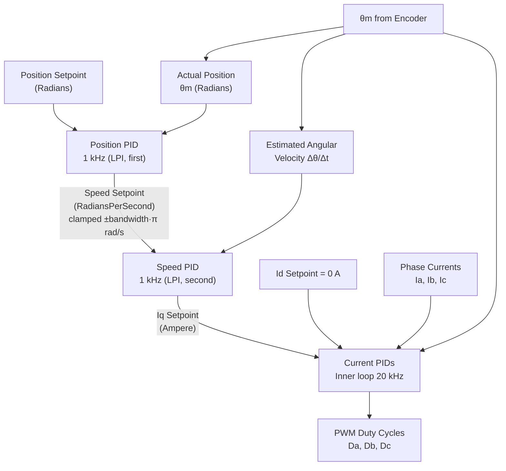
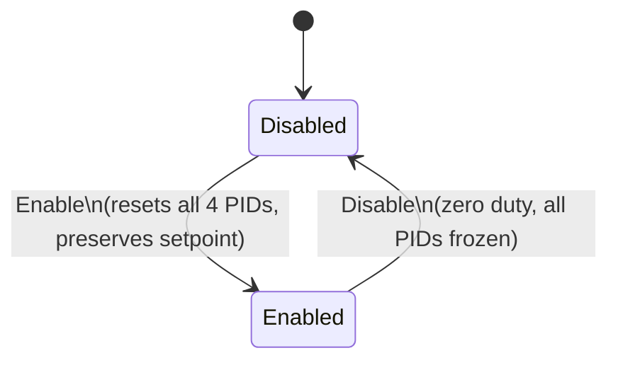
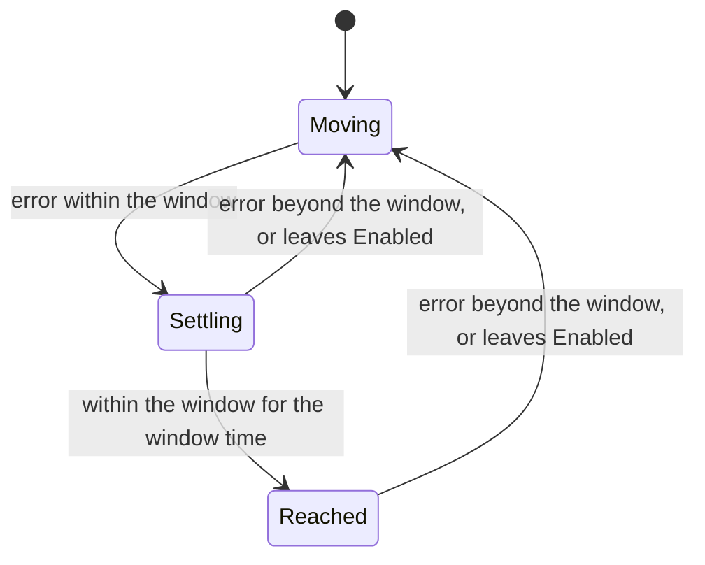
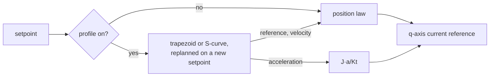
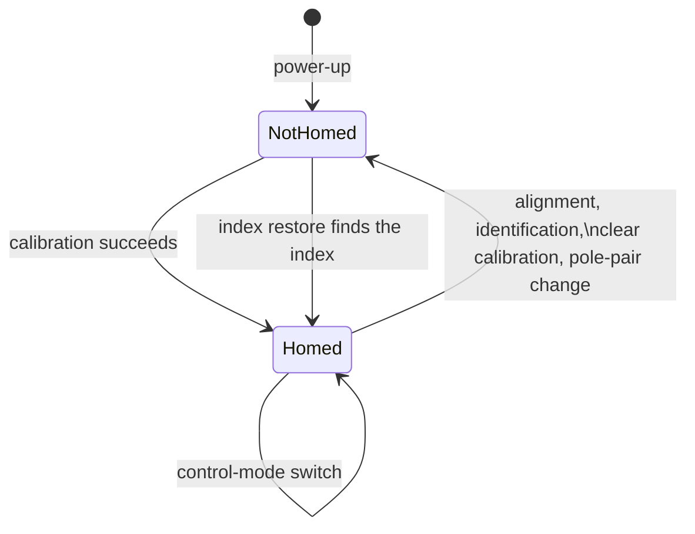
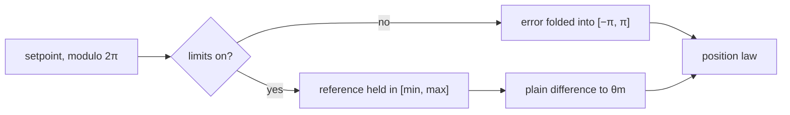
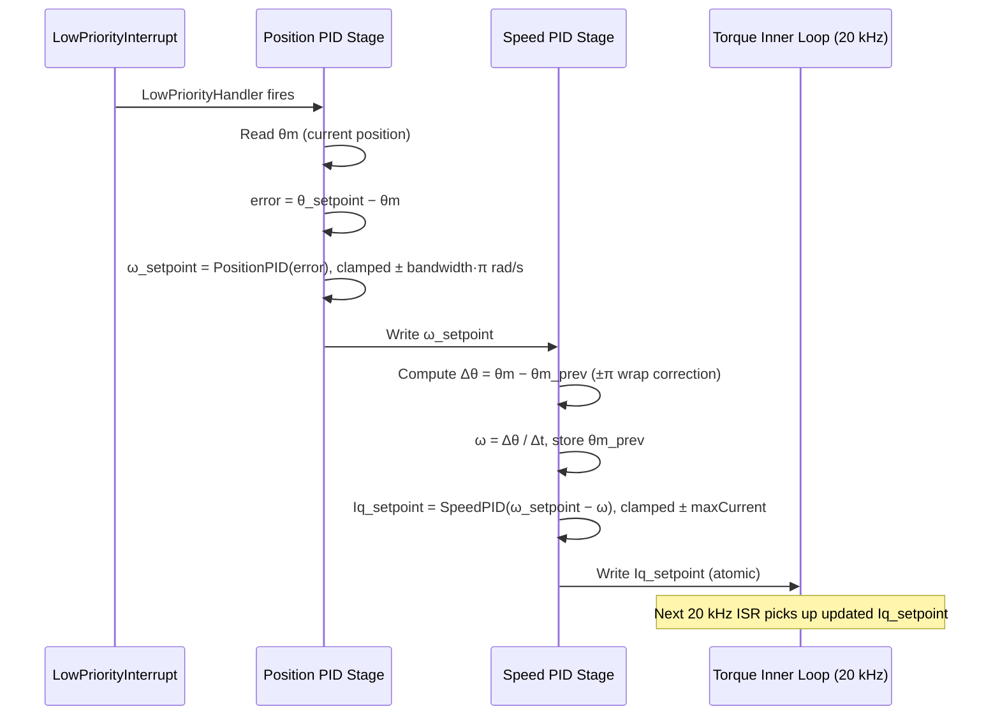
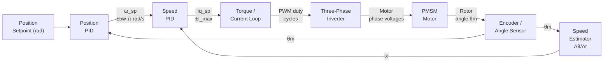

| Field     | Value                |
|-----------|----------------------|
| Title     | FOC Position Control |
| Type      | design               |
| Status    | draft                |
| Version   | 0.5.0                |
| Component | foc-position         |
| Date      | 2026-11-08           |

> **IMPORTANT — Implementation-blind document**: This document describes *behavior, structure, and
> responsibilities* WITHOUT referencing code. **No code blocks using programming languages (C++, C,
> Python, CMake, shell, etc.) are allowed.** Use Mermaid diagrams to express behavior instead.
> Prose descriptions of algorithms are encouraged; source-level details are not.
>
> **Diagrams**: All visuals must be either a Mermaid fenced code block (` ```mermaid `) or ASCII art inline
> in the document. External image references using Markdown image syntax are **not allowed**.

---

## Responsibilities

**Is responsible for:**
- Executing the FOC cascade: an outermost position loop and a middle speed loop (both at 1 kHz within the same LPI callback), and the innermost current control loop (20 kHz)
- Regulating rotor mechanical position to a commanded setpoint in radians
- Dispatching to the selected position algorithm and routing its output to either the speed loop or, for the state feedback laws, straight to the current loop
- Estimating rotor angular velocity from consecutive mechanical angle samples (same wrap-around compensation as speed control) for the middle loop
- Resetting the position, speed and current controller state on Enable / Disable
- Accepting a position setpoint in mechanical radians and propagating all derived setpoints through the cascade
- Reporting, through the drive, when the rotor has settled on its setpoint (Target Reached)
- Keeping the reference, and the way the rotor takes to it, within the software position limits when they are set

**Is NOT responsible for:**
- Reading phase currents or encoder position directly from hardware — these are supplied by the Runner
- Writing duty cycles to the PWM hardware — duty cycles are returned to the Runner
- Multi-turn position tracking — the setpoint is a single-turn mechanical angle, and without software position limits the loop takes the shorter way round to it
- Flux weakening (Id is always commanded to 0 A)

---

## Component Details

### Three-Loop Cascade Architecture

Position control extends the speed control design by adding a third outermost loop. All three loops share the same `LowPriorityInterrupt` trigger; the outer two loops execute sequentially within a single LPI callback, while the innermost loop executes in the high-priority 20 kHz ISR.

| Loop        | Rate   | Context                | Input                      | Output                 |
|-------------|--------|------------------------|----------------------------|------------------------|
| Inner loop  | 20 kHz | High-priority FOC ISR  | Phase currents, θm         | PWM duty cycles        |
| Middle loop | 1 kHz  | Low-priority interrupt | θm from last inner cycle   | Iq setpoint (Ampere)   |
| Outer loop  | 1 kHz  | Low-priority interrupt | θm (position), position SP | Speed setpoint (rad/s) |

The position loop fires **before** the speed loop within the same LPI callback. This ensures the speed setpoint written by the position PID is immediately consumed by the speed PID in the same interrupt invocation, keeping both derived setpoints in step.



### Outer Loop — Selectable Position Law

The position error is always the wrapped difference between the setpoint and the current mechanical angle θm, folded into [−π, π] so a move across the encoder seam takes the shorter way round rather than most of a turn backwards.

`PositionControllerSelector` holds every position algorithm in a `std::variant` and dispatches through `std::visit`, exactly as the current and speed loops do. Each algorithm declares the kind of output it produces:

- **Speed reference** (PID, Cascade P, Two-DOF): the value is written as the speed setpoint and the speed loop runs immediately afterwards in the same callback, as it always has.
- **Current reference** (LQR, LQI): the speed loop is skipped entirely and the value becomes the q-axis current setpoint directly. These laws carry ω in their own state vector and already regulate it, so running them on top of a speed loop would stack two regulators on the same state.

The speed-reference laws saturate at one loop bandwidth of speed per π radians of error. The current-reference laws clamp to ± maxCurrent, and LQI stops accumulating its integral state whenever that clamp is active.

See `documentation/design/controller-selection.md` for the algorithm set, the numerical conditioning the state feedback designs require, and the rules governing when a selection or a retune is refused.

### Middle Loop — Speed Estimation and Speed PID

The speed estimation and speed PID in the middle loop are functionally identical to those described in the FOC Speed Control design document. The speed PID output is clamped to ± maxCurrent (Ampere) and written as the Iq setpoint for the inner current loop.

When a speed-reference position law is active, the speed setpoint consumed by the speed PID is the output of the position law from the same LPI invocation, not a value set by the application. When a current-reference law is active the speed loop does not run at all.

### Inner Loop — Torque and Current Control

The inner loop is functionally identical to the FOC Torque Control design document: Clarke, Park, d-axis PID, q-axis PID, inverse Park, and SVM. It runs independently at 20 kHz and reads its Iq setpoint from the value most recently written by the middle loop.

The d-axis setpoint is 0 A, except while an online electrical estimator is attached: the cascade then
adds a ±2.5 % of maxCurrent, 50 Hz square wave so the winding resistance stays observable. It runs in
bursts, the first 4 s of every 60 s from each enable, and the setpoint is 0 A in between (see
`service-electrical-ident.md`, Excitation).

### Current Command

A calibration step can bypass the position and speed loops and command the q-axis current directly,
through the mode the speed cascade provides (see the speed-control design). The 1 kHz tick then sets
the q-axis reference to the commanded current and runs neither loop. Enable, Disable and a speed
command end it.

### Quick Stop

A quick stop suspends the position law and runs the speed loop alone, on a reference the outer loop ramps from
the measured speed to zero at the quick-stop deceleration, exactly as in speed mode (`foc-speed.md`, Quick Stop).
The position setpoint is kept for the next Enable, which resumes the law from it; the travel limits do not act
during the stop, which ends within a second and leaves the remaining speed to coast out.

### Enable and Disable

**Enable**: ends a quick stop, resets and arms all four PID controllers in cascade order (position, speed, d-axis, q-axis). The last position setpoint is preserved.

**Disable**: ends a quick stop and disarms all four PIDs. `Calculate()` returns zero duty cycles until re-enabled.



### Target Reached

A host that sequences moves needs to know when one is done. The drive reports the target reached once the
target error — the wrapped difference between the final setpoint and θm, which the motion profile (Motion
Profile) does not shorten — has stayed within the position window for the position-window time (REQ-CTL-003). An evaluation on the event loop every
1 ms keeps that count in a `SustainedCondition` (`core/supervision/`), and the error is read again when a host asks: a setpoint the drive has accepted is
never answered with the previous move's flag, because a target outside the window clears it at once, and the
count starts over when the rotor arrives.

The flag is clear in every other mode and in every state but Enabled, and leaving Enabled or the window
restarts the count. A window of 0 keeps the flag clear. The window and its time are stored drive-wide limits,
in force at the next evaluation: the window defaults to 6.28 mrad, four counts of the default 4000-count
encoder, and the time to 20 ms (`service-nvm.md`). The flag is the read-only parameter `targetReached` of
contract 2.10 (`service-can.md`).



### Motion Profile

A step setpoint asks the loop for the most speed and current it has. Two stored limits shape the move instead:
the profile velocity and the profile acceleration, with an optional profile deceleration (0 uses the
acceleration) and an optional profile jerk. With jerk zero (the default) position mode plans a **trapezoid**
of speed from the motion already under way. With jerk positive it plans a **jerk-limited S-curve** that also
keeps the reference acceleration continuous across a replan. The position law receives a moving reference with
its velocity and acceleration in both cases (`documentation/theory/position-motion-profile.md`). The settings
are contract 3.1 parameters and drive-wide limits (`service-can.md`, `service-nvm.md`).

- **On and off.** The profile is on only while the velocity and the acceleration are both above zero. Off, the
  setpoint reaches the position law exactly as without the feature, and so do every output and every
  observation.
- **Replan.** A new setpoint is noticed at the next 1 kHz tick and the plan restarts from the reference's own
  position and velocity (and acceleration when jerk is set), so they stay continuous. A reversal brakes at the
  deceleration, then turns round; the speed and rates stay within the limits throughout.
- **Seed.** On Enable, after a speed or current command, and when the profile is switched on, the reference
  starts from the measured position and speed.
- **Circle and limits.** Without travel limits the goal is placed by the wrapped difference, the shorter way
  round the seam. With travel limits it is the setpoint held between them and the move goes the direct way.
- **Feed-forward.** The reference velocity feeds each position law (speed reference for PID, Cascade P and
  Two-DOF; the speed state of LQR and LQI), and the acceleration feeds the q-axis current as J·a/Kt beside the
  friction feed-forward, under the same current limit. The Two-DOF law bypasses its reference pre-filter while the
  profile is on.
- **Errors.** The drive reports two position errors: the *position error*, profiled reference minus θm, which
  the following-error monitor and the encoder plausibility monitor measure (`fault-supervision.md` Parts H and
  K), and the *target error*, final setpoint minus θm, which the target-reached check measures. The target is
  therefore not reported reached while the reference is on its way.



### Homing and the Position Reference

The position the drive reports is measured from the zero its alignment set. A plain alignment can land that zero
on any of the electrical detents of the rotor, one per pole pair, so after one the position zero need not be the one
the machine was commissioned with. The drive therefore tracks whether its position frame is the commissioned one and
calls it *homed* (REQ-CMS-006):

- Homed after a successful calibration in this power-up, because that calibration's alignment defines the frame.
- Homed after the first Start restored the rotor reference from the encoder index, because the index angle stored
  with the calibration puts the encoder back in the frame of that calibration (`state-machine.md`, Referencing the
  Rotor from the Encoder Index).
- Not homed at every power-up, after Clear Calibration, after an alignment, an identification of the electrical
  parameters or a pole-pair change, and whenever the rotor reference is lost.

A control-mode switch that keeps the rotor reference keeps the homed state with it. The state is the read-only
parameter `homed` of contract 2.19 (`service-can.md`).

A machine whose process depends on that zero can make the drive hold position mode back until it is homed, with the
stored drive-wide setting `homingRequired`, off by default (REQ-CMS-007). With it on, the Start of position mode is
refused unless the drive is homed or the first Start is about to restore the reference from the index, which
homes it; an index search that then finds nothing refuses the Start as before. Speed and torque mode are never
held back, whatever the setting says, as they do not depend on the position zero. A drive whose reference is
valid but not homed has to be calibrated to be homed again; the index restore runs only for a drive without a
reference.



### Software Position Limits

Machines rely on software travel limits to protect their mechanics (REQ-CTL-007). Two stored drive-wide
limits, the position minimum and maximum, bound the travel in the frame the position is measured in: the
mechanical angle from the alignment zero, in [−π, π). They are off while the minimum is not below the
maximum, as both are 0 by default. Once the drive is homed (Homing and the Position Reference) the same limits are absolute.

With the limits on:

- A position setpoint outside them, taken modulo 2π into [−π, π), is refused and the previous one stays in
  force (`service-can.md`, contract 2.11).
- The cascade holds its reference within them, so a setpoint accepted before the limits were narrowed takes
  the rotor to the nearer limit, never beyond it.
- The position law takes the plain difference between the reference and θm instead of folding it into
  [−π, π]. The interval between the limits never contains the encoder seam, so the plain difference is the
  way that stays inside: from 2.9 rad to −2.9 rad within limits of ±3 rad the rotor turns 5.8 rad back
  through zero rather than 0.48 rad across the seam. The position error the drive reports to its monitors is
  the same difference.

The cascade takes new limits at its next 1 kHz tick after they are stored, and on every mode activation. A rotor
that an outside force or an overshoot carries more than four encoder counts past them faults the drive with
`positionLimit` (`fault-supervision.md` Part J).



### LPI Callback Execution Order Within One 1 kHz Tick

Within a single LPI callback, the position and speed loops execute in strict order:

1. **Motion profile fires first** (Motion Profile): replans on a new setpoint and samples the reference position, velocity and acceleration for this tick; with the profile off it passes the setpoint through.
2. **Position law fires second**: reads θm, computes the wrapped position error to the reference, produces either a speed setpoint or an Iq setpoint.
3. **Speed PID fires third, if the position law produced a speed setpoint**: reads the freshly updated setpoint, computes speed error using Δθ/Δt, produces and clamps the Iq setpoint. A current-reference law writes the Iq setpoint itself and this step is skipped. The acceleration feed-forward and the friction feed-forward are stored beside the result.
4. Callback returns. On the next 20 kHz ISR cycle, the inner loop picks up the updated Iq setpoint.

This ordering guarantees that the Iq setpoint used by the inner loop is always the one derived in the most recent outer-loop tick.

---

## Interfaces

### Provided

| Interface               | Purpose                                                                                                                     | Contract                                                                                                                                                                                                                                            |
|-------------------------|-----------------------------------------------------------------------------------------------------------------------------|-----------------------------------------------------------------------------------------------------------------------------------------------------------------------------------------------------------------------------------------------------|
| Configure               | Supplies the motor model, including the pole-pair count.                                                                    | Must be called before the first `Calculate()`. Must not be changed while Enabled.                                                                                                                                                                   |
| Enable                  | Resets the position law and arms the loops beneath it.                                                                      | Safe to call repeatedly. Position setpoint is preserved.                                                                                                                                                                                            |
| Disable                 | Disarms all PIDs and forces zero duty cycle output.                                                                         | Safe to call from any context.                                                                                                                                                                                                                      |
| SetCurrentTunings       | Sets the current loop closed-loop bandwidth.                                                                                | Gains are derived from the motor model and normalised internally.                                                                                                                                                                                   |
| SetSpeedTunings         | Sets the speed loop closed-loop bandwidth.                                                                                  | Speed loop output clamped to ± maxCurrent.                                                                                                                                                                                                          |
| SetPositionTunings      | Sets the position loop bandwidth and cost weights.                                                                          | Returns `SelectResult`. Refused with `busy` while enabled; refused with `invalidParameters` if the active law cannot be redesigned for the new tunings, leaving the last accepted set live.                                                         |
| SelectPositionAlgorithm | Selects the position algorithm.                                                                                             | Refused with `busy` while enabled, and with `invalidParameters` when the design does not converge; the previously active algorithm stays live.                                                                                                      |
| SetPoint                | Sets the target position in mechanical radians.                                                                             | Written atomically; used on the next outer-loop cycle; with a motion profile on it starts a replan.                                                                                                                                                 |
| ProfileMotion           | Sets the motion profile: velocity, acceleration, deceleration and jerk.                                                     | Applied with the other limits at the next outer-loop period. Off while the velocity or the acceleration is zero; a deceleration of zero uses the acceleration; a jerk of zero plans a trapezoid, above zero an S-curve.                             |
| Calculate               | Executes the inner 20 kHz FOC torque loop for one cycle.                                                                    | Called from the FOC ISR; returns `PhasePwmDutyCycles`. Must not block.                                                                                                                                                                              |
| ObserveMotion           | Reports the motion the drive asks for and gets.                                                                             | Window speed, mean q-axis current, demanded speed, the position error to the reference and the target error to the final setpoint, for REQ-PRO-005. LQR and LQI demand no speed: they command the current, so the stale speed reference is not one. |
| Current command         | Bypasses the position and speed loops and runs the cascade on a q-axis current; reports the mean q-axis voltage it applies. | Starts from 0 A. Ends with Enable, Disable or a speed command. The voltage is the mean over the last millisecond, in volts.                                                                                                                         |

### Required

| Interface            | Purpose                                                                                 | Contract                                                                                                                            |
|----------------------|-----------------------------------------------------------------------------------------|-------------------------------------------------------------------------------------------------------------------------------------|
| LowPriorityInterrupt | Provides the callback registration point for the combined position + speed outer loops. | The inner-loop ISR triggers the LPI at the 1 kHz prescale ratio. Both outer-loop stages execute sequentially in one LPI invocation. |

---

## Data Model

| Entity              | Field               | Type / Unit              | Range                                    | Notes                                                                            |
|---------------------|---------------------|--------------------------|------------------------------------------|----------------------------------------------------------------------------------|
| Position setpoint   | θ_sp                | Radians (float)          | ±2π over CAN                             | Not wrapped, but taken modulo 2π: θ_sp and θ_sp ± 2π are the same target         |
| Actual position     | θm                  | Radians (float)          | [−π, π)                                  | Mechanical angle from the alignment zero, wrapped by the platform (REQ-CTL-003)  |
| Position PID output | ω_sp                | RadiansPerSecond (float) | [−bw·π, +bw·π] rad/s                     | Clamped speed setpoint; saturation = one speed-loop bandwidth per π rad of error |
| Estimated speed     | ω                   | RadiansPerSecond (float) | computed from Δθ/Δt                      | Finite difference with ±π wrap correction                                        |
| Speed PID output    | Iq_sp               | Ampere (float)           | ± maxCurrent                             | Written to inner loop                                                            |
| d-axis setpoint     | Id_sp               | Ampere (float)           | 0 A; ±2.5 % Imax at 50 Hz with estimator | SPMSM maximum torque per ampere                                                  |
| Previous angle      | θm_prev             | Radians (float)          | [−π, π)                                  | Saved each outer cycle for speed estimator                                       |
| Outer loop period   | Δt                  | Seconds (float)          | 1 / outer_frequency                      | Constant after construction                                                      |
| Pole pairs          | P                   | Integer (unsigned)       | ≥ 1                                      | Motor property                                                                   |
| Max current         | maxCurrent          | Ampere (float)           | > 0                                      | Upper bound on Iq setpoint from speed PID                                        |
| Speed clamp         | ± bandwidth·π rad/s | RadiansPerSecond (float) | derived from speed-loop bandwidth        | Position PID output saturation; determines approach speed cap                    |

---

## Sequence Diagrams

### Single 1 kHz LPI Tick — Position and Speed Outer Loops



---

## Block Diagram



---

## Constraints & Limitations

| Constraint                      | Value / Description                                                                                                                 |
|---------------------------------|-------------------------------------------------------------------------------------------------------------------------------------|
| Inner loop rate                 | 20 kHz — called from the FOC ISR once per PWM period.                                                                               |
| Outer loop rate                 | 1 kHz (same for both position and speed stages). Must be an integer divisor of 20 kHz.                                              |
| Speed-reference clamp           | One loop bandwidth of speed per π radians of error, which bounds the approach speed at any position error.                          |
| No multi-turn tracking          | Position setpoint is in single-turn radians. Multi-turn logic must be handled externally.                                           |
| Position wrap-around correction | Folded into [−π, π] so a move across the seam takes the short way, except within software position limits.                          |
| LPI callback order              | The position law must always execute before the speed PID within the same LPI callback. Reversing the order yields stale setpoints. |
| No flux weakening               | Id = 0 is invariant. High-speed flux-weakening operation is out of scope.                                                           |
| Cycle budget (inner loop)       | `Calculate()` must complete in <= 4500 cycles (75% of the 6000-cycle control period at 120 MHz / 20 kHz).                           |
| Controller state at Enable      | Every integrator and observer is zeroed on Enable; the position setpoint is preserved.                                              |
| Target reached                  | Window and time from the configuration record, checked every 1 ms on the event loop and when asked.                                 |
| Setpoint atomicity              | Speed and Iq setpoints written by outer loops must be read atomically by downstream loops on 32-bit ARM.                            |
