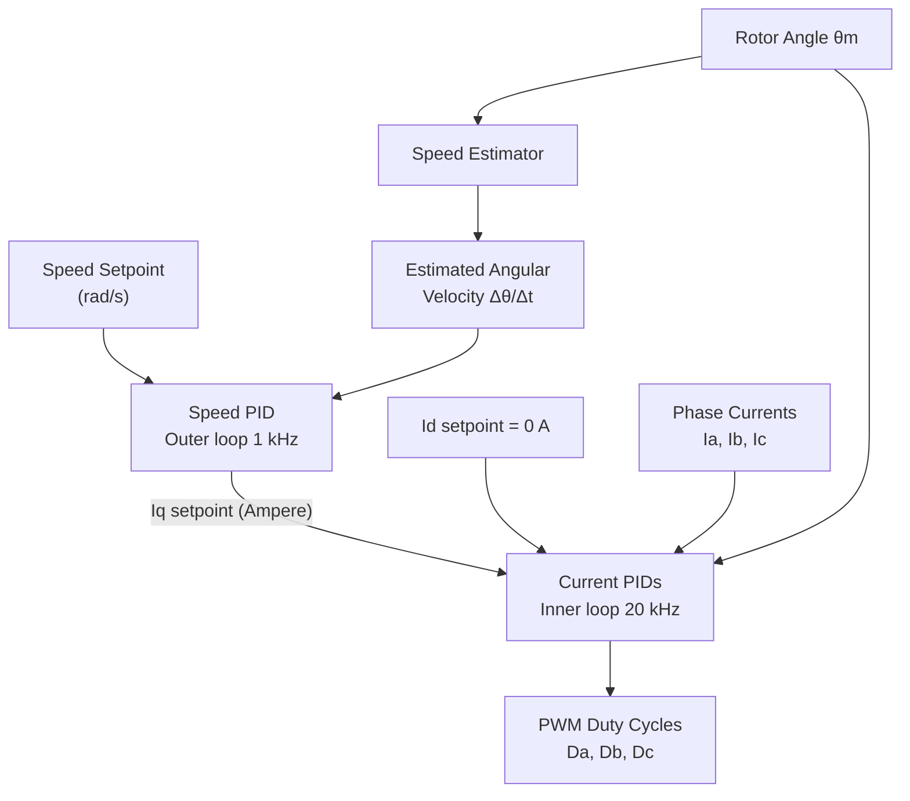
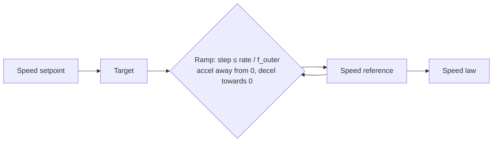
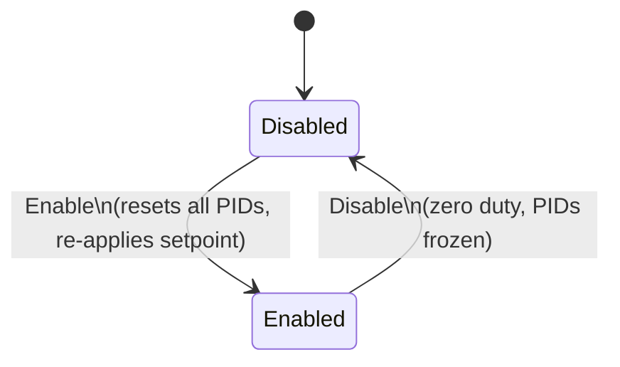
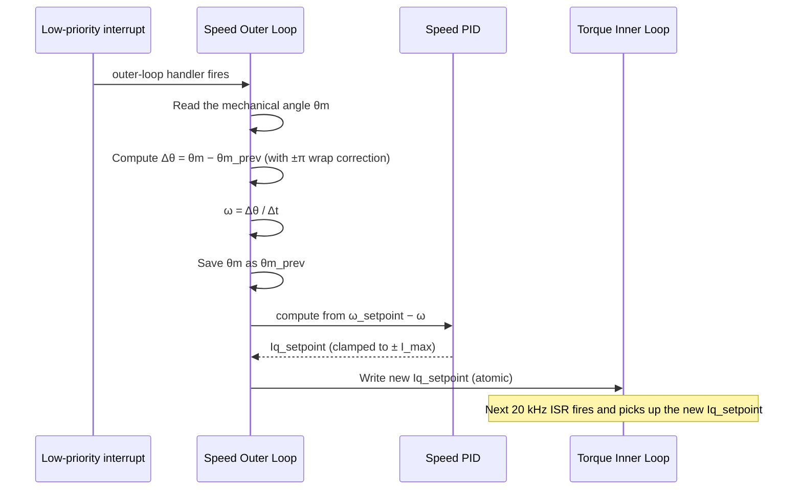
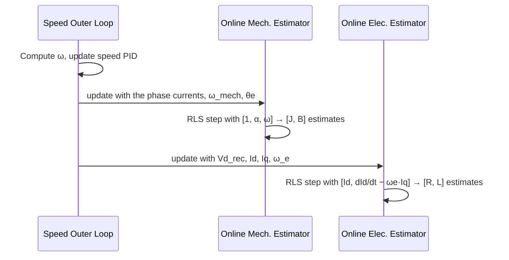

| Field     | Value             |
|-----------|-------------------|
| Title     | FOC Speed Control |
| Type      | design            |
| Status    | draft             |
| Version   | 0.4.1             |
| Component | foc-speed         |
| Date      | 2026-11-26        |

> **IMPORTANT — Implementation-blind document**: This document describes *behavior, structure, and
> responsibilities* WITHOUT referencing code. **No code blocks using programming languages (C++, C,
> Python, CMake, shell, etc.) are allowed.** Use Mermaid diagrams to express behavior instead.
> Prose descriptions of algorithms are encouraged; source-level details are not.
>
> **Diagrams**: All visuals must be either a Mermaid fenced code block (` ```mermaid `) or ASCII art inline
> in the document. External image references using Markdown image syntax are **not allowed**.

---

## Responsibilities

**Is responsible for:**
- Executing the two-level FOC cascade: an outer speed PID loop (1 kHz by default) and an inner current control loop (20 kHz)
- Estimating rotor angular velocity from successive mechanical angle samples using finite differences with wrap-around compensation
- Regulating rotor speed to the commanded setpoint in radians per second
- Producing the Iq (quadrature current) setpoint that drives the inner torque loop, bounded by a configurable current limit
- Registering an outer-loop handler with the low-priority interrupt so that the outer loop fires at the correct prescale ratio
- Reporting the outer-loop frequency so that the application can schedule the low-priority interrupt at the correct rate
- Arming and resetting all three PID controllers (speed, d-axis, q-axis) on Enable / Disable

---

## Component Details

### Two-Loop Cascade Architecture

Speed control builds on the torque control loop by adding a supervisory outer loop. The two loops operate at different rates and in different interrupt contexts:

| Loop       | Rate   | Context                | Input                    | Output               |
|------------|--------|------------------------|--------------------------|----------------------|
| Inner loop | 20 kHz | High-priority FOC ISR  | Phase currents, θm       | PWM duty cycles      |
| Outer loop | 1 kHz  | Low-priority interrupt | θm from last inner cycle | Iq setpoint (Ampere) |

The inner loop is identical to the torque control loop described in the FOC Torque Control design document. This includes the current-stream window ([service-can.md](service-can.md) Part J), which the position cascade shares. The outer loop adds the speed PID and the speed estimation step.



### Outer Loop — Speed Estimation and Speed PID

The low-priority interrupt triggers the outer loop at a prescale ratio. The ratio of the inner-loop frequency to the desired outer-loop frequency determines it. For example, 20 kHz / 1 kHz = 20 inner cycles per outer cycle.

**Speed estimation by finite difference:**

The estimate of the angular velocity uses the difference between the current and the previous mechanical angle sample, divided by the time between them Δt:

```text
ω = Δθ / Δt,   Δt = n · T_outer
```

The inner-loop interrupt closes a window every prescaler ticks, whether or not the outer loop has read the
previous one. It counts each window it closes. The count n is the number of windows closed since the last
read: 1 normally, more when the outer-loop handler ran late. Dividing by one period after a late read would
report a multiple of the true speed followed by zero. A read that finds no new window keeps the previous
estimate. The angle and the count are read together and the read is retried if a window closes in between.

Because the encoder angle wraps around at 2π, the raw angle difference may be discontinuous at the wrap
boundary. Wrap-around compensation applies a correction. If the computed Δθ is greater than +π, it is shifted
by −2π. If it is less than −π, it is shifted by +2π. This produces a signed angular velocity in the range
(−π/Δt, +π/Δt) radians per second. This holds for any physical speed below half the Nyquist rate of the
sampling interval.

**Speed PID:**

The speed PID receives the speed error (setpoint minus estimate) and produces the Iq setpoint. Its output is clamped to ± I_max (in Ampere), which directly limits the peak torque the motor can apply while tracking the speed command. This clamp is the primary over-current protection for the speed-control mode.

The inner loop receives a q-axis reference: the law's output plus the friction and cogging feed-forwards. It
clamps this reference once more, to a current limit that starts at I_max. The motor's overload protection can
lower this limit ([fault-supervision.md](fault-supervision.md) Part I). The limit reaches the interrupt as one
single-precision store, written from the
event loop in any state and capped at I_max. The law does not see this second clamp: while it cuts the
output the law keeps integrating up to its own clamp at I_max.

The friction feed-forward is the Coulomb current of the calibration
([service-cogging-compensation.md](service-cogging-compensation.md), Part F) times a sign of the speed
reference. This sign ramps through zero over ±2 rad/s. The outer loop evaluates the feed-forward with the law,
once per period, and holds it for the interrupt. A current command or a law that commands current directly
holds none. The law's integrator is charged while the rotor accelerates. A law that integrates may then
overshoot a start more with the feed-forward than without it. Without it, the integrator alone had to supply
the friction. The feed-forward does not enter the law's own limit or its integrator.

The d-axis setpoint is 0 A, except while an online electrical estimator is attached. The cascade then
adds a ±2.5 % of I_max, 50 Hz square wave so the winding resistance stays observable. It runs in
bursts, the first 4 s of every 60 s from each enable. The setpoint is 0 A in between (see
[service-electrical-ident.md](service-electrical-ident.md), Excitation).

### Low-Priority Interrupt — Outer Loop Scheduling

The low-priority interrupt is an abstract scheduling interface. The speed control component registers its outer-loop handler with this interface when it is created. The inner-loop interrupt counts cycles and triggers the low-priority interrupt at the appropriate prescale ratio, so the outer-loop handler executes without an RTOS.

The registered handler captures the cascade instance, so its lifetime is bound to that instance. The cascade unregisters the handler when it is destroyed. After the unregistration returns, an already queued trigger must be discarded rather than dispatched. A mode switch that destroys the cascade then cannot leave a handler pointing at freed storage.

The outer-loop frequency query returns the configured outer-loop rate, so the application layer can check or configure the low-priority interrupt's trigger frequency.

### Current Command

A calibration step can bypass the speed loop and command the q-axis current directly. Each outer-loop
tick then measures the speed and sets the q-axis reference to the commanded current instead of running
the speed PID. The online estimators are not updated. As in torque mode, the inner loop keeps a
one-millisecond mean of the q-axis voltage only while the command is active. The speed and position
cascades share this mode, since both run the same speed loop. Enable, Disable and a speed command end
it.

### Speed Ramp

Without a ramp, a setpoint step reaches the speed loop as a step. The only bound on the acceleration is then
the current clamp. Every step accelerates at the current limit, the loop saturates, and a deceleration at the
limit returns the most energy to the supply. The operator can bound both from the configuration record
(REQ-CTL-002):

| Setting            | Default      | Range              | Meaning                                                 |
|--------------------|--------------|--------------------|---------------------------------------------------------|
| Speed acceleration | 0 (no limit) | 0 – 100 000 rad/s² | Largest rate at which the reference's magnitude grows   |
| Speed deceleration | 0 (no limit) | 0 – 100 000 rad/s² | Largest rate at which the reference's magnitude shrinks |

With either rate set, the setpoint becomes a target and the outer loop owns the speed reference. Each tick,
before the speed law runs, it moves the reference towards the target by at most the rate over one outer-loop
period. The rate is the acceleration while the reference moves away from zero and the deceleration while it
moves towards it. A reversal therefore decelerates to zero first and then accelerates. A step that would carry
the reference through zero stops at zero for that tick. A rate of zero leaves that direction unlimited, so a
drive can, for instance, ramp up and stop at the current limit. With both at zero the setpoint is the reference, as
before.

The reference starts from zero at every Enable, because the rotor is at rest when the drive enables. The first
setpoint after a start is therefore ramped as well. While a calibration step commands the speed (the mechanical
identification's speed commands), the ramp is bypassed. Each command is then the reference at once, because
identification needs the excitation it designed. Disable ends the bypass, so the operator's next Enable is
ramped again. The outer loop writes the reference only while a ramp is in force. Otherwise the setpoint
writes it. Turning the ramp off hands the latest setpoint to the loop at once.

The laws follow the ramp with a lag and receive no acceleration feed-forward. A law with integral action
therefore carries the ramp's effort in its integrator and overshoots a little when the ramp ends. On the
nominal plant at 100 rad/s² to 20 rad/s, the overshoot is 2.7 % under the PI and 2.2 % under the two-DOF law.
It is below 1 % under LQI and ADRC.

The rates reach the outer loop as single-precision stores. The control-mode state machine writes them
whenever the mode is activated and whenever the configuration record is written, in any state.



### Quick Stop

A quick stop ([state-machine.md](state-machine.md), Quick Stop) hands the cascade a deceleration a. It makes the outer loop
own the speed reference until the next Enable or Disable. The reference starts from the measured speed, so a loop that lags
its setpoint is not first driven back up to it. Each tick moves the reference towards zero by at most a over one outer-loop
period. At a = 0 the reference is zero from the first tick, and the loop brakes at the current limit. The speed law follows
the reference within the current limit as it follows a setpoint. The setpoint and its ramp are set aside: a setpoint
arriving meanwhile is stored for the next Enable, not applied.
The online estimators keep their last estimates while the stop runs.

The deceleration reaches the outer loop as two single-precision stores: the step and then the flag that starts
the stop. The outer loop therefore never sees one without the other. From 100 rad/s at 500 rad/s² the
reference reaches 2 rad/s after 196 ms.

### Enable and Disable

**Enable**: ends a quick stop, resets and arms all three PID controllers (speed, d-axis, q-axis). The last speed setpoint is preserved so the motor resumes commanding toward the previous target. With a ramp set, the reference starts from zero and ramps towards it.

**Disable**: ends a quick stop and disarms all three PIDs. The control step returns zero duty cycles. The outer loop continues to receive its low-priority interrupt calls but produces no Iq output while disarmed.



---

## Interfaces

### Provided

| Interface                   | Purpose                                                                                                               | Contract                                                                                                                                                                                                                                                                                                                                                                                     |
|-----------------------------|-----------------------------------------------------------------------------------------------------------------------|----------------------------------------------------------------------------------------------------------------------------------------------------------------------------------------------------------------------------------------------------------------------------------------------------------------------------------------------------------------------------------------------|
| Configure                   | Supplies the motor model, including the pole-pair count used for the electrical angle.                                | Must be called before the first control step. Must not be changed while Enabled.                                                                                                                                                                                                                                                                                                             |
| Enable                      | Arms all three PIDs and resets their integrator state.                                                                | Safe to call repeatedly. Speed setpoint is preserved.                                                                                                                                                                                                                                                                                                                                        |
| Disable                     | Disarms all PIDs and forces zero duty cycle output.                                                                   | Safe to call from any context.                                                                                                                                                                                                                                                                                                                                                               |
| Current tunings             | Sets the current loop closed-loop bandwidth.                                                                          | Gains are derived from the motor model and normalised internally. Takes effect on the next control step.                                                                                                                                                                                                                                                                                     |
| Speed tunings               | Sets the speed loop closed-loop bandwidth.                                                                            | Gains are derived from the mechanical model supplied through the mechanical configuration. Output is clamped to ± I_max.                                                                                                                                                                                                                                                                     |
| Setpoint                    | Sets the speed setpoint in radians per second.                                                                        | Written atomically; used on the next outer-loop cycle, through the speed ramp when one is set.                                                                                                                                                                                                                                                                                               |
| Speed ramp                  | Sets the acceleration and deceleration, in rad/s², that bound the speed reference; zero leaves a direction unlimited. | Callable in any state, also while Enabled; in force from the next outer-loop cycle.                                                                                                                                                                                                                                                                                                          |
| Control step                | Executes the inner 20 kHz FOC torque loop for one cycle.                                                              | Called from the FOC ISR; returns the duty cycles. Must not block.                                                                                                                                                                                                                                                                                                                            |
| Bus voltage                 | Hands a measured bus voltage to the inner loop ([foc-torque.md](foc-torque.md), Bus Voltage Tracking).                | Called from the event loop; in force from the next control step, also while Enabled.                                                                                                                                                                                                                                                                                                         |
| Outer-loop frequency        | Returns the configured outer-loop frequency in Hz.                                                                    | Pure query; no side effects. Can be called before Enable.                                                                                                                                                                                                                                                                                                                                    |
| Online mechanical estimator | Attaches an online mechanical parameter estimator (optional).                                                         | If attached, the estimator is updated automatically on each outer-loop cycle. No separate estimator Enable/Disable interface is defined here; detach or omit the estimator to stop updates.                                                                                                                                                                                                  |
| Online electrical estimator | Attaches an online electrical parameter estimator (optional).                                                         | If attached, the estimator is updated each outer-loop cycle from window averages the inner loop accumulates, and a d-axis square wave is added to the current reference so the resistance is observable. Once it settles, its resistance and inductance also set the zero-vector rates ([platform-sampling-skew.md](platform-sampling-skew.md) Part C). Assumes non-salient motor (Ld ≈ Lq). |
| Current stream              | The stream whose window the inner loop fills, given at construction ([service-can.md](service-can.md) Part J).        | Never absent, so the inner loop does not test for it. The stream outlives the controller.                                                                                                                                                                                                                                                                                                    |
| Motion observation          | Reports the window speed, window-mean q-axis current and speed reference.                                             | Written by the control interrupts, read from the event loop; feeds telemetry (REQ-COM-002) and the encoder plausibility monitor (REQ-PRO-005).                                                                                                                                                                                                                                               |
| Current command             | Bypasses the speed loop and runs the cascade on a q-axis current; reports the mean q-axis voltage it applies.         | Starts from 0 A. Ends with Enable, Disable or a speed command. The voltage is the mean over the last millisecond, in volts, and zero outside the command.                                                                                                                                                                                                                                    |

### Required

| Interface              | Purpose                                                               | Contract                                                                                                                                                        |
|------------------------|-----------------------------------------------------------------------|-----------------------------------------------------------------------------------------------------------------------------------------------------------------|
| Low-priority interrupt | Provides the registration point for the outer-loop speed PID handler. | The inner-loop ISR triggers it at the correct prescale ratio. The outer-loop handler must execute within its own interrupt context, not the 20 kHz ISR context. |

---

## Data Model

| Entity            | Field   | Type / Unit        | Range                                    | Notes                                                    |
|-------------------|---------|--------------------|------------------------------------------|----------------------------------------------------------|
| Speed setpoint    | ω_sp    | rad/s (float)      | ± mechanical max                         | Written by application; applied on next outer-loop tick  |
| Estimated speed   | ω       | rad/s (float)      | computed from Δθ/Δt                      | Computed each outer-loop cycle                           |
| Speed PID output  | Iq_sp   | Ampere (float)     | ± I_max                                  | Written to inner loop; clamped by speed PID output limit |
| d-axis setpoint   | Id_sp   | Ampere (float)     | 0 A; ±2.5 % Imax at 50 Hz with estimator | SPMSM maximum torque per ampere                          |
| Previous angle    | θm_prev | Radians (float)    | [0, 2π)                                  | Saved each outer cycle for finite-difference estimator   |
| Outer loop period | Δt      | Seconds (float)    | 1 / f_outer                              | Constant after construction                              |
| Pole pairs        | P       | Integer (unsigned) | ≥ 1                                      | Motor property                                           |
| Max current       | I_max   | Ampere (float)     | > 0                                      | Upper bound on Iq setpoint from speed PID                |

---

## Sequence Diagrams

### Single Outer-Loop Cycle (1 kHz Low-Priority Interrupt)



### Online Estimator Update Within Outer-Loop Cycle

When online estimators are attached and enabled, each 1 kHz outer-loop cycle also feeds observations to them after the speed PID step:



Vd_rec is the d-axis voltage back-computed from the last normalized Vd output of the inner loop and the DC bus voltage.

---

## Constraints & Limitations

| Constraint                     | Value / Description                                                                                                      |
|--------------------------------|--------------------------------------------------------------------------------------------------------------------------|
| Inner loop rate                | 20 kHz — called from the FOC ISR once per PWM period.                                                                    |
| Outer loop rate                | Configurable; default 1 kHz. Must be an integer divisor of 20 kHz.                                                       |
| Iq saturation                  | Speed PID output clamped to ± I_max (Ampere). This limits peak torque.                                                   |
| Speed estimator wrap threshold | Assumes physical speed below π / Δt rad/s (half the Nyquist limit of the outer-loop sampling rate).                      |
| No flux weakening              | Id = 0 is fixed. Operating above base speed without flux weakening is the application's responsibility.                  |
| Outer-loop scheduling          | The outer loop does not use an RTOS. The inner loop ISR triggers the low-priority interrupt — no timer or task involved. |
| Cycle budget                   | The inner-loop control step must complete within 75 % of the control period.                                             |
| Setpoint atomicity             | The Iq setpoint written by the outer loop must be read atomically by the inner loop on 32-bit ARM targets.               |

---

## Controller Alternatives

The speed PID described above is one of several selectable strategies for the outer speed loop.
Alternative controllers — LQI, ADRC, and Two-DOF — are described in
[advanced-controllers.md](../theory/advanced-controllers.md) ([speed-loop-lqi.md](../theory/speed-loop-lqi.md), [speed-loop-adrc.md](../theory/speed-loop-adrc.md), [speed-loop-two-dof.md](../theory/speed-loop-two-dof.md)). Plant model foundations are in
[foc-plant-models.md](../theory/foc-plant-models.md).

The runtime selection mechanism is described in [controller-selection.md](controller-selection.md).
