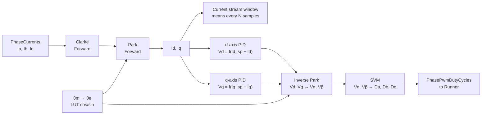
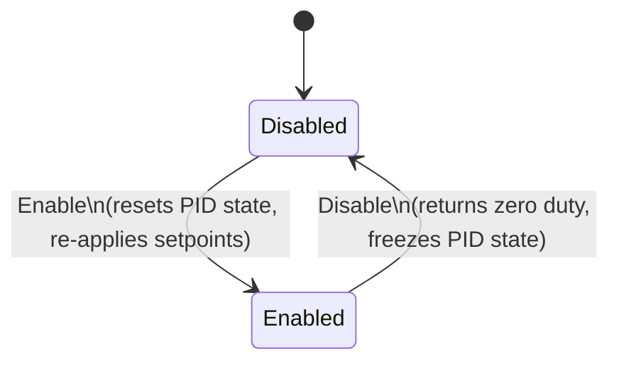
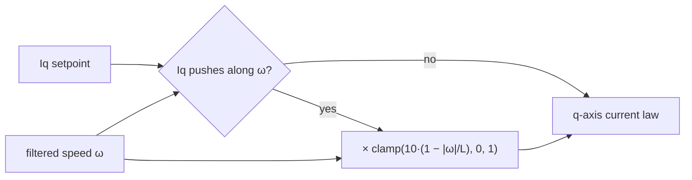

| Field     | Value              |
|-----------|--------------------|
| Title     | FOC Torque Control |
| Type      | design             |
| Status    | draft              |
| Version   | 0.4.3              |
| Component | foc-torque         |
| Date      | 2026-11-08         |

> **IMPORTANT — Implementation-blind document**: This document describes *behavior, structure, and
> responsibilities* WITHOUT referencing code. **No code blocks using programming languages (C++, C,
> Python, CMake, shell, etc.) are allowed.** Use Mermaid diagrams to express behavior instead.
> Prose descriptions of algorithms are encouraged; source-level details are not.
>
> **Diagrams**: All visuals must be either a Mermaid fenced code block (` ```mermaid `) or ASCII art inline
> in the document. External image references using Markdown image syntax are **not allowed**.

---

## Responsibilities

**Is responsible for:**
- Executing the innermost FOC current control loop at 20 kHz in interrupt context
- Converting three-phase stator currents to the rotor-synchronous dq frame via Clarke and Park transforms
- Regulating the d-axis current (Id) to its setpoint using a dedicated PID controller
- Regulating the q-axis current (Iq) to its setpoint using a dedicated PID controller
- Converting the resulting voltage demands back to three-phase PWM duty cycles via inverse Park and SVM
- Accepting a combined (Id, Iq) setpoint from an outer control loop or directly from an application
- Providing Enable and Disable transitions that safely reset internal PID state
- Folding a torque current that would drive the rotor past the overspeed limit back to zero (REQ-PRO-004)

**Is NOT responsible for:**
- Reading phase current values from the ADC hardware — currents are passed in as arguments
- Committing duty cycles to the PWM hardware — duty cycles are returned to the Runner
- Measuring or tracking rotor position — the mechanical angle is passed in as an argument
- Outer-loop speed or position control
- Faulting an overspeed: the overspeed monitor of `fault-supervision.md` Part G does that from the event loop
- Flux weakening (Id ≠ 0 operation is structurally possible but not yet supported)

---

## Component Details

### Innermost Control Loop — 20 kHz ISR Execution

The torque control loop is the innermost layer of the FOC cascade. It is invoked once per PWM switching period (default 20 kHz) by the hardware interrupt handler that drives the three-phase inverter. The entire loop — from phase current input to duty cycle output — must complete within the interrupt budget.

The sequence executed each cycle is:

1. Receive phase currents (Ia, Ib, Ic) as the `PhaseCurrents` argument.
2. Read the rotor mechanical angle θm from the `Radians` argument (supplied by the Runner from the encoder).
3. Compute the electrical angle: `θe = θm × pole_pairs`.
4. Evaluate `cos(θe)` and `sin(θe)` via the fast trigonometric LUT — one evaluation, results reused.
5. Clarke forward: (Ia, Ib) → (Iα, Iβ); Ic is derived from the balanced-phase constraint.
6. Park forward: (Iα, Iβ, θe) → (Id, Iq).
7. Current stream: add Id and Iq to the stream window; on the window's last sample, store the two means and θm
   for the event loop (`service-can.md` Part J). Skipped when no stream is attached or the stream is stopped.
8. Speed limiter: fold Iq_setpoint by the measured speed against the overspeed limit (Speed Limiter, below),
   add the cogging current at θe (`service-cogging-compensation.md` Part D) and clamp to the current limit.
9. d-axis and q-axis PID: error = I_setpoint − I → output = Vd, Vq.
10. Inverse Park: (Vd, Vq, θe + (n + ½)·ωe·Ts) → (Vα, Vβ). The sampled cos/sin pair is rotated through the delay angle (`foc-transforms.md`, *Delay compensation*), with ωe the filtered electrical speed of step 8's limiter and n the platform's duty delay in periods.
11. Space vector modulation: (Vα, Vβ) → (duty_a, duty_b, duty_c).
12. Return `PhasePwmDutyCycles` to the Runner for immediate PWM register update.



### d-axis and q-axis PID Controllers

Two independent incremental PID controllers regulate the direct (d) and quadrature (q) current components independently. Both PIDs share the same structural properties:

- **Output clamping**: the output magnitude is limited to the modulation circle, 1 at the configured DC bus voltage and r at a measured one (Bus Voltage Tracking).
- **Anti-windup**: back-calculation. Each axis is the toolbox `controllers::PidIncrementalSynchronous<float>` with no derivative term and no per-axis clamp; after the modulation-circle limit, the realised voltage is written back with `SetPreviousOutput`, so the next increment starts from what was applied and the integrator cannot wind up.
- **Gain derivation**: the current regulator derives its own gains from the motor model (phase resistance, inductance) and the requested closed-loop bandwidth, normalised by the DC bus voltage. Tuning is therefore expressed as a single bandwidth in radians per second rather than raw controller gains.
- **Incrementalism**: the PID uses the incremental (velocity) form, accumulating output from step to step, which naturally limits abrupt changes at Enable transitions.

The d-axis setpoint is normally 0 A for a surface PMSM (Id = 0 gives maximum torque per ampere). Setting Id_setpoint to a non-zero negative value for flux weakening is structurally possible but the operational consequences are outside the scope of this document.

### Bus Voltage Tracking

Every number the current law is built from assumes the bus voltage `Configure()` supplied: the gains are
normalised by it, the decoupling and back-EMF feed-forwards are scaled by it, and the reported q-axis voltage
converts per-unit to volts with it. A bus that sags under load or rises under regeneration would otherwise
scale the voltage the winding gets by V_meas / V_cfg, and with it the loop gain, the feed-forwards and the
reported voltage.

`TrackBusVoltage()` hands the cascade a measured bus voltage; the bus-voltage service reads it every 10 ms
and filters it (`service-bus-voltage.md`). The cascade keeps every configured number and
scales only the output: the modulator divides each per-unit phase voltage by r = V_meas / V_cfg, so the duty
gives the winding the voltage the law asked for, and the law limits its output to a magnitude of r, the
largest voltage the measured bus can make, which keeps its anti-windup honest. r is held within 0.5 to 2 so
that a failed measurement cannot multiply the duties, and it is 1 until a bus voltage is tracked. The event
loop writes r and 1/r; the control interrupt reads them, so a period that sees one updated and not the other
is off by one measurement's change for one period (REQ-PRO-003).

### Enable and Disable

**Enable**: arms both the d-axis and the q-axis PID controllers and resets their internal integrator state to zero. The most recently stored setpoints (Id_setpoint, Iq_setpoint) are re-applied immediately — there is no rollback to zero. This allows seamless re-engagement after a brief disable event without a step change in the setpoint.

**Disable**: disarms both PIDs. While disarmed, the `Calculate()` method returns zero duty cycles regardless of the current error. PID state is frozen and will be fully reset on the next Enable call.

The two states are the only run-time states of this component:



### Current Command

A calibration step can run the cascade on a q-axis current it commands directly, with $I_d = 0$,
starting from 0 A, and read back the mean q-axis voltage the current loop applies. While the command
is active, the inner loop adds each sample's q-axis voltage to a one-millisecond window and publishes
the window's mean; otherwise it only finds the window closed, so the other modes pay one branch per
sample. Disable ends the command and closes the window.

### Current Envelope

The speed and position cascades bound the current reference their outer loop produces. Torque mode
has no outer loop — the reference arrives from the operator, over CAN — so the cascade
applies the bound itself, at `SetPoint`, before the reference reaches the current loop.

The bound is on the **magnitude of the current vector**, not on either axis separately: the plant
constraint is $\sqrt{I_d^2 + I_q^2} \le I_{max}$, and a per-axis clamp would admit $\sqrt 2$ times
the limit on the diagonal. A setpoint outside the envelope is scaled onto it, preserving the
commanded ratio between $I_d$ and $I_q$ rather than clipping one axis and rotating the vector.

The envelope comes from the inverter's `MaxCurrentSupported()`, the same source the speed and
position cascades take theirs from, so the three modes cannot disagree about the hardware limit.

Below the envelope the motor's overload protection can set a lower current limit (`fault-supervision.md`
Part I). Each sample the interrupt clamps the q-axis setpoint, after the speed limiter, to that limit; the
limit reaches it as one single-precision store, written from the event loop in any state and capped at the
envelope, and the demanded torque current the cascade reports is the clamped one.

The (Id, Iq) pair is written outside the interrupt and read by it. It is handed over through a
lock-free triple buffer — the same mechanism that carries estimator windows the other way — so the
interrupt always reads a pair published together, never a new Id with the previous Iq.

### Speed Limiter

Torque mode has no speed loop, so nothing bounds the speed a torque command reaches: with the load gone, a
held torque accelerates the rotor until the back-EMF uses up the voltage. The limiter bounds it from the
overspeed limit of the configuration record (`fault-supervision.md` Part G), at the measured speed the loop
already filters for its feed-forward (one-millisecond time constant).

Each sample the q-axis setpoint is scaled by a fold factor of the mechanical speed |ω| against the limit L:

  fold = clamp(10 · (1 − |ω| / L), 0, 1)

so the setpoint passes unchanged up to 90 % of the limit, falls linearly to zero between 90 % and 100 %, and
stays at zero beyond. Only a setpoint that pushes the rotor further in the direction it turns is folded; one
that brakes it, of the opposite sign to the speed, passes unchanged, so the drive can always slow the rotor
down. The d-axis setpoint is never folded.

The fold settles the speed where the folded current balances the load and friction, inside the last 10 % of
the limit: at no load the rotor settles just below the limit, where the folded current only covers friction.
The filter's lag lets an accelerating rotor pass the limit briefly before the fold catches up: 1.1 % on the
Teknic plant at 1 A, which reaches the fold at about 5000 rad/s², in the model-in-the-loop protection test;
the settled speed stays below the limit. An outside torque that drives the rotor beyond the limit is not opposed — the setpoint is zero
there, not a braking current — and is caught by the overspeed monitor at 110 % of the limit.

The limit reaches the interrupt as one single-precision store, its reciprocal in electrical radians per
second, so the interrupt reads either the old or the new limit, never a mix. A reciprocal of zero folds
nothing. It is set by the control-mode state machine whenever the mode is activated and whenever the
configuration record is written, in any state; a new limit is in force from the next sample. The demanded
torque current the cascade reports to the supervisors is the folded one, so the phase-loss monitor
(`fault-supervision.md` Part E) does not mistake a folded current for one that cannot flow.



### Pole-Pair Configuration

The pole-pair count is an integer property that translates the mechanical rotor angle supplied by the encoder into the electrical angle required by the Park transform. It must be configured before the first `Calculate()` call. Changing it while enabled produces undefined control behaviour and must be avoided.

---

## Interfaces

### Provided

| Interface         | Purpose                                                                                                         | Contract                                                                                                                                |
|-------------------|-----------------------------------------------------------------------------------------------------------------|-----------------------------------------------------------------------------------------------------------------------------------------|
| Configure         | Supplies the motor model: resistance, inductance, flux linkage, bus voltage, sampling frequency and pole pairs. | Must be called before the first `Calculate()`. Must not be changed while Enabled.                                                       |
| Enable            | Arms both PID controllers and resets their integrator state.                                                    | Safe to call repeatedly. PIDs start from a clean state each time. Last setpoints are preserved.                                         |
| Disable           | Disarms both PID controllers and forces zero duty cycle output.                                                 | Safe to call from any context. `Calculate()` returns zero while disabled.                                                               |
| SetCurrentTunings | Provides the current loop closed-loop bandwidth.                                                                | Gains are derived from the motor model and normalised internally. Takes effect on the next `Calculate()` call.                          |
| SetPoint          | Sets the (Id, Iq) current setpoint in Ampere.                                                                   | Scaled onto the current envelope on the way in. New setpoint is used on the next `Calculate()` invocation. Can be called while Enabled. |
| Calculate         | Executes the full 12-step FOC torque loop for one control cycle.                                                | Must be called at 20 kHz from ISR context. Returns `PhasePwmDutyCycles`. Must not block.                                                |
| TrackBusVoltage   | Hands a measured bus voltage (Bus Voltage Tracking).                                                            | Called from the event loop; in force from the next `Calculate()`, also while Enabled.                                                   |
| SetCurrentStream  | Attaches the current stream whose window the loop fills (`service-can.md` Part J).                              | Called once, before the first `Calculate()`. The stream outlives the controller.                                                        |
| Current command   | Runs the cascade on a q-axis current with $I_d = 0$ and reports the mean q-axis voltage it applies.             | Starts from 0 A and ends with Disable. The voltage is the mean over the last millisecond, in volts, and zero outside the command.       |
| Speed limit       | Sets the overspeed limit, in mechanical rad/s, that the speed limiter folds the q-axis setpoint against.        | Callable in any state, also while Enabled; in force from the next sample. A limit of zero folds nothing.                                |
| Current limit     | Sets the current limit, in amperes, that the q-axis setpoint is clamped to below the envelope.                  | Callable in any state, also while Enabled; in force from the next sample. Capped at the envelope.                                       |

### Required

| Interface | Purpose                                                                                                                        | Contract |
|-----------|--------------------------------------------------------------------------------------------------------------------------------|----------|
| None      | The inverter and encoder are managed externally by the Runner; they are not accessed directly by the torque control component. | —        |

---

## Data Model

| Entity            | Field        | Type / Unit           | Range           | Notes                                            |
|-------------------|--------------|-----------------------|-----------------|--------------------------------------------------|
| Phase currents    | Ia, Ib, Ic   | Ampere (float)        | ± motor rated A | Ic derived; passed in from ADC callback          |
| Synchronous frame | Id, Iq       | Ampere (float)        | ± motor rated A | Regulated quantities                             |
| Current setpoint  | Id_sp, Iq_sp | Ampere (float)        | ± motor rated A | Id_sp = 0 for SPMSM MTPA; Iq_sp from application |
| Voltage demands   | Vd, Vq       | Dimensionless (float) | [−1, +1]        | PID output; normalised to DC bus                 |
| Duty cycles       | Da, Db, Dc   | Dimensionless (float) | [0.0, 1.0]      | Returned to Runner for PWM register write        |
| Mechanical angle  | θm           | Radians (float)       | [0, 2π)         | Supplied by Runner; pole-pairs multiply to θe    |
| Electrical angle  | θe           | Radians (float)       | [0, 2π)         | θm × pole_pairs; used for Park and inverse Park  |
| Pole pairs        | P            | Integer (unsigned)    | ≥ 1             | Motor property; configured once at startup       |

---

## Constraints & Limitations

| Constraint                      | Value / Description                                                                                                   |
|---------------------------------|-----------------------------------------------------------------------------------------------------------------------|
| Control loop rate               | 20 kHz — must be called once per PWM switching period from the FOC interrupt.                                         |
| Cycle budget                    | <= 4500 cycles (75% of the 6000-cycle control period at 120 MHz / 20 kHz) for the full `Calculate()` execution.       |
| No virtual dispatch in hot path | `Calculate()` must not incur virtual function call overhead.                                                          |
| Output duty cycle format        | Normalised floating-point [0.0, 1.0]; conversion to PWM timer counts is the Runner's responsibility.                  |
| Electrical angle wrapping       | Handled by the table index mask in `math::FastSine` — no explicit modulo operation required in loop.                  |
| Gain derivation dependency      | Gain derivation requires the motor model — including the DC bus voltage — to be supplied through `Configure()` first. |
| No flux weakening               | Id_setpoint ≠ 0 is structurally accepted but operational flux-weakening strategy is not yet defined.                  |
| Current envelope                | Vector magnitude bounded to the inverter's `MaxCurrentSupported()` at `SetPoint`; it is not a regulator.              |
| Speed limiter                   | Folds, never brakes: an outside torque beyond the limit is left to the overspeed fault (REQ-PRO-004).                 |
| PID state at Enable             | Integrators are always zeroed on Enable, regardless of previous state.                                                |

---

## Controller Alternatives

The dual-PID current controller described above is one of several selectable strategies for the
current loop. Alternative controllers — Decoupled PID, Deadbeat, and Sliding-mode — are described in
`documentation/theory/advanced-controllers.md` (`current-loop-decoupled-pid.md`, `current-loop-deadbeat.md`, `current-loop-sliding-mode.md`). Plant model foundations are in
`documentation/theory/foc-plant-models.md`.

The mechanism by which a controller strategy is selected at runtime, stored without heap allocation,
dispatched in the ISR via type-aware visit, and persisted to NVM is described in
`documentation/design/controller-selection.md`.
