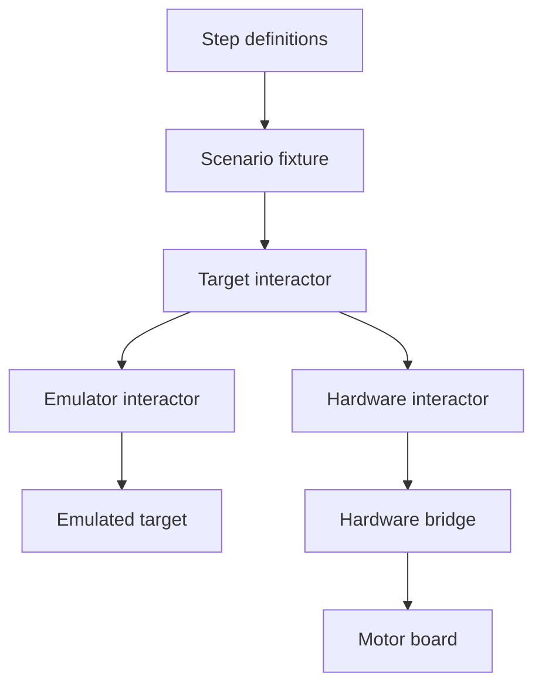
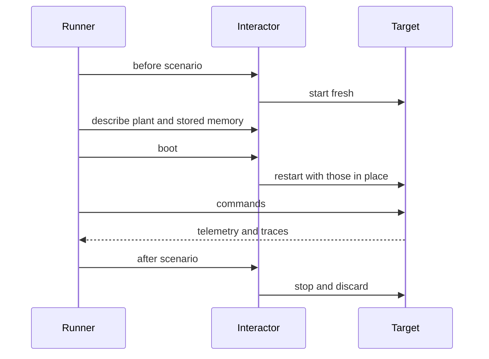
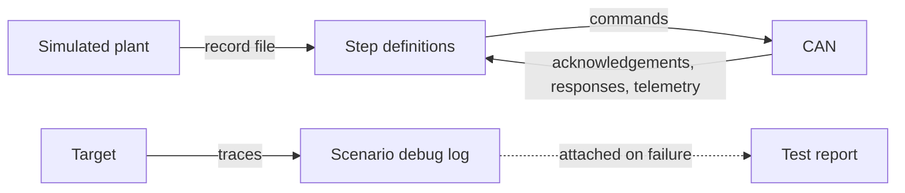

| Field     | Value                      |
|-----------|----------------------------|
| Title     | Integration Testing Design |
| Type      | design                     |
| Status    | accepted                   |
| Version   | 1.3.0                      |
| Component | integration-testing        |
| Date      | 2026-10-25                 |

> **Note — Design-level document**: This document describes *how the integration tests are
> structured*. It expands on the architecture by specifying component responsibilities, data flows,
> and design decisions that would not be obvious to a reviewer unfamiliar with the system.
>
> **Diagrams**: All visuals must be Mermaid fenced code blocks or ASCII art. External image
> references are **not allowed**.

---

## Overview

The suite is a **black-box driver**. It starts a target running the real firmware, speaks to it
over the product's own CAN command set, and asserts on the telemetry and traces that come back. It
does not reach into the firmware, does not mock its components, and knows nothing of its internal
types.

Scenarios are authored in Gherkin and live in a single directory. A tag decides which target
implements a scenario, and the runner is invoked with that tag.

| Tag    | Target                                           | Detailed in                                    |
|--------|--------------------------------------------------|------------------------------------------------|
| `@sil` | Real firmware under an emulator, simulated motor | `documentation/design/software-in-the-loop.md` |
| `@hil` | Real firmware on hardware, over the bridge       | This document                                  |

> Earlier revisions described an in-process host fixture that mocked the platform and drove the
> state machine directly. No such fixture exists, and none is planned: mocking the platform and
> then asserting on the state machine tests the wiring of the test, not the product.

---

## Responsibilities

**Is responsible for:**
- Starting, stopping and isolating a target for each scenario
- Presenting one interactor seam so a scenario reads the same whichever target implements it
- Encoding commands and decoding telemetry on the product's wire format
- Describing the simulated world a software-in-the-loop target runs in

**Is NOT responsible for:**
- Control algorithm correctness in the small — that is what the unit tests under each library cover
- CAN framing and payload layout — that is the wire contract tests' job
- Substituting for hardware-in-the-loop, which alone exercises silicon, timing and analogue paths

---

## Component Details

### The interactor seam

Everything a scenario needs from a target sits behind one interface: lifecycle, command and
telemetry transport, and — for a simulated target only — the world the firmware runs in.

The simulation seam — describe the plant, describe stored memory, restart — defaults to doing
nothing and to reporting that simulation is unsupported. A hardware target inherits that default,
and a scenario that configures a plant fails loudly rather than quietly testing something else.

### Scenario lifecycle

Each scenario gets a fresh target. Setup accumulates in the scenario's own state and is applied in
a single restart, so a scenario that describes a plant, a calibration and a set of algorithms still
starts the target once rather than once per description.

### Observation

Three channels, all of them the product's own:

- **Telemetry** carries the lifecycle state, the fault code, and the measured speed and position.
- **Command acknowledgements** carry acceptance or the reason for refusal.
- **Traces** carry what the firmware decided, most importantly which algorithm each loop ended up
  running, which can differ from what was asked for.
- **Plant trajectory**, on a simulated target only, carries what the motor actually did, sampled
  on the control-tick time base, and the tick each command frame was delivered on, in a record file
  the plant writes in the scenario directory. This is the channel the performance and disturbance
  scenarios measure; see the software-in-the-loop design.

Two of the traces are measurements in their own right: the calibration record the firmware stores
(`[SM] Calibration record:`) and the online estimates it prints on request (`[EST]`). Inertia and
friction travel in micro-units on both, because the tracer prints three decimals. The
identification scenarios compare them, and the CAN electrical-parameters response, against the
plant the scenario configured; the terminal command that asks for the estimates is the product's
own, sent on the simulated target through its terminal port.

Trace output only drains while the target's event loop has work, so an assertion that waits for a
trace polls telemetry rather than waiting passively. Trace lines are retained across the frames the
command path reads, and cleared per scenario and per restart, so an assertion cannot match a line
from an earlier boot.

Everything the simulated target prints is also the scenario's debug log, and the report of a failed
scenario carries its last lines.

> A planned change takes the terminal and the traces off this list: see
> [Planned — Commands and Verdicts over CAN Only](#planned--commands-and-verdicts-over-can-only).

### Isolation

Scenarios ran into each other through three shared resources, all now per session: the working
directory holding the target's files, the sockets carrying frames and terminal lines, and the
captured output.

---

## Interfaces

### Provided to step definitions

| Capability        | Purpose                                                                     |
|-------------------|-----------------------------------------------------------------------------|
| Lifecycle         | Start, stop and restart the target                                          |
| Command transport | Send a category command and await its acknowledgement                       |
| Telemetry         | Await a state, a fault code, or read the measured position                  |
| Serial capture    | Drain and search the target's trace output                                  |
| Simulation        | Describe the plant and the stored calibration and configuration             |
| Response          | Capture the plant trajectory and measure step and disturbance metrics on it |

The command transport heartbeats while it awaits an acknowledgement, as a CAN client does. An
identification acknowledges only when it ends, and the target emergency-stops an identification or an
enabled drive whose client falls silent (see the CAN service design).

The transport addresses the node whose heartbeat it waits for at the start of a scenario. A board
answers as its configured base plus the board ID read from its jumpers, so the suite takes the node
ID from the first server heartbeat it sees rather than assuming node 1; the emulated target, with
no jumpers, is node 1.

### Required from the system under test

- A CAN command set covering mode selection, calibration, alignment, enable, disable, setpoints,
  telemetry requests and fault clearing
- Telemetry reporting state, fault code, measured speed and measured position
- Traces naming the algorithm each control loop is running
- For a simulated target, that it read its plant description at boot

No test-only command is added to the product to make the suite work.

---

## Feature-to-Requirements Mapping

Each scenario carries the requirement identifiers it verifies as tags alongside its runner tag.
The traceability matrix is generated from those tags during release, reading the feature directory
directly, so the mapping lives with the scenarios rather than in this document where it would rot.

---

## Planned — Commands and Verdicts over CAN Only

> **Status: in progress.** Contract 2.2 (`service-can.md` Part A) provides the CAN side; the steps move
> to it as listed below. Until every row is done, the sections above describe the suite as it runs.

### The rule

Every scenario of the motor controller application, on the emulator and on hardware alike, sends
every command as a CAN frame and decides pass or fail only from the CAN frames the target sends and,
on the emulator, from what the simulated plant records about itself. The serial port is a debug
channel: the suite records everything the target prints and attaches it to a failed scenario, but
never writes to it and never parses it for a verdict (REQ-INT-015, REQ-INT-016).

- **CAN is the product's control surface.** A deployed controller is commanded over the bus, by the
  CAN Commander or a host. A scenario that goes through the terminal proves a path no deployed system
  uses, and stays green while the CAN path is broken.
- **Traces are not a contract.** Their wording changes with any logging edit, nothing versions them,
  and a parser can match a stale line. The CAN contract is versioned and has its own wire tests.
- **One step, two targets.** When both targets speak only CAN, a step reads the same on the emulator
  and on hardware; today some steps take the terminal on one target and CAN on the other.
- **Debug output is free to change.** Trace wording, verbosity and rate stop mattering to the suite,
  and a slow or chatty serial port can no longer delay or break a verdict.

### Channels after the change

| Channel                            | Direction     | Carries                                                       | Asserted on                       |
|------------------------------------|---------------|---------------------------------------------------------------|-----------------------------------|
| CAN                                | both          | commands, acknowledgements, responses, telemetry              | yes                               |
| Plant record (emulator only)       | target → host | the trajectory, and the tick each command frame was delivered | yes                               |
| Serial port and semihosting output | target → host | traces, terminal output, fault dumps                          | no: recorded, attached on failure |

On the emulator, CAN frames have a second emulated serial port to themselves, in the same text
encoding in both directions, and the plant's samples and command-delivery ticks are in a file the
plant writes in the scenario directory through semihosting, which the host reads back. On hardware,
CAN goes through the bridge's own bus.

### What has to move

Each row is a dependence on the terminal or on a trace today, and what replaces it.

| Today, over the serial port                                   | Used by                                                       | Over CAN                                                                                                                                                | Contract        |
|---------------------------------------------------------------|---------------------------------------------------------------|---------------------------------------------------------------------------------------------------------------------------------------------------------|-----------------|
| `clear_cal`                                                   | starting with no valid calibration, on both targets           | `ClearCalibration`, refused unless stopped                                                                                                              | 2.2             |
| `calibrate`                                                   | the full calibration "run from the terminal", on both targets | `Calibrate`, acknowledged when the sequence ends, as the identifications are                                                                            | 2.2             |
| `[SM] Calibration record:` trace                              | identification scenarios and the hardware motor scenarios     | `QueryParameter` for resistance, inductance, pole pairs, inertia and friction (`0x40`–`0x45`), the current offsets and the cogging peak (`0x80`–`0x83`) | 2.1 + 2.2       |
| `estimate_status` and the `[EST]` traces                      | online estimator scenarios                                    | `QueryParameter` for the online estimates (`0x90`–`0x93`)                                                                                               | 2.2             |
| `loop_stats`, `clear_stats` and the `[LOOP]` traces           | control-loop timing                                           | `QueryParameter` for the loop statistics (`0xA0`–`0xA7`) and `ClearDiagnostics`                                                                         | 2.2             |
| `[SM] … loop algorithm:` traces                               | controller matrix                                             | `QueryAlgorithms`                                                                                                                                       | 2.1             |
| `watchdog_stall`, the `[WDT]` trace and the reset-cause trace | emulator watchdog                                             | the stall is scheduled in the world description, like a disturbance; the reset cause is read as `resetCause` (`0xB0`) once the heartbeat returns        | 2.2             |
| `CAN_RX` and `CAN_TX` lines                                   | every emulator scenario                                       | the CAN-only emulated serial port                                                                                                                       | transport, done |
| `PLANT` and `CAN_RX_AT` lines                                 | step-response, disturbance and estimator scenarios            | the plant record file                                                                                                                                   | transport, done |

Algorithm selection on the hardware motor scenarios already goes over CAN (`SelectAlgorithm`, contract
2.1): reading the terminal's reply raced the trace output, so a heartbeat trace line could be taken for it.

The runner's own `[METRIC]` lines are its report on standard error, not target output, and stay.

Every new message is a product diagnostic that the CAN Commander shows as well: a commissioning
engineer needs the estimates, the loop statistics and the reset cause as much as a test does, so no
message exists only for testing (REQ-INT-017). Stalling the event loop is the one injected fault, and
it is not a command: it is part of the simulated world and exists only on the emulator.

### Out of scope: the bring-up image

The hardware-test image (scenarios tagged `@hil`: ADC, PWM, encoder, EEPROM, CAN peripheral, UART,
hard fault, reset cause, watchdog) brings up a board; it is not the motor controller. Its terminal is
its interface, the UART scenario tests that terminal itself, and the CAN scenario checks the
peripheral before any CAN command server runs. It keeps using the terminal.

### Migration

One follow-up change, in this order, each step leaving the suite green:

1. **Contract 2.2.** Add `Calibrate`, `ClearCalibration`, `ClearDiagnostics` and the read-only
   parameters of `service-can.md` Part A: wire contract, wire tests, firmware handlers, and the CAN
   Commander views. Done, except the CAN Commander views.
2. **Emulator transport.** CAN moves to its own emulated serial port, the plant record to its file,
   and the serial output becomes the per-scenario debug log. Done.
3. **Steps.** Port the rows above one feature at a time; the emulator watchdog scenario schedules its
   stall in the world description.
4. **Guard.** Remove terminal writes and trace reads from the fixture the application scenarios use;
   they remain only in the bring-up fixture, so a new step cannot bring them back.
5. **Documents.** Rewrite Observation and Interfaces here, and Parts B, D, G, I and J and the
   Interfaces of the software-in-the-loop design, for the new channels.
