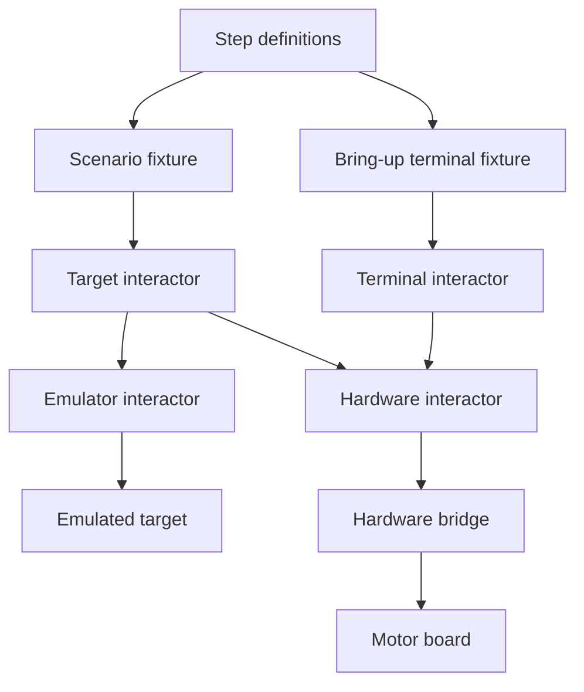
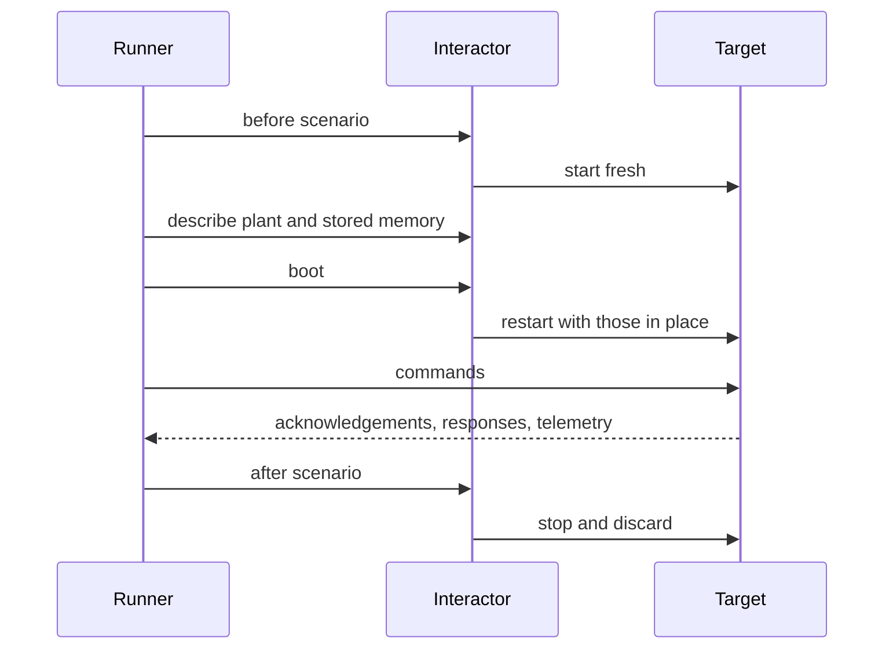
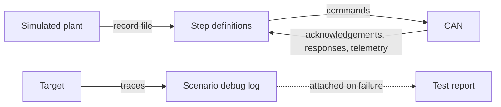

| Field     | Value                      |
|-----------|----------------------------|
| Title     | Integration Testing Design |
| Type      | design                     |
| Status    | accepted                   |
| Version   | 1.7.0                      |
| Component | integration-testing        |
| Date      | 2026-11-06                 |

> **Note — Design-level document**: This document describes *how the integration tests are
> structured*. It expands on the architecture by specifying component responsibilities, data flows,
> and design decisions that would not be obvious to a reviewer unfamiliar with the system.
>
> **Diagrams**: All visuals must be Mermaid fenced code blocks or ASCII art. External image
> references are **not allowed**.

---

## Overview

The suite is a **black-box driver**. It starts a target running the real firmware, speaks to it
over the product's own CAN command set, and asserts on the frames that come back and, on an
emulated target, on the plant's own record. It
does not reach into the firmware, does not mock its components, and knows nothing of its internal
types.

Scenarios are authored in Gherkin and live in a single directory. A tag decides which target
implements a scenario, and the runner is invoked with that tag.

| Tag          | Target                                                               | Detailed in                                    |
|--------------|----------------------------------------------------------------------|------------------------------------------------|
| `@sil`       | Real firmware under an emulator, simulated motor                     | `documentation/design/software-in-the-loop.md` |
| `@hil_motor` | The motor-controller firmware on hardware, over the bridge, CAN only | This document                                  |
| `@hil`       | The bring-up image on hardware, over the bridge, with its terminal   | This document                                  |

`@hil` is the only tag whose scenarios get the terminal (see *Out of scope: the bring-up image*); a
motor-controller scenario on hardware is tagged `@hil_motor`.

> Earlier revisions described an in-process host fixture that mocked the platform and drove the
> state machine directly. No such fixture exists, and none is planned: mocking the platform and
> then asserting on the state machine tests the wiring of the test, not the product.
>
> The host model-in-the-loop tests (`integration_tests/model_in_the_loop`) are not that fixture.
> They mock nothing: they compose the firmware's control-mode state machine, calibration services
> and memory stack against the plant model the emulated target carries, and carry the sweeps over
> laws, plants and seeds that used to be emulated scenarios. They are ordinary unit-test binaries,
> not a target of this suite, and every requirement they cover keeps at least one `@sil` scenario
> here. See Part N of `documentation/design/software-in-the-loop.md`.

---

## Responsibilities

**Is responsible for:**
- Starting, stopping and isolating a target for each scenario
- Presenting one interactor seam so a scenario reads the same whichever target implements it
- Encoding commands and decoding telemetry on the product's wire format
- Describing the simulated world a software-in-the-loop target runs in

**Is NOT responsible for:**
- Control algorithm correctness in the small — that is what the unit tests under each library cover
- CAN framing and payload layout — that is the wire contract tests' job
- Substituting for hardware-in-the-loop, which alone exercises silicon, timing and analogue paths

---

## Component Details

### The interactor seam

Everything a scenario needs from a target sits behind one interface: lifecycle, command and
telemetry transport, and — for a simulated target only — the world the firmware runs in.



The terminal is not part of that seam. It has an interactor of its own, which only the hardware
interactor implements, and a fixture of its own, which exists only in a scenario tagged `@hil` (see
*Out of scope: the bring-up image*). A motor-controller step has no terminal to write to and no trace
to read, and on the emulator there is no terminal interactor at all.

The simulation seam — describe the plant, describe stored memory, restart — defaults to doing
nothing and to reporting that simulation is unsupported. A hardware target inherits that default,
and a scenario that configures a plant fails loudly rather than quietly testing something else.

### Scenario lifecycle

Each scenario gets a fresh target. Setup accumulates in the scenario's own state and is applied in
a single restart, so a scenario that describes a plant, a calibration and a set of algorithms still
starts the target once rather than once per description.



### Observation

The motor-controller scenarios observe the target only through the product's CAN messages and, on a
simulated target, the plant's own record:

- **Telemetry** carries the lifecycle state, the fault code, and the measured speed and position.
- **Command acknowledgements** carry acceptance or the reason for refusal.
- **Responses** carry what the firmware decided and measured: the algorithm each loop ended up
  running (`QueryAlgorithms`), which can differ from what was asked for; the calibration record, the
  online estimates, the control-loop statistics and the reset cause (`QueryParameter`); and the
  electrical parameters an identification broadcasts.
- **Plant trajectory**, on a simulated target only, carries what the motor actually did, sampled
  on the control-tick time base, and the tick each command frame was delivered on, in a record file
  the plant writes in the scenario directory. This is the channel the performance and disturbance
  scenarios measure; see the software-in-the-loop design.

The identification scenarios compare the calibration record, the online estimates and the
electrical-parameters response against the plant the scenario configured. Every value travels as a
float, so no unit is scaled to suit a printout.

Everything a target prints is its debug log. The emulated target's is kept per scenario, and the
report of a failed scenario carries its last lines. Only the bring-up scenarios send terminal
commands and read traces, through the bring-up terminal fixture. Its lines are cleared per scenario
and per restart, so an assertion cannot match a line from an earlier boot.

### Isolation

Scenarios ran into each other through three shared resources, all now per session: the working
directory holding the target's files, the sockets behind the target's serial ports, and the
captured output.

---

## Interfaces

### Provided to step definitions

| Capability        | Purpose                                                                     |
|-------------------|-----------------------------------------------------------------------------|
| Lifecycle         | Start, stop and restart the target                                          |
| Command transport | Send a category command and await its acknowledgement                       |
| Telemetry         | Await a state, a fault code, or read the measured position                  |
| Readings          | Read a numbered parameter or the running algorithms over CAN                |
| Bring-up terminal | Send a terminal command and search the trace output, in `@hil` scenarios    |
| Simulation        | Describe the plant and the stored calibration and configuration             |
| Response          | Capture the plant trajectory and measure step and disturbance metrics on it |

The command transport heartbeats while it awaits an acknowledgement, as a CAN client does. An
identification acknowledges only when it ends, and the target emergency-stops an identification or an
enabled drive whose client falls silent (see the CAN service design).

The transport addresses the node whose heartbeat it waits for at the start of a scenario. A board
answers as its configured base plus the board ID read from its jumpers, so the suite takes the node
ID from the first server heartbeat it sees rather than assuming node 1; the emulated target, with
no jumpers, is node 1. While it waits it broadcasts a status request, which a server answers with a
heartbeat at once, so a target is found as soon as its CAN server is up rather than a heartbeat period
later. It sends one at most once a second: a request a silent target cannot acknowledge stays in the
bus adapter and is delivered in a burst when the target comes back, and a burst of them filled the
target's send queue ahead of the first command's acknowledgement.

### Required from the system under test

- A CAN command set covering mode selection, calibration, alignment, enable, disable, setpoints,
  telemetry requests and fault clearing
- Telemetry reporting state, fault code, measured speed and measured position
- Answers naming the algorithm each control loop is running, and the read-only parameters of
  contract 2.2: calibration record, online estimates, control-loop statistics and reset cause
- For a simulated target, that it read its plant description at boot

No test-only command is added to the product to make the suite work.

---

## Feature-to-Requirements Mapping

Each scenario carries the requirement identifiers it verifies as tags alongside its runner tag.
`documentation/tools/check-requirements-traceability.py`, which `requirements-validation.yml` runs on
every pull request, reads the tags straight from the feature directory, so the mapping lives with the
scenarios rather than in this document where it would rot.

### Two tiers

A requirement states what the drive promises; a scenario states how much and how it is checked. The
two used to be one layer: requirements carried the scenarios' limit tables word for word, so every
retuned limit was edited twice, and a requirement turned "verified" by restating the test that
verified it. They are now kept apart.

```
Tier 1  product requirement   documentation/requirements/*.yaml    what the drive promises
          ^ @REQ tag
Tier 2  acceptance criteria   integration_tests/features/*.feature  how much, on which plant, how checked
```

| Content                                                                                 | Lives in                                      |
|-----------------------------------------------------------------------------------------|-----------------------------------------------|
| What the drive promises, observable at its boundary: CAN, shaft, power stage, NVM, boot | `documentation/requirements/*.yaml`           |
| Numeric limits per law, per plant and per step: settling, overshoot, rise, tail, error  | The `Examples:` tables of the scenarios       |
| Mechanisms and design constraints: storage, interrupt rules, ownership, class structure | The component's design document and AGENTS.md |
| What each CAN contract version added                                                    | The contract changelog in `service-can.md`    |
| How the suite commands the target and decides a verdict                                 | This document and `software-in-the-loop.md`   |
| A guard against a defect that was fixed                                                 | The regression test that reproduces it        |

### Writing a product requirement

- **Solution-free.** No class, method, file or message name, no contract version number, no
  interrupt or storage mechanism. If it cannot be observed from outside the drive, it is design.
- **One promise.** A `shall` holds one promise and the few bounds that are the product's own
  (fault reaction time, identification accuracy, loop period). It stays under about 60 words; the
  checker refuses one over 90.
- **No cross-references.** A `shall` never names another requirement; the checker refuses one that
  does.
- **No limit tables.** A per-law or per-plant envelope is an acceptance criterion: the requirement
  says the envelope holds, and the scenario's `Examples:` table says what it is. A limit pinned from
  a `[METRIC]` line goes in the scenario only.
- **Area prefixes, not method prefixes.** `LCY` lifecycle, `CMS` commissioning, `CTL` control,
  `PRO` protection, `PLT` platform, `COM` communication, `FWU` firmware update, `HWT` hardware-test
  application. How a requirement is verified is its `verification` field.
- **Status and verification are mandatory.** `verified` needs at least one citing scenario;
  `implemented` is met by code checked through unit tests or inspection only.

A broad requirement cited by many scenarios is verified only as far as its scenarios reach: the
checker's listing prints the number of scenarios per requirement, and a review of a new requirement
asks which scenario covers each promise it makes.

### Former requirement identifiers

Requirements written before the two tiers (`REQ-SM`, `REQ-CAL`, `REQ-CAN`, `REQ-HIL` and the
others) were merged into the product requirements below. A former identifier in an old pull request
or issue maps as follows; the checker refuses any of them as a tag.

| New requirement       | Former requirements                                                                                                                                                                                                                                                                                         |
|-----------------------|-------------------------------------------------------------------------------------------------------------------------------------------------------------------------------------------------------------------------------------------------------------------------------------------------------------|
| REQ-LCY-001           | REQ-SM-001, 002, 006, 007; REQ-INT-001, 002, 005                                                                                                                                                                                                                                                            |
| REQ-LCY-002           | REQ-SM-013, 014, 015; REQ-INT-006, 007                                                                                                                                                                                                                                                                      |
| REQ-LCY-003           | REQ-SM-008, 009, 017, 018, 020, 021, 023 to 026; REQ-INT-003                                                                                                                                                                                                                                                |
| REQ-LCY-004           | REQ-CM-001 to 005; REQ-SM-016, 029, 032                                                                                                                                                                                                                                                                     |
| REQ-LCY-005           | REQ-CM-006; REQ-PRT-007                                                                                                                                                                                                                                                                                     |
| REQ-CMS-001           | REQ-CAL-012, 013, 015, 018, 020, 021; REQ-SM-003, 004, 005, 034; REQ-HIL-020, 021                                                                                                                                                                                                                           |
| REQ-CMS-002           | REQ-CAL-001, 005, 009, 010                                                                                                                                                                                                                                                                                  |
| REQ-CMS-003           | REQ-CAL-014, 016, 017, 019, 022 to 025                                                                                                                                                                                                                                                                      |
| REQ-CMS-004           | REQ-SM-010, 011, 031                                                                                                                                                                                                                                                                                        |
| REQ-CTL-001           | REQ-TRQ-002, 007 to 012, 014; REQ-HIL-024                                                                                                                                                                                                                                                                   |
| REQ-CTL-002           | REQ-SPD-008, 009, 010; REQ-HIL-022                                                                                                                                                                                                                                                                          |
| REQ-CTL-003           | REQ-POS-009 to 012, 014; REQ-HIL-023, 025                                                                                                                                                                                                                                                                   |
| REQ-CTL-004           | REQ-CTRL-014                                                                                                                                                                                                                                                                                                |
| REQ-CTL-005           | REQ-CTRL-001 to 003, 006, 008 to 010, 012, 013                                                                                                                                                                                                                                                              |
| REQ-CTL-006           | REQ-CTRL-015 to 017; REQ-SPD-003; REQ-POS-003, 007; REQ-TRQ-003                                                                                                                                                                                                                                             |
| REQ-CTL-007           | REQ-POS-015, 016                                                                                                                                                                                                                                                                                            |
| REQ-PRO-001           | REQ-PRT-001; REQ-TRQ-006                                                                                                                                                                                                                                                                                    |
| REQ-PRO-002           | REQ-PRT-002, 008                                                                                                                                                                                                                                                                                            |
| REQ-PRO-003           | REQ-PRT-009; REQ-TRQ-013                                                                                                                                                                                                                                                                                    |
| REQ-PRO-004           | REQ-PRT-003, 004                                                                                                                                                                                                                                                                                            |
| REQ-PRO-005           | REQ-SM-028, 033; REQ-EH-015                                                                                                                                                                                                                                                                                 |
| REQ-PRO-006           | REQ-PRT-011                                                                                                                                                                                                                                                                                                 |
| REQ-PLT-001           | REQ-EH-008, 009, 012; REQ-HIL-012                                                                                                                                                                                                                                                                           |
| REQ-PLT-002           | REQ-EH-001 to 003, 006, 007; REQ-HIL-010                                                                                                                                                                                                                                                                    |
| REQ-PLT-003           | REQ-EH-004, 005; REQ-HIL-008                                                                                                                                                                                                                                                                                |
| REQ-PLT-004           | REQ-PERF-001, 002, 004 to 006, 008                                                                                                                                                                                                                                                                          |
| REQ-COM-001           | REQ-CAN-001 to 003, 007 to 011, 013 to 021, 023 to 025; REQ-CM-007                                                                                                                                                                                                                                          |
| REQ-COM-002           | REQ-INT-013, 014; REQ-CAN-012                                                                                                                                                                                                                                                                               |
| REQ-COM-003           | REQ-CAN-006                                                                                                                                                                                                                                                                                                 |
| REQ-FWU-001           | REQ-BOOT-001, 002, 003, 007                                                                                                                                                                                                                                                                                 |
| REQ-FWU-002           | REQ-UPD-002, 003, 005, 006, 011, 013, 014; REQ-BOOT-004, 005                                                                                                                                                                                                                                                |
| REQ-FWU-003           | REQ-UPD-007                                                                                                                                                                                                                                                                                                 |
| REQ-FWU-004           | REQ-UPD-009, 010, 012                                                                                                                                                                                                                                                                                       |
| REQ-FWU-005           | REQ-UPD-001, 004                                                                                                                                                                                                                                                                                            |
| REQ-HWT-001           | REQ-HIL-001, 004, 005, 006                                                                                                                                                                                                                                                                                  |
| moved out (see below) | REQ-TRQ-001, 004; REQ-SPD-001, 004, 005, 007; REQ-POS-001, 002, 004, 006, 008; REQ-SPD-002; REQ-CAL-002 to 004, 006 to 008, 011; REQ-SM-019, 022, 027, 030; REQ-CTRL-007, 011; REQ-INT-008 to 012, 015 to 017; REQ-CAN-004, 005; REQ-EH-013, 014; REQ-PERF-007; REQ-UPD-008, 015; REQ-BOOT-006; REQ-POS-013 |

The former requirements moved out were design constraints (fixed-size law storage, cascade rates,
callback ownership, the torque-constant derivation, NVM writer ordering, the CAN client API and its
tracing), rules of this test suite (CAN-only commands and verdicts, no test-only messages), wire
contract test rules, and guards against fixed defects; each is stated in the design document of its
component.

---

## Commands and Verdicts over CAN Only

> **Status: done.** Every row of *What has to move* is done, the guard of migration step 4 is in
> place, and the CAN Commander shows every new message: the motor-controller scenarios command the
> target and decide their verdicts over CAN and the plant record only, as the sections above
> describe.

### The rule

Every scenario of the motor controller application, on the emulator and on hardware alike, sends
every command as a CAN frame and decides pass or fail only from the CAN frames the target sends and,
on the emulator, from what the simulated plant records about itself. The serial port is a debug
channel: the suite records everything the target prints and attaches it to a failed scenario, but
never writes to it and never parses it for a verdict.

- **CAN is the product's control surface.** A deployed controller is commanded over the bus, by the
  CAN Commander or a host. A scenario that goes through the terminal proves a path no deployed system
  uses, and stays green while the CAN path is broken.
- **Traces are not a contract.** Their wording changes with any logging edit, nothing versions them,
  and a parser can match a stale line. The CAN contract is versioned and has its own wire tests.
- **One step, two targets.** When both targets speak only CAN, a step reads the same on the emulator
  and on hardware; today some steps take the terminal on one target and CAN on the other.
- **Debug output is free to change.** Trace wording, verbosity and rate stop mattering to the suite,
  and a slow or chatty serial port can no longer delay or break a verdict.

### Channels after the change

| Channel                            | Direction     | Carries                                                       | Asserted on                       |
|------------------------------------|---------------|---------------------------------------------------------------|-----------------------------------|
| CAN                                | both          | commands, acknowledgements, responses, telemetry              | yes                               |
| Plant record (emulator only)       | target → host | the trajectory, and the tick each command frame was delivered | yes                               |
| Serial port and semihosting output | target → host | traces, terminal output, fault dumps                          | no: recorded, attached on failure |



On the emulator, CAN frames have a second emulated serial port to themselves, in the same text
encoding in both directions, and the plant's samples and command-delivery ticks are in a file the
plant writes in the scenario directory through semihosting, which the host reads back. On hardware,
CAN goes through the bridge's own bus.

### What has to move

Each row was a dependence on the terminal or on a trace, and what replaced it.

| Formerly, over the serial port                                | Used by                                                       | Over CAN                                                                                                                                                | Contract  |
|---------------------------------------------------------------|---------------------------------------------------------------|---------------------------------------------------------------------------------------------------------------------------------------------------------|-----------|
| `clear_cal`                                                   | starting with no valid calibration, on both targets           | `ClearCalibration`, refused unless stopped                                                                                                              | 2.2       |
| `calibrate`                                                   | the full calibration "run from the terminal", on both targets | `Calibrate`, acknowledged when the sequence ends, as the identifications are                                                                            | 2.2       |
| `[SM] Calibration record:` trace                              | identification scenarios and the hardware motor scenarios     | `QueryParameter` for resistance, inductance, pole pairs, inertia and friction (`0x40`–`0x45`), the current offsets and the cogging peak (`0x80`–`0x83`) | 2.1 + 2.2 |
| `estimate_status` and the `[EST]` traces                      | online estimator scenarios                                    | `QueryParameter` for the online estimates (`0x90`–`0x93`)                                                                                               | 2.2       |
| `loop_stats`, `clear_stats` and the `[LOOP]` traces           | control-loop timing                                           | `QueryParameter` for the loop statistics (`0xA0`–`0xA7`) and `ClearDiagnostics`                                                                         | 2.2       |
| `[SM] … loop algorithm:` traces                               | controller matrix                                             | `QueryAlgorithms`                                                                                                                                       | 2.1       |
| `watchdog_stall`, the `[WDT]` trace and the reset-cause trace | emulator watchdog                                             | the stall is scheduled in the world description, like a disturbance; the reset cause is read as `resetCause` (`0xB0`) once the heartbeat returns        | 2.2       |
| `CAN_RX` and `CAN_TX` lines                                   | every emulator scenario                                       | the CAN-only emulated serial port                                                                                                                       | transport |
| `PLANT` and `CAN_RX_AT` lines                                 | step-response, disturbance and estimator scenarios            | the plant record file                                                                                                                                   | transport |

Algorithm selection on the hardware motor scenarios already goes over CAN (`SelectAlgorithm`, contract
2.1): reading the terminal's reply raced the trace output, so a heartbeat trace line could be taken for it.

The runner's own `[METRIC]` lines are its report on standard error, not target output, and stay.

Every new message is a product diagnostic that the CAN Commander shows as well: a commissioning
engineer needs the estimates, the loop statistics and the reset cause as much as a test does, so no
message exists only for testing. Stalling the event loop is the one injected fault, and
it is not a command: it is part of the simulated world and exists only on the emulator.

### Out of scope: the bring-up image

The hardware-test image (scenarios tagged `@hil`: ADC, PWM, encoder, EEPROM, CAN peripheral, UART,
hard fault, reset cause, watchdog) brings up a board; it is not the motor controller. Its terminal is
its interface, the UART scenario tests that terminal itself, and the CAN scenario checks the
peripheral before any CAN command server runs. It keeps using the terminal, through a fixture that
a hook creates only for a scenario tagged `@hil`.

The scenarios that reset the board (the reset command, the watchdog stall and the hard fault) wait for
the restart before they talk to the terminal again. The boot banner's reset-cause line marks it, and so
does the bridge dropping the serial link, which a reset can do. A probe sent earlier would reach the
image that is about to reset. The session reconnects to the bridge whenever a link has dropped, so one
dropped link fails no later scenario.

### Migration

One follow-up change, in this order, each step leaving the suite green:

1. **Contract 2.2.** Add `Calibrate`, `ClearCalibration`, `ClearDiagnostics` and the read-only
   parameters of `service-can.md` Part A: wire contract, wire tests, firmware handlers, and the CAN
   Commander views. Done.
2. **Emulator transport.** CAN moves to its own emulated serial port, the plant record to its file,
   and the serial output becomes the per-scenario debug log. Done.
3. **Steps.** Port the rows above one feature at a time; the emulator watchdog scenario schedules its
   stall in the world description. Done.
4. **Guard.** Remove terminal writes and trace reads from the fixture the application scenarios use;
   they remain only in the bring-up fixture, so a new step cannot bring them back. Done.
5. **Documents.** Rewrite Observation and Interfaces here, and Parts B, D, G, I and J and the
   Interfaces of the software-in-the-loop design, for the new channels. Done.
