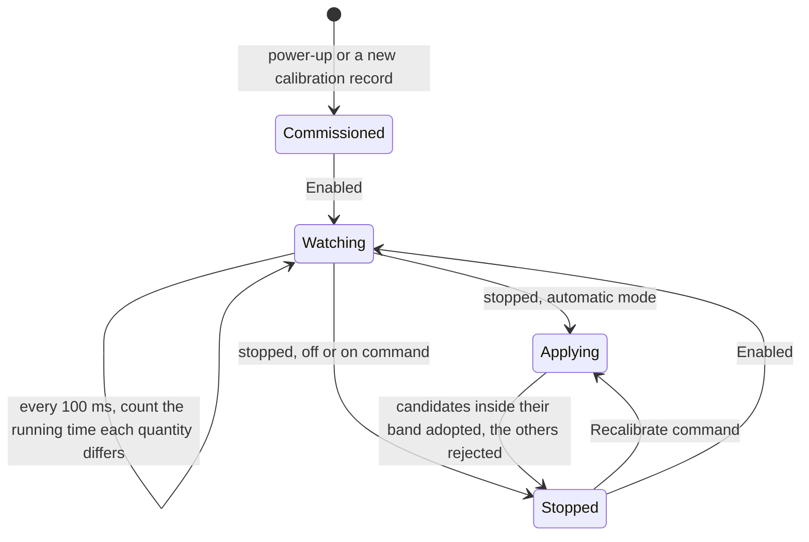
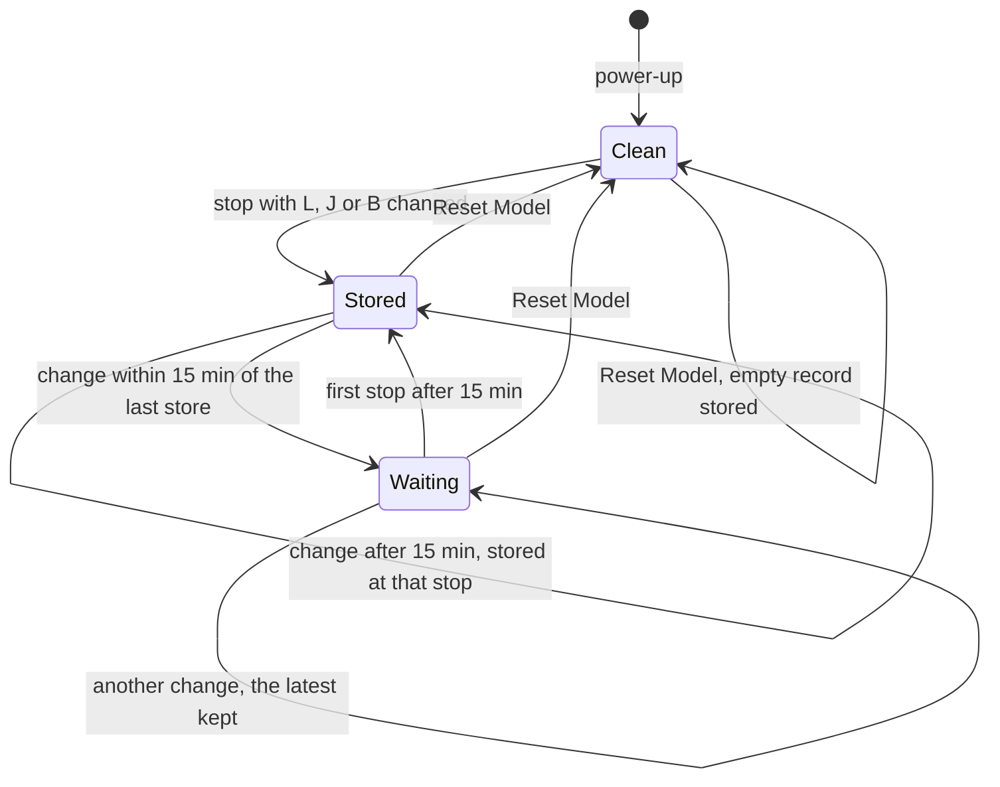

| Field     | Value                |
|-----------|----------------------|
| Title     | Online Recalibration |
| Type      | design               |
| Status    | draft                |
| Version   | 0.3.0                |
| Component | online-recalibration |
| Date      | 2026-11-11           |

> **IMPORTANT — Implementation-blind document**: This document describes *behavior, structure, and
> responsibilities* WITHOUT referencing code. **No code blocks using programming languages (C++, C,
> Python, CMake, shell, etc.) are allowed.** Use Mermaid diagrams to express behavior instead.
> Prose descriptions of algorithms are encouraged; source-level details are not.
>
> **Diagrams**: All visuals must be Mermaid (` ```mermaid `), TikZ via ` ```{=latex} ` raw blocks (source in
> `documentation/tikz/`), or ASCII art. External image references (``) are **not allowed**.

---

## Responsibilities

In speed and position mode the drive re-estimates its motor while it runs: the resistance and inductance from a
small d-axis injection (`service-electrical-ident.md`, Excitation), the inertia and viscous friction from the speed
and torque current (`service-mechanical-ident.md`), the magnet flux linkage from the quadrature voltage
(`service-flux-linkage-ident.md`, Part D). The loop gains are designed from the calibration record, so a
load whose inertia differs from the commissioned one, a winding whose resistance has risen, or a magnet that has
warmed and weakened, runs on a model that no longer matches it. Online recalibration lets the gains follow the estimates, safely (REQ-CMS-003),
and keeps the inductance, inertia and friction it learned across power cycles (REQ-CMS-003).

**Is responsible for:**
- Deciding when an estimate may replace the model the loops are designed from: once its estimator reports it
  settled, once it has differed from that model by more than a threshold for a dwell time of running, and only
  inside a plausibility band around the commissioned value.
- Applying the new model only while the drive is stopped, redesigning the current and speed loops from it with the
  loop bandwidths the operator or the calibration chose.
- The operator's choice of when: never, on command, or on every stop.
- Counting each recalibration applied and each estimate rejected, and showing the model in use.
- Carrying the flux linkage in use into torque mode, which estimates nothing, until the model is reverted or the
  drive is calibrated again (Part D).
- Storing the recalibrated inductance, inertia and viscous friction, at most once every 15 minutes, restoring them at
  power-up while they belong to the commissioned model, and discarding them on the operator's command.

**Is NOT responsible for:**
- Changing a gain while the drive is `Enabled`. The current and speed loop designs are not interrupt-safe; the drive
  waits for its next stop.
- Changing the calibration record. It keeps the commissioned values; the learned ones are a record of their own.
- Storing the resistance or the flux linkage. The resistance tracks the winding temperature, which is estimated from
  it against the commissioned resistance (`fault-supervision.md`, Part K), so a hot resistance stored as the baseline
  would read as a cold winding at the next power-up. The flux linkage follows the magnet temperature the same way: a
  weakened magnet stored as the baseline would be restored at power-up on a cold magnet.
- Estimating in torque mode, which runs no estimators.

---

## Component Details

### Part A — The model in use

The model in use holds the five quantities the loops are designed from: resistance, inductance, inertia, viscous
friction and flux linkage. At power-up, and whenever the calibration record changes — a calibration, a motor parameter written over
CAN, a cleared calibration — it is the commissioned model, the record's values, with the stored inductance, inertia
and friction in place of the record's while the mode is not off (Part F). A recalibration replaces some of its
quantities; the record does not change. A control-mode switch keeps the model in use: the new mode's loops are
designed from it once its machine is ready.

### Part B — When an estimate is used

The event loop reads the estimates every 100 ms while the drive is `Enabled`. A quantity is a candidate when:

1. **Its estimator has settled.** The electrical estimator once it has taken the 200 updates it needs before it
   publishes; the mechanical estimator once a direction's fit has settled (`service-mechanical-ident.md`). An
   estimator that has not settled since it was seeded publishes its seed.
2. **It differs from the model in use by more than its threshold,** and has done so for **5 s of running**. The
   threshold is 10 % for the resistance, inductance, inertia and friction and 5 % for the flux linkage, whose
   estimate is the least noisy and whose drift is slow. Time spent stopped does not count; a reading within the
   threshold starts the count again.

A candidate is applied only inside its plausibility band, a ratio to the commissioned value:

| Quantity         | Band         | Why                                                                          |
|------------------|--------------|------------------------------------------------------------------------------|
| Resistance       | 0.7 – 2.0 ×  | Copper from −50 °C to 280 °C around a 25 °C commissioning                    |
| Inductance       | 0.5 – 1.5 ×  | Saturation and the d-axis injection's spread; more is a wrong reading        |
| Inertia          | 0.5 – 5.0 ×  | A load coupled or removed; outside it the speed loop's design fails          |
| Viscous friction | 0.2 – 5.0 ×  | Friction varies widely with temperature and lubrication                      |
| Flux linkage     | 0.75 – 1.1 × | A magnet loses 0.1 – 0.2 % per kelvin; −25 % is a hot winding, more is wrong |

A candidate outside its band is rejected: it is counted, traced, and the model in use keeps its value. A quantity
whose commissioned value is not positive — a record without friction — is never recalibrated.

The resistance and inductance bands also gate the one use of an estimate that needs no stop: the sampling-skew
correction follows a settled electrical estimate inside them while the drive runs
([sampling skew](platform-sampling-skew.md) Part C).

### Part C — When it is applied

| Mode       | Behaviour                                                                                                         |
|------------|-------------------------------------------------------------------------------------------------------------------|
| Off        | Estimates are only read, as before (the default)                                                                  |
| On command | A Recalibrate command while stopped adopts every settled estimate beyond its threshold, inside its band, no dwell |
| Automatic  | Every stop of a running drive applies the candidates that have met the dwell                                      |

The mode is a drive-wide setting of the configuration record (`service-nvm.md`), read and written over CAN
(`service-can.md`, contract 2.17). The CAN Commander chooses it on its Configuration tab and shows the model in
use, the counters and the Recalibrate and Reset Model commands on its Diagnostics tab (`tool-can-commander.md`).



### Part D — How it is applied

Applying a model redesigns the current loop from the resistance, inductance and flux linkage in use and the speed
loop, and in position mode the position loop, from the inertia and friction in use, with the record's pole pairs. The operator's loop settings are then applied again, so the bandwidths do not change. It happens only while
the drive is stopped, so neither control interrupt runs a loop half-redesigned; the next `Enable` resets the loops
as it always does. The estimators are not seeded again: they keep tracking from where they are, and the model in use
now agrees with them.

The flux linkage in use reaches everything that is built from the magnet's strength: the back-EMF feed-forward
of the current loop, the torque constant (torque per ampere) of the speed loop's design and of the online mechanical
estimator, the friction and cogging feed-forwards, which convert a torque to a current, and the conversion of a
torque setpoint in newton-metres to a current over CAN. Without it, a magnet that has lost 10 % of its flux would
deliver 10 % less torque for the current the speed loop asks for, and the speed loop would be designed for a
stronger actuator than it has.

**Torque mode.** Torque mode runs no estimator, so it cannot learn the flux linkage, but it keeps the one in use: on
a switch to torque mode the new machine applies the flux linkage in use once it is ready, and the conversion of
a newton-metre setpoint and the current loop's back-EMF feed-forward use it. The resistance, inductance, inertia and
friction in use are not carried, since torque mode does not use them. The flux linkage in use stays until Reset
Model, a new calibration or a change of the calibration record; those return to the record's value, and so does
a power cycle, because the flux linkage is never stored.

### Part E — Reporting

Each applied quantity and each rejected candidate is traced with its value and its commissioned value. Two counters
of applied quantities and rejected candidates, and the five quantities of the model in use, are read-only
parameters over CAN (the flux linkage in torque mode too, where it shows the one carried); the motor parameters keep
reading the calibration record. The counters restart at power-up.

---

### Part F — Storing the model

A recalibration that changes the inductance, inertia or viscous friction in use stores the three of them in the
learned-model record (`service-nvm.md`), with a check of the commissioned values they were learned from. The
resistance is never stored.

- **Rate.** At most one store every 15 minutes of uptime. The first change after power-up is stored at the stop that
  made it. A change made sooner waits, and the first stop once the 15 minutes have passed stores the model then in
  use, so only the latest of several waiting changes reaches the record. A store that finds the device busy is tried
  again 10 ms later; one that fails waits for the next window.
- **Mode off** never stores, and runs the commissioned model; the stored values are kept for when the mode is turned
  on again.
- **Power-up.** While the mode is on command or automatic, and the record's commissioned inductance, inertia and
  friction still match the check, the stored values are in use from the first `Ready`, each only inside its
  plausibility band (Part B). A new calibration or a changed motor parameter changes the check, so the stored values
  are no longer used, and the next store replaces them.
- **Reset Model.** A CAN command, accepted only while stopped, stores an empty learned model at once, outside the
  15-minute rate, and returns the model in use to the commissioned one, the resistance included. It is acknowledged
  once the record is stored.
- **Count.** The stores since power-up are a read-only parameter over CAN, so a test can bound the writes.



## Interfaces

### Provided

| Interface   | Purpose                               | Contract                                                            |
|-------------|---------------------------------------|---------------------------------------------------------------------|
| Mode        | Off, on command or automatic          | Stored in the configuration record; takes effect at the next stop   |
| Recalibrate | Adopt the settled estimates now       | Refused while running, in torque mode and with the mode off         |
| Model       | The five quantities the loops use     | Read-only; equals the calibration record until a recalibration      |
| Counters    | Applied quantities, rejected readings | Read-only; restart at power-up                                      |
| Reset Model | Discard the stored model              | Refused while running; acknowledged once the empty record is stored |
| Stores      | Learned-model stores since power-up   | Read-only; at most one per 15 minutes of uptime                     |

### Required

| Interface            | Purpose                                     | Contract                                                      |
|----------------------|---------------------------------------------|---------------------------------------------------------------|
| Online estimators    | Current estimates and whether they settled  | Written by the low-priority interrupt; read on the event loop |
| Calibration record   | The commissioned model and the loop design  | Flux linkage, pole pairs, bandwidths                          |
| Learned-model record | The stored inductance, inertia and friction | Loaded once at power-up; written whole and read back          |
| Lifecycle            | Entering `Ready` from `Enabled`             | Announced on the event loop                                   |
| Timer                | The 100 ms observation                      | Runs on the event loop                                        |

---

## Constraints & Limitations

| Constraint     | Description                                                                          |
|----------------|--------------------------------------------------------------------------------------|
| Stopped only   | A change during a long run waits for the next stop                                   |
| Resistance     | Never stored; every power-up starts from the commissioned resistance                 |
| Flux linkage   | Never stored; every power-up starts from the commissioned flux linkage               |
| Store rate     | At most one learned-model store per 15 minutes of uptime; the reset is not limited   |
| Fixed criteria | The 10 % and 5 % thresholds, the 5 s dwell and the bands are constants, not settings |
| Torque mode    | Runs no estimators; the command is refused, the flux linkage in use is kept (Part D) |
