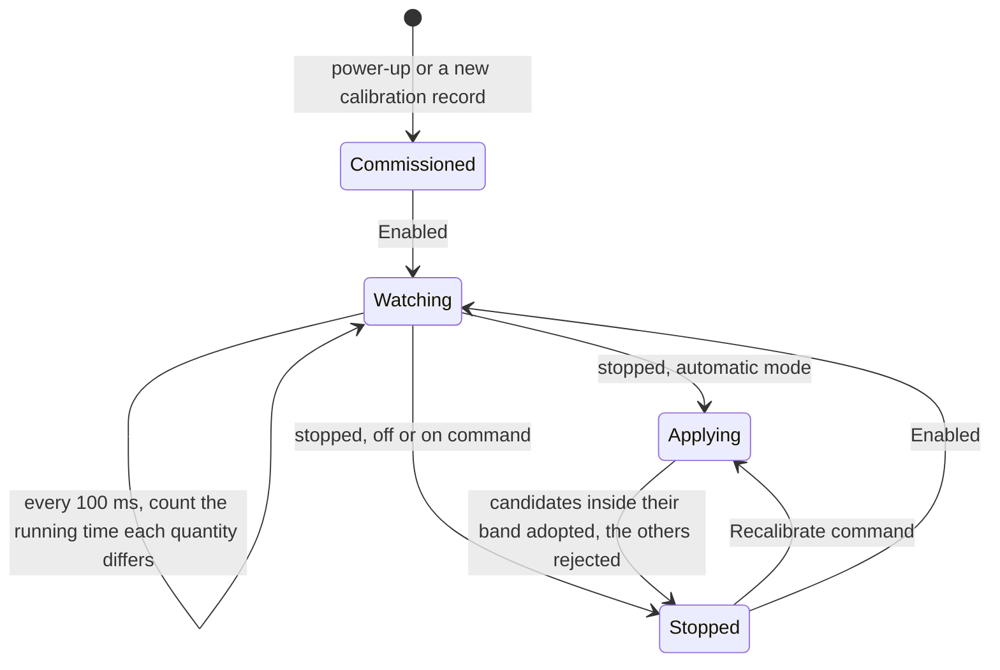

| Field     | Value                |
|-----------|----------------------|
| Title     | Online Recalibration |
| Type      | design               |
| Status    | draft                |
| Version   | 0.1.0                |
| Component | online-recalibration |
| Date      | 2026-11-06           |

> **IMPORTANT — Implementation-blind document**: This document describes *behavior, structure, and
> responsibilities* WITHOUT referencing code. **No code blocks using programming languages (C++, C,
> Python, CMake, shell, etc.) are allowed.** Use Mermaid diagrams to express behavior instead.
> Prose descriptions of algorithms are encouraged; source-level details are not.
>
> **Diagrams**: All visuals must be Mermaid (` ```mermaid `), TikZ via ` ```{=latex} ` raw blocks (source in
> `documentation/tikz/`), or ASCII art. External image references (``) are **not allowed**.

---

## Responsibilities

In speed and position mode the drive re-estimates its motor while it runs: the resistance and inductance from a
small d-axis injection (`service-electrical-ident.md`, Excitation), the inertia and viscous friction from the speed
and torque current (`service-mechanical-ident.md`). The loop gains are designed from the calibration record, so a
load whose inertia differs from the commissioned one, or a winding whose resistance has risen, runs on a model that
no longer matches it. Online recalibration lets the gains follow the estimates, safely (REQ-CAL-023, REQ-CAL-024).

**Is responsible for:**
- Deciding when an estimate may replace the model the loops are designed from: once its estimator reports it
  settled, once it has differed from that model by more than a threshold for a dwell time of running, and only
  inside a plausibility band around the commissioned value.
- Applying the new model only while the drive is stopped, redesigning the current and speed loops from it with the
  loop bandwidths the operator or the calibration chose.
- The operator's choice of when: never, on command, or on every stop.
- Counting each recalibration applied and each estimate rejected, and showing the model in use.

**Is NOT responsible for:**
- Changing a gain while the drive is `Enabled`. The current and speed loop designs are not interrupt-safe; the drive
  waits for its next stop.
- Storing the recalibrated model. The calibration record keeps the commissioned values, and every power-up starts
  from them; storing the inductance, inertia and friction is a later step. The resistance is never stored: it tracks
  the winding temperature, which is estimated from it against the commissioned resistance (`fault-supervision.md`,
  Part K).
- Torque mode, which runs no estimators.

---

## Component Details

### Part A — The model in use

The model in use holds the four quantities the loops are designed from: resistance, inductance, inertia and viscous
friction. At power-up, and whenever the calibration record changes — a calibration, a motor parameter written over
CAN, a cleared calibration — it is the commissioned model, the record's values. A recalibration replaces some of its
quantities; the record does not change. A control-mode switch keeps the model in use: the new mode's loops are
designed from it once its machine is ready.

### Part B — When an estimate is used

The event loop reads the estimates every 100 ms while the drive is `Enabled`. A quantity is a candidate when:

1. **Its estimator has settled.** The electrical estimator once it has taken the 200 updates it needs before it
   publishes; the mechanical estimator once a direction's fit has settled (`service-mechanical-ident.md`). An
   estimator that has not settled since it was seeded publishes its seed.
2. **It differs from the model in use by more than 10 %,** and has done so for **5 s of running**. Time spent
   stopped does not count; a reading within 10 % starts the count again.

A candidate is applied only inside its plausibility band, a ratio to the commissioned value:

| Quantity         | Band        | Why                                                                   |
|------------------|-------------|-----------------------------------------------------------------------|
| Resistance       | 0.7 – 2.0 × | Copper from −50 °C to 280 °C around a 25 °C commissioning             |
| Inductance       | 0.5 – 1.5 × | Saturation and the d-axis injection's spread; more is a wrong reading |
| Inertia          | 0.5 – 5.0 × | A load coupled or removed; outside it the speed loop's design fails   |
| Viscous friction | 0.2 – 5.0 × | Friction varies widely with temperature and lubrication               |

A candidate outside its band is rejected: it is counted, traced, and the model in use keeps its value. A quantity
whose commissioned value is not positive — a record without friction — is never recalibrated.

### Part C — When it is applied

| Mode       | Behaviour                                                                                                       |
|------------|-----------------------------------------------------------------------------------------------------------------|
| Off        | Estimates are only read, as before (the default)                                                                |
| On command | A Recalibrate command while stopped adopts every settled estimate more than 10 % off, inside its band, no dwell |
| Automatic  | Every stop of a running drive applies the candidates that have met the dwell                                    |

The mode is a drive-wide setting of the configuration record (`service-nvm.md`), read and written over CAN
(`service-can.md`, contract 2.16).



### Part D — How it is applied

Applying a model redesigns the current loop from the resistance and inductance in use and the speed loop, and in
position mode the position loop, from the inertia and friction in use, with the record's flux linkage and pole
pairs. The operator's loop settings are then applied again, so the bandwidths do not change. It happens only while
the drive is stopped, so neither control interrupt runs a loop half-redesigned; the next `Enable` resets the loops
as it always does. The estimators are not seeded again: they keep tracking from where they are, and the model in use
now agrees with them.

### Part E — Reporting

Each applied quantity and each rejected candidate is traced with its value and its commissioned value. Two counters
of applied quantities and rejected candidates, and the four quantities of the model in use, are read-only
parameters over CAN; the motor parameters keep reading the calibration record. The counters restart at power-up.

---

## Interfaces

### Provided

| Interface   | Purpose                               | Contract                                                          |
|-------------|---------------------------------------|-------------------------------------------------------------------|
| Mode        | Off, on command or automatic          | Stored in the configuration record; takes effect at the next stop |
| Recalibrate | Adopt the settled estimates now       | Refused while running, in torque mode and with the mode off       |
| Model       | The four quantities the loops use     | Read-only; equals the calibration record until a recalibration    |
| Counters    | Applied quantities, rejected readings | Read-only; restart at power-up                                    |

### Required

| Interface          | Purpose                                    | Contract                                                      |
|--------------------|--------------------------------------------|---------------------------------------------------------------|
| Online estimators  | Current estimates and whether they settled | Written by the low-priority interrupt; read on the event loop |
| Calibration record | The commissioned model and the loop design | Flux linkage, pole pairs, bandwidths                          |
| Lifecycle          | Entering `Ready` from `Enabled`            | Announced on the event loop                                   |
| Timer              | The 100 ms observation                     | Runs on the event loop                                        |

---

## Constraints & Limitations

| Constraint     | Description                                                                 |
|----------------|-----------------------------------------------------------------------------|
| Stopped only   | A change during a long run waits for the next stop                          |
| Not persisted  | Every power-up starts from the commissioned model                           |
| Fixed criteria | The 10 % threshold, the 5 s dwell and the bands are constants, not settings |
| Torque mode    | Runs no estimators; the mode has no effect and the command is refused       |
