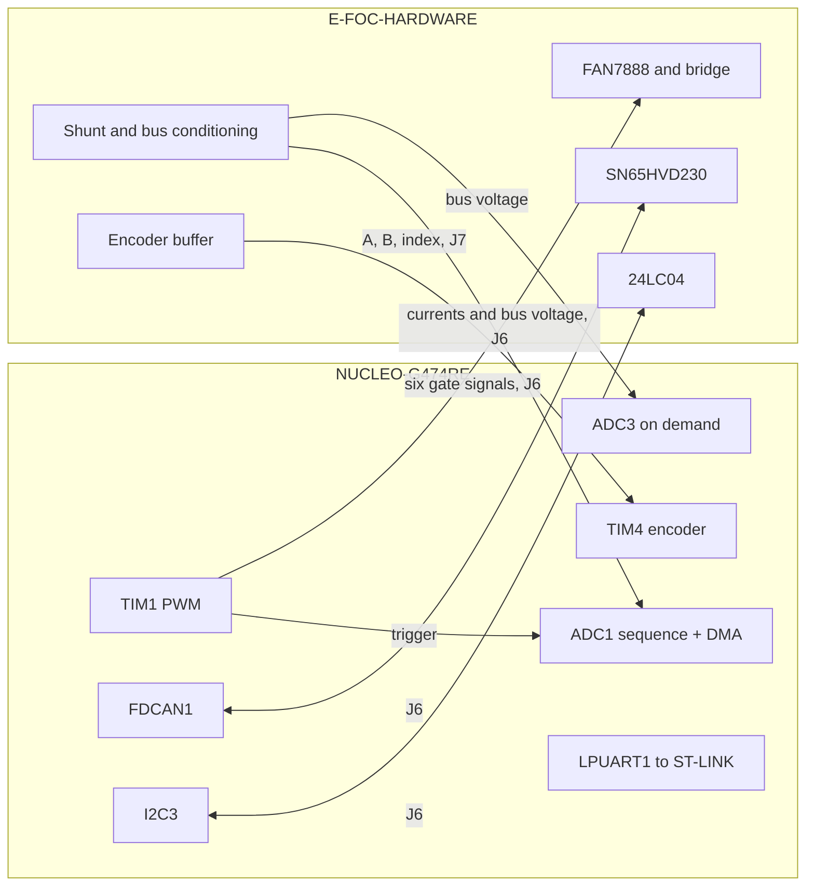

| Field     | Value                                       |
|-----------|---------------------------------------------|
| Title     | Platform: NUCLEO-G474RE with E-FOC-HARDWARE |
| Type      | design                                      |
| Status    | draft                                       |
| Version   | 0.1.0                                       |
| Component | platform-nucleo-g474re                      |
| Date      | 2026-10-29                                  |

> **IMPORTANT — Implementation-blind document**: This document describes *behavior, structure, and
> responsibilities* WITHOUT referencing code. **No code blocks using programming languages (C++, C,
> Python, CMake, shell, etc.) are allowed.** Use Mermaid diagrams to express behavior instead.
> Prose descriptions of algorithms are encouraged; source-level details are not.
>
> **Diagrams**: All visuals must be Mermaid (` ```mermaid `), TikZ via ` ```{=latex} ` raw blocks (source in
> `documentation/tikz/`), or ASCII art. External image references (``) are **not allowed**.

---

## Responsibilities

The NUCLEO-G474RE platform drives the E-FOC-HARDWARE power board from an ST NUCLEO-G474RE (STM32G474RET6,
Cortex-M4F at 170 MHz) wired to the board's two MCU headers, J6 (2×12) and J7 (2×6). It provides the same
platform interface as the EK-TM4C1294XL, so the application runs unchanged.

**Is responsible for:**

- Generating the six gate signals with dead time from one advanced-control timer, and cutting them in a
  handful of instructions on any fault.
- Sampling the three phase shunts, the total current and the bus voltage once per PWM period, at the centre
  of the low-side window.
- Checking over-current, over-voltage and under-voltage on every sample and latching the bridge off.
- Measuring the bus voltage on demand, also while the bridge is stopped.
- Decoding the quadrature encoder, running the CAN bus, the console, the board-ID switches, the power-good
  input and the three status LEDs.
- Storing the calibration and configuration records in the board's 24LC04 I²C EEPROM.

**Is not responsible for:**

- The board's SPI flash (J6 pins 7, 10, 12, 14) and serial header (J6 pins 9, 11); the console runs on the
  Nucleo's ST-LINK virtual COM port instead.
- Hall sensors: the board routes none to its MCU headers.

---

## Component Details

### Part A — wiring

Every signal goes to a pin that is free on the Nucleo as shipped: the crystal pins (PF0/PF1, PC14/PC15), the
debug pins (PA13/PA14, PB3), the virtual COM port (PA2/PA3), the user LED and button (PA5, PC13) and the
BOOT0-shared PB8 are left alone. PB8 matters most: the board pulls I²C high with 10 kΩ, which on PB8 would boot
the system memory.

Header positions follow ST's morpho numbering (CN7 left, CN10 right) and the Arduino labels; they were taken
from the Zephyr board description of the NUCLEO-G474RE and should be checked against ST user manual UM2505
before the first power-up.

J6, the 2×12 signal header:

| J6                   | Signal            | STM32G474 | Function             | Nucleo header |
|----------------------|-------------------|-----------|----------------------|---------------|
| 1                    | GND               | GND       | —                    | any GND       |
| 2                    | +3.3 V            | —         | leave open           | —             |
| 3                    | VOLT_TOTAL        | PB0       | ADC1 IN15, ADC3 IN12 | A3, CN7-34    |
| 4                    | CUR_TOTAL         | PC1       | ADC1 IN7, COMP3 IN+  | A4, CN7-36    |
| 5                    | CUR_C             | PC0       | ADC1 IN6             | A5, CN7-38    |
| 6                    | CUR_B             | PA1       | ADC1 IN2             | A1, CN7-30    |
| 8                    | CUR_A             | PA0       | ADC1 IN1             | A0, CN7-28    |
| 13                   | I2C_SCL           | PC8       | I2C3 SCL             | CN10-2        |
| 15                   | CAN_RX            | PA11      | FDCAN1 RX            | CN10-14       |
| 16                   | I2C_SDA           | PC9       | I2C3 SDA             | CN10-1        |
| 17                   | POWER_GOOD        | PB2       | input, pull-up       | CN10-22       |
| 18                   | CAN_TX            | PA12      | FDCAN1 TX            | CN10-12       |
| 19                   | PWM_C_H           | PA10      | TIM1 CH3             | D2, CN10-33   |
| 20                   | PWM_C_L           | PB15      | TIM1 CH3N            | CN10-26       |
| 21                   | PWM_B_H           | PA9       | TIM1 CH2             | D8, CN10-21   |
| 22                   | PWM_B_L           | PB14      | TIM1 CH2N            | CN10-28       |
| 23                   | PWM_A_H           | PA8       | TIM1 CH1             | D7, CN10-23   |
| 24                   | PWM_A_L           | PB13      | TIM1 CH1N            | CN10-30       |
| 7, 9, 10, 11, 12, 14 | flash SPI, serial | —         | not used             | —             |

J7, the 2×6 operator header:

| J7 | Signal        | STM32G474 | Function                | Nucleo header |
|----|---------------|-----------|-------------------------|---------------|
| 1  | GND           | GND       | —                       | any GND       |
| 2  | +3.3 V        | —         | leave open              | —             |
| 3  | BTN_3         | PC12      | board ID bit 2, pull-up | CN7-3         |
| 4  | BTN_2         | PC11      | board ID bit 1, pull-up | CN7-2         |
| 5  | BTN_1         | PC10      | board ID bit 0, pull-up | CN7-1         |
| 6  | ENC_A         | PB6       | TIM4 CH1                | D10, CN10-17  |
| 7  | ENC_C (index) | PD2       | input                   | CN7-4         |
| 8  | ENC_B         | PB7       | TIM4 CH2                | CN7-21        |
| 9  | LED_G         | PB4       | warning LED             | D5, CN10-27   |
| 10 | LED_R         | PB5       | operational LED         | D4, CN10-29   |
| 11 | GND           | GND       | —                       | any GND       |
| 12 | LED_B         | PB10      | failure LED             | D6, CN10-25   |

The LED roles follow the J7 pins the EK-TM4C1294XL adapter drives, so both controllers light the same LED for
the same state. PC6 (CN10-4) carries the control-loop timing pulse for an oscilloscope.

Both boards regulate their own 3.3 V, so only the grounds are joined; the Nucleo is powered from its ST-LINK USB
port. The conditioning amplifiers bias the current signals at half of the power board's 3.3 V while the ADC
measures against the Nucleo's; the current-offset calibration absorbs the difference.

### Part B — clock, PWM and the sampling point

The core runs at 170 MHz from the Nucleo's 24 MHz crystal. TIM1 counts centre-aligned from the same clock, so
a 20 kHz PWM is 4250 ticks up and 4250 down. Each phase is a channel and its complementary output, active high
as the FAN7888 inputs expect, with the requested dead time inserted by the timer. With the main output disabled,
every gate input sits at its idle low level, so all six FETs are off.

The high-side pulse is centred on the counter valley, which puts the low-side window, when the shunts conduct,
around the counter peak. An internal fourth channel produces an edge one tick before the peak; the timer passes
that edge to the ADC as its trigger. The repetition counter makes the timer load new duty cycles at the peak
only, so a duty written in the control loop never lands half-way through a pulse.

```
             valley            peak            valley            peak
counter   0 ─── counting up ──▶ ARR ── down ──▶ 0 ─── counting up ──▶ ARR
high side ███                                  ███████                 
low side     ███████████████████████████████████       ████████████████
ADC start                      ▲ ARR − 1                                ▲
duty load                      ▲ update event                           ▲
control loop                    [5 conversions ▸ DMA ▸ FOC ▸ new duties ]
```

ADC1 converts CUR_A, CUR_B, CUR_C, CUR_TOTAL and VOLT_TOTAL in that order and DMA moves them to memory; the DMA
completion interrupt, at the highest priority, runs the control loop, as the ADC interrupt does on the
TM4C129. At the 42.5 MHz converter clock and the shortest sampling time, the three phases are sampled within
about 1.5 µs of the trigger, well inside the low-side window that the 70 % duty limit keeps open. The five
sample-and-hold choices map to the converter's sampling times nearest above the TM4C129 ones.

### Part C — board protection

The DMA completion first compares the raw counts against the thresholds the board's characteristics define,
then hands the phase currents on:

| Condition     | Source     | Threshold               |
|---------------|------------|-------------------------|
| Over-current  | CUR_TOTAL  | 6.6 A (3685 counts)     |
| Over-current  | each phase | 6.6 A, after conversion |
| Over-voltage  | VOLT_TOTAL | 58 V (3386 counts)      |
| Under-voltage | VOLT_TOTAL | 18 V (1051 counts)      |

A trip cuts the bridge at once, refuses duty commands and starts until the bridge is stopped, and reports its
reason to the application from the event loop. The TM4C129 makes the same comparisons in its ADC's digital
comparators, which also evaluate once per PWM period; here they cost a few instructions in the control-loop
interrupt and add its latency, a few microseconds. Like the TM4C129, the platform answers *unknown* for the
protection state while stopped, because nothing is sampled then.

### Part D — bus voltage on demand

The application reads the bus voltage while it is constructed, before any PWM runs. VOLT_TOTAL is therefore
also wired, through the same pin, to ADC3, which converts on request with eight-fold hardware oversampling,
about 50 µs per reading. ADC1 keeps the pin in analog mode; ADC3 never configures it.

### Part E — non-volatile storage

The calibration and configuration records live in the power board's 24LC04 (512 bytes), not in the MCU. The
device takes one word-address byte; the ninth address bit selects one of two 256-byte blocks through the device
address. Both 128-byte records sit in the first block. Writes go in 16-byte pages, each followed by the 5 ms
write cycle on a timer, so the event loop never waits. A transfer the device does not acknowledge — no board
connected — still completes: reads return erased bytes and writes do nothing, so the records' magic and CRC
report the fault, as they would for a corrupt EEPROM. The bus runs at 100 kHz on the board's 10 kΩ pull-ups.

### Part F — watchdog

The window watchdog resets one counter tick after its early warning. At 170 MHz, prescaler 1 would leave the
early-warning handler 24 µs, less than a control-loop interrupt can delay it; prescaler 8 gives it 193 µs, at an
early-warning period of 12.1 ms. Watchdog expiry and every fault cut the bridge by disabling the timer's main
output, which needs no driver state.

### Part G — CAN and console

FDCAN1 runs classic CAN frames from the 24 MHz crystal, with the most time quanta that divide the clock exactly
and the sample point near 87.5 %; 1 Mbit/s is 24 quanta. Like the TM4C129 driver it keeps one frame in flight,
queues received frames in the interrupt and delivers them, and its errors, from the event loop. Test mode
loops transmitted frames back internally while still driving the bus.

The console runs at 921 600 baud on LPUART1, the ST-LINK virtual COM port, and is mirrored on SEGGER RTT when
the build includes it.

---

## Interfaces

### Provided

| Interface                  | Purpose                               | Contract                                                            |
|----------------------------|---------------------------------------|---------------------------------------------------------------------|
| Power stage                | Duty cycles in, phase currents out    | One sample set per PWM period, at the centre of the low-side window |
| Board protection           | Over-current, over- and under-voltage | Latched until stop; reported once, from the event loop              |
| Bus voltage                | Volts on demand                       | Blocking, about 50 µs; valid with the bridge stopped                |
| Encoder                    | Rotor angle                           | Exists once the resolution is configured; at most 65 536 counts     |
| CAN bus                    | Classic CAN frames                    | One frame in flight; errors reported by class                       |
| EEPROM                     | Calibration and configuration storage | 512 bytes; a missing device reads erased                            |
| Board ID, power good, LEDs | Node identity, supply state, status   | Board ID read once at start-up                                      |

### Required

| Interface      | Purpose                                     | Contract                                                   |
|----------------|---------------------------------------------|------------------------------------------------------------|
| E-FOC-HARDWARE | Gate drive, conditioned sense signals, CAN  | Wired as in Part A; grounds joined, 3.3 V rails kept apart |
| hal-st drivers | Timer PWM, ADC with DMA, encoder, I²C, UART | As provided for the STM32G4 family                         |

---

## Sequence Diagrams

### One PWM period

```mermaid
sequenceDiagram
    participant TIM as TIM1
    participant ADC as ADC1 + DMA
    participant P as Platform (DMA interrupt)
    participant FOC as Control loop
    TIM->>ADC: trigger one tick before the peak
    ADC->>ADC: convert five channels
    ADC->>P: transfer complete
    P->>P: compare CUR_TOTAL and VOLT_TOTAL with the thresholds
    alt a threshold is crossed
        P->>TIM: disable the main output
        P-->>FOC: nothing this period; the fault is reported from the event loop
    else within limits
        P->>FOC: phase currents
        FOC->>TIM: new duty cycles, loaded at the next peak
    end
```

---

## Block Diagram



---

## Constraints & Limitations

| Constraint          | Value / Description                                                             |
|---------------------|---------------------------------------------------------------------------------|
| PWM frequency       | 1.3 kHz to well above the board's 50 kHz limit with the 16-bit TIM1 counter     |
| Phase sampling      | Sequential on one converter, about 0.6 µs apart at the shortest sampling time   |
| Protection latency  | One PWM period plus the interrupt latency; no comparator-driven break input yet |
| Encoder resolution  | At most 65 536 counts (16-bit TIM4)                                             |
| EEPROM              | 512 bytes, 16-byte pages, 5 ms per page                                         |
| Header positions    | From the Zephyr board description; confirm against UM2505                       |
| Hardware validation | Built in CI; not yet run on a NUCLEO-G474RE with E-FOC-HARDWARE                 |

---

## Verification

CI builds the NUCLEO-G474RE preset with warnings as errors. Unit tests drive an I²C master mock through the
EEPROM driver: reads across the block boundary, page-split writes that wait out the write cycle, erase, and
transfers the device does not acknowledge. Bring-up on hardware, in order: the gate signals and dead time on an
oscilloscope with the bus unpowered; the ADC trigger against the PWM peak on the timing pin; the bus-voltage
reading against a meter; the EEPROM records surviving a reset; CAN at 1 Mbit/s against the CAN Commander; then
the current-offset calibration and a closed current loop at low bus voltage.

---

## Open Questions

| # | Question                                                                    | Proposal                                                                                                                                                    | Status |
|---|-----------------------------------------------------------------------------|-------------------------------------------------------------------------------------------------------------------------------------------------------------|--------|
| 1 | Should over-current and over-voltage trip the timer's break input directly? | CUR_TOTAL (PC1) and VOLT_TOTAL (PB0) already reach COMP3 and COMP4; a DAC3 threshold on each would break TIM1 within nanoseconds rather than one PWM period | open   |
| 2 | Should the phases be sampled simultaneously?                                | ADC1 and ADC2 in dual mode would remove the 0.6 µs skew between phases                                                                                      | open   |
