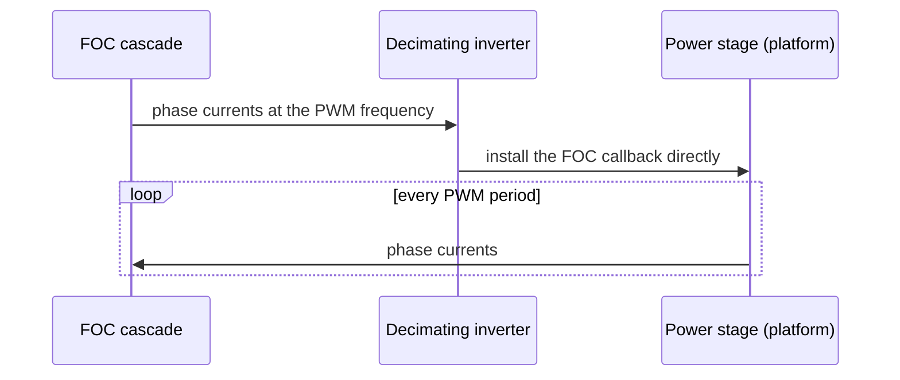
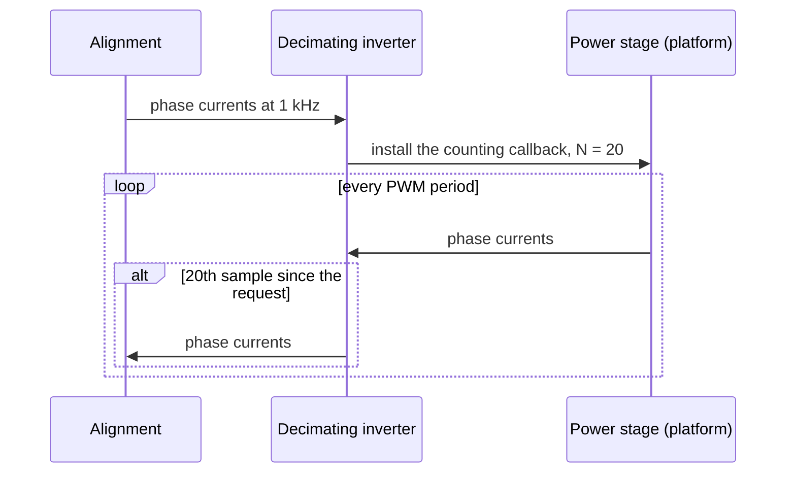
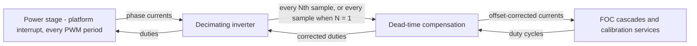

| Field     | Value                               |
|-----------|-------------------------------------|
| Title     | Platform: Phase-Current Sample Rate |
| Type      | design                              |
| Status    | draft                               |
| Version   | 0.1.0                               |
| Component | platform-phase-current-rate         |
| Date      | 2026-10-29                          |

> **IMPORTANT — Implementation-blind document**: This document describes *behavior, structure, and
> responsibilities* WITHOUT referencing code. **No code blocks using programming languages (C++, C,
> Python, CMake, shell, etc.) are allowed.** Use Mermaid diagrams to express behavior instead.
> Prose descriptions of algorithms are encouraged; source-level details are not.
>
> **Diagrams**: All visuals must be Mermaid (` ```mermaid `), TikZ via ` ```{=latex} ` raw blocks (source in
> `documentation/tikz/`), or ASCII art. External image references (``) are **not allowed**.

---

## Responsibilities

The decimating inverter sits between a platform's power stage and everything that samples the phase
currents: the FOC cascades, the calibration procedures and the dead-time compensation. It is the one
place that turns the platform's per-period samples into the rate a consumer asks for.

**Is responsible for:**

- Delivering the phase currents at the rate a consumer requests, as long as that rate divides the PWM
  frequency.
- Adding no work to the control loop's interrupt when the consumer asks for every sample.
- Passing the duty cycles, start, stop, the PWM frequency and the current limit through to the power
  stage unchanged.

**Is NOT responsible for:**

- The PWM frequency. The power stage keeps switching at the frequency it was configured with, whatever
  rate a consumer asks for.
- Anything a platform does on every sample, such as the over-current check or the control-loop cycle
  metrics. That runs in the platform's interrupt before a sample reaches this component.
- Filtering. Samples that are not delivered are dropped, not averaged.

---

## Component Details

### Part A — Two interfaces

Before this component, each platform interpreted the requested rate itself, and they disagreed:

| Platform                   | What a slower rate did                           |
|----------------------------|--------------------------------------------------|
| TI                         | Re-clocked the PWM to that rate                  |
| ST                         | Nothing; every sample was delivered              |
| Emulator and MIL simulator | Kept the PWM rate and delivered every Nth sample |

On TI, alignment switched the bridge at 1 kHz and the inductance and pole-pair steps at 10 kHz, so
they characterised a different inverter from the one the current loop runs. The platforms are now split
from the consumers by two interfaces:

- **Power stage** (platform side). It invokes its callback with the phase currents once every PWM
  period and has no notion of a requested rate. Every platform implements it, and so does the
  model-in-the-loop drive.
- **Three-phase inverter** (consumer side). It takes the requested rate along with the callback. This
  component provides it on top of a power stage, and the dead-time compensation decorates it.

### Part B — Choosing a rate

A request names a rate and a callback. The ratio N is the PWM frequency divided by the rate; a rate
that does not divide the PWM frequency is a programming error and stops the firmware.

- **N = 1 (the control loop, the offsets measurement, the resistance step).** The component installs
  the consumer's callback on the power stage directly. The control loop's interrupt then calls the
  consumer with nothing in between, so the shared component costs it no cycles.
- **N > 1 (alignment at 1 kHz, the inductance and pole-pair steps at 10 kHz).** The component installs its own
  callback on the power stage. That callback counts samples and hands every Nth one on, so the first
  sample delivered is the Nth after the request. Every request restarts the count.

Returning to N = 1 installs the consumer's callback directly again; the counting callback is no longer
called.

### Part C — Changing the callback while the interrupt runs

A request is made from the main context while the power stage's interrupt may be running. Both the
power stage's callback and the consumer callback the counter hands samples to are swapped as a whole:
the interrupt runs either the previous callable or the new one, never a mix. The ratio and the count
are single words, so a request that lands between two samples changes the delivery from the next
sample on.

### Part D — What stays at the PWM rate

The dead-time compensation scales its correction by the PWM period, read from the power stage, not by
the rate a consumer asked for. A consumer sampling at 1 kHz therefore gets duties corrected for the
bridge's real 20 kHz switching.

---

## Interfaces

### Provided

| Interface            | Purpose                                    | Contract                                                                                                |
|----------------------|--------------------------------------------|---------------------------------------------------------------------------------------------------------|
| Phase currents ready | Deliver phase currents at a requested rate | The rate divides the PWM frequency; a new request replaces the previous callback and restarts the count |
| PWM output           | Apply three duty cycles                    | Passed to the power stage unchanged                                                                     |
| Start, Stop          | Arm and disarm the bridge                  | Passed to the power stage unchanged                                                                     |
| Base frequency       | The PWM frequency                          | The power stage's frequency, independent of any requested rate                                          |
| Max current          | The current the drive supports             | Passed through from the power stage                                                                     |

### Required

| Interface   | Purpose                                          | Contract                                                       |
|-------------|--------------------------------------------------|----------------------------------------------------------------|
| Power stage | Phase currents once every PWM period, PWM output | Its callback can be replaced from the main context at any time |

---

## Sequence Diagrams

### Control loop: every sample



### Alignment: one sample in twenty



---

## Block Diagram



---

## Constraints & Limitations

| Constraint                   | Value / Description                                                          |
|------------------------------|------------------------------------------------------------------------------|
| Allowed rates                | Divisors of the PWM frequency: 20 kHz, 10 kHz, 5 kHz, 4 kHz, 2 kHz, 1 kHz, … |
| Consumers                    | One at a time; the latest request wins                                       |
| Cost at the PWM rate         | None in the interrupt; the consumer is the power stage's callback            |
| Cost below the PWM rate      | One count and compare per PWM period, outside the control loop               |
| First sample after a request | The Nth power-stage sample after it                                          |

---

## Verification

Unit tests drive a power-stage mock and check that every sample is delivered at the PWM frequency,
that every Nth is delivered below it, that a new request restarts the count, that a return to the PWM
frequency delivers every sample again, and that the PWM output, start, stop, frequency and current
limit pass through. The model-in-the-loop and software-in-the-loop suites run alignment and electrical
identification through it at 1 kHz and 10 kHz.
