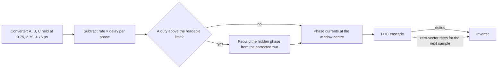
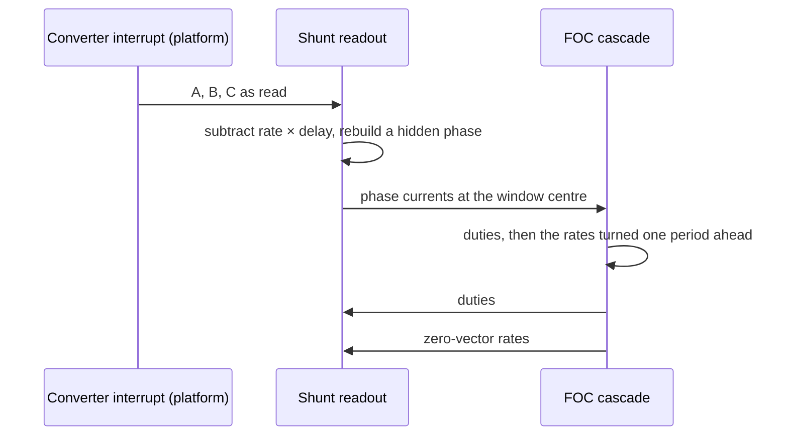

| Field     | Value                                 |
|-----------|---------------------------------------|
| Title     | Platform: Phase-Current Sampling Skew |
| Type      | design                                |
| Status    | draft                                 |
| Version   | 0.1.0                                 |
| Component | platform-sampling-skew                |
| Date      | 2026-11-09                            |

> **IMPORTANT — Implementation-blind document**: This document describes *behavior, structure, and
> responsibilities* WITHOUT referencing code. **No code blocks using programming languages (C++, C,
> Python, CMake, shell, etc.) are allowed.** Use Mermaid diagrams to express behavior instead.
> Prose descriptions of algorithms are encouraged; source-level details are not.
>
> **Diagrams**: All visuals must be Mermaid (` ```mermaid `), TikZ via ` ```{=latex} ` raw blocks (source in
> `documentation/tikz/`), or ASCII art. External image references (``) are **not allowed**.

---

## Responsibilities

A low-side shunt board with one converter reads the three phases one after another, so each phase is
read a few microseconds after the centre of the zero vector, when its current has already moved away
from the period mean ([low-side current sensing](../theory/low-side-current-sensing.md) §8,
[sensing chain](../theory/sensing-chain.md) §6). The skew correction brings every phase the platform reads
back to the window centre before the controller sees it.

**Is responsible for:**

- Knowing, per platform, how long after the window centre each phase is held.
- Subtracting, from each phase read, its rate of change during the zero vector times that delay.
- Rebuilding a hidden phase from the two corrected phases, so the rebuilt phase is corrected too.
- Leaving the samples unchanged while no controller supplies the rates, and on a platform that reads
  all phases at once.

**Is NOT responsible for:**

- Estimating the rates. The FOC cascade owns the motor model and computes them.
- The offsets and the dead-time loss: the stage above removes the offsets and corrects the duties
  ([dead-time compensation](service-dead-time-compensation.md)).
- The current ripple of the active vectors. The correction only moves the sample along the zero
  vector, where all low sides conduct.

---

## Component Details

### Part A — When each phase is held

The converter starts at the trigger, at the centre of the low-side window. Conversion $k$ of the
sequence holds its sample at

$$t_k = t_{trig} + \frac{k\,(N_{sh} + N_{conv}) + N_{sh}}{f_{ADC}}$$

and a phase averaged over $n$ consecutive conversions behaves as if it were held at the mean of their
instants. The platform derives one delay per phase from its converter settings when the converter is
configured:

| Platform                       | Phase A                    | Phase B | Phase C | Source                                                                             |
|--------------------------------|----------------------------|---------|---------|------------------------------------------------------------------------------------|
| EK-TM4C1294XL + E-FOC-HARDWARE | 0.75 µs                    | 2.75 µs | 4.75 µs | 16 MHz, 4-clock sample-and-hold, 12 conversion clocks, two averaged                |
| Emulator and MIL drive         | from the plant description |         |         | The converter fields of the current-sense chain (`software-in-the-loop.md` Part M) |
| ST boards                      | 0                          | 0       | 0       | Not characterised; no correction                                                   |

The TM4C's phase-delay setting shifts the trigger by a fraction of one converter clock, under 63 ns,
and is left out.

### Part B — The rate of each phase during the zero vector

While all three low sides conduct, every terminal is at the negative rail and the star point at zero,
so each winding sees no applied voltage:

$$L\,\frac{di_k}{dt} = -R\,i_k - e_k$$

In the stationary frame this is $\dot{i}_{\alpha\beta} = -(R\,i_{\alpha\beta} + e_{\alpha\beta})/L$.
Written in rotor coordinates it is

$$\dot{i}_d = -\frac{R}{L}\,i_d, \qquad \dot{i}_q = -\frac{R}{L}\,i_q - \omega_e\frac{\psi_f}{L}$$

which the inverse Park and Clarke transforms turn into one rate per phase. The FOC cascade computes it
every period from the currents it has just measured, the electrical speed it already tracks and the
motor model it was configured with, and hands it to the inverter after the duties. The rate is used
at the next sample, one period later, so the cascade turns it by the angle the rotor covers in one
period first; at speed that is the larger part of its change between two samples. With the inductance
unknown (zero), the rates are zero.

### Part C — Which model

The rates scale with $1/L$, so a model inductance off by a factor $k$ leaves $1 - 1/k$ of the skew, or
adds to it: an inductance stored at 0.7 of the motor's over-corrects by 43 %. At the speeds where the
mechanical estimator runs, that residual is a q-axis offset that grows with speed and reads as viscous
friction. The rates therefore start from the model the loops are designed from, at configuration and at
every enable, and in speed and position mode follow the online electrical estimate as soon as its
estimator reports it settled. The outer loop hands each settled resistance and inductance to the cascade,
which takes them only inside the bands online recalibration believes (resistance 0.7–2×, inductance
0.5–1.5× of the model in use; [online recalibration](online-recalibration.md) Part B) and publishes the two
gains to the inner loop through a triple buffer. Unlike the loop gains, the rates are not a controller
design: following an estimate while the drive is enabled changes only how far each sample is moved, so it
needs no stop. Torque mode runs no estimator and keeps the model in use.

### Part D — Correcting before the rebuild

The rebuild of a hidden phase ([low-side current sensing](../theory/low-side-current-sensing.md) §5)
runs in the platform, from the two phases that were readable. A correction applied above the platform
would correct the rebuilt phase by its own delay, while it carries the errors of the two phases it was
built from, and leave an error where the correction matters most: at high speed, where a duty goes
past the readable limit. The platform therefore corrects each phase it read, by its rate times its
delay, and rebuilds the hidden phase from the corrected two.



### Part E — When no controller runs

The rates are cleared when the bridge stops, so the calibration services, which drive the bridge
without a cascade, read the samples unchanged. A cascade that has just been enabled has rates of zero
until its first period.

---

## Interfaces

### Provided

| Interface         | Purpose                                                         | Contract                                                                                        |
|-------------------|-----------------------------------------------------------------|-------------------------------------------------------------------------------------------------|
| Zero-vector rates | Take the rate of each phase current while all low sides conduct | Called from the control interrupt after the duties; applies to the next sample; cleared by Stop |

### Required

| Interface          | Purpose                              | Contract                                  |
|--------------------|--------------------------------------|-------------------------------------------|
| Converter settings | The hold instant of every conversion | Known when the converter is configured    |
| FOC cascade        | The rates, from the motor model      | Once per period, in the control interrupt |

---

## Sequence Diagrams



---

## Constraints & Limitations

| Constraint               | Value / Description                                                                             |
|--------------------------|-------------------------------------------------------------------------------------------------|
| Error removed            | On E-FOC-HARDWARE up to 0.40 A on the Teknic and 71 mA on the Anaheim at rated speed            |
| Model                    | One inductance; a salient motor's phase inductance varies with the angle and is not followed    |
| Model error              | A model inductance off by $k$ leaves $1 - 1/k$ of the skew until the online estimate settles    |
| Rate age                 | Computed from the previous period's currents and turned one period ahead                        |
| Cost                     | Three multiply-subtracts in the platform; the rates cost the cascade one transform and one call |
| Platforms without timing | Delays of zero: the samples pass unchanged                                                      |

---

## Verification

Unit tests check the delays derived from the converter settings, that the readout subtracts rate ×
delay from every phase it reads and rebuilds a hidden phase from the corrected two, that Stop clears
the rates, that each cascade hands the inverter the rates of Part B, and that the inverter decorators
pass them on, and that a settled online estimate inside the bands moves the rates and an enable restores
the configured model. The plant's current-sense chain samples each phase along its zero-vector rate, so the
model-in-the-loop suite compares the currents the drive measures with those the plant carries on the
low-inductance Teknic, read through the bench sense chain at the 600 rad/s overspeed limit. Without the
correction the q-axis current reads 0.21 A low, the $\tau\,\omega_e\psi_f/L$ of the 2.75 µs mean delay;
with it the error is 1 mA.
