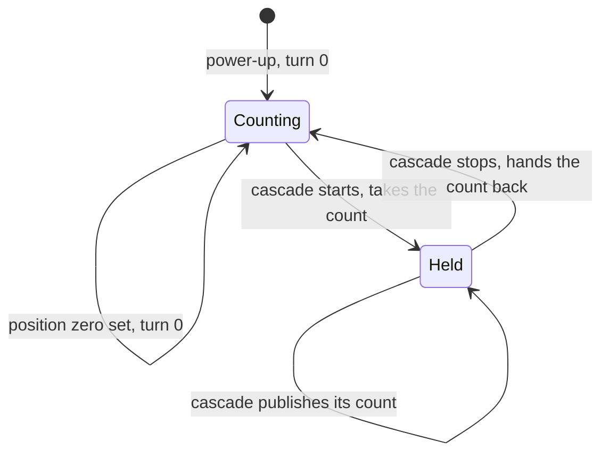
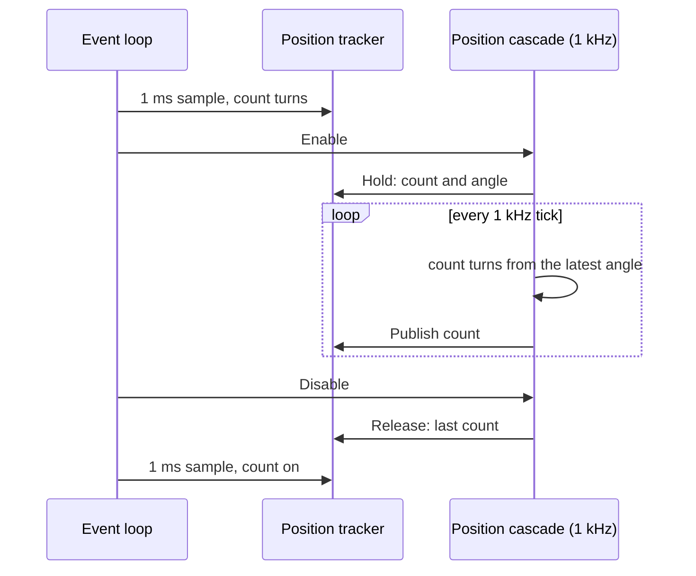

| Field     | Value            |
|-----------|------------------|
| Title     | Position Tracker |
| Type      | design           |
| Status    | draft            |
| Version   | 0.1.1            |
| Component | position-tracker |
| Date      | 2026-11-26       |

> **IMPORTANT — Implementation-blind document**: This document describes *behavior, structure, and
> responsibilities* WITHOUT referencing code. **No code blocks using programming languages (C++, C,
> Python, CMake, shell, etc.) are allowed.** Use Mermaid diagrams to express behavior instead.
> Prose descriptions of algorithms are encouraged; source-level details are not.
>
> **Diagrams**: All visuals must be Mermaid (` ```mermaid `), TikZ via ` ```{=latex} ` raw blocks (source in
> `documentation/tikz/`), or ASCII art. External image references (``) are **not allowed**.

---

## Responsibilities

**Is responsible for:**
- Keeping the multi-turn position θ = 2π·n + θm of the rotor from the position zero in every control mode and
  state. It counts the turns n of the encoder angle θm ([foc-position.md](foc-position.md), Multi-Turn Position)
- Counting the turns on the event loop, from an encoder reading every 1 ms, while the position cascade does not
- Handing the count to the position cascade when it starts, and taking it back when it stops
- Reporting the count the cascade publishes in between
- Starting the count again at turn 0 whenever the drive sets the position zero
- Reporting the multi-turn position to the CAN telemetry

---

## Component Details

### Part A — Turn Counting

The turn count follows consecutive samples of θm. A step from the previous sample below −π is a forward crossing of
the encoder seam and adds a turn. A step above π is a backward crossing and takes one away. Any other step leaves
the count as it is. The count is exact as long as the rotor turns less than half a turn between two samples. The
first sample after a restart sets the angle and counts nothing. The same counting serves the tracker and the
position cascade, so the two count alike.

The tracker samples the encoder every 1 ms on the event loop. A sample that comes late by d ms still counts right
up to a speed of half a turn per (1 + d) ms. That is 30 000 rpm on time. At a delay of 6.5 ms it is 4000 rpm, the
faster reference motor's rated speed.

### Part B — Handover with the Position Cascade

Only one counter counts at a time. While the cascade runs, it counts every 1 kHz tick from the angle of the
latest inner-loop sample. This never misses a turn below 500 turns per second. The tracker then stops counting:

- **Hold.** When the cascade starts (an Enable, a speed command or a current command in position mode), it takes
  the tracker's count. It also takes the angle that count was taken at, and the tracker stops sampling. A seam
  crossing between that sample and the cascade's first tick is still counted. The cascade unwraps its first
  angle against the one it took.
- **Publish.** Every tick the cascade publishes its count. The tracker reports the published count. When the
  outer-loop interrupt pre-empts a reader on the event loop mid-read, the reader reads again. Thus it never sees the turns of one
  tick with the angle of another.
- **Release.** When the cascade stops it hands back its last count and the tracker counts on from it.

A cascade that started before the tracker took any sample starts at turn 0 from its own first angle.

### Part C — A New Position Zero

Alignment and the index restore set the position zero through the tracker's encoder port, which forwards the
setting to the platform's encoder. Each setting moves θm by the change of zero, which is no motion of the rotor.
The tracker therefore starts the count again at turn 0, and its next sample sets the angle. A count the cascade
hands back after a new zero is discarded for the same reason.



---

## Interfaces

### Provided

| Interface    | Purpose                                                                 | Contract                                                                                       |
|--------------|-------------------------------------------------------------------------|------------------------------------------------------------------------------------------------|
| Position     | The multi-turn position from the position zero, in radians              | Event loop. The published count while the cascade holds it, the tracker's own count otherwise. |
| Encoder port | Reading, setting and zeroing the encoder for alignment and index search | Reads and settings are forwarded; a setting restarts the count at turn 0.                      |
| Hold         | The count and its angle, for the cascade that starts                    | Event loop, before the cascade's first tick. Nothing to hold before the first sample.          |
| Publish      | The cascade's count of this tick                                        | Outer-loop interrupt, while held.                                                              |
| Release      | Ends the hold; the tracker counts on from the last published count      | Event loop, after the cascade's last tick.                                                     |

### Required

| Interface        | Purpose                                    | Contract                                                    |
|------------------|--------------------------------------------|-------------------------------------------------------------|
| Encoder          | The angle within the turn θm, and its zero | Read is non-blocking and may be called from the event loop. |
| Event-loop timer | The 1 ms sample                            | Runs for the life of the tracker.                           |

---

## Data Model

| Entity     | Field | Type / Unit     | Range   | Notes                                                               |
|------------|-------|-----------------|---------|---------------------------------------------------------------------|
| Turn count | n     | 32-bit integer  | ±2³¹    | Turns since the position zero                                       |
| Angle      | θm    | Radians (float) | [−π, π) | The sample the count was last advanced at                           |
| Position   | θ     | Radians (float) | 2π·n+θm | Reported; a single-precision value resolves 0.001 rad to 1300 turns |

---

## Sequence Diagrams



---

## Constraints & Limitations

| Constraint         | Value / Description                                                                              |
|--------------------|--------------------------------------------------------------------------------------------------|
| Turn counting      | Exact while the rotor turns less than half a turn between two samples of the counter that counts |
| One counter counts | The cascade while it runs, the tracker otherwise; the handover happens on the event loop         |
| Power cycle        | The count starts at turn 0; a machine that needs its turns after a power cycle homes again       |
| No heap            | The application allocates the tracker and its timer statically                                   |
