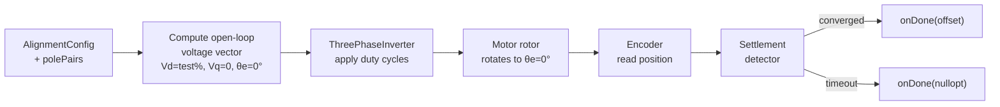
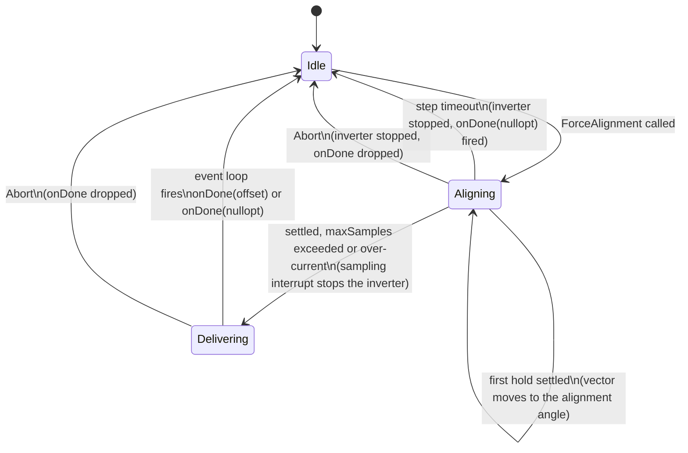

| Field     | Value                    |
|-----------|--------------------------|
| Title     | Service: Motor Alignment |
| Type      | design                   |
| Status    | draft                    |
| Version   | 0.3.0                    |
| Component | service-alignment        |
| Date      | 2026-10-30               |

> **IMPORTANT — Implementation-blind document**: This document describes *behavior, structure, and
> responsibilities* WITHOUT referencing code. **No code blocks using programming languages (C++, C,
> Python, CMake, shell, etc.) are allowed.** Use Mermaid diagrams to express behavior instead.
> Prose descriptions of algorithms are encouraged; source-level details are not.
>
> **Diagrams**: All visuals must be either a Mermaid fenced code block (` ```mermaid `) or ASCII art inline
> in the document. External image references using Markdown image syntax are **not allowed**.

---

## Responsibilities

**Is responsible for:**
- Calibrating the encoder zero-offset so that the encoder frame and the motor's electrical rotor frame are aligned (position = 0 in the encoder corresponds to electrical angle = 0° in the rotor)
- Applying an open-loop DC voltage vector at electrical angle 0° via the three-phase inverter to force the rotor to a known magnetic position
- Detecting rotor settlement by monitoring encoder position change over consecutive samples
- Reporting the calibrated encoder offset (in radians) via a single completion callback on success, or reporting failure if the rotor does not settle within the allowed time
- Refusing to align a motor whose phases do not carry the current the alignment vector drives, and saying so (REQ-EH-016): a disconnected motor or an open phase leaves the rotor where it is, which the settlement check alone takes for an aligned rotor
- Refusing to align when the encoder does not follow the field (REQ-SM-034): the vector is held a quarter electrical turn ahead first, and the encoder must travel the matching mechanical angle when the vector moves to the alignment angle. An encoder stuck from boot reads as settled at once, which the settlement check alone takes for an aligned rotor
- Stopping the inverter cleanly after the procedure completes, whether successfully or not
- Enforcing mutual exclusion: silently ignoring re-entry while an alignment is already in progress

**Is NOT responsible for:**
- Persisting the returned encoder offset to NVM — that is the caller's decision
- Running during normal FOC operation — the FOC loop must be stopped by the caller before alignment begins
- Measuring or interpreting motor electrical parameters (R, L, pole pairs)
- Providing any feedback during the alignment beyond the single completion callback

---

## Component Details

### Preconditions and Configuration

Before invoking alignment, the caller must have:

1. Stopped the normal FOC loop so the three-phase inverter is not claimed by a current control loop.
2. Provided the number of pole pairs for the motor under test.
3. Constructed an `AlignmentConfig` specifying:
   - **test voltage percent** — fraction of DC bus voltage (0–100 %) applied to the d-axis during the procedure
   - **sampling frequency** — the rate at which encoder samples are taken and settlement is checked (Hz); a
     divisor of the PWM frequency, since the shared [decimating inverter](platform-phase-current-rate.md) hands
     on every Nth sample while the PWM keeps switching at its own frequency
   - **max samples** — the total number of sampling ticks before the procedure times out
   - **settled threshold** — the maximum absolute encoder position change (radians) that qualifies as "not moving"
   - **settled count** — the number of consecutive below-threshold samples required to declare settlement
   - **phase resistance** and **bus voltage** — the calibrated winding resistance and the measured supply, from
     which the phase-continuity check derives the current the vector should drive; either left at zero skips the
     part of the check that needs them
   - **follow step** — the electrical angle ahead of the alignment angle at which the vector is held first, so
     the encoder can be seen to follow the field; zero skips the first hold and the follow check. The calibration
     flow passes a quarter turn
   - **follow dwell** — the samples of the second hold during which settlement is not yet counted, so the rotor
     has started to move before it can be declared settled; 100 by default

These parameters are tuned by the application engineer for the specific motor and mechanical load. A typical configuration applies 10–20 % of bus voltage and requires 20 consecutive samples within 0.001 rad of one another before declaring settlement.

### Open-Loop Voltage Application

The alignment service drives the inverter directly in open-loop mode, bypassing all current feedback. It synthesises a stationary voltage vector by computing the inverse Clarke and inverse Park transforms with:

- d-axis voltage = test_voltage_percent / 100 (normalised to DC bus)
- q-axis voltage = 0 (no torque component)
- electrical angle = 0°, or the follow step during the first hold

The resulting three-phase duty cycles are submitted to the inverter each sampling tick for the duration of the procedure. Because the q-axis component is zero, the resulting stator field is purely aligned with the d-axis at 0°. A surface PMSM or BLDC rotor will rotate to align its permanent-magnet d-axis with this field and remain there.



### Settlement Detection

Settlement detection is a simple sliding window state machine. At each sampling tick (controlled by the inverter's ADC interrupt callback):

1. The encoder position is read.
2. The absolute difference between the current and previous position sample is computed.
3. If this difference is below `settledThreshold`, the consecutive-settlement counter is incremented; otherwise the counter is reset to zero.
4. If the counter reaches `settledCount`, the rotor is declared settled.
5. If the total sample count reaches `maxSamples` without settlement, a timeout is declared.
6. If any phase current in a sample exceeds `ThreePhaseInverter::MaxCurrentSupported()`, the injection is aborted immediately and the timeout path is taken. Alignment drives an open-loop voltage with no current regulation, so this per-sample check is the only software limit on the resulting current.

Sampling is gated on the pending completion rather than on the inverter's callback slot being reclaimed:
reassigning that slot from inside its own invocation would destroy the closure being executed, and the
over-current path fails from inside it. A sample arriving after the procedure ended is discarded before it
reaches anything.

`Abort()` is the caller-facing form of the same shutdown. It stops the alignment voltage and drops the pending
completion **without invoking it**, so a fault raised by the state machine cannot be overwritten by an
alignment result that arrives after it.

Every decision above is taken in the sampling interrupt, and so is everything that must happen at that
instant: the inverter is stopped there and, on success, the encoder zeroed there. The completion is not. The
caller stores calibration data and changes state from it, which is event-loop work and far longer than a
control period, so the outcome is queued and delivered from the event loop. Until then the run is still in
progress: samples are discarded, a second `ForceAlignment` is rejected, and `Abort()` drops the queued outcome.
The outcome carries the run it belongs to, so one that an abort overtook cannot complete a run started after
it. The step timeout already runs on the event loop and completes the run directly, unless an outcome is
already queued, which it then leaves to be delivered.

The encoder position at the moment of settlement declaration becomes the calibration offset. This offset represents the mechanical angle the rotor adopts when the electrical d-axis is at 0°; subtracting it from any subsequent encoder reading, and wrapping the difference to [−π, π), yields the corrected angle for the closed-loop FOC controller.

The offset is in **mechanical** radians, which is the unit `Encoder::Set` and `Encoder::SetZero` consume. It is not scaled by pole pairs; scaling it would make it an electrical angle and misorient the field.

The service applies the offset itself, by calling `Encoder::SetZero()` at the settled instant while the rotor
is still held at electrical zero. It does not wait for the caller to re-apply the reported value, because the
rotor drifts as soon as the bridge is released. The reported value is therefore a record of where the encoder
read before it was zeroed, and the calibration record persisted to NVM is diagnostic: an incremental encoder
loses its reference across a reset, so the state machine does not re-apply a stored alignment at boot and
calibration must be re-run to orient the field.

### Phase Continuity Check

A rotor held at electrical zero by a vector the windings do not carry looks exactly like an aligned rotor:
its reading stops changing at once. So when the rotor is declared settled, before the encoder is zeroed, the
service compares the phase currents of the settled run with the ones the vector must drive (REQ-EH-016).

The vector puts `d·Vdc/2` across phase a and `−d·Vdc/4` across phases b and c, with `d` the test voltage as a
fraction of the bus. With the rotor at rest there is no back-EMF, so the currents settle at
`ia = d·Vdc/(2R)` and `ib = ic = −ia/2`. The service averages each phase over the settled run — the samples it
already takes at the sampling frequency, never the 20 kHz ones — and declares a phase missing when:

- **phase a** carries less than a quarter of the expected `|ia|`. Phase a is the only one driven against the
  other two together, so this also catches a fully disconnected motor, where nothing flows;
- **phase b or c** carries less than a quarter of half of the expected `|ia|`. An open b or c leaves a and the
  other one in series, so the open phase reads zero while a still carries most of its current.

A quarter leaves room for what the model ignores: dead time and switch drop take a few percent of the
alignment voltage, and the calibrated resistance can be off by more than that. A missing phase reads a few
noise samples' worth of current, far below it.

Without a resistance or a bus voltage the expected current is unknown. The check then falls back to the
ratio between the phases: b and c must each carry at least a quarter of half of the measured `|ia|`. That
still catches an open b or c, but not a disconnected motor or an open a, which leave nothing to compare
against. Every caller in this firmware passes both.

The check needs all three phases measured. The alignment duties (60 % and 45 % at the default 20 % vector)
stay below every board's readable duty, so no phase is rebuilt from the other two.

A missing phase ends the run like a timeout — inverter stopped, encoder untouched, completion empty — and the
service records why. `LastFailure()` answers *phase missing* after such a run until the next `ForceAlignment`,
so the caller can enter `phaseMissing` instead of a generic calibration failure.

### Encoder Follow Check

An encoder that has stopped reporting — stuck from boot, unplugged, or with a broken channel — reads as a rotor
that settled at once, so the alignment would zero it and the drive would enable against a reading that means
nothing (REQ-SM-034). With a non-zero follow step the service therefore aligns in two holds:

1. **First hold.** The vector is applied at the follow step, a quarter electrical turn ahead of the alignment
   angle, and settlement is detected as above. The settled reading is recorded; nothing is zeroed.
2. **Second hold.** The vector moves to the alignment angle within the sampling interrupt, without stopping the
   inverter. The rotor turns back by the follow step in electrical angle, which is the follow step divided by
   the pole pairs mechanically. Settlement is not counted during the follow dwell, so a heavy rotor that has not
   yet started to move cannot be declared settled where it stood. Each hold has its own `maxSamples`.

When the second hold settles, the phase-continuity check runs on its currents, which are the alignment angle's,
and a missing phase is reported first: a disconnected motor or an open phase also leaves the rotor where it is.
Then the travel between the two settled readings is compared with the expected one. The encoder followed when
the travel is in the direction the field turned and between half and one and a half times the expected angle.
Otherwise the run ends like a missing phase, with *encoder not following* recorded, which the caller reports as
`encoderLoss`. The encoder is zeroed only after both checks pass, at the second hold, exactly as without the
follow step.

The bounds leave room for what moves a settled rotor off its electrical position: friction and cogging hold it
a few electrical degrees short, and both holds settle within the same threshold. A quarter turn keeps the
second hold far from the unstable position half a turn away, so the rotor always turns the short way. A stuck
encoder travels nothing; one wired with the wrong count direction travels the right angle the wrong way, and
one set to the wrong resolution or pole-pair count travels the wrong angle.

A rotor that cannot move — clamped, or held by more friction than the vector's torque — is reported the same
way. From the encoder alone the drive cannot tell it from an encoder that does not report; the fault
supervisor classifies a rotor locked before it moved as `encoderLoss` for the same reason
(`fault-supervision.md`).

The first hold adds one settlement to every alignment: tens of milliseconds for a free rotor, up to the first
hold's own `maxSamples` for a slow one.

### State Machine

The service follows a four-state machine:



While in the **Aligning** state, any further call to `ForceAlignment` is silently ignored — the service will not restart or nest. Only one alignment may be in progress at any time. Transitions out of the **Aligning** state always stop the inverter before invoking the callback, so the caller's callback receives control only after the hardware is in a safe, stopped state.

### Completion Callback Semantics

The `onDone` callback accepts a single `std::optional<Radians>` argument:

- `std::optional` with a value: alignment succeeded; the contained value is the encoder offset in mechanical radians, already applied to the encoder by the service.
- Empty `std::optional`: alignment failed — a timeout, an over-current, a missing phase or an encoder that did not follow the field. The caller should not use any offset; `LastFailure()` tells the last two apart, and only a timeout is worth retrying.

The callback fires exactly once per `ForceAlignment` invocation, from the event loop and never from the sampling interrupt. The callback is reset (using `infra::AutoResetFunction` semantics) after firing so that stale references cannot cause a second invocation.

---

## Interfaces

### Provided

| Interface                                            | Purpose                                                                                                                                        | Contract                                                                                                                              |
|------------------------------------------------------|------------------------------------------------------------------------------------------------------------------------------------------------|---------------------------------------------------------------------------------------------------------------------------------------|
| `ForceAlignment(polePairs, AlignmentConfig, onDone)` | Starts the alignment procedure using the supplied configuration; reports the calibrated encoder offset (or failure) via `onDone` when complete | Silently ignored if already aligning; `onDone` fires exactly once, from the event loop; inverter is stopped before `onDone` is called |
| `LastFailure()`                                      | Why the last run failed: none, a missing phase or an encoder that did not follow the field                                                     | Valid from the completion until the next `ForceAlignment`                                                                             |

### Required

| Interface            | Purpose                                                                                                                          | Contract                                                                                |
|----------------------|----------------------------------------------------------------------------------------------------------------------------------|-----------------------------------------------------------------------------------------|
| `ThreePhaseInverter` | Open-loop voltage application during alignment; source of ADC sampling callbacks that drive the settlement state machine         | Must not be concurrently claimed by any other controller during the alignment procedure |
| `Encoder`            | Reads the current rotor mechanical angle at each sampling tick so that settlement can be detected and the offset can be captured | Must be initialised and tracking position before `ForceAlignment` is called             |
