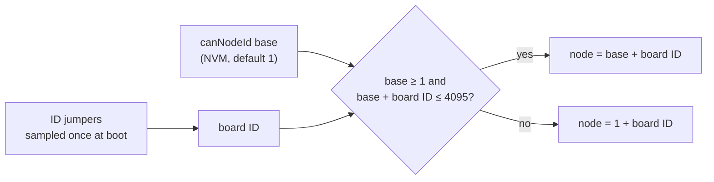
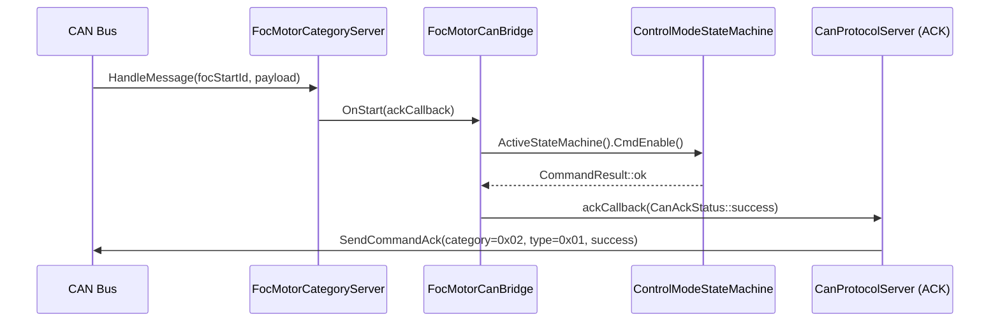
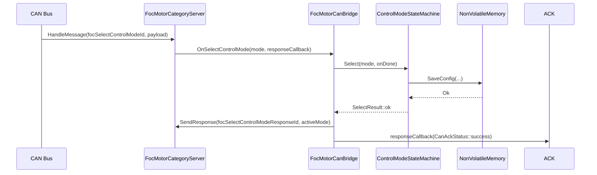
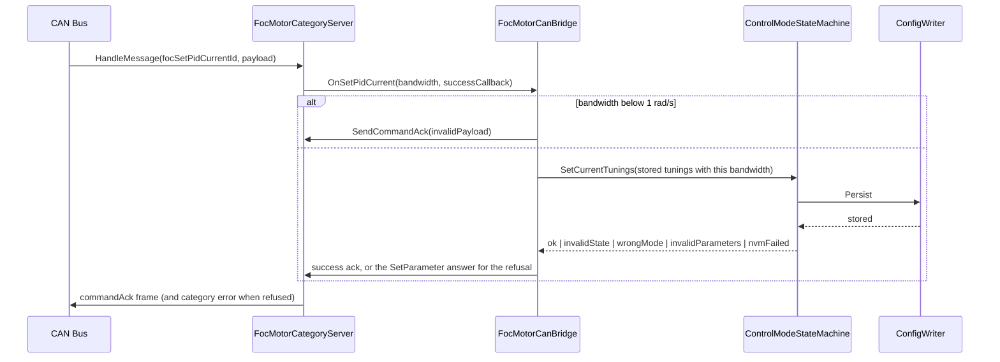
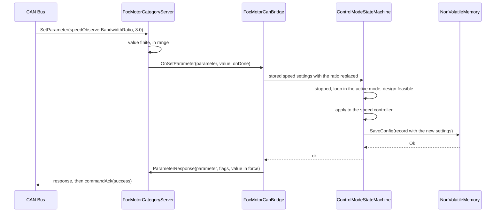
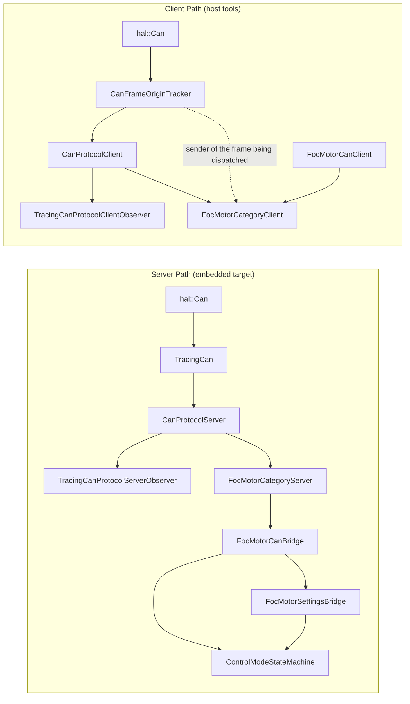

| Field     | Value                    |
|-----------|--------------------------|
| Title     | CAN Service Layer Design |
| Type      | design                   |
| Status    | draft                    |
| Version   | 0.5.0                    |
| Component | can-service              |
| Date      | 2026-10-25               |

> **IMPORTANT — Implementation-blind document**: This document describes *behavior, structure, and
> responsibilities* WITHOUT referencing code. **No code blocks using programming languages (C++, C,
> Python, CMake, shell, etc.) are allowed.** Use Mermaid diagrams to express behavior instead.
> Prose descriptions of algorithms are encouraged; source-level details are not.
>
> **Diagrams**: All visuals must be either a Mermaid fenced code block or ASCII art inline
> in the document. External image references (``) are **not allowed**.

---

## Responsibilities

**Is responsible for:**
- Defining the FOC motor CAN category (ID `0x02`) message format — command IDs, response IDs, scale factors, and error codes — in one canonical location.
- Implementing the server category: decoding incoming CAN frames into typed observer callbacks and encoding typed results into response frames.
- Implementing the client category: encoding typed setpoints into CAN frames and decoding response frames into typed callbacks.
- Bridging the server category to `ControlModeStateMachine`, translating motor control commands into state machine transitions.
- Providing a user-facing client API that composes the protocol client, transport, and category client into a single object for use by host-side tools and SIL tests.
- Applying tracing decorators at every layer boundary so all CAN frames and protocol lifecycle events are observable.
- Delegating identification commands to `ElectricalParametersIdentification` and `MechanicalParametersIdentification` services and broadcasting results via response frames.
- Persisting encoder resolution and telemetry rate changes to `NonVolatileMemory`.
- Broadcasting on-demand telemetry status frames in response to `RequestTelemetry`.
- Selecting the control algorithm of each loop and reporting the algorithms in force.
- Writing and reading the numbered parameters of the contract: every loop's tuning settings, the motor
  parameters of the calibration record and the settings that take effect at the next start.

**Is NOT responsible for:**
- The CAN protocol framing, sequence validation, or ACK dispatch — those belong to `can-lite` core.
- The FOC control algorithms, state machine transitions, or calibration — those belong to `core/foc/` and `core/state_machine/`.
- Motor physics or hardware-specific logic.

---

## Component Details

### Part A — FOC Motor Message Catalogue

Message type IDs, the category ID, the enums and the scale factors live in `FocMotorMessages.hpp`; the field
layout of every message — order, width, signedness, scale and unit — lives beside them in
`FocMotorWireContract.hpp` as a `constexpr` descriptor table. Together these are the authoritative contract
for category `0x02`, and no other component may restate any part of them. The tables below are checked against
that table by `TestWireContractDocumentation`, so a change to one that is not made to the other fails the
build.

The category occupies slot `0x02` (the first application-reserved category ID). Commands occupy message types
`0x00–0x7F`; responses occupy `0x80–0xFF`. The category error frame uses the `can-lite` reserved type `0xFE`.

Every command carries the `can-lite` sequence byte ahead of its fields; responses and telemetry do not. A frame
whose length is not exactly the length its descriptor states is rejected by its handler and never partially
decoded; the `can-lite` protocol server answers a rejected command with `invalidPayload` and does not advance
the sequence or client-liveness bookkeeping for it — a payload of another length is a foreign layout, not a tolerable variant of this one. The
category-error frame on the `can-lite` reserved type `0xFE` carries a descriptor of its own and is held to the
same exactness, so no decode path in this category escapes it.

The descriptors are the specification and the length authority, not a codec: encoders and decoders are written
against them by hand. A descriptor edit therefore changes the accepted length and fails the byte-level vectors,
which is what surfaces the encode or decode change that has to accompany it.

**Contract version.** `focContractVersionMajor.focContractVersionMinor` identifies the contract, and
`QueryContractVersion` (`0x12`) answers it in `ContractVersionResponse` (`0x92`). A client whose major differs
from the server's shall report the mismatch and send no further category-`0x02` commands; equal majors are
compatible. Adding a message is a minor bump; changing any field layout, or the meaning of any enumerator, is
a major bump. The client keeps the verdict per server node, because one client commands several drives on a
bus: an incompatible node silences commands to itself only, and a node that answers again (after a firmware
update) is judged afresh. The client remembers the eight most recent nodes, the number of servers `can-lite`
tracks per bus.

**Contract 2.1 — algorithms and parameters.** Version 2.1 adds four commands and two responses; nothing in
2.0 changes, so a 2.0 client keeps working against a 2.1 server and a 2.1 client can tell from the minor
version whether a server understands them.

| ID     | Message              | Direction | Fields (after the sequence byte for commands)     | Answer                                     |
|--------|----------------------|-----------|---------------------------------------------------|--------------------------------------------|
| `0x13` | `SelectAlgorithm`    | command   | loop `uint8`, algorithm `uint8`                   | `AlgorithmsResponse`, then the acknowledge |
| `0x14` | `QueryAlgorithms`    | command   | —                                                 | `AlgorithmsResponse`, then the acknowledge |
| `0x15` | `SetParameter`       | command   | parameter `uint8`, value `float32`                | `ParameterResponse`, then the acknowledge  |
| `0x16` | `QueryParameter`     | command   | parameter `uint8`                                 | `ParameterResponse`, then the acknowledge  |
| `0x93` | `AlgorithmsResponse` | response  | mode, current, speed, position algorithm `uint8`  | —                                          |
| `0x96` | `ParameterResponse`  | response  | parameter `uint8`, flags `uint8`, value `float32` | —                                          |

The loop is `current = 0`, `speed = 1`, `position = 2`. The algorithm enumerations are the contract's own,
with the values the firmware's selection uses: current `pid = 0`, `decoupledPid = 1`, `deadbeat = 2`,
`slidingMode = 3`; speed `pid = 0`, `lqi = 1`, `adrc = 2`, `twoDof = 3`; position `pid = 0`, `cascadeP = 1`,
`lqr = 2`, `lqi = 3`, `twoDof = 4`. `AlgorithmsResponse` leads with the active control mode (`FocMotorMode`)
and always carries all three loops: a loop the active mode does not run reports the algorithm stored for it.
The mode is what tells a client which loops it may tune, and it is the only message that reports the mode
without changing it.

A `float32` field is the IEEE 754 single-precision bit pattern sent most significant byte first, the order of
every other multi-byte field. The parameters span from 10⁻⁹ kg·m² to 10⁶ bit/s, which no single fixed-point
scale carries, and a float keeps seven significant digits across all of them. An integer parameter is sent
as the float of that integer and is refused unless the value is whole; every integer the table allows is
exactly representable. Flag bit 0 of `ParameterResponse` is *automatic*: the value is one the firmware chose
because none was set, and setting a parameter that allows it to `0` returns it to automatic.

| ID     | Parameter                       | Unit       | Range                              | Automatic | Takes effect             |
|--------|---------------------------------|------------|------------------------------------|-----------|--------------------------|
| `0x00` | `currentBandwidth`              | rad/s      | 1 – 20000                          | yes       | immediately              |
| `0x01` | `currentSwitchingGain`          | A          | 0 – 5, below the boundary layer    | no        | immediately              |
| `0x02` | `currentBoundaryLayer`          | A          | 0.01 – 5, above the switching gain | no        | immediately              |
| `0x03` | `currentTwoStepDeadbeat`        | -          | 0 or 1                             | no        | immediately              |
| `0x10` | `speedBandwidth`                | rad/s      | 1 – 2000                           | yes       | immediately              |
| `0x11` | `speedErrorWeight`              | -          | 0.001 – 1000                       | no        | immediately              |
| `0x12` | `speedIntegralWeight`           | -          | 0.001 – 1000                       | no        | immediately              |
| `0x13` | `speedObserverBandwidthRatio`   | -          | 1 – 20                             | no        | immediately              |
| `0x14` | `speedReferenceTimeConstant`    | s          | 0.0001 – 10                        | no        | immediately              |
| `0x20` | `positionBandwidth`             | rad/s      | 1 – 500                            | yes       | immediately              |
| `0x21` | `positionErrorWeight`           | -          | 0.001 – 1000                       | no        | immediately              |
| `0x22` | `positionSpeedErrorWeight`      | -          | 0.001 – 1000                       | no        | immediately              |
| `0x23` | `positionIntegralWeight`        | -          | 0.001 – 1000                       | no        | immediately              |
| `0x24` | `positionReferenceTimeConstant` | s          | 0.0001 – 10                        | no        | immediately              |
| `0x40` | `resistance`                    | ohm        | 0.0001 – 100                       | no        | immediately              |
| `0x41` | `inductance`                    | mH         | 0.0001 – 1000                      | no        | immediately              |
| `0x42` | `polePairs`                     | -          | 1 – 64                             | no        | after the next alignment |
| `0x43` | `fluxLinkage`                   | Wb         | 0.00001 – 10                       | yes       | immediately              |
| `0x44` | `inertia`                       | kg.m2      | 0.000000001 – 10                   | no        | immediately              |
| `0x45` | `viscousFriction`               | Nm.s/rad   | 0 – 10                             | no        | immediately              |
| `0x60` | `encoderResolution`             | counts/rev | 1 – 16777216                       | no        | at the next start        |
| `0x61` | `canNodeId`                     | -          | 1 – 4095                           | no        | at the next start        |
| `0x62` | `canBitrate`                    | bit/s      | 125000, 250000, 500000 or 1000000  | no        | at the next start        |

The ranges are the firmware's command limits, so the table, the server's validation and the commander's
input fields share one definition. The tuning settings (`0x00`–`0x24`) are the ones described in
`controller-selection.md` Part H and are kept in the configuration record; the motor parameters
(`0x40`–`0x45`) are fields of the calibration record; `0x60`–`0x62` are configuration fields read once at
start-up. A loop's settings can only be written while the active control mode runs that loop, and a
tuning setting or motor parameter is refused unless the drive is stopped (`Idle` or `Ready`), so no
setting changes under a running law. Start-up settings are read only at start-up and can be written at any
time; a `canNodeId` base whose sum with the board ID exceeds 4095 is replaced by 1 at the next start
(Part I). Every accepted write is stored, so a client that sweeps a setting rewrites the non-volatile
record on each step; tune interactively rather than in tight automated loops.

**Answers.** A write is acknowledged only once it is in force and stored: the `ParameterResponse` that
precedes the acknowledgement carries the value now held, which for a bandwidth set to `0` is the one the
firmware chose. Rejections reuse the 2.0 vocabulary:

| Situation                                                                         | Answer                                        |
|-----------------------------------------------------------------------------------|-----------------------------------------------|
| Unknown loop, algorithm or parameter; value not finite, out of range or not whole | acknowledge `invalidPayload`                  |
| Tuning setting or motor parameter while the drive is not stopped                  | acknowledge `invalidState`                    |
| Another command or a non-volatile write still outstanding                         | category error `busy`                         |
| Motor-parameter write interrupted by an emergency stop or a fault                 | category error `abortedByFault`               |
| The loop is not part of the active control mode                                   | category error `modeMismatch`                 |
| The controller cannot be designed from the stored motor model and settings        | category error `invalidParameters` (new, `6`) |
| The value is in force but could not be stored                                     | category error `persistenceFailed`            |

An interrupted motor-parameter write cannot be taken back once the record is on its way to the
non-volatile memory, so the value may still be in force after `abortedByFault`; a client reads it back.

`invalidParameters` is added to the category error enumeration; the meaning of the existing codes is
unchanged, which keeps the addition a minor version. It answers a model-based algorithm (decoupled PID,
deadbeat, speed LQI and ADRC, position LQR and LQI) selected before the motor parameters it needs are known,
a position LQR or LQI design that does not converge for the requested settings, and a switching gain that
would reach the boundary layer. In every case the law that was running keeps running unchanged.

**Contract 2.2 — commissioning and diagnostics.** Version 2.2 adds three commands and seventeen read-only
parameters; nothing in 2.1 changes. Together they reach everything the terminal offered for commissioning
and diagnosis, so a client — the CAN Commander, a host on the bus or the integration suite — needs no serial
connection (`integration-testing.md`, "Commands and Verdicts over CAN Only").

| ID     | Message            | Direction | Fields | Answer                                                         |
|--------|--------------------|-----------|--------|----------------------------------------------------------------|
| `0x17` | `Calibrate`        | command   | —      | acknowledge when the calibration sequence ends                 |
| `0x18` | `ClearCalibration` | command   | —      | acknowledge once the stored calibration record is invalidated  |
| `0x19` | `ClearDiagnostics` | command   | —      | acknowledge once the control-loop and CAN statistics are reset |

`Calibrate` runs the sequence of `state-machine.md` — current offsets, pole pairs, resistance and inductance,
alignment and, in speed and position modes, the mechanical identification and the cogging map — and stores
the record, as the terminal's `calibrate` does. Like the identifications it is answered when it ends, so a
client allows it two minutes. `ClearCalibration` invalidates the stored record, as `clear_cal` does, and the
drive returns to `Idle`. Both are refused unless the drive is stopped:

| Situation                                                 | Answer                             |
|-----------------------------------------------------------|------------------------------------|
| The drive is not stopped (`Idle` or `Ready`)              | acknowledge `invalidState`         |
| Another command or a non-volatile write still outstanding | category error `busy`              |
| A step of the calibration sequence fails                  | category error `calibrationFailed` |
| Interrupted by an emergency stop or a fault               | category error `abortedByFault`    |
| The record could not be stored or invalidated             | category error `persistenceFailed` |

The read-only parameters answer `QueryParameter` like any other and are refused by `SetParameter` with
`invalidPayload`. Counts travel as the float of the count, exact up to 2²⁴ (about fourteen minutes of
control periods at 20 kHz) and rounded beyond.

| ID     | Parameter                  | Unit     | Value                                                                                        | Automatic |
|--------|----------------------------|----------|----------------------------------------------------------------------------------------------|-----------|
| `0x80` | `currentOffsetA`           | A        | Phase A current-sensor offset in the calibration record                                      | no        |
| `0x81` | `currentOffsetB`           | A        | Phase B current-sensor offset in the calibration record                                      | no        |
| `0x82` | `currentOffsetC`           | A        | Phase C current-sensor offset in the calibration record                                      | no        |
| `0x83` | `coggingPeak`              | Nm       | Peak of the stored cogging map; `0` when the record holds none                               | no        |
| `0x90` | `estimatedResistance`      | ohm      | Online estimate; `0` while the active mode runs no estimator or it has none                  | no        |
| `0x91` | `estimatedInductance`      | mH       | Online estimate, as above                                                                    | no        |
| `0x92` | `estimatedInertia`         | kg.m2    | Online estimate, as above                                                                    | no        |
| `0x93` | `estimatedViscousFriction` | Nm.s/rad | Online estimate, as above                                                                    | no        |
| `0xA0` | `loopSamples`              | -        | Control periods measured since the statistics were last reset                                | no        |
| `0xA1` | `loopBudgetCycles`         | cycles   | Cycles one control period allows                                                             | no        |
| `0xA2` | `loopMinimumCycles`        | cycles   | Shortest control-interrupt execution                                                         | no        |
| `0xA3` | `loopAverageCycles`        | cycles   | Mean control-interrupt execution                                                             | no        |
| `0xA4` | `loopMaximumCycles`        | cycles   | Longest control-interrupt execution                                                          | no        |
| `0xA5` | `loopOverruns`             | -        | Executions longer than the budget                                                            | no        |
| `0xA6` | `loopDeadlineMisses`       | -        | Periods whose interrupt started late                                                         | no        |
| `0xA7` | `loopReentries`            | -        | Interrupts that arrived while the previous one ran                                           | no        |
| `0xB0` | `resetCause`               | -        | Cause of the last reset: `powerUp 0`, `brownOut 1`, `software 2`, `hardware 3`, `watchdog 4` | no        |

Physical-to-wire conversions use fixed-point scale factors. `int16` fields round to nearest and
saturate (`CanFrameCodec::FloatToFixed16`). Friction and inertia of the reference motors are around
1e-5 and 1e-6 in SI units, which any useful `int16` scale rounds to zero, so they travel as unsigned
32-bit nano-unit counts:

| Quantity   | Wire type | Scale factor | Example                                          |
|------------|-----------|--------------|--------------------------------------------------|
| Current    | int16     | 10           | 1.5 A → 15 wire                                  |
| Speed      | int16     | 1            | 300 rad/s → 300 wire                             |
| Position   | int16     | 100          | 3.14 rad → 314 wire                              |
| Voltage    | int16     | 10           | 24.0 V → 240 wire                                |
| Bandwidth  | int16     | 1            | closed-loop bandwidth in rad/s                   |
| Resistance | int16     | 1000         | 0.36 Ω (Teknic M-2310P-LN-04K) → 360 wire        |
| Inductance | int16     | 1000         | 0.20 mH (Teknic M-2310P-LN-04K) → 200 wire       |
| Friction   | uint32    | 1000000000   | 1.5e-5 N·m·s/rad (Teknic M-2310P-LN-04K) → 15000 |
| Inertia    | uint32    | 1000000000   | 7.06e-6 kg·m² (Teknic M-2310P-LN-04K) → 7060     |

The `uint32` fields round to nearest, saturate at `UINT32_MAX` and encode a negative or NaN value as
`0`: friction and inertia are never negative in a physical plant. The reference-motor values come from
`documentation/theory/foc-plant-models.md` "Reference motors".

### Deviations from the can-lite reference example

`infra/can-lite` (pinned at `ea80b3e`) ships `examples/foc_motor`, which also claims category `0x02` and
disagrees with this contract. e-foc's definitions are authoritative for this product; the example is
documentation. Because every decode is length-exact, a frame built from the example is rejected with
`invalidPayload` rather than misread — visibly, not silently.

| Message / item                | e-foc                                       | can-lite example       | Why                                                                                          |
|-------------------------------|---------------------------------------------|------------------------|----------------------------------------------------------------------------------------------|
| `0x03/0x04/0x05`              | one `int16` closed-loop bandwidth           | three `int16` kp/ki/kd | `documentation/requirements/foc/*-controller.yaml` forbid externally supplied per-axis gains |
| `0x0A`                        | `Align`                                     | reserved, unused       | alignment is a first-class command here                                                      |
| `FocMotorState`               | adds `partialCalibration = 4`               | stops at `calibrating` | speed and position modes can hold a partial record                                           |
| `0x12` / `0x92`               | contract version query and response         | absent                 | the example has no versioning                                                                |
| `0x13`–`0x16`, `0x93`, `0x96` | algorithm selection and numbered parameters | absent                 | the example has one fixed law per loop and no parameter access                               |
| category error `6`            | `invalidParameters`                         | absent                 | a model-based algorithm or setting can be refused for the motor model it would run on        |
| `0x17`–`0x19`, `0x80`–`0xB0`  | commissioning commands and read-only values | absent                 | a client commissions and diagnoses the drive without a serial connection                     |

### Part B — FocMotorCategoryServer

Inherits `CanCategoryServer` from `can-lite`. Registers one `CanMessageHandler` per command type; each handler decodes the payload using `CanPayloadReader`, skips the sequence byte (required for server categories), converts wire values to physical units, and calls the corresponding observer method.

The observer interface provides callbacks for:
- `OnStart`, `OnStop`, `OnClearFault`, `OnEmergencyStop` — lifecycle commands with a `CanAckStatus` result callback.
- `OnSelectControlMode` — takes a `FocMotorMode` and a result callback.
- `OnSetTorqueSetpoint`, `OnSetSpeedSetpoint`, `OnSetPositionSetpoint` — take a typed unit quantity and a completion callback.
- `OnSetPidCurrent`, `OnSetPidSpeed`, `OnSetPidPosition` — receive a bandwidth parsed from the CAN frame and set the bandwidth `SetParameter` sets, through the same `ControlModeStateMachine` path: acknowledged once in force and stored, refused as a `SetParameter` of that bandwidth would be. Contract 2.0 has no automatic bandwidth, so `0` stays `invalidPayload`.
- `OnIdentifyElectrical` — calls `CmdReserveExternalCalibration()` before starting estimation; `invalidState` if rejected; on estimation success calls `CmdCompleteExternalCalibration()` and broadcasts `focElectricalParamsResponseId`; on estimation failure or a rejected completion calls `CmdReleaseExternalCalibration()`.
- `OnIdentifyMechanical` — calls `ActiveCalibrationData()` to obtain pole pairs and guard the state in one step, then `CmdReserveExternalCalibration()` for the duration of the run; `invalidState` if not in `Ready`; releases the reservation when the estimation reports and on success broadcasts `focMechanicalParamsResponseId`.
- `OnRequestTelemetry` — broadcasts current state, fault code, measured speed and measured position via `focTelemetryStatusResponseId`. Position is read from the encoder; speed is the active mode's `ObserveMotion().measuredSpeed` — the outer loop's window speed in speed and position mode, the interrupt's filtered speed in torque mode (REQ-INT-014).
- `OnSetEncoderResolution`, `OnConfigureTelemetryRate` — validate payload, update and persist `ConfigData` via `NonVolatileMemory`.
- `OnSelectAlgorithm`, `OnQueryAlgorithms` — receive a loop and algorithm already range-checked against the
  contract's enumerations; the result callback sends `AlgorithmsResponse` and then the acknowledgement.
- `OnSetParameter`, `OnQueryParameter` — receive a parameter number and, for a write, a value the server has
  already checked against the parameter table (finite, in range, whole where the parameter is an integer); the
  result callback sends `ParameterResponse` and then the acknowledgement. A write to a read-only parameter
  never reaches the observer: the server refuses it as `invalidPayload`.
- `OnCalibrate`, `OnClearCalibration` — commands without fields, with a `CanAckStatus` result callback that
  is called when the sequence or the invalidation ends.
- `OnClearDiagnostics` — a command without fields, with a completion callback.

The commissioning handlers — `Align`, the two identifications, `Calibrate` and `ClearCalibration` — sit in
one handler group of the server, so the server's own surface stays small as the contract grows.

### Part C — FocMotorCategoryClient

Inherits `CanCategoryClient` from `can-lite`. Provides typed `Send*` methods that encode physical units into wire format via `CanPayloadWriter` and call `SendCommand(nodeId, messageType, payload)`.

The three commands without fields that 2.2 adds — `Calibrate`, `ClearCalibration`, `ClearDiagnostics` — share
one send method that takes the command; like every other send it is refused for a node whose major contract
version differs.

Registers response handlers for the server-to-client response message types. Response handlers decode the payload and invoke the corresponding observer callbacks, each naming the node that sent the response.

`can-lite` hands a category the payload of a frame but not its sender. The client therefore takes a frame-origin source: a thin decorator between the bus and the protocol client records the node of each received frame just before the frame is dispatched, and the category reads it while handling that frame. Per-node contract compatibility (see the wire contract above) and per-node response attribution both rest on it.

### Part D — FocMotorCanBridge

Implements the `FocMotorCategoryServerObserver` interface. Holds references to `FocMotorCategoryServer` and `ControlModeStateMachine`. Translates each observer callback into the appropriate state machine call:

- `OnStart` → `CmdEnable()`; success calls the ack callback, rejection sends `invalidState`.
- `OnStop` → `CmdDisable()`.
- `OnClearFault` → `CmdClearFault()`.
- `OnEmergencyStop` → aborts the bridge's mechanical identification if one runs, then `CmdEmergencyStop()`.
- `OnSelectControlMode` → `Select(mode, onDone)`; the result callback sends the mode response or a category error.
- `OnSetTorqueSetpoint`, `OnSetSpeedSetpoint`, `OnSetPositionSetpoint` → validate mode and range, then delegate to `TrySet*` on the state machine.
- PID bandwidth commands → the loop's stored settings with this bandwidth, through `Set*Tunings` on the state
  machine, as a `SetParameter` of that bandwidth: the same `foc::CommandLimits` ranges and stopped-state policy,
  acknowledged once stored; a value out of range is acknowledged `invalidPayload`, a loop the active mode does
  not run is answered `modeMismatch`, and a drive that is not stopped is acknowledged `invalidState`.
- `OnIdentifyElectrical` → `CmdReserveExternalCalibration()` (state guard + `Calibrating` entry); run estimation; `CmdCompleteExternalCalibration(data, cb)` on success, which aligns the rotor and persists; `invalidState` / `calibrationFailed` / `busy` on failure. Every failure that leaves the reservation in place — a poor R/L fit, no pole-pair estimate (or one that does not fit the wire's byte), a rejected completion — calls `CmdReleaseExternalCalibration()`, so the node returns to `Ready` or `Idle`. A request that finds its previous run abandoned by an emergency stop or a fault (the reservation gone, the estimation never answered) starts afresh instead of answering `busy`. The command covers the electrical steps only — it never drives the mechanical estimator — so speed and position end in `Idle` reporting `partialCalibration`, while torque reaches `Ready`.
- `OnIdentifyMechanical` → `ActiveCalibrationData()` (state guard + pole-pairs extraction in one call); `CmdReserveExternalCalibration()`; run estimation; `CmdReleaseExternalCalibration()` when it reports; broadcast on success; `invalidState` / `calibrationFailed` / `busy` on failure. The reservation keeps `Start`, mode selection and setpoints refused while the motor spins.
- `OnRequestTelemetry` → broadcast current state, fault code, measured speed and measured position via `focTelemetryStatusResponseId`; always succeeds. `ToCanMotorState` maps `Idle` to `FocMotorState::partialCalibration` instead of `idle` when `HasPartialCalibration()` reports a non-empty but incomplete NVM record (old-schema or interrupted external calibration).
- `OnSetEncoderResolution` / `OnConfigureTelemetryRate` → persist to `NonVolatileMemory`; `persistenceFailed` on write error; `busy` if a prior NVM save is in flight.
  The configuration record has one owner, `ControlModeStateMachine`: the bridge changes the field in that
  record and asks it to store it, so a write from CAN can never put back an algorithm or mode selection that
  an older copy of the record still held.
- `OnSelectAlgorithm` → the control mode's selection for that loop, then the configuration record is stored;
  the response and acknowledgement follow the write. `AlgorithmsResponse` reports what the selectors run, so
  a refused selection is visible as the unchanged algorithm.
- `OnSetParameter` → by parameter group:
  - a tuning setting: the bridge takes the loop's stored settings, replaces the one field and hands the whole
    record to the control mode, which validates it (ranges, switching gain below boundary layer, position
    design feasibility), applies it to the running controller when stopped and stores it;
  - a motor parameter: the control mode dispatches `SetMotorParameter` to the lifecycle, which stores the
    edited calibration record and re-applies the model (`state-machine.md`); the operator's tuning settings
    are re-applied on top, because applying a model re-derives the loop tunings;
  - a start-up setting: changed in the configuration record and stored; it takes effect at the next start.
    A start-up setting that cannot be stored is taken back, and the record's next write leaves it out.
  A second write while one is outstanding, or while a mode selection or a configuration write is in
  flight, answers `busy`.
- `OnQueryParameter` → the value in force: a loop setting's effective value (an automatic bandwidth reports
  the bandwidth the firmware derived, flagged automatic, or `0` flagged automatic when the active mode does
  not run that loop), a motor parameter from the calibration record in RAM (`0` while unknown; an unset flux
  linkage reports the platform's default, flagged automatic), a start-up setting from the stored
  configuration. The read-only parameters report, never flagged automatic: the current offsets and the
  cogging-map peak from the calibration record in RAM; the active mode's online estimates (`0` in torque
  mode, which runs none); the control-loop statistics of `PlatformDiagnostics`; and the reset cause the
  platform reported at start-up.
- `OnCalibrate` → `CmdCalibrate` on the active mode's state machine, answered when the sequence ends: success,
  `invalidState` when the drive is not stopped, the category error the sequence ended with otherwise.
- `OnClearCalibration` → `CmdClearCalibration`, answered once the record is invalidated and the drive is back
  in `Idle`; a record that cannot be invalidated faults the drive and answers `persistenceFailed`.
  Either command arriving while the other one, another non-volatile write, a mode selection or a setting is
  outstanding is answered `busy`.
- `OnClearDiagnostics` → `PlatformDiagnostics::Reset()`, which restarts the control-loop and CAN statistics;
  always succeeds.

The settings callbacks — the PID bandwidth commands, `OnSetEncoderResolution`, `OnConfigureTelemetryRate`,
`OnSelectAlgorithm`, `OnQueryAlgorithms`, `OnSetParameter`, `OnQueryParameter` and `OnClearDiagnostics` — are
forwarded to `FocMotorSettingsBridge`, which the bridge owns. It holds the one outstanding setting at a time,
so a settings write that arrives while another is being stored is answered `busy`, whichever message carried
it. The commissioning callbacks — `OnAlign`, the identifications, `OnCalibrate` and `OnClearCalibration` — are
forwarded to `FocMotorCommissioningBridge`, which the bridge also owns and which holds each one's outstanding
answer. The bridge takes the platform it reads from as one argument: the inverter and encoder, the platform
diagnostics, and the reset cause.

The bridge validates that the correct control mode is active before accepting a setpoint command. An out-of-range setpoint results in `invalidPayload`. A mode mismatch results in `categoryError/modeMismatch`.

### Part E — FocMotorCanClient

A self-contained client object for use in host tools and SIL tests. Internally composes the frame-origin tracker, `CanFrameTransport`, `CanProtocolClient`, and `FocMotorCategoryClient` as value members (no heap) and registers the category with the protocol client. Constructed with a `hal::Can&` reference only; callers send through the category client, passing the node ID with each command, so one client can command several nodes.

### Part F — `CanLivenessWatchdog`

`CanProtocolServer` already tracks client liveness: it restarts a timer on every frame from the client and calls `Offline()` on its observers when `clientTimeout` elapses with no traffic. Nothing acted on that notification, so unplugging the bus mid-spin left the drive holding its last setpoint indefinitely.

`CanLivenessWatchdog` is a `CanProtocolServerObserver` that closes the loop. On `Offline()` it checks whether
the active state machine is in `Enabled`, or in `Calibrating` under a CAN client's reservation (an
identification the client started, which may be spinning the motor); if so it traces and issues
`CmdEmergencyStop`, which stops the inverter. A calibration started from the CLI is left alone. When the drive
is otherwise not running the notification is ignored — a bus that goes quiet while the motor is
stopped is not a hazard, and faulting there would obstruct commissioning. An identification acknowledges only
when it ends, so a client waiting on one keeps sending frames; `CanProtocolClient` heartbeats every
`heartbeatInterval` for this.

It is composed in the instantiation layer alongside the CAN bridge, so the bridge and category server stay free of lifecycle policy.

### Part G — Fault Broadcast Priority

`BroadcastFaultStatus` sends its frame through `SendEmergency`, at `CanPriority::emergency` (0), rather than
through `SendTelemetry`, which uses `CanPriority::telemetry` (12). CAN arbitration is by identifier, and the
priority field is the high bits of the identifier, so a telemetry-priority fault notification loses arbitration
to routine telemetry on a busy bus — exactly when the bus is busiest and the notification matters most. The
payload is unchanged.

Arbitration only helps a frame that reaches the controller. The `can-lite` send queue therefore orders queued
frames by priority, keeps two of its slots for emergency frames only, and lets an emergency frame displace the
newest lowest-priority frame when it is full, so a fault notification is not refused behind queued telemetry.

### Part H — Tracing Decorators

All tracing is applied via `can-lite`'s decorator classes:

| Decorator                          | Wraps               | Traces                                       |
|------------------------------------|---------------------|----------------------------------------------|
| `TracingCan`                       | `hal::Can`          | Every raw CAN frame sent and received        |
| `TracingCanProtocolServerObserver` | `CanProtocolServer` | Server online/offline events                 |
| `TracingCanProtocolClientObserver` | `CanProtocolClient` | Server online/offline, ACK timeouts per node |

These are composed in the instantiation layer (`Logic.hpp`) so the production code paths gain full observability without any tracing logic in the category or bridge classes themselves.

### Part I — Node Address

Each controller answers on one CAN node ID, fixed once at boot: the configured base from the
non-volatile configuration (`canNodeId`, default 1) plus the board ID read from the board's ID
jumpers. Boards that run the same firmware and configuration can therefore share a bus once their
jumpers differ.

The jumpers are sampled once, during platform start-up, after their pull-ups have had time to
settle; moving a jumper takes effect at the next reset. Node 0 is the broadcast address, so a base
of 0, or a base whose sum with the board ID exceeds the 12-bit node field (4095), is replaced by the
default base. The resolved node and both of its parts are traced at start-up.

| Board                                                      | ID jumpers                                                             | Board ID |
|------------------------------------------------------------|------------------------------------------------------------------------|----------|
| EK-TM4C1294XL                                              | PK0 (bit 0), PK1 (bit 1), PK2 (bit 2); a jumper to ground sets the bit | 0–7      |
| EK-TM4C123GXL, STM32F407G-DISC1, NUCLEO-H563ZI, host, QEMU | none                                                                   | 0        |

With the default base, eight EK-TM4C1294XL boards jumpered 0–7 answer as nodes 1–8, the most one bus
carries (`can-lite` tracks eight servers).

---

## Interfaces

### Provided

| Interface                      | Purpose                                                            | Contract                                                                       |
|--------------------------------|--------------------------------------------------------------------|--------------------------------------------------------------------------------|
| FocMotorCategoryServerObserver | Observer interface for the server category                         | Callbacks must not block or allocate; called from the event dispatcher context |
| FocMotorCategoryClientObserver | Observer interface for the client category                         | Callbacks must not block or allocate                                           |
| FocMotorCanClient              | Wires the protocol client and the category client onto one CAN bus | Callers send through `CategoryClient()`; each `Send*` returns `bool` queued    |

### Required

| Interface                 | Purpose                           | Contract                                                                |
|---------------------------|-----------------------------------|-------------------------------------------------------------------------|
| `CanFrameTransport`       | Sends and receives raw CAN frames | Provided by `can-lite`; must be constructed before the category objects |
| `ControlModeStateMachine` | Accepts motor control commands    | All methods are synchronous or deliver results via `infra::Function`    |
| `hal::Can`                | Raw CAN bus access                | Required by `CanProtocolServer` and `CanProtocolClient`                 |
| `services::Tracer`        | Diagnostic output                 | Must outlive the tracing decorator objects                              |

---

## Data Model

| Entity                | Field     | Type / Unit    | Range                          | Notes                                                            |
|-----------------------|-----------|----------------|--------------------------------|------------------------------------------------------------------|
| FocMotorMode          | mode      | enum uint8     | torque=0, speed=1, position=2  | Transmitted as single byte                                       |
| Torque setpoint       | iq        | int16 wire     | INT16_MIN – INT16_MAX          | Physical = wire / 10 [A]                                         |
| Speed setpoint        | speed     | int16 wire     | INT16_MIN – INT16_MAX          | Physical = wire / 1 [rad/s]                                      |
| Position setpoint     | position  | int16 wire     | INT16_MIN – INT16_MAX          | Physical = wire / 100 [rad]                                      |
| FocMotorCategoryError | code      | enum uint8     | 0–6                            | See FocMotorMessages.hpp                                         |
| FocControlLoop        | loop      | enum uint8     | current=0, speed=1, position=2 | Selects the loop of `SelectAlgorithm`                            |
| FocParameter          | parameter | enum uint8     | see the parameter table        | Numbers of `SetParameter`, `QueryParameter`, `ParameterResponse` |
| Parameter value       | value     | float32 wire   | the parameter's range          | IEEE 754, most significant byte first                            |
| ParameterResponse     | flags     | bitfield uint8 | bit 0: automatic               | Other bits are zero                                              |
| FocResetCause         | cause     | enum uint8     | 0–4                            | Value of `resetCause`, sent as its float                         |

---

## Sequence Diagrams

### Start Command (server path)

### SelectControlMode (server path)

### 2.0 Bandwidth Commands

From contract 2.1 the 2.0 bandwidth commands no longer change the running loop alone: they set the stored
setting, so a bandwidth survives a restart and reads back through `QueryParameter`. A command for a loop the
active mode does not run is answered `modeMismatch` rather than `invalidPayload`.

### SetParameter (tuning setting)

A motor parameter takes the same path to the bridge, which then dispatches `SetMotorParameter` to the
lifecycle instead; the response carries the value the calibration record now holds.

---

## Block Diagram

---

## Constraints & Limitations

| Constraint              | Value / Description                                                                                       |
|-------------------------|-----------------------------------------------------------------------------------------------------------|
| No heap                 | All objects are value members or statically allocated; `infra::Function` for callbacks                    |
| One observer per server | `CanCategoryServer` uses `infra::Subject<Observer>` — only one bridge may attach at a time                |
| Setpoint range          | Torque: bounded by inverter `MaxCurrentSupported`; speed: 1000 rad/s; position: ±2π rad                   |
| Sequence byte           | Server handlers always skip the first byte (sequence number) before reading payload fields                |
| Ident re-entrancy       | A second identification command while one is in-flight returns `busy` via `SendCategoryError`             |
| NVM re-entrancy         | A second config-persist command while one is in-flight returns `busy` via `SendCategoryError`             |
| Parameter writes        | One outstanding per node; acknowledged after the value is in force and stored                             |
| Setting changes         | Refused unless stopped (start-up settings excepted); a loop's settings only while its mode runs that loop |
| Mechanical ident        | `mechIdent` is optional (nullable pointer); if absent, `OnIdentifyMechanical` returns `notImplemented`    |
| Telemetry speed/pos     | Speed is the active mode's `ObserveMotion().measuredSpeed`, zero while disabled; position is the encoder  |
| Node ID                 | Configured base + board ID, fixed at boot; 1–4095                                                         |

---

## Open Questions

| # | Question                                                         | Resolution                                                                                                                       | Status   |
|---|------------------------------------------------------------------|----------------------------------------------------------------------------------------------------------------------------------|----------|
| 1 | Implement telemetry push (BroadcastFaultStatus, periodic status) | On-demand via `OnRequestTelemetry`; periodic timer deferred                                                                      | resolved |
| 2 | PID bandwidth commands                                           | Accepted: single bandwidth value per command decoded by server, stored as that loop's bandwidth setting (2.0 Bandwidth Commands) | resolved |
| 3 | Mechanical identification via CAN                                | Delegated to injected `MechanicalParametersIdentification*`; nullable for targets lacking it                                     | resolved |
