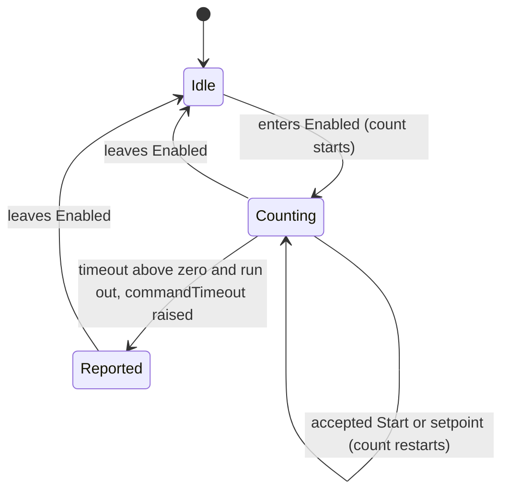
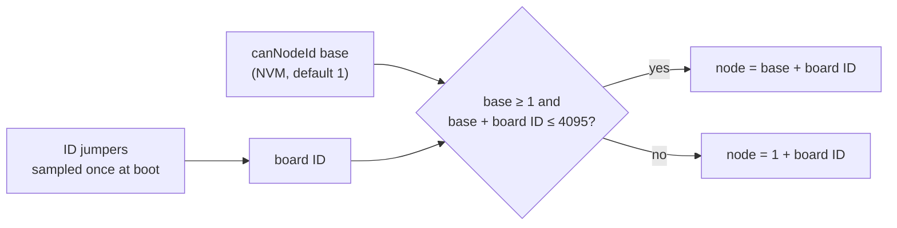
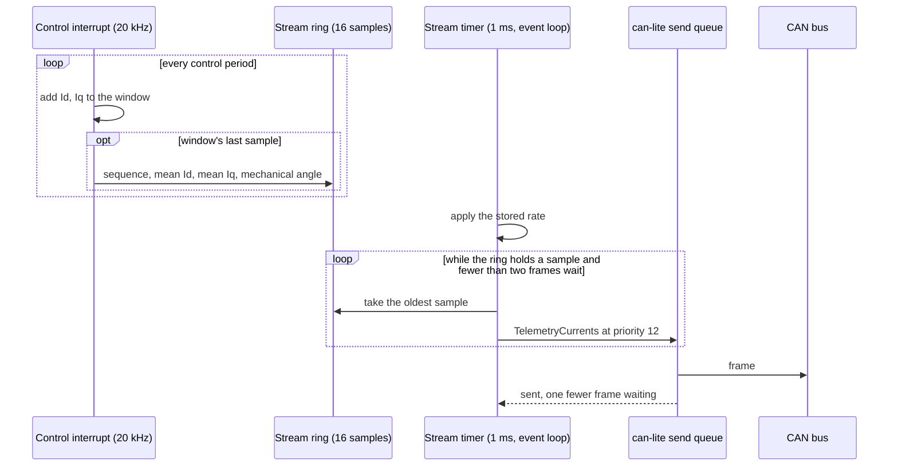
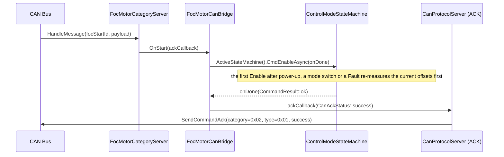
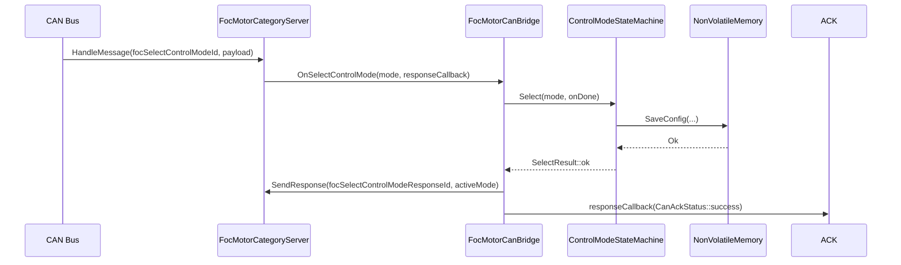
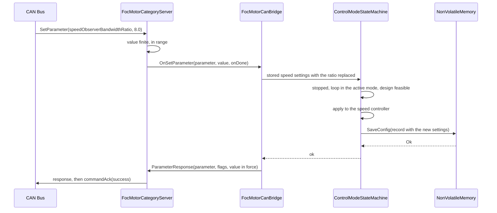
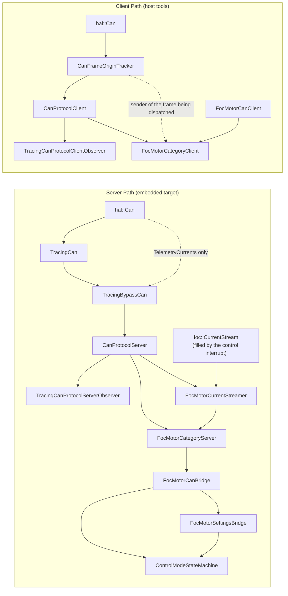

| Field     | Value                    |
|-----------|--------------------------|
| Title     | CAN Service Layer Design |
| Type      | design                   |
| Status    | draft                    |
| Version   | 0.25.0                   |
| Component | can-service              |
| Date      | 2026-11-11               |

> **IMPORTANT — Implementation-blind document**: This document describes *behavior, structure, and
> responsibilities* WITHOUT referencing code. **No code blocks using programming languages (C++, C,
> Python, CMake, shell, etc.) are allowed.** Use Mermaid diagrams to express behavior instead.
> Prose descriptions of algorithms are encouraged; source-level details are not.
>
> **Diagrams**: All visuals must be either a Mermaid fenced code block or ASCII art inline
> in the document. External image references (``) are **not allowed**.

---

## Responsibilities

**Is responsible for:**
- Bridging the server category to `ControlModeStateMachine`, translating motor control commands into state machine transitions.
- Applying tracing decorators at every layer boundary so all CAN frames and protocol lifecycle events are observable.
- Delegating the electrical identification command to `ElectricalParametersIdentification`; its result lands in the calibration record, which a client reads back as parameters.
- Broadcasting the on-demand status and motion telemetry frames in response to `RequestTelemetry`.
- Streaming the measured d- and q-axis currents and the rotor position at the configured telemetry rate (Part J).
- Selecting the control algorithm of each loop and reporting the algorithms in force.
- Writing and reading the numbered parameters of the contract: every loop's tuning settings, the motor
  parameters of the calibration record, the start-up settings, the current stream's rate and the drive-wide
  supervision settings.
- Registering the `can-lite` firmware-upgrade category beside the FOC motor category, and answering `busy`
  to configuration writes while a firmware pack is received (Part K).

**Is NOT responsible for:**
- The FOC motor category's message format, its server and client categories and the client object — those
  belong to the e-foc-protocol library (`infra/e-foc-protocol/documentation/design/wire-contract.md`).
- The CAN protocol framing, sequence validation, or ACK dispatch — those belong to `can-lite` core.
- Receiving and checking firmware — that belongs to the firmware upgrade service (`service-firmware-upgrade.md`).
- The FOC control algorithms, state machine transitions, or calibration — those belong to `core/foc/` and `core/state_machine/`.
- Motor physics or hardware-specific logic.

---

## Component Details

### Part A — FOC Motor Message Catalogue

The category's message catalogue, scale factors, parameter table and contract version are defined by the
e-foc-protocol library, in `infra/e-foc-protocol/documentation/design/wire-contract.md` Part A. This firmware
restates none of it.

### Part B — FocMotorCategoryServer

The server category is part of e-foc-protocol (`wire-contract.md` Part B). The firmware attaches
`FocMotorCanBridge` (Part D) as its only observer.

### Part C — FocMotorCategoryClient

The client category is part of e-foc-protocol (`wire-contract.md` Part C).

### Part D — FocMotorCanBridge

Implements the `FocMotorCategoryServerObserver` interface. Holds references to `FocMotorCategoryServer` and `ControlModeStateMachine`. Translates each observer callback into the appropriate state machine call:

- `OnStart` → `CmdEnableAsync(onDone)`; the ack is sent when the `Enable` is decided — at once, or after the offset refresh of the first `Enable` after power-up, a mode switch or a Fault (`state-machine.md`, Refreshing the current offsets at enable). Success calls the ack callback; a refusal sends the matching error.
- `OnStop` → `CmdDisable()`.
- `OnClearFault` → `CmdClearFault()`.
- `OnEmergencyStop` → `CmdEmergencyStop()`.
- `OnQueryFaultHistory(age)` → the fault history's record of that age, answered with both responses.
- `OnClearFaultHistory` → clears the fault history; the acknowledgement follows the store.
- `OnSelectControlMode` → `Select(mode, onDone)`; the result callback sends the mode response or a category error.
- `OnSetSetpoint` → validate mode, range and state, then delegate to `TrySet*` on the state machine; the N·m kind first converts with the torque constant of Part A (contract 2.21) and is refused `invalidState` when there is none.
- `OnIdentifyElectrical` → `CmdReserveExternalCalibration()` (state guard + `Calibrating` entry); wait for standstill, measure and apply the current offsets; run estimation; `CmdCompleteExternalCalibration(data, cb)` on success, with the offsets in `data`, which aligns the rotor and persists; `invalidState` / `calibrationFailed` / `busy` on failure. Every failure that leaves the reservation in place — a rotor that does not come to rest, a failed offset measurement, a poor R/L fit, no pole-pair estimate (or one that does not fit the calibration record's byte), a rejected completion — calls `CmdReleaseExternalCalibration()`, so the node returns to `Ready` or `Idle`. A request that finds its previous run abandoned by an emergency stop or a fault (the reservation gone, the estimation never answered) starts afresh instead of answering `busy`. The command covers the electrical steps only — it never drives the mechanical estimator — so speed and position end in `Idle` reporting `partialCalibration`, while torque reaches `Ready`.
- `OnRequestTelemetry` → broadcast the current state and fault code via `focTelemetryStatusResponseId`, then the measured speed and measured position via `focTelemetryMotionId`; always succeeds.
  `ToCanMotorState` maps `Ready` to `FocMotorState::ready`, and `Idle` to `FocMotorState::partialCalibration` instead of `idle` when `HasPartialCalibration()` reports a non-empty but incomplete NVM record (old-schema or interrupted external calibration).
- `OnSelectAlgorithm` → the control mode's selection for that loop, then the configuration record is stored;
  the response and acknowledgement follow the write. `AlgorithmsResponse` reports what the selectors run, so
  a refused selection is visible as the unchanged algorithm.
- `OnSetParameter` → by parameter group:
  - a tuning setting: the bridge takes the loop's stored settings, replaces the one field and hands the whole
    record to the control mode, which validates it (ranges, switching gain below boundary layer, position
    design feasibility), applies it to the running controller when stopped and stores it;
  - a motor parameter: the control mode dispatches `SetMotorParameter` to the lifecycle, which stores the
    edited calibration record and re-applies the model (`state-machine.md`); the operator's tuning settings
    are re-applied on top, because applying a model re-derives the loop tunings;
  - a start-up setting or the telemetry rate: changed in the configuration record and stored; a start-up
    setting takes effect at the next start, the telemetry rate at the current stream's next tick (Part J).
    A setting that cannot be stored is taken back, and the record's next write leaves it out. The
    configuration record has one owner, `ControlModeStateMachine`: the bridge changes the field in that
    record and asks it to store it, so a write from CAN can never put back an algorithm or mode selection
    that an older copy of the record still held.
  A second write while one is outstanding, or while a mode selection or a configuration write is in
  flight, answers `busy`.
- `OnQueryParameter` → the value in force: a loop setting's effective value (an automatic bandwidth reports
  the bandwidth the firmware derived, flagged automatic, or `0` flagged automatic when the active mode does
  not run that loop), a motor parameter from the calibration record in RAM (`0` while unknown; an unset flux
  linkage reports the platform's default, flagged automatic), a start-up setting or the telemetry rate from
  the stored configuration. The read-only parameters report, never flagged automatic: the current offsets and the
  cogging-map peak from the calibration record in RAM; the active mode's online estimates (`0` in torque
  mode, which runs none); the control-loop statistics of `PlatformDiagnostics`; and the reset cause the
  platform reported at start-up.
- `OnCalibrate` → `CmdCalibrate` on the active mode's state machine, answered when the sequence ends: success,
  `invalidState` when the drive is not stopped, the category error the sequence ended with otherwise.
- `OnClearCalibration` → `CmdClearCalibration`, answered once the record is invalidated and the drive is back
  in `Idle`; a record that cannot be invalidated faults the drive and answers `persistenceFailed`.
  Either command arriving while the other one, another non-volatile write, a mode selection or a setting is
  outstanding is answered `busy`.
- `OnClearDiagnostics` → `PlatformDiagnostics::Reset()`, which restarts the control-loop and CAN statistics;
  always succeeds.
- `OnRecalibrate` → `ModelRecalibration::CmdRecalibrate()`; not stopped or the mode off answers
  `invalidState`, torque mode `modeMismatch`.
- `OnResetModel` → `ModelRecalibration::CmdResetModel()`; not stopped answers `invalidState`, a store that
  fails `persistenceFailed`.

The settings callbacks — `OnSelectAlgorithm`, `OnQueryAlgorithms`, `OnSetParameter`, `OnQueryParameter` and
`OnClearDiagnostics` — are forwarded to `FocMotorSettingsBridge`, which the bridge owns. It holds the one
outstanding setting at a time, so a settings write that arrives while another is being stored is answered
`busy`, whichever message carried it. The commissioning callbacks — `OnAlign`, the identifications, `OnCalibrate` and `OnClearCalibration` — are
forwarded to `FocMotorCommissioningBridge`, which the bridge also owns and which holds each one's outstanding
answer. The bridge takes the platform it reads from as one argument: the inverter and encoder, the platform
diagnostics, and the reset cause.

The bridge validates that the correct control mode is active before accepting a setpoint command. An out-of-range setpoint results in `invalidPayload`. A mode mismatch results in `categoryError/modeMismatch`.

### Part E — FocMotorCanClient

The client object is part of e-foc-protocol (`wire-contract.md` Part D).

### Part F — `CanLivenessWatchdog`

`CanProtocolServer` already tracks client liveness: it restarts a timer on every frame from the client and calls `Offline()` on its observers when `clientTimeout` elapses with no traffic. Nothing acted on that notification, so unplugging the bus mid-spin left the drive holding its last setpoint indefinitely.

`CanLivenessWatchdog` is a `CanProtocolServerObserver` that closes the loop. On `Offline()` it checks whether
the active state machine is in `Enabled`, or in `Calibrating` under a CAN client's reservation (an
identification the client started, which may be spinning the motor); if so it traces and issues
`CmdEmergencyStop`, which stops the inverter. A calibration the drive runs itself, started with `Calibrate`, is left alone. When the drive
is otherwise not running the notification is ignored — a bus that goes quiet while the motor is
stopped is not a hazard, and faulting there would obstruct commissioning. An identification acknowledges only
when it ends, so a client waiting on one keeps sending frames; `CanProtocolClient` heartbeats every
`heartbeatInterval` for this.

It is composed in the instantiation layer alongside the CAN bridge, so the bridge and category server stay free of lifecycle policy.

**Command timeout.** Liveness alone does not catch a client whose application hangs while its CAN stack
keeps running: the heartbeat goes on, the client never goes offline, and the drive keeps executing its last
setpoint. `CanCommandTimeout` watches what the client asks for instead (REQ-LCY-005). The bridge tells it
of every accepted Start and every accepted torque, speed or position setpoint; nothing else counts, the
heartbeat included. Every 1 ms on the event loop, while the drive is `Enabled` and the command timeout of the
configuration record is above zero, it compares the time since the later of the latest such command and the
entry to `Enabled` with the timeout; once the timeout has run out it raises `commandTimeout` through the
platform fault notifier, once, and stays silent until the drive leaves `Enabled`. The drive cuts its power
stage and coasts, and enters `Fault` rather than `Ready`, so the client finds out why when it comes back.

| Setting         | Default | Range    | Meaning                                                        |
|-----------------|---------|----------|----------------------------------------------------------------|
| Command timeout | 0 (off) | 0 – 60 s | Longest silence of Start and setpoints a running drive accepts |

The timeout is off by default because a client that commands one setpoint and then only watches, as the CAN
Commander does, is a legitimate use; a client that streams setpoints sets it to a few of its periods. While
the timeout is zero the count keeps restarting, so a timeout written while the drive runs counts from the write.
A drive enabled from the terminal is watched the same way: with a timeout set, it needs setpoints over CAN.

### Part G — Fault Broadcast Priority

`BroadcastFaultStatus` sends its frame through `SendEmergency`, at `CanPriority::emergency` (0), rather than
through `SendTelemetry`, which uses `CanPriority::telemetry` (12). CAN arbitration is by identifier, and the
priority field is the high bits of the identifier, so a telemetry-priority fault notification loses arbitration
to routine telemetry on a busy bus — exactly when the bus is busiest and the notification matters most. The
payload is a `TelemetryStatusResponse`: the `fault` state and the fault code.

Arbitration only helps a frame that reaches the controller. The `can-lite` send queue therefore orders queued
frames by priority, keeps two of its slots for emergency frames only, and lets an emergency frame displace the
newest lowest-priority frame when it is full, so a fault notification is not refused behind queued telemetry.

### Part H — Tracing Decorators

All tracing is applied via `can-lite`'s decorator classes:

| Decorator                          | Wraps               | Traces                                                              |
|------------------------------------|---------------------|---------------------------------------------------------------------|
| `TracingCan`                       | `hal::Can`          | Every raw CAN frame sent and received, except current-stream frames |
| `TracingCanProtocolServerObserver` | `CanProtocolServer` | Server online/offline events                                        |
| `TracingCanProtocolClientObserver` | `CanProtocolClient` | Server online/offline, ACK timeouts per node                        |

These are composed in the instantiation layer (`CanStack.hpp`, owned by `Logic`) so the production code paths gain full observability without any tracing logic in the category or bridge classes themselves.

can-lite's `TracingBypassCan` sits between the protocol server and `TracingCan`. Its predicate is
`FocMotorCurrentStreamer::IsStreamFrame`, so it sends `TelemetryCurrents` frames straight to the bus. One traced frame is a line of about 120 characters, so a 1 kHz stream alone would need
about 120 kB/s of trace output, more than the 921 600 bit/s trace port carries; every other frame, and every
received frame, is still traced.

### Part I — Node Address

Each controller answers on one CAN node ID, fixed once at boot: the configured base from the
non-volatile configuration (`canNodeId`, default 1) plus the board ID read from the board's ID
jumpers. Boards that run the same firmware and configuration can therefore share a bus once their
jumpers differ.

The jumpers are sampled once, during platform start-up, after their pull-ups have had time to
settle; moving a jumper takes effect at the next reset. Node 0 is the broadcast address, so a base
of 0, or a base whose sum with the board ID exceeds the 12-bit node field (4095), is replaced by the
default base. This is can-lite's `MakeCanNodeId` (its REQ-CAN-005.1). The resolved node and both of its
parts are traced at start-up.

| Board                     | ID jumpers                                                                                          | Board ID |
|---------------------------|-----------------------------------------------------------------------------------------------------|----------|
| EK-TM4C1294XL             | PK0 (bit 0), PK1 (bit 1), PK2 (bit 2); a jumper to ground sets the bit                              | 0–7      |
| NUCLEO-G474RE             | E-FOC-HARDWARE switch SW1 on PC10 (bit 0), PC11 (bit 1), PC12 (bit 2); a closed switch sets the bit | 0–7      |
| NUCLEO-H563ZI, host, QEMU | none                                                                                                | 0        |

With the default base, eight EK-TM4C1294XL or NUCLEO-G474RE boards set to 0–7 answer as nodes 1–8, the
most one bus carries (`can-lite` tracks eight servers).

### Part J — Current Stream

A host that rebuilds the current and position waveforms needs them at a steady rate, not one status frame
per request. While the stream runs, the drive sends one `TelemetryCurrents` frame per window without being
asked.

**Window.** The control interrupt adds each sample's measured Id and Iq — the Park transform's output, not
the references — to the stream window. A window is N control periods, N = round(f_control / rate), so the
effective rate is f_control / N: exactly the configured rate at 1000, 500, 250, 200 or 100 Hz on the 20 kHz
loop, and 298.5 Hz (N = 67) for a configured 300 Hz. At the window's last sample the interrupt stores the
two means and that sample's mechanical angle in a sixteen-entry ring and starts the next window. The mean
is the anti-aliasing filter of the stream: a 1 kHz stream of single samples would fold the PWM ripple and
the sensor noise into its band, while the window average has a null at every multiple of the stream rate.
The interrupt does a few additions per sample and nothing while the stream is stopped
(`documentation/performance-optimization/README.md`).

**Sequence.** Every window the interrupt closes takes the next value of an 8-bit counter, whether or not its
frame reaches the bus: a window lost to a full ring or to a full send queue is a gap in the sequence, never a
silently shifted sample. The counter wraps after 256 windows (256 ms at 1 kHz), so a client also uses the
arrival time to tell a long outage from a wrap. Windows are counted only while a control loop runs: a stop
and a later start show as a pause in arrival, not as a gap.

**When it runs.** The stream runs while a CAN client is online (Part F's liveness, the same `clientTimeout`),
the configured rate is not zero and a closed-loop cascade runs — torque, speed or position, including the
calibration steps that drive the motor through the cascade (mechanical identification, cogging map). The
open-loop steps (alignment, resistance and inductance injection) and a stopped drive produce no windows.

**Rate.** The rate is `telemetryRateHz` of the configuration record, read and written as the parameter
`telemetryRate` (Part A, contract 3.0): 0 stops the stream, 1–1000 Hz runs it; any other value is answered
`invalidPayload` and changes nothing. A stored change takes effect within one millisecond. The default record
holds 100 Hz.

**Sending.** An event-loop timer drains the ring every millisecond and hands each sample to the send queue
at telemetry priority (12). At most two stream frames are in the send queue at once, which leaves the other
ordinary slots of `can-lite`'s queue to responses and acknowledgements; a sample that finds two frames
waiting stays in the ring for the next tick, and the ring holds sixteen milliseconds of samples at 1 kHz.
Stream frames are not traced (Part H).

**Bus budget.** One `TelemetryCurrents` frame has a 29-bit identifier and seven data bytes: 123 bits
nominal, 150 with worst-case bit stuffing (110 stuffable bits, at most 27 stuff bits).

| Bitrate    | One node at 1 kHz | One node at 500 Hz | Stream frames per second within 70 % |
|------------|-------------------|--------------------|--------------------------------------|
| 1 Mbit/s   | 12.3–15 %         | 6.2–7.5 %          | 4666                                 |
| 500 kbit/s | 24.6–30 %         | 12.3–15 %          | 2333                                 |
| 250 kbit/s | 49.2–60 %         | 24.6–30 %          | 1166                                 |
| 125 kbit/s | does not fit      | 49.2–60 %          | 583                                  |

Several drives share one bus, so the budget is the sum over every node: Σ rate × 150 bit shall stay at or
below 70 % of the bitrate, which leaves the rest for commands, responses, acknowledgements and heartbeats.
Nine drives at 1 kHz need 1.11–1.35 Mbit/s and do not fit any classic CAN bitrate; nine at 500 Hz on
1 Mbit/s take 67.5 % worst case, as do nine at 250 Hz on 500 kbit/s.

Stream frames (priority 12) win arbitration over heartbeats (priority 16). On an over-subscribed bus an idle
client's heartbeats starve, every drive declares the client gone after `clientTimeout` (3 s) and stops its
motor (Part F). A node sees only its own traffic and cannot measure the bus load, so it does not throttle
itself: choosing the rates within the budget is the integrator's job.

### Part K — Firmware Upgrade Category

The drive's protocol server registers a second category beside the FOC motor category: the `can-lite`
firmware-upgrade category (`0x1`), on the same node ID, with the firmware upgrade service as its observer
(`service-firmware-upgrade.md`). Its commands carry no sequence byte, as the `can-lite` specification defines,
so they do not take part in the FOC motor category's sequence bookkeeping, and the server's rate limit of 500
commands a second covers both categories. While a pack is received the bridge answers `busy` to every command
that writes the configuration record — start-up settings, the telemetry rate and the fault supervision
settings — and the control-mode state machine refuses the commands that start the drive or asynchronous work,
because the download counts as pending work. A pack that is staged, waiting for the user to apply it, holds
nothing. `EmergencyStop` is always accepted.

---

## Interfaces

### Provided

| Interface                      | Purpose                                                            | Contract                                                                       |
|--------------------------------|--------------------------------------------------------------------|--------------------------------------------------------------------------------|
| FocMotorCurrentStreamer        | Sends the current stream while a client is online (Part J)         | Event loop only; reads the rate from the configuration record every tick       |

### Required

| Interface                 | Purpose                            | Contract                                                                |
|---------------------------|------------------------------------|-------------------------------------------------------------------------|
| `CanFrameTransport`       | Sends and receives raw CAN frames  | Provided by `can-lite`; must be constructed before the category objects |
| `FocMotorCategoryServer`  | Decodes the category's commands    | Provided by e-foc-protocol; `FocMotorCanBridge` is its only observer    |
| `ControlModeStateMachine` | Accepts motor control commands     | All methods are synchronous or deliver results via `infra::Function`    |
| `hal::Can`                | Raw CAN bus access                 | Required by `CanProtocolServer` and `CanProtocolClient`                 |
| `services::Tracer`        | Diagnostic output                  | Must outlive the tracing decorator objects                              |
| `foc::CurrentStream`      | Windows filled by the control loop | Single producer (control interrupt), single consumer (event loop)       |

---

## Data Model

The wire-level data model is defined in `infra/e-foc-protocol/documentation/design/wire-contract.md`.

---

## Sequence Diagrams

### Start Command (server path)

### SelectControlMode (server path)

### SetParameter (tuning setting)

A motor parameter takes the same path to the bridge, which then dispatches `SetMotorParameter` to the
lifecycle instead; the response carries the value the calibration record now holds.

---

## Block Diagram

---

## Constraints & Limitations

| Constraint              | Value / Description                                                                                                                                |
|-------------------------|----------------------------------------------------------------------------------------------------------------------------------------------------|
| No heap                 | All objects are value members or statically allocated; `infra::Function` for callbacks                                                             |
| One observer per server | `CanCategoryServer` uses `infra::Subject<Observer>` — only one bridge may attach at a time                                                         |
| Setpoint range          | Torque: bounded by inverter `MaxCurrentSupported`; speed: 1000 rad/s; position: ±2π rad                                                            |
| Sequence byte           | Server handlers always skip the first byte (sequence number) before reading payload fields                                                         |
| Ident re-entrancy       | A second identification command while one is in-flight returns `busy` via `SendCategoryError`                                                      |
| NVM re-entrancy         | A second config-persist command while one is in-flight returns `busy` via `SendCategoryError`                                                      |
| Parameter writes        | One outstanding per node; acknowledged after the value is in force and stored                                                                      |
| Setting changes         | Refused unless stopped (start-up settings excepted); a loop's settings only while its mode runs that loop                                          |
| Telemetry speed/pos     | Speed is the active mode's `ObserveMotion().measuredSpeed`, zero while disabled; position is the encoder angle from the alignment zero, in [−π, π) |
| Current stream          | 0–1000 Hz per node, window mean of Id and Iq; the sum over all nodes of rate × 150 bit stays within 70 % of the bitrate (Part J)                   |
| Node ID                 | Configured base + board ID, fixed at boot; 1–4095                                                                                                  |
| Firmware download       | Configuration writes answered `busy`, the drive held stopped, while a pack is received (Part K)                                                    |

---

## Open Questions

| # | Question                                                         | Resolution                                                                                                                       | Status   |
|---|------------------------------------------------------------------|----------------------------------------------------------------------------------------------------------------------------------|----------|
| 1 | Implement telemetry push (BroadcastFaultStatus, periodic status) | Status on demand via `OnRequestTelemetry`; currents and position pushed by the current stream (Part J)                           | resolved |
| 2 | PID bandwidth commands                                           | Retired in 3.0: a loop's bandwidth is the parameter `currentBandwidth`, `speedBandwidth` or `positionBandwidth` (`SetParameter`) | resolved |
| 3 | Mechanical identification via CAN                                | Delegated to injected `MechanicalParametersIdentification*`; nullable for targets lacking it                                     | resolved |
