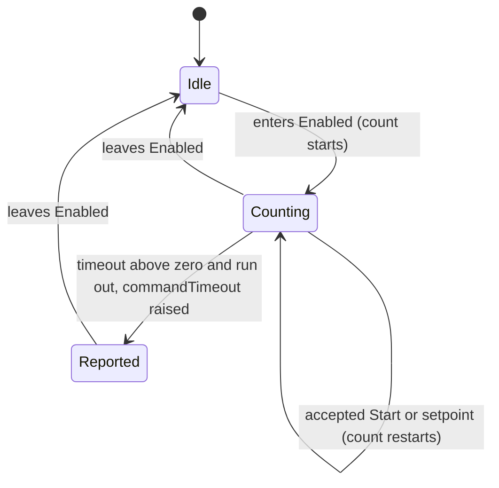
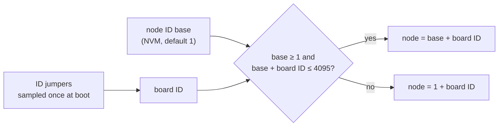
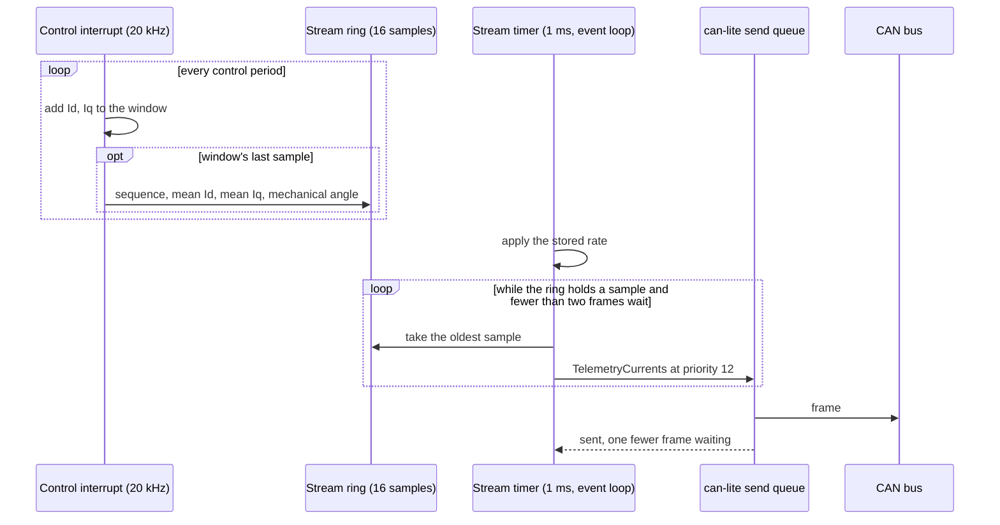
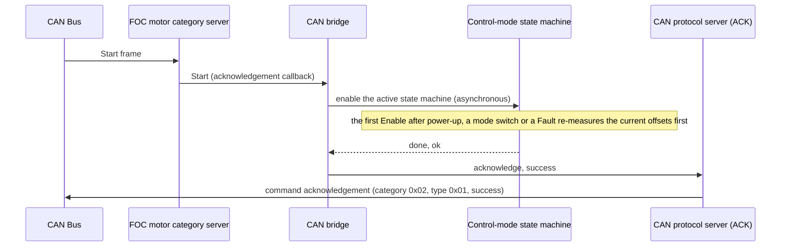
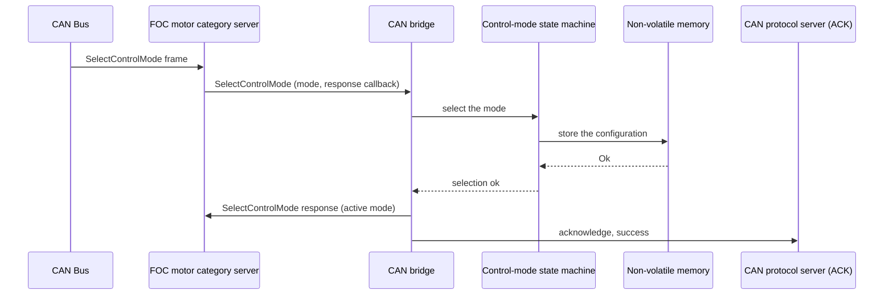
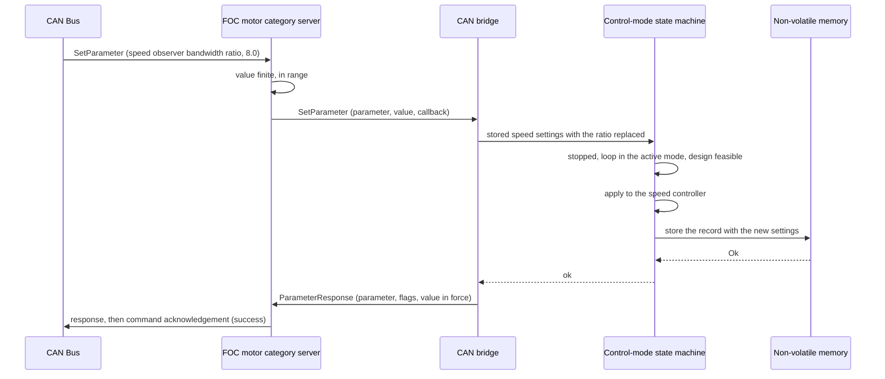
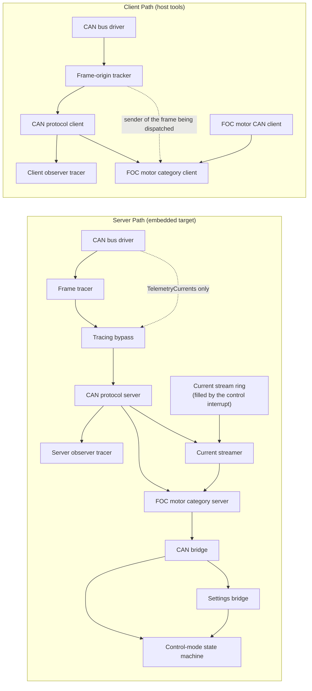

| Field     | Value                    |
|-----------|--------------------------|
| Title     | CAN Service Layer Design |
| Type      | design                   |
| Status    | draft                    |
| Version   | 0.25.4                   |
| Component | can-service              |
| Date      | 2026-11-27               |

> **IMPORTANT — Implementation-blind document**: This document describes *behavior, structure, and
> responsibilities* WITHOUT referencing code. **No code blocks using programming languages (C++, C,
> Python, CMake, shell, etc.) are allowed.** Use Mermaid diagrams to express behavior instead.
> Prose descriptions of algorithms are encouraged; source-level details are not.
>
> **Diagrams**: All visuals must be either a Mermaid fenced code block or ASCII art inline
> in the document. External image references (``) are **not allowed**.

---

## Responsibilities

**Is responsible for:**
- Bridging the server category to the control-mode state machine, translating motor control commands into state machine transitions.
- Applying tracing decorators at every layer boundary so all CAN frames and protocol lifecycle events are observable.
- Delegating the electrical identification command to the electrical identification; its result lands in the calibration record, which a client reads back as parameters.
- Broadcasting the on-demand status and motion telemetry frames in response to RequestTelemetry.
- Streaming the measured d- and q-axis currents and the rotor position at the configured telemetry rate (Part J).
- Selecting the control algorithm of each loop and reporting the algorithms in force.
- Writing and reading the numbered parameters of the contract:
  - every loop's tuning settings
  - the motor parameters of the calibration record
  - the start-up settings
  - the current stream's rate
  - the drive-wide supervision settings.
- Registering the can-lite firmware-upgrade category beside the FOC motor category, and answering *busy*
  to configuration writes while a firmware pack is received (Part K).

---

## Component Details

### Part A — FOC Motor Message Catalogue

The e-foc-protocol library defines the category's message catalogue, scale factors, parameter table and
contract version, in its wire contract, Part A. This firmware restates none of it.

### Part B — FOC motor category server

The server category is part of e-foc-protocol (wire contract, Part B). The firmware attaches the CAN bridge
(Part D) as its only observer.

### Part C — FOC motor category client

The client category is part of e-foc-protocol (wire contract, Part C).

### Part D — CAN bridge

The CAN bridge observes the FOC motor category server and uses the control-mode state machine. It
translates each command the server decodes into the matching state machine call:

- Start → asynchronous enable. The bridge sends the acknowledgement when the enable is decided. The decision
  comes at once, or after an offset refresh. The offset refresh runs at the first enable after power-up, a mode
  switch or a Fault ([state-machine.md](state-machine.md), Refreshing the current offsets at enable).
  Success acknowledges; a refusal sends the matching error. A stopped drive (Idle or Ready) answers *busy*
  while another command or a non-volatile write is outstanding ([when busy](#commissioning-busy)). In
  Calibrating, Enabled, Stopping and Fault, Start keeps its state answer, *invalidState*.
- Stop → disable.
- ClearFault → clear fault.
- EmergencyStop → emergency stop.
- QueryFaultHistory (age) → the fault history's record of that age, answered with both responses.
- ClearFaultHistory → clears the fault history; the acknowledgement follows the store.
- QuickStop → quick stop; a refusal in Calibrating answers *invalidState*.
- SelectControlMode → mode selection; the result sends the mode response or a category error.
- A setpoint → the bridge validates mode, range and state, then hands the setpoint to the state machine.
  The N·m kind first converts with the torque constant of Part A (contract 2.21). Without a torque
  constant, the bridge refuses it with *invalidState*.
- IdentifyElectrical → the bridge reserves an external calibration (state guard and Calibrating entry).
  It waits for standstill, measures and applies the current offsets, and runs the estimation. On success
  it completes the external calibration with the offsets in the data; this aligns the rotor and persists.
  On failure it answers *invalidState*, *calibrationFailed* or *busy* ([when busy](#commissioning-busy)).
  Every failure that leaves the reservation in place releases the reservation, so the node returns to Ready
  or Idle. These failures are
  a rotor that does not come to rest, a failed offset measurement and a poor R/L fit. A missing pole-pair
  estimate, or one that does not fit the calibration record's byte, is also such a failure, as is a
  rejected completion. An emergency stop or a fault can abandon a previous run: the reservation is gone and
  the estimation never answered. A request that finds such a run starts afresh instead of answering *busy*. The command covers the electrical steps only. It
  never drives the mechanical estimator, so speed and position end in Idle reporting *partialCalibration*,
  while torque reaches Ready.
- RequestTelemetry → the bridge broadcasts the current state and fault code in the telemetry status
  response. Then it broadcasts the measured speed and measured position in the motion telemetry frame. The
  command always succeeds.
  The reported state maps Stopping to *stopping* and Ready to *ready*. It maps Idle to
  *partialCalibration* instead of *idle* when the non-volatile record is not empty but incomplete (old
  schema or interrupted external calibration).
- SelectAlgorithm → the control mode's selection for that loop, then the bridge stores the configuration
  record; the response and acknowledgement follow the write. AlgorithmsResponse reports what the selectors
  run, so a refused selection is visible as the unchanged algorithm.
- SetParameter → by parameter group:
  - a tuning setting: the bridge takes the loop's stored settings, replaces the one field and hands the whole
    record to the control mode. The control mode validates it (ranges, switching gain below boundary
    layer, position design feasibility). It applies the record to the running controller when stopped and
    stores it;
  - a motor parameter: the control mode sends the motor parameter change to the lifecycle. The lifecycle stores the
    edited calibration record and re-applies the model ([state-machine.md](state-machine.md)). The operator's
    tuning settings are re-applied on top, because applying a model re-derives the loop tunings;
  - a start-up setting or the telemetry rate: changed in the configuration record and stored. A start-up
    setting takes effect at the next start, the telemetry rate at the current stream's next tick (Part J).
    A setting that cannot be stored is taken back, and the record's next write leaves it out. The
    configuration record has one owner, the control-mode state machine. The bridge changes the field in that
    record and asks the owner to store it. Thus a write from CAN can never put back an algorithm or mode
    selection that an older copy of the record still held.
  A second write while one is outstanding, or while a mode selection or a configuration write is in
  flight, answers *busy*.
- QueryParameter → the value in force:
  - a loop setting's effective value: an automatic bandwidth reports the bandwidth the firmware derived,
    flagged automatic. When the active mode does not run that loop, it reports 0 flagged automatic;
  - a motor parameter from the calibration record in RAM: 0 while unknown; an unset flux linkage reports
    the platform's default, flagged automatic;
  - a start-up setting or the telemetry rate from the stored configuration.
  The read-only parameters report, never flagged automatic:
  - the current offsets and the cogging-map peak from the calibration record in RAM;
  - the active mode's online estimates (0 in torque mode, which runs none);
  - the control-loop statistics of the platform diagnostics;
  - the reset cause the platform reported at start-up.
- Calibrate → calibration on the active mode's state machine, answered when the sequence ends. The answer is
  success, *invalidState* when the drive is not stopped, or otherwise the category error the sequence ended with.
- ClearCalibration → calibration clear, answered once the record is invalidated and the drive is back in
  Idle. A record that cannot be invalidated faults the drive and answers *persistenceFailed*.
  Either command arriving while the other one, another non-volatile write, a mode selection or a setting is
  outstanding is answered *busy*.
- ClearDiagnostics → the platform diagnostics reset, which restarts the control-loop and CAN statistics;
  always succeeds.
- Recalibrate → the model recalibration's recalibrate command; not stopped or the mode off answers
  *invalidState*, torque mode *modeMismatch*.
- ResetModel → the model recalibration's model reset; not stopped answers *invalidState*, a store that
  fails *persistenceFailed*.

The bridge forwards the settings commands (SelectAlgorithm, QueryAlgorithms, SetParameter, QueryParameter and
ClearDiagnostics) to the settings bridge, which it owns. The settings bridge holds one outstanding setting at
a time. Thus a settings write that arrives while another is being stored is answered *busy*, whichever message
carried it.

The bridge forwards the commissioning commands (Align, the identifications,
Calibrate and ClearCalibration) to the commissioning bridge, which it owns. The commissioning bridge holds the
outstanding answer of each command. Each commissioning command answers *busy* while another command or a
non-volatile write is outstanding. The start-up loads and stores are such writes.

The bridge takes the platform it reads from as one argument: the inverter and encoder, the platform
diagnostics, and the reset cause.

The bridge validates that the correct control mode is active before accepting a setpoint command. An out-of-range setpoint results in *invalidPayload*. A mode mismatch results in a category error, *modeMismatch*.

### Part E — FOC motor CAN client

The client object is part of e-foc-protocol (wire contract, Part D).

### Part F — CAN liveness watchdog

The CAN protocol server already tracks client liveness. It restarts a timer on every frame from the client.
When the client timeout elapses with no traffic, it notifies its observers that the client is offline.
Nothing acted on that notification, so unplugging the bus mid-spin left the drive holding its last setpoint
indefinitely.

The liveness watchdog observes the protocol server and closes the loop. On the offline notification it checks
whether the active state machine is in Enabled, or in Calibrating under a CAN client's reservation. Such a
reservation is an identification the client started, which may be spinning the motor. If so, the watchdog
traces and issues an emergency stop, which stops the inverter. A calibration the drive runs itself, started
with Calibrate, is left alone. When the drive is otherwise not running, the watchdog ignores the
notification. A bus that goes quiet while the motor is stopped is not a hazard, and a fault there would
obstruct commissioning. An identification acknowledges only when it ends. A client waiting on one therefore keeps
sending frames: the CAN protocol client sends a heartbeat every heartbeat interval for this.

The instantiation layer composes it alongside the CAN bridge, so the bridge and category server stay free of lifecycle policy.

**Command timeout.** Liveness alone does not catch a client whose application hangs while its CAN stack
keeps running. The heartbeat goes on, the client never goes offline, and the drive keeps executing its last
setpoint. The command timeout monitor watches what the client asks for instead (REQ-LCY-005). The bridge tells
it of every accepted Start and every accepted torque, speed or position setpoint; nothing else counts, the
heartbeat included. Every 1 ms on the event loop, the monitor checks the drive. It checks while the drive is
Enabled and the command timeout of the configuration record is above zero. It compares the time since the
later of the latest such command and the entry to Enabled with the timeout. Once the timeout has run out, it
raises *commandTimeout* through the platform fault notifier, once. It then stays silent until the drive
leaves Enabled. The drive cuts its power stage and coasts, and enters Fault rather than Ready, so the client
finds out why when it comes back.

| Setting         | Default | Range    | Meaning                                                        |
|-----------------|---------|----------|----------------------------------------------------------------|
| Command timeout | 0 (off) | 0 – 60 s | Longest silence of Start and setpoints a running drive accepts |

The timeout is off by default. A client that commands one setpoint and then only watches, as the CAN
Commander does, is a legitimate use. A client that streams setpoints sets it to a few of its periods. While
the timeout is zero the count keeps restarting, so a timeout written while the drive runs counts from the write.
A drive enabled from the terminal is watched the same way: with a timeout set, it needs setpoints over CAN.

### Part G — Fault Broadcast Priority

The fault broadcast sends its frame at emergency priority (0), not at telemetry priority (12). CAN
arbitration is by identifier, and the priority field is the high bits of the identifier. Thus a
telemetry-priority fault notification loses arbitration to routine telemetry on a busy bus. That is exactly
when the bus is busiest and the notification matters most. The payload is a TelemetryStatusResponse: the
*fault* state and the fault code.

Arbitration only helps a frame that reaches the controller. The can-lite send queue therefore orders queued
frames by priority and keeps two of its slots for emergency frames only. When the queue is full, an emergency
frame displaces the newest lowest-priority frame. Thus the queue does not refuse a fault notification behind
queued telemetry.

### Part H — Tracing Decorators

All tracing is applied through can-lite's tracing decorators:

| Decorator              | Wraps               | Traces                                                              |
|------------------------|---------------------|---------------------------------------------------------------------|
| Frame tracer           | The CAN bus driver  | Every raw CAN frame sent and received, except current-stream frames |
| Server observer tracer | The protocol server | Server online/offline events                                        |
| Client observer tracer | The protocol client | Server online/offline, ACK timeouts per node                        |

The instantiation layer composes these in the CAN stack of the application logic. Thus the production code paths gain full observability without any tracing logic in the category or the bridge.

can-lite's tracing bypass sits between the protocol server and the frame tracer. It selects the
current-stream frames and sends the TelemetryCurrents frames straight to the bus. One traced frame is a line
of about 120 characters. A 1 kHz stream alone would thus need about 120 kB/s of trace output, more than the
921 600 bit/s trace port carries. Every other frame, and every received frame, is still traced.

### Part I — Node Address

Each controller answers on one CAN node ID, fixed once at boot. The node ID is the configured base from the
non-volatile configuration (the CAN node ID base, default 1) plus the board ID. The board ID comes from the
board's ID jumpers. Boards that run the same firmware and configuration can therefore share a bus once their
jumpers differ.

The jumpers are sampled once, during platform start-up, after their pull-ups have had time to
settle; moving a jumper takes effect at the next reset. Node 0 is the broadcast address. Thus the default
base replaces a base of 0, or a base whose sum with the board ID exceeds the 12-bit node field (4095).
This is can-lite's node-ID rule (its REQ-CAN-005.1). The resolved node and both of its parts are traced at
start-up.

| Platform                                       | ID inputs                                                                 | Board ID |
|------------------------------------------------|---------------------------------------------------------------------------|----------|
| Board with three ID inputs                     | Three inputs, one per bit; a jumper or closed switch to ground sets a bit | 0–7      |
| Board with no ID inputs, host, emulated target | none                                                                      | 0        |

With the default base, eight boards with ID inputs set to 0–7 answer as nodes 1–8, the
most one bus carries (can-lite tracks eight servers).

### Part J — Current Stream

A host that rebuilds the current and position waveforms needs them at a steady rate, not one status frame
per request. While the stream runs, the drive sends one TelemetryCurrents frame per window without being
asked.

**Window.** The control interrupt adds each sample's measured Id and Iq to the stream window. These are the
Park transform's output, not the references. A window is N control periods, N = round(f_control / rate), so
the effective rate is f_control / N. On the 20 kHz loop this is exactly the configured rate at 1000, 500,
250, 200 or 100 Hz. For a configured 300 Hz it is 298.5 Hz (N = 67). At the window's last sample the interrupt
stores the two means and that sample's mechanical angle in a sixteen-entry ring and starts the next window.
The mean is the anti-aliasing filter of the stream. A 1 kHz stream of single samples would fold the
switching ripple and the sensor noise into its band. The window average has a null at every multiple of the
stream rate. The interrupt does a few additions per sample and nothing while the stream is stopped
([performance optimization](../performance-optimization/README.md)).

**Sequence.** Every window the interrupt closes takes the next value of an 8-bit counter, whether or not its
frame reaches the bus. A window lost to a full ring or to a full send queue is a gap in the sequence, never a
silently shifted sample. The counter wraps after 256 windows (256 ms at 1 kHz). A client therefore also uses
the arrival time to tell a long outage from a wrap. The interrupt counts windows only while a control loop
runs. A stop and a later start show as a pause in arrival, not as a gap.

**When it runs.** The stream runs while all of these hold:

- a CAN client is online (Part F's liveness, the same client timeout);
- the configured rate is not zero;
- a closed-loop cascade runs: torque, speed or position, including the calibration steps that drive the
  motor through the cascade (mechanical identification, cogging map).

The open-loop steps (alignment, resistance and inductance injection) and a stopped drive produce no windows.

**Rate.** The rate is the telemetry rate of the configuration record, read and written as the parameter
*telemetryRate* (Part A, contract 3.0). A rate of 0 stops the stream, and 1–1000 Hz runs it. Any other value
is answered *invalidPayload* and changes nothing. A stored change takes effect within one millisecond. The default record
holds 100 Hz.

**Sending.** An event-loop timer drains the ring every millisecond and hands each sample to the send queue
at telemetry priority (12). At most two stream frames are in the send queue at once. This leaves the other
ordinary slots of can-lite's queue to responses and acknowledgements. A sample that finds two frames waiting
stays in the ring for the next tick. The ring holds sixteen milliseconds of samples at 1 kHz.
Stream frames are not traced (Part H).

**Bus budget.** One TelemetryCurrents frame has a 29-bit identifier and seven data bytes. It is 123 bits
nominal, and 150 with worst-case bit stuffing (110 stuffable bits, at most 27 stuff bits).

| Bitrate    | One node at 1 kHz | One node at 500 Hz | Stream frames per second within 70 % |
|------------|-------------------|--------------------|--------------------------------------|
| 1 Mbit/s   | 12.3–15 %         | 6.2–7.5 %          | 4666                                 |
| 500 kbit/s | 24.6–30 %         | 12.3–15 %          | 2333                                 |
| 250 kbit/s | 49.2–60 %         | 24.6–30 %          | 1166                                 |
| 125 kbit/s | does not fit      | 49.2–60 %          | 583                                  |

Several drives share one bus, so the budget is the sum over every node. The sum Σ rate × 150 bit shall stay
at or below 70 % of the bitrate. This leaves the rest for commands, responses, acknowledgements and heartbeats.
Nine drives at 1 kHz need 1.11–1.35 Mbit/s and do not fit any classic CAN bitrate. Nine at 500 Hz on
1 Mbit/s take 67.5 % worst case, as do nine at 250 Hz on 500 kbit/s.

Stream frames (priority 12) win arbitration over heartbeats (priority 16). On an over-subscribed bus an idle
client's heartbeats starve. Every drive then declares the client gone after the client timeout (3 s) and
stops its motor (Part F). A node sees only its own traffic and cannot measure the bus load, so it does not
throttle itself. Choosing the rates within the budget is the integrator's job.

### Part K — Firmware Upgrade Category

The drive's protocol server registers a second category beside the FOC motor category: the can-lite
firmware-upgrade category (0x1), on the same node ID. Its observer is the firmware upgrade service
([service-firmware-upgrade.md](service-firmware-upgrade.md)). Its commands carry no sequence byte, as the
can-lite specification defines. Thus they do not take part in the FOC motor category's sequence bookkeeping.
The server's rate limit of 500 commands a second covers both categories. While a pack is received, the bridge
answers *busy* to every command that writes the configuration record. These are the start-up settings, the
telemetry rate and the fault supervision settings. The control-mode state machine refuses the commands that start the drive
or asynchronous work, because the download counts as pending work. A pack that is staged, waiting for the user
to apply it, holds nothing. EmergencyStop is always accepted.

---

## Interfaces

### Provided

| Interface        | Purpose                                                    | Contract                                                                 |
|------------------|------------------------------------------------------------|--------------------------------------------------------------------------|
| Current streamer | Sends the current stream while a client is online (Part J) | Event loop only; reads the rate from the configuration record every tick |

### Required

| Interface                  | Purpose                            | Contract                                                               |
|----------------------------|------------------------------------|------------------------------------------------------------------------|
| CAN frame transport        | Sends and receives raw CAN frames  | Provided by can-lite; constructed before the category objects          |
| FOC motor category server  | Decodes the category's commands    | Provided by e-foc-protocol; the CAN bridge is its only observer        |
| Control-mode state machine | Accepts motor control commands     | Every command is synchronous or delivers its result through a callback |
| CAN bus driver             | Raw CAN bus access                 | Required by the CAN protocol server and the CAN protocol client        |
| Tracer                     | Diagnostic output                  | Outlives the tracing decorators                                        |
| Current stream ring        | Windows filled by the control loop | Single producer (control interrupt), single consumer (event loop)      |

---

## Data Model

The e-foc-protocol wire contract defines the wire-level data model.

---

## Sequence Diagrams

### Start Command (server path)

### SelectControlMode (server path)

### SetParameter (tuning setting)

A motor parameter takes the same path to the bridge. The bridge then sends the motor parameter change to the
lifecycle instead; the response carries the value the calibration record now holds.

---

## Block Diagram

---

## Constraints & Limitations

| Constraint              | Value / Description                                                                                                              |
|-------------------------|----------------------------------------------------------------------------------------------------------------------------------|
| No heap                 | All objects are value members or statically allocated; callbacks need no heap                                                    |
| One observer per server | A category server holds one observer: only one bridge attaches at a time                                                         |
| Setpoint range          | Torque: bounded by the inverter's maximum supported current; speed: 1000 rad/s; position: ±2000π rad, 1000 turns (contract 4.0)  |
| Sequence byte           | Server handlers always skip the first byte (sequence number) before reading payload fields                                       |
| Ident re-entrancy       | A second identification command while one is in flight returns *busy* as a category error                                        |
| NVM re-entrancy         | A second config-persist command while one is in flight returns *busy* as a category error                                        |
| Parameter writes        | One outstanding per node; acknowledged after the value is in force and stored                                                    |
| Setting changes         | Refused unless stopped (start-up settings excepted); a loop's settings only while its mode runs that loop                        |
| Telemetry speed/pos     | Speed is the active mode's measured speed, zero while disabled; position is the position tracker's multi-turn position (4.0)     |
| Current stream          | 0–1000 Hz per node, window mean of Id and Iq; the sum over all nodes of rate × 150 bit stays within 70 % of the bitrate (Part J) |
| Node ID                 | Configured base + board ID, fixed at boot; 1–4095                                                                                |
| Firmware download       | Configuration writes answered *busy*, the drive held stopped, while a pack is received (Part K)                                  |
