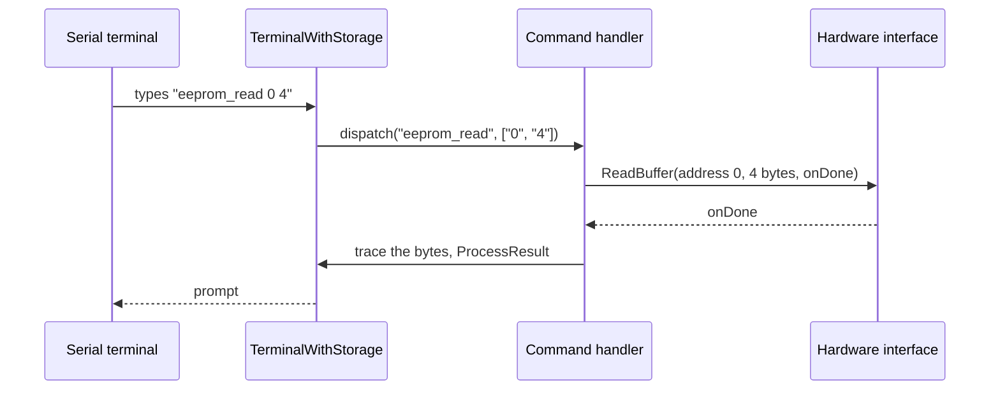

| Field     | Value                                 |
|-----------|---------------------------------------|
| Title     | Service: Command-Line Interface (CLI) |
| Type      | design                                |
| Status    | draft                                 |
| Version   | 1.0.0                                 |
| Component | service-cli                           |
| Date      | 2026-11-06                            |

> **IMPORTANT — Implementation-blind document**: This document describes *behavior, structure, and
> responsibilities* WITHOUT referencing code. **No code blocks using programming languages (C++, C,
> Python, CMake, shell, etc.) are allowed.** Use Mermaid diagrams to express behavior instead.
> Prose descriptions of algorithms are encouraged; source-level details are not.
>
> **Diagrams**: All visuals must be either a Mermaid fenced code block (` ```mermaid `) or ASCII art inline
> in the document. External image references using Markdown image syntax are **not allowed**.

---

## Responsibilities

**Is responsible for:**
- The serial command line of the bring-up application, `hardware_test`: parsing typed commands into
  bounded arguments, answering each with a status and a message, and the hardware commands of that
  application (EEPROM, ADC, CAN, watchdog, reset cause) that the `@hil` scenarios drive
- The startup banner of both applications: firmware name, version and revision, build, compiler,
  target, system clock, supply voltage, reset cause, and the fault record a crash left behind
- Ensuring all string handling uses bounded-size containers — no heap allocation at any point

**Is NOT responsible for:**
- Commanding the motor application. `sync_foc_sensored` has no command line: CAN is its only command
  interface (`service-can.md`), and its serial port carries only the trace output, starting with the
  startup banner (Part B)
- Physical serial framing, character echo, or byte-level UART management — those are handled by the
  `TerminalWithStorage` infrastructure component

---

## Component Details

### Part A — Where the command line lives

| Application         | Command line | Serial output                                        | Commands                     |
|---------------------|--------------|------------------------------------------------------|------------------------------|
| `hardware_test`     | Yes          | Startup banner, command prompt, command answers      | Bring-up and `@hil` hardware |
| `sync_foc_sensored` | No           | Startup banner and the trace output, nothing to type | None; CAN (`service-can.md`) |

The motor application once registered terminal commands of its own. Each has a CAN equivalent, and
the scenarios and tools use CAN only (`integration-testing.md`):

| Former terminal command                                                           | Over CAN                                                                |
|-----------------------------------------------------------------------------------|-------------------------------------------------------------------------|
| `select_current_algorithm`, `select_speed_algorithm`, `select_position_algorithm` | `SelectAlgorithm`                                                       |
| `active_algorithms`                                                               | `QueryAlgorithms`                                                       |
| `active_mode`                                                                     | `SelectControlMode`'s response and the telemetry status                 |
| `set_torque`, `set_speed`, `set_position`                                         | `SetTorqueSetpoint`, `SetSpeedSetpoint`, `SetPositionSetpoint`          |
| `set_current_bandwidth`, `set_speed_bandwidth`, `set_position_bandwidth`          | The bandwidth parameters, with the same ranges and stopped-state policy |
| `set_flux_linkage`                                                                | The motor parameter `fluxLinkage`                                       |
| `apply_estimates`                                                                 | `Recalibrate` (`online-recalibration.md`)                               |
| `estimate_status`                                                                 | The online estimates, `0x90`–`0x93`                                     |
| `loop_stats`, `clear_stats`                                                       | The loop statistics, `0xA0`–`0xA7`, and `ClearDiagnostics`              |
| `can_stats`                                                                       | None: the CAN error counters are not read in the motor application      |

The lifecycle commands (`calibrate`, `align`, `enable`, `disable`, `clear_fault`, `clear_cal`) were
never registered by the motor application, which drives its state machines from CAN; they are gone
with the command line.

### Part B — The startup banner

Both applications trace the same banner as they start, before anything else:

- A clear-screen sequence and a delimiter line
- The application name, and the firmware version and source revision injected from the build
  information (`generated/Version.h`, which EmIL's `add_version_header_target` regenerates on every
  build from the CMake project version and the abbreviated source revision, empty when the revision
  cannot be read); the library holds no version literal
- The build date, the compiler and the target board
- The system clock and the supply voltage
- The reset cause, and the fault record a crash left behind between visible delimiters
  (`error-handling.md`, Boot-time reporting)

`hardware_test` follows it with the line inviting commands; the motor application does not.

### Part C — The bring-up command line

`TerminalWithBanner` is the `hardware_test` terminal: a `TerminalWithStorage` that traces the
startup banner when it is built. Command handlers convert a bounded-string token into a number with
EmIL's `services::ParseDecimal` (`services/util/DecimalToken.hpp`). A whole or decimal number within a caller-supplied
minimum and maximum is accepted; a malformed or out-of-range token yields no value, and the command
handler answers with a non-ok status describing the expected input. No dynamic string allocation
occurs.

Every command handler answers with a status (`ok`, `badArgument`, `notAllowed`, `hardwareError`, …)
and a bounded message, which the terminal writes verbatim. A command that starts an asynchronous
operation returns its prompt only when the operation completes.



### Memory Constraints

All string handling within the command line uses `infra::BoundedString` with compile-time fixed
capacities. Command names, argument tokens and answers are all bounded, and registered commands are
held in a fixed-size table in `TerminalWithStorage` — no dynamic registration table is used.

---

## Interfaces

### Provided

| Interface            | Purpose                                                     | Contract                                                                 |
|----------------------|-------------------------------------------------------------|--------------------------------------------------------------------------|
| Startup banner       | Traces the banner of Part B                                 | Traced once, as the application starts                                   |
| `TerminalWithBanner` | The `hardware_test` terminal, tracing the banner when built | Transparent to the underlying terminal after the banner has been printed |

### Required

| Interface             | Purpose                                                                                     | Contract                                                                         |
|-----------------------|---------------------------------------------------------------------------------------------|----------------------------------------------------------------------------------|
| `Tracer`              | The serial trace output the banner is written to                                            | Available before the application's other components are built                    |
| `TerminalWithStorage` | Receives and dispatches parsed command tokens; writes string responses to the serial output | `hardware_test` only; connected to the serial driver before any command is added |

---

## Hardware-Test EEPROM Commands

The hardware-test application registers three additional terminal commands that exercise the EEPROM hardware directly through the `hal::Eeprom` interface. These commands are available only in the hardware-test build target and are intended for commissioning, production testing, and EEPROM verification.

### Command Reference

| Command        | Alias | Arguments                | Action                                                                                                                                                             |
|----------------|-------|--------------------------|--------------------------------------------------------------------------------------------------------------------------------------------------------------------|
| `eeprom_write` | `ew`  | `<addr> <b0> [b1 … b63]` | Writes up to 64 bytes to the EEPROM starting at the given byte address. The callback fires when the hardware write completes.                                      |
| `eeprom_read`  | `er`  | `<addr> <size>`          | Reads `size` bytes (1–64) from the EEPROM starting at `addr` and traces each byte value to the serial output. The callback fires when the hardware read completes. |
| `eeprom_erase` | `ee`  | none                     | Erases the entire EEPROM to the all-0xFF state. The callback fires when the hardware erase completes.                                                              |

### Asynchronous Completion

All three commands are asynchronous. The terminal prompt (`>`) does not appear until the hardware operation completes and `ProcessResult` is called from the completion callback. This correctly models the interrupt-driven behaviour of the TM4C EEPROM peripheral.

### Argument Constraints

- `addr`: unsigned integer in the range 0 to 65535
- `b0 … b63`: unsigned integer byte values in the range 0 to 255
- `size`: unsigned integer in the range 1 to 64

Invalid argument count or out-of-range values return an error `StatusWithMessage` immediately without starting the EEPROM operation.
