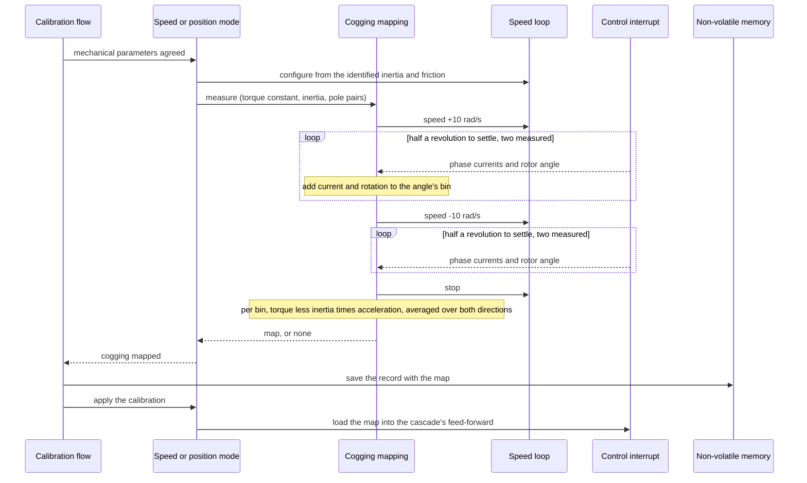

| Field     | Value                         |
|-----------|-------------------------------|
| Title     | Service: Cogging Compensation |
| Type      | design                        |
| Status    | draft                         |
| Version   | 0.1.0                         |
| Component | service-cogging-compensation  |
| Date      | 2026-10-22                    |

> **IMPORTANT — Implementation-blind document**: This document describes *behavior, structure, and
> responsibilities* WITHOUT referencing code. **No code blocks using programming languages (C++, C,
> Python, CMake, shell, etc.) are allowed.** Use Mermaid diagrams to express behavior instead.
> Prose descriptions of algorithms are encouraged; source-level details are not.
>
> **Diagrams**: All visuals must be Mermaid (` ```mermaid `), TikZ via ` ```{=latex} ` raw blocks (source in
> `documentation/tikz/`), or ASCII art. External image references (``) are **not allowed**.

---

## Responsibilities

A permanent-magnet rotor prefers some angles to others even with no current in the winding: its
magnets pull towards the stator teeth. On the bench motor, a 12-slot, 8-pole machine, that cogging
torque repeats 24 times a revolution and is about 4 mN·m deep, as large as the shaft's 3.7 mN·m of
dry friction (`software-in-the-loop.md`, Part K). A position setpoint between two detents sits
where the cogging pushes the rotor away. A loop holds it there only if its stiffness exceeds the
cogging's, and at the default tunings it does not: the PID, two-DOF and Cascade P laws step
between the neighbouring detents instead (`documentation/theory/position-loop-pid.md`).

**Is responsible for:**
- Measuring the cogging torque over one electrical period during the full calibration, in speed
  and position mode, and storing it with the calibration record
- Adding the measured torque, as current, to what the speed and position cascades ask of the
  winding at every control interrupt
- Keeping that addition out of the torque the online mechanical estimator regresses

**Is NOT responsible for:**
- Torque mode, which runs no mechanical identification and so measures no map
- A rotor angle reference across power cycles, which the alignment provides (Part E)

---

## Component Details

### Part A — Why one electrical period

The encoder has no index, so after a power cycle the firmware knows the rotor's angle only from the
alignment, which pulls the rotor to the electrical zero. That fixes the electrical angle, and the
mechanical angle only up to a whole electrical period. A map over one electrical period is therefore
the longest one that means the same after every alignment.

It also holds the cogging. Its fundamental repeats at the least common multiple of the slot and
pole counts a revolution, 24 on the bench motor, which is a whole number of times per electrical
period: six. What the map loses is any difference between the pole pairs, which a map over a
revolution would keep.

### Part B — The measurement

The step runs once the mechanical parameters are agreed, with the speed loop configured from them.
It turns the rotor under speed control at 10 rad/s, half a revolution to settle and then two
revolutions measured, in one direction and then in the other. Each control interrupt adds the
quadrature current and the encoder's rotation since the last interrupt to the bin of the electrical
period the rotor is in, 48 bins, kept per direction.

At 10 rad/s the cogging repeats at 240 rad/s, well above the speed loop's 50 rad/s, so most of it
goes into speeding and slowing the rotor rather than into current. The torque a bin holds is
therefore the winding's less the rotor's:

- a bin's speed is the rotation the encoder reported in it over the time spent there, so a bin
  one encoder count wider than its neighbour does not read as faster;
- its acceleration is its speed times the slope of speed with angle, taken over two bins on either
  side so that eight bins a cogging cycle lose about 1 % of it;
- its torque is the torque constant times its mean current, less the identified inertia times its
  acceleration.

Without the inertia term the map missed most of the cogging. The two directions are then averaged:
the cogging follows the angle and stays, the friction follows the motion and cancels, and so does
the viscous term at equal speeds. The mean is taken out. A direction that left a bin with fewer
than 16 samples, or turned the wrong way, yields no map.

A motor without cogging still gave a map: noise alone, 0.13 to 0.26 mN·m on the bench plant, which
the feed-forward then applied as a torque ripple of its own. The two directions tell the cogging
from the noise. The cogging is the same in both, while the noise in one is independent of the noise
in the other. So the builder compares the two profiles, each with its mean removed: the root mean
square of their sum against that of their difference, which it calls the agreement. Noise alone
agrees to about 1, and the builder keeps a map only from an agreement of 3. In simulation, through
full calibrations:

| Plant                                    | Agreement   | Map            |
|------------------------------------------|-------------|----------------|
| Bench, no cogging, four noise seeds      | 0.99 – 1.20 | none           |
| Bench, 3.7 mN·m dry friction, no cogging | 0.85        | none           |
| Teknic and anaheim reference motors      | 0.76 – 0.78 | none           |
| Bench, 0.5 mN·m cogging                  | 6.6         | 0.60 mN·m peak |
| Bench, 1 mN·m cogging                    | 9.1         | 1.08 mN·m peak |
| Bench, the bench's 4 mN·m cogging        | 26          | 3.87 mN·m peak |

The agreement also refuses a map built with the wrong inertia: without the inertia term, the
simulated rotor's two directions agree to 0.14, against 52 with it, because the current the speed
loop gives each detent leads the rotor in one direction and lags it in the other. The calibration
traces the agreement with the map's peak.

The run stops the bridge if any phase current passes the identification envelope, and gives up
after 10 s. Neither ends the calibration: a calibration without a map completes and is stored
without one.

### Part C — The record

The map is stored as 48 signed bytes and one scale: the largest bin is ±127. It adds 52 bytes, so
the calibration record grows from 56 to 108 bytes inside its 128-byte region, and the layout
version goes from 3 to 4. A board flashed with this version therefore boots with no calibration and
has to be calibrated again (`service-nvm.md`).

An external electrical identification over CAN keeps the stored map, as it keeps the current
offsets: it measures neither.

### Part D — The feed-forward

When a calibration with a map is applied, at boot or when one completes, the cascade expands the 48
bins into 256 points over the electrical period, by a periodic Catmull-Rom curve through the bin
centres, and divides by the torque constant. At every control interrupt it looks up the current at
the rotor's electrical angle, interpolating linearly between points, and adds it to the speed
loop's output, or to the current an LQR or LQI position law asks for directly. The sum is held
within the drive's current limit. The lookup costs about as much as one sine from the table the
transforms use.

Through 48 bins the curve reproduces a cogging that repeats six times a period within 3 % of its
depth. The bins average the torque across their width, which takes about 2.5 % off the fundamental.

The map is cleared before the mechanical identification runs, so a calibration measures the plant
without the compensation from an earlier one.

The online mechanical estimator regresses the current without the compensation's share. The
compensation and the plant's cogging cancel in the torque balance, so what the estimator sees is
the inertia, the friction, and only what the map missed (`service-mechanical-ident.md`).

### Part E — Where it does not reach

- **Alignment repeatability.** The alignment pulls the rotor to the electrical zero against the
  cogging and the dry friction, so it can settle a little to either side of where it settled when
  the map was measured. A map applied after a later alignment is shifted by that much, and the
  compensation leaves a residual that grows with the shift. Within the power cycle that measured
  the map there is no shift.
- **Torque mode.** It runs no mechanical identification and measures no map, and its setpoint is
  passed through without the compensation.
- **Differences between pole pairs.** One electrical period holds the average of the four.

---

## Sequence Diagrams



---

## Interfaces

### Provided

| Interface            | Purpose                                                  | Contract                                                                  |
|----------------------|----------------------------------------------------------|---------------------------------------------------------------------------|
| Cogging mapping      | Measure the map during the calibration                   | One run at a time; reports a map or none exactly once, unless aborted     |
| Cogging compensation | Load or clear the map in the speed and position cascades | Takes effect at the next control interrupt; a cleared map adds no current |

### Required

| Interface          | Purpose                                   | Contract                                                |
|--------------------|-------------------------------------------|---------------------------------------------------------|
| Speed command      | Turn the rotor at the measurement's speed | The speed loop configured from the identified mechanics |
| Phase currents     | Every control interrupt's sample          | One observer at a time; released when the run ends      |
| Encoder            | The rotor's mechanical angle              | Zeroed by the alignment of this power cycle             |
| Calibration record | Store and restore the map                 | Layout version 4                                        |

---

## Verification

- **Unit tests.**
  - The builder recovers a 4 mN·m, 24-detent cogging from a simulated rotor under a 50 rad/s speed
    loop, read through a 4000-count encoder, within 4 % in every bin and its peak within 5 %, and
    without the inertia term refuses it.
  - It refuses a run that left a bin empty or turned the wrong way.
  - It refuses noise alone in both directions, and a profile only one direction shows, and keeps
    a cogging smaller than the noise when both directions share it.
  - The mapping service turns both ways and reports the map, stops the bridge past the current
    envelope, times out with no map when the rotor does not turn, and stays silent once aborted.
  - The feed-forward reproduces a cogging sampled eight times a cycle within 3 %, wraps in either
    direction and scales with the torque constant.
  - The cascade asks for the cogging current at standstill once a map is loaded and stops when it
    is cleared, and the mechanical estimator's window leaves the compensation out.
- **SIL.** On the bench plant with the bench's cogging and dry friction:
  - the full calibration measures the cogging's peak within 10 % (REQ-CAL-018); it read 3.83 to
    3.90 mN·m against 4.0 across runs;
  - a cogging a quarter as deep, with the dry friction, is mapped within 30 % (it read 14.5 % high,
    the noise adding to a small map's peak), and with the dry friction and no cogging no map is
    stored (REQ-CAL-018);
  - every position law then settles within 0.03 rad of a 3.0 rad setpoint on a cogging hill top
    within 4 s and holds it for 2 s, and then 1.0 rad (REQ-POS-012). Without the map the PID,
    two-DOF and Cascade P laws stop at 3.02 to 3.13 rad.
