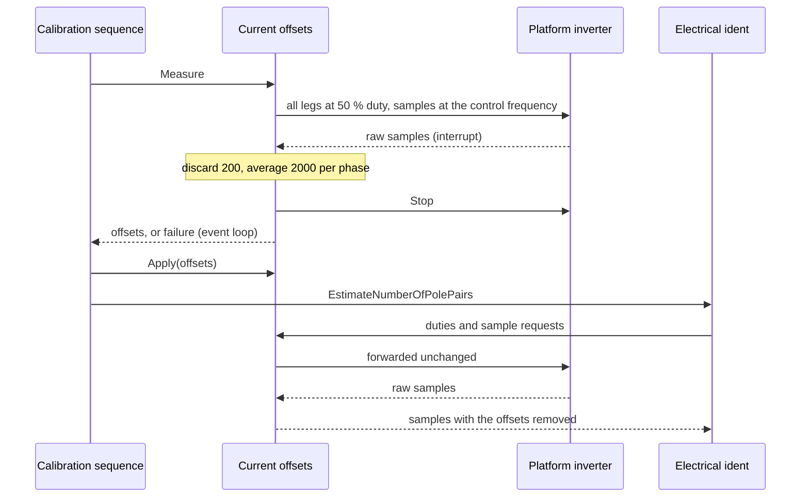

| Field     | Value                           |
|-----------|---------------------------------|
| Title     | Service: Current Sensor Offsets |
| Type      | design                          |
| Status    | draft                           |
| Version   | 0.1.0                           |
| Component | service-current-offsets         |
| Date      | 2026-10-21                      |

> **IMPORTANT — Implementation-blind document**: This document describes *behavior, structure, and
> responsibilities* WITHOUT referencing code. **No code blocks using programming languages (C++, C,
> Python, CMake, shell, etc.) are allowed.** Use Mermaid diagrams to express behavior instead.
> Prose descriptions of algorithms are encouraged; source-level details are not.
>
> **Diagrams**: All visuals must be Mermaid (` ```mermaid `), TikZ via ` ```{=latex} ` raw blocks (source in
> `documentation/tikz/`), or ASCII art. External image references (``) are **not allowed**.

---

## Responsibilities

A phase current sensor does not read zero at zero current. On E-FOC-HARDWARE the three phases read
+27, −18 and +54 mA with no current flowing. In the stationary frame that is a 42 mA error, which
the rotation turns into a ripple at the electrical frequency, and it hides small torques such as the
bench rotor's viscous friction (`documentation/design/software-in-the-loop.md`, Part M).

**Is responsible for:**
- Measuring each phase sensor's zero-current reading at the start of the full calibration
- Removing the offsets in force from every phase-current sample before any consumer receives it
- Failing a measurement whose readings cannot be offsets

**Is NOT responsible for:**
- Deciding when to measure, which is the calibration sequence's job (`state-machine.md`)
- Storing the offsets, which travel in the calibration record (`service-nvm.md`)
- Board protection, which reads the raw samples in hardware

---

## Component Details

### Part A — Where the correction sits

The service stands between the platform's inverter and everything that reads phase currents: the
current loop, the online estimators, and the identification and alignment procedures. To them it is
the inverter. It passes duty commands, start, stop, the base frequency and the current limit through
unchanged, and subtracts the offsets in force from each sample before handing it on. The cost in the
control interrupt is one call and three subtractions.

The hardware over-current comparators and the hardware-test target keep the raw samples. The emulated
platform's board protection does too, as the real comparators would.

### Part B — Measuring

With all three legs at 50 % duty the windings see no voltage, so each sensor reads only its offset.
The measurement runs at the control frequency, the one the loop runs at. It discards the first 200
samples while the bridge and the sensing settle, then averages the next 2000 for each phase: 110 ms at
20 kHz, which brings 35 mA of sample noise below 1 mA. It reads the raw samples, whatever offsets are
applied at the time.

It fails and stops the bridge in three cases:
- a sample exceeds the inverter's maximum current, which means the rotor was turning or the sensing
  is broken;
- an offset exceeds 0.5 A, far beyond any amplifier or mid-rail error;
- no sample arrives within 100 ms.

The interrupt only accumulates, and stops the bridge on the last sample or a failure. The result is
delivered from the event loop.

### Part C — The life of the offsets

| Event                              | Offsets afterwards                                                         |
|------------------------------------|----------------------------------------------------------------------------|
| Full calibration, first step       | Measured and applied at once, so every later step reads corrected currents |
| Calibration record saved           | Stored with it and traced as `Ia_mA`, `Ib_mA`, `Ic_mA`                     |
| Boot with a stored record          | Applied, whether or not the record is complete for the mode                |
| Calibration cleared                | Zero                                                                       |
| Electrical identification over CAN | Kept: it does not measure the sensors                                      |
| Re-alignment                       | Kept: it copies the record                                                 |

A record written before this step existed carries zero offsets, which applies no correction.

---

## Sequence Diagrams



---

## Interfaces

### Provided

| Interface  | Purpose                                | Contract                                                                      |
|------------|----------------------------------------|-------------------------------------------------------------------------------|
| Inverter   | The bridge, for every current consumer | Same as the platform's; each sample arrives with the offsets in force removed |
| Measure    | Measure the three offsets              | Asynchronous; reports three offsets or none; leaves the bridge stopped        |
| Apply      | Set the offsets in force               | Takes effect on the next sample                                               |
| Abort      | Abandon a measurement                  | Stops the bridge; the measurement reports nothing                             |
| Is running | Whether a measurement is in flight     | True from Measure until its result is delivered or it is aborted              |

### Required

| Interface         | Purpose                                  | Contract                                                  |
|-------------------|------------------------------------------|-----------------------------------------------------------|
| Platform inverter | Duties, start, stop and the raw samples  | One sample callback at a time; the last registration wins |
| Event dispatcher  | Deliver the result outside the interrupt | —                                                         |
| Timer             | Detect a bridge that sends no samples    | —                                                         |

---

## Verification

Against plants whose phases are biased by +27, −18 and +54 mA with 35 mA of noise, the full
calibration traces offsets within 1.5 mA of the biases on both reference motors and the bench motor
(REQ-CAL-015, `parameter_identification.feature`).
