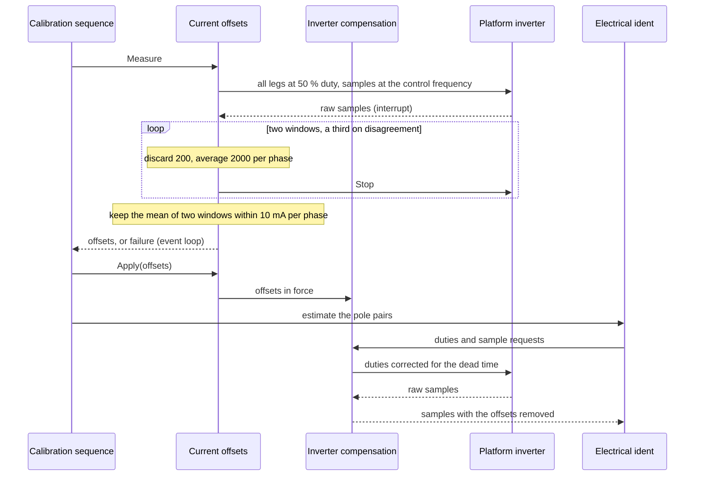

| Field     | Value                           |
|-----------|---------------------------------|
| Title     | Service: Current Sensor Offsets |
| Type      | design                          |
| Status    | draft                           |
| Version   | 0.2.2                           |
| Component | service-current-offsets         |
| Date      | 2026-11-26                      |

> **IMPORTANT — Implementation-blind document**: This document describes *behavior, structure, and
> responsibilities* WITHOUT referencing code. **No code blocks using programming languages (C++, C,
> Python, CMake, shell, etc.) are allowed.** Use Mermaid diagrams to express behavior instead.
> Prose descriptions of algorithms are encouraged; source-level details are not.
>
> **Diagrams**: All visuals must be Mermaid (` ```mermaid `), TikZ via ` ```{=latex} ` raw blocks (source in
> `documentation/tikz/`), or ASCII art. External image references (``) are **not allowed**.

---

## Responsibilities

A phase current sensor does not read zero at zero current. On the reference board the three phases read
+27, −18 and +54 mA with no current flowing. In the stationary frame that is a 42 mA error, which the rotation turns
into a ripple at the electrical frequency. It hides small torques such as the bench rotor's viscous friction
([software-in-the-loop](../verification_and_validation/software-in-the-loop.md), Part M).

**Is responsible for:**
- Measuring each phase sensor's zero-current reading at the start of the full calibration. The
  measurement repeats at the first Enable after power-up, a control-mode switch or a Fault
- Confirming each measurement with a second one, so a single disturbed window is never stored
- Handing the offsets in force to the inverter compensation stage, which removes them from every
  phase-current sample before any consumer receives it
- Failing a measurement whose readings cannot be offsets

---

## Component Details

### Part A — Where the correction sits

The inverter compensation stage removes the offsets. It stands between the platform's inverter and everything
that reads phase currents: the current loop, the online estimators, and the identification and alignment
procedures. To them it is the inverter. It subtracts the offsets in force from each sample before handing it
on. The same stage corrects each duty for the dead-time loss
([service-dead-time-compensation.md](service-dead-time-compensation.md)). A sample therefore crosses one stage
on its way in and a duty one on its way out. The offsets cost three subtractions inside that stage's call.

This service measures the offsets and hands them to the stage. It does not stand in the path itself.

The hardware over-current comparators and the hardware-test target keep the raw samples. The emulated
platform's board protection does too, as the real comparators would.

### Part B — Measuring

With all three legs at 50 % duty the windings see no voltage, so each sensor reads only its offset.
That holds only for a rotor at rest. The legs short the windings, so a turning rotor's back-EMF drives
current through the sensors. A rotor that slows to a stop during the average leaves part of that
current in the result. The calibration sequence therefore starts the measurement only once the rotor
is at rest ([state-machine.md](state-machine.md), Calibration Sequence). The measurement runs at the
control frequency, the one the loop runs at. It discards the first 200 samples while the bridge and
the sensing settle. It then averages the next 2000 for each phase: 110 ms at 20 kHz, which brings 35
mA of sample noise below 1 mA. It reads the raw samples, whatever offsets are applied at the time.

The same samples give the sensors' noise: the RMS over the three phases of each sample's distance from
its phase's offset. The calibration record stores it in whole milliamperes. The automatic
current-loop bandwidth is held where its proportional gain keeps that noise out of earshot
([controller-selection.md](controller-selection.md), *Automatic bandwidth*; REQ-CTL-006).

One such average is a window. A measurement takes two windows and keeps their mean, offsets and noise
alike, when every phase agrees within 10 mA. With 35 mA of sample noise two undisturbed windows differ
by about 1 mA RMS, so the tolerance only turns away a disturbed one. When they disagree it takes a third
window and keeps its mean with whichever earlier window it agrees with, the first if both do. With no
agreeing pair among the three, the measurement fails. It takes 220 ms at 20 kHz, 330 ms with a third
window.

On the bench a back-to-back calibration once read phase B 52 mA low while A and C read as usual. The
noise rose from 38 to 43 mA. The flux-linkage fit that followed was the worst of the session. A second
window catches such a disturbance whatever its cause. The stored record is not consulted: the offsets
drift by several milliamperes between calibrations, and none exists after the calibration is cleared.

A window fails and stops the bridge in three cases, and a failed window fails the measurement:
- a sample exceeds the inverter's maximum current, which means the rotor was turning or the sensing
  is broken;
- an offset exceeds 0.5 A, far beyond any amplifier or mid-rail error;
- no sample arrives within 100 ms.

The interrupt only accumulates, and stops the bridge on the last sample or a failure. The result is
delivered from the event loop.

### Part C — The life of the offsets

| Event                                                         | Offsets afterwards                                                                                                         |
|---------------------------------------------------------------|----------------------------------------------------------------------------------------------------------------------------|
| Full calibration, first step                                  | Measured and applied at once, so every later step reads corrected currents                                                 |
| Calibration record saved                                      | Stored with it and traced as `Ia_mA`, `Ib_mA`, `Ic_mA`                                                                     |
| Boot with a stored record                                     | Applied, whether or not the record is complete for the mode                                                                |
| Calibration cleared                                           | Zero                                                                                                                       |
| Electrical identification over CAN                            | Measured at rest and applied before R/L, then stored with its record                                                       |
| Re-alignment                                                  | Kept: it copies the record                                                                                                 |
| First Enable after power-up, a control-mode switch or a Fault | Re-measured at rest; applied when every phase is within 50 mA of the record, otherwise the record's stay in force (Part D) |

A record written before this step existed carries zero offsets, which applies no correction.

### Part D — The refresh at enable

An amplifier's offset drifts with temperature and age after the calibration that measured it
([sensing chain](../theory/sensing-chain.md) §3). The drive therefore measures the offsets again, by the
procedure of Part B. It does this at the first Enable after power-up, after a control-mode switch and
after every Fault. The drive stays Ready throughout. It waits for the rotor to come to rest, as the
calibration does, and then measures. This way no winding current is taken for sensor bias.

| Outcome                                                   | Offsets in force  | Enable                         |
|-----------------------------------------------------------|-------------------|--------------------------------|
| Every phase within 50 mA of the record                    | The measured ones | Proceeds to Enabled            |
| A phase more than 50 mA from the record                   | The record's      | Refused: calibration failed    |
| The rotor does not come to rest, or the measurement fails | The record's      | Refused: calibration failed    |
| Disable, emergency stop or a fault meanwhile              | The record's      | Refused; the measurement stops |

The comparison is always against the record, never against an earlier refresh. A sensor that creeps
therefore cannot walk the offsets away from the calibration a few milliamperes at a time. A
difference of more than 50 mA is larger than any drift the sensing chain's budget allows for. It
therefore points at a fault or at a different board, and only a new calibration may store it. The
refreshed offsets are not written to the calibration record; later Enables use them without
measuring until the next power-up, control-mode switch or Fault.

---

## Sequence Diagrams



---

## Interfaces

### Provided

| Interface  | Purpose                            | Contract                                                                                             |
|------------|------------------------------------|------------------------------------------------------------------------------------------------------|
| Measure    | Measure the three offsets          | Asynchronous; reports three offsets or none; leaves the bridge stopped                               |
| Noise      | The noise of the last measurement  | RMS about the offsets over the three phases, mean of the two windows kept; zero before a measurement |
| Apply      | Set the offsets in force           | Takes effect on the next sample the compensation stage hands on                                      |
| Abort      | Abandon a measurement              | Stops the bridge; the measurement reports nothing                                                    |
| Is running | Whether a measurement is in flight | True from Measure until its result is delivered or it is aborted                                     |

### Required

| Interface             | Purpose                                         | Contract                                                  |
|-----------------------|-------------------------------------------------|-----------------------------------------------------------|
| Platform inverter     | Duties, stop and the raw samples, for measuring | One sample callback at a time; the last registration wins |
| Inverter compensation | Remove the offsets in force from every sample   | The offsets apply from the next sample                    |
| Event dispatcher      | Deliver the result outside the interrupt        | —                                                         |
| Timer                 | Detect a bridge that sends no samples           | —                                                         |

---

## Verification

The plants bias their phases by +27, −18 and +54 mA, with 35 mA of noise. Against them, the full
calibration traces offsets within 1.5 mA of the biases on both reference motors and the bench motor.
An electrical identification over CAN stores them within the same 5 mA (REQ-CMS-001, parameter
identification scenarios).

With a phase sensor 20 mA from the offset its calibration record stores, the first Start enables the
drive. With it 100 mA away, the Start is refused and the drive stays Ready (REQ-CMS-003, motor
control scenarios).

The refresh is what keeps the torque current right after a sensor drifts. On the bench current-sense chain,
phase A is 20 mA from its calibration, and the rotor is held 90 electrical degrees from its aligned position.
There an uncorrected phase-A offset lands on the q axis as two thirds of itself. The winding's mean q-axis
current over 1.5 s is within 0.1 mA of a 0, 0.1, 1.0 and 3.0 A command. The limit is 1 % plus 5 mA (REQ-CTL-001,
control performance scenarios).

In the model in the loop, phase B read 52 mA low for the first 105 ms of the measurement. This covers
most of the first window. Without the confirmation the stored phase B offset was 49 mA off. With it,
the first window is outvoted and all three offsets are within 5 mA of the biases (REQ-CMS-001).
