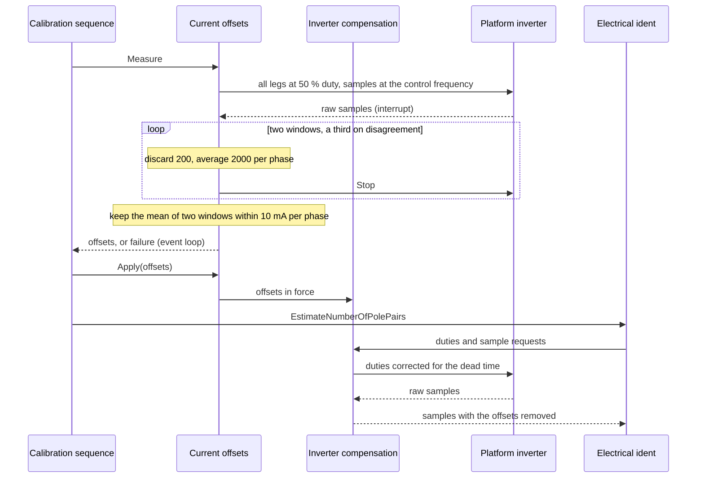

| Field     | Value                           |
|-----------|---------------------------------|
| Title     | Service: Current Sensor Offsets |
| Type      | design                          |
| Status    | draft                           |
| Version   | 0.1.2                           |
| Component | service-current-offsets         |
| Date      | 2026-10-29                      |

> **IMPORTANT — Implementation-blind document**: This document describes *behavior, structure, and
> responsibilities* WITHOUT referencing code. **No code blocks using programming languages (C++, C,
> Python, CMake, shell, etc.) are allowed.** Use Mermaid diagrams to express behavior instead.
> Prose descriptions of algorithms are encouraged; source-level details are not.
>
> **Diagrams**: All visuals must be Mermaid (` ```mermaid `), TikZ via ` ```{=latex} ` raw blocks (source in
> `documentation/tikz/`), or ASCII art. External image references (``) are **not allowed**.

---

## Responsibilities

A phase current sensor does not read zero at zero current. On E-FOC-HARDWARE the three phases read
+27, −18 and +54 mA with no current flowing. In the stationary frame that is a 42 mA error, which
the rotation turns into a ripple at the electrical frequency, and it hides small torques such as the
bench rotor's viscous friction (`documentation/design/software-in-the-loop.md`, Part M).

**Is responsible for:**
- Measuring each phase sensor's zero-current reading at the start of the full calibration
- Confirming each measurement with a second one, so a single disturbed window is never stored
- Handing the offsets in force to the inverter compensation stage, which removes them from every
  phase-current sample before any consumer receives it
- Failing a measurement whose readings cannot be offsets

**Is NOT responsible for:**
- Deciding when to measure, which is the calibration sequence's job (`state-machine.md`)
- Storing the offsets, which travel in the calibration record (`service-nvm.md`)
- Board protection, which reads the raw samples in hardware

---

## Component Details

### Part A — Where the correction sits

The offsets are removed by the inverter compensation stage, which stands between the platform's
inverter and everything that reads phase currents: the current loop, the online estimators, and the
identification and alignment procedures. To them it is the inverter. It subtracts the offsets in
force from each sample before handing it on, and the same stage corrects each duty for the dead-time
loss (`service-dead-time-compensation.md`). A sample therefore crosses one stage on its way in and a
duty one on its way out; the offsets cost three subtractions inside that stage's call.

This service measures the offsets and hands them to the stage. It does not stand in the path itself.

The hardware over-current comparators and the hardware-test target keep the raw samples. The emulated
platform's board protection does too, as the real comparators would.

### Part B — Measuring

With all three legs at 50 % duty the windings see no voltage, so each sensor reads only its offset.
That holds only for a rotor at rest: the legs short the windings, so a turning rotor's back-EMF drives
current through the sensors, and a rotor that slows to a stop during the average leaves part of it in
the result. The calibration sequence therefore starts the measurement only once the rotor is at rest
(`state-machine.md`, Calibration Sequence).
The measurement runs at the control frequency, the one the loop runs at. It discards the first 200
samples while the bridge and the sensing settle, then averages the next 2000 for each phase: 110 ms at
20 kHz, which brings 35 mA of sample noise below 1 mA. It reads the raw samples, whatever offsets are
applied at the time.

The same samples give the sensors' noise: the RMS over the three phases of each sample's distance from
its phase's offset. The calibration record stores it in whole milliamperes, and the automatic
current-loop bandwidth is held where its proportional gain keeps that noise out of earshot
(`controller-selection.md`, *Automatic bandwidth*; REQ-CTRL-017).

One such average is a window. A measurement takes two windows and keeps their mean, offsets and noise
alike, when every phase agrees within 10 mA. With 35 mA of sample noise two undisturbed windows differ
by about 1 mA RMS, so the tolerance only turns away a disturbed one. When they disagree it takes a third
window and keeps its mean with whichever earlier window it agrees with, the first if both do. With no
agreeing pair among the three, the measurement fails. It takes 220 ms at 20 kHz, 330 ms with a third
window.

On the bench a back-to-back calibration once read phase B 52 mA low while A and C read as usual, and
the noise rose from 38 to 43 mA. The flux-linkage fit that followed was the worst of the session. A
second window catches such a disturbance whatever its cause; the stored record is not consulted, since
the offsets drift by several milliamperes between calibrations and none exists after the calibration
is cleared.

A window fails and stops the bridge in three cases, and a failed window fails the measurement:
- a sample exceeds the inverter's maximum current, which means the rotor was turning or the sensing
  is broken;
- an offset exceeds 0.5 A, far beyond any amplifier or mid-rail error;
- no sample arrives within 100 ms.

The interrupt only accumulates, and stops the bridge on the last sample or a failure. The result is
delivered from the event loop.

### Part C — The life of the offsets

| Event                              | Offsets afterwards                                                         |
|------------------------------------|----------------------------------------------------------------------------|
| Full calibration, first step       | Measured and applied at once, so every later step reads corrected currents |
| Calibration record saved           | Stored with it and traced as `Ia_mA`, `Ib_mA`, `Ic_mA`                     |
| Boot with a stored record          | Applied, whether or not the record is complete for the mode                |
| Calibration cleared                | Zero                                                                       |
| Electrical identification over CAN | Measured at rest and applied before R/L, then stored with its record       |
| Re-alignment                       | Kept: it copies the record                                                 |

A record written before this step existed carries zero offsets, which applies no correction.

---

## Sequence Diagrams



---

## Interfaces

### Provided

| Interface  | Purpose                            | Contract                                                                                             |
|------------|------------------------------------|------------------------------------------------------------------------------------------------------|
| Measure    | Measure the three offsets          | Asynchronous; reports three offsets or none; leaves the bridge stopped                               |
| Noise      | The noise of the last measurement  | RMS about the offsets over the three phases, mean of the two windows kept; zero before a measurement |
| Apply      | Set the offsets in force           | Takes effect on the next sample the compensation stage hands on                                      |
| Abort      | Abandon a measurement              | Stops the bridge; the measurement reports nothing                                                    |
| Is running | Whether a measurement is in flight | True from Measure until its result is delivered or it is aborted                                     |

### Required

| Interface             | Purpose                                         | Contract                                                  |
|-----------------------|-------------------------------------------------|-----------------------------------------------------------|
| Platform inverter     | Duties, stop and the raw samples, for measuring | One sample callback at a time; the last registration wins |
| Inverter compensation | Remove the offsets in force from every sample   | The offsets apply from the next sample                    |
| Event dispatcher      | Deliver the result outside the interrupt        | —                                                         |
| Timer                 | Detect a bridge that sends no samples           | —                                                         |

---

## Verification

Against plants whose phases are biased by +27, −18 and +54 mA with 35 mA of noise, the full
calibration traces offsets within 1.5 mA of the biases on both reference motors and the bench motor,
and an electrical identification over CAN stores them within the same 5 mA (REQ-CAL-015,
`parameter_identification.feature`).

In the model in the loop, phase B read 52 mA low for the first 105 ms of the measurement, which covers
most of the first window. Without the confirmation the stored phase B offset was 49 mA off; with it,
the first window is outvoted and all three offsets are within 5 mA of the biases (REQ-CAL-015).
