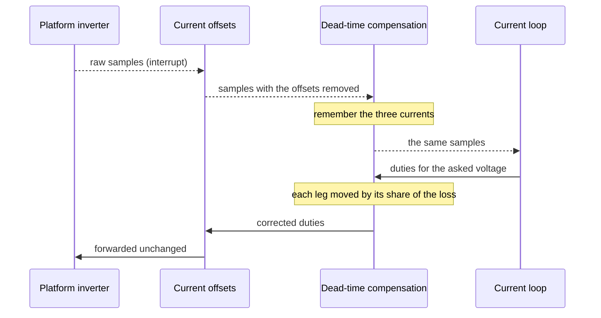

| Field     | Value                           |
|-----------|---------------------------------|
| Title     | Service: Dead-Time Compensation |
| Type      | design                          |
| Status    | draft                           |
| Version   | 0.1.0                           |
| Component | service-dead-time-compensation  |
| Date      | 2026-10-21                      |

> **IMPORTANT — Implementation-blind document**: This document describes *behavior, structure, and
> responsibilities* WITHOUT referencing code. **No code blocks using programming languages (C++, C,
> Python, CMake, shell, etc.) are allowed.** Use Mermaid diagrams to express behavior instead.
> Prose descriptions of algorithms are encouraged; source-level details are not.
>
> **Diagrams**: All visuals must be Mermaid (` ```mermaid `), TikZ via ` ```{=latex} ` raw blocks (source in
> `documentation/tikz/`), or ASCII art. External image references (``) are **not allowed**.

---

## Responsibilities

A leg of the bridge does not deliver its duty. Between one switch turning off and the other turning
on, the phase current alone decides where the switch node goes, and the leg loses voltage against
the current's sign (`documentation/design/software-in-the-loop.md`, Part L). On E-FOC-HARDWARE the
loss is about 0.2 % of the period once the current passes about 0.2 A, and below that it shrinks in
proportion to the current. At small currents the winding therefore sees about 0.17 Ω more than it
has, which is why the online resistance estimate reads about 20 % high on the rig.

**Is responsible for:**
- Correcting every duty the drive commands by the loss its leg's current will cause
- Passing the phase currents, start, stop, the base frequency and the current limit through unchanged

**Is NOT responsible for:**
- Measuring the loss, which the board states (Part C)
- Making a held duty follow the current, which is the procedure's job (Part D)

---

## Component Details

### Part A — Where the correction sits

The service stands between the current-offset correction (`service-current-offsets.md`) and
everything that commands duties: the current loop and the identification and alignment
procedures. To them it is the inverter. It remembers the last phase currents it handed on, which
already have the sensors' offsets removed, and corrects the next duty written with them. In the
closed loop the duty follows the sample it was computed from in the same interrupt, so the
correction always uses the current of that period.

The voltage the current loop asks for is unchanged. The anti-windup limits and the online
estimators see that voltage, and the correction makes the winding receive it, which is why the
online resistance estimate then measures the winding alone. The platform's rule that keeps every
low-side shunt readable shifts all three corrected duties together, after the correction.

### Part B — The correction

For each leg, the duty moves by the effective dead time over the PWM period, times the leg's
current over the knee current held between minus one and one. A current flowing out of the leg
raises its duty, one flowing in lowers it. The result is held between 0 and 100 %.

The loss is a fixed time out of every period, so its share of the duty scales with the PWM
frequency. The service takes that frequency from the sample rate a consumer asks for, which is the
rate the PWM runs at. The knee scales with the bus voltage, and the board's figure holds for the
bus it was measured at.

The ramp is a simplification. The switch node's real curve bends more gradually into the saturated
loss, and against that curve the online resistance stays about 3 % high (Verification). The rig's
sweep could not tell the two shapes apart: both fit it within 3 to 5 mV.

The cost in the control interrupt is one more call on each side, and two multiplications and two
clamps per leg.

### Part C — The numbers

| Board          | Dead band | Effective dead time  | Knee                 |
|----------------|-----------|----------------------|----------------------|
| E-FOC-HARDWARE | 500 ns    | 70 ns                | 0.2 A                |
| E-FOC-HARDWARE | any other | none                 | none                 |
| FRDM-MC-LVPMSM | any       | none                 | none                 |
| Emulated       | any       | as the scenario says | as the scenario says |

A board with no figure for the dead band it runs reports none, and its duties pass unchanged.

E-FOC-HARDWARE's figure comes from a sweep on the rig at 24 V. One leg was stepped from 50 % in
single PWM counts, from 1 to 150 of 1500, in both directions, with the other two legs at 50 %. Each
point averaged 8000 offset-corrected samples, and the rotor did not move. Through the 500 ns band
the winding read 1.02 to 1.06 Ω above 1 A. The saturated loss was 0.12 to 0.16 % of the period,
and the knee was 0.18 to 0.21 A. The spread in each comes from the bus reading, which fell by up to
0.4 V at 1.5 A. The figure takes the middle of each.

Widening the band to 1000, 1500 and 2000 ns moved the saturated loss up in 500 ns steps, each about
420 ns short of the band: the gate driver's and the switches' delays take that much back. The
same delays leave the true gap between one switch turning off and the other turning on much
shorter than the band, so the band should not be narrowed without measuring that gap on a scope.

### Part D — Where it does not reach

- **A held duty.** The resistance identification and the alignment write their duties once, when
  the current is still zero, and hold them, so their duties go uncompensated.
- **A pulse as short as the band.** The resistance identification holds two legs at 1 %, a pulse
  no longer than the dead band. A leg that barely switches is outside the model, and the bias it
  puts on the calibration resistance stays.
- **A leg at either rail.** A leg that does not switch has no dead time, but the correction still
  moves it by up to the full loss. Space-vector modulation keeps the legs off the rails except at
  full modulation, where the effect is a fraction of a percent.

Making the resistance identification use legs near 50 % and correct its duty on every sample would
remove the first two. That is the next step.

---

## Sequence Diagrams



---

## Interfaces

### Provided

| Interface | Purpose                                    | Contract                                                                       |
|-----------|--------------------------------------------|--------------------------------------------------------------------------------|
| Inverter  | The bridge, for every duty-commanding user | Same as the current-offset correction's; each duty corrected by its leg's loss |

### Required

| Interface    | Purpose                                          | Contract                                                  |
|--------------|--------------------------------------------------|-----------------------------------------------------------|
| Inverter     | Duties, start, stop and offset-corrected samples | One sample callback at a time; the last registration wins |
| Board's loss | The effective dead time and knee                 | Stated for one dead band; none for any other              |

---

## Verification

The unit tests check the direction and size of the correction past the knee, the ramp below it,
the scaling with the PWM frequency, the bounds at 0 and 100 %, and that a board with no loss gets
its duties unchanged. Through a stage that loses the dead time at 2 A, the corrected leg delivers
the commanded voltage to within 1 mV.

Through the bench's power stage, uncompensated, the online resistance reads 18.1 to 18.3 % above
the winding, and compensated with the board's figure it reads 3.2 to 3.3 % above
(REQ-TRQ-008, `identification_robustness.feature`).
