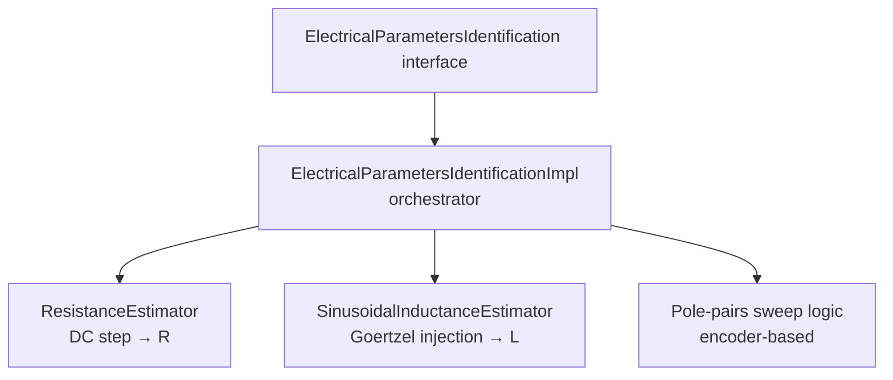
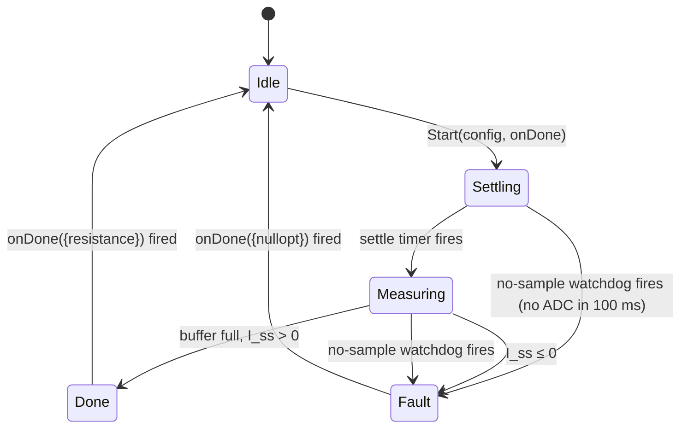
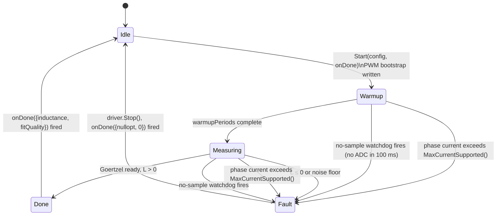
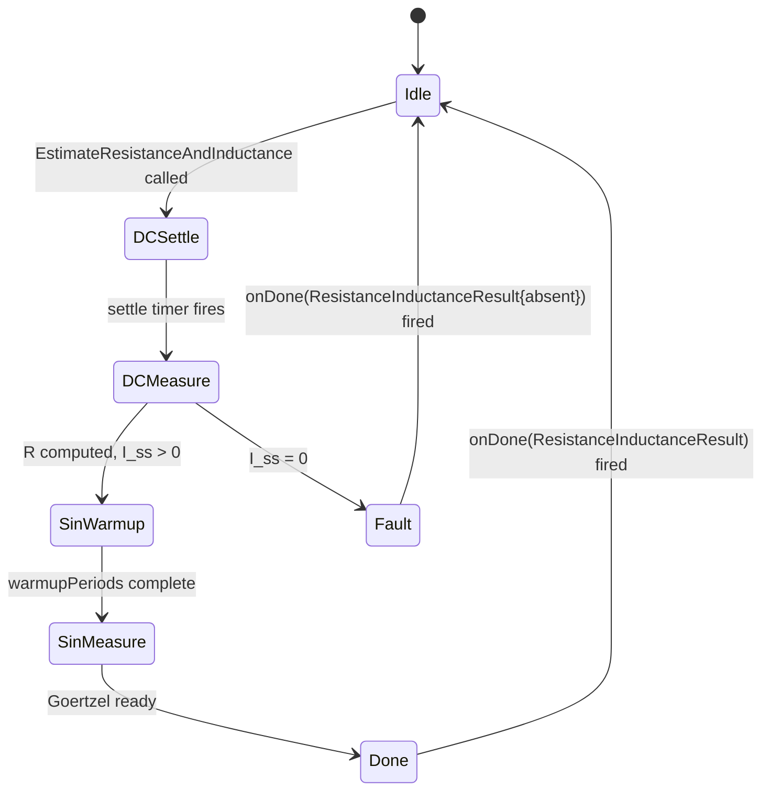
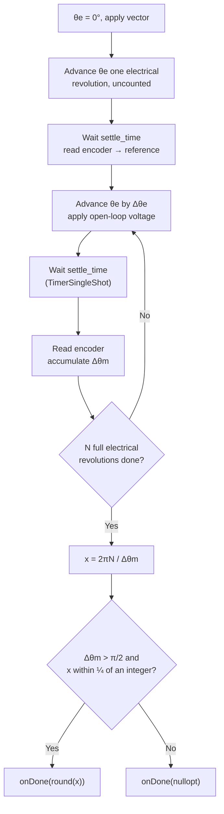

| Field     | Value                                         |
|-----------|-----------------------------------------------|
| Title     | Service: Electrical Parameters Identification |
| Type      | design                                        |
| Status    | draft                                         |
| Version   | 0.3.1                                         |
| Component | service-electrical-ident                      |
| Date      | 2026-10-22                                    |

> **IMPORTANT — Implementation-blind document**: This document describes *behavior, structure, and
> responsibilities* WITHOUT referencing code. **No code blocks using programming languages (C++, C,
> Python, CMake, shell, etc.) are allowed.** Use Mermaid diagrams to express behavior instead.
> Prose descriptions of algorithms are encouraged; source-level details are not.
>
> **Diagrams**: All visuals must be either a Mermaid fenced code block (` ```mermaid `) or ASCII art inline
> in the document. External image references using Markdown image syntax are **not allowed**.

---

## Responsibilities

**Is responsible for:**
- Measuring phase resistance ($R_s$) via DC voltage step using `ResistanceEstimator`
- Measuring d-axis inductance ($L_s$) via HF sinusoidal injection using `SinusoidalInductanceEstimator`
- Estimating the number of pole pairs by rotating an open-loop voltage vector and comparing electrical angle to mechanical encoder angle
- Delivering a combined `ResistanceInductanceResult` — resistance, inductance, and fit quality — via a single completion callback once both sub-estimators finish
- Enforcing that R/L identification and pole-pairs estimation cannot run concurrently
- Stopping the inverter cleanly before invoking any completion callback
- Delivering every completion from the event loop, never from the sampling interrupt that decides it
- Rejecting calibration when `fitQuality < 0.5` (incoherent injection response)

**Is NOT responsible for:**
- Persisting identified parameters — the caller decides what to do with results
- Encoder zero-offset calibration — that is the Motor Alignment service
- Performing any closed-loop current control — all voltage application is open-loop
- Running concurrently with the normal FOC loop — the FOC loop must be stopped before either procedure begins

---

## Architecture

The R/L estimation is split across three cooperating components:



`ResistanceEstimator` and `SinusoidalInductanceEstimator` are standalone components; the orchestrator
calls them sequentially and assembles their results into a single `ResistanceInductanceResult`.
Application code (hardware test terminal, etc.) may also call these components directly.

---

## Component Details

### Open-Loop Injection Current Limit

Every procedure in this service drives the bridge open-loop: a fixed duty is applied and held, with no
current regulator in the path. The resulting current is set entirely by the applied voltage and the
winding impedance, and a low-resistance motor reaches a large current within the settle time. The
resistance test in particular holds a DC duty for seconds.

Each procedure therefore registers a phase-current callback that checks every sample against
`ThreePhaseInverter::MaxCurrentSupported()` and aborts immediately if any phase exceeds it — stopping
the inverter, cancelling the step timer, and reporting failure through the procedure's normal failure
path. Previously the pole-pairs and resistance procedures registered an
empty callback and discarded the samples, leaving hardware comparators (present on some boards, absent
on others) as the only backstop. `MotorAlignment` applies the same check.

The limit is a per-sample abort, not regulation: it stops a runaway, it does not hold a setpoint.

### Ending a procedure

A procedure that has finished, failed or been aborted does **not** reclaim the inverter's phase-current
callback slot. Reassigning that slot from inside its own invocation destroys the closure being executed, and
every one of these procedures fails from inside that callback. Instead each procedure is gated on its own
pending completion, and a sample that arrives after the procedure ended is discarded before it reaches
anything. This matters most for the inductance injection, whose callback writes duty cycles on every sample:
ungated, it would re-arm the peripheral that the abort had just stopped.

`Abort()` is the caller-facing form of the same shutdown. It stops injection, cancels all timers (including
the no-sample watchdog), and drops the pending completion **without invoking it** — the caller that aborted
owns the outcome, so a fault raised by the state machine cannot be overwritten by the result of the
procedure it interrupted. It covers whichever stage is live: resistance, inductance injection, or the
pole-pairs sweep.

The decisions that end a procedure on a sample — the resistance buffer filling, the inductance block
completing, a phase current over the limit — are taken in the sampling interrupt, and so is the one thing that
must happen at that instant: the injection is stopped there. The completion is not. Computing the result,
starting the inductance stage once the resistance is known, and whatever the caller does next — answering over
CAN, tracing, starting the next calibration step — is event-loop work. Run from the interrupt, it started the
inductance stage from inside the resistance stage's own sample callback, started and cancelled timers there,
and in a full calibration took one execution of 6709 cycles, more than five control periods
(`software-in-the-loop.md`, Part I). So the outcome is queued and delivered from the event loop. Until then the
run is still in progress: samples are discarded, the settle and step timers and the no-sample watchdog do
nothing, and `Abort()` drops the queued outcome. The outcome carries the run it belongs to, so one that an
abort overtook cannot complete a run started after it. Outcomes decided on the event loop already — the
pole-pair count, which the sweep computes on its step timer, and a no-sample failure — complete directly,
unless an over-current outcome is already queued, which they then leave to be delivered. The interrupt can
also trip while the event loop is between its check and a write to the bridge — the sweep's next step, or the
first duty a procedure applies — and that write would re-arm the bridge the interrupt had just stopped, so each
such write is followed by a second check that stops the bridge again.

Every estimator is also RAII-safe: if destroyed while active, the destructor cancels all timers and stops
the driver without invoking the completion callback.

### ResistanceEstimator

Applies a DC differential voltage across phase A versus phases B and C held at neutral. A
`TimerSingleShot` fires after the configured settle time to allow the current to reach steady state.
A 5-sample moving-average filter (using a bounded deque of capacity 5) is applied in-flight to each
ADC sample before it is pushed to the measurement buffer (bounded vector, capacity 123).

When the buffer is full, the steady-state current is read from the mean of the last 10 % of the
buffer. Resistance is computed as $V_{step} / I_{ss}$ divided by the winding topology factor. If
$I_{ss} \leq 0$, the result is absent.

**No-sample watchdog:** a second `TimerSingleShot` is armed immediately after the DC duty is applied
and resets on every ADC callback (during both settle and measurement phases). Default bound: 100 ms
(`Config::noSampleTimeout`). If the ADC produces no callback within that window — whether at startup
or after samples stop mid-measurement — the watchdog fires `FailMeasurement()`, stopping the driver
and delivering an absent result. This ensures ADC loss does not leave the motor energised
indefinitely regardless of the configured settle time.

**RAII cleanup:** the destructor cancels all timers and stops the driver if the estimator is
destroyed while a measurement is active, so callers do not need to call `Abort()` explicitly before
releasing the object.



**Internal buffers:**

| Buffer            | Capacity    | Purpose                                      |
|-------------------|-------------|----------------------------------------------|
| Moving-avg window | 5 samples   | In-flight noise reduction on ADC input       |
| Measurement store | 123 samples | Filtered step-response for steady-state read |

---

### SinusoidalInductanceEstimator

Injects a sinusoidal voltage on the alpha axis only (beta = 0), keeping net electromagnetic torque
at zero so the rotor remains stationary. The injection frequency is snapped to the nearest
integer-samples-per-period to align exactly with the Goertzel analysis bin, eliminating spectral
leakage.

Two phases run consecutively:

1. **Warmup** — voltage is injected but the Goertzel is not fed. Allows the current transient to
   decay and the steady-state sinusoidal response to establish. Duration: `warmupPeriods` full
   injection cycles.

2. **Measurement** — the Goertzel accumulates `measurementPeriods` full cycles of current samples
   (block size $N = N_{periods} \times N_{spp}$, bin $k = N_{periods}$). When `Ready()`, the
   complex result is delay-corrected (rotation by $e^{+j\omega d T_s}$ to cancel the $d$-sample
   ADC pipeline lag), then converted to $\text{Im}(Z)$ and finally to per-phase inductance.

The coherence metric `fitQuality = 2|I_{Goertzel}|² / (N · \Sigma i²)` is computed simultaneously
from the accumulated current power. It equals 1.0 for a pure sinusoid at $f_{inj}$ and falls toward
zero with increasing noise or rotor motion.

**Working memory (streaming — no sample buffer required):**

| Variable       | Size    | Purpose                                 |
|----------------|---------|-----------------------------------------|
| Goertzel state | 3 float | $s_1$, $s_2$, sample count              |
| sumSquared     | 1 float | Accumulates $\Sigma i^2$ for fitQuality |
| sampleCount    | 1 int   | Warmup/measurement gate                 |

**PWM bootstrap:** the ADC on TI targets is triggered by the PWM peripheral. Because the resistance
estimator stops PWM on completion, the inductance estimator writes a zero-voltage vector immediately
after registering the ADC callback to restart the PWM-triggered ADC chain before the first sample
is expected.

**No-sample watchdog:** a `TimerSingleShot` is armed when injection begins and resets on every ADC
callback. Default bound: 100 ms (`Config::noSampleTimeout`). Loss of ADC samples — whether the
bootstrap never triggers or samples stop mid-measurement — causes the watchdog to fire
`FailMeasurement()`, stopping the driver and delivering an absent result within the documented bound.

**RAII cleanup:** the destructor cancels the watchdog timer and stops the driver if the estimator is
destroyed while a measurement is active.



---

### ElectricalParametersIdentificationImpl (orchestrator)

Sequences `ResistanceEstimator` then `SinusoidalInductanceEstimator` and assembles their results
into a single `ResistanceInductanceResult`. If resistance estimation fails (absent result), the L
stage is skipped and the combined callback fires immediately with an absent result. If the L stage
yields `fitQuality < 0.5`, the orchestrator treats this as a fault and includes the low-quality
result so the caller can make its own policy decision.



**Concurrent-call invariant:** a second call to `EstimateResistanceAndInductance` while any of the
five states above is active causes the new request to be rejected immediately (callback fires with an
absent result). The pole-pairs procedure shares this guard: neither procedure may start while the
other is active.

---

### Procedure 2 — Pole Pairs Estimation

The service applies an open-loop voltage vector at electrical angle 0° and advances it by a fixed
increment each settle-timer tick. The rotor starts anywhere, so the first vector can pull it up to
half an electrical revolution either way, and a rotor resting on that vector's torque null, 180°
from it, does not move at all until a later vector pulls it. The first electrical revolution is
therefore a lead-in that is not counted: by its end the rotor follows the field one step behind,
and the encoder reading there is the reference. The vector then turns through exactly $N_{rev}$
more electrical revolutions, ending on the angle the reference was read at, and the mechanical
displacement is accumulated after every step. Both the reference and the end are read one step
behind the field, so the lag cancels:

$$
x = 2\pi N_{rev} / \Delta\theta_{mech,total}, \qquad p = \text{round}(x)
$$

The result is absent if the rotation is below $\pi/2$ (rotor not following the field), or if $x$ is
more than a quarter from the nearest integer: a rotor that skipped or slipped part of a revolution
must fail the calibration, not hand the loops a wrong pole-pair count. Counting the first snap, as
an earlier version did, measured anything from 1590° to 1950° electrical for 1800° of field travel;
on the bench motor (four pole pairs) a rotor that had to snap back more than about 170° read five,
and the calibration that followed drove the rotor with an angle error that grew with every
radian it turned, until the current loop saturated and pulled the supply down. Taking the
reference right after the first vector instead failed four bench sweeps in seventeen: the rotor rested on
that vector's null, moved only at the next step, and the sweep measured 1620° for 1800°, a ratio
of 4.44.



---

## Interfaces

### Provided

| Interface                                         | Purpose                                                                                                                                | Contract                                                                                                                                                        |
|---------------------------------------------------|----------------------------------------------------------------------------------------------------------------------------------------|-----------------------------------------------------------------------------------------------------------------------------------------------------------------|
| `EstimateResistanceAndInductance(config, onDone)` | Sequences DC-step R estimation then sinusoidal L estimation; delivers `ResistanceInductanceResult{resistance, inductance, fitQuality}` | Rejected (immediate empty callback) if pole-pairs procedure is already running; inverter stopped before callback fires; fires exactly once, from the event loop |
| `EstimateNumberOfPolePairs(config, onDone)`       | Sweeps an open-loop rotating vector and delivers `optional<size_t>` pole pairs                                                         | Rejected if R/L procedure is already running; inverter stopped before callback fires; fires exactly once, from the event loop                                   |

### Result Type

`ResistanceInductanceResult` carries:

| Field        | Type                   | Absent when                  |
|--------------|------------------------|------------------------------|
| `resistance` | `optional<Ohm>`        | DC step finds $I_{ss} = 0$   |
| `inductance` | `optional<MilliHenry>` | Goertzel yields $L \leq 0$   |
| `fitQuality` | `float` in $[0, 1]$    | Always present; 0 on failure |

### Required

| Interface                | Purpose                                                             | Contract                                                 |
|--------------------------|---------------------------------------------------------------------|----------------------------------------------------------|
| `ThreePhaseInverter`     | Voltage application and ADC sampling callbacks for both stages      | Must not be concurrently claimed by any other controller |
| `Encoder`                | Reads mechanical angle during pole-pairs sweep                      | Must be initialised before pole-pairs estimation begins  |
| DC bus voltage (`Volts`) | Normalises applied voltage and interprets current in physical units | Must remain stable throughout any active procedure       |

---

## Online Resistance and Inductance Estimation

In addition to the one-shot calibration procedures above, a continuous online estimator
(`RealTimeResistanceAndInductanceEstimator`) runs alongside the closed-loop speed/position
controller to track slow parameter drift. See the state machine design document for when online
estimates are applied.

### Model

The d-axis voltage equation for a non-salient PMSM is:

$$V_d = R \cdot I_d + L \cdot \left(\frac{dI_d}{dt} - \omega_e \cdot I_q\right)$$

Integrated over one outer-loop period $T$ it needs no derivative of a sampled current:

$$\overline{V_d} = R\,\overline{I_d} + L\left(\frac{I_{d,end} - I_{d,start}}{T} - \overline{\omega_e I_q}\right)$$

The regressor vector is $\phi = [\overline{I_d},\ (\Delta I_d / T - \overline{\omega_e I_q})]^T$ in amperes and
amperes per millisecond, and the parameter vector is $\theta = [R,\ L]^T$ in ohms and millihenries. A recursive
instrumental-variable estimator with forgetting factor 0.9995 updates $\theta$ once per outer-loop period (1 kHz),
which gives it a memory of about 2 s. With half that memory the estimate wandered within a run: through the bench's
current-sense chain the inductance moved by 5 % (one standard deviation) about the winding's, so a single reading
fell more than 10 % off about once in twenty; the bench read 0.93 to 1.12 times the calibration. Doubling the memory
halves that wander, and a warming winding, whose resistance changes over minutes, is still tracked.

### Instrumental Variables

The inductance column takes its current change from two single samples: the last of this window and the last
of the one before. Each carries the current sensor's noise in full, and least squares reads noise in a regressor
as a weaker dependence on it. On the bench motor the recursive least-squares estimate read the inductance 55 %
low with the ±75 mA excitation below, and still 33 % low with ±0.3 A; in simulation, with 10 mA of noise, 9 to
11 % low, where the estimate below reads it within 5 %.

The recursion therefore takes its gain along an instrument $z$ rather than along the regressor:

$$K = \frac{P z}{\lambda + \phi^T P z}, \qquad \theta \leftarrow \theta + K\,(\overline{V_d} - \phi^T \theta), \qquad P \leftarrow \frac{P - K \phi^T P}{\lambda}$$

with $z = [I_d^*,\ \Delta I_d^* / T]^T$: the d-axis reference the window ran with, and its change from the
previous window's. The reference is the excitation itself. It moves with the true current and not with the
sensor's noise, so the estimate converges on the winding however noisy the samples are. The constant part of
$\overline{V_d}$ that no column explains, such as a small error in the rotor angle, which leaks back-EMF into
the d axis, also averages out against a reference that alternates in sign. With $z = \phi$ the recursion is
the ordinary RLS one.

The averages are accumulated by the control interrupt, tick by tick, and published with each window:

- $\overline{V_d}$ pairs each current sample with the voltage *applied during the tick that produced it*,
  not the command just computed from that same sample. Regressing the same-tick command put the PI's own
  $-K_p I_d$ into the output and pulled the resistance negative, by about $K_p$. Which command acted
  across a tick depends on when the bridge takes a new duty, and the platform states it as a number of
  periods. The emulated board applies a duty the moment it is written, so the previous tick's command
  acted. E-FOC-HARDWARE loads its compare registers at the counter's zero, a period after the sample the
  duty came from, so the command from two ticks back acted. Paired with the previous tick's command, the
  rig read the online inductance 2 to 6 times too high under the deadbeat law, whose command swings by as
  much as the $L\,\Delta I_d / T$ term it is regressed against, and 1 to 15 % high under the smoother
  laws. The emulated board applying each duty a period late reproduces it (REQ-CAL-017).
- The applied vector is fixed in the stator for the tick while the rotor turns through $\Delta\theta_e$, so
  in the rotor frame it arrives advanced by half that angle: $V_d$ is taken as $v_d + \tfrac{1}{2}\Delta\theta_e v_q$.
- $\overline{\omega_e I_q}$ integrates the rotation each tick actually made, $\Delta\theta_e\,\overline{I_q}/T_s$,
  rather than the outer loop's last speed, which lags an accelerating rotor.

### Excitation

The product regulates $I_d$ to zero, so the resistance column is never excited on its own: the recursion
drifted, read $-0.68\ \Omega$ for a $0.36\ \Omega$ winding, and could not by construction track a warming
one. The speed and position cascades therefore add a d-axis square wave to the current reference while the
estimator is attached: $\pm 2.5\,\%$ of the drive's current limit at 10 Hz. It produces no torque on a
non-salient machine and a copper loss proportional to its square. An update is taken only while the
reference exceeds 50 mA, so an amplitude of zero switches both the injection and resistance tracking off.

### Publication

Estimates are published after 200 updates since the last seed, and only when both are finite and positive.

### Seeding

When calibration data is loaded (from NVM or after fresh calibration), the online estimator is
seeded with the identified values, avoiding a cold-start transient where estimates are physically
meaningless.
