| Field     | Value                  |
|-----------|------------------------|
| Title     | Service: Fault History |
| Type      | design                 |
| Status    | draft                  |
| Version   | 0.1.0                  |
| Component | service-fault-history  |
| Date      | 2026-11-06             |

> **IMPORTANT — Implementation-blind document**: This document describes *behavior, structure, and
> responsibilities* WITHOUT referencing code. **No code blocks using programming languages (C++, C,
> Python, CMake, shell, etc.) are allowed.** Use Mermaid diagrams to express behavior instead.
> Prose descriptions of algorithms are encouraged; source-level details are not.
>
> **Diagrams**: All visuals must be Mermaid (` ```mermaid `), TikZ via ` ```{=latex} ` raw blocks (source in
> `documentation/tikz/`), or ASCII art. External image references (``) are **not allowed**.

---

## Responsibilities

The last fault code lives only while the drive is in `Fault` (`state-machine.md`): a clear or a reset loses
it, so an intermittent fault — an overvoltage on a deceleration, an over-current burst, a command timeout — leaves
nothing to diagnose afterwards. The fault history keeps the last eight entries into `Fault` across power cycles
(REQ-PRT-011).

**Is responsible for:**
- Recording every entry into `Fault`: the fault code, the power-up it happened in, the time since that power-up,
  the control mode, the filtered bus voltage and the peak torque current of the last 10 ms.
- Keeping the eight newest records in the non-volatile memory, the oldest overwritten first.
- Counting the power-ups, so that records of different power-ups can be ordered although the uptime restarts.
- Writing from the event loop only, at most once a second, without colliding with the calibration and
  configuration writes.
- Answering a read of a record by its age (0 the newest) and clearing every record on an explicit command.

**Is NOT responsible for:**
- Recording a fault while the drive is already in `Fault`. The state machine keeps the first code of an episode
  (`state-machine.md`, Fault Latching) and so does the history; a further fault of the same episode is traced only.
- Recording a reset. A watchdog or hard fault resets the target before any write could start; the reset cause
  is reported after the reboot instead (`watchdog.md`).
- Keeping wall-clock time. The drive has none; the power-up count and the uptime order the records.
- Clearing on a factory format. The calibration and configuration format leaves the history alone; only its own
  clear empties it.

---

## Component Details

### Part A — What a record holds

| Field        | Unit  | Resolution | Range                | Meaning                                                              |
|--------------|-------|------------|----------------------|----------------------------------------------------------------------|
| Fault code   | —     | —          | the state machine's  | The code the drive entered `Fault` with                              |
| Control mode | —     | —          | torque, speed, pos.  | The mode active when it faulted                                      |
| Power-up     | count | 1          | 1 – 32767, saturates | Which power-up of the drive it happened in                           |
| Uptime       | ms    | 1          | 0 – 49 days          | Time since that power-up                                             |
| Bus voltage  | V     | 0.01       | ±327 V               | The bus-voltage service's filtered value (`service-bus-voltage.md`)  |
| Peak current | A     | 0.01       | ±327 A               | Largest magnitude of the measured torque current over the last 10 ms |

The peak current is sampled from the active drive every millisecond on the event loop, so it is the largest of
the ten one-millisecond torque-current values the drive reported before the fault, not the largest phase-current
sample: the 20 kHz loop does no per-sample bookkeeping (REQ-PERF-003), and an over-current trip is cut by the
board before any sample reaches the event loop.

### Part B — Capturing an entry into Fault

The state machine announces each entry into `Fault` that starts an episode, with the code it records. The history
then reads the control mode, the latest filtered bus voltage and the peak current, stamps the record with the
power-up and the time, and keeps it in memory at once, so a read over CAN sees it before it is stored. The
oldest of eight records gives way to it.

### Part C — Storing

The eight records and the power-up count are stored as one image in a region of their own (`service-nvm.md`,
Fault History Region). A store starts at most once a second; records captured meanwhile go out with the next
store. Each load and store is bracketed as outstanding asynchronous work of the control-mode state machine
(`state-machine.md`, C2a), so a calibration or a configuration write is refused for its duration rather than
answered `Busy`; when the memory is busy with one of those, the store is retried every 10 ms, and a store that does
not read back is retried a second later. Each record carries its own check byte, so a store cut short by a power
loss loses at most the records it was writing.

At power-up the history loads the image, adds one to the power-up count and stores it. An image that does not
read back as a fault history — a new board, or one written by another firmware — starts empty at power-up 1.

```mermaid
stateDiagram-v2
    [*] --> Loading : power-up
    Loading --> Idle : image loaded or reset,\npower-up count + 1 stored
    Idle --> Pending : fault entered\n(record kept in memory)
    Pending --> Storing : 1 s since the last store
    Storing --> Pending : memory busy, retry in 10 ms;\nnot read back, retry in 1 s
    Storing --> Idle : stored
    Idle --> Storing : clear
```



### Part D — Reading and clearing

A record is read by its age: 0 is the newest, 7 the oldest, ordered by power-up and then uptime; an age past the
records held answers that there is none. Clearing empties the eight records, keeps the power-up count and is
answered once stored. The history is read and cleared over CAN (`service-can.md`, contract 2.16).

---

## Interfaces

### Provided

| Interface | Purpose                          | Contract                                                                  |
|-----------|----------------------------------|---------------------------------------------------------------------------|
| Record    | Capture an entry into `Fault`    | Called from the event loop; kept in memory at once, stored within 1 s     |
| Read      | Return the record of a given age | 0 the newest; none past the records held                                  |
| Clear     | Empty the history                | Answered once stored, or with a failure when the memory refuses the write |

### Required

| Interface              | Purpose                                                | Contract                                           |
|------------------------|--------------------------------------------------------|----------------------------------------------------|
| Non-volatile memory    | Load and store the history image                       | One operation at a time; `Busy` while another runs |
| Asynchronous work hold | Keep the control mode from starting NVM work meanwhile | Held for the duration of each load and store       |
| Active drive           | Measured torque current                                | Read every 1 ms on the event loop                  |
| Bus voltage            | Latest filtered bus voltage                            | Handed on every 10 ms                              |
| Timer                  | Pace the stores and the current sampling               | Runs on the event loop                             |

---

## Constraints & Limitations

| Constraint         | Description                                                                                                   |
|--------------------|---------------------------------------------------------------------------------------------------------------|
| Eight records      | The 512-byte EEPROM of E-FOC-HARDWARE leaves 128 bytes after calibration and configuration; eight records fit |
| No wall clock      | Records are ordered by power-up and uptime; the power-up count saturates at 32767                             |
| Torque current     | The peak is the largest one-millisecond torque current, not the largest phase-current sample                  |
| One store a second | A fault storm keeps the newest records only; the in-memory history is complete until the next power loss      |
