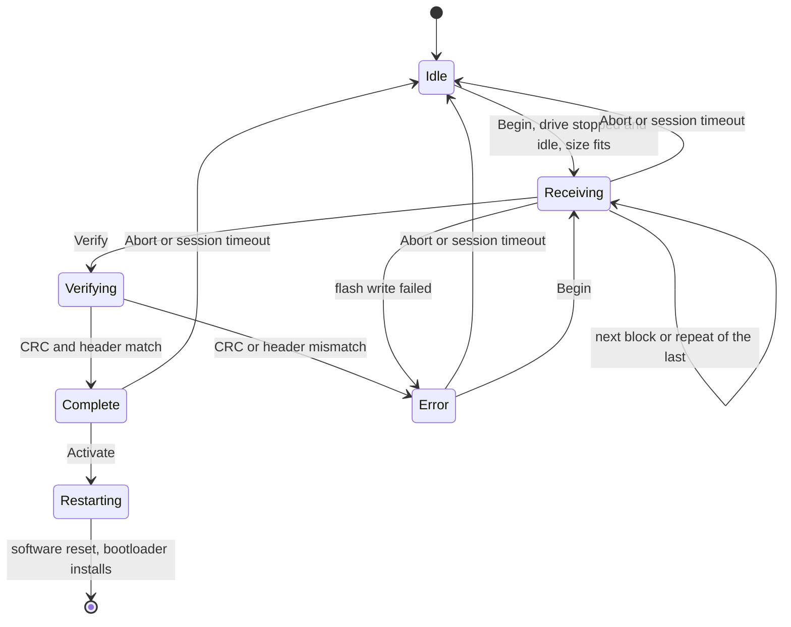
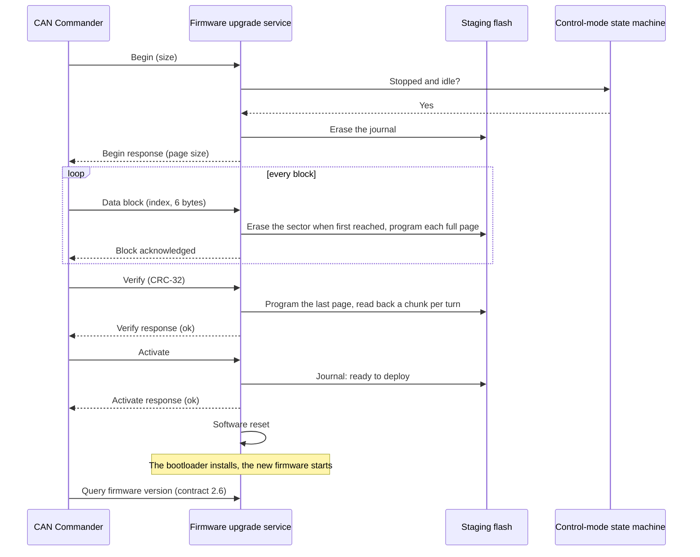
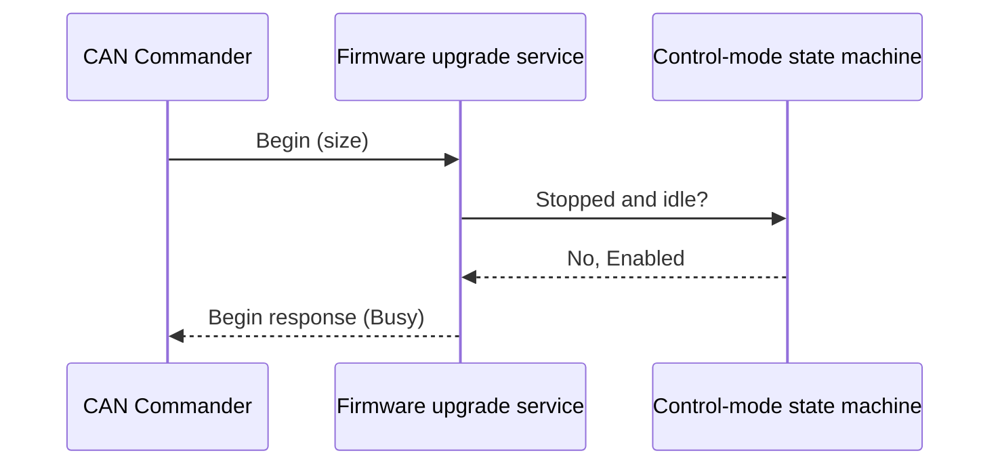

| Field     | Value                     |
|-----------|---------------------------|
| Title     | Service: Firmware Upgrade |
| Type      | design                    |
| Status    | draft                     |
| Version   | 0.1.0                     |
| Component | service-firmware-upgrade  |
| Date      | 2026-11-01                |

> **IMPORTANT — Implementation-blind document**: This document describes *behavior, structure, and
> responsibilities* WITHOUT referencing code. **No code blocks using programming languages (C++, C,
> Python, CMake, shell, etc.) are allowed.** Use Mermaid diagrams to express behavior instead.
> Prose descriptions of algorithms are encouraged; source-level details are not.
>
> **Diagrams**: All visuals must be Mermaid (` ```mermaid `), TikZ via ` ```{=latex} ` raw blocks (source in
> `documentation/tikz/`), or ASCII art. External image references (``) are **not allowed**.

---

## Responsibilities

The firmware upgrade service is the motor controller application's side of a firmware update. It receives an
upgrade pack over CAN into the staging slot, checks it, and on request marks it ready and restarts, so the
bootloader installs it (`bootloader.md`). The CAN Commander drives it (`tool-can-commander.md` Part M).

**Is responsible for:**
- Answering the `can-lite` firmware-upgrade category (`0x1`) on the drive's CAN node: Begin Upgrade, Data
  Block, Verify, Activate, Abort and Query Progress, as the `can-lite` firmware-upgrade specification defines
  them.
- Writing the received pack into the staging slot, erasing each sector as the transfer reaches it.
- Checking the pack on Verify: its CRC-32 (the specification's section 4.3), and that its header names this
  board and an application image that fits the application slot.
- On Activate, recording *ready to deploy* in the status journal and restarting the controller.
- Keeping the drive stopped, and every writer of the non-volatile memory waiting, while an upload is open.
- Reporting the running firmware version and the board over the FOC motor contract (2.6, Part H), so a client
  can choose the right pack.

**Is NOT responsible for:**
- Verifying the pack's signature or decrypting it. The bootloader does both before it installs anything.
- Choosing a firmware version or where it comes from. The client does.
- Keeping the previous firmware. The bootloader overwrites it when it installs the new one.
- Updating the EK-TM4C123GXL, which has no bootloader and no staging slot (`bootloader.md` Part A).

---

## Component Details

### Part A — the upload session

The service follows the state machine of the `can-lite` firmware-upgrade specification (section 7.6). It holds
one upload at a time; the category server enforces the 30 s session timeout between commands.

| State     | Meaning                                                           | Drive and NVM interlock (Part G) |
|-----------|-------------------------------------------------------------------|----------------------------------|
| Idle      | No upload open                                                    | released                         |
| Receiving | Begin accepted; data blocks arrive in order                       | held                             |
| Verifying | Last page written; CRC and header being checked, a chunk per turn | held                             |
| Complete  | Pack checked; Activate accepted                                   | held                             |
| Error     | Verify or a flash write failed; Abort or a new Begin leaves it    | held                             |

### Part B — Begin Upgrade

Begin is accepted only when all of these hold; the answer otherwise is the one in the table, and nothing is
erased:

| Condition                                                                           | Otherwise     |
|-------------------------------------------------------------------------------------|---------------|
| No upload is open                                                                   | `Busy`        |
| The drive is stopped: `Idle`, `Ready` or `Fault`, never `Enabled` or `Calibrating`  | `Busy`        |
| No asynchronous work is outstanding: no command pending, no NVM operation in flight | `Busy`        |
| The size is at least one pack header and at most the staging slot's pack capacity   | `InvalidSize` |
| The board has a staging slot                                                        | `InvalidSize` |

`Busy` covers the drive's state as well as an open upload, as the `busy` category error does for the FOC
motor commands; a client tells them apart from the status it last read.

An accepted Begin erases the status journal (the drive's previous pack is forgotten) and answers with the page
size: the number of bytes the service collects before it programs them, 128 on the TI board and 256 on the ST
boards. The pack's data sectors are not erased yet (Part C), so Begin answers within one sector erase.

### Part C — data blocks

- Blocks arrive in ascending order from 0, six bytes each (fewer in the last). The block the service expects
  next is written; a repeat of the block it acknowledged last is acknowledged again without being written,
  because only its acknowledgement was lost; any other index is answered `SequenceError` with nothing written.
- The bytes are collected into one page. A full page is programmed into the staging slot, after the sector
  it starts in has been erased: each sector is erased when the transfer first reaches it, one sector per
  event-loop turn, so no single flash operation stalls the processor for longer than one sector erase
  (Part G).
- A flash failure is answered `WriteError` and the session goes to Error; the client starts the upload again
  with Begin. The page is not written a second time, because the ST internal flash cannot program a unit twice
  without erasing it, and a second Begin erases what it needs again.
- A block that would take the upload past the size given in Begin is answered `InvalidSize`.

### Part D — Verify

Verify first programs the last, partly filled page, then reads the pack back from the staging slot, a chunk
per event-loop turn, and checks:

1. the CRC-32 of exactly the Begin size, in the variant the `can-lite` specification fixes (section 4.3),
   against the value Verify carries; otherwise `CrcMismatch`;
2. the pack header: the magic, header version 1, a product name that names this board (`bootloader.md`
   Part B), one image whose target is the application, whose destination is the start of the application slot
   and whose size fits the slot less its descriptor; otherwise `NotReady`, the specification's answer for
   "no application".

The signature is not checked here: the application holds no key and the bootloader checks it anyway. Both
failures leave the session in Error, with the journal still empty, so nothing installs.

### Part E — Activate

Activate is accepted only in Complete; otherwise `NotReady`. The service writes *ready to deploy* into the
status journal, answers, and restarts the controller once the acknowledgement has left the send queue, at most
one second later, through the platform's software reset. The bootloader installs the pack at that reset, and
the new application starts.

The client sees the node fall silent and come back, then reads the firmware version again (Part H). The
calibration and configuration records survive the update; a new firmware whose record version differs treats
them as the NVM design describes (`service-nvm.md`, version check).

### Part F — Abort and the session timeout

Abort and the session timeout close the upload: the session returns to Idle, the interlock is released and
the staging slot is left as it is, with an empty journal, so nothing installs. A sector being erased or a page
being programmed finishes first.

### Part G — interlocks

- **Drive.** While an upload is open the service counts as asynchronous work of the control-mode state
  machine, so `Enable`, `Calibrate`, `ReAlign`, `ClearCalibration`, `SetMotorParameter` and a control-mode or
  algorithm selection are refused, as they are while an NVM write is outstanding (`state-machine.md`). The
  emergency stop is always accepted.
- **Non-volatile memory.** While an upload is open the CAN bridge answers `busy` to every command that writes
  the configuration record: start-up settings, telemetry rate and fault supervision settings. On the
  EK-TM4C1294XL the EEPROM and the flash share one controller, so a flash program and an EEPROM write must
  never overlap; on the ST boards the rule costs nothing and keeps the behaviour the same.
- **Watchdog.** A sector erase stalls every access to the flash being erased, and on the TI board every
  access to flash at all, interrupts included. The service erases one sector per event-loop turn and programs
  one page at a time, so each stall stays far below the 100 ms watchdog expiry (`watchdog.md`).
- **Real time.** The drive is stopped while an upload is open, so no PWM depends on the control interrupt
  during a stall. No code is added to the control interrupt or the outer loop.

### Part H — firmware identity (contract 2.6)

Contract 2.6 adds four read-only parameters to the FOC motor contract: the major, minor and patch numbers of
the running firmware's release version, and the board kind (`service-can.md` Part A, "Contract 2.6"). The
release version is the one the release workflow stamps into the build. A board kind maps to the product name
of its packs (`bootloader.md` Part B), so a client picks the pack for the board it talks to.

### Part I — per board

| Board         | Staging flash                                     | Page  | Pack capacity |
|---------------|---------------------------------------------------|-------|---------------|
| EK-TM4C1294XL | internal flash, staging region of `bootloader.md` | 128 B | 393 216 B     |
| NUCLEO-H563ZI | internal flash, bank 2                            | 256 B | 393 216 B     |
| NUCLEO-G474RE | SPI NOR on the motor board (`bootloader.md` Q1)   | 256 B | 393 216 B     |
| Emulated      | file `staging.bin` in the scenario directory      | 256 B | 393 216 B     |
| EK-TM4C123GXL | none: Begin is answered `InvalidSize`             | —     | 0             |

The platform provides the staging flash, the application slot's limits and the board kind; the service
depends on these abstractions only. On the emulated target the file stands in for the staging flash as the
EEPROM file stands in for the NVM, so a scenario can read back what the firmware staged.

### Part J — release assets

The release workflow builds, signs and encrypts one pack per board that has a bootloader, and publishes it
beside the existing firmware archives (`.github/workflows/release-please.yml`):

| Asset                                                         | Content                                                      |
|---------------------------------------------------------------|--------------------------------------------------------------|
| `e_foc-firmware-<board>-sync_foc_sensored-<tag>.upgrade`      | the upgrade pack the CAN Commander sends                     |
| `e_foc-firmware-<board>-sync_foc_sensored-<tag>-combined.hex` | bootloader, application and image descriptor, for a debugger |

The CAN Commander finds a board's pack by these names, so they stay stable. Every asset carries the
build-provenance attestation the other assets carry, and the release check fails when a pack or image exceeds
its limit. A dry run builds and signs with the development keys.

### Part K — verification

| Level                 | What it shows                                                                                                                                              | Requirements                     |
|-----------------------|------------------------------------------------------------------------------------------------------------------------------------------------------------|----------------------------------|
| Unit tests            | Admission, block order and repeats, page and sector handling, CRC and header checks, Activate, Abort and timeout, against a flash fake                     | REQ-UPD-001 to 008               |
| Bootloader host tests | Valid pack installs; wrong product, bad signature, wrong destination and oversize refused; interrupted copy resumes; broken slot halts                     | REQ-BOOT-001 to 005              |
| Software in the loop  | A dev-signed pack staged over CAN up to *ready to deploy*; Begin refused while running; CRC and board mismatch; Abort; NVM writes refused during an upload | REQ-UPD-001 to 007               |
| Hardware in the loop  | A full update and restart on the EK-TM4C1294XL, the new version read back (`@hil_motor`)                                                                   | REQ-UPD-005, REQ-BOOT-001 to 004 |
| CAN Commander tests   | Pack checks, the transfer with lost answers, the restart and version confirmation, against a StrictMock bus                                                | REQ-UPD-009, REQ-UPD-010         |

The software-in-the-loop scenarios read the staging file the emulated firmware wrote and check the pack and
the journal in it. The new feature goes into the shard that keeps the three balanced
(`integration_tests/sil-shards.json`).

---

## Interfaces

### Provided

| Interface                        | Purpose                        | Contract                                                                 |
|----------------------------------|--------------------------------|--------------------------------------------------------------------------|
| Firmware-upgrade category server | Receive a pack over CAN        | `can-lite` firmware-upgrade specification; answers as Parts B to F       |
| Running state                    | Interlock with the drive       | True from an accepted Begin until Activate, Abort or the session timeout |
| Firmware identity                | Version and board for a client | Contract 2.6 parameters (Part H)                                         |

### Required

| Interface                  | Purpose                                | Contract                                                                               |
|----------------------------|----------------------------------------|----------------------------------------------------------------------------------------|
| Staging flash              | Hold the received pack and the journal | Asynchronous flash of the platform; erase per sector, write any byte range             |
| Control-mode state machine | Drive state, pending work              | Begin admitted only when stopped and idle; the upload counts as pending work           |
| Platform software reset    | Restart into the bootloader            | Does not return                                                                        |
| CAN protocol server        | Category registration                  | Registered beside the FOC motor category on the drive's node (`service-can.md` Part K) |

---

## State Machine



---

## Sequence Diagrams

### A successful update



### Begin while the motor runs



---

## Constraints & Limitations

| Constraint          | Value / Description                                                                                       |
|---------------------|-----------------------------------------------------------------------------------------------------------|
| Pack size           | at most 393 216 bytes (65 536 blocks of 6 bytes) and the staging slot's capacity                          |
| Throughput          | one block in flight; about 2–3 KB/s, so a 300 KB pack takes about two minutes                             |
| Session timeout     | 30 s between commands (the category server's default)                                                     |
| Flash stall         | one sector erase or one page program at a time, each far below the 100 ms watchdog expiry                 |
| Drive               | stopped for the whole upload; the emergency stop is always accepted                                       |
| NVM writes          | refused with `busy` while an upload is open                                                               |
| One upload per node | a second Begin during an upload is answered `Busy`                                                        |
| Boards              | EK-TM4C1294XL, NUCLEO-H563ZI, NUCLEO-G474RE (with SPI NOR) and the emulated target; not the EK-TM4C123GXL |

---

## Open Questions

| # | Question                                                                                       | Options                                                                    | Status |
|---|------------------------------------------------------------------------------------------------|----------------------------------------------------------------------------|--------|
| 1 | Should the transfer acknowledge a window of blocks at a time, as the specification suggests?   | `can-lite` extension (section 7.2) / one block in flight (current)         | open   |
| 2 | Which tool builds the packs in the release workflow? The library's pack builder needs mbedTLS. | The library's pack builder in a host build with mbedTLS / a script of ours | open   |
| 3 | Should the emergency stop also abort an open upload?                                           | Abort on emergency stop / leave the upload open (current)                  | open   |
