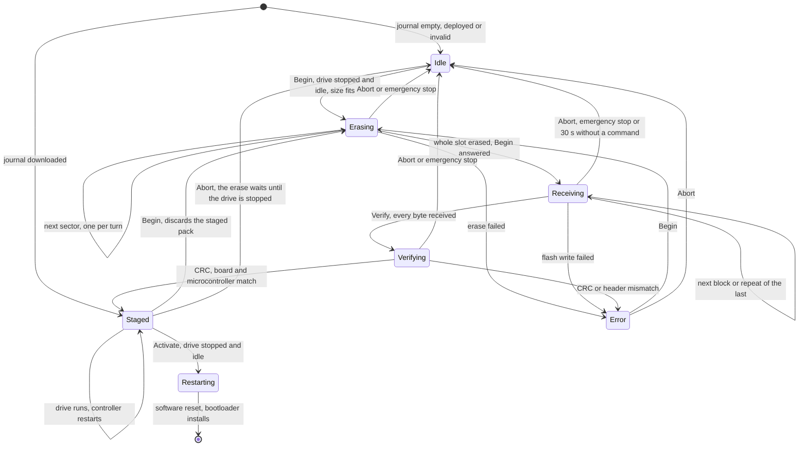
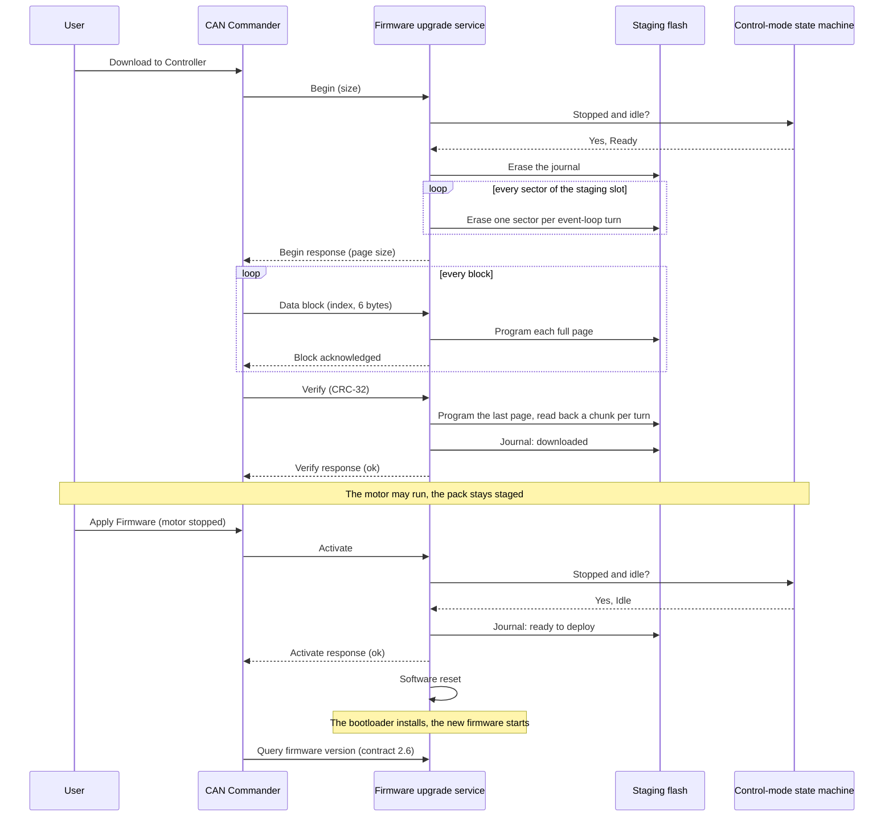
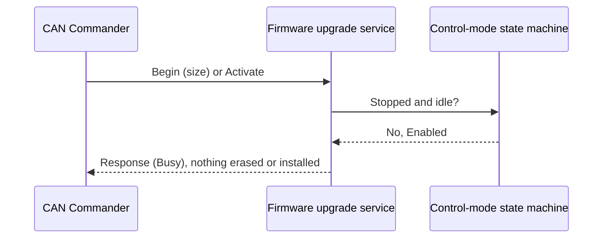

| Field     | Value                     |
|-----------|---------------------------|
| Title     | Service: Firmware Upgrade |
| Type      | design                    |
| Status    | draft                     |
| Version   | 0.3.8                     |
| Component | service-firmware-upgrade  |
| Date      | 2026-11-04                |

> **IMPORTANT — Implementation-blind document**: This document describes *behavior, structure, and
> responsibilities* WITHOUT referencing code. **No code blocks using programming languages (C++, C,
> Python, CMake, shell, etc.) are allowed.** Use Mermaid diagrams to express behavior instead.
> Prose descriptions of algorithms are encouraged; source-level details are not.
>
> **Diagrams**: All visuals must be Mermaid (` ```mermaid `), TikZ via ` ```{=latex} ` raw blocks (source in
> `documentation/tikz/`), or ASCII art. External image references (``) are **not allowed**.

---

## Responsibilities

The firmware upgrade service is the motor controller application's side of a firmware update. An update has
two steps, and the user starts each of them, separately, while the motor is stopped:

- **Download**: the controller receives an upgrade pack over CAN into the staging slot and checks it. The
  checked pack stays staged, across restarts, until the user applies or discards it; the motor can run in
  between.
- **Apply**: the controller marks the staged pack ready and restarts, and the bootloader installs it
  (`bootloader.md`).

The CAN Commander offers both steps (`tool-can-commander.md` Part M). The service never starts either on its
own.

**Is responsible for:**
- Answering the `can-lite` firmware-upgrade category (`0x1`) on the drive's CAN node: Begin Upgrade, Data
  Block, Verify, Activate, Abort and Query Progress, as the `can-lite` firmware-upgrade specification defines
  them.
- Accepting Begin Upgrade (download) and Activate (apply) only while the drive is stopped, in `Idle` or
  `Ready`, with nothing outstanding.
- Erasing the whole staging slot before a download starts, then writing the received pack into it.
- Checking the pack on Verify: its CRC-32 (the specification's section 4.3), and that its header names this
  board and this microcontroller and an application image that fits the application slot.
- Keeping a checked pack staged until Activate, Abort or the next Begin, and recording it in the status
  journal so a restart keeps it.
- On Activate, recording *ready to deploy* in the status journal and restarting the controller.
- Keeping the drive stopped, and every writer of the non-volatile memory waiting, while a pack is received.
- Ending a download in progress on the emergency stop.
- Reporting the running firmware version, the board and the version of a staged pack over the FOC motor
  contract (2.6, Part H).

**Is NOT responsible for:**
- Verifying the pack's signature, decrypting it, or reading the microcontroller identity inside the image.
  The bootloader does all three before it erases anything (`bootloader.md` Part I).
- Choosing a firmware version, where it comes from, or when to download or apply it. The user does, through a
  client.
- Keeping the previous firmware. The bootloader overwrites it when it installs the new one.
- Updating a board without a bootloader: the EK-TM4C123GXL, and the ST boards until they have one
  (`bootloader.md` Part A, Part I below).

---

## Component Details

### Part A — download and apply

The service follows the state machine of the `can-lite` firmware-upgrade specification (section 7.6), with one
difference: a verified pack is kept instead of being forgotten when the session ends. The category server stops
its session timer on Verify and on Activate, also when it refuses them, so the service keeps its own inactivity
deadline while a pack is received: 30 s after Begin was answered or the last command it accepted, after which
the download ends as on Abort. The emergency stop ends a download the same way (Part F). After a successful
Verify no deadline runs, so Activate may come at any later time, also after a restart.

| State      | Meaning                                                                        | Drive and NVM interlock (Part G) |
|------------|--------------------------------------------------------------------------------|----------------------------------|
| Idle       | No pack being received and none staged                                         | released                         |
| Erasing    | Begin accepted; the staging slot is erased a sector per turn, Begin unanswered | held                             |
| Receiving  | Begin answered; data blocks arrive in order                                    | held                             |
| Verifying  | Last page written; CRC and header being checked, a chunk per turn              | held                             |
| Staged     | Pack checked and recorded *downloaded*; waits for the user's Activate or Abort | released                         |
| Error      | Verify, the erase or a flash write failed; Abort or a new Begin leaves it      | released                         |
| Restarting | Activate accepted; the reset follows within one second                         | held                             |

At start-up the service reads the status journal. A journal that reads *downloaded* puts it in Staged, with
the pack's version and size read from its header (Part H), so Query Progress reports the whole pack received;
any other status puts it in Idle. The journal is the
bootloader's own (`bootloader.md` Part B), read and written through the same library component, so both read
the same entries.

### Part B — Begin Upgrade: the download

Begin is accepted only when all of these hold; the answer otherwise is the one in the table, and nothing is
erased:

| Condition                                                                           | Otherwise     |
|-------------------------------------------------------------------------------------|---------------|
| No pack is being erased for or received                                             | `Busy`        |
| The drive is stopped: `Idle` or `Ready`; never `Enabled`, `Calibrating` or `Fault`  | `Busy`        |
| No asynchronous work is outstanding: no command pending, no NVM operation in flight | `Busy`        |
| The size is at least one pack header and at most the staging slot, 256 KB           | `InvalidSize` |
| The board has a staging slot                                                        | `InvalidSize` |

`Busy` covers the drive's state as well as a transfer in progress, as the `busy` category error does for the
FOC motor commands; a client tells them apart from the status it last read. A drive in `Fault` is not
stopped in this sense: the fault is cleared first, so a download never starts while a fault is unexplained.

An accepted Begin erases the status journal, which discards a pack that was staged before, then the entire
staging slot, one sector per event-loop turn, and only then answers. The download therefore starts on a fully
erased slot: 16 sectors on the EK-TM4C1294XL, whatever the pack's size. The answer carries the page size, the
number of bytes the service collects before it programs them: 128 on the TI board and 256 on the emulated
board (Part I).

- An erase that fails is answered `WriteError`, and the session goes to Error.
- An Abort or the emergency stop during the erase stops it after the sector in progress. The pending Begin is
  answered `InvalidState`, then the Abort, and the session returns to Idle with the journal empty.
- A second Begin during the erase is answered `Busy`.
- The inactivity deadline (Part A) starts when Begin is answered, so the erase never counts against it.

### Part C — data blocks

- Blocks arrive in ascending order from 0, six bytes each (fewer in the last). The block the service expects
  next is written; a repeat of the block it acknowledged last is acknowledged again without being written,
  because only its acknowledgement was lost; any other index is answered `SequenceError` with nothing written.
- The bytes are collected into one page. A full page is programmed into the staging slot, which Begin
  erased; nothing is erased while blocks arrive, so each block costs at most one page program (Part G).
- A flash failure is answered `WriteError` and the session goes to Error; the client starts the download
  again with Begin. The page is not written a second time, because the ST internal flash cannot program a unit
  twice without erasing it, and a second Begin erases the staging slot again.
- A block that would take the download past the size given in Begin is answered `InvalidSize`.
- A block that fills a page is acknowledged once the page is programmed. A command that arrives while a page
  is programmed is answered `Busy`, except Abort, which waits for it (Part F).

### Part D — Verify: the end of the download

Verify is answered `InvalidState` unless a pack is being received, and `InvalidSize` until every byte of the
size given in Begin has arrived; the download stays open after either. Otherwise Verify first programs the
last, partly filled page, then reads the pack back from the staging slot, a chunk per event-loop turn, and
checks:

1. the CRC-32 of exactly the Begin size, in the variant the `can-lite` specification fixes (section 4.3),
   against the value Verify carries; otherwise `CrcMismatch`;
2. the pack header, as far as it can be read without the key: the magic, header version 1, a product name
   equal to this firmware's own, which names the board and the microcontroller part (`bootloader.md` Part B),
   a product version of three decimal numbers from 0 to 255, major, minor and patch, separated by dots
   (Part H), and one image whose target is the application, which ends the pack, and whose length, less its
   image header and its AES counter, fits the application slot less its descriptor; otherwise `NotReady`, the
   specification's answer for "no application". The image's destination and exact size are encrypted; the
   bootloader checks them before it erases anything (`bootloader.md` Parts C and I).

A pack built for another microcontroller, an STM32 pack sent to a Tiva board for example, names another part
and fails the second check; the bootloader would refuse it again (`bootloader.md` Part I). The signature is
not checked here: the application holds no key and the bootloader checks it anyway.

A pack that passes is recorded *downloaded* in the status journal and the service enters Staged. A pack that
fails leaves the session in Error with the journal empty, so nothing is staged and nothing installs.

### Part E — Activate: the apply

Activate is accepted only when all of these hold:

| Condition                               | Otherwise  |
|-----------------------------------------|------------|
| A checked pack is staged (Staged)       | `NotReady` |
| The drive is stopped: `Idle` or `Ready` | `Busy`     |
| No asynchronous work is outstanding     | `Busy`     |

The service then writes *ready to deploy* into the status journal, enters Restarting, answers, and restarts the
controller 250 ms later, which leaves the acknowledgement time to leave the send queue, through the
platform's software reset. On the emulated board the software reset requests a system reset, and the
emulator restarts into the bootloader, as the board does. Restarting holds the same interlocks as receiving a pack (Part G), so nothing starts the drive
or writes the non-volatile memory in that second, and a new Begin is answered `Busy`.
The bootloader installs the pack at that reset, and the new application starts. Between the download and the
apply the motor may run any number of times and the controller may restart; the staged pack waits.

The client sees the node fall silent and come back, then reads the firmware version again (Part H). The
calibration and configuration records survive the update; a new firmware whose record version differs treats
them as the NVM design describes (`service-nvm.md`, version check).

### Part F — Abort and the inactivity deadline

- Abort while a pack is being received, or the inactivity deadline, ends the download: the session returns to
  Idle, the interlock is released and the journal stays empty, so nothing is staged. A Begin or Verify still
  unanswered is answered `InvalidState` first.
- The emergency stop ends a download in progress, from an accepted Begin until Verify is answered, as Abort
  does, without an Abort answer: the client sees its pending Begin or Verify answered `InvalidState`, or its
  next block answered `InvalidState`. A staged pack stays staged, and an accepted Activate still restarts.
- Abort in Staged or Error discards the staged pack and the service returns to Idle. The pack is unavailable at
  once: Activate is answered `NotReady` and the staged version reads zero. Erasing the journal stalls flash, so
  it is carried out only while the drive is stopped (`Idle` or `Ready`) with nothing outstanding; an Abort that
  arrives while the drive runs leaves the erase until it is next stopped and idle. A restart before then leaves
  the pack staged.
- A sector being erased or a page being programmed finishes first.

### Part G — interlocks

- **Drive.** While a pack is received (Erasing, Receiving and Verifying), and after an accepted Activate
  (Restarting), the service counts as asynchronous work of the control-mode state machine, so `Enable`, `Calibrate`, `ReAlign`, `ClearCalibration`, `SetMotorParameter` and
  a control-mode or algorithm selection are refused, as they are while an NVM write is outstanding
  (`state-machine.md`). A staged pack holds nothing: the drive runs normally until the user applies it, and
  Activate is admitted only once it is stopped again (Part E). The emergency stop is always accepted, and ends
  a download in progress (Part F).
- **Non-volatile memory.** While a pack is received, and while Restarting, the CAN bridge answers `busy` to every
  command that writes
  the configuration record: start-up settings, telemetry rate and fault supervision settings. On the
  EK-TM4C1294XL the EEPROM and the flash share one controller, so a flash program and an EEPROM write must
  never overlap; on the ST boards the rule costs nothing and keeps the behaviour the same.
- **Watchdog.** A sector erase stalls every access to the flash being erased, and on the TI board every
  access to flash at all, interrupts included. The service erases the staging slot one sector per event-loop
  turn, and programs one page at a time, so each stall stays far below the 100 ms watchdog expiry
  (`watchdog.md`), and the node keeps sending its heartbeat while Begin waits for the erase.
- **Real time.** The drive is stopped while a pack is received, so no PWM depends on the control interrupt
  during a stall. No code is added to the control interrupt or the outer loop.

### Part H — firmware identity (contract 2.6)

Contract 2.6 adds read-only parameters to the FOC motor contract (`service-can.md` Part A, "Contract 2.6"):
the major, minor and patch numbers of the running firmware's release version, the board kind, and the version
of the staged pack, zero when none is staged. The running version is the one the build stamps into the
application header (`bootloader.md` Part B), the project's release version; the staged version is the product
version in the staged pack's header, which Verify requires to read as three numbers from 0 to 255, the range
the parameters carry (Part D). Every board reports its version and its kind, also one that cannot be updated.
A board kind maps to the
board and microcontroller its packs name (`bootloader.md` Part B), so a client picks the pack for the board it
talks to and shows what waits to be applied.

The firmware answers the running version and the board kind (`0xB1`–`0xB4`) from the version header EmIL
generates from the CMake project version (`generated/Version.h`, target `e_foc.version_header`) and from `PlatformFactory::GetBoardKind()`, which returns the kind of the board the build is for, from the header the build generates from the board definitions (`bootloader.md` Part B); the staged-version
parameters (`0xB5`–`0xB7`) from the version the service holds staged. Board kinds: `EK-TM4C1294XL 1`, `NUCLEO-G474RE 2`,
`NUCLEO-H563ZI 3`, `EK-TM4C123GXL 4`, emulated `5`, unknown `0`.

### Part I — per board

| Board         | Staging flash                                                     | Page  | Pack capacity |
|---------------|-------------------------------------------------------------------|-------|---------------|
| EK-TM4C1294XL | internal flash, staging region of `bootloader.md`                 | 128 B | 262 144 B     |
| Emulated      | file `staging.bin` in the scenario directory                      | 256 B | 262 144 B     |
| NUCLEO-H563ZI | none until it has a bootloader; then internal flash, bank 2       | —     | 0             |
| NUCLEO-G474RE | none until it has a bootloader; then SPI NOR (`bootloader.md` Q1) | —     | 0             |
| EK-TM4C123GXL | none: Begin is answered `InvalidSize`                             | —     | 0             |

A board without a staging slot still answers the category: Begin with `InvalidSize`, Verify with
`InvalidState`, Activate with `NotReady`.

The platform provides the staging flash and the status journal, the board identification its packs carry as
product name (`bootloader.md` Part B), the application slot's capacity and the page size; the service depends
on these abstractions only. Whether a board has staging follows from its bootloader layout, not from its
identification, which every board has: a board whose layout places no staging slot provides none. On the
emulated target the files `staging.bin` and `journal.bin` stand in for the staging flash and the journal as the
EEPROM file stands in for the NVM, so a scenario can read back what the firmware staged; they are the files the
emulated bootloader reads (`software-in-the-loop.md` Part P).

### Part J — release assets

The release workflow builds, signs and encrypts one pack per board that has a bootloader, and publishes it
beside the existing firmware archives (`.github/workflows/release-please.yml`):

| Asset                                                    | Content                                                                                                 |
|----------------------------------------------------------|---------------------------------------------------------------------------------------------------------|
| `e_foc-firmware-<board>-sync_foc_sensored-<tag>.upgrade` | the upgrade pack the CAN Commander sends                                                                |
| `e_foc-firmware-<board>-sync_foc_sensored-<tag>.hex`     | the application with its image descriptor, for a debugger; the name the EK-TM4C1294XL image already had |
| `e_foc-firmware-<board>-bootloader-<tag>.hex`            | the bootloader with the release key set, for a debugger, which programs it beside the application       |

The CAN Commander finds a board's pack by these names, so they stay stable. The packer takes the product name,
the version and the target identity from the build of that board (`bootloader.md` Parts I and J), never from
an argument typed for it. Every asset carries the build-provenance attestation the other assets carry, and the
release fails when a pack or image exceeds its limit, or when a pack's product name or image identity does not
match the board it is published for. A dry run builds and signs with the development keys, and so does
continuous integration on every pull request, so the step a release takes is the one every build has taken.

### Part K — verification

| Level                 | What it shows                                                                                                                                                                                                                                                                              | Requirements                      |
|-----------------------|--------------------------------------------------------------------------------------------------------------------------------------------------------------------------------------------------------------------------------------------------------------------------------------------|-----------------------------------|
| Unit tests            | Admission of Begin and Activate, the whole slot erased before Begin is answered, block order and repeats, pages, CRC and header checks, the staged pack across a restart, Abort, the emergency stop and timeout, against a flash fake                                                      | REQ-UPD-001 to 008, 011 to 014    |
| Bootloader host tests | Valid pack installs; wrong product, bad signature, wrong microcontroller, wrong destination and oversize refused before any erase; interrupted copy resumes; broken slot halts                                                                                                             | REQ-BOOT-001 to 007               |
| Software in the loop  | A dev-signed pack downloaded over CAN and staged; Begin and Activate refused while running; a pack for another board refused; CRC mismatch; Abort; the emergency stop; NVM writes refused meanwhile; the staged pack kept across a restart; the apply installed by the emulated bootloader | REQ-UPD-001 to 007, 011, 013, 014 |
| Hardware in the loop  | Download, run, stop, apply and restart on the EK-TM4C1294XL, the version read back (`@hil_motor`)                                                                                                                                                                                          | REQ-UPD-005, REQ-BOOT-001 to 004  |
| CAN Commander tests   | Pack checks, the download with lost answers, the separate apply, the restart and version confirmation, against a StrictMock bus                                                                                                                                                            | REQ-UPD-009, REQ-UPD-010          |

The hardware scenario downloads the application it runs, as a pack signed with the development key set,
so the board needs the bootloader with that key set, as every build programmed by a debugger has
(`bootloader.md` Part G). The software-in-the-loop scenarios read the staging and journal files the emulated
firmware wrote and check the pack and the journal in them. Most send a small pack, built for the scenario with
the real product name; only the scenario that applies the pack sends the application itself, since the
bootloader checks the image it installs. The new feature goes into the shard that keeps the three balanced
(`integration_tests/sil-shards.json`).

---

## Interfaces

### Provided

| Interface                        | Purpose                            | Contract                                                                                                                                                                |
|----------------------------------|------------------------------------|-------------------------------------------------------------------------------------------------------------------------------------------------------------------------|
| Firmware-upgrade category server | Download and apply a pack over CAN | `can-lite` firmware-upgrade specification; answers as Parts B to F                                                                                                      |
| Running state                    | Interlock with the drive           | True while a pack is received, from an accepted Begin, through the erase, until Verify, Abort or the inactivity deadline, and from an accepted Activate until the reset |
| Staged version                   | The version waiting to be applied  | The staged pack's product version, zero when none is staged (Part H)                                                                                                    |
| Emergency stop                   | End a download in progress         | As Abort, without its answer (Part F)                                                                                                                                   |

### Required

| Interface                  | Purpose                     | Contract                                                                                                                                               |
|----------------------------|-----------------------------|--------------------------------------------------------------------------------------------------------------------------------------------------------|
| Staging flash              | Hold the received pack      | Asynchronous flash of the platform; erase per sector, write any byte range                                                                             |
| Status journal flash       | Record the pack's status    | Synchronous flash of the platform, read and written as the bootloader does                                                                             |
| Control-mode state machine | Drive state, pending work   | Begin and Activate admitted only in `Idle` or `Ready` with nothing outstanding; holds the drive's asynchronous-work interlock for the service (Part G) |
| Platform software reset    | Restart into the bootloader | Does not return                                                                                                                                        |
| CAN protocol server        | Category registration       | Registered beside the FOC motor category on the drive's node (`service-can.md` Part K)                                                                 |

---

## State Machine



---

## Sequence Diagrams

### Download, then apply later



### Begin or Activate while the motor runs



---

## Constraints & Limitations

| Constraint          | Value / Description                                                                                                              |
|---------------------|----------------------------------------------------------------------------------------------------------------------------------|
| Who starts          | the user, for the download and for the apply, each separately; the service never starts either itself                            |
| When                | Begin and Activate only in `Idle` or `Ready` with nothing outstanding                                                            |
| Pack size           | at most the staging slot, 256 KB (262 144 bytes), below the 393 216 bytes the transfer can address                               |
| Throughput          | one block in flight; about 2–3 KB/s, so a 256 KB pack downloads in about two minutes                                             |
| Begin answer        | after the journal and the whole staging slot are erased, a sector per event-loop turn                                            |
| Inactivity deadline | 30 s after the last accepted command while a pack is received, the service's own; none for a staged pack                         |
| Flash stall         | one sector erase or one page program at a time, each far below the 100 ms watchdog expiry                                        |
| Drive               | stopped while a pack is received; free to run while a pack is staged; the emergency stop always accepted, and it ends a download |
| NVM writes          | refused with `busy` while a pack is received                                                                                     |
| One pack per node   | a second Begin while one is received is answered `Busy`; a Begin while one is staged replaces it                                 |
| Target              | a pack names one board and one microcontroller part; any other is refused at Verify                                              |
| Boards              | EK-TM4C1294XL and the emulated target; the ST boards once they have a bootloader; not the EK-TM4C123GXL                          |

---

## Open Questions

| # | Question                                                                                       | Options                                                                    | Status                                                                                                                                                           |
|---|------------------------------------------------------------------------------------------------|----------------------------------------------------------------------------|------------------------------------------------------------------------------------------------------------------------------------------------------------------|
| 1 | Should the transfer acknowledge a window of blocks at a time, as the specification suggests?   | `can-lite` extension (section 7.2) / one block in flight (current)         | open                                                                                                                                                             |
| 2 | Which tool builds the packs in the release workflow? The library's pack builder needs mbedTLS. | The library's pack builder in a host build with mbedTLS / a script of ours | resolved: the library's pack builder, which now runs on tiny-AES and micro-ecc without mbedTLS (embedded-infra-lib#192), through the image tool's `pack` command |
| 3 | Should the emergency stop also abort a download in progress?                                   | Abort on emergency stop / leave the download open                          | resolved: the emergency stop ends a download in progress (Part F)                                                                                                |
