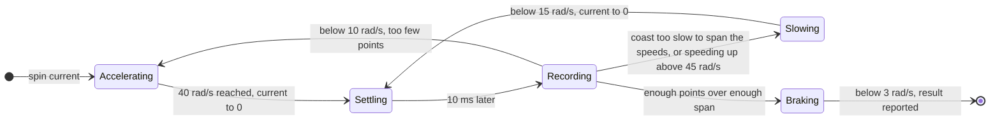
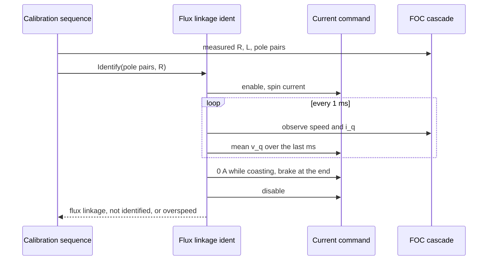

| Field     | Value                                |
|-----------|--------------------------------------|
| Title     | Service: Flux Linkage Identification |
| Type      | design                               |
| Status    | draft                                |
| Version   | 0.1.0                                |
| Component | service-flux-linkage-ident           |
| Date      | 2026-10-29                           |

> **IMPORTANT — Implementation-blind document**: This document describes *behavior, structure, and
> responsibilities* WITHOUT referencing code. **No code blocks using programming languages (C++, C,
> Python, CMake, shell, etc.) are allowed.** Use Mermaid diagrams to express behavior instead.
> Prose descriptions of algorithms are encouraged; source-level details are not.
>
> **Diagrams**: All visuals must be Mermaid (` ```mermaid `), TikZ via ` ```{=latex} ` raw blocks (source in
> `documentation/tikz/`), or ASCII art. External image references (``) are **not allowed**.

---

## Responsibilities

- Measuring the motor's flux linkage $\psi_f$ during calibration from the back-EMF, with no reliance
  on the resistance or inductance being exact.
- Moving the rotor only within a bounded current and speed, and leaving it at rest.
- Reporting a value only when the measurement is precise and spans enough speed, and reporting a
  runaway as a failure in its own right.

The flux linkage cannot come from the mechanical identification: that service turns current into
torque through $K_t = \tfrac{3}{2} p \psi_f$ and fits inertia and friction to the motion, and from speed
and current alone a larger $\psi_f$ only scales the inertia and friction it reports. A voltage has to be
measured.

---

## Component Details

### Part A — Measuring at zero current

With the current loop holding $i_d = i_q = 0$, the q-axis voltage equation leaves only the back-EMF:

$$
v_q = R_s i_q + L_s \frac{di_q}{dt} + \omega_e L_s i_d + \omega_e \psi_f \;\approx\; \omega_e \psi_f
$$

The service spins the rotor up with a small q-axis current, sets the current to zero and, while the
rotor coasts, records the q-axis voltage the current loop applies against the electrical speed. The
flux linkage is the slope of a straight-line fit. The fit's intercept absorbs a constant voltage
error, such as what is left of the dead time, and $R_s i_q$ is subtracted from each point so that a
current law that does not hold exactly zero still measures the back-EMF. Neither the resistance nor
the inductance needs to be exact, since the current they multiply is close to zero.

Each fitted point is the mean of 10 ms of observations. A single 1 ms speed reading on a 1000-count
encoder carries a count of quantisation, a quarter of the speed at 25 rad/s, and noise in the speed
pulls a least-squares slope towards zero: with 1 ms points the bench motor's inertia came out 7.9 %
low through the flux linkage. The 10 ms mean leaves a tenth of that noise.

### Part B — The spin profile



| Setting                | Value                                         | Why                                                                |
|------------------------|-----------------------------------------------|--------------------------------------------------------------------|
| Spin and brake current | 0.6 A, at most a quarter of the drive's limit | Twice the bench motor's dry friction and cogging                   |
| Release speed          | 40 rad/s                                      | Below the bench's 60 rad/s, with room for the overshoot            |
| Speed limit            | 50 rad/s                                      | Above it the run stops and reports an overspeed                    |
| Recording range        | 40 down to 10 rad/s                           | A span of four to one in speed                                     |
| Recording ceiling      | 45 rad/s, halfway to the speed limit          | A rotor still driven at 0 A is slowed before the limit             |
| Points                 | 30, over up to six coasts                     | The bench motor coasts 40 to 10 rad/s in about 100 ms              |
| Coast limit            | 1.5 s                                         | A rotor that barely slows is braked to 15 rad/s and recorded again |
| Run limit              | 5 s                                           | A rotor that never reaches the release speed is not identified     |

Under the sliding-mode law the rotor barely slows at a 0 A setpoint, since the law leaves a small
current: in simulation it was still above 27 rad/s after 1.5 s. Braking it to 15 rad/s and recording
again gives the fit its span.

The current the law leaves comes from the back-EMF feedforward, which uses the flux linkage being
measured. When that is too large the current drives the rotor, and with the noise-bound automatic
bandwidth the bench motor speeds up at 0 A instead of coasting. A 10 ms point whose mean speed is
above the recording ceiling and higher than the point before ends the coast; the rotor is slowed to
15 rad/s and recorded again as it speeds up. The fit subtracts $R_s i_q$ with the measured current, so
the current it leaves does not bias the slope. The overshoot past the release speed falls from one
point to the next, so it does not end a coast.

### Part C — Accepting the result

A result is reported as identified only when the fit has at least 10 points, its lowest speed is at
most half its highest, the slope's relative standard error is at most 5 %, the intercept is at most
15 % of the largest voltage recorded, and the slope lies inside the flux-linkage range a motor
parameter may take. Otherwise the result is not identified, and the calibration keeps the value it
had. A speed above the limit at any point is reported as an overspeed, which fails the calibration.

---

## Sequence Diagrams



---

## Interfaces

### Provided

| Interface  | Purpose                            | Contract                                                          |
|------------|------------------------------------|-------------------------------------------------------------------|
| Identify   | Measure the flux linkage           | Asynchronous; leaves the rotor at rest and the drive stopped      |
| Abort      | Abandon a measurement              | Stops the drive; the measurement reports nothing                  |
| Is running | Whether a measurement is in flight | True from Identify until its result is delivered or it is aborted |

### Required

| Interface         | Purpose                                                                                         | Contract                                                                                                         |
|-------------------|-------------------------------------------------------------------------------------------------|------------------------------------------------------------------------------------------------------------------|
| Current command   | Run the cascade on a q-axis current with $i_d = 0$, and read the mean q-axis voltage it applies | Bypasses the speed and position loops while enabled; the voltage is the mean over the last millisecond, in volts |
| Motion observable | Speed and q-axis current                                                                        | —                                                                                                                |
| Drive control     | Start and stop the drive                                                                        | —                                                                                                                |
| Inverter          | The current the drive supports                                                                  | —                                                                                                                |
| Timer             | 1 ms observation tick and the run limit                                                         | —                                                                                                                |

---

## Verification

Unit tests drive the service against a simulated rotor and check the fitted flux linkage for a
coasting rotor, a constant voltage offset, a rotor that barely slows, and a rotor the current law
keeps driving at 0 A. They also check braking to rest, the current limit, an overspeed, a rotor that
never reaches the release speed, an abort and a refused request. The calibration step that runs the
service is verified in the model-in-the-loop and on the bench.
