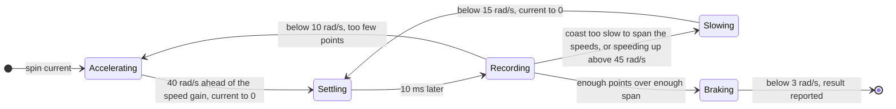
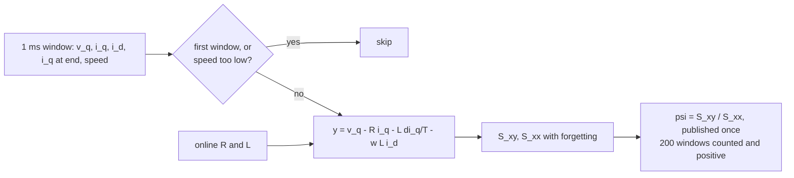
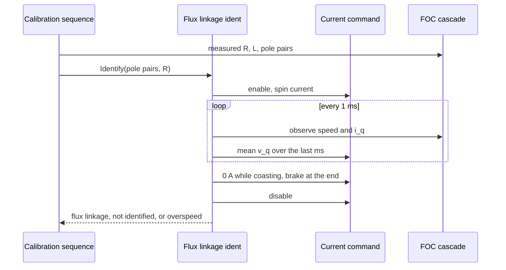

| Field     | Value                                |
|-----------|--------------------------------------|
| Title     | Service: Flux Linkage Identification |
| Type      | design                               |
| Status    | draft                                |
| Version   | 0.2.0                                |
| Component | service-flux-linkage-ident           |
| Date      | 2026-11-11                           |

> **IMPORTANT — Implementation-blind document**: This document describes *behavior, structure, and
> responsibilities* WITHOUT referencing code. **No code blocks using programming languages (C++, C,
> Python, CMake, shell, etc.) are allowed.** Use Mermaid diagrams to express behavior instead.
> Prose descriptions of algorithms are encouraged; source-level details are not.
>
> **Diagrams**: All visuals must be Mermaid (` ```mermaid `), TikZ via ` ```{=latex} ` raw blocks (source in
> `documentation/tikz/`), or ASCII art. External image references (``) are **not allowed**.

---

## Responsibilities

- Measuring the motor's flux linkage $\psi_f$ during calibration from the back-EMF, with no reliance
  on the resistance or inductance being exact.
- Moving the rotor only within a bounded current and speed, and leaving it at rest.
- Reporting a value only when the measurement is precise and spans enough speed, and reporting a
  runaway as a failure in its own right.
- Tracking the flux linkage while the drive runs in speed or position mode, so a magnet that warms and weakens
  is followed (Part D). Applying the result is the online recalibration's business (`online-recalibration.md`).

The flux linkage cannot come from the mechanical identification: that service turns current into
torque through $K_t = \tfrac{3}{2} p \psi_f$ and fits inertia and friction to the motion, and from speed
and current alone a larger $\psi_f$ only scales the inertia and friction it reports. A voltage has to be
measured.

---

## Component Details

### Part A — Measuring at zero current

With the current loop holding $i_d = i_q = 0$, the q-axis voltage equation leaves only the back-EMF:

$$
v_q = R_s i_q + L_s \frac{di_q}{dt} + \omega_e L_s i_d + \omega_e \psi_f \;\approx\; \omega_e \psi_f
$$

The service spins the rotor up with a small q-axis current, sets the current to zero and, while the
rotor coasts, records the q-axis voltage the current loop applies against the electrical speed. The
flux linkage is the slope of a straight-line fit. The fit's intercept absorbs a constant voltage
error, such as what is left of the dead time, and $R_s i_q$ is subtracted from each point so that a
current law that does not hold exactly zero still measures the back-EMF. Neither the resistance nor
the inductance needs to be exact, since the current they multiply is close to zero.

Each fitted point is the mean of 10 ms of observations. A single 1 ms speed reading on a 1000-count
encoder carries a count of quantisation, a quarter of the speed at 25 rad/s, and noise in the speed
pulls a least-squares slope towards zero: with 1 ms points the bench motor's inertia came out 7.9 %
low through the flux linkage. The 10 ms mean leaves a tenth of that noise.

### Part B — The spin profile



| Setting                | Value                                         | Why                                                                |
|------------------------|-----------------------------------------------|--------------------------------------------------------------------|
| Spin and brake current | 0.6 A, at most a quarter of the drive's limit | Twice the bench motor's dry friction and cogging                   |
| Release speed          | 40 rad/s                                      | Below the bench's 60 rad/s, with room for the overshoot            |
| Speed limit            | 50 rad/s                                      | Above it the run stops and reports an overspeed                    |
| Recording range        | 40 down to 10 rad/s                           | A span of four to one in speed                                     |
| Recording ceiling      | 45 rad/s, halfway to the speed limit          | A rotor still driven at 0 A is slowed before the limit             |
| Points                 | 30, over up to six coasts                     | The bench motor coasts 40 to 10 rad/s in about 100 ms              |
| Coast limit            | 1.5 s                                         | A rotor that barely slows is braked to 15 rad/s and recorded again |
| Run limit              | 5 s                                           | A rotor that never reaches the release speed is not identified     |

Under the sliding-mode law the rotor barely slows at a 0 A setpoint, since the law leaves a small
current: in simulation it was still above 27 rad/s after 1.5 s. Braking it to 15 rad/s and recording
again gives the fit its span.

The current the law leaves comes from the back-EMF feedforward, which uses the flux linkage being
measured. When that is too large the current drives the rotor, and with the noise-bound automatic
bandwidth the bench motor speeds up at 0 A instead of coasting. A 10 ms point whose mean speed is
above the recording ceiling and higher than the point before ends the coast; the rotor is slowed to
15 rad/s and recorded again as it speeds up. The fit subtracts $R_s i_q$ with the measured current, so
the current it leaves does not bias the slope. The overshoot past the release speed falls from one
point to the next, so it does not end a coast.

The release happens ahead of the release speed by twice the speed gained over the last tick. The
measured speed is a 1 ms mean, a period behind the rotor, and the current falls to zero a period
after it is set, so a rotor gaining speed fast is already well past the speed it is released at. In
simulation the low-inertia reference motor gained 4 rad/s per tick on the spin current: released when
its measured speed passed 40 rad/s, it was at 47 rad/s and peaked at 50.4 rad/s, an overspeed. Counting
two ticks of gain releases it below 40 rad/s, and it peaks below 45 rad/s. The bench motor gains about
1 rad/s per tick and its 1000-count encoder reads the speed in steps of 1.6 rad/s, so it is released a
few rad/s earlier than before; the coast still spans more than three to one.

### Part C — Accepting the result

A result is reported as identified only when the fit has at least 10 points, its lowest speed is at
most half its highest, the slope's relative standard error is at most 5 %, the intercept is at most
15 % of the largest voltage recorded, and the slope lies inside the flux-linkage range a motor
parameter may take. Otherwise the result is not identified, and the calibration keeps the value it
had. A speed above the limit at any point is reported as an overspeed, which fails the calibration.

### Part D — Online tracking

A magnet loses flux as it warms: neodymium about 0.11 % per kelvin, ferrite about 0.2 %. A winding that has
run hot for an hour has a magnet 10 % weaker than the one that was calibrated cold, so the same current delivers
10 % less torque and the back-EMF feed-forward of the current loop cancels 10 % too much of the voltage the
motion induces. The drive therefore estimates the flux linkage while it runs, in speed and position mode.
Torque mode runs no estimator.

**Equation.** Each 1 ms window of the outer loop gives the mean q-axis voltage the current loop applied $\bar v_q$,
the mean q-axis current $\bar i_q$ and d-axis current $\bar i_d$, the q-axis current at the window's end, and the
mean electrical speed $\bar\omega_e$, from the rotation over the window. With the resistance and inductance of the
online electrical estimate (`service-electrical-ident.md`), the voltage that only the magnet explains is

$$
y_k = \bar v_q - R\,\bar i_q - L\,\frac{i_{q,k}^{\text{end}} - i_{q,k-1}^{\text{end}}}{T} - \bar\omega_e L\,\bar i_d
\;=\; \bar\omega_e\,\psi_f , \qquad x_k = \bar\omega_e
$$

with $T$ the window length. The voltage applied is paired with the current it produced the way the direct-axis
voltage is, a period later when the board updates its duty a period late
(`platform-sampling-skew.md`).

**Filter.** The estimate is the least-squares slope through the origin with exponential forgetting:
$S_{xy} \leftarrow \lambda S_{xy} + x_k y_k$, $S_{xx} \leftarrow \lambda S_{xx} + x_k^2$, $\hat\psi_f = S_{xy}/S_{xx}$,
with $\lambda = 0.9995$, a memory of about two seconds, long against the speed loop and short against a magnet's
thermal time constant of minutes. The sign of the speed cancels, so reverse rotation gives the same estimate.

**Which windows count.** The first window after the loops restart has no earlier current to difference and is
skipped. A window whose back-EMF $|\bar\omega_e|\psi_{\text{seed}}$ is below 2 % of the largest phase voltage
the bus gives, $V_{dc}/\sqrt3$, is skipped: there the dead-time and the voltage error of the inverter are as large
as the signal. The estimator reports it has settled after 200 counted windows since it was seeded; until then,
and whenever the slope is not finite and positive, it reports its seed. It is seeded with the flux linkage of the
calibration record whenever a calibration is applied, and not seeded again by a recalibration, so it keeps tracking
from where it is.



**Accuracy.** The estimate depends on the resistance and inductance of the online estimate: a resistance 5 % off at
a q-axis current of 5 A and a speed of 400 rad/s shifts the flux linkage by $0.05 R i_q/\omega_e$, a few
percent of a small motor's flux linkage, which is why the online recalibration adopts the flux linkage only beyond
5 % and only inside a band. The voltage offset of the inverter's dead time and the resistance drift with the
winding are the leading errors; the model-in-the-loop test with a hot magnet bounds the combined error
(`software-in-the-loop.md`).

---

## Sequence Diagrams



---

## Interfaces

### Provided

| Interface           | Purpose                                         | Contract                                                                          |
|---------------------|-------------------------------------------------|-----------------------------------------------------------------------------------|
| Identify            | Measure the flux linkage                        | Asynchronous; leaves the rotor at rest and the drive stopped                      |
| Abort               | Abandon a measurement                           | Stops the drive; the measurement reports nothing                                  |
| Is running          | Whether a measurement is in flight              | True from Identify until its result is delivered or it is aborted                 |
| Online flux linkage | The tracked flux linkage and whether it settled | Written once per outer-loop period while the drive runs in speed or position mode |

### Required

| Interface         | Purpose                                                                                         | Contract                                                                                                         |
|-------------------|-------------------------------------------------------------------------------------------------|------------------------------------------------------------------------------------------------------------------|
| Current command   | Run the cascade on a q-axis current with $i_d = 0$, and read the mean q-axis voltage it applies | Bypasses the speed and position loops while enabled; the voltage is the mean over the last millisecond, in volts |
| Motion observable | Speed and q-axis current                                                                        | —                                                                                                                |
| Drive control     | Start and stop the drive                                                                        | —                                                                                                                |
| Inverter          | The current the drive supports                                                                  | —                                                                                                                |
| Timer             | 1 ms observation tick and the run limit                                                         | —                                                                                                                |

---

## Verification

Unit tests drive the service against a simulated rotor and check the fitted flux linkage for a
coasting rotor, a constant voltage offset, a rotor that barely slows, and a rotor the current law
keeps driving at 0 A. They also check braking to rest, the current limit, an overspeed, a rotor that
never reaches the release speed, an abort and a refused request. Rotors gaining 3.9 to 5.4 rad/s per
tick, seen a period late, are released early enough to peak below 45 rad/s; released at the measured
40 rad/s they reached 54 rad/s and were reported as an overspeed.

In the model-in-the-loop, calibrating against plants whose flux linkage differs from the configured
7.0 mWb, the stored flux linkage is within 0.2 % of 4.6 mWb on the bench motor and within 0.1 % on
both reference motors, in torque and in speed mode. With the bench's 38.5 mA of current noise and each
duty a period late, it is within 1 % under every current law, at the noise-bound automatic bandwidth.
The mechanical identification that follows reads the inertia within 0.1 % on a 1000-count encoder
(REQ-CMS-001, `parameter_identification.feature`).

The online estimator is unit tested against synthetic windows: it removes the resistive, inductive and cross-coupling
terms, ignores slow windows and the first window, follows a drifting magnet, and reports the seed until 200 windows
have counted. In the model-in-the-loop a plant whose magnet has warmed is followed by the online estimate
within a tolerance pinned from the test's metric line, and the automatic recalibration restores the torque per
ampere (REQ-CMS-003, `online-recalibration.md`).

On the bench, three torque-mode calibrations under sliding mode stored 4.54 to 4.63 mWb, and the
calibrations in the hardware regression 4.55 to 4.67 mWb. The inertia was a factor 1.51 below the one
the configured 7.0 mWb gave.
