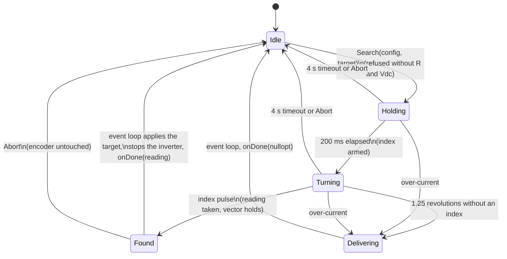

| Field     | Value                         |
|-----------|-------------------------------|
| Title     | Service: Encoder Index Search |
| Type      | design                        |
| Status    | draft                         |
| Version   | 0.1.0                         |
| Component | service-index-search          |
| Date      | 2026-11-06                    |

> **IMPORTANT — Implementation-blind document**: This document describes *behavior, structure, and
> responsibilities* WITHOUT referencing code. **No code blocks using programming languages (C++, C,
> Python, CMake, shell, etc.) are allowed.** Use Mermaid diagrams to express behavior instead.
> Prose descriptions of algorithms are encouraged; source-level details are not.
>
> **Diagrams**: All visuals must be Mermaid (` ```mermaid `), TikZ via ` ```{=latex} ` raw blocks (source in
> `documentation/tikz/`), or ASCII art. External image references (``) are **not allowed**.

---

## Responsibilities

**Is responsible for:**
- Turning the rotor slowly, with an open-loop voltage vector sized for a bounded current, until the encoder's
  index pulse passes, and reporting the encoder reading at that pulse (REQ-CAL-027)
- At commissioning, measuring that reading in the frame the alignment has just set: the **index angle**, the
  mechanical angle of the index from the electrical zero (REQ-CAL-026)
- At power-up, re-referencing the encoder so that it reads the stored index angle at the pulse, which restores
  the frame the alignment set without aligning again (REQ-SM-035)
- Failing safely: stopping the inverter on a run-out of travel, an over-current or a timeout, and dropping its
  completion on an abort

**Is NOT responsible for:**
- Deciding when to search, or storing the index angle — the calibration sequence and the state machine do that
- Knowing whether the encoder has an index channel — the platform's encoder index port says so
- Catching a rotor that is already turning (a flying start): the search always drives the rotor itself

---

## Component Details

### Part A — Why an index restores the rotor reference

An incremental encoder counts from wherever it was at power-up, so the frame the alignment sets
(`service-alignment.md`) is lost on every reset. The index channel is a mark on the encoder disc: one pulse per
revolution, always at the same mechanical position. The angle between that mark and the electrical zero the
alignment found is a property of the assembled motor, not of the power-up, so it can be measured once and
stored with the calibration record. After a reset, one pass over the index tells the drive where the mark is
in the new count, and the stored angle places the electrical zero relative to it
(`theory/alignment.md` §7).

The search reads the encoder at the pulse, not the field's angle, so the result does not depend on how far the
rotor lags the field: friction, cogging and a load that the alignment's settled position absorbs as an error
do not enter it.

### Part B — The search

The search drives the inverter directly, as the alignment does, with no current feedback. It runs in the
phase-current interrupt at the inverter's base frequency, so the index is polled every control period.

1. **Sizing.** The vector's amplitude is the voltage that drives the search current through the calibrated
   phase resistance from the measured bus: a vector of duty fraction `d` drives `d·Vdc/(2R)` into phase a,
   so `d = 2·I·R/Vdc`. The search current is 0.6 A, or a quarter of the inverter's maximum if that is less.
   Without a positive resistance and bus voltage the amplitude is unknown and the search refuses to start.
2. **Hold.** The vector is held at electrical angle zero for 200 ms. A rotor anywhere else snaps to it, turning
   up to half an electrical turn either way; an index pulse it passes on the way would be seen from the wrong
   side, so the index is armed only when the hold ends.
3. **Turn.** The vector turns forward at half a mechanical revolution per second (`π·p` rad/s electrical).
   The rotor follows it like a stepper: at that speed the back-EMF and the winding's reactance are a small part
   of the resistive drop, so the current stays close to the sized one.
4. **Index.** At the first control period that sees the index, the encoder is read and the vector stops
   turning; it keeps holding the rotor where it is. The reading is handed to the event loop.
5. **Reference.** On the event loop, when the caller gave a stored index angle, the encoder is set so that the
   reading taken at the pulse becomes that angle: the current reading is shifted by the stored angle less the
   pulse reading. Only then is the inverter stopped and the completion delivered.

The search always turns forward, at commissioning and at power-up alike, so it always meets the same edge of the
pulse and its width does not separate the two readings.



### Part C — Bounds

| Bound          | Value                                                       | Why                                                                                         |
|----------------|-------------------------------------------------------------|---------------------------------------------------------------------------------------------|
| Current        | 0.6 A, at most a quarter of the inverter's maximum          | Enough to pull the bench rotor past its friction and cogging with a wide margin              |
| Trip           | Any phase above twice the search current or the inverter's maximum | The amplitude is sized from a calibrated resistance a hot or cold winding departs from |
| Travel         | 1.25 mechanical revolutions after the hold                  | One revolution always passes the index; the rest absorbs the rotor's lag behind the vector |
| Time           | 4 s                                                         | The hold and the travel take 2.7 s; the timer only backs the travel limit up                 |

A failure stops the inverter and completes with no reading. The completion is always delivered from the
event loop, never from the interrupt. `Abort()` stops the inverter and drops the completion without invoking
it; an abort after the pulse has been seen leaves the encoder untouched.

### Part D — The encoder index port

The platform reports the index through a port beside the encoder:

| Operation | Meaning                                                                                       |
|-----------|-----------------------------------------------------------------------------------------------|
| Has index | Whether the board wires an index channel at all; without one nothing searches                   |
| Arm       | Forget any pulse seen so far                                                                    |
| Seen      | Whether a pulse has been seen since the last arm; polled every control period during the search |

The EK-TM4C1294XL latches the pulse in the quadrature encoder interface's raw interrupt status, so a pulse
shorter than a control period is still seen. The NUCLEO-G474RE reads the index pin's level, which a pulse one
count wide holds for 0.5 ms at the search speed of a 4000-count encoder — ten control periods. The emulated
target reports the plant's index (`software-in-the-loop.md`, Part A), and the host has none.

---

## Interfaces

### Provided

| Interface                         | Purpose                                                                              | Contract                                                                                                     |
|-----------------------------------|--------------------------------------------------------------------------------------|--------------------------------------------------------------------------------------------------------------|
| `Available()`                     | Whether a search can find anything                                                   | False without an index channel                                                                               |
| `Search(config, target, onDone)`  | Searches the index; with a target, re-references the encoder to it                   | `onDone` fires once, from the event loop, after the inverter has stopped, with the reading at the pulse or nothing |
| `Abort()`                         | Stops a search                                                                       | Inverter stopped, completion dropped, encoder untouched                                                      |
| `IsRunning()`                     | Whether a search owns the inverter or a completion is queued                        | The state machine counts it as pending work                                                                  |

### Required

| Interface            | Purpose                                                          | Contract                                                                          |
|----------------------|------------------------------------------------------------------|-----------------------------------------------------------------------------------|
| `ThreePhaseInverter` | Open-loop vector and the phase-current interrupt that paces it   | Not claimed by the control loop while a search runs                               |
| `Encoder`            | Reading at the pulse, and the re-reference                       | `Set` makes the current reading the given angle                                   |
| `EncoderIndex`       | The index pulse                                                  | Polled from the phase-current interrupt                                           |
