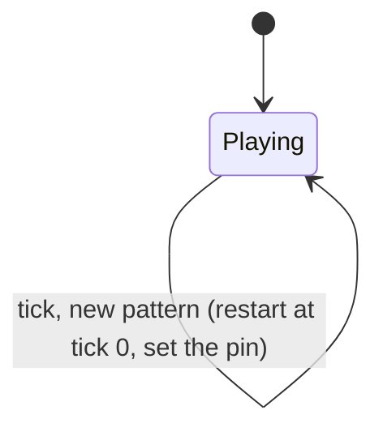
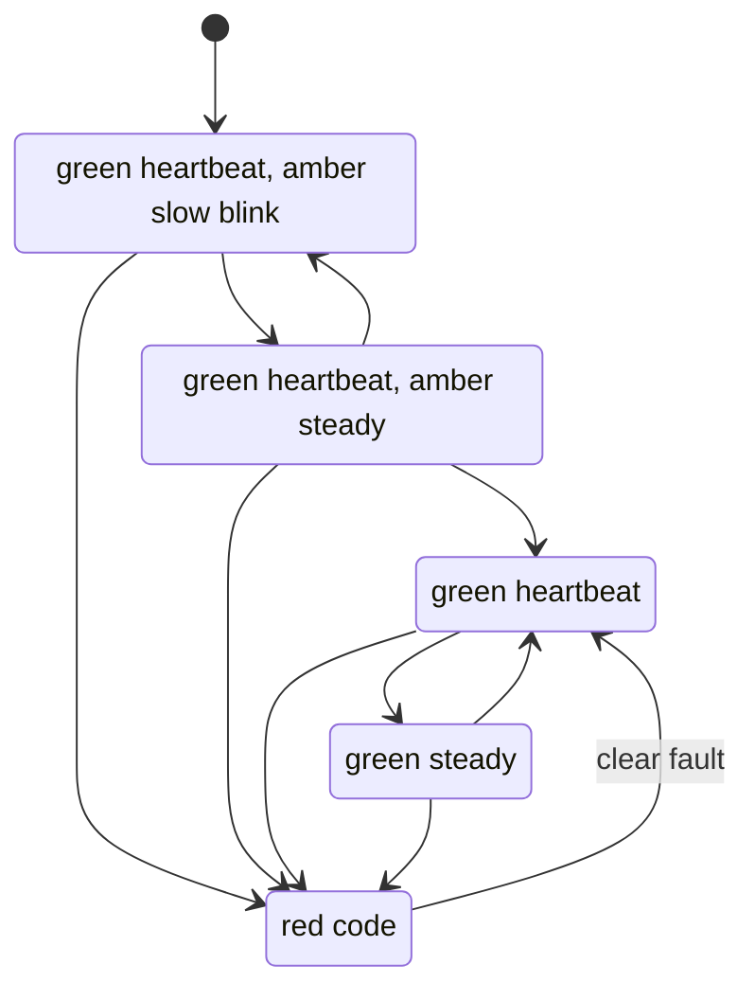
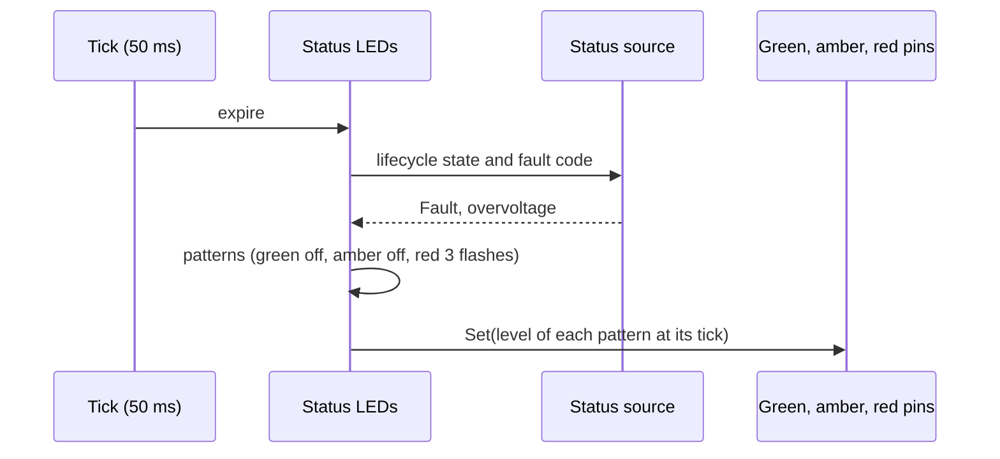

| Field     | Value                |
|-----------|----------------------|
| Title     | Service: Status LEDs |
| Type      | design               |
| Status    | draft                |
| Version   | 0.1.0                |
| Component | service-leds         |
| Date      | 2026-11-08           |

> **IMPORTANT — Implementation-blind document**: This document describes *behavior, structure, and
> responsibilities* WITHOUT referencing code. **No code blocks using programming languages (C++, C,
> Python, CMake, shell, etc.) are allowed.** Use Mermaid diagrams to express behavior instead.
> Prose descriptions of algorithms are encouraged; source-level details are not.
>
> **Diagrams**: All visuals must be Mermaid (` ```mermaid `), TikZ via ` ```{=latex} ` raw blocks (source in
> `documentation/tikz/`), or ASCII art. External image references (``) are **not allowed**.

---

## Responsibilities

A person at the drive has no terminal and no CAN tool. Three LEDs on the board tell them, at a glance, whether the
firmware runs, whether the motor is being driven, whether the drive is being commissioned and, when it stopped, why.
Requirements: REQ-UI-001, REQ-UI-002, REQ-UI-003.

**Is responsible for:**
- Turning the drive's lifecycle state and its latched fault into one pattern per LED: green (operational), amber
  (warning) and red (failure)
- Playing the patterns on the three board LEDs from the event loop, from a single 50 ms tick
- Restarting a pattern from its first flash when the pattern changes, so that a new fault class is always read from
  the start

**Is NOT responsible for:**
- Detecting any fault: overcurrent, voltage, temperature and sensor faults are detected by the protection path
  (`fault-supervision.md`) and enter Fault through the state machine
- Latching a fault or clearing it (`state-machine.md`): the LEDs only follow what the state machine reports
- Anything in the 20 kHz interrupt or the 1 kHz outer loop: the service runs on the event loop only
- Reporting the fault over CAN (`service-can.md`) or storing it (`service-fault-history.md`)

---

## Component Details

### Part A — Status source

The service reads the drive through a small interface it is given: the lifecycle state (Idle, Calibrating, Ready,
Enabled, Fault) and the fault code of the fault the drive is in. The state machine knows nothing of the service.
The application adapts the active control mode's state machine to the interface, the same state and fault code
the CAN telemetry reports. Before the control mode exists, that is during the start-up load of the configuration,
the adapter reports Idle with no fault.

The state machine offers no change notification that covers every transition, so the service polls on its tick.
The worst-case lag between a transition and its indication is one tick, 50 ms.

### Part B — Patterns

A pattern is one of three shapes: off, steady on, or a repeating group of flashes. A group is a number of flashes,
each with an on time and an off time, followed by a pause. All times are whole ticks of 50 ms.

| Name         | Flashes | On     | Off    | Pause   | Period            |
|--------------|---------|--------|--------|---------|-------------------|
| Heartbeat    | 1       | 50 ms  | 0      | 1950 ms | 2 s               |
| Slow blink   | 1       | 500 ms | 500 ms | 0       | 1 s               |
| Fault code N | N       | 250 ms | 250 ms | 1500 ms | N × 0.5 s + 1.5 s |

The heartbeat keeps the look the firmware has always had: 50 ms on every two seconds.

### Part C — Pattern table

| State       | Green (operational) | Amber (warning) | Red (failure)          |
|-------------|---------------------|-----------------|------------------------|
| Idle        | Heartbeat           | Slow blink      | Off                    |
| Calibrating | Heartbeat           | Steady          | Off                    |
| Ready       | Heartbeat           | Off             | Off                    |
| Enabled     | Steady              | Off             | Off                    |
| Fault       | Off                 | Off             | Fault code (see below) |

Idle means the drive has no valid calibration, since a drive holding one starts in Ready. Amber therefore asks for
commissioning. Amber is steady while calibrating because the rotor may then move without a command.

### Part D — Fault codes

| Flashes | Fault                                                                                |
|---------|--------------------------------------------------------------------------------------|
| 2       | Overcurrent                                                                          |
| 3       | Overvoltage                                                                          |
| 4       | Overtemperature                                                                      |
| 5       | Loss of the position sensor (encoder loss)                                           |
| 6       | Undervoltage                                                                         |
| 7       | Motion supervision: stall, missing phase, overspeed, following error, position limit |
| 8       | Command timeout                                                                      |
| steady  | Hardware fault, calibration failed, any code not listed                              |

One flash is not used, so that a lone flash is never mistaken for a heartbeat on the other LED.

A fault stays in Fault until it is cleared, so the red LED is never off while a fault is latched: it either flashes
its group, with at most a 1.5 s pause between two groups, or is steady. The flashing group is the latched
indication. Whenever the pattern of an LED changes, for instance because the fault has another flash count, that
LED restarts at its first flash; an LED whose pattern stays the same, such as red between two motion faults, keeps
its phase.

### Part E — Lifetime

The service is a static application-level object that lives as long as the event loop runs, so the
asynchronous-callback lifetime rules (`async-callback-lifetime.md`) do not apply. It schedules nothing on the
dispatcher but its own repeating timer.

---

## Interfaces

### Provided

| Interface    | Purpose               | Contract                                                                                                             |
|--------------|-----------------------|----------------------------------------------------------------------------------------------------------------------|
| Construction | Starts the indication | Drives the LEDs from the first tick; the three LEDs are configured as outputs and are off when the service goes away |

### Required

| Interface         | Purpose                        | Contract                                |
|-------------------|--------------------------------|-----------------------------------------|
| Three output pins | Green, amber, red LEDs         | Set on and off from the event loop only |
| Status source     | Lifecycle state and fault code | Read once per tick, event loop only     |
| Repeating timer   | The 50 ms tick                 | Event loop                              |

---

## State Machine

Each LED runs the same player: a pattern and the number of ticks it has been playing. The pattern is recomputed from
the status every tick.



Lifecycle states and the indication they select:



---

## Sequence Diagrams



---

## Constraints & Limitations

| Constraint  | Value / Description                                                                              |
|-------------|--------------------------------------------------------------------------------------------------|
| Tick        | 50 ms; every time in a pattern is a whole number of ticks                                        |
| Latency     | One tick between a transition and its indication                                                 |
| Context     | Event loop only; never the control interrupts                                                    |
| Memory      | No allocation; three players and the patterns are plain values                                   |
| Power off   | All LEDs are off without power; no pattern can express it                                        |
| Fault codes | Several faults share the motion code 7; the CAN fault code or the fault history tells them apart |
