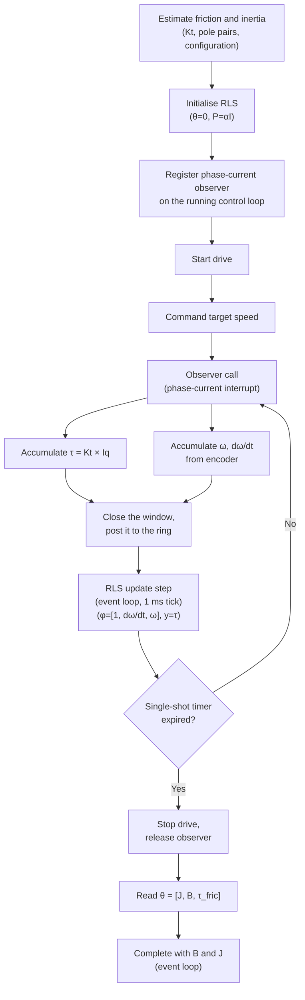
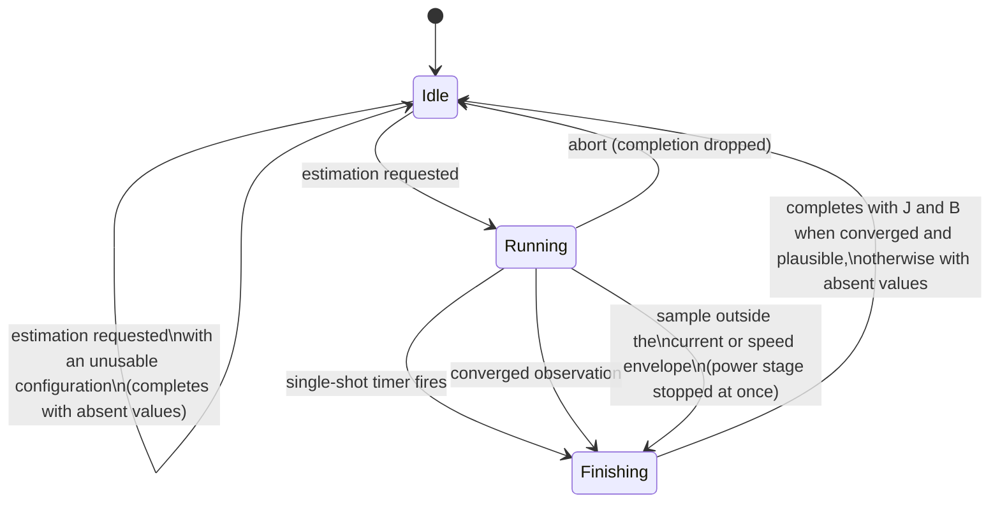

| Field     | Value                                         |
|-----------|-----------------------------------------------|
| Title     | Service: Mechanical Parameters Identification |
| Type      | design                                        |
| Status    | draft                                         |
| Version   | 0.5.2                                         |
| Component | service-mechanical-ident                      |
| Date      | 2026-11-26                                    |

> **IMPORTANT — Implementation-blind document**: This document describes *behavior, structure, and
> responsibilities* WITHOUT referencing code. **No code blocks using programming languages (C++, C,
> Python, CMake, shell, etc.) are allowed.** Use Mermaid diagrams to express behavior instead.
> Prose descriptions of algorithms are encouraged; source-level details are not.
>
> **Diagrams**: All visuals must be either a Mermaid fenced code block (` ```mermaid `) or ASCII art inline
> in the document. External image references using Markdown image syntax are **not allowed**.

---

## Responsibilities

**Is responsible for:**
- Estimating rotor moment of inertia (J) and viscous friction coefficient (B) while the motor runs in closed-loop speed control
- Starting and stopping the drive for the duration of the procedure, and driving the two-level speed trajectory that provides the excitation
- Refusing a request whose configuration does not describe a bounded trajectory, and ending a run that leaves the current or speed envelope it was given
- Reporting an estimate only when it is converged and physically plausible, and reporting absent values otherwise
- Releasing the drive and discarding the pending completion when the caller aborts, so that a fault is not overwritten by the result of the procedure it interrupted
- Computing instantaneous electromagnetic torque from the q-axis current and the caller-supplied torque constant
- Estimating angular acceleration by finite-differencing successive speed measurements obtained from the encoder
- Maintaining a real-time Recursive Least Squares (RLS) estimator that continuously refines the parameter vector [J, B, τ_friction] using each new observation
- Enforcing a configurable one-shot estimation timeout, after which the latest RLS estimates are reported and the procedure stops
- Delivering results through a single completion notification that reports friction and inertia using explicit physical units

---

## Component Details

### Prerequisites and Motor Model

The mechanical dynamics of a PMSM rotor are governed by Newton's second law for rotation:

```text
τ_motor = J · dω/dt + B · ω + τ_friction
```

where:

- **τ_motor** — electromagnetic torque produced by the motor (N·m)
- **J** — rotor moment of inertia (kg·m²)
- **B** — viscous friction coefficient (N·m·s/rad)
- **τ_friction** — Coulomb (constant) friction term (N·m)
- **ω** — rotor angular velocity (rad/s)
- **dω/dt** — rotor angular acceleration (rad/s²)

This is a linear model in the three unknowns [J, B, τ_friction]. The RLS estimator treats each measurement instant as one observation of this linear equation.

### Torque Estimation

At each phase-current sample, the instantaneous electromagnetic torque is estimated from the q-axis current:

```text
τ_motor = Kt × Iq
```

where $K_t$ is the torque constant (N·m/A) provided by the caller. The q-axis current $I_q$ is the measured value the control loop is already sampling. It uses the same current feedback path as the FOC current controller.

The d-axis contribution to torque is zero for surface PMSM under the Id = 0 operating condition assumed during identification. For interior PMSM with reluctance torque, this approximation introduces a small systematic error in the torque estimate. The caller should account for this if Ld ≠ Lq.

### Speed and Acceleration Estimation

Speed and acceleration come from differences of encoder positions, and an encoder gives positions in counts. For a
count of $q$ radians, a window of $T_w$ seconds quantises the speed at $q/T_w$ and the acceleration at $q/T_w^2$. Read
at 20 kHz, a 1000-line encoder (4000 counts per revolution, $q$ = 1.6 mrad) moves in steps of about 31 rad/s. Its
second difference is quantised at over 600 000 rad/s². The acceleration is the harder quantity, because its
quantisation falls with the *square* of the window.

The procedure therefore sizes its **observation window** from the encoder it is given. It tracks the smallest non-zero
position step it sees, which is one count. Once it has seen enough steps, it chooses the window that holds the
acceleration quantum at a fixed target (100 rad/s²):

```text
T_w = sqrt( q / 100 )          q = smallest non-zero position step, in radians
```

A continuous encoder with noise has no count. Every position step is nonzero, and the smallest of them keeps shrinking
as more are seen. This would collapse the window to one sample. The procedure therefore also tracks the second
difference of the position, which motion barely changes at 20 kHz and noise dominates. For white noise of standard
deviation $\sigma$, the second difference has an RMS of $\sqrt{6}\,\sigma$. A quantiser of step $q$ has the same noise
power at $\sigma = q/\sqrt{12}$. So $\sqrt{2}$ times that RMS is the step the encoder is equivalent to. The window is sized
from the larger of the smallest step and this equivalent step. So a noisy encoder gets a window as long as a coarse one
of the same noise. A clean quantised encoder measures an equivalent step of about 1.1 counts, and at most $\sqrt{2}$ counts
for a perfectly alternating pattern. This moves the window by under 20 %. A new window is adopted only when it differs
from the current one by more than about 6 % (any change below 16 samples). Otherwise an estimate that drifts by one
sample would restart the pairing of windows, and so discard the data, on nearly every window.

A clean encoder (a simulated plant, or a very fine one) has a tiny step and so a single-sample window, which is the
sample itself. A 4000-count encoder gets about 4 ms and a 1000-count one about 8 ms. The window is limited to 256 samples, which an encoder of fewer than about 400 counts reaches. Until enough steps have been seen, the window is one
sample. No speed limit is applied to it then, because a quantised single-sample speed is not a speed. The current
limit is checked on every sample throughout.

Each window yields one observation. The speed is taken between the **mean positions** of consecutive windows, not
between their end samples:

```text
θ̄_w = mean of the positions sampled in window w     wrap-around compensated
ω_w = (θ̄_w − θ̄_{w−1}) / T_w
α_w = (ω_w − ω_{w−1}) / T_w
```

An end sample carries the whole quantisation error of one reading. The second difference of three of them puts
noise of about $q/(\sqrt{2}\,T_w^2)$ on the acceleration. Given the window chosen above, this is about 70 rad/s² on
every window. Least squares does not average noise in a regressor away. It biases the coefficient toward zero by the
ratio of the noise power to the regressor's. The acceleration of the two-level trajectory is concentrated in the few
windows after each step, so that ratio was a few percent. The bench plant read its inertia about 1 % low at 4000
counts. At 1000 counts it read 1.4 % to 4.4 % low, varying from run to run with the speeds the windows happened to
sample. A continuous encoder read within 0.15 %. When the rotor crosses tens of counts in a window, the quantisation
error of the window's mean changes little from one window to the next. So with window means the bias falls to about
0.1 % at both encoder sizes.

Every sample arrives with the rotor angle the control loop read and the q-axis current it measured from the phase
currents at that angle. So the procedure reads no encoder and repeats no transform while it runs. The q-axis current
is accumulated over the window the way the position is. The second difference
of three window means is the true acceleration weighted by a quadratic kernel over the three windows. Let $u$ be the
position of a sample within its window. The kernel rises as $u^2/2$ over the first window, is $1/2 + u(1-u)$ over the
second, and falls as $(1-u)^2/2$ over the third. The torque it is regressed on must be weighted by the same kernel,
sample by sample. A plain mean of window torques agrees with it on a ramp and differs wherever the torque bends. At a
window of eighty samples, that made the inertia read about a tenth low even on a continuous encoder. A simulation of
the estimator alone gave 0.87 of the true value, and 0.99 once the torque was weighted by the acceleration's kernel.
For windows longer than a sample, the regressors are therefore centred on one instant, the middle of the middle
window. These regressors are:

- the acceleration from three window means;
- the mean of the two speeds between them;
- the kernel-weighted torque.

A change of window length starts the run of three windows again.

An estimator fed long window means makes far fewer updates per second than one fed samples. So its covariance trace
falls too slowly in time to reach its bound within a run. On a 4000-count encoder (an 80-sample window), it was still
just above the bound when the five-second timeout ended. For windows longer than 16 samples the bound is therefore
scaled by the window over 16; shorter windows keep the bound unchanged. The count of accelerating observations the
run must reach (see Persistence of Excitation) is scaled the same way. So a long window needs proportionally fewer of
them. This did not matter while speeds came from end samples. Then quantisation noise alone lifted most plateau
windows past the 20 rad/s² floor and counted them as accelerating. With window means the plateaus read under
2 rad/s², and only the windows after a step count. So an unscaled count kept a 1000-count run going for over five
seconds. The forgetting factor itself is not rescaled with the window. Doing so shortened the memory so far that the
viscous friction was estimated from one level. The viscous friction is resolved only from the difference between the
two speed levels. Estimated from one level, it came out 20 to 30 % high in simulation.

A run may not converge before it has crossed both speed levels, so it lasts at least two dwell periods. A run that
has converged does not end there. It keeps fitting until the dwell it is in has ended, counted in samples from the
start of the run. So every dwell the fit has seen is a whole one (Whole Turns, below).

Convergence additionally requires the inertia to have **settled**. The inertia is compared with itself one estimator
memory earlier and must have moved by less than 10 %. The memory is $1/(1-\lambda)$ samples, that is that many divided
by the window in updates. A single innovation under its bound can be luck. The covariance trace is dominated by the
Coulomb term. So neither shows that the inertia is known. Without this check, a hardware run occasionally converged on
a value ten times too low. The settling check is not enough on its own on a rotor with no load. So the calibration
also asks for two runs that agree (see [state-machine.md](state-machine.md#confirming-the-estimate-by-agreement)).

The current envelope is checked on every sample, because an over-current must stop the power stage at once. The speed
envelope is checked once per window, on the windowed speed. Wrap-around compensation shifts the raw position
difference into (−π, +π]. So a window must move the rotor by less than half a turn, which is a speed far above any
envelope this procedure accepts.

### Excitation Trajectory

A single constant speed setpoint is not an excitation. Once the loop has settled on it, the regressor reads
`[1, 0, ω]` with ω constant. The acceleration column is zero, so J is not identified at all. The intercept and
speed columns are collinear, so B cannot be separated from the Coulomb term. Every sample then adds information
in no direction while the forgetting factor keeps inflating the covariance.

The procedure therefore drives a two-level trajectory. It starts at the lower dwell speed, so the first
step out of standstill is the smaller one. The speed loop still runs on provisional gains, and a light rotor
overshoots a large step past the speed limit. The trajectory then alternates between the target speed and the
dwell speed every dwell period until the run ends. Level changes are not stepped. The commanded speed moves toward
the next level at a bounded slew rate (5000 rad/s² by default). This is because the speed loop still runs on
provisional gains. A step out of standstill makes it request a current spike that a small supply cannot deliver.
Each transition is a commanded acceleration. The rotor spends the whole run above the minimum speed the update gate
requires. So both the inertia and the friction directions are excited repeatedly.

```text
speed
  ω_target        ┌─────┐     ┌─────┐
                  │     │     │     │
  ω_dwell   ──────┘     └─────┘     └───  …
            |<-T->|<-T->|<-T->|<-T->|
```

### Whole Turns

A torque that depends on the rotor's angle is not part of the model, and over part of a turn it does not average
away. Such a torque is, for example, a disc out of balance, a bearing's runout or the cogging. What is left of it
depends on the angle the dwell started at. The speed column is what differs between the two levels, so the fit reads
the leftover as viscous friction. The default levels, 250 and 500 rpm, are therefore held for 240 ms each: exactly
one and two turns. So a dwell covers whole turns at either level. With the run ending on a dwell boundary, every
harmonic of the turn cancels to first order.

In simulation, the bench motor had a once-per-turn torque of 1 mN·m. With 250 ms dwells, it read the friction 28 %
high on every first run. It read 16 % low on one second run, because it started where the first had stopped. With
whole turns:

| Plant, viscous friction 12 µN·m·s | 250 ms dwells        | Whole turns |
|-----------------------------------|----------------------|-------------|
| Once per turn, 0.5 mN·m           | +15 %                | 0, ±1 %     |
| Once per turn, 1 mN·m             | +28 %, one run −16 % | −5 %, ±2 %  |
| Twice per turn, 1 mN·m            | −18 % to +2 %        | 0, ±1.5 %   |
| Once per turn, 2 mN·m             | +41 %, one run −47 % | −22 %, ±6 % |
| Bench dry friction and cogging    | −7 %                 | −8 %        |

What remains is second order: the speed ripple the torque itself causes correlates with it, which grows with
the square of the torque.

On the rig, six calibrations of each were interleaved. With 250 ms dwells, the first run read the friction
2.9 µN·m·s (about 25 %) above the second, in all six. With whole turns, it read 0.7 µN·m·s below it, in four of
six. In a full sweep, where each calibration starts at a different angle, the leftover would show as scatter rather
than bias. The rms difference between runs was 1.8 µN·m·s, against 1.7 to 3.1 in seven earlier sweeps. So a sweep
does not resolve it. What does not change is a scatter of 1.5 to 2 µN·m·s (15 %) in a single run, with either
dwell. It is not from the turn.

The friction also changes with the motor's temperature, which no trajectory removes. On the rig it fell by 10
to 30 % through each 12-minute sweep. It read high again after an idle hour, as a bearing's grease would. The
winding resistance barely moved meanwhile. The online estimator follows it.

### Bounded Envelope

The trajectory is given explicit limits and the run stays inside them:

| Limit    | Meaning                                                                                                                                                                                                  |
|----------|----------------------------------------------------------------------------------------------------------------------------------------------------------------------------------------------------------|
| current  | The largest phase-current magnitude the run may produce, clamped to twice what the inverter supports: the measured phase current carries overshoot and ripple above the command the loops are limited to |
| speed    | The largest rotor speed the run may reach, measured rather than commanded                                                                                                                                |
| duration | The timeout after which the run ends whether or not it has converged                                                                                                                                     |

On the first sample that meets one of these conditions, the run ends and reports absent values:

- its phase current exceeds the current envelope in any phase and in either direction;
- its measured speed exceeds the speed limit.

The power stage is stopped **in the interrupt that observed the sample**, not with the rest of the
teardown. Deferring it would leave the inverter driving an out-of-envelope current until the event loop
next ran. That is the one thing the envelope exists to prevent. Stopping the inverter touches no handler, so it
is safe from the interrupt. Releasing the observer there, in contrast, would destroy the handler that runs.
Releasing the observer, stopping the drive through the controller and delivering the completion therefore stay
deferred. They stay deferred for every other way a run ends too.

The envelope is evaluated on **every** sample for as long as the drive is live. This includes samples that
arrive after a converged one has recorded the outcome but before the event loop has ended the run. A run is only
over once the drive has been released. So a sample that leaves the envelope in that window still invalidates the
estimate rather than letting a converged value through.

A configuration that does not describe a usable bounded trajectory is refused through the completion rather than
started. This covers:

- a dwell speed that is not below the target speed;
- a non-positive envelope;
- a speed limit that is not finite and positive, or that sits below the target;
- a timeout that does not outlast one dwell period;
- a forgetting factor outside (0, 1].

A request without a positive torque constant or pole-pair count is refused the same way. The speed limit in
particular must be finite. An infinite bound passes every comparison against the target speed while making the
run-time check unreachable. That is a bounded trajectory in name only.

### Recursive Least Squares Estimator

The RLS estimator maintains a 3×1 parameter vector θ = [τ_friction, J, B]ᵀ and a 3×3 covariance matrix P. At each observation k, a 1×3 regressor row vector is formed:

```text
φ_k = [ 1,  dω/dt_k,  ω_k ]
```

and the scalar observation is:

```text
y_k = τ_motor_k
```

The prediction error is:

```text
e_k = y_k − φ_k · θ_{k−1}
```

The Kalman gain vector is:

```text
K_k = P_{k−1} · φ_kᵀ · (λ + φ_k · P_{k−1} · φ_kᵀ)⁻¹
```

The parameter and covariance updates are:

```text
θ_k = θ_{k−1} + K_k · e_k
P_k = (P_{k−1} − K_k · φ_k · P_{k−1}) / λ
```

The scalar λ (0 < λ <= 1) is the **forgetting factor** (default 0.9995). Values less than 1 cause older observations to carry exponentially decreasing weight, which is important for tracking slowly time-varying loads. At λ = 1 the estimator is an ordinary batch least squares — it never forgets.

The RLS state (θ and P) is held in statically allocated storage. This storage is constructed in place at the start of each procedure invocation and destroyed when the procedure ends. This avoids heap allocation while still permitting the state to be absent between procedures.



### Where the Fit Runs

The control interrupt observes every sample, but it neither fits nor schedules. It accumulates the
window, checks the current and speed envelopes, and decides whether the window is observable. It posts the
closed window to a ring of 64 entries. The closed window holds the acceleration, speed, torque, the sample it
closed on and the window's length. When the run reaches its outcome, converged on a dwell boundary, outside the
envelope or with a full ring, the interrupt only records it.

The run's 1 ms tick in the event loop also slews the speed command. This tick takes the windows from the ring in
order. It runs the update, the inertia-settling check and the convergence decision on each. It ends the run once
the interrupt has recorded an outcome. On the reference board, with the fit in the interrupt, every calibration
took 472 interrupts past the interrupt's time budget, by up to 11 %. That is one for each fitted window of the two
runs. With the fit in the event loop but scheduled from the interrupt, each sample posting a window still ran
about 1 % past the budget. Scheduling a call cost about 13 % of the budget.

The fit produces the same estimate as before, because it sees the same windows in the same order. It
takes the window length and the sample index each was closed on from the window itself. It does not take them
from the interrupt's state when it is fitted. The decision to finish on a dwell boundary is taken from the
window's sample index too. The interrupt finishes on the first window it sees at or past that boundary. This
window can come a little after the boundary because the fit runs on the next tick. The fit therefore drops any
window closed at or past the boundary. So the run fits exactly the windows it fitted when the fit ran in the
interrupt. On the timeout, and when the run finishes, the windows still in the ring are fitted first.

A window can be as short as one sample, so at 20 kHz up to twenty arrive between two ticks. The ring holds
three ticks of them, and the tick is the only thing that fits: the interrupt never schedules a fit. With a
16-entry ring, it had to schedule a fit once half the ring was waiting. That was every eighth sample of a run with
single-sample windows, and it cost the scheduling time above each time. A run whose windows still fill the ring
before they are fitted ends without an estimate rather than skipping a window.

### Structure

The service owns the run: the drive, the envelopes, the tick and timeout timers, the outcome
and the result. The work above is split into parts that each run in one context:

| Part                    | Context                | Holds                                                                                                      |
|-------------------------|------------------------|------------------------------------------------------------------------------------------------------------|
| Encoder resolution      | control interrupt      | Smallest step and step-change energy; the window length they call for                                      |
| Sample window           | control interrupt      | Position and torque accumulation, the kernel-centred speed and torque, the window resize                   |
| Observation queue       | interrupt → event loop | The 16-entry ring; reports when half of it waits and when it is full                                       |
| Mechanical fit          | event loop             | The RLS estimator, persistence of excitation, the convergence decision and the dwell boundary to finish on |
| Inertia settling        | event loop             | The inertia reference compared once per estimator memory                                                   |
| Two-level speed profile | event loop             | The dwell and target levels, the slewed speed command and the timer that alternates them                   |

The sample window owns the encoder resolution part.

The interrupt reads two things the event loop writes: whether a run is active and the dwell boundary to finish on.

### Timeout and Result Delivery

A single-shot timer starts when the procedure begins. When it fires, the current RLS parameter vector is read and the results are extracted:

- **τ_friction** (the constant term) is the first element of θ. It is τ_c plus any constant shaft load, because the one-shot run turns one way only and cannot separate dry friction from a load, so it is not reported. The Coulomb friction comes from the cogging-map step, which turns both ways (`service-cogging-compensation.md`).
- **J** (inertia) is the second element of θ; reported in kg·m² (N·m·s²).
- **B** (viscous friction) is the third element of θ; reported in N·m·s/rad.

### Acceptance Policy

The procedure and the online estimator described below share one acceptance policy, so a value one of
them refuses is refused by the other:

| Gate              | Rule                                                                                                                                                        |
|-------------------|-------------------------------------------------------------------------------------------------------------------------------------------------------------|
| excitation        | An observation updates the estimator only when the rotor is both moving and accelerating: speed magnitude and acceleration magnitude are each above a floor |
| informed estimate | At least a minimum number of such observations must have been taken since the estimator was started or seeded                                               |
| convergence       | The innovation must be below a fixed bound and the covariance trace below a bound scaled to the forgetting factor                                           |
| plausibility      | J must be finite, strictly positive and below an upper bound; B must be finite, non-negative and below an upper bound                                       |

The covariance bound is expressed relative to the forgetting factor. This is because an RLS that forgets cannot
drive its covariance below a floor proportional to (1 − λ). A single absolute bound would be structurally
unreachable for a tracking estimator with a short memory and trivially met by one that never forgets.

The one-shot procedure runs with a forgetting factor close to unity. The plant does not drift within a
five-second run. A shorter memory would hold the steady-state covariance above the bound the run has
to reach.

A run that reaches its timeout without satisfying every gate, or whose final parameter vector falls
outside the plausibility band, reports both outputs as absent. The caller treats that as a failed
calibration step.

### State Machine



Only one estimation may be in progress at a time. A request while already Running is rejected immediately (the completion fires with absent values).

---

## Interfaces

### Provided

| Interface                     | Purpose                                                                                | Contract                                                                   |
|-------------------------------|----------------------------------------------------------------------------------------|----------------------------------------------------------------------------|
| Estimate friction and inertia | Runs the RLS estimator under active speed control along a bounded two-level trajectory | Delivers the viscous friction and the inertia, each optional, exactly once |

The request takes the torque constant, the pole pairs and the configuration. Both values are absent unless the
estimate is converged and plausible.

A request is rejected through its own completion, with both values absent, in these cases:

- a run is already in flight;
- the configuration does not describe a usable bounded trajectory;
- the torque constant or pole-pair count is not positive.

### Required

| Interface                 | Purpose                                                                                                       | Contract                                                                        |
|---------------------------|---------------------------------------------------------------------------------------------------------------|---------------------------------------------------------------------------------|
| Speed control loop        | Commands the two speed setpoints that excite the mechanical dynamics                                          | Active and in control of the motor before the procedure begins (see below)      |
| Three-phase inverter      | Gives the control rate and the supported current, and stops the power stage when a sample leaves the envelope | Stopped from the control interrupt; everything else of the teardown is deferred |
| Phase-current observation | Every control interrupt's phase currents, with the q-axis current measured from them and the rotor angle used | One observer at a time; released when the run ends                              |
| Encoder                   | Supplies the mechanical angle the run starts from                                                             | Read once, when the run starts; every later angle comes with its sample         |

The speed control loop must have an electrical model and mechanics applied, so its gains and current envelope
are not inert.

---

## Online Inertia and Friction Estimation

In addition to the one-shot timed procedure above, a continuous online estimator runs alongside the closed-loop speed controller to track slow mechanical parameter drift.

### Model

The mechanical equation of motion for the motor shaft is:

$$T_e = J \cdot \dot{\omega} + B \cdot \omega + c_\pm, \qquad c_\pm = \tau_L \pm \tau_c$$

The electromagnetic torque is approximated as $T_e = I_q \cdot k_t$, where $k_t = \tfrac{3}{2} p \psi_f$ is derived from the calibration record's pole pairs and flux linkage. The calibration identifies that flux linkage from the back-EMF just before this step (`service-flux-linkage-ident.md`). With the target's configured 7.0 mWb against the bench motor's 4.6 mWb, the identified inertia read 52 % high. Angular acceleration $\dot{\omega}$ and speed $\omega$ come from the window-mean positions of three consecutive observation windows (see Window Kinematics below).

When the calibration holds a cogging map, the cascade adds the map's current to what the speed loop asks for
(`service-cogging-compensation.md`). Here $I_q$ is the current without that addition. The compensation and
the plant's cogging then cancel in the torque balance. So the regression is left with only what the map
missed, rather than the whole cogging as an unmodelled disturbance.

The cogging can mislead this estimator. Take a seed off by twice the inertia and half the friction. From it, the
plant with the bench's cogging and dry friction read the viscous friction 12 times too high. This was after a
sweep that dwells at 30 and 60 rad/s and then stops through zero. Without the cogging, it read 40 % high. Seeded
from a full calibration, both read it within 2 %, with or without the map.

The intercept is whatever torque does not scale with the motion. It is a shaft load $\tau_L$ that keeps its sign,
plus a dry friction $\tau_c$ that turns with the rotor. Their sum differs by $2\tau_c$ between the two
directions of rotation, and nothing in one direction's data says how it splits. The estimator therefore keeps
**one fit per direction**. Each fit carries the regressor $\phi = [1,\ \dot{\omega},\ \omega]^T$ and the
parameters $\theta = [c_\pm,\ J,\ B]^T$, with the scalar output $T_e$. An RLS with a forgetting factor of
0.9995 updates the fit of the direction an observation moves in, once per observation window. Each fit has its
own covariance, excitation count, residual and settled state. Whichever fit settles publishes its $J$ and
the viscous friction of its constant-speed runs (below).

One fit for both directions used to read a reversal wrongly. Its intercept could not follow the step of
$2\tau_c$, so the fit put it on the viscous column, whose speed reverses too. The speed sweep on the rig ran at 30,
60, −30 and 0 rad/s. It read the viscous friction 70 to 100 µN·m·s against the calibration's 9 to 11. The
plant with the rig's 3.7 mN·m of dry friction read it 94 against 5. A dry friction modelled as
$\tau_c\,\mathrm{sgn}(\omega)$ instead fixed that. But it read a constant shaft torque that turned the rotor
backwards wrongly instead, 3 to 5 times the plant's friction. Two fits read both.

An observation whose speed is smaller than its acceleration times one observation window may cross zero inside the window, where it belongs to neither direction. It is refused.

The viscous friction a fit publishes does not come from its regression. Each fit also averages runs of
observations whose speed stays within 3 % of the run's mean. Such a run is at least 16 and at most 256
observations long. The fit averages every such run into one mean speed and one mean torque less the fit's inertia
times the run's mean acceleration. A line through those means, weighted by their lengths and forgotten at the
regression's rate, gives the viscous friction as its slope. The viscous friction is the same both ways while the
intercepts are not. So the slope is pooled over both directions, each direction's runs taken about their own
means. It is published once either direction's means span distinct speeds: a weighted spread of at least an
eighth of their mean speed. It is held at its last value when neither does.

The regression's own viscous term also takes the torque of every transient between the speeds and of every
ripple at one speed. Both are much larger than the torque difference friction makes between two constant speeds.
The speed sweep on the rig holds 30 and 60 rad/s and then stops through zero. It read the online viscous
friction at 1.0 to 1.6 times the calibration's under the PID and two-degree-of-freedom speed loops. Under LQI and
ADRC it read 0.1 to 0.7 times the calibration's. The mean torques of constant-speed holds from 10 to 60 rad/s gave
a slope of 8 to 11 µN·m·s for every law. In simulation, the bench plant has cogging, dry friction and a
viscous friction of 10 µN·m·s. Under the PID loop, the regression read 9.0 after the two holds and 19.8 after the stop. The means read
9.6 to 9.8 at both points under PID, LQI and ADRC. Within a run the speed loop answers each dip with torque. So
the scatter there has the loop's stiffness for a slope, hundreds of times the friction. The means carry none of it.

The rig's friction is not linear in speed. Its constant-speed torque stays at about 3.75 mN·m from 10 to 30 rad/s
and rises at about 13 µN·m·s above that. The slope published is the line through the speeds the motor has run at.
A slope per direction, published by whichever direction ran last, read the rig's sweep correctly under PID and the
two-degree-of-freedom loop. Under LQI and ADRC it read 0 to 0.3 times the calibration's. The negative direction only
held -10 rad/s, in the calibration's cogging pass, and -30 rad/s. Both are where the friction is flat, so its slope
was about 0. Only the PID loops overshot into the positive direction when they stopped. That published the positive
direction's 10 to 12 µN·m·s instead. Pooled, a direction held only at flat speeds weighs in by its small spread.
The sweep then reads 0.85 to 1.08 times the calibration's friction under every current and speed law.

A fit that only ever sees one speed cannot tell its intercept from its viscous friction, since $\omega$ is
then constant. The span of speeds a publication waits for (Persistence of Excitation below) is therefore taken
per fit. It is taken from the observations at a constant speed only, those accelerating slower than 20 rad/s².
So the transients into and out of a reversal do not count as a second speed level. Reversing between +30 and −30
rad/s publishes nothing. The one-shot procedure, which runs in one direction, counts every observation as
before.

### Window Kinematics

The online estimator uses the kinematics of the one-shot procedure (see Speed and Acceleration Estimation). These
are window-mean positions, the acceleration as their second difference, and the torque weighted by the kernel that
second difference puts on the acceleration. An earlier version took each outer-loop window's speed from the encoder
reading at its two ends. On a 4000-count encoder over 1 ms that quantises the speed at 1.6 rad/s and the
acceleration at about 1600 rad/s² per count. In simulation the inertia read about 4 % low on both reference motors.
On the bench motor's plant the residual never fell under its publication bound, so the estimate stayed on its seed.

Over every outer-loop window the control interrupt now accumulates:

- the mean rotor position relative to the window's start;
- the rotation across it;
- the smallest non-zero step the encoder took;
- three moments of the q-axis current: its mean and the means of $i_q u$ and $i_q u^2$, with $u$ the sample's position within the window.

Those moments let the estimator merge $M$ consecutive outer-loop windows into one observation window. It still
weights the current by the kernel exactly, sample by sample. Here $M$ follows the one-shot rule: the window that holds
the acceleration quantum at 100 rad/s². That window is $T_w = \sqrt{q/100}$, with $q$ the smallest step seen,
rounded up to whole outer-loop periods. Here $M$ is never fewer than 4 and at most 16. This gives 4 ms on a fine or
continuous encoder and on a 4000-count one, and 8 ms on a 1000-count one. The floor is there because the kernel is
the continuous B-spline evaluated at each sample's centre. This differs from the weight the window means really put
on each sample by a fraction of order $1/N^2$ for $N$ samples per window. At 20 samples that is a quarter percent
of the transient torque. This is close to the whole torque the friction adds between the two speed levels. In
simulation the friction read 5 to 15 % low. At 80 samples it is sixteen times smaller and the friction reads within
about 2 %. A change of $M$ restarts the run of three windows, not the fit.

The update count the estimator waits for after a seed, and the count of accelerating observations it must see, are
counted in outer-loop periods. So each observation counts $M$ times. The forgetting factor and the residual averaging
stay per observation, as in the one-shot procedure. The memory then lengthens with the window rather than shortening,
which keeps the friction resolved across both speed levels.

### Torque Constant Dependency

The torque constant $k_t$ must be provided before the estimator updates begin. In normal operation the state machine derives it from the calibration record as $\tfrac{3}{2} p \psi_f$ and supplies it on the entry to Enabled. The one-shot procedure receives the same value.

A wrong $k_t$ scales every identified $J$ and $B$ by the same factor, which is why it is not a per-target constant. Updates run opportunistically while the FOC controller is active.

### Persistence of Excitation

At standstill the regressor degenerates to $\phi = [1,\ 0,\ 0]^T$: the constant intercept is excited but the
inertia and friction directions are not. The coefficients barely move, but the covariance $P$ is **not**
self-gating. An RLS update with a forgetting factor inflates $P$ by $\lambda^{-1}$ in every unexcited
direction on every sample. So $P$ grows as $\lambda^{-n}$. At $\lambda = 0.995$ and 20 kHz that reaches
roughly $5\times10^{21}$ after ten seconds of standstill. The first sample of real excitation then
produces an enormous coefficient jump.

Standstill observations (below a minimum speed) are therefore skipped entirely, so the covariance is frozen
rather than inflated and the previous coefficients are reported unchanged.

A rotor held at a constant speed is a different case. It excites neither the inertia direction nor, on its
own, the friction direction separately from the intercept. But a trajectory that holds *two* speeds is
exactly what separates friction from the intercept. An earlier gate refused every sample whose
acceleration was under 1 rad/s², which removed those plateaus. The offline friction estimate stayed
accurate only because whole-percent duty ripple put a spurious acceleration on each plateau sample and let
it through. With the duty carried as a fraction, the ripple vanished and the plateaus were refused. The
friction the full calibration identified then moved 19–27 % off the plant.

Both procedures now take every sample above the minimum speed. They count separately what the estimate
needs before it may be published:

- at least 64 samples accelerating faster than 20 rad/s² (inertia; for the one-shot procedure 64 sixteen-sample windows' worth, see Speed and Acceleration Estimation);
- observations spanning more than a quarter of the fastest speed seen (friction apart from the intercept).

The shared excitation tracker tracks both. The online estimator runs indefinitely. It admits a
non-accelerating sample only while the covariance trace is under a ceiling. So a long constant-speed run
cannot inflate the inertia direction without bound. The offline run is bounded by its timeout, and its
trajectory re-excites every dwell.

### Plausibility Band and Update Rate

A finiteness test alone admits values such as $10^{30}$. Before an estimate is published as the current inertia
and friction, it must pass every gate of the shared acceptance policy above. So it must also pass them before it
can become PID gains. The gates are:

- enough accelerating observations and a span of speeds since the last seed;
- a settled fit;
- a value inside the physical band.

The offline procedure judges the fit by its innovation and covariance. The online estimator runs on outer-loop
window averages (see `theory/friction-inertia-estimation.md` §4.1). It judges the fit by an averaged residual
under a quarter of the averaged output in RMS terms. This is a residual power under 1/16 of the output power. This
is because an instantaneous innovation of 0.1 mN·m sits under any real drive's torque ripple. The bound was a tenth
until the bench motor ran. There the residual, torque the model has no term for, settles at 14 % of the torque
the 26/52 rad/s steps excite. Meanwhile the inertia sits within 1 % of the calibration's. So nothing ever
published. With at least $1000/M$ observations behind a publication, a residual a quarter of the output leaves the
inertia a statistical error of about $0.25/\sqrt{1000/M}$. This is 1.6 % at $M = 4$ and 3.2 % at $M = 16$. A
publication is therefore rate-limited by construction. No estimate reaches the accessors during the warm-up that
follows a seed, and none reaches them while the fit is still moving. An estimate that fails any gate is discarded
and the last accepted pair is retained.

### Seeding and Warm Start

When calibration data is loaded (from the non-volatile memory or after a fresh calibration run), the online estimator is seeded
with the calibration values $(J_{cal}, B_{cal})$. This initialises the RLS coefficient vector to $\theta =
[0,\ J_{cal},\ B_{cal}]^T$ in both fits. This sets the intercepts to zero and warm-starts the inertia and
viscous-friction estimates at the identified operating point. This avoids a cold-start transient where
estimates are physically meaningless during the initial operating period.

### Forgetting Factor

The online forgetting factor $\lambda = 0.9995$ applies an exponential weight decay to past observations. This enables the estimator to track gradual mechanical changes over the motor lifetime (bearing wear increases friction; load changes affect effective inertia).

### Estimate Consumption

The estimate reaches the speed loop only through online recalibration (`online-recalibration.md`). Once a direction's fit has settled, the estimator reports itself settled. A settled estimate may replace the inertia and friction the loop is designed from while the drive is stopped.
