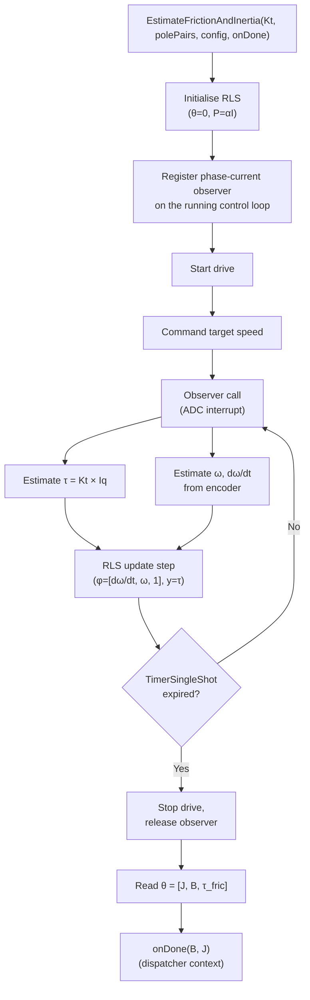
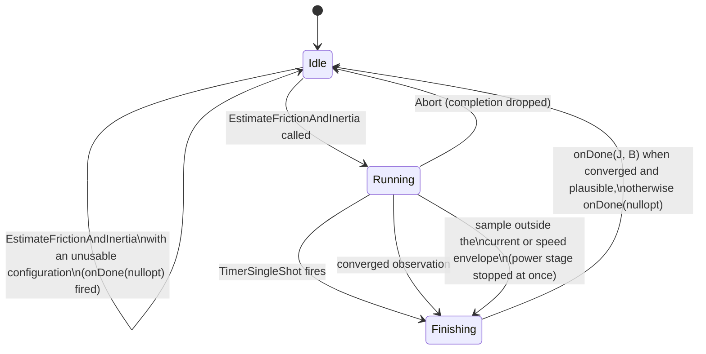

| Field     | Value                                         |
|-----------|-----------------------------------------------|
| Title     | Service: Mechanical Parameters Identification |
| Type      | design                                        |
| Status    | draft                                         |
| Version   | 0.2.0                                         |
| Component | service-mechanical-ident                      |
| Date      | 2026-09-21                                    |

> **IMPORTANT — Implementation-blind document**: This document describes *behavior, structure, and
> responsibilities* WITHOUT referencing code. **No code blocks using programming languages (C++, C,
> Python, CMake, shell, etc.) are allowed.** Use Mermaid diagrams to express behavior instead.
> Prose descriptions of algorithms are encouraged; source-level details are not.
>
> **Diagrams**: All visuals must be either a Mermaid fenced code block (` ```mermaid `) or ASCII art inline
> in the document. External image references using Markdown image syntax are **not allowed**.

---

## Responsibilities

**Is responsible for:**
- Estimating rotor moment of inertia (J) and viscous friction coefficient (B) while the motor runs in closed-loop speed control
- Starting and stopping the drive for the duration of the procedure, and driving the two-level speed trajectory that provides the excitation
- Refusing a request whose configuration does not describe a bounded trajectory, and ending a run that leaves the current or speed envelope it was given
- Reporting an estimate only when it is converged and physically plausible, and reporting absent values otherwise
- Releasing the drive and discarding the pending completion when the caller aborts, so that a fault is not overwritten by the result of the procedure it interrupted
- Computing instantaneous electromagnetic torque from the q-axis current and the caller-supplied torque constant
- Estimating angular acceleration by finite-differencing successive speed measurements obtained from the encoder
- Maintaining a real-time Recursive Least Squares (RLS) estimator that continuously refines the parameter vector [J, B, τ_friction] using each new observation
- Enforcing a configurable one-shot estimation timeout, after which the latest RLS estimates are reported and the procedure stops
- Delivering results through a single completion notification that reports friction and inertia using explicit physical units

**Is NOT responsible for:**
- Configuring the speed control loop — the loop's tunings and algorithm selection are established before the procedure begins, and the caller is responsible for the electrical model and provisional mechanics that make those loops able to move the rotor at all (see the State Machine design document)
- Persisting the returned parameters — the caller decides what to do with them
- Auto-tuning the speed controller — this service provides the plant parameters that a separate tuning step may consume
- Measuring electrical parameters (R, L, pole pairs) — those are handled by the Electrical Parameters Identification service

---

## Component Details

### Prerequisites and Motor Model

The mechanical dynamics of a PMSM rotor are governed by Newton's second law for rotation:

```text
τ_motor = J · dω/dt + B · ω + τ_friction
```

where:

- **τ_motor** — electromagnetic torque produced by the motor (N·m)
- **J** — rotor moment of inertia (kg·m²)
- **B** — viscous friction coefficient (N·m·s/rad)
- **τ_friction** — Coulomb (constant) friction term (N·m)
- **ω** — rotor angular velocity (rad/s)
- **dω/dt** — rotor angular acceleration (rad/s²)

This is a linear model in the three unknowns [J, B, τ_friction]. The RLS estimator treats each measurement instant as one observation of this linear equation.

### Torque Estimation

At each sampling callback, the instantaneous electromagnetic torque is estimated from the q-axis current:

```text
τ_motor = Kt × Iq
```

where `Kt` is the torque constant (N·m/A) provided by the caller. The q-axis current `Iq` is the measured value the control loop is already sampling — the same current feedback path used by the FOC current controller.

The d-axis contribution to torque is zero for surface PMSM under the Id = 0 operating condition assumed during identification. For interior PMSM with reluctance torque, this approximation introduces a small systematic error in the torque estimate; the caller should account for this if Ld ≠ Lq.

### Speed and Acceleration Estimation

Speed and acceleration come from differences of encoder positions, and an encoder gives positions in counts. For a
count of $q$ radians, a window of $T_w$ seconds quantises the speed at $q/T_w$ and the acceleration at $q/T_w^2$. A
1000-line encoder (4000 counts per revolution, $q$ = 1.6 mrad) read at 20 kHz moves in steps of about 31 rad/s, and its
second difference is quantised at over 600 000 rad/s². The acceleration is the harder quantity, because its
quantisation falls with the _square_ of the window.

The procedure therefore sizes its **observation window** from the encoder it is given. It tracks the smallest non-zero
position step it sees, which is one count, and once it has seen enough steps it chooses the window that holds the
acceleration quantum at a fixed target (100 rad/s²):

```text
T_w = sqrt( q / 100 )          q = smallest non-zero position step, in radians
```

A continuous encoder with noise has no count: every position step is nonzero, and the smallest of them keeps shrinking
as more are seen, which would collapse the window to one sample. The procedure therefore also tracks the second
difference of the position, which motion barely changes at 20 kHz and noise dominates. For white noise of standard
deviation $\sigma$ the second difference has an RMS of $\sqrt{6}\,\sigma$, and a quantiser of step $q$ has the same noise
power at $\sigma = q/\sqrt{12}$, so $\sqrt{2}$ times that RMS is the step the encoder is equivalent to. The window is sized
from the larger of the smallest step and this equivalent step, so a noisy encoder gets a window as long as a coarse one
of the same noise. A clean quantised encoder measures an equivalent step of about 1.1 counts, and at most $\sqrt{2}$ counts
for a perfectly alternating pattern, which moves the window by under 20 %. A new window is adopted only when it differs
from the current one by more than about 6 % (any change below 16 samples), because an estimate that drifts by one sample
would otherwise restart the pairing of windows, and so discard the data, on nearly every window.

A clean encoder (a simulated plant, or a very fine one) has a tiny step and so a single-sample window, which is the
sample itself. A 4000-count encoder gets about 4 ms and a 1000-count one about 8 ms. The window is limited to 256 samples, which an encoder of fewer than about 400 counts reaches. Until enough steps have been seen the window is one sample and no
speed limit is applied to it, because a quantised single-sample speed is not a speed; the current limit is checked
on every sample throughout.

Each window yields one observation. The speed is taken between the **mean positions** of consecutive windows, not
between their end samples:

```text
θ̄_w = mean of the positions sampled in window w     wrap-around compensated
ω_w = (θ̄_w − θ̄_{w−1}) / T_w
α_w = (ω_w − ω_{w−1}) / T_w
```

An end sample carries the whole quantisation error of one reading, and the second difference of three of them puts
noise of about $q/(\sqrt{2}\,T_w^2)$ on the acceleration: about 70 rad/s² on every window, given the window chosen above.
Least squares does not average noise in a regressor away; it biases the coefficient toward zero by the ratio of the
noise power to the regressor's. The acceleration of the two-level trajectory is concentrated in the few windows after
each step, so that ratio was a few percent. The bench plant read its inertia about 1 % low at 4000 counts, and 1.4 % to
4.4 % low at 1000 counts, varying from run to run with the speeds the windows happened to sample. A continuous encoder
read within 0.15 %. When the rotor crosses tens of counts in a window, the quantisation error of the window's mean
changes little from one window to the next, so with window means the bias falls to about 0.1 % at both encoder sizes.

The encoder is read at every sample, because the electrical angle that turns the phase currents into the q-axis
current needs it, and the q-axis current is accumulated over the window the way the position is. The second difference
of three window means is the true acceleration weighted by a quadratic kernel over the three windows. With $u$ the
position of a sample within its window, the kernel rises as $u^2/2$ over the first window, is $1/2 + u(1-u)$ over the
second, and falls as $(1-u)^2/2$ over the third. The torque it is regressed on must be weighted by the same kernel,
sample by sample. A plain mean of window torques agrees with it on a ramp and differs wherever the torque bends: at a
window of eighty samples that made the inertia read about a tenth low even on a continuous encoder. A simulation of the
estimator alone gave 0.87 of the true value, and 0.99 once the torque was weighted by the acceleration's kernel. For
windows longer than a sample the regressors are therefore centred on one instant: the acceleration from three window
means, the mean of the two speeds between them, and the kernel-weighted torque all belong to the middle of the middle
window. A change of window length starts the run of three windows again.

An estimator fed long window means makes far fewer updates per second than one fed samples, so its covariance trace falls
too slowly in time to reach its bound within a run: on a 4000-count encoder (an 80-sample window) it was still just above
the bound when the five-second timeout ended. For windows longer than 16 samples the bound is therefore scaled by the window
over 16; shorter windows keep the bound unchanged. The count of accelerating observations the run must reach (see
Persistence of Excitation) is scaled the same way, so a long window needs proportionally fewer of them. This did not
matter while speeds came from end samples, because quantisation noise alone lifted most plateau windows past the
20 rad/s² floor and counted them as accelerating. With window means the plateaus read under 2 rad/s² and only the
windows after a step count, so an unscaled count kept a 1000-count run going for over five seconds. The forgetting factor itself is not rescaled with the window: doing so
shortened the memory so far that the viscous friction, which is resolved only from the difference between the two speed
levels, was estimated from one level and came out 20 to 30 % high in simulation.

A run may not converge before it has crossed both speed levels, so it lasts at least two dwell periods.

Convergence additionally requires the inertia to have **settled**: it is compared with itself one estimator memory earlier
(the memory being $1/(1-\lambda)$ samples, that is that many divided by the window in updates) and must have moved by less than 10 %. A single innovation under its bound
can be luck, and the covariance trace is dominated by the Coulomb term, so neither shows that the inertia is known; without
this check a hardware run occasionally converged on a value ten times too low. The settling check is not enough on its own
on a rotor with no load, so the calibration also asks for two runs that agree
(see [state-machine.md](state-machine.md#confirming-the-estimate-by-agreement)).

The current envelope is checked on every sample, because an over-current must stop the power stage at once; the speed
envelope is checked once per window, on the windowed speed. Wrap-around compensation shifts the raw position
difference into (−π, +π], so a window must move the rotor by less than half a turn, which is a speed far above any
envelope this procedure accepts.

### Excitation Trajectory

A single constant speed setpoint is not an excitation. Once the loop has settled on it the regressor reads
`[1, 0, ω]` with ω constant: the acceleration column is zero, so J is not identified at all, and the
intercept and speed columns are collinear, so B cannot be separated from the Coulomb term. Every sample
then adds information in no direction while the forgetting factor keeps inflating the covariance.

The procedure therefore drives a two-level trajectory. It starts at the lower dwell speed, so the first
step out of standstill is the smaller one (the speed loop still runs on provisional gains, and a light rotor
overshoots a large step past the speed limit), then alternates between the target speed and the dwell speed
every dwell period until the run ends. Level changes are not stepped: the commanded speed moves toward the next level
at a bounded slew rate (5000 rad/s² by default), because the speed loop still runs on provisional gains and a
step out of standstill makes it request a current spike that a small supply cannot deliver. Each transition is
a commanded acceleration, and the rotor spends the whole run above the minimum speed the update gate
requires, so both the inertia and the friction directions are excited repeatedly.

```text
speed
  ω_target        ┌─────┐     ┌─────┐
                  │     │     │     │
  ω_dwell   ──────┘     └─────┘     └───  …
            |<-T->|<-T->|<-T->|<-T->|
```

### Bounded Envelope

The trajectory is given explicit limits and the run stays inside them:

| Limit    | Meaning                                                                                                                                                                                                  |
|----------|----------------------------------------------------------------------------------------------------------------------------------------------------------------------------------------------------------|
| current  | The largest phase-current magnitude the run may produce, clamped to twice what the inverter supports: the measured phase current carries overshoot and ripple above the command the loops are limited to |
| speed    | The largest rotor speed the run may reach, measured rather than commanded                                                                                                                                |
| duration | The timeout after which the run ends whether or not it has converged                                                                                                                                     |

On the first sample whose phase current exceeds the current envelope in any phase and in either
direction, or whose measured speed exceeds the speed limit, the run ends and reports absent values.

The power stage is stopped **in the interrupt that observed the sample**, not with the rest of the
teardown. Deferring it would leave the inverter driving an out-of-envelope current for as long as the
dispatcher takes to run, which is the one thing the envelope exists to prevent; stopping the inverter
touches no callback slot, so it is safe from the interrupt, whereas releasing the observer there would
destroy the closure being executed. Releasing the observer, stopping the drive through the controller and
delivering the completion therefore stay deferred, as they are for every other way a run ends.

The envelope is evaluated on **every** sample for as long as the drive is live — including samples that
arrive after a converged one has queued its completion but before the dispatcher has run. A run is only
over once the drive has been released, so a sample that leaves the envelope in that window still
invalidates the estimate rather than letting a converged value through.

A configuration that does not describe a usable bounded trajectory — a dwell speed that is not below the
target speed, a non-positive envelope, a speed limit that is not finite and positive or that sits below
the target, a timeout that does not outlast one dwell period, a forgetting factor outside (0, 1] — is
refused through the completion rather than started, as is a request without a positive torque constant or
pole-pair count. The speed limit in particular must be finite: an infinite bound passes every comparison
against the target speed while making the run-time check unreachable, which is a bounded trajectory in
name only.

### Recursive Least Squares Estimator

The RLS estimator maintains a 3×1 parameter vector θ = [J, B, τ_friction]ᵀ and a 3×3 covariance matrix P. At each observation k, a 1×3 regressor row vector is formed:

```text
φ_k = [ dω/dt_k,  ω_k,  1 ]
```

and the scalar observation is:

```text
y_k = τ_motor_k
```

The prediction error is:

```text
e_k = y_k − φ_k · θ_{k−1}
```

The Kalman gain vector is:

```text
K_k = P_{k−1} · φ_kᵀ · (λ + φ_k · P_{k−1} · φ_kᵀ)⁻¹
```

The parameter and covariance updates are:

```text
θ_k = θ_{k−1} + K_k · e_k
P_k = (P_{k−1} − K_k · φ_k · P_{k−1}) / λ
```

The scalar λ (0 < λ <= 1) is the **forgetting factor** (default 0.9995). Values less than 1 cause older observations to carry exponentially decreasing weight, which is important for tracking slowly time-varying loads. At λ = 1 the estimator is an ordinary batch least squares — it never forgets.

The RLS state (θ and P) is held in a statically allocated object (`std::optional<MotorRLS>`) that is emplaced in-place at the start of each procedure invocation and destroyed when the procedure ends. This avoids heap allocation while still permitting the state to be absent between procedures.



### Timeout and Result Delivery

A `TimerSingleShot` starts when the procedure begins. When it fires, the current RLS parameter vector is read and the results are extracted:

- **J** (inertia) is the first element of θ; reported as `NewtonMeterSecondSquared`.
- **B** (viscous friction) is the second element of θ; reported as `NewtonMeterSecondPerRadian`.
- **τ_friction** (Coulomb friction) is the third element of θ; it is observed internally but is not part of the output interface for this version.

### Acceptance Policy

The procedure and the online estimator described below share one acceptance policy, so a value one of
them refuses is refused by the other:

| Gate              | Rule                                                                                                                                                        |
|-------------------|-------------------------------------------------------------------------------------------------------------------------------------------------------------|
| excitation        | An observation updates the estimator only when the rotor is both moving and accelerating: speed magnitude and acceleration magnitude are each above a floor |
| informed estimate | At least a minimum number of such observations must have been taken since the estimator was started or seeded                                               |
| convergence       | The innovation must be below a fixed bound and the covariance trace below a bound scaled to the forgetting factor                                           |
| plausibility      | J must be finite, strictly positive and below an upper bound; B must be finite, non-negative and below an upper bound                                       |

The covariance bound is expressed relative to the forgetting factor because an RLS that forgets cannot
drive its covariance below a floor proportional to (1 − λ). A single absolute bound would be structurally
unreachable for a tracking estimator with a short memory and trivially met by one that never forgets.

The one-shot procedure runs with a forgetting factor close to unity: the plant does not drift within a
five-second run, and a shorter memory would hold the steady-state covariance above the bound the run has
to reach.

A run that reaches its timeout without satisfying every gate, or whose final parameter vector falls
outside the plausibility band, reports both outputs as absent. The caller treats that as a failed
calibration step.

### State Machine



Only one estimation may be in progress at a time. A call to `EstimateFrictionAndInertia` while already Running is rejected immediately (callback invoked with absent values).

---

## Interfaces

### Provided

| Interface                                                               | Purpose                                                                                | Contract                                                                                                                                                  |
|-------------------------------------------------------------------------|----------------------------------------------------------------------------------------|-----------------------------------------------------------------------------------------------------------------------------------------------------------|
| `EstimateFrictionAndInertia(torqueConstant, polePairs, config, onDone)` | Runs the RLS estimator under active speed control along a bounded two-level trajectory | Delivers `(optional<NewtonMeterSecondPerRadian>, optional<NewtonMeterSecondSquared>)` exactly once; absent unless the estimate is converged and plausible |

A request is rejected through its own completion, with both values absent, when a run is already in
flight, when the configuration does not describe a usable bounded trajectory, or when the torque constant
or pole-pair count is not positive.

### Required

| Interface            | Purpose                                                                                 | Contract                                                                                                                                                                       |
|----------------------|-----------------------------------------------------------------------------------------|--------------------------------------------------------------------------------------------------------------------------------------------------------------------------------|
| `FocSpeed`           | Commands the two speed setpoints that excite the mechanical dynamics                    | Must already be active and in control of the motor before the procedure begins, with an electrical model and mechanics applied so its gains and current envelope are not inert |
| `ThreePhaseInverter` | Source of ADC current callbacks that supply the Iq measurement on each computation step | Must not be stopped during the estimation procedure                                                                                                                            |
| `Encoder`            | Supplies mechanical angle samples for speed and acceleration estimation                 | Must be tracking position at the configured sampling rate                                                                                                                      |

---

## Online Inertia and Friction Estimation

In addition to the one-shot timed procedure above, a continuous online estimator (`RealTimeFrictionAndInertiaEstimator`) runs alongside the closed-loop speed controller to track slow mechanical parameter drift.

### Model

The mechanical equation of motion for the motor shaft is:

$$T_e = J \cdot \dot{\omega} + B \cdot \omega + c_\pm, \qquad c_\pm = \tau_L \pm \tau_c$$

The electromagnetic torque is approximated as $T_e = I_q \cdot k_t$, where $k_t = \tfrac{3}{2} p \psi_f$ is derived from the calibration record's pole pairs and flux linkage. Angular acceleration $\dot{\omega}$ and speed $\omega$ come from the window-mean positions of three consecutive observation windows (see Window Kinematics below).

The intercept is whatever torque does not scale with the motion: a shaft load $\tau_L$ that keeps its sign, plus a dry friction $\tau_c$ that turns with the rotor. Their sum differs by $2\tau_c$ between the two directions of rotation, and nothing in one direction's data says how it splits. The estimator therefore keeps **one fit per direction**. Each carries the regressor $\phi = [1,\ \dot{\omega},\ \omega]^T$ and the parameters $\theta = [c_\pm,\ J,\ B]^T$, with the scalar output $T_e$, and an RLS with a forgetting factor of 0.9995 updates the fit of the direction an observation moves in, once per observation window. Each fit has its own covariance, excitation count, residual and settled state, and whichever fit settles publishes $J$ and $B$.

One fit for both directions used to read a reversal wrongly. Its intercept could not follow the step of $2\tau_c$, so the fit put it on the viscous column, whose speed reverses too: the speed sweep on the rig, 30, 60, −30 and 0 rad/s, read the viscous friction 70 to 100 µN·m·s against the calibration's 9 to 11, and the plant with the rig's 3.7 mN·m of dry friction read it 94 against 5. A dry friction modelled as $\tau_c\,\mathrm{sgn}(\omega)$ instead fixed that but read a constant shaft torque that turned the rotor backwards wrongly instead, 3 to 5 times the plant's friction. Two fits read both.

An observation whose speed is smaller than its acceleration times one observation window may cross zero inside the window, where it belongs to neither direction. It is refused.

A fit that only ever sees one speed cannot tell its intercept from its viscous friction, since $\omega$ is then constant. The span of speeds a publication waits for (Persistence of Excitation below) is therefore taken per fit, and from the observations at a constant speed only, those accelerating slower than 20 rad/s², so that the transients into and out of a reversal do not count as a second speed level. Reversing between +30 and −30 rad/s publishes nothing. The one-shot procedure, which runs in one direction, counts every observation as before.

### Window Kinematics

The online estimator uses the kinematics of the one-shot procedure (see Speed and Acceleration Estimation): window-mean
positions, the acceleration as their second difference, and the torque weighted by the kernel that second difference
puts on the acceleration. An earlier version took each outer-loop window's speed from the encoder reading at its two
ends. On a 4000-count encoder over 1 ms that quantises the speed at 1.6 rad/s and the acceleration at about
1600 rad/s² per count. In simulation the inertia read about 4 % low on both reference motors, and on the bench motor's
plant the residual never fell under its publication bound, so the estimate stayed on its seed.

Over every outer-loop window the control interrupt now accumulates the mean rotor position relative to the window's
start, the rotation across it, the smallest non-zero step the encoder took, and three moments of the q-axis current:
its mean and the means of $i_q u$ and $i_q u^2$, with $u$ the sample's position within the window. Those moments let
the estimator merge $M$ consecutive outer-loop windows into one observation window and still weight the current by
the kernel exactly, sample by sample. $M$ follows the one-shot rule: the window that holds the acceleration quantum
at 100 rad/s², $T_w = \sqrt{q/100}$ with $q$ the smallest step seen, rounded up to whole outer-loop periods, but never
fewer than 4 and at most 16: 4 ms on a fine or continuous encoder and on a 4000-count one, 8 ms on a 1000-count one. The
floor is there because the kernel is the continuous B-spline evaluated at each sample's centre, which differs from the
weight the window means really put on each sample by a fraction of order $1/N^2$ for $N$ samples per window. At 20
samples that is a quarter percent of the transient torque, close to the whole torque the friction adds between the two
speed levels, and in simulation the friction read 5 to 15 % low; at 80 samples it is sixteen times smaller and the
friction reads within about 2 %. A change of $M$ restarts the run of three windows, not the fit.

The update count the estimator waits for after a seed, and the count of accelerating observations it must see, are
counted in outer-loop periods, so each observation counts $M$ times. The forgetting factor and the residual averaging
stay per observation, as in the one-shot procedure: the memory then lengthens with the window rather than shortening,
which keeps the friction resolved across both speed levels.

### Torque Constant Dependency

The torque constant $k_t$ must be provided before the estimator updates begin. In normal operation the state machine derives it from the calibration NVM record as $\tfrac{3}{2} p \psi_f$ (`core/foc/math/TorqueConstant.hpp`) and supplies it via `SetTorqueConstant()` during the `EnterEnabled` transition; the one-shot procedure receives the same value.

A wrong $k_t$ scales every identified $J$ and $B$ by the same factor, which is why it is not a per-target constant. Updates run opportunistically while the FOC controller is active.

### Persistence of Excitation

At standstill the regressor degenerates to $\phi = [1,\ 0,\ 0]^T$: the constant intercept is excited but the
inertia and friction directions are not. The coefficients barely move, but the covariance $P$ is **not**
self-gating — an RLS update with a forgetting factor inflates $P$ by $\lambda^{-1}$ in every unexcited
direction on every sample, so $P$ grows as $\lambda^{-n}$. At $\lambda = 0.995$ and 20 kHz that reaches
roughly $5\times10^{21}$ after ten seconds of standstill, and the first sample of real excitation then
produces an enormous coefficient jump.

Standstill observations (below a minimum speed) are therefore skipped entirely, so the covariance is frozen
rather than inflated and the previous coefficients are reported unchanged.

A rotor held at a constant speed is a different case. It excites neither the inertia direction nor, on its
own, the friction direction separately from the intercept, but a trajectory that holds *two* speeds is
exactly what separates friction from the intercept. An earlier gate refused every sample whose
acceleration was under 1 rad/s², which removed those plateaus; the offline friction estimate stayed
accurate only because whole-percent duty ripple put a spurious acceleration on each plateau sample and let
it through. With the duty carried as a fraction the ripple vanished, the plateaus were refused, and the
friction the full calibration identified moved 19–27 % off the plant.

Both procedures now take every sample above the minimum speed, and count separately what the estimate
needs before it may be published: at least 64 samples accelerating faster than 20 rad/s² (inertia; for the one-shot
procedure 64 sixteen-sample windows' worth, see Speed and Acceleration Estimation), and
observations spanning more than a quarter of the fastest speed seen (friction apart from the intercept).
The shared `MechanicalExcitation` tracks both. The online estimator, which runs indefinitely, admits a
non-accelerating sample only while the covariance trace is under a ceiling, so a long constant-speed run
cannot inflate the inertia direction without bound; the offline run is bounded by its timeout and its
trajectory re-excites every dwell.

### Plausibility Band and Update Rate

A finiteness test alone admits values such as $10^{30}$. Before an estimate is published to `CurrentInertia()`
/ `CurrentFriction()` — and therefore before it can become PID gains — it must pass every gate of the shared
acceptance policy above: enough accelerating observations and a span of speeds since the last seed, a
settled fit, and a value inside the physical band. The offline procedure judges the fit by its innovation
and covariance; the online estimator, which runs on outer-loop window averages (see
`documentation/theory/friction-inertia-estimation.md` §4.1), by an averaged residual under a quarter of the
averaged output in RMS terms (a residual power under 1/16 of the output power), because an instantaneous
innovation of 0.1 mN·m sits under any real drive's torque ripple. The bound was a tenth until the bench motor
ran: there the residual, torque the model has no term for, settles at 14 % of the torque the 26/52 rad/s steps
excite while the inertia sits within 1 % of the calibration's, so nothing ever published. With at least
$1000/M$ observations behind a publication, a residual a quarter of the output leaves the inertia a statistical
error of about $0.25/\sqrt{1000/M}$: 1.6 % at $M = 4$, 3.2 % at $M = 16$. A publication is therefore rate-limited by construction —
no estimate reaches the accessors during the warm-up that follows a seed, and none reaches them while the
fit is still moving. An estimate that fails any gate is discarded and the last accepted pair is retained.

### Seeding and Warm Start

When calibration data is loaded (from NVM or after a fresh calibration run), the online estimator is seeded
with the calibration values $(J_{cal}, B_{cal})$. This initialises the RLS coefficient vector to $\theta =
[0,\ J_{cal},\ B_{cal}]^T$ in both fits, setting the intercepts to zero and warm-starting the inertia and
viscous-friction estimates at the identified operating point. This avoids a cold-start transient where
estimates are physically meaningless during the initial operating period.

### Forgetting Factor

The online forgetting factor $\lambda = 0.9995$ applies an exponential weight decay to past observations, enabling the estimator to track gradual mechanical changes over the motor lifetime (bearing wear increases friction; load changes affect effective inertia).

### Estimate Consumption

Estimates are not applied automatically. The operator or application explicitly triggers a speed-PID retune via `ApplyOnlineEstimates()` on the state machine. See the State Machine design document for details.
