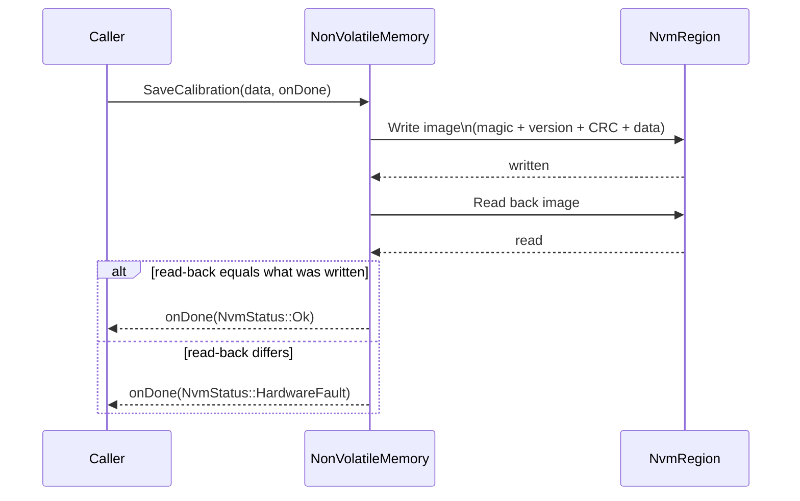
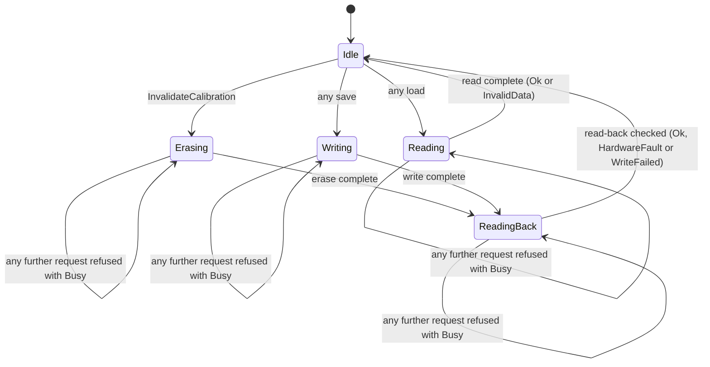

| Field     | Value                        |
|-----------|------------------------------|
| Title     | Service: Non-Volatile Memory |
| Type      | design                       |
| Status    | draft                        |
| Version   | 0.17.0                       |
| Component | service-nvm                  |
| Date      | 2026-11-08                   |

> **IMPORTANT — Implementation-blind document**: This document describes *behavior, structure, and
> responsibilities* WITHOUT referencing code. **No code blocks using programming languages (C++, C,
> Python, CMake, shell, etc.) are allowed.** Use Mermaid diagrams to express behavior instead.
> Prose descriptions of algorithms are encouraged; source-level details are not.
>
> **Diagrams**: All visuals must be either a Mermaid fenced code block (` ```mermaid `) or ASCII art inline
> in the document. External image references using Markdown image syntax are **not allowed**.

---

## Responsibilities

**Is responsible for:**
- Persisting motor calibration data (R, L, pole pairs, current offsets and noise, inertia, friction, cogging map,
  encoder index angle) and system
  configuration (CAN and start-up settings, telemetry rate, loop tunings and algorithm selections, fault-supervision
  settings, and the drive-wide limits: overspeed, following error, speed ramps, command timeout, motor current ratings,
  target window, travel limits, temperature and bus voltage) across power cycles using MCU internal EEPROM
- Persisting the fault history and the learned motor model, the inductance, inertia and friction online
  recalibration adopted (`online-recalibration.md`, Part F)
- Ensuring data integrity on every read through CRC-32 verification and on every write through read-back verification
- Rejecting a record written with another layout version as invalid, so it is never misread
- Distinguishing the calibration and configuration regions by per-region magic numbers, preventing cross-region misinterpretation of data
- Providing non-blocking, callback-based operations — no operation may block the calling context

**Is NOT responsible for:**
- Raw EEPROM hardware access — all erase, read, and write operations are delegated to injected EmIL `services::NvmRegion` instances (`services/util/NvmRegion.hpp`); on the board each is an EmIL `services::NvmEepromRegion`
- Computing the calibration or configuration values themselves — those are produced by the identification services and the application
- Providing wear-levelling or journaling — a single record per region is maintained without historical versioning

---

## Component Details

### Logical Regions

The service manages four independent EEPROM regions. Each region holds exactly one record at a time — the latest write replaces any previous record in that address range.

| Region        | Magic        | Data structure    | Data size |
|---------------|--------------|-------------------|-----------|
| Calibration   | `0xCAFEF00D` | `CalibrationData` | 100 bytes |
| Configuration | `0xDEADBEEF` | `ConfigData`      | 168 bytes |
| Fault history | `0xFA17C0DE` | fault history     | 112 bytes |
| Learned model | `0x1EA4ED0D` | learned model     | 26 bytes  |

The calibration record's layout is at version 6. Version 6 dropped four fields nothing read — the q-axis inductance
(always equal to the d-axis one), the alignment angle and the encoder direction (the rotor reference lives in RAM
and the index angle), and a current-loop bandwidth calibration only ever carried forward as 0 — and widened the
current noise to two bytes, so a noise above 255 mA is stored instead of saturating. That took the data from 112
to 100 bytes, so a record written by an earlier firmware reads as invalid and the motor has to be calibrated again.
Version 5's encoder index angle (`service-index-search.md`) had taken it from 108 to 112 bytes, as version 4's
cogging map (`service-cogging-compensation.md`) had taken it from 56 to 108. A record without an index angle
holds a NaN there; the 109-byte record fits the 128-byte calibration region.

The configuration record's layout is at version 14. The homing requirement (`foc-position.md`, Homing and the
Position Reference) took the last reserved byte, so a record written at version 13 reads as a version mismatch and
the configuration returns to its defaults; the record keeps its 168 bytes. Version 13's recalibration mode
(`online-recalibration.md`) had taken one of the two reserved bytes, and version 12's bus-voltage minimum and maximum (`fault-supervision.md`
Part L) took its data from 160 to 168 bytes, as version 11 had taken it from 152 to 160 bytes for the temperature limit
and margin (Part K), version 10 from 148 to 152 bytes for the calibration temperature and version 9 from 140 to 148 bytes for the software position
limits (`foc-position.md` Software Position Limits) and version 8 from 132 to 140 bytes for the
position window and its time (`foc-position.md` Target Reached) and version 7 from 96 to 132 bytes for the drive-wide
limits (`fault-supervision.md` Parts G and H, `foc-speed.md` Speed Ramp, `service-can.md` command timeout,
`fault-supervision.md` Part I) and version 6 from 76 to 96 bytes for the supervision
settings (`fault-supervision.md` Part D) and version 5 from 20 to 76 bytes for the operator's tuning settings
(`controller-selection.md` Part H). A record written by an earlier firmware reads as invalid once:
the start-up settings, the tuning settings, the default control mode, the algorithm selections, the supervision
settings and the limits return to their defaults and are stored again by the next change. The calibration
record is untouched by any of these bumps.

The regions use different `NvmRegion` instances (injected at construction) and can be read, written, and erased independently. An operation on one region has no effect on the others.

### Fault History Region

The fault history (`service-fault-history.md`) is stored differently from the two records above, because it is
rewritten in the field, on every fault, where a power loss during a write is to be expected. It has no CRC-32 over
the whole image: a write cut short would invalidate all of it. Each part carries its own check byte instead, so a
cut write loses only the part it was writing.

| Field      | Size    | Description                                                                                            |
|------------|---------|--------------------------------------------------------------------------------------------------------|
| Magic      | 4 bytes | `0xFA17C0DE`                                                                                           |
| Version    | 1 byte  | Layout version of the fault history, 1                                                                 |
| Power-ups  | 2 bytes | Power-up count, saturating at 32767                                                                    |
| Check byte | 1 byte  | CRC-8 of the power-up count                                                                            |
| Records    | 8 × 13  | Code, mode, power-up (2), uptime in ms (4), bus voltage and peak current in hundredths (2 each), CRC-8 |

A record whose check byte does not match, or whose code is none, is an empty slot; an empty slot is written as
all-0xFF. A wrong magic or version reads as a history to be reset: no records, power-up count 0. A write stores the
whole image without erasing it first, then reads it back and compares, as the other regions do; an unchanged part
is rewritten with the same bytes, so a power loss can damage only the record or the count that changed.

### Learned Model Region

The learned model of online recalibration (`online-recalibration.md`, Part F) is rewritten in the field, at most
once every 15 minutes of uptime, so it is stored as the fault history is: one image, written whole without an erase
and read back, with a check that a write cut short fails.

| Field            | Size    | Description                                                                                      |
|------------------|---------|--------------------------------------------------------------------------------------------------|
| Magic            | 4 bytes | `0x1EA4ED0D`                                                                                     |
| Version          | 1 byte  | Layout version of the learned model, 1                                                           |
| Commissioning    | 4 bytes | CRC-32 of the commissioned inductance, inertia and viscous friction the values were learned from |
| Inductance       | 4 bytes | mH, IEEE-754 single precision                                                                    |
| Inertia          | 4 bytes | kg·m², IEEE-754 single precision                                                                 |
| Viscous friction | 4 bytes | N·m·s/rad, IEEE-754 single precision                                                             |
| Present          | 1 byte  | Bit 0 the inductance, bit 1 the inertia, bit 2 the viscous friction                              |
| CRC              | 4 bytes | CRC-32 of the 22 bytes before it                                                                 |

A wrong magic, version or CRC reads as an empty learned model, one with no quantity present, and so does the image
a Reset Model command stores. The commissioning check is compared by online recalibration, not here: the record
does not know the calibration it belongs to.

### On-Media Record Format

Each region stores a single record consisting of a fixed-size header followed by the data payload. The header fields, in order, are:

| Field   | Size    | Description                                      |
|---------|---------|--------------------------------------------------|
| Magic   | 4 bytes | Region identifier (`0xCAFEF00D` or `0xDEADBEEF`) |
| Version | 1 byte  | Layout version constant baked into firmware      |
| CRC-32  | 4 bytes | CRC-32 of the data bytes only (header excluded)  |
| Data    | N bytes | Serialised `CalibrationData` or `ConfigData`     |

This layout ensures that a calibration record stored in EEPROM cannot be silently misinterpreted as a configuration record (and vice versa) because any cross-region read will fail the magic check immediately.

The header's multi-byte fields are stored least significant byte first, and the data is the structure's own bytes,
so the CRC covers exactly the stored bytes. `CalibrationData` and `ConfigData` list their four-byte fields before
the smaller ones and fill the last word exactly, so neither has implicit padding whose value would be undefined;
a `static_assert` on each size holds that. A layout version is bumped whenever a field is added, resized or
reordered, so a record written by an earlier firmware reads as invalid instead of being misinterpreted. The
software-in-the-loop harness builds its NVM images with the same encoding the firmware uses, so the two cannot
drift apart.

All four regions are written the same way: the whole image is written without an erase, read back and compared.
The calibration and configuration records differ from the fault history and the learned model only in what the
image holds.

### Integrity Checks on Read

When a region is read back, the following checks are applied in order:

1. **Magic check** — the four-byte magic field must match the expected value for that region.
2. **Version check** — the version byte must match the version constant compiled into the current firmware.
3. **CRC-32 check** — a CRC-32 is computed over the data bytes and compared to the stored CRC field.

Only if all three checks pass is the data considered valid and `NvmStatus::Ok` reported; any failure is
`NvmStatus::InvalidData`. No caller treats a record of another version differently from a damaged one: either
way the calibration has to be redone, and a configuration falls back to its defaults. A configuration load
therefore reports `Ok` with the defaults when its record is invalid.

These three checks establish that the record is *intact*, not that its values are *usable*: a record whose CRC
matches can still hold a non-finite float. `FocStateMachineCommon::HasValidCalibration()` therefore applies a
plausibility gate on top, requiring the electrical fields to be finite (and the phase resistance positive)
before the restored calibration can carry the drive to `Ready`. The same gate runs on externally supplied
calibration in `CmdCompleteExternalCalibration`, so a value that arrives over CAN cannot be persisted either.
Positive infinity passes every `> 0` test, which is why finiteness is checked explicitly rather than inferred
from a range comparison.

### Write Sequence

Every write stores the whole image without an erase and reads it back; each step is driven by an asynchronous
callback from the `NvmRegion` abstraction, and no step blocks:



The read-back comparison catches EEPROM hardware faults, programming errors and marginal cells. Only
`InvalidateCalibration` erases: it erases the calibration region, reads it back, and reports `WriteFailed` if
an intact record survived the erase.

### EEPROM Address-Space Map

The two NVM regions occupy fixed, non-overlapping address ranges within the MCU EEPROM. Addresses are byte offsets from the start of the EEPROM address space.

| Region        | Base address | Size      | Content                  |
|---------------|--------------|-----------|--------------------------|
| Calibration   | 0            | 128 B     | One calibration record   |
| Configuration | 128          | 224 B     | One configuration record |
| Learned model | 352          | 32 B      | The learned model image  |
| Fault history | 384          | 128 B     | The fault history image  |
| Reserved      | 512+         | remainder | Unused; not accessed     |

The regions fit within the 2048-byte EEPROM available on the TM4C1294 target, and fill the 512-byte 24LC04 on
E-FOC-HARDWARE, which backs the NUCLEO-G474RE (that MCU has no EEPROM); the fault history therefore holds eight
records, the number its 128 bytes take. The configuration region grew
from 128 to 256 bytes when the record of layout 7 outgrew it, so it now spans both 256-byte blocks of the 24LC04;
the driver splits a write at the block boundary. The learned model took the last 32 of its 256 bytes: the
177-byte record of layout 14 fits in the 224 that remain, and no stored record moves. The NUCLEO-H563ZI and host targets use an in-memory stub of
identical layout for regression testing.

### Power-Loss Mitigation

EEPROM cells retain data indefinitely once a write word-program cycle completes. The write sequence (write record → read-back verify) is designed so that power loss at any point leaves the system in a known state:

- **Power loss during an invalidation's erase**: The region holds erased bytes or a part of the old record. On next read, the magic or the CRC-32 check fails and `NvmStatus::InvalidData` is returned — the application must re-run identification or use factory defaults.
- **Power loss during write**: The partially-written record will fail either the magic check or the CRC-32 check on next read. The same `InvalidData` result is returned; no silent corruption is possible.
- **Power loss during read-back**: The write has already completed. On next power-on, the record will re-read correctly. The application may retry the write if the previous session reported `WriteFailed`.

No journaling or wear-levelling is implemented. Each write operation overwrites the same address range, which is sufficient for infrequent commissioning writes. If frequent writes are required, a wear-levelling strategy must be added at the `NvmRegion` layer.

### Buffer Management — No Heap

Each region is held in an EmIL `services::NvmImage<Size>` (`services/util/NvmImage.hpp`), which owns two statically allocated byte arrays:

- **Write buffer** — sized to hold one complete image; populated before the `NvmRegion::Write` call.
- **Read-back buffer** — same size; populated by the `NvmRegion::Read` call, compared after a write and decoded after a load. `NvmImage` reports the comparison as `bool verified`; the service maps `false` to `NvmStatus::HardwareFault`.

Both buffers are `std::array<uint8_t, recordSize>` members of the service object. They are reused across invocations. No heap is used at any point.

### Concurrency — One Operation At A Time, Device-Wide

Both logical regions are backed by a single EEPROM device, and that device driver serialises access:
it accepts exactly one erase, program, or read at a time and treats a second concurrent request as a
programming error. Admission control is therefore **device-wide, not per region**: while any
operation is in flight, every entry point — calibration save, load and invalidate, configuration save and
load, and the fault-history and learned-model loads and saves — is refused. No refused request ever reaches
a region.

A refused request never silently disappears. Its callback is invoked immediately with `Busy`. Callers
that arm a pending-command callback before issuing a request therefore always see it complete, and
cannot be wedged by a dropped notification.

Refusal is decided before any internal state is touched, so a caller that issues a further request
from inside a synchronously delivered `Busy` callback can only be refused in turn — re-entry cannot
corrupt an in-flight operation. Admission is released just before the completion callback of the
in-flight operation runs, so a follow-up request issued from that callback is accepted normally.

Callers are expected to treat `Busy` as "nothing was written": any in-memory state speculatively
updated in anticipation of a successful write must be rolled back, and the originating command
rejected cleanly rather than escalated to a fault.

### State Machine (Device-Wide)



### Error Codes

| Status            | Meaning                                                                      |
|-------------------|------------------------------------------------------------------------------|
| `Ok`              | Operation completed successfully                                             |
| `InvalidData`     | Magic, version or CRC-32 mismatch on read                                    |
| `WriteFailed`     | An intact calibration record survived an invalidation's erase                |
| `HardwareFault`   | The read-back after a write differs from what was written                    |
| `Busy`            | Another operation is in flight; nothing was read or written                  |

### Calibration and Configuration Data Fields

**CalibrationData** (100 bytes total, layout version 6):

| Field                | Physical unit | Description                                                      |
|----------------------|---------------|------------------------------------------------------------------|
| rPhase               | Ω             | Measured phase resistance                                        |
| lD                   | mH            | Measured phase inductance, used for both axes                    |
| fluxLinkage          | Wb            | Rotor flux linkage, identified from the back-EMF                 |
| currentOffsetA/B/C   | A             | Zero-current reading of each phase current sensor                |
| inertia              | kg·m²         | Estimated rotor inertia                                          |
| frictionCoulomb      | N·m           | Dry friction from the cogging step; 0 = no feed-forward          |
| frictionViscous      | N·m·s/rad     | Viscous friction coefficient                                     |
| speedLoopBandwidth   | rad/s         | Not measured: mechanical identification writes a fixed 100 rad/s |
| coggingTorqueScale   | N·m per count | Scale of the cogging map entries                                 |
| encoderIndexAngle    | rad           | Encoder reading at the index in the aligned frame; NaN when none |
| polePairs            | —             | Number of motor pole pairs                                       |
| stage                | —             | Whether the calibration completed                                |
| currentNoise         | mA            | RMS current-sensor noise, two bytes; 0 when not measured         |
| coggingTorque        | counts        | Cogging torque over one electrical period, 48 bins               |

The four-byte fields come first, then the current noise, the pole pairs and the stage, which fill one word,
then the cogging map.

**ConfigData** (168 bytes total):

| Field                  | Physical unit                   | Description                                                                                                    |
|------------------------|---------------------------------|----------------------------------------------------------------------------------------------------------------|
| canNodeId              | —                               | Base CAN node ID; board ID added at boot                                                                       |
| canBaudrate            | bit/s                           | CAN bus baud rate                                                                                              |
| telemetryRateHz        | Hz                              | Rate of the current stream (`service-can.md` Part J): 0 stops it, 1–1000 Hz; default 100                       |
| encoderResolution      | —                               | Encoder counts per mechanical revolution                                                                       |
| currentLoop            | rad/s, A, —                     | Bandwidth (0 = automatic), switching gain, boundary layer                                                      |
| speedLoop              | rad/s, —, s                     | Bandwidth (0 = automatic), speed error and integral weights, observer bandwidth ratio, reference time constant |
| positionLoop           | rad/s, —, s                     | Bandwidth (0 = automatic), position error, speed error and integral weights, reference time constant           |
| supervision            | s, —, rad/s, rad, rad           | Still window, current fraction, demanded speed, position error and still excursion of the fault supervisor     |
| limits                 | rad/s, rad, s, rad/s², A, °C, V | Drive limits; ranges and defaults below the table                                                              |
| defaultControlMode     | —                               | Control mode selected on power-up                                                                              |
| currentAlgorithm       | —                               | Current-loop algorithm selected on power-up                                                                    |
| speedAlgorithm         | —                               | Speed-loop algorithm selected on power-up                                                                      |
| positionAlgorithm      | —                               | Position-loop algorithm selected on power-up                                                                   |
| currentTwoStepDeadbeat | —                               | Two-step variant of the deadbeat current law                                                                   |
| stallDetection         | —                               | Whether the fault supervisor raises a stall (1, the default) or not (0)                                        |
| recalibrationMode      | —                               | Online recalibration: 0 off (the default), 1 on command, 2 automatic (`online-recalibration.md`)               |
| homingRequired         | —                               | Whether position mode starts only once the drive is homed: 0 no (the default), 1 yes (`foc-position.md`)       |

The limits are the overspeed limit (`fault-supervision.md` Part G), 1–5000 rad/s, default 1000; the
following-error window, 0–3.2 rad, 0 (off) by default, and time, 0.001–10 s, default 0.1 (Part H); the speed
acceleration and deceleration, 0–100 000 rad/s², 0 (no limit) by default (`foc-speed.md`); the command timeout,
0–60 s, 0 (off) by default (`service-can.md` Part F); and the continuous and peak current, 0–100 A, 0 by default
(off, and the board limit), with the peak time, 0.1–60 s, default 1 (`fault-supervision.md` Part I); and the
position window, 0–3.2 rad, default 6.28 mrad (four counts of the default 4000-count encoder), with its time,
0–10 s, default 0.02 (`foc-position.md` Target Reached); and the position minimum and maximum, −3.2–3.2 rad,
both 0 (off) by default (`foc-position.md` Software Position Limits); the calibration temperature,
−40–100 °C, default 25; and the temperature limit, 40–200 °C, default 120, with its margin, 1–50 K, default 15
(`fault-supervision.md` Part K); and the bus-voltage minimum and maximum, 0–100 V, both 0 (off) by default
(`fault-supervision.md` Part L).

The tuning fields hold the operator's values as entered; a bandwidth of 0 asks the firmware to derive it.
They are range-checked when they are written and again at boot, where a value outside its range — possible
only if a later firmware narrows a range without bumping the layout — is replaced by its default. The four-byte fields precede the byte-sized ones and a
reserved byte completes the last word, so the record has no implicit padding. The supervision fields and the
limits are checked the same way, one field at a time, against the command limits the wire contract also uses.

The four selection fields are stored as raw byte identifiers. A record can pass the integrity check
and still hold a byte outside the valid range for its selection, so each value is range-checked
against its algorithm set before it is applied on power-up. A value outside the range, or a selection
the current motor parameters do not support, leaves the loop on its built-in default and the stored
byte is corrected to match what is actually running.

---

## Interfaces

### Provided

| Interface                           | Purpose                                                                       | Contract                                                                                                              |
|-------------------------------------|-------------------------------------------------------------------------------|-----------------------------------------------------------------------------------------------------------------------|
| `SaveCalibration(data, onDone)`     | Writes the calibration record and verifies the read-back                      | `onDone(NvmStatus)` fires exactly once; `Busy` if the device is occupied                                              |
| `LoadCalibration(data, onDone)`     | Reads and integrity-checks the calibration record                             | `onDone(NvmStatus)` fires exactly once; `InvalidData` with an empty record when the stored one is not intact          |
| `InvalidateCalibration(onDone)`     | Erases the calibration region without writing a new record                    | A later load reports `InvalidData`; `onDone(NvmStatus)` fires exactly once                                            |
| `SaveConfig(data, onDone)`          | Same write+verify sequence for the configuration region                       | `onDone(NvmStatus)` fires exactly once; `Busy` if the device is occupied                                              |
| `LoadConfig(data, onDone)`          | Reads and integrity-checks the configuration record                           | `onDone(NvmStatus)` fires exactly once; `Ok` with the defaults when the stored record is not intact                   |
| `LoadFaultHistory(onDone)`          | Reads the fault history image and checks each part                            | `onDone(NvmStatus)` fires once; `InvalidData` for a wrong magic or version, with an empty history                     |
| `SaveFaultHistory(history, onDone)` | Writes the fault history image and verifies the read-back                     | `onDone(NvmStatus)` fires exactly once; `Busy` if the device is occupied                                              |
| `LoadLearnedModel(model, onDone)`   | Reads the learned-model image and checks it                                   | `onDone(NvmStatus)` fires once; `InvalidData` for a wrong magic, version or CRC, with an empty model                  |
| `SaveLearnedModel(model, onDone)`   | Writes the learned-model image and verifies the read-back                     | `onDone(NvmStatus)` fires exactly once; `Busy` if the device is occupied                                              |

### Required

| Interface                            | Purpose                                                                 | Contract                                                                                   |
|--------------------------------------|-------------------------------------------------------------------------|--------------------------------------------------------------------------------------------|
| `NvmRegion` (calibration instance)   | Abstracts raw EEPROM write and read for the calibration address range   | Must be backed by a dedicated EEPROM address range; must not be shared with any other user |
| `NvmRegion` (configuration instance) | Abstracts raw EEPROM write and read for the configuration address range | Must be backed by a dedicated EEPROM address range separate from the calibration range     |
| `NvmRegion` (fault history instance) | Abstracts raw EEPROM write and read for the fault history address range | A dedicated address range of at least the image's 112 bytes                                |
| `NvmRegion` (learned model instance) | Abstracts raw EEPROM write and read for the learned model address range | A dedicated address range of at least the image's 26 bytes                                 |
