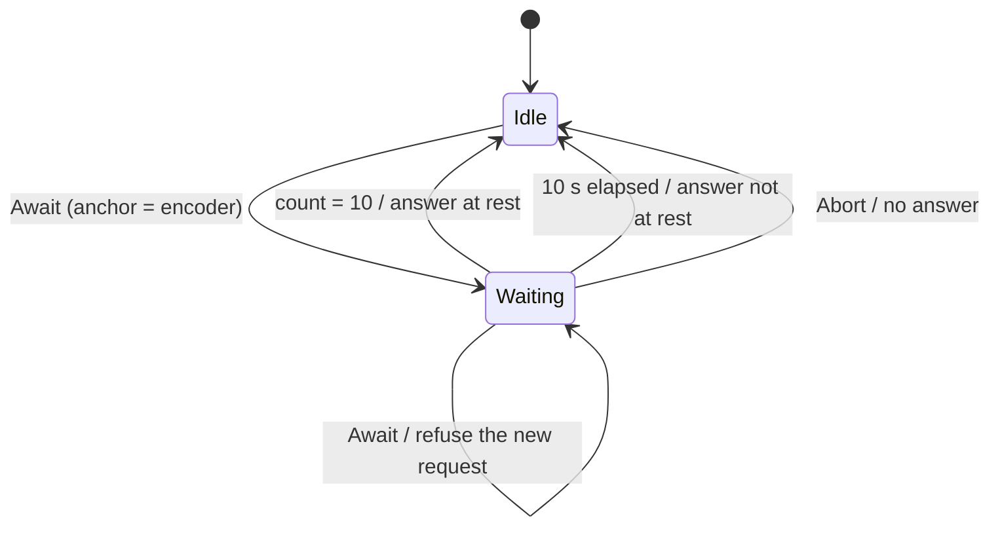
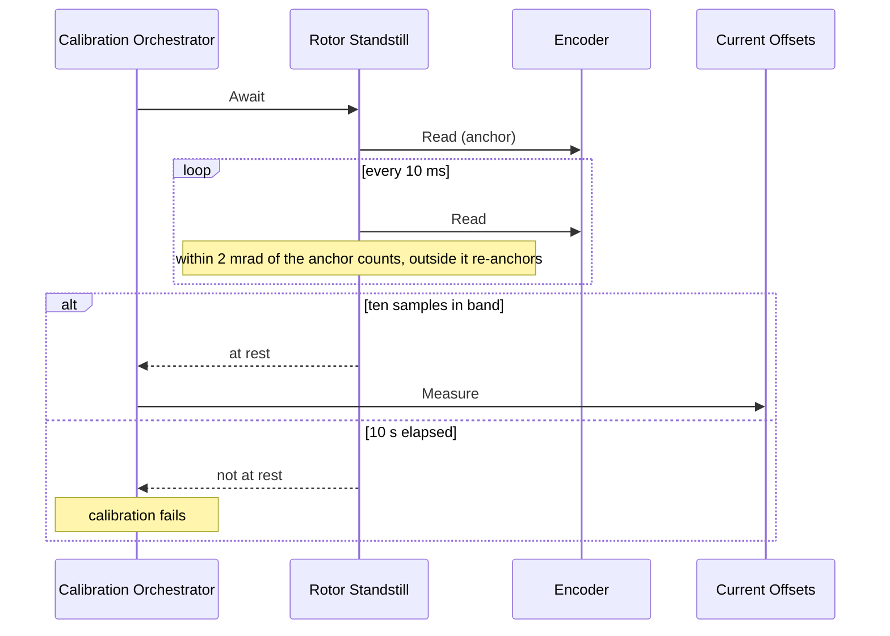

| Field     | Value                     |
|-----------|---------------------------|
| Title     | Service: Rotor Standstill |
| Type      | design                    |
| Status    | draft                     |
| Version   | 0.1.0                     |
| Component | service-standstill        |
| Date      | 2026-10-27                |

> **IMPORTANT — Implementation-blind document**: This document describes *behavior, structure, and
> responsibilities* WITHOUT referencing code. **No code blocks using programming languages (C++, C,
> Python, CMake, shell, etc.) are allowed.** Use Mermaid diagrams to express behavior instead.
> Prose descriptions of algorithms are encouraged; source-level details are not.
>
> **Diagrams**: All visuals must be Mermaid (` ```mermaid `), TikZ via ` ```{=latex} ` raw blocks (source in
> `documentation/tikz/`), or ASCII art. External image references (``) are **not allowed**.

---

## Responsibilities

The full calibration starts by measuring the current sensors' offsets with all three legs at 50 % duty
(`service-current-offsets.md`). That shorts the windings, so a rotor still turning from an earlier run
drives its back-EMF current through the sensors, and the offset step would store that current as sensor
bias. In simulation, a calibration started 25 ms after disabling the bench motor at 500 rpm stored
offsets 5 to 15 mA off in five runs out of five (`state-machine.md`, Calibration Sequence). This
service holds the calibration back until the rotor is at rest (REQ-CAL-020).

**Is responsible for:**
- Reporting, once, whether the encoder came to rest within the allotted time
- Refusing a second request while one is outstanding, without disturbing the first
- Cancelling an outstanding request without reporting it

**Is NOT responsible for:**
- Stopping the rotor: the drive is disabled when calibration starts, and the rotor coasts or is held
  by its load
- Failing the calibration, tracing the outcome, or deciding which step comes next — the calibration
  orchestrator does that with the answer

---

## Component Details

### Part A — The rest criterion

The service samples the encoder every 10 ms. The first sample of a request anchors a window. Each
later sample that lies within 2 mrad of the anchor, measured with angle wrap-around, extends the
window; a sample outside that band moves the anchor to where the rotor now is and starts the window
again. Ten samples in a row inside the band, 100 ms, mean the rotor is at rest. That bounds its speed
to 0.02 rad/s.

The band is measured from where the window began rather than from one sample to the next. A rotor
creeping by less than 2 mrad every 10 ms would pass a sample-to-sample test forever while turning
at up to 0.2 rad/s; against a fixed anchor it leaves the band within a few samples and the window
restarts. Encoder jitter inside the band, by contrast, never restarts it, and a rotor resting on the
0 / 2π boundary is at rest like any other.

A rotor already at rest therefore costs the calibration the 100 ms window and nothing else.

### Part B — Timeout

A rotor that has not been at rest for a whole window 10 s after the request is reported as not at
rest, and the calibration fails with `[SM] The rotor did not come to rest`. A spinning flywheel or a
rotor driven by its load would otherwise hold the calibration indefinitely.

### Part C — Lifetime of a request

A request ends exactly once: at rest, at the timeout, or cancelled. Both timers stop when it ends.
A cancelled request reports nothing; the orchestrator cancels it when the calibration is aborted, for
example by an emergency stop. A request made while another is outstanding is answered "not at rest"
at once and leaves the outstanding one running, so a duplicate request cannot restart or hide it.
After a request ends the service accepts a new one.

---

## Interfaces

### Provided

| Interface     | Purpose                                                       | Contract                                                                       |
|---------------|---------------------------------------------------------------|--------------------------------------------------------------------------------|
| Await at rest | Asks whether the rotor comes to rest; answered asynchronously | Answered once, on the event dispatcher; a second concurrent request is refused |
| Abort         | Cancels the outstanding request                               | No answer follows; a later request starts from a fresh window                  |

### Required

| Interface | Purpose                               | Contract                                   |
|-----------|---------------------------------------|--------------------------------------------|
| Encoder   | Mechanical angle of the rotor         | Readable from the event dispatcher context |
| Timers    | The 10 ms sampling and the 10 s limit | Event-dispatcher timers; no interrupt work |

---

## State Machine



---

## Sequence Diagrams



---

## Constraints & Limitations

| Constraint   | Value / Description                                                                                                     |
|--------------|-------------------------------------------------------------------------------------------------------------------------|
| Band         | 2 mrad about the window's anchor                                                                                        |
| Window       | 10 samples at 10 ms, 100 ms                                                                                             |
| Timeout      | 10 s from the request                                                                                                   |
| Speed bound  | 0.02 rad/s at rest                                                                                                      |
| Encoder      | A coarse encoder reads a slow creep as rest until it moves a count; the band is below one count of a 2000-count encoder |
| Verification | REQ-CAL-020: offsets within 5 mA of the plant's biases when calibration starts 25 ms after disabling at 52 rad/s        |
