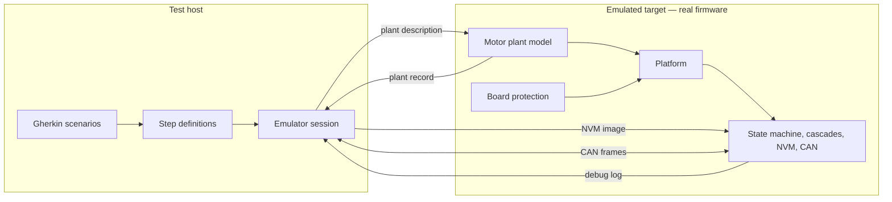
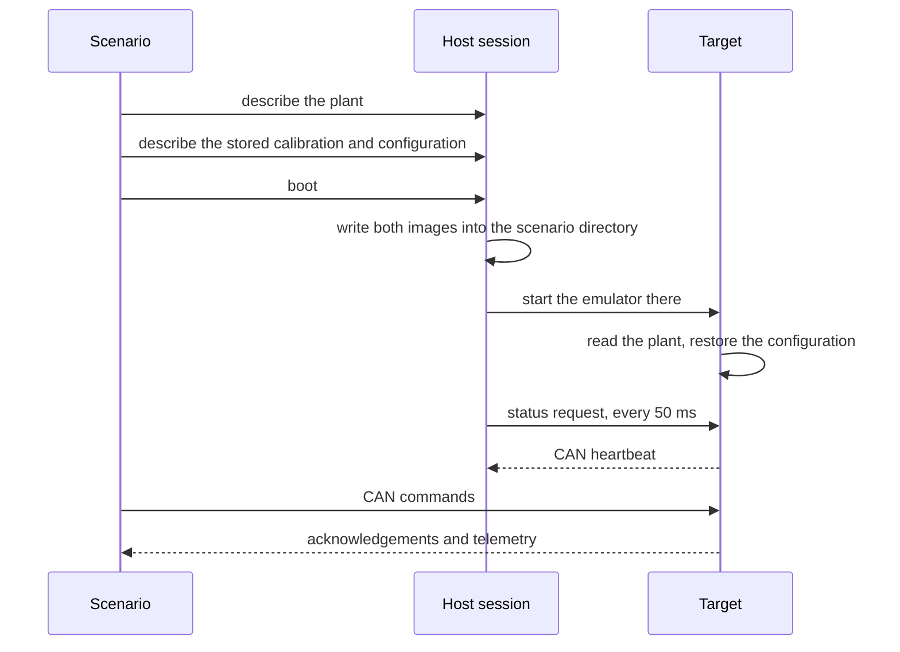
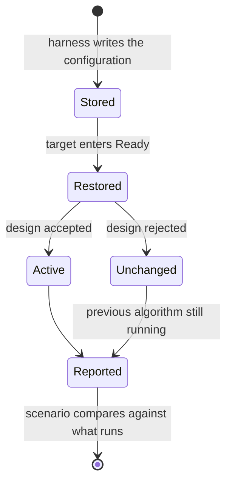
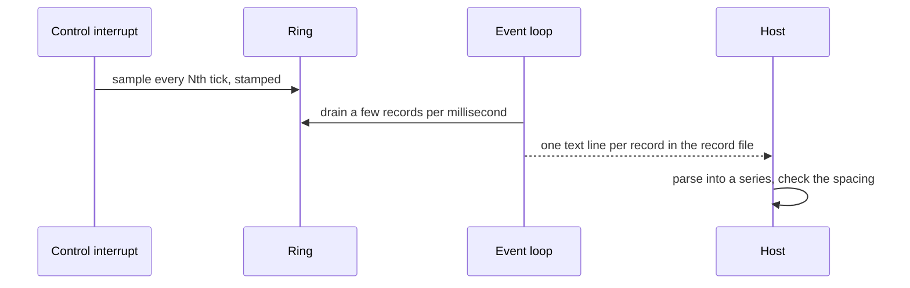
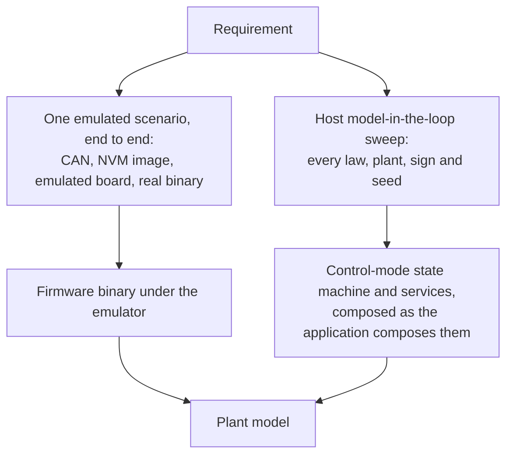
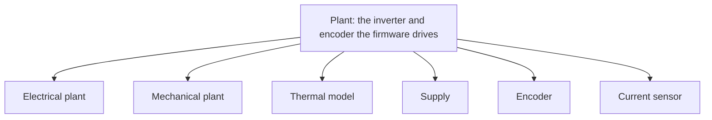

| Field     | Value                       |
|-----------|-----------------------------|
| Title     | Software-in-the-Loop Design |
| Type      | design                      |
| Status    | accepted                    |
| Version   | 1.10.0                      |
| Component | software-in-the-loop        |
| Date      | 2026-10-27                  |

> **IMPORTANT — Implementation-blind document**: This document describes *behavior, structure, and
> responsibilities* WITHOUT referencing code. **No code blocks using programming languages (C++, C,
> Python, CMake, shell, etc.) are allowed.** Use Mermaid diagrams to express behavior instead.
>
> **Diagrams**: All visuals must be Mermaid or ASCII art. External image references are **not allowed**.

---

## Overview

Software-in-the-loop runs the **real firmware** for the emulated Cortex-M4 target under an
emulator, against a simulated three-phase motor that the firmware itself owns. The test host
commands it over the wire the product speaks, CAN frames carried as text lines on an emulated
serial port of their own, and reads what the motor did from a record the plant writes. Everything
the firmware prints is kept as the scenario's debug log, which no scenario reads for a verdict.

Nothing is mocked on the target. The state machine, the control cascades, the calibration
services, the non-volatile memory stack and the CAN server are the shipping ones. Only the motor,
the power stage and the board protection are simulated, because there is no hardware.

---

## Responsibilities

**Is responsible for:**
- Describing the motor plant per scenario and delivering that description to the firmware at boot
- Pre-seeding non-volatile memory so a scenario starts from a chosen calibration and configuration
- Driving the target only through its CAN command set and observing only its CAN frames and the
  plant record
- Simulating the board protection the hardware provides, and the wiring faults hardware can suffer
- Isolating scenarios from one another so neither files nor sockets nor captured output leak across

**Is NOT responsible for:**
- Verifying control algorithm correctness in the small — that is what the unit tests are for
- Testing CAN framing — that is covered by the wire contract tests
- Standing in for hardware-in-the-loop, which alone exercises real silicon, timing and analogue paths

---

## Component Details

### Part A — The plant is an input, not a constant

The motor the firmware drives is described per scenario and handed to it at boot as a small
binary record placed in the emulator's working directory. The record carries a magic number, a
layout version and a checksum over its payload, exactly as the non-volatile memory records do, so
a truncated or stale description is rejected rather than half-read.

The description covers everything the plant needs:

| Group             | Contents                                                                                                             |
|-------------------|----------------------------------------------------------------------------------------------------------------------|
| Winding and rotor | Resistance, both axis inductances, flux linkage, pole pairs, inertia, damping                                        |
| Drive             | Supply voltage, control frequency, peak current, load torque                                                         |
| Measurement       | Current noise deviation and per-phase bias, encoder noise deviation and bias                                         |
| Thermal           | Ambient, thermal resistance and capacitance, copper and iron coefficients                                            |
| Protection        | Over-current, over-voltage, under-voltage and over-temperature trips                                                 |
| Fault injection   | Open phase per phase, stuck encoder, when it freezes, supply voltage scaling, an event-loop stall and when it begins |
| Non-idealities    | Coulomb friction, encoder counts per revolution, supply source resistance and current limit                          |
| Power stage       | Dead time, switch-node capacitance, switch on-resistance, diode drop, minimum pulse                                  |
| Current sensing   | Converter clock and timing, averaging, trigger delay, amplifier lag, full scale, resolution                          |
| Reproducibility   | The seed both noise generators start from                                                                            |
| Disturbance       | A signed shaft torque and the delay after enabling at which it steps in                                              |
| Recording         | The rate at which the plant reports its trajectory, and how many samples                                             |

The thermal group's resistance and inductance coefficients act from the temperature the
nameplate values were measured at (25 °C), not from the ambient, so a plant described with a hot
ambient starts with a hot winding.

When no description is present the firmware falls back to the motor it is built with, so the
target still boots standalone. A trip threshold of zero disables that protection, which is how a
scenario opts out of one it is not testing.

The winding and rotor group is filled from one of the two reference motors in `motor_parameters/`
(the Teknic M-2310P-LN-04K on its 40 V bus is the nominal plant, the Anaheim BLY172S-24V-4000 on
24 V the other), whose parameters and sources are in the plant theory document. A scenario names
the motor as a preset; every other preset is a variation on the nominal one. The stored calibration
a scenario boots from is derived from the same description, current sensor offsets included, so
"already calibrated" means calibrated to the plant, and a scenario that wants a wrong seed says by
how much.

The seed matters more than it looks: the emulated target cannot obtain entropy, so without an
explicit seed the noise generators are not merely unpredictable, they are unreliable.

### Part B — Reaching the target

The emulator runs from a directory created for the scenario, so the firmware opens its plant
description and its memory image by plain relative name and knows nothing about the host's paths.
The directory, and the sockets behind the target's serial ports, are unique per session; scenarios
ran into each other when either was shared.

The target has two serial ports. The first is the product's terminal, which the host does not
connect to; with `SIL_VERBOSE` set it prints the terminal socket's path, so a person can attach to
a running scenario. The second carries only CAN
frames, one text line per frame in each direction, so a frame can never be split by a terminal line
or taken for one. Whatever the firmware prints, traces and terminal output alike, goes to the
emulator's console and is the scenario's debug log: it is written to the scenario directory, and a
failed scenario's report carries its last lines. The plant's record (Part G) is a file the firmware
writes into the same directory. The host asks for the target's status on the CAN port every 50 ms
from the moment the emulator starts, and takes the heartbeat that answers as the sign that the
target is up; it never waits for a line of console output. The answer comes about half a second
after the emulator starts, where the first unprompted heartbeat comes a full heartbeat period
later, and every scenario boots at least once.

A session ends by signalling the emulator to terminate. Closing its sockets does not end it: the
emulator keeps running with its serial ports unconnected and ignores the broken pipe. The session
once waited out a two-second deadline before killing it, at the boot that applies a scenario's
plant and again after the scenario, which was four of the five and a half seconds a typical
scenario took.

### Part B2 — Emulated time, and why it has to be instruction-counted

By default the emulator's guest clock follows host wall-clock while the guest's instruction
throughput follows whatever CPU the host happens to give it. The firmware's timers therefore keep
real time regardless of how much work the emulated core actually completed.

That breaks the control system. The control interrupt runs at 20 kHz, and on this machine it
carries the whole motor plant as well as the control loop, which no emulated core of this class
completes in a 50 microsecond period. The interrupt then crowds out the 1 kHz outer loop, which runs
at the lowest priority, and the speed and position loops stop tracking a motor that was running
perfectly well.

This is the firmware behaving correctly on a target that genuinely cannot keep up. It was
measured, not inferred: the inner loop kept running while the outer loop starved, in speed and
position modes only — the two modes that have an outer loop.

The emulator is therefore run with its virtual clock tied to instructions retired rather than to
host time, at 8 nanoseconds per instruction. That models a core of roughly 125 MHz, at least as
fast as the slowest target the firmware ships on, so work that fits in the emulator fits on
hardware. It also makes a run's timing independent of host load, which is what removes the
flakiness rather than merely reducing it.

> The emulated machine's own clock is 25 MHz and the platform must declare exactly that. The
> declaration is a divisor used to program the timers, not a statement of capability: declaring a
> faster core does not execute more instructions, it just makes every firmware timer run
> proportionally slower than the firmware believes. Declaring 50 MHz, for instance, was measured
> to halve the rate of the firmware's own clock. Capacity comes from the instruction-counted
> clock above; the declared value must stay matched to the machine.

### Part B3 — Timing the control interrupt

The platform measures every execution of the control callback and counts the ones that overrun
the budget, miss the period or re-enter (REQ-PERF-004 to REQ-PERF-006); the control-loop
statistics parameters of contract 2.2 report them, and `ClearDiagnostics` restarts them. On hardware the duration comes from the DWT cycle counter. The emulator does not implement
the DWT and its registers read zero, so every execution measured zero and the counters could not
report an overrun however long the callback ran. The emulated platform reads a free-running timer
of the emulated machine instead, clocked from the same 25 MHz system clock as the control timer,
so the budget (three quarters of the period, 937 cycles at 20 kHz) and the period (1250) keep the
units the platform already declared. Because that clock is instruction-counted (Part B2), one of
its cycles is five instructions retired, and a run reproduces its own durations to within a
cycle.

What it measures is the instruction count of the callback, not the cycles a real core would take,
so it is a regression signal and the static cycle-budget gate remains the authority on hardware
cycles. The plant step the same interrupt carries before the callback is outside the window, as
REQ-PERF-004 requires.

The mode scenarios boot calibrated and clear the counters before the rotor is aligned on command,
so the window covers alignment as well as closed-loop running, and run every current law in torque
mode and the decoupled law in speed and position mode. The calibration scenario clears them before
a full calibration is run over CAN, so the window covers every identification procedure
and the alignment between them. Each requires at least one execution, a non-zero shortest one (a
dead counter reads zero), no overrun, deadline miss or re-entry, and a slowest execution under a
pinned limit. With the current-offset and dead-time corrections in the path, the slowest execution
measured 116 to 127 cycles for the laws in torque mode, 160 in speed and position mode and 377
through a full calibration, about 640, 800 and 1890 instructions, the same to within a cycle across
runs. The limits are one and a half times that, rounded up to
ten, so a regression trips them long before it reaches the budget; a change that makes the callback
slower on purpose re-pins them by the same rule.

### Part C — Starting from a chosen calibration

Reaching a mode that regulates speed or position requires a complete calibration, including the
mechanical parameters. Rather than run identification in every scenario, the harness writes a
memory image whose calibration record already satisfies every completeness check. The target then
boots straight to Ready, and one alignment command establishes the rotor reference the state
machine requires before enabling.

This cuts a scenario from the better part of a minute to a few seconds, and it is also what makes
the damaged-record scenarios possible: the same builder can produce a record with a wrong magic
number, a stale layout version or a broken checksum, and the scenario asserts what the firmware
does with it.

### Part D — Selecting controller algorithms

The controller matrix does not select an algorithm over CAN, although contract 2.1 can: it writes
the stored configuration that the firmware restores on entry to Ready, so the restore path is what
it tests, and then asks the firmware over CAN (`QueryAlgorithms`) which algorithm is actually
running. The settings scenarios select over CAN.

That last step is not ceremony. A state feedback design that does not converge for a given motor
leaves the previously active algorithm in place. A scenario that only asserted what it requested
would pass while testing something else entirely, so the firmware reports the algorithm each loop
ended up with and the scenario compares against that.

### Part E — Board protection

Real boards compare bus voltage and phase current against thresholds in hardware and feed the
result to the power stage's fault input. The simulation mirrors that arrangement in three ways
that matter:

- It is **armed with the inverter**, because comparators guard a stage that is switching. A
  standing condition does not fault a motor that was never enabled.
- It is **evaluated every control tick**, against the live plant state, so a trip follows from the
  physics of the scenario rather than being poked in by the test.
- It is **delivered from the event loop**, not from the control interrupt. The handler stops the
  drive and walks the state machine, which is far more than belongs in a 20 kHz interrupt; on
  hardware the equivalent work is done from a dedicated fault interrupt.

A condition already standing when the state machine registers its handler is still reported. An
edge that passes before anyone is listening would otherwise be lost, and the motor would enable
into a fault the board had already detected.

Delivering a board protection fault to a running drive used to lock the firmware up, and the
scenarios that reproduced it were held out of the default run. The fault path defers the state
transition through the weak-pointer event dispatcher, and the emulated platform registered only the
plain one, so the call ran on a singleton that did not exist. On this machine address zero is
writable memory holding the vector table, and the dispatcher's push index sits at offset twelve —
the HardFault vector. The atomic increment advanced that vector from `0x22dd` to `0x22de`, clearing
its Thumb bit; the next store, through a "storage" pointer that was really a code address, took an
unaligned-access fault; and the escalation to HardFault jumped through a vector that could not be
executed. QEMU reported exactly that: a lockup, unable to escalate to HardFault, at `0x22de`.
Registering a dispatcher that serves both singletons (Part J) fixed it; the scenarios were then
found to fail for a second, unrelated reason — two of their thresholds no longer sat on the far
side of the nominal plant after the reference motors replaced the 48 V stand-in — and run in the
default set with those rows corrected.

### Part F — Wiring faults

The plant can be told that a phase carries no current, that the encoder is stuck, or that the
supply sags. These are configuration, not a separate model, and they compose with everything else.

Two results are worth recording because they are not obvious:

- A **fully disconnected** motor produces no torque and does not turn, however it is commanded.
  Its torque follows the currents that actually flow, so masking the phases is enough.
- A motor with **one open phase** still turns. Two phases can produce torque, so this is a
  degraded running condition rather than a dead motor, and nothing in the firmware detects it.
- A **stuck encoder** passes alignment rather than failing it. Alignment declares the rotor
  settled once its reading stops changing for a run of samples, and a reading frozen at one
  value satisfies that on the first run it sees, more convincingly than a real rotor ever
  does. The drive therefore takes its reference from a reading that means nothing and enables
  on it. What exposes it is the first request for motion: the loop pushes torque current and
  the reading does not move. The encoder plausibility monitor (REQ-SM-028) watches for exactly
  that from the event loop — measured torque current above a fraction of the limit, a demanded
  speed or an unclosed position error, and a reading still inside a small excursion for a
  whole window — and raises the sensor fault the wire already carried but nothing used to
  raise. A disconnected motor carries no current and is not misreported; a position held
  against a load demands no motion and is not reported either; a mechanically locked rotor is
  indistinguishable and is reported the same way.
- **A position held against a load was reported after a calibration, under LQR and LQI.** These
  laws command the current, so nothing updated the speed reference, which kept the −10 rad/s the
  cogging mapping last asked for. The monitor read it as a demanded speed, and a held shaft load of
  0.01 N·m, 0.24 A, raised the sensor fault within the window; the rig saw the same in its LQI
  row with the shaft free. The position cascade now reports no demanded speed while its law
  commands the current, so the position error alone stands for the demand (REQ-SM-028).

An encoder can also be told to freeze a set time after the motor is enabled rather than to have
been dead all along, scheduled the same way as the shaft torque of Part H and on the same
guest-time base. The two describe different failures and are worth keeping apart: an encoder
already stuck when the drive aligns corrupts the reference the drive takes, while one that
freezes afterwards leaves a valid reference and stops reporting against it. The delay is carried
in hundredths of a second, in a byte the plant description already held in reserve, so a
description written before the freeze existed still reads as one that never freezes and the
record neither grew nor changed version. What freezes is what the firmware reads; the plant goes
on reporting its own trajectory truthfully, which is what lets a scenario see the rotor moving
while the drive does not.

Alignment also cannot converge once encoder noise reaches the threshold below which it declares
the rotor settled, which bounds how noisy an encoder the current calibration tolerates. A frozen
reading and a noisy one therefore fail in opposite directions: the noisy encoder never settles
and refuses to align, the frozen one settles at once and aligns against nothing.

### Part G — The plant reports its trajectory

Telemetry cannot time a transient. The status frame is answered on request, so the host samples
at whatever cadence its round trips allow, tens of milliseconds apart; the speed it carries is
quantised to whole radians per second; and the host's own clock says nothing about the guest's,
because the emulated clock counts instructions rather than seconds. A speed loop that settles in
a few tens of milliseconds is invisible through that window.

The plant therefore reports what it did, itself. Every control tick, once the motor is enabled,
the plant samples its mechanical speed, its mechanical angle, its d- and q-axis currents and the
external torque acting on the shaft, decimated to the rate the plant description asks for, and
stamps each sample with the control-tick count. The tick count is the only time base that means
anything on this target: it advances exactly once per control period whatever the host is doing.

Two rules keep this honest. Nothing is printed from the interrupt: samples go into a ring the
interrupt alone writes, and the event loop alone drains, so the record file is written from one
context. And the ring never blocks: when it is full the sample is dropped and
counted, the count is reported when recording stops, and the host also checks that consecutive
samples are exactly one decimation apart. A gap fails the scenario rather than skewing a metric. Begin and End
only raise flags the tick acts on, so the tick stays the ring's only writer, and each marker has a slot of its own
that the tick fills and the event loop empties: a full ring can drop samples but never the record that reports the
drops.

Between them those two rules set a ceiling on how long a recording can run, and it is worth
stating because it is not the budget and it bites only the fast ones. The interrupt produces at
the recording rate; the event loop empties a fixed number of records on each of its ticks. A
recording asking for less than that drains as fast as it fills and can run until its budget is
spent. A recording asking for more is safe only while the ring absorbs the difference, and then
begins dropping: at the control rate itself that is roughly a quarter of a second, a few thousand
samples. A scenario measuring a transient from rest never notices, because it records for a few
tens of milliseconds. One measuring a transient that begins half a second after enabling cannot
be run at the control rate at all, whatever budget it is given, and has to record at a rate the
event loop can keep up with instead — which lengthens the span its fixed-size window covers, and
so the capture that waits for that window.

Recording begins on enable, which resets the rotor to rest, and stops when the sample budget in
the plant description is spent or the motor is disabled. The budget bounds the record so a
scenario that never reads it does not grow it without limit; a scenario that measures reads it
continuously while it waits. Marker lines bracket the run: one when recording begins with
the tick it began on, one when a scheduled torque step fires, one when recording stops. Every
command frame the target takes from the wire is stamped with the tick it was delivered on, so a
setpoint changed while running has an onset the host can look up rather than guess.

The measurements themselves are the classical ones and are computed on the host with the
numerical toolbox's step-response metrics: rise time, settling time into a two-percent band,
percent overshoot, peak time and steady-state error over the tail of the window. A step is
normalised before measuring, so a reversal or a step down is the same unit step as a step up.
Settling time, overshoot, steady-state error, rise time and the band the tail still ripples in
are each bounded by the row the scenario carries. Because the step is normalised first, the tail
band is a percentage of the step rather than of the setpoint the step ends at; the two coincide
from rest and differ on a change made while running, where the step is the distance moved and
not the setpoint reached. Peak time is printed and not asserted: a law
that does not overshoot has its largest sample wherever the tail ripple happened to peak, so a
bound on it would measure the duty quantisation rather than the law. A
disturbance is measured as the largest excursion from the setpoint and the time of the last
excursion outside a band around it, which is the same settling computation applied to the
recovery. Every measurement is also printed as a labelled line, which is how limits are found:
a scenario is run first with permissive limits, the printed numbers are read, and the limits are
pinned with a margin. Design intent says where to expect them, roughly two over the loop
bandwidth for settling with a few percent of overshoot, but the pinned numbers come from the run.

One run is not enough to pin from. The same scenario does not measure quite the same numbers
twice, and two machines running it agree less closely still, so a bound is taken from the worst
value several repeated runs report and set at twice that, and the rows are then checked against a
run on the integration machine before they are trusted. A bound sitting on a measured value fails
the next time the measurement moves, and a bound sitting far above every measured value fails
nothing at all; twice the worst of a repeated run is the compromise the suite uses. What the
spread actually is, and why it exists at all against a deterministic guest, is in Part I.

### Part H — Disturbances are described, not poked

The load torque the plant has always carried opposes motion, so it flips sign with the speed and
vanishes at rest, like friction. That is the right model for a loaded shaft and the wrong one for
a disturbance: a position loop holding still against it sees only a dither around zero. The
plant therefore also carries a signed shaft torque, which keeps its sign whatever the rotor does,
like gravity on an arm.

A scenario schedules that torque in the plant description: a magnitude and a delay after
enabling. The control tick applies it on the exact tick, notes the tick in the plant record, and the
loop under test has to hold its setpoint against it. Re-enabling re-arms the schedule and
disabling clears the torque, so every enable starts from the same plant.

Setpoint changes need no such machinery. The product accepts a setpoint while running and while
ready, and every cascade re-applies its last setpoint on enable. A scenario that applies the
setpoint before enabling makes enabling the step, with the onset on the tick recording began and
the rotor known to be at rest. A scenario that applies one while running reads the onset from the
delivery stamp. The target's command surface is still the product's: nothing was added to it.

### Part I — What the measurements found

The first characterisation run measured the product against the parameter set that stood in
for a motor at the time and reported four findings. Re-measured on the reference motors, after
the harness faults recorded in Part J were fixed, two of them were artefacts and two were real
defects. Later runs found more. Each real defect was root-caused and fixed rather than parked:
every scenario in the suite now runs in the default set.

- **Whole-percent duty resolution — fixed.** The duty cycles the modulator handed the inverter
  were `hal::Percent`, a whole-percent `uint8_t` from the infrastructure library's PWM
  interfaces, and the conversion rounded to the nearest percent. On a 40 V bus into a 0.36 Ω,
  0.20 mH winding one step is 0.4 V and about a tenth of an ampere of ripple per control period,
  so the current loop held a half-ampere setpoint inside a band of about 30 % of it and could
  not settle into a 10 % one. The hardware was no better: the TI driver computed its compare
  value as `load × duty / 100` in integers. The PWM interfaces now take `hal::DutyCycle`, an
  integer Q16 fraction of the period (65536 is 100 %), through the infrastructure library and
  both hardware abstraction layers — integer so that no driver needs floating point, and Q16 so
  that its conversion to counts is a multiply and a shift, never a division, in the interrupt.
  Each driver rounds its compare value with the same `DutyCycle::ToCounts` helper;
  the TI platform also clocks its PWM at half the system clock rather than an eighth, so a
  20 kHz centre-aligned period spans 1500 counts on the 120 MHz part (0.07 % a count) instead
  of 375. The deadbeat law now settles into a 10 % band within a sample with under 5 %
  overshoot, the decoupled law within 1.7 ms with none, and the speed laws' tail band fell to
  0.4 % of a 20 rad/s setpoint.
- **The sliding-mode current law overshot by design — fixed.** Its equivalent control drove the
  next error to zero on its own, and the switching term then threw the error `K_sw` past zero
  every time it left the boundary layer: 40 % of a step with the shipped gains, measured at
  46–50 %. It now uses the exponential reaching law at the loop bandwidth
  (`documentation/theory/current-loop-sliding-mode.md`) and settles into a 10 % band within
  0.2 ms without overshoot.
- **The PID current law keeps a standing error on an accelerating rotor — by design.** A
  torque step accelerates the free rotor at some 2700 rad/s², so the back-EMF ramps at about
  70 V/s, and a PI tracks a ramp with an error of the ramp rate over its integral gain: 0.08 A
  of a 0.5 A step here. Whole-percent dither used to hide some of it. The law has no back-EMF
  feedforward by construction; the decoupled law does, and meets the tight envelope. The PID
  row carries the envelope the law can meet.
- **Two current laws command nothing — retracted.** With the inductance seeded correctly the
  deadbeat law rises within a sample and overshoots 9 %, the sliding-mode law overshoots 50 %
  into its boundary layer, and the decoupled law 25 %. The zero output was the deadbeat and
  sliding designs computed for a winding of half a microhenry.
- **The LQI position law is unstable — retracted.** Same cause. It settles into a 10 % band
  within 30 ms with 27–40 % overshoot, and holds 1.5 rad against a torque step within 0.011 rad,
  the tightest of the position laws.
- **The LQI speed law was erratic — fixed.** From rest to 20 rad/s it overshot 121 % and never
  settled; stepped to 40 rad/s while running it overshot 66 % and kept swinging for the rest of
  the window; a 0.002 N·m torque step pushed it 26 rad/s off a 20 rad/s setpoint, where the other
  laws move less than 2 rad/s. The cause was `LqiSpeedController` never scaling its LQR effort
  weight to the plant's own input gain: the fixed weight sized a design with no margin against a
  real current loop's one-sample delay (`documentation/theory/speed-loop-lqi.md`). Rescaled to the
  plant's input gain and the requested bandwidth, it settles into a 10 % band within 16–19 ms with
  2–4 % overshoot in both step scenarios, and the same torque step moves it about 1.2 rad/s off
  setpoint. Its rows carry the same envelope as the other speed laws now.

A later run, the first to apply a disturbance of either sign, found one more thing and is worth
recording because the asymmetry was not expected:

- **Two position laws rejected a torque better in one direction than the other — fixed.**
  Against a negative torque the PID position loop took 106 ms to return inside the band its
  positive row meets in 50, and the two-DOF loop was pushed 0.1008 rad off a limit of 0.1. The
  "standing error" of some 0.055 rad both showed was not one: their PI placed its integral zero
  at a twentieth of the position bandwidth, which leaves a slow closed-loop pole beside the zero
  and a tail of some 0.089 rad decaying over a second. Half a second after a 1.5 rad step it was
  still 0.055 rad over the setpoint, and a torque pushing the same way crossed the band. The zero
  now sits at a fifth of the bandwidth, and the proportional term weights the reference at three
  quarters so that the zero does not overshoot the step
  (`documentation/theory/position-loop-pid.md`). Both laws now settle a 1.5 rad step within
  0.5 % and are pushed under 0.03 rad by the torque step of either sign.

The same run, once a disturbance was made large enough to reach the current limit, found a
second thing:

- **Two speed laws did not come back from a saturating disturbance — fixed.** A shaft torque of
  half a newton-metre asks for about thirteen of the twenty amperes the drive allows, so the
  current to reject it is there. ADRC and LQI were thrown 205 to 238 rad/s off a 20 rad/s
  setpoint and returned; PI and two-DOF were thrown to about 317 and ended the window
  10.44 rad/s short. There was no windup — the velocity-form PI never reached its clamp. The PI
  placed its integral zero at a tenth of the speed bandwidth, which leaves a slow closed-loop
  pole near 10 rad/s, and the tail mean of that pole's decay over the last quarter of the window
  predicts 10.7 rad/s. The zero now sits at a quarter of the bandwidth
  (`documentation/theory/speed-loop-pi.md`): both laws are thrown about 295 rad/s off and are
  back inside 3 rad/s 175 ms later, and a step from rest overshoots by about 10 %. The scenario
  is the only one in the suite that reaches the current limit at all: every other disturbance
  is kept small on purpose so that it measures the control law rather than the limiter.

How far the limit can be lowered to provoke that is itself bounded, which is worth recording
because it is not obvious: alignment injects open-loop and abandons the attempt the moment a
phase carries more than the drive says it supports, so the limit cannot be dropped below what
that injection draws. On the nominal plant it is above ten amperes, more than half the nominal
twenty. A limit low enough to make a millinewton-metre step saturate stops the motor aligning
at all, so a scenario that wants saturation raises the torque rather than lowering the limit.

The run also found a harness fault: a line cut by a read timeout was dropped and its tail
parsed as a line of its own, which showed up as a gap in the sample spacing. The reader now
keeps a partial line for the next read.

Two runs of the same scenario do not measure exactly the same numbers, and how far they differ
has now been measured rather than assumed. Six consecutive runs of the default set passed every
scenario in every run — six hundred and seventy-two executions with no failure of any kind, so
the suite itself does not flake — and yet only a fifth of the measurements taken from rest
repeated exactly across all six, and none of the measurements taken from a setpoint changed while
running did. The guest is deterministic; the host decides when each command frame reaches it, so
the tick a setpoint or an enable lands on, relative to the outer loop's phase, moves between runs
and the transient moves with it. The onset of one mid-run change moved by a sixth of a second of
guest time across the six.

What moves is small on most rows and not on all of them. Rise times moved by at most five
milliseconds and tail bands by about a point, while one measurement moved far further: the
current loop's reversal ripples in a band eleven points wide from run to run, between 20 and 31
percent of its step. Two machines agree less closely again. The same reversal's overshoot has
measured between 9 and 13 percent on a development machine and between 10 and 15 percent on the
integration machine, so the range either one sees alone understates the range the scenario has.

That is what sets the margin on a pinned limit, and it is why the rise and tail bounds are twice
the worst of six runs rather than a tighter multiple of one. It leaves the widest spread yet
measured several times over, and room for a machine nobody has measured on. Tightening those
bounds towards the measurement would buy a sensitivity the suite cannot support, and the first
thing it would catch is the harness rather than a control law.

The two runs made to check the pinned bounds bear that out immediately: three of their
measurements came in above the worst of the six the bounds were set from, the largest a tail band
a fifth higher than anything those six had shown. Every bound still had more than 46 percent of
itself to spare, and a bound pinned to the measurement itself would have been red on all three,
on the very run that was meant to confirm it.

### Part J — The estimators against a known plant

A simulated plant is the one place where an estimator can be marked against the truth: the
scenario wrote the resistance, inductance, flux linkage, inertia and friction the plant runs
with, so whatever the firmware identifies can be compared with them, and the comparison is
made on both reference motors so that a tolerance is not tuned to one winding.

Three product channels carry what the firmware believes, all of them CAN messages of the product:

- The **electrical parameters response** the CAN identification command broadcasts before it
  acknowledges: resistance, inductance and pole pairs at the wire's resolution of 1 mΩ and 1 µH.
- The **calibration record**, read with `QueryParameter` once `Calibrate` has acknowledged: the motor
  parameters (`0x40`–`0x45`), the current-sensor offsets and the cogging-map peak (`0x80`–`0x83`).
  This is the only way the mechanical identification's result is visible on this target: the CAN
  mechanical command is not wired, and the full sequence that includes it is `Calibrate`.
- The **online estimates** (`0x90`–`0x93`), seeded from the record and updated at the outer-loop
  rate while the motor runs.

Every value travels as a float, so no unit is scaled to suit a printout.

The scenarios cover the offline procedures from a blank calibration and from one deliberately
wrong by given factors, the online estimators from a wrong seed under a speed reference that
alternates between two levels (the same shape the identification service uses, because a constant
speed excites neither inertia nor friction), the same with a constant shaft torque applied while
the estimators run, and a winding that heats while running. The excitation is paced on the plant's
own clock, read from its trajectory samples, so it lasts the same guest time on every host. Where a
scenario also schedules a shaft torque, the excitation waits on that clock until the torque is on:
the step that enables the motor waits half a second of host time, so the first setpoint otherwise
lands wherever the host's speed puts it.

What the first characterisation found, in the order it was found:

- **The emulated inverter delivered current samples at the control rate whatever rate a
  procedure asked for.** The identification procedures ask for 10 kHz and demodulate on that
  assumption, so every sample arriving twice as often made the injection twice the frequency it
  was analysed at, and the inductance came out doubled on both motors (0.36 mH for a 0.20 mH
  winding, 1.22 mH for 0.64 mH). The platform now delivers samples at the requested rate, as an
  ADC trigger divider would, while the plant keeps stepping at the control rate. With that, the
  resistance identifies within 2 % and the inductance within 15.5 % (Teknic) and 6.5 % (Anaheim),
  reading low in both cases, which is the ZOH bias the electrical theory document predicts made
  larger by the whole-percent duty quantising the injection. Pole pairs identify exactly. None of
  these numbers move under current and encoder noise.
- **The mechanical identification could never complete on the emulated target.** Its completion
  is deferred to the event loop against a weak pointer, so that an identification torn down
  before the completion runs is dropped rather than executed on a dead object. The emulated
  platform registered only the plain dispatcher, and the weak-pointer dispatcher is a second
  singleton next to it; scheduling through it dereferenced nothing and hard-faulted inside the
  control interrupt on the first sample the identification observed. The fault handler then
  faulted again, so nothing was traced and the target simply went silent. The deferred fault
  notifications take the same path. The platform now registers a cortex dispatcher that serves
  both singletons. Both hardware platforms register the weak-pointer dispatcher and run it from
  `Run()`; the ST one, still a stub that builds no application, used to register none and return
  from `Run()`. With the
  dispatcher in place the full calibration from the terminal reaches Ready on both motors and
  its record is within 0.05 % of the plant's inertia and 2 % of its viscous friction, from a
  seed that was off by a factor of two and a half; the offline procedure, sampling at the control
  rate, is as good as the plant it measures.
- **The stored calibration the scenarios booted from carried the inductance in henry where the
  record holds millihenry**, so every "already calibrated" run since the plant description was
  introduced configured its current loop with an inductance a thousand times too small. Part I's
  numbers were measured that way and are re-measured below.
- **The torque constant was a per-target constant of 0.1 N·m/A**, two and a half to three times
  the true value of either reference motor, used by the mechanical identification, the online
  inertia estimator and the speed-loop gain design alike. It is now derived from the calibration
  record (REQ-SM-027).
- **Small mechanical values did not survive the product's own outputs.** The mechanical
  parameters response on the wire carries inertia and friction as fixed-point with a resolution
  of 1e-4, so the rotors here (5e-6 to 7e-6 kg·m², 1e-5 N·m·s/rad) encode as zero; that
  response is not used by the scenarios and changing its scale is a wire-contract change left
  open. The tracer prints three decimals, so the same values traced as zero; the traces now
  carry them in micro-units.
- **The online mechanical estimator did not track.** Seeded with twice the inertia and half the
  friction and excited for six seconds by a speed reference alternating between 26 and 52 rad/s
  every quarter second, it published an inertia 26–33 % low and a friction near zero on the
  Teknic, and nothing at all on the Anaheim. It regressed an instantaneous current sample against
  the second difference of two window-mean speeds, which is centred an outer sample earlier; with
  the speed loop's transients decaying at some 400 rad/s that alone scaled the inertia by about
  two thirds. Its 200 ms memory was shorter than one 250 ms dwell, so within its window friction
  was collinear with the intercept. Its excitation gate was met by duty ripple on every plateau,
  and its convergence gate — an innovation under 0.1 mN·m — sat under that same ripple and was
  met by chance. It now regresses the momentum balance over window averages the control interrupt
  accumulates (theory: `friction-inertia-estimation.md` §4.1) with a two-second memory, and
  publishes once its averaged residual is small against the torque it explains (the bound is in
  `service-mechanical-ident.md`, Plausibility Band and Update Rate).

  Fixing that exposed a platform-independent timing fault: the outer loop measured speed by
  differencing whatever angle it found when it ran, and it runs up to a tick after the window
  closes, so windows of 19 and 21 ticks were divided by 20. The jitter — some 2000 rad/s² of
  acceleration noise — biased the inertia low by errors in the regressor, and it also reached the
  speed loop. The interrupt now latches the angle at the window boundary. Both reference motors
  then identify inertia within 4 % and friction within 8 %, and a constant 0.01 N·m shaft torque
  lands in the intercept (10.0 mN·m) instead of the friction.

- **The online electrical estimator could not see the resistance.** Its regressor's resistance
  column was the d-axis current, which the product regulates to zero, so that direction was
  never excited and the recursion drifted: −0.68 Ω for a 0.36 Ω winding, −1.63 Ω for 0.405 Ω. It
  also paired each current with the voltage commanded on the same tick, which contains the PI's
  own −Kp·id and pulled the resistance negative by about Kp, and it differentiated two
  instantaneous currents a millisecond apart. The cascades now carry a d-axis square wave while
  the estimator is attached (±2.5 % of the current limit, now at 50 Hz, no torque on a non-salient
  machine), and the estimator regresses the integrated d-axis equation over window averages that
  pair each current with the voltage applied while it formed (`service-electrical-ident.md`).
  The resistance then reads 0.360 Ω and 0.405 Ω.

- **The plant counted the frame rotation twice.** With the resistance fixed the Anaheim
  inductance still read 48 % high, and the window residuals were exactly −L·ωe·iq through every
  speed transition. The plant integrates the dq equations — which already carry the ±ωL coupling
  the rotating frame produces — then converted the new currents back to phase currents at the
  angle the step *started* from, and the next step read them at the new angle: the rotation was
  applied twice and the plant's cross-coupling was doubled. Every scenario since the plant model
  was introduced ran against that doubled coupling. The currents now return to phase quantities
  at the angle the step ends on, and the inverter's stator-fixed voltage is read at mid-step. The
  inductance then reads 0.191 mH and 0.636 mH.

- **The heated winding could not be tracked as described.** The plant scaled its resistance from
  its ambient temperature, and the "hot" preset set the ambient to 90 °C, so its winding
  resistance stayed at the 25 °C nameplate value while the scenario compared against the value at
  90 °C. The thermal model now carries the temperature the nameplate values were measured at, and
  the heated winding reads 0.453 Ω against 0.452 Ω.

- **The offline friction depended on the duty ripple.** With the duty carried as a fraction the
  full calibration's friction moved 19–27 % off the plant. Its excitation gate refused every
  sample accelerating slower than 1 rad/s², which on a clean plateau is every sample, and the
  plateaus are what separate friction from the intercept; only the whole-percent ripple had let
  them through. Both procedures now take every sample above standstill and require a span of
  speeds before publishing (`service-mechanical-ident.md` § *Persistence of Excitation*).

- **The constant-torque scenario depended on the host's speed — fixed.** Its 0.01 N·m steps in
  500 ms after enable on the plant's clock, but the excitation started after the enable step's
  half second of host time. A host that runs the emulator slower than real time (230 to 350 ms of
  guest time to that half second here) turned the rotor first, and the online estimator kept a
  stretch of unloaded motion at 52 rad/s in its two-second memory. The load is 20 to 40 times the
  friction torque, so the few per cent of weight that stretch still carried six seconds later
  pulled the Anaheim friction 15 to 48 % low, further the earlier the rotor started; CI read
  +4 %. The scenario now holds the excitation until 700 ms after enable, so every host applies
  the load at standstill, where the estimator takes no samples, and the friction reads +7 %.

- **The rotor moved a sample ahead of the current it was reported with — fixed.** Each step
  integrated the currents, then built the torque from the new end-of-step current and applied it
  over the whole step, so the central second difference of the position at one sample was the
  acceleration of the current reported at the next. A real rotor accelerates with the current
  that flows at the instant the converter samples it. Fifty microseconds is invisible to the
  loops, but a regression of torque against acceleration reads the shift as friction: a time
  offset adds the inertia times the jerk, and the jerk correlates with the speed. The offline
  friction read 1.3 % to 5.5 % high only because the estimator's torque weighting sat half a
  sample late and cancelled half of the lead; aligned exactly, it read 2.6 % to 14 % high. The
  plant now builds the torque from the start-of-step current, which makes the position a
  Störmer–Verlet integration, and the friction identifies within 0.35 % on both motors.

Every identification scenario, offline and online, runs in the default set on both motors
(REQ-CAL-012 to REQ-CAL-014).

Timing the control interrupt (Part B3) found three more, all inside the measured window, and the
timing scenarios fail on each when it is put back:

- **Alignment completed inside the control interrupt — fixed.** Alignment decides in the sampling
  interrupt that the rotor has settled, and it invoked the caller's completion there too, which
  stores calibration data and changes state: one execution of 27 000 to 34 000 cycles, over a
  millisecond against a 50 µs period, an overrun and a missed deadline on every alignment. The
  service now stops the inverter and zeroes the encoder in the interrupt and delivers the outcome
  from the event loop (`service-alignment.md`, REQ-PERF-008).
- **The plant drew encoder noise inside the measured window — fixed.** Every encoder read drew a
  normal deviate, even with the noise switched off, so about one read in five hundred refilled the
  generator's state inside the callback: 1650 to 1700 cycles, an overrun and a missed deadline
  each time. The plant now draws one deviate per step, outside the window, and every read within a
  step returns that step's sample, as a latched encoder count would.
- **Identification completed inside the control interrupt — fixed.** The resistance and inductance
  estimators decide in the sampling interrupt that a measurement is complete, and every procedure
  decides there that a phase current is over the limit; each invoked its caller's completion there
  too. The resistance result started the inductance stage from inside the resistance stage's own
  sample callback, and in a full calibration the inductance result ran the next calibration step —
  its trace and the start of the alignment — in the interrupt as well: one execution of 6709
  cycles, more than five control periods, an overrun and a missed deadline on every calibration.
  Identification over CAN peaked at 506. Each procedure now stops the injection in the interrupt
  and delivers its outcome from the event loop (`service-electrical-ident.md`, REQ-PERF-008); a
  full calibration then peaks at 236 cycles and identification over CAN at 114.

---

---

## Scenario Taxonomy

| Area                     | What it establishes                                                                                              |
|--------------------------|------------------------------------------------------------------------------------------------------------------|
| Control modes            | Each mode calibrates or refuses to without mechanical parameters; a mode switch keeps the alignment              |
| Controller algorithms    | Every algorithm of every loop is selected through the stored configuration and reported running, in combinations |
| Plant characteristics    | Alignment refuses a noisy encoder; heavy current noise does not stop torque control                              |
| Wiring faults            | A dead motor does not turn; a degraded one does; a stuck or frozen encoder is reported as a sensor fault         |
| Memory integrity         | Damaged calibration is distrusted; damaged configuration falls to defaults                                       |
| Board protection         | Trips reach the state machine and are reported                                                                   |
| Control performance      | Each loop's default law stays inside its envelope, from rest and while running                                   |
| Control robustness       | The noisy plant keeps the speed and position envelopes; every position law holds against the bench's cogging     |
| Disturbance rejection    | A shaft torque step while regulating is bounded in excursion and recovered from, linearly and through saturation |
| Parameter identification | Each identification requirement holds once on the bench motor, through its power stage and current-sense chain   |
| Control loop timing      | The control interrupt holds its budget and a pinned worst case in calibration, alignment and closed-loop running |

Every requirement a scenario verifies keeps at least one scenario here. The sweeps across laws,
plants, signs and seeds run on the host instead (Part N).

The controller combinations are chosen to exercise every algorithm of every loop at least once and
both kinds of position law: those that produce a speed reference and run through the speed loop,
and those that produce a current reference and bypass it. The full cross product is an order of
magnitude more scenarios for coverage the combinations already provide.

### Part K — A plant that behaves like the bench

The reference motors are ideal in the three ways that mattered on the bench: a continuous
encoder, viscous friction only, and a supply that holds its voltage whatever the motor draws. A
firmware can pass every scenario against them and still misidentify a real rotor. The plant
description therefore carries the non-idealities as optional fields, each off when zero:

| Field                    | Effect in the plant                                                     |
|--------------------------|-------------------------------------------------------------------------|
| Coulomb friction         | A constant opposing torque that holds the rotor still below break-away  |
| Cogging                  | A torque of the given depth that repeats the given times a revolution   |
| Encoder counts per rev   | The reported angle is floored to whole counts                           |
| Supply source resistance | The bus falls by resistance times the current the motor draws           |
| Supply current limit     | Past the limit the bus folds back in proportion, as a bench supply does |
| Duty delay               | Each duty acts from the period after the one it was written in          |

The bus current is the electrical power the inverter delivers, divided by the bus voltage and
smoothed by a one millisecond bulk capacitor. Regeneration is ignored: a supply cannot absorb it.
The existing under-voltage trip reads the sagging bus, so a scenario sees a collapse as a fault.

The `bench` plant takes its winding, rotor, supply and encoder from the values the firmware
identified on the real test rig (1.10 Ω, 1.07 mH, four pole pairs, about 12.4 µkg·m², 24 V, 3 A,
4000 counts), not from a datasheet. Its dry friction is a guess. The rig's measured shaft is a
separate step, `the plant's shaft has the bench's dry friction and cogging`: 3.7 mN·m of dry
friction, the intercept the online estimator settles on at a constant speed, and 24 detents a
revolution 4 mN·m deep. The detents came from 96 torque pulses that scattered the rotor round the
shaft: its rest positions cluster at 24 a revolution, the slot and pole count of a 12-slot, 8-pole
motor, and carrying it past one took 0.135 to 0.23 A, 5.7 to 9.7 mN·m. Through the depth the
breakaway is the cogging and the dry friction together, so the plant needs no friction of its own
at rest.

What the plant has shown so far:

- **The inertia read about 10 % low on a 4000-count encoder, and the two runs agreed on it**, so
  the agreement check could not see it. A simulation of the estimator alone traced it to the
  weighting of the torque against the acceleration, not to quantisation; it is fixed
  (`documentation/design/hardware-characterisation.md`, Part D).
- **A residual low inertia of 1–4 % on quantised encoders varied from run to run**, so a limit
  pinned from one run failed on CI. It was quantisation, in the end-sample speeds the
  acceleration came from; speeds now come from window-mean positions and every quantised row
  reads within 0.3 % (Part D).
- **Encoder noise of 0.2 mrad on the light reference rotor ended the calibration in Fault**, with
  inertia estimates a hundred times too small, while the heavier bench rotor completed. The
  window was sized from the smallest position step, which a noisy continuous encoder drives to
  zero; it is now sized from the noise the encoder shows as well, and the scenarios pin both
  reference rotors at 10 % (`documentation/design/hardware-characterisation.md`, Part D).
- **Dry friction does not disturb the identification**; the estimator models it.
- **The bench's cogging and dry friction made the PID and two-DOF position laws hunt**, ±0.17 rad
  every 1.5 s at 1 rad on the rig and in the plant alike, while Cascade P, LQR and LQI held
  (`documentation/theory/position-loop-pid.md`, *A rotor that stands still*; REQ-POS-011).
- **The same cogging left the PID, two-DOF and Cascade P laws unable to hold a setpoint on a hill top**,
  3.0 rad, where they stopped at 3.02 to 3.13 rad. The calibration's cogging map, which read the plant's
  4 mN·m within 4 %, lets every law hold it (`documentation/design/service-cogging-compensation.md`;
  REQ-CAL-018, REQ-POS-012).
- **A duty that acts a period late, as E-FOC-HARDWARE's PWM applies it, read the deadbeat law's online
  inductance three times too high** while the estimator paired each current change with the previous
  tick's command; the plant had applied every duty at once, so the simulation never showed the rig's
  2–6×. The platform now states the delay and the estimator pairs accordingly
  (`documentation/design/service-electrical-ident.md`; REQ-CAL-017).
- **The same late duty put the deadbeat law into a 3.4 kHz limit cycle on the rig**, swinging to the
  voltage limit with the rotor at rest. Inverting the plant on the measured current leaves the pole
  pair $z^2 - A_d z + A_d = 0$; on the bench motor with the duty a period late the model showed the
  same thing as a 102 % overshoot that took 12.8 ms to settle. The law now acts on the current it
  predicts for when its duty lands, which settles in 0.1 ms with 5 % overshoot
  (`documentation/theory/current-loop-deadbeat.md`; REQ-TRQ-010).
- **On the rig the deadbeat law then drove the rotor at a 0 A setpoint.** The stored flux linkage
  was 7.0 mWb against the motor's 4.6 mWb, so the back-EMF fed forward was half again too large, and
  with no integral action the law settled at +0.23 A by 275 rad/s, which kept the rotor accelerating.
  With the duty a period late the prediction runs that error through the plant twice, doubling the
  offset. The model showed it with a stored flux linkage 1.5 times the plant's: after 120 ms at
  0.5 A the current stayed near 0.39 A at a 0 A setpoint. The law now estimates the voltage it does
  not model from what it mispredicts and subtracts it, which holds the setpoint within 0.5 mA
  (`documentation/theory/current-loop-deadbeat.md`; REQ-TRQ-011).
- **A one amp supply is enough for the calibration of the bench motor.** The electrical power of
  the identification is under half an amp, so a collapsing supply on the rig is not explained by
  the motor's power alone.

### Part L — The power stage between the duty and the winding

An ideal plant puts $(d - \tfrac{1}{2})V_{bus}$ on each phase for the whole control period. A
real leg does not: each of its two switches waits for the other to stop conducting before it
turns on, and during that dead time the phase current alone decides where the switch node goes.
At the currents the online estimators excite the node does not even complete its swing. The
plant description therefore carries the power stage as optional fields, each off when zero:

| Field                   | Meaning                                                                                   |
|-------------------------|-------------------------------------------------------------------------------------------|
| Dead time               | Both switches off between one turning off and the other on, as the node sees it           |
| Switch-node capacitance | The charge the phase current must move to swing the node: both switches' output and board |
| Switch on-resistance    | Of whichever switch conducts, in series with the phase                                    |
| Diode forward voltage   | Of the body diode that carries the phase current while both switches are off              |
| Minimum pulse           | A commanded conduction shorter than this does not happen                                  |

The dead time is the one the node sees: the controller's dead band plus the gate driver's
turn-on delay, minus its turn-off delay. On E-FOC-HARDWARE that is the MCU's band, the FAN7888
driver (270 ns built-in dead time, about 130 ns on and 150 ns off) and CSD88537ND switches
(12.5 mΩ, a 0.8 V body diode, 133 pF and 25 nC of output charge each).

Each control period is one centre-aligned PWM period $T$, with the low-side window centred on the
period's edges, where the converter samples. For a leg commanded to duty $d$ the controller
releases the low switch at $t_r = \tfrac{T}{2}(1 - d)$ and the high one at $t_f = \tfrac{T}{2}(1 + d)$,
and turns each complement on a dead time $t_d$ later. The leg is low, floating, high, floating and
low again. While it floats with phase current $i$ (positive out of the leg), the node moves at
$-i/C$ from where the conducting switch left it, until the opposite body diode clamps it at $-V_f$
or $V_{bus} + V_f$. A conduction shorter than the minimum pulse vanishes, and the two floating
intervals around it become one. The leg's mean voltage over the period is

$$\bar v = \frac{1}{T}\Big(\int_{\text{high}} (V_{bus} - i R_{on})\,dt + \int_{\text{low}} (-i R_{on})\,dt + \int_{\text{floating}} v_{node}\,dt\Big)$$

which the plant puts on the winding in place of $d\,V_{bus}$. Three regimes follow from it:

- **Zero current:** the node stays wherever the last switch left it, and the leg delivers $d\,V_{bus}$.
- **Small current**, $|i| < C V_{bus} / t_d$: on the edge that has to cross the bus the node swings
  only part of the way, and the leg loses $i\,t_d^2 / (2C\,T)$ there, in proportion to the current.
  The winding sees it as extra resistance. The other edge only has to reach the body diode and
  clamps there, adding $\operatorname{sign}(i)\,V_f\,t_d / T$. Below $V_f C / t_d$ neither edge
  reaches a diode, and the whole loss is $i\,t_d^2 / (C\,T)$.
- **Large current:** the node is clamped almost at once, and the leg loses
  $\operatorname{sign}(i)\,(V_{bus} + 2V_f)\,t_d / T$, the textbook dead-time error.

The mean is computed once per control period from the phase current at its start, which the
winding's time constant holds nearly constant across a period. Its cost is a handful of
operations per leg. The voltages the plant reports to its observers are these real leg voltages.

What the plant showed with the bench winding, 300 pF at the node, 12.5 mΩ switches and 0.8 V
diodes:

| Dead time at the node | Calibration resistance | Online resistance |
|-----------------------|------------------------|-------------------|
| 0                     | +1.6 %                 | +1.2 %            |
| 50 ns                 | +2.7 %                 | +9.6 %            |
| 270 ns                | +10 %                  | +151 %            |

The calibration measures with 1 to 2 A, where the node swings at once and the error is the fixed
dead-time voltage against a few volts. The online estimator excites ±2.5 % of the current limit,
75 mA on the bench, where the node is still swinging when the complement turns on: its
resistance is the one the dead time hurts.

A sweep on the rig settled the bench's stage. One leg was stepped from 50 % in single PWM counts
with the other two at 50 %, and each point compared the applied voltage with the offset-corrected
current. Through the 500 ns band the winding reads 1.02 to 1.06 Ω above 1 A. The loss grows with
the current up to about 0.13 to 0.2 A and saturates near 0.2 % of the period past it. Widening the
band moves that loss up in 500 ns steps, each about 420 ns short of the band: the driver's and the
switches' delays take that much back, and the node sees about 100 ns. A bench scenario can drive
its windings through that stage, 100 ns at the node and 600 pF, which reproduces both the sweep
and the rig's online resistance, about 20 % above the winding. Uncompensated, the online
resistance reads 18 % high through it. The drive compensates the loss
(`service-dead-time-compensation.md`), and a scenario can give the emulated drive the bench's
compensation figures while the plant's stage stays as it is.

The stage and the current-sense chain (Part M) run together. The plant executes on the emulated
core, inside the same 50 µs interrupt as the drive, so what it costs is taken from the firmware's
event loop. Timed with the emulated clock (five instructions to a cycle, 1250 cycles to the
period), one plant step averages:

| Plant                        | Average cycles | Share of the period |
|------------------------------|----------------|---------------------|
| Nominal motor                | 212            | 17 %                |
| Bench motor                  | 217            | 17 %                |
| Bench motor and power stage  | 275            | 22 %                |
| Bench motor and sense chain  | 560            | 45 %                |
| Bench motor, stage and chain | 573            | 46 %                |

The chain had cost 1010 cycles on its own, 81 % of the period, and with the drive's interrupt on top
the event loop starved and the watchdog reset the target. Most of it went on work whose result never
changed: an exponential for an amplifier that had settled long before the sample, which in float
rounds to exactly one past eighteen time constants and is no longer computed there, the converter's
code width and range rebuilt for every conversion, and 64-bit sums for codes that fit in 32 bits.
Compiled for the host, the old and the new reading agree bit for bit over three million random
windows, currents, offsets and noise draws; the emulated build allows the compiler to reassociate
floating point, in both. What remains is mostly the normal noise drawn for each conversion.

About one step in 120 takes some 1800 cycles, more than a period: each of the two noise generators
refills its state of 624 words once every 624 draws, and the nominal plant draws four a step. The
interrupt that carries it ends after the next period has begun. It happens in every plant, the
nominal one included, and the chain only makes it more frequent.

### Part M — The current-sense chain between the winding and the controller

An ideal plant reports each phase current as it flows, plus a bias and white noise. E-FOC-HARDWARE
reads it through a shunt under each low-side switch, an amplifier, and one converter that takes the
three phases one after another from a trigger at the PWM centre. A shunt carries its phase only
while the low side conducts, and the converter reaches the last phase microseconds after the
trigger, so a phase reads only while its leg's low-side pulse is still on. The plant description
therefore carries the chain as optional fields; with the converter clock at zero the plant reports
as before.

| Field                   | Meaning                                                                               |
|-------------------------|---------------------------------------------------------------------------------------|
| Converter clock         | Of the converter; zero leaves the chain out                                           |
| Sample-and-hold clocks  | The converter tracks for these before it holds; zero takes what the firmware asks for |
| Conversion clocks       | From the hold to the result                                                           |
| Averaged conversions    | Consecutive conversions averaged into each step's result                              |
| Trigger delay           | From the centre of the low-side pulse to the start of the sequence                    |
| Amplifier time constant | Of the shunt amplifier and its filter, as one first-order lag                         |
| Full scale              | The current at either end of the converter's range around mid-rail                    |
| Resolution              | Bits of the converter                                                                 |
| Readable duty           | The board's limit, above which the platform lowers all three duties together          |
| Maximum duty            | The board's limit on the highest duty; zero leaves it at full scale                   |

With the chain on, the noise deviation is that of one conversion, and the per-phase bias is the
amplifier's offset, present whether the shunt conducts or not.

The low side of a leg at duty $d$ conducts for $(1 - d)T - t_d$ around the period's edge, and its
body diode for a dead time more on each side when the current flows out of the leg. Conversion $k$
of the sequence holds its sample at

$$t_k = t_{trig} + \frac{k\,(N_{sh} + N_{conv}) + N_{sh}}{f_{adc}}$$

after the trigger: phase A first, then B, then C, each step averaging $n$ conversions. The
amplifier rises into the window and decays after it with its time constant. Each conversion adds
its noise and offset, rounds to a code and clips to the range, and the step averages its codes and
drops the remainder, as the converter's averager does. The firmware's sample-and-hold request maps
to 4, 16, 32, 64 or 256 clocks, as the TI platform maps it, and the emulated platform applies the
readable-duty and maximum-duty limits and rebuilds a hidden phase from the other two as the TI platform does.

On E-FOC-HARDWARE the converter is ADC0 of the TM4C1294 at 16 MHz, with 12 conversion clocks and
two averaged conversions. The TLV9064 amplifiers at gain 10, behind 200 Ω and 150 pF, lag by about
200 ns. The range is ±8.25 A, from 5 A/V around the 3.3 V mid-rail, in 12-bit codes of 4 mA, and
the board's readable duty is 70 % and its maximum duty 95 %. The rig's offsets measured +27, −18 and +54 mA, and its noise of
31–39 mA per averaged sample is about 50 mA per conversion. Scenarios add this chain to the `bench`
plant by name. The last phase holds at:

| Sample-and-hold | Last phase holds at | Readable up to |
|-----------------|---------------------|----------------|
| 4 clocks        | 5.25 µs             | 79 % duty      |
| 16 clocks       | 9.75 µs             | 61 % duty      |

What the plant showed through the bench chain:

- **With the 16-clock sample-and-hold the last phase drops out of its window.** The speed steps
  of the online estimator scenarios drive a leg past 61 %, the torque reads low while the rotor
  accelerates, and the online inertia read 9 % and the friction 62 % low, the rig's symptoms. The
  4-clock sample-and-hold the firmware now asks for reads them within 0.03 % and 6 %.
- **Two readable phases are enough.** Holding all three phases readable stopped the bench motor near
  356 rad/s, 24 rad/s short of 380. Keeping the two lowest duties readable and rebuilding the
  highest phase from them, the motor reaches 420 rad/s with the q- and d-axis current ripple it
  has at 340 rad/s, and holds 460 rad/s within 1 rad/s, where the modulator leaves its circle
  (REQ-TRQ-009).
- **The electrical identification is immune at its duties.** It runs near 50 % duty, inside every
  window, and reads the resistance within 2 % through the chain with either sample-and-hold.
- **The offsets hide the friction until the calibration removes them.** The bench rotor's viscous
  friction is about 6 mA of q-axis current at 50 rad/s. The rig's offsets put 42 mA into the
  stationary frame, which the rotation turns into a ripple at the electrical frequency; on four
  seeds they biased the online friction 14–24 % low on their own and up to 63 % with the noise,
  while the noise alone left it within 5 %. The full calibration now measures them and every
  sample has them removed (`service-current-offsets.md`). Through the chain it traces them within
  2.1 mA, the converter's truncating averager included, and on five seeds the online friction
  reads within 8 %, the inertia within 0.1 %, the resistance within 0.6 % and the inductance
  within 4 %.

The chain leaves out the current ripple within a period (a sample at the centre of the zero
vector reads its mean), the other legs' switching edges coupling into the amplifiers, and gain
mismatch between the phases.

What the plant cannot show: interrupt preemption at an arbitrary instruction, the vendor HAL
drivers, the event queue under a hardware error storm, and power-rail behaviour. The emulated
platform replaces the HAL, so a defect that lives in it, such as the per-error scheduling of the
CAN driver, is outside what a scenario can reach and belongs to a test of that driver.

### Part N — What the emulator keeps, and what runs on the host

An emulated scenario costs its plant time in host time: the instruction-counted clock (Part B2)
runs the guest at roughly the speed of the hardware, and the control interrupt carries the plant,
so an identification that excites the motor for six seconds takes six seconds. The suite had grown
to two hundred scenarios, most of them the same procedure swept over laws, plants, torque signs and
seeds, and ran for twenty-four minutes.

What a sweep measures is the control law or the estimator against the plant model, which the host
can run as well as the emulator can. The host model-in-the-loop tests (`integration_tests/
model_in_the_loop`) build the firmware's control-mode state machine, its calibration services and
its non-volatile memory the way the application does, minus the CAN server, and drive them against
the same plant model:

- The simulated drive is the emulated platform's control interrupt carried over: it steps the
  plant at the control rate, applies each duty a period late when the plant says so, keeps the
  low-side shunts readable, decimates the phase currents to the rate a procedure asks for, fires
  the scheduled torque step and encoder freeze, and records the trajectory with the same recorder.
- The plant is configured from the same plant description by the same function the emulated
  platform uses, so a field added to one cannot be missed by the other.
- The outer loop runs after the control interrupt, as the low-priority interrupt does, and timers
  advance by one control period per step. The recorder is drained sixteen lines a millisecond, as
  the emulated platform drains it, and a command waits a few milliseconds after completing, as a
  CAN round trip does, so an alignment ending and an enable starting never land on the same tick.
- Steps, windows and metrics are those of the scenarios: the same response windows, the same
  metric functions, the same limits.

Run against the scenarios they replace, the two agree to the printed precision: the speed step of
the PID law rises in 8 ms and overshoots by 9.37 % in both, and the hot winding's online resistance
reads 0.4531 Ω in both. The whole host suite runs in about five seconds.

The split follows one rule: every requirement keeps at least one emulated scenario, on the plant
closest to the hardware, so the binary, the CAN surface, the memory image, the emulated board and
the instruction-counted timing are exercised end to end; the sweeps move to the host. What stays
emulated regardless: anything that reads the emulated board's protection (the current-limited
supply's undervoltage trip, the protection faults), the control loop's timing, wiring faults that
the encoder plausibility monitor reports, the watchdog, and the scenarios that speak to the target
over CAN for their own sake.

The host composition is written next to the application's, not shared with it, which is the cost:
a change to how the application wires a service has to be made in both. The emulated scenario each
requirement keeps is what catches the two drifting apart.

The emulated scenarios that remain run in three CI jobs at once. The plan of which feature runs
where, balanced by the time each takes, is a file next to the features
(`integration_tests/sil-shards.json`), and every job checks that the plan lists every feature with
an emulated scenario exactly once before it runs its share, so a new feature cannot be left out. A
last job gathers the three reports into the one check the suite always published.

### Part O — How the plant is put together

To the firmware the plant is one inverter and one encoder. Inside, it models six things, each in a
part of its own, so a change to one cannot reach into another:

| Part             | Models                                                                                         | Described by (part of this document)                   |
|------------------|------------------------------------------------------------------------------------------------|--------------------------------------------------------|
| Electrical plant | The winding currents in the rotor frame, the power stage between duty and winding, open phases | Winding parameters, power stage (L), wiring faults (F) |
| Mechanical plant | Rotor angle and speed under load, external torque, viscous and dry friction, cogging           | Rotor parameters, non-idealities (K), disturbances (H) |
| Thermal model    | The winding temperature and the resistance and inductance it shifts                            | Thermal description (A)                                |
| Supply           | The bus voltage: source resistance, current-limit fold-back, a weak supply                     | Supply description (K), wiring faults (F)              |
| Encoder          | The reported angle: bias, noise, counts per revolution, a stuck encoder                        | Encoder description (K), wiring faults (F)             |
| Current sensor   | The phase currents as the converter reports them: bias, noise, shunt amplifier, conversion     | Converter noise, current-sense chain (M)               |

A wiring fault is not a part of its own. An open phase belongs to the winding, a stuck encoder to the
encoder and a weak supply to the supply, so the fault description is handed to each of them.

Every control period runs the parts in one fixed order, and the order is part of the model:

1. The supply gives the bus voltage, and the thermal model the resistance and inductances at the
   present temperature.
2. The electrical plant turns the duties into leg voltages and advances the winding currents by one
   period, at the rotor's electrical angle and speed.
3. The supply integrates the power the inverter drew, and the thermal model the copper loss of the
   new currents.
4. The mechanical plant advances the rotor with the torque of the currents at the start of the
   period, which keeps the position's second difference on the current reported with it.
5. The current sensor reads the new currents, then the encoder draws its noise for the period.

The random draws come in that sequence, three for the current sensor and one for the encoder, so a
seeded scenario replays exactly. Splitting the plant into these parts changed none of its outputs:
a trace of 18,000 periods with every non-ideality, fault and noise source enabled matched the single
class it replaced bit for bit.

---

## Interfaces

**Provided to scenarios:** a named plant (one of the reference motors, or a variation on the
nominal one) or one described field by field, a stored calibration and configuration to boot
from, a calibration deliberately off by given factors, a scheduled shaft torque, a scheduled
event-loop stall, a recording rate and budget, a boot step, the CAN command set, a capture step that
waits on the plant's own clock, and assertions over telemetry, reported algorithms, fault codes,
rotor movement, step-response metrics, disturbance recovery and identified or tracked parameters.

**Required from the target:** that it read its plant description at boot; expose its state, fault
code, measured speed and position over telemetry; answer over CAN with the algorithm each loop is
running, its calibration record, its online estimates, its control-loop statistics and its reset
cause; and, when asked to, write the plant's trajectory and the tick each command frame was
delivered on to its record file. The emulated machine has no reset-cause register and its reset reloads RAM, so a
watchdog reset leaves a marker in a host file (`watchdog_reset.bin`) that the next boot takes and clears, and the
reset cause reads `watchdog` once and `powerUp` otherwise.

**The terminal** stays on the first serial port for a person debugging a run, and what the target
prints is the scenario's debug log. No scenario writes to the terminal or reads a verdict from the
log.

**Not required:** any test-only command. The target's CAN and terminal surfaces are the product's.
