| Field     | Value                      |
|-----------|----------------------------|
| Title     | Service: FOC State Machine |
| Type      | design                     |
| Status    | draft                      |
| Version   | 0.13.1                     |
| Component | state-machine              |
| Date      | 2026-11-26                 |

> **IMPORTANT — Implementation-blind document**: This document describes *behavior, structure, and
> responsibilities* WITHOUT referencing code. **No code blocks using programming languages (C++, C,
> Python, CMake, shell, etc.) are allowed.** Use Mermaid diagrams to express behavior instead.
> Prose descriptions of algorithms are encouraged; source-level details are not.
>
> **Component, not code or hardware**: No class, type, function, file or folder names. No MCU, board,
> vendor peripheral, register or clock frequency. Say "the target"; "on the reference board" for a
> measured figure.
>
> **Diagrams**: All visuals must be either a Mermaid fenced code block (` ```mermaid `) or ASCII art inline
> in the document. External image references (``) are **not allowed**.

---

## Responsibilities

**Is responsible for:**
- Owning the complete motor lifecycle: Idle → Calibrating → Ready ⇄ Enabled, and Fault as an escape state reachable from any active state
- Enforcing all transition guards: the FOC controller is enabled only after a successful calibration, and calibration starts only from Idle or Ready
- Orchestrating the sequential calibration chain: waiting for the rotor to come to rest → current sensor offsets → pole-pair identification → resistance and inductance estimation → alignment → index search when the encoder has an index → (mechanical parameter identification for speed/position modes) → NVM persistence
- On a boot with valid NVM data, loading the electrical parameters (R, L, pole pairs) and staying in Idle until a live alignment re-establishes the rotor reference. The motor cannot be enabled until a Re-align or a Calibrate succeeds. A record that carries an encoder index angle, on a drive with an index channel, boots to Ready instead, and the first Enable restores the reference from the index (see Referencing the Rotor from the Encoder Index)
- Keeping an established rotor reference across a control-mode switch: a machine built by a switch out of an aligned Ready boots straight to Ready when the stored record is complete for its mode (see C4)
- Intercepting hardware fault notifications from the fault notifier: stopping the inverter in the delivering context, then transitioning to Fault on the event dispatcher (see Fault Safety)

---

## Component Details

### Motor Lifecycle States

The state machine has six named states:

| State       | Motor condition                                                                                                                       | Allowed transitions                                                                                                                                                                                                                                                                                                      |
|-------------|---------------------------------------------------------------------------------------------------------------------------------------|--------------------------------------------------------------------------------------------------------------------------------------------------------------------------------------------------------------------------------------------------------------------------------------------------------------------------|
| Idle        | No calibration data, or electrical parameters loaded but rotor reference not yet established; motor cannot be enabled                 | → Calibrating (Calibrate, Re-align with loaded parameters, or Reserve External Calibration), → Ready (boot load completes with a complete record and either a rotor reference kept by a control-mode switch or an index angle an index search can restore it from), → Idle (Clear Calibration), → Fault (hardware fault) |
| Calibrating | Calibration sequence in progress; motor is driven by identification services, under a provisional plant model for the mechanical step | → Ready (sequence complete + NVM saved, or Emergency Stop / Release External Calibration with previously valid calibration), → Idle (record saved but incomplete for this mode, or Emergency Stop / Release External Calibration without valid calibration), → Fault (any step or the NVM save fails, or hardware fault) |
| Ready       | Calibration data valid, rotor reference established or restorable from the encoder index; motor can be enabled                        | → Enabled (Enable, only when the rotor reference is valid; the first after power-up, a mode switch or a Fault re-measures the offsets), → Calibrating (Calibrate re-runs, Re-align, or Reserve External Calibration), → Idle (Clear Calibration), → Fault (hardware fault, or the NVM invalidation failing)              |
| Enabled     | FOC controller active; motor under closed-loop control                                                                                | → Stopping (Quick Stop), → Ready (Disable, or Emergency Stop with valid calibration), → Idle (Emergency Stop without valid calibration), → Fault (hardware fault)                                                                                                                                                        |
| Stopping    | FOC controller active; the drive decelerates the rotor to a standstill under control (Quick Stop below)                               | → Ready (the rotor below 2 rad/s, the stop deadline, Disable, or Emergency Stop with valid calibration), → Idle (Emergency Stop without valid calibration), → Fault (hardware fault)                                                                                                                                     |
| Fault       | Safe state; inverter stopped; fault code recorded and latched                                                                         | → Ready (Clear Fault with valid calibration held), → Idle (Clear Fault without it); at most 3 consecutive times. A further fault re-enters Fault but keeps the code that first tripped the drive                                                                                                                         |

### State Diagram

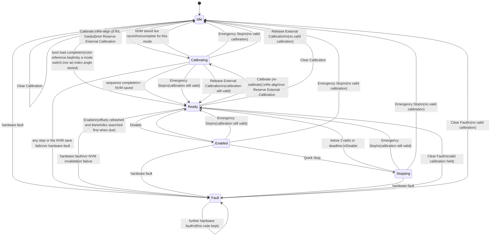

### Transition Table

The graph above does not describe hand-written command handlers. It is the transition table that the
FOC state machine is built from. Every operator command, every service completion and every fault
notification is an **event**. Every arrow in the diagram is a **row** of the table. A row has a source state, an event,
a target state, an optional guard and the action that builds the target state. Some rows accept an event
in a state without leaving it, for example a calibration sub-step changing or a motor-parameter save
completing. These are declared as internal rows.

The table is a compile-time constant. Its guards and actions are stateless and receive the state
machine as their context, so the whole table lives in read-only memory. The machine itself holds only
the current state and a bounded queue of events. That keeps the lifecycle within the RAM of the
targets with 32 KB of RAM.

The queue depth is budgeted, not rounded up. Each slot costs a whole event, and an overflow is an
assertion failure, not a dropped event. The deepest run of nested dispatches is a calibration sequence
whose identification services report inline. The orchestrator announces four steps, and the alignment
result follows the last one, so the run peaks at five. The friction-and-inertia step is not among them,
because the control mode sets that step directly and does not announce it. The events that follow the
alignment are pushed only once the queue has drained again. The remaining slot absorbs a command
chained from a completion callback, which gives the six slots the machine reserves. A new calibration
step that announces itself therefore costs a slot. On the targets with 32 KB of RAM, that slot comes out
of a RAM budget that the linker now guards.

The table is the single source of truth for what the machine accepts:

- An event that arrives in a state with no row for it is **forbidden**: nothing changes, the
  command reports *rejected*, and the trace shows which event was refused in which state.
- An event whose rows exist but whose guards all refuse it is **rejected** in the same way.
  The guard holds conditions such as "asynchronous work is outstanding" or "the rotor
  reference is not established".
- The build checks the table, not the running firmware. The machine can only be constructed
  from a validated table, which the compiler evaluates. Each of these defects stops the build
  and names the offending row. The defects are duplicate rows and rows that an earlier unguarded
  row hides. They are also states that no sequence of rows reaches from Idle, and events that no
  row handles. Last, they are states that no row leaves, and rows that can never fire. A malformed lifecycle therefore never produces
  a binary.
- A separate rule set declares which state changes the lifecycle may make, apart from the rows.
  Idle goes to Calibrating, Ready or Idle. Ready goes to Calibrating, Enabled or Idle. Enabled goes
  to Stopping, Ready or Idle. Calibrating, Stopping and Fault go to Ready or Idle. Any state goes
  to Fault. Enabled is
  forbidden from every state except Ready, Stopping from every state except Enabled, and Fault
  never leads straight back to Calibrating. A row that makes any other transition, or an allowed
  transition that no row makes, is a compile error.

Events are handled to completion. An event dispatched while another is being handled is queued. Two
examples are a service that completes synchronously inside the action that started it, and a fault
raised while the drive starts. The queued event is handled once the current transition has been
committed and announced. Actions therefore always observe a consistent state. The target state is
committed before its side effects run. These effects are, in order: starting the drive, completing the
pending command and notifying the ready handler.

Every operator command that starts asynchronous work (Calibrate, Re-align, Reserve External Calibration,
Clear Calibration, Set Motor Parameter) and Enable are guarded by the pending-work check. The check
rejects them in these conditions:

- a command is pending;
- any NVM operation is in flight, the boot-time check and load included;
- an identification service is running;
- a firmware pack is being received ([Service: Firmware Upgrade](service-firmware-upgrade.md), Part G);
- a fault latched in an interrupt still owes its transition.

One request therefore owns the machine at a time. The save of a new run cannot overlap a save still
outstanding after an emergency stop. Enable cannot interrupt a clear or a motor-parameter change in
progress: its transition would discard the completion and leave the command pending forever. The
boot-time load cannot overwrite the record of a calibration that started before the load answered. The
command completes with *rejected*, and the client retries once the outstanding work has completed.

A command issued from inside a completion callback is such a queued event. It reports *queued*, which
is distinct from *ok*: the machine accepted the event for processing, but the table has not decided it
yet. The caller must not read *queued* as "applied". The CAN bridge turns *queued* into *busy*, so callers
that pass a command outcome on never report success for work whose outcome is unknown. A command that
carries a callback is not left dangling when the table then refuses it. The command-rejection observer
sees every forbidden or rejected event and completes that command's callback with *rejected*. This is
true whether the event was dispatched directly or from the queue.

The transition table is observable. A tracer prints every transition as `fsm: <from> --<event>--> <to>`
next to the existing `[SM]` lines, and every forbidden, rejected or discarded event with its state. Every
entry into Fault also traces `[SM] Fault: <code>` with the code it was entered for, which the transition
line does not carry. On the bench, that line is the only record of why a run ended, short of a CAN
telemetry request.

### Structure

The common lifecycle core composes the machine. It does not hold the lifecycle logic. It owns the
table-driven machine and hands the rows a lifecycle context: references to the collaborators that do
the work, each with one responsibility.

| Collaborator           | Responsibility                                                                                                                        |
|------------------------|---------------------------------------------------------------------------------------------------------------------------------------|
| Lifecycle table        | The 49 rows and the entered hooks; the only place that knows which event is legal in which state                                      |
| Calibration flow       | Full calibration, re-alignment and external calibration: running the orchestrator, saving the record and completing the command       |
| Maintenance flow       | Clearing the stored calibration and editing the motor parameters it holds                                                             |
| Boot sequence          | The boot-time validity check and load of the stored record, and the move to Ready when a control-mode switch kept the rotor reference |
| Operation flow         | Enable and disable, faults and emergency stop, and the post-commit work of every state                                                |
| Pending command        | The one outstanding operator command, and the result held back until the target state has been committed                              |
| Command rejections     | The observer that completes a queued command's callback with *rejected* when the table refuses it                                     |
| NVM activity           | The count of NVM operations whose callbacks still capture the machine; part of the pending-work check. See C2a for its owner          |
| Calibration context    | The calibration record in RAM and its application to the controller                                                                   |
| Commissioning commands | Re-alignment, the external-calibration reservation and completion, and motor-parameter edits, each dispatched as its event            |
| Mode hooks             | The interface through which the flows reach the control mode: the controller, its tunables and the mode-specific calibration steps    |
| Default mode hooks     | The mode-specific hooks that a control mode need not override; the common lifecycle core supplies them                                |

The control-mode state machine owns the NVM activity count, not the common lifecycle core (C2a).

The torque, speed and position machines extend the common lifecycle core and implement the mode hooks.
Nothing else in the lifecycle depends on the concrete control mode.

### Emergency Stop

Emergency Stop is the unconditional safety command. It is accepted from **every** state and always
returns *ok*. Its first action stops the FOC controller, and with it the power stage, before any state
evaluation. Every Emergency Stop row also stops the controller in its own action. The table itself thus
cuts the power stage. An Emergency Stop that reaches the machine by any other route cannot leave
Enabled with the bridge still switching. A second stop is harmless, because the stop is idempotent. Any
command callback still outstanding, for example a running calibration or a pending Clear Calibration,
completes with *aborted by fault*.

The resulting state depends on the state the command was issued from:

| Issued from                      | Resulting state | Rationale                                                                          |
|----------------------------------|-----------------|------------------------------------------------------------------------------------|
| Enabled, Stopping or Calibrating | Ready           | Calibration data in memory and NVM is still valid; the motor stays enableable      |
| Enabled, Stopping or Calibrating | Idle            | No valid calibration data is held, so the motor must be calibrated before enabling |
| Idle, Ready                      | unchanged       | The machine is already stopped; only the inverter stop is (re)issued               |
| Fault                            | Fault           | The fault state is safe and must be cleared explicitly with Clear Fault            |

Clear Fault returns to Ready when valid calibration is held and to Idle when it is not. It does not
always return to Idle. Clearing releases the latch, so the next Enable is accepted, not refused.

Calibration data is valid when the applied record meets four conditions. It has the stage *complete*,
a non-zero pole-pair count and a positive phase resistance. It also meets the active mode's own requirements. Torque mode adds no
requirement. Speed and position modes also require a finite, positive rotor inertia and a finite,
non-negative viscous friction. This mode-aware check stops a torque-only record from silently reaching
Ready in speed or position mode. An aborted calibration run never commits its results. The in-progress
values live in the pending record of the Calibrating state and are copied out only after the NVM save
succeeds. A previously valid calibration therefore survives an emergency stop during a re-calibration,
and the machine returns to Ready.

A drop to Idle on every emergency stop would force a full recalibration after each safety intervention.
That is why the transition depends on calibration validity.

### Quick Stop

An emergency stop cuts the power stage and lets the rotor coast. On a drive with inertia, this takes as long as
friction allows. Quick Stop stops the rotor under control instead (REQ-LCY-006). From Enabled it enters Stopping,
where the power stage stays on. The active mode then decelerates the rotor towards a standstill at the quick-stop
deceleration of the configuration record.

| Setting                 | Default           | Range              | Meaning                                         |
|-------------------------|-------------------|--------------------|-------------------------------------------------|
| Quick-stop deceleration | 0 (current limit) | 0 – 100 000 rad/s² | Rate at which a quick stop slows the rotor down |

- Speed and position mode ramp the speed reference from the measured speed to zero at the deceleration, and the
  speed loop follows it within the current limit. A deceleration of zero steps the reference to zero, so the
  loop brakes at the current limit. The position law and the speed ramp of the setpoint are suspended
  ([FOC Speed Control](foc-speed.md) and [FOC Position Control](foc-position.md), Quick Stop).
- Torque mode has no speed loop. The cascade brakes with a q-axis current against the measured speed. The current
  is capped at the value that decelerates the calibrated inertia at the deceleration, or at the current limit for
  zero ([FOC Torque Control](foc-torque.md), Quick Stop). Without a calibrated inertia it cannot size the braking
  current. Quick Stop is then rejected and the drive stays Enabled; the client falls back to the emergency stop.

The event loop checks the measured speed every 10 ms. Once its magnitude is below 2 rad/s, or once the deadline
has passed at any speed, the drive cuts the power stage and enters Ready. The remaining speed coasts out.
The deadline is set on entry from the measured speed |ω₀| and the deceleration a: 1.25·|ω₀|/a + 100 ms. That is a
quarter more than the ramp needs plus one outer settling time. A slow ramp thus runs to the end, and a stop that
does not decelerate is still cut. A deceleration of zero brakes at the current limit and has a 1 s deadline.

While Stopping, the drive refuses setpoints, a mode switch and calibration. Some fault supervisors guard the power
stage and the motor: bus voltage, over-temperature, overspeed, encoder freeze and plausibility, phase loss and
travel limits. They watch Enabled and Stopping alike. Other monitors watch Enabled only: the following-error and
target-window monitors, the CAN liveness watchdog and the command timeout. The stop suspends the position law and
takes no setpoints. Disable and Emergency Stop cut the stop short and cut the power stage at once. A fault enters Fault
from Stopping as from Enabled. Quick Stop is accepted and changes nothing in Stopping, Idle, Ready and Fault. It is
rejected in Calibrating, whose stop is the emergency stop.

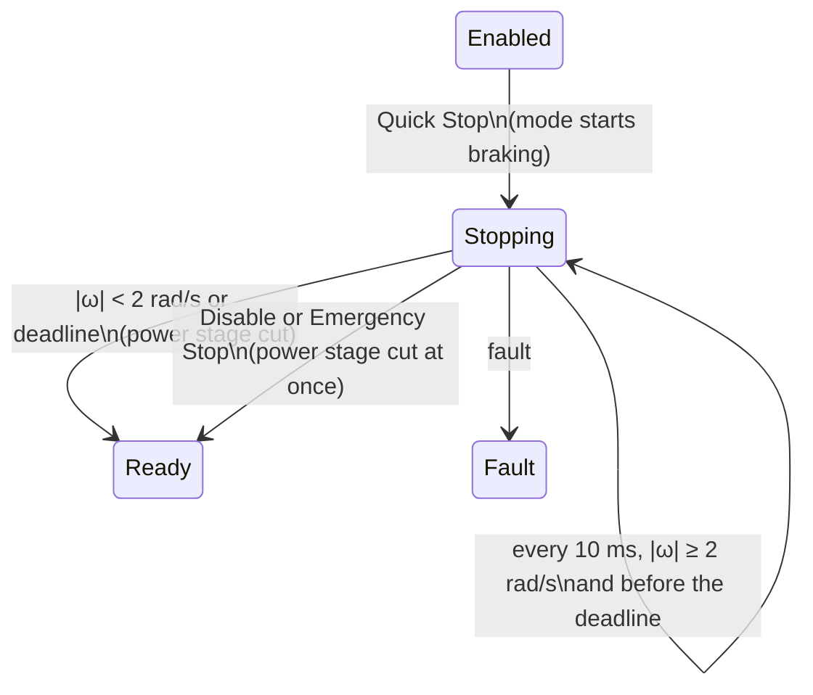

### Calibration Sequence

When Calibrate is issued from Idle or Ready, the state machine enters Calibrating and executes a sequential chain
of identification steps. Each step is asynchronous: the state machine calls a service and waits for its callback
before it continues to the next step. If any step returns a failure result, the machine immediately enters Fault.

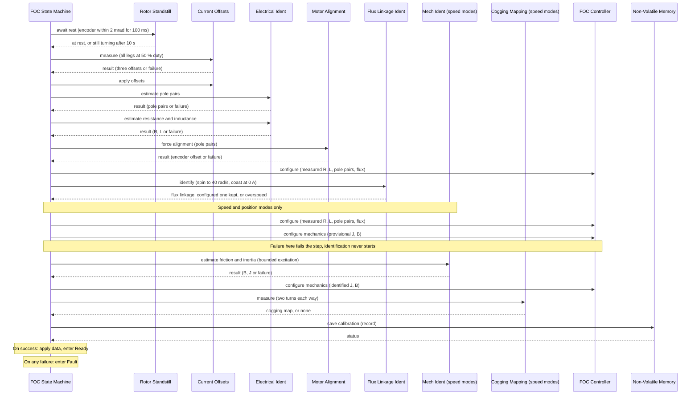

**Steps and data produced:**

| Step                                                               | Service             | Data stored                                                       |
|--------------------------------------------------------------------|---------------------|-------------------------------------------------------------------|
| Rotor at rest ([Service: Rotor Standstill](service-standstill.md)) | Rotor Standstill    | Nothing; fails the calibration after 10 s                         |
| 0. Current sensor offsets                                          | Current Offsets     | The offsets of phases A, B and C                                  |
| 1. Pole pairs                                                      | Electrical Ident    | Pole pairs                                                        |
| 2. Resistance and inductance                                       | Electrical Ident    | Phase resistance, d-axis inductance                               |
| 3. Alignment                                                       | Motor Alignment     | Nothing; the rotor reference is held in RAM                       |
| 3b. Index search (encoder with an index)                           | Index Search        | Encoder index angle; none when no index is found                  |
| 3a. Flux linkage (every mode)                                      | Flux Linkage Ident  | Flux linkage; the configured value when not identified            |
| 4. Apply measured model + provisional plant                        | FOC controller      | Nothing persisted; makes the loops able to move the rotor         |
| 5. Mechanical parameters (speed/position only)                     | Mechanical Ident    | Inertia, viscous friction, speed-loop bandwidth (fixed 100 rad/s) |
| 6. Cogging map (speed/position only)                               | Cogging Mapping     | Cogging map and its scale, Coulomb friction                       |
| 7. NVM persist                                                     | Non-Volatile Memory | All of the above written to non-volatile memory                   |

The sequence starts only once the rotor is at rest. The encoder must stay within 2 mrad of where a
100 ms window began, which bounds the speed to 0.02 rad/s. A rotor still turning after 10 s fails the
calibration with `[SM] The rotor did not come to rest`. The offset step holds all three legs at 50 %
duty, which shorts the windings, so a turning rotor drives current through the sensors. A rotor that
slows to a stop inside the averaging window leaves part of that current in the stored offsets. In
simulation, a calibration started 25 ms after the reference motor was disabled at 500 rpm. It stored
offsets 5 to 15 mA off in five runs out of five. REQ-CMS-001 allows 5 mA. From 100 rpm the offsets were 4 to
9 mA off (REQ-CMS-001). The wait is measured from the window's start, not from poll to poll, so a slow
creep cannot pass one encoder count at a time. A rotor already at rest costs the 100 ms window.

The offsets apply as soon as they are measured, so the identification and alignment steps after them
read corrected currents ([Service: Current Sensor Offsets](service-current-offsets.md)). An electrical
identification that arrives over CAN measures them too. The CAN bridge waits for the rotor to come to
rest, then measures and applies the offsets before it estimates resistance and inductance. The record
it completes carries them. Without that step, a drive commissioned over CAN after a cleared calibration
ran on zero offsets. On the reference board, this left +25, −17 and +45 mA uncorrected. The error
was in the current loop and in the phase-A current that the resistance estimate uses. The electrical
identification over CAN keeps the cogging map, the mechanical parameters and the loop bandwidths of the
record. It measures none of them. Replacing an inertia entered or identified earlier with nothing would
leave a speed or position mode uncalibrated again.

The cogging map is measured with the speed loop configured from the identified mechanics. A run that
measures no map does not fail the calibration ([Service: Cogging Compensation](service-cogging-compensation.md)).
The same two-direction run measures the dry friction, which is kept even when the map is refused. An
estimate that is negative, not finite or missing is stored as 0 and traced as none. A value of 0 means
no friction feed-forward. In speed and position modes, the friction is applied with the mechanics and
the cogging map. It is cleared with the map before the mechanical identification and the cogging step,
so neither step measures through an earlier calibration's compensation. Torque mode applies none. A
Coulomb friction written as a motor parameter (contract 2.20) is stored first. It is then re-applied the
same way, so a value of 0 removes the feed-forward.

After the save, the calibration data is applied to the FOC controller. The current PID gains are
computed from R, L and the bandwidth, and the velocity PID gains are applied for speed modes. The state
machine then transitions to Ready. The encoder zero offset is not written back to the encoder at this
point. Only the alignment step itself sets it during the calibration sequence.

Every record handed to the NVM is traced first as `[SM] Calibration record: R=… L_mH=… p=… psi_mWb=… J_uNms2=… B_uNms=… Ia_mA=… Ib_mA=… Ic_mA=… In_mA=… cog_mNm=… fc_mNm=…`.
In this line, `In_mA` is the measured current noise, 0 when not measured. The field `cog_mNm` is the peak
of the cogging map, 0 when there is none. The field `fc_mNm` is the Coulomb friction, 0 when there is none. Inertia and
viscous friction are traced in micro-units, because the tracer prints three decimals and cannot show
values around 1e-6 and 1e-5. The `[EST]` lines and the `[SM] Applying mechanical estimates` line below
use the same convention.

An external observer, the software-in-the-loop suite included, compares the calibration record line
against the plant it configured.

Every mechanical consumer uses one torque constant: the identification service, the online inertia
estimator and the speed-loop gain design. It is not configured per target. It is derived from the
record as $K_t = \tfrac{3}{2} p \psi_f$, the factor that the plant model itself applies.

A motor whose flux linkage is set as a motor parameter therefore gets a consistent torque constant,
without a second number to keep in step.

### Editing motor parameters

The record holds seven motor parameters: phase resistance, inductance (written to both axes), pole
pairs, flux linkage, inertia, viscous friction and Coulomb friction. Set Motor Parameter from CAN
([CAN Service Layer Design](service-can.md)) can also enter them, one at a time. The command is accepted
in Idle and Ready with no work outstanding, for a value inside the parameter's range. A record need not
exist yet, so a motor can be commissioned from its datasheet (REQ-CMS-004).

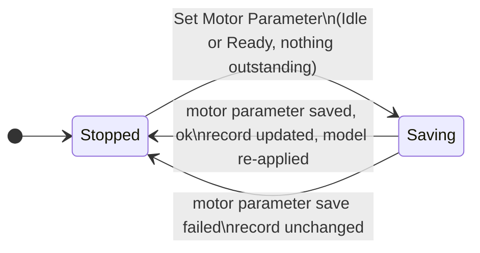

The machine stores the edited record first and adopts it only when the write has landed. RAM thus never
holds a value that the NVM does not. Its stage is recomputed. A record that was complete stays complete.
An incomplete record becomes complete once it holds pole pairs and a positive resistance and inductance.
It must also hold what the active mode needs in addition (inertia for speed and position). Once complete, the electrical
model and the mode-specific calibration are applied as at boot. A completed record does not move the
machine out of Idle. A rotor whose reference was never established must still be aligned before it can
be enabled, exactly as after boot.

A change of the pole-pair count invalidates the rotor reference, because the encoder offset was measured
in electrical angle for the old count. Enable is refused until the rotor is aligned again. The change
also drops the cogging map, which is binned per electrical period and would compensate other positions
after the change. Inertia and friction identified with the old count were derived through the old
torque constant. The record keeps them, and they should be identified again. No other parameter touches
the reference or the map, and none of them moves the rotor.

While the save is outstanding, the command owns the machine like any other NVM operation. A fault or an
emergency stop in that window aborts the command but not the write. The machine adopts the stored
value when it lands. The command is therefore answered *aborted* (*aborted by fault* over CAN), not
*busy*, and a client reads the value back.

Two consequences of entering parameters by hand are left to the operator. First, a record completed by
hand has no measured current offsets. Only Calibrate and an electrical identification over CAN measure
them, so calibrate a drive commissioned from its datasheet once before you rely on it. Second, a motor
parameter is stored even when the active speed LQI or position LQR/LQI law cannot be designed from it
with the operator's settings. That law keeps the design derived from the automatic settings. The drive
traces `Speed settings not applied` or `Position settings not applied`, and the settings read back are
still the operator's. To refuse such a parameter, the drive needs a design check of the edited model
before it stores it. The cascades do not offer that check yet.

### Identifying the flux linkage

The flux linkage sets the back-EMF feedforward of the decoupled, deadbeat and sliding current laws. Through
$K_t = \tfrac{3}{2} p \psi_f$ it also sets every mechanical consumer. Before this step existed, the flux linkage
was always the target's configured value. On the reference board this was 7.0 mWb, against the motor's 4.6 mWb.
Identified inertia, viscous friction and the cogging map all scaled with that ratio. The deadbeat law settled
with a current offset that grew with speed.

After alignment and before mechanical identification, the state machine applies the electrical model it has just
measured to the live current loop. It then asks the flux linkage service to spin the rotor with a small q-axis
current and release it to a 0 A setpoint. While the rotor coasts, the service fits the q-axis voltage against the
electrical speed ([Service: Flux Linkage Identification](service-flux-linkage-ident.md)). The step runs in every control mode,
torque included, since it needs only the current loop.

| Outcome        | Effect on the calibration                                                          |
|----------------|------------------------------------------------------------------------------------|
| Identified     | The flux linkage of the pending record is replaced, and later steps use it         |
| Not identified | The configured value is kept, the reason is traced, and the calibration carries on |
| Overspeed      | The step fails and the machine enters Fault, as for any failed step                |

The step runs once per calibration. A mechanical run that aligns again for a second attempt does not spin it a
second time. A re-alignment and an electrical identification over CAN do not run it, since neither may move the
rotor beyond the alignment. The step is traced as `[SM] Identifying flux linkage` and then
`[SM] Flux linkage: psi_mWb=… c_mV=… n=… se_pct=…`, or `[SM] Flux linkage not identified (…), keeping psi_mWb=…`
(REQ-CMS-001).

### Making the loops live before mechanical identification

Mechanical identification commands a speed trajectory and identifies the plant from the motion that results.
It and the flux-linkage step are the two calibration steps that move the rotor. Every earlier step injects
current into a stationary rotor and needs no closed loop at all.

Until a model is applied, the current loop holds inert gains. It is configured from resistance, inductance
and pole pairs, and none of them are known before the electrical steps run. The speed loop holds a zero
current envelope and no plant, so its controller produces no reference at all. An identification started in
that state commands a speed that no rotor reaches. The regressor carries no excitation and the run reaches
its timeout. The calibration fails on hardware, but passes against any test double that publishes samples
on demand.

Before identification starts, the state machine therefore applies to the live controller:

1. the **electrical model it has just measured** in this run — the pending resistance, inductance, pole-pair
   count and effective flux linkage, with the current-loop tunings that follow from them;
2. a **bounded provisional mechanical model** — a small placeholder inertia, zero viscous friction and a
   deliberately low speed-loop bandwidth. It is a stand-in that lets the speed loop act within its current
   envelope, not a measurement. It is never persisted or reported as calibration.

Both are checked. Identification is **not started** in these cases:

- the pending electrical record is not usable;
- the torque constant derived from the pending pole pairs and effective flux linkage is not positive
  ($K_t = \tfrac{3}{2} p \psi_f$, the same factor that the plant model applies);
- the controller refuses either configuration.

The step then fails and the machine enters Fault. A run that cannot move the rotor is a failed calibration,
not a run that silently produces nothing.

The excitation that the service is given is bounded in current, speed and time. The current envelope is the
drive's own configured limit, with a small margin above it. Noise at the clamp thus does not read as a
runaway. The service clamps that down again to what the inverter reports it supports. The speed limit is
derived from the commanded target, not from a rated speed of the machine, because the system configures no
per-drive speed rating. It bounds the trajectory against a runaway, not against a motor whose safe speed is
below the commanded target.

### Restoring the controller after an aborted run

The provisional model must not outlive the run that needed it. Every way a calibration can end short of a
committed record reaches the same restore. Each one passes through the one place that aborts a calibration
run. These ways are a failed step, a refused configuration, a failed NVM save and a hardware fault. They are
also an emergency stop, and the release of the machine's external resources when it is torn down. A record that
saves but is incomplete for this mode also restores, since nothing was committed for the loops to keep.

| Situation                         | Restored state                                                                           |
|-----------------------------------|------------------------------------------------------------------------------------------|
| A valid calibration is still held | That record is re-applied: electrical model, current tunings, mechanics, estimator seeds |
| No valid calibration is held      | Nothing is re-applied; the motor stays un-enableable until a calibration succeeds        |

A committed calibration supersedes the provisional model and does not restore over it. The record just
saved is applied in full, so nothing is left to put back.

### Validating the identified mechanics

An identified pair is accepted only when it is finite and inside a shared physical band. The mechanical
identification service and the online estimator use the same band
([Service: Mechanical Parameters Identification](service-mechanical-ident.md)). A non-finite, non-positive or
out-of-band inertia or friction fails the step through the normal calibration-failure path. The command gets the
result *calibration failed*, and the machine enters Fault with the fault code calibration failed. The value never reaches the NVM service.
The completeness check that stamps the stage *complete* catches zero and non-finite values. It does not catch
a merely absurd value, such as an inertia of 10^30. That is why the band is applied where the estimate
arrives.

### Retrying the mechanical step from a new alignment

The excitation starts from a rotor at rest, under provisional gains. Its outcome depends on the rotor reference that
the alignment just set. A run that stalls or leaves its envelope does so again when it is repeated from the same
reference. It does not do so when it is repeated from a new one. A run that yields no usable estimate therefore sends the
sequence back through alignment and then the mechanical step. The sequence makes up to three attempts in all, then
gives up the calibration through the failure path above. Each retry traces
`[SM] Aligning again for mechanical identification, attempt n of 3`. Electrical identification is not repeated.

### Confirming the estimate by agreement

A single run can converge on noise. On a rotor with no load, friction and cogging swamp the inertia signal. An
isolated run then sometimes reports an inertia an order of magnitude too low. The calibration therefore asks the
mechanical step for a set number of agreeing runs. The default is 1, which accepts the first usable run; the motor
application asks for 2. Each usable run is kept. As soon as two inertia estimates differ by less than 20 % of the
larger, their mean is the answer and the record is saved. Runs that do not agree are repeated from a new alignment
under the three-attempt limit above. A lone outlier is thus outvoted by two runs that agree, and three mutually
disagreeing runs fail the calibration. An unconfirmed estimate traces
`[SM] Mechanical estimate J_uNms2=… not confirmed by a second run`.

### External Calibration (CAN-driven)

An external client, for example the CAN bridge, can supply pre-measured calibration data without the internal
identification chain. A two-command protocol makes sure that the state machine is in the correct state before
any inverter interaction begins:

1. **Reserve External Calibration** — synchronous. It checks that the machine is in Idle or Ready with no pending
   asynchronous work, like every command that starts asynchronous work. It then transitions to Calibrating and
   returns *ok*. In any other state it returns *rejected*. The Calibrating state prevents the acceptance of a
   concurrent second request.

2. **Complete External Calibration** (with a completion callback) — asynchronous. The external client calls it
   after its own estimation is finished. The machine stores the data in the pending record of the Calibrating
   state, the current-sensor offsets that the client measured included. It then runs the alignment step, so an
   externally supplied record still gets a live rotor frame before it can be used. Its guard refuses the command
   while another command is still pending. A second completion sent while the first is aligning is thus rejected
   and does not overwrite the pending record. If a fault occurred between the two calls, the machine is in Fault.
   The completion command has no row there and is rejected. The client observes the failure through its own
   estimation callback.

The two-command split makes sure that the machine enters Calibrating before any open-loop power-stage output is
applied. It also keeps the state guard entirely inside the state machine, not in the calling layer.

3. **Release External Calibration** — synchronous. It gives up a reservation whose estimation failed, or whose
   completion was rejected, so the node does not stay in Calibrating until an emergency stop. It returns to Ready
   when a valid calibration is held, and to Idle otherwise. It is accepted only while three conditions are true.
   The reservation came from Reserve External Calibration, no command is pending and no run is in flight.
   A calibration started with Calibrate cannot be released this way, and a completion that is already aligning
   finishes first.

The CAN liveness watchdog emergency-stops a reservation like an Enabled drive when the client is lost.

The external path stops after alignment and does not chain into mechanical identification. The electrical
identification over CAN covers the electrical steps only, so it must not drive the mechanical estimator. The NVM
save therefore stamps the stage *complete* only when the record satisfies the active mode's own validity
requirements. Electrical parameters plus alignment satisfy torque mode, which transitions to Ready. Speed and
position still lack inertia and friction. Their record is persisted with the stage *none*, and the machine returns
to Idle with a partial record. CAN reports this as the partial-calibration motor state. To complete those modes,
run the internal Calibrate chain, which includes mechanical identification.

### Refreshing the current offsets at enable

The current sensors' offsets drift after the calibration that measured them
([Service: Current Sensor Offsets](service-current-offsets.md), Part D). The machine therefore measures them again
before the drive is enabled, at the first Enable after power-up, after a control-mode switch and after every Fault.
The machine stays in Ready while it does this. The machine accepts the Enable, waits for the rotor to come to
rest and measures the offsets. A completion event then decides the command.

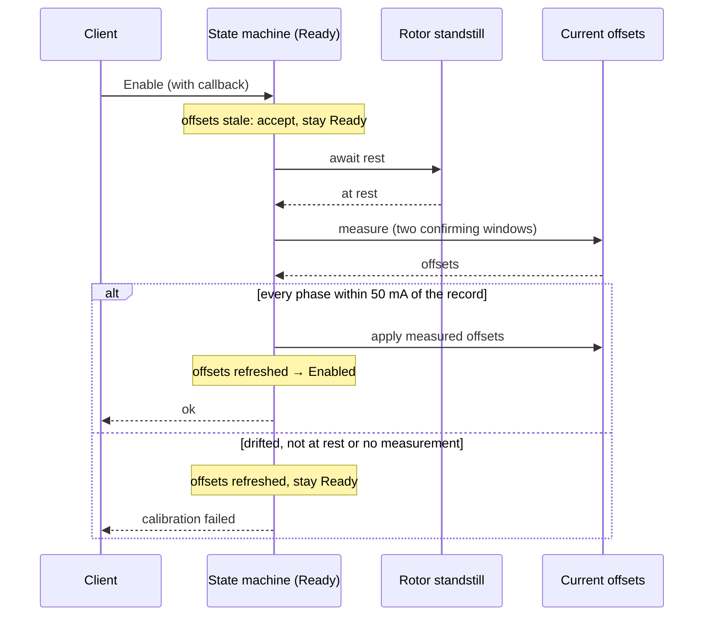

- The offsets are stale when the machine is constructed, which is at power-up and at every control-mode switch,
  and whenever the machine enters Fault. A refresh that ends in Enabled makes them fresh, and every later Enable
  goes straight to Enabled as before. A drive built without an offset measurement never refreshes.
- While the refresh runs, the pending-work check is true. A second Enable, a calibration, a mode switch or a
  maintenance command is therefore rejected. Disable abandons the refresh and refuses the Enable with *rejected*.
  An emergency stop or a fault abandons it with *aborted by fault*. The stored offsets stay in force in every
  refusal.
- The plain Enable returns *ok* as soon as the machine accepts the Enable. The model in the loop uses it and
  watches the state. The Enable with a callback reports the outcome when the machine decides the Enable. The CAN
  bridge acknowledges Start from it ([CAN Service Layer Design](service-can.md), Part D). A client thus sees the
  acknowledgement once the drive runs or has refused.

### Fault Safety

**Event-dispatcher path.** The fault-detected event has a row from every state to Fault. Its action records the
code, latches the fault controller, stops the inverter if the machine was in Enabled or Calibrating, and aborts the
calibration services. Only then is Fault committed. Any event raised during this time is queued and handled only
after Fault has been committed, so it cannot observe the state being left. Examples are a further fault from inside
the stop, or a calibration completion that the abort could not suppress. A further fault does re-enter Fault, but
the recorded code is the one that first tripped the drive. The fault raised during the shutdown is a consequence.
To overwrite the root cause with it would lose the only diagnostic the operator has. The new code is recorded again
once the fault has been cleared.

The clear budget is spent where the transition commits, not where the command is issued. Clear Fault only reads
whether a clear is still allowed. The row action consumes one of the three attempts and releases the latch. A
Clear Fault that is queued and then refused thus does not silently cost an attempt.

**Interrupt path (board protection, CAN bus-off).** A fault can arrive in interrupt context. The platform then stops
the FOC controller's bridge immediately within that interrupt, before any state change or tracing. The
fault-detected event, its trace output and any pending-command completion are posted to the event dispatcher and
execute on the next dispatcher turn. No multi-word state write, tracing call or non-volatile-memory access thus
runs from an interrupt context (see REQ-LCY-003).

A stop of the inverter alone is not enough to cut the power stage. The identification services drive the bridge
through their own timers and phase-current callbacks. A service left running writes duty cycles on its next tick.
The power-stage output then re-arms the output stage that the stop has just disabled. The transition to Fault
and Emergency Stop therefore both abort the electrical identification, the alignment and, in speed and position
modes, the mechanical identification. The abort stops injection, cancels the service's timers, and drops the
pending completion **without invoking it**. The state machine owns the outcome, and a late calibration result must
not overwrite the fault that interrupted it. A service that has been aborted or has completed ignores any further
phase-current sample it is handed. It does not reclaim the inverter's callback slot, because a reassignment of that
slot from inside its own invocation would destroy the closure being executed.

The control-loop runner releases the inverter's phase-current callback when it disables, for the same reason. A
callback left pointing at a stopped control loop is another path back to the power-stage output.

The transition to Enabled commits the state **before** the FOC controller starts. The start runs as a post-commit
effect of the transition, and a fault raised while it runs is queued behind it. Otherwise a fault raised in the
window where current first flows would observe Ready and skip the stop. The pending assignment to Enabled would
then overwrite it. The result would be an energised bridge on faulted hardware, with the machine reporting Enabled.
Because the state is committed first, such a fault stops the drive.

The early commit alone is not enough for a fault delivered from an interrupt. That path dispatches the
fault-detected event on the event dispatcher, not in the interrupt. A read of the lifecycle state around the
start thus still sees Enabled. The latch is therefore set **in the interrupt**, and the Enabled entry hook consults the
latch, not the state. It checks before the start, so the start does not undo the cutoff that the interrupt made.
It checks again after the start, for a fault raised while the start ran. Either check turns the latched fault into
a fault-detected dispatch, which the table queues and drains before the Enable dispatch returns. The whole enable
sequence is therefore atomic with respect to the fault, and Enable reports *aborted by fault*.

The same reasoning applies one level down, inside the control-loop runner. The phase-current slot connects the
control loop to the bridge, so the runner holds it only while the bridge runs. The runner's enable sequence clears
the slot, enables the control law, starts the inverter and takes the slot last. Its disable sequence releases the
slot first, then stops the inverter and the control law. A conversion that lands while the slot is clear does
nothing, so no per-sample flag is necessary. Once the disable sequence has released the slot, no sample can write a
duty cycle. On a target whose power stage restarts when a duty cycle is written, a duty cycle written to a stopped
stage would restart it.

Each step of the enable sequence can be interrupted. A stop from the faulting context between two steps would be
undone by the steps that follow. These steps would re-arm the bridge on hardware that has just faulted. The enable
sequence therefore clears a stop-request flag that the disable sequence sets. It re-checks the flag after every
step and unwinds through the disable sequence once the flag is set. A stop that lands after the last check needs no
unwinding, because it runs after every write the sequence makes. Both the faulting context and the mainline write
the flag, so it is set and cleared outright, not counted. A read-modify-write shared with an interrupt is exactly
what REQ-LCY-003 excludes.

#### Announcing a Fault

An entry into Fault from any state but Fault starts an episode. Each such entry is announced to an observer,
with the code that the machine keeps. The control-mode state machine registers that observer for every mode it activates, so
the observer survives a mode switch. A further fault of the same episode is not announced. The application hands
the announcement to the fault history ([Service: Fault History](service-fault-history.md)), which records it.

#### Fault Latching

A fault is latched. Enable is refused while the latch is set, so the only path out of Fault is an explicit Clear Fault.

Clearing has two gates: the hardware condition and a retry budget. The fault controller reports the first gate that
refuses, condition before budget, so the operator learns the physical cause, not the accounting.

**The condition gate.** The platform reports its board protection status as *asserted*, *clear* or *unknown*. While
a fault is held, the fault controller polls the status every 50 ms (the condition poll interval) on the event
dispatcher. It polls on its own schedule, not only when a command arrives. Otherwise a condition that asserts and
clears between two operator commands would never be observed as asserted. A clear is accepted only once the
condition has left *asserted* and has stayed *clear* for 250 ms (the condition dwell). The dwell starts at the
*asserted* → *clear* change, so any asserted sample inside the window restarts it. A condition that chatters around
its threshold thus cannot be cleared on one favourable reading. The enable check refuses independently while the
condition reads *asserted*, so a clear granted during a momentary deassertion still cannot arm the bridge.

```text
  asserted ──clear sample──> settling ──dwell elapsed──> ready ──Clear Fault──> cleared
      ^                          │
      └────asserted sample───────┘
```

*Unknown* is the honest answer from a platform that cannot interrogate its protection hardware. It neither blocks a
clear nor satisfies the verification, and such a platform behaves exactly as it did before the gate existed. A
*clear* answer instead would claim a verification that the hardware never made. On those platforms a fault comes
from software (calibration failure, CAN bus-off, watchdog), not from a physical condition that anything could hold.

On some targets, the protection comparators sample through the phase-current converter, which converts only while
the power stage switches. Once the bridge is stopped, the comparators cannot be read while faulted. Such targets
therefore answer from their latched trips and a fresh bus-voltage reading ([Error Handling Design](error-handling.md)).
The emulated target answers from its simulated protection. Only a platform with no protection reports *unknown*.

**The budget.** Each accepted Clear Fault increments a counter. After 3 clears (the maximum consecutive clears)
without an intervening clean run, further clears are refused and a reset is necessary. Two events count as a clean
run and reset the counter:

- Disable from Enabled: the drive ran and was stopped deliberately, not by the same condition re-tripping;
- 10 s (the clean-run duration) spent in Enabled without a fault.

Some drives are only ever stopped by faults or emergency stops. The second event keeps three faults spread over
a long life from forcing a power cycle on such a drive. The operation flow starts the clean-run timer once Enabled has started without a
pending fault, and cancels it on entry to any other state. The fault controller also cancels it when it enters a
fault. A condition that re-faults within 10 s of every enable therefore still exhausts the budget.

The budget supplements the condition gate and does not replace it. It bounds the platforms that cannot verify. On
the platforms that can, it bounds a condition that happens to read clear between attempts. A clear that the
condition refused does not spend from the budget.

The fault controller's clear asserts on the budget alone. It runs where the transition commits, not where the
command was issued, and a condition that re-asserts in that window must refuse the clear. An assertion on the
condition there would reset a board whose hardware is still faulted, which would turn a fault into a reset loop.

The last fault code is preserved and stays readable after Clear Fault has cleared the fault. Before any fault has
occurred it reads *none*, so a client can tell "no fault yet" from a real hardware fault.

#### Faults raised in interrupt context

The primary path of the platform fault notifier runs in the power-stage fault interrupt (board protection) or in the
CAN interrupt (bus-off). Neither context can take the transition itself. The transition to Fault traces, writes a
multi-word state value that the CAN bridge reads concurrently, and completes a pending command that reaches
non-volatile memory.

The split is therefore: **latch and cut the bridge in the interrupt, record the fault in the dispatcher**.

The registered handler latches the fault and stops the FOC controller synchronously. It does this unconditionally,
without a look at the state, because hardware that says "fault" outranks what the state machine believes it was
doing. It then hands the fault-detected event to the event dispatcher. The secondary handler, which broadcasts the
fault over CAN, already worked this way.

The latch is an atomic compare-and-set of the pending fault code from *none*, plus a write of the latch flag. That
is all that an interrupt may do here. The tracing, the multi-word state write and the pending-command completion
stay on the dispatcher. The latch flag says that a fault is in force, and commands consult it. A pending code other
than *none* says that the machine still owes the fault-detected transition; whichever context takes the transition
consumes the code. The compare-and-set keeps the first code when a second source fires before the transition is
taken, so the root cause is the code reported. The power-stage trip and CAN bus-off both latch. The fault
controller keeps a third, dispatcher-only flag for "the transition has been taken". This flag decides whether an
arriving fault is the one that tripped the drive. A further fault does not replace the last fault code.
The latch flag carried this distinction before the latch moved into the interrupt.

The claim of the pending fault takes the code with one atomic exchange to *none* and hands it back. An interrupt
that lands mid-claim is either claimed with it or stays pending for its own transition; it cannot be wiped. Only the
claim clears the pending code. The transition does not clear it. Otherwise a fault latched while that transition ran would
be wiped before its own dispatcher turn and would never be recorded. For the same reason, Clear Fault is refused
while a fault is pending. A clear there would drop the latch of a fault that has already tripped the drive. It
would also spend one of the three permitted clears on a state that the next dispatcher turn immediately undoes. A
fault whose transition is still owed also counts as pending asynchronous work. This stops a control-mode switch from
destroying the state machine in that window, together with the latch and the queued fault-detected event.

Know this consequence when you read the tests. Between the interrupt and the dispatcher turn, the bridge is off and
the latch is set. But the reported state is still the pre-fault state. Commands consult the latch, not the state,
so an enable that arrives in that window is refused and not acted on. The transition is taken exactly once. The
dispatcher turn or the enable sequence, whichever comes first, takes the pending fault, and the other finds nothing
left to record.

#### Registration lifetime

A fault notifier outlives the state machines that register with it. A control-mode switch destroys one state machine
and constructs the next in the same storage. Each state machine therefore releases its registration and aborts its
calibration services when it is destroyed. Otherwise the notifier's stored callback and the services' pending
callbacks would both point into freed storage.

Hardware protection events reach the state machine through the platform fault notifier, the fault notifier used on
the target. It registers a callback for board protection with the platform during construction. It translates each
board protection reason into the matching fault code:

| Board protection reason | Fault code      |
|-------------------------|-----------------|
| over-current            | overcurrent     |
| over-voltage            | overvoltage     |
| under-voltage           | undervoltage    |
| over-temperature        | overtemperature |

The fault supervisor ([Fault Supervision Design](fault-supervision.md)) raises encoder loss, stall, phase missing,
overspeed, following error, position limit and overtemperature through the same notifier. It also raises overvoltage
and undervoltage at the operator's bus-voltage limits (Part L). The CAN command timeout
([CAN Service Layer Design](service-can.md), Part F) raises command timeout the same way. All of these come from the
event loop, and the state machine handles them as it handles a board protection trip.

The control-mode state machine hands the overspeed limit of the configuration record to the speed limiter of the
torque cascade ([FOC Torque Control](foc-torque.md)). The limit is defined in
[Fault Supervision Design](fault-supervision.md), Part G. It does this whenever it activates a mode and whenever the record is written,
in any state. It holds a speed setpoint beyond the limit at the limit before the setpoint reaches the speed cascade.
It hands the speed ramp of the record to the speed cascade in the same way. It keeps the latest current limit of the
motor overload model ([Fault Supervision Design](fault-supervision.md), Part I). It hands that limit to the active
cascade whenever the model changes it and whenever a mode is activated.

The state machine discards a protection event raised before it has registered its handler. A platform whose
protection reflects a *standing* condition, not an edge, must re-raise it once a handler exists. A motor then does
not enable into a condition that the board had already detected.

### Async-Callback State Invariant

A service call and its callback do not happen at the same moment. Between them, a hardware fault, an operator
command or a second calibration attempt can move the state machine. The invariant is: **a callback may only apply
its result if the state machine is still in the state that issued the service call.**

Each callback no longer re-implements this invariant as a convention. Each callback translates its result into an
event and dispatches it. The transition table decides whether the result is applied:

- The results of the calibration steps (pole pairs, resistance and inductance, alignment, friction and inertia)
  become the events *calibration step changed*, *alignment succeeded*, *mechanical parameters identified* and
  *calibration step failed*. These events have rows only in Calibrating. The mechanical result also carries a guard
  on the active sub-step. The calibration orchestrator also drops the results of a run that was aborted.
- The completion of the calibration save becomes *calibration saved*, which has rows only in Calibrating. It never
  carries a *busy* status, because the calibration flow retries a *busy* answer internally (see C2c) and does not
  dispatch it. The callback also carries the epoch of the transition that issued the save. A save that completes
  after an emergency stop and a new Calibrate is thus discarded and not consumed by the new run.
- The boot-time NVM completion becomes *boot calibration loaded*, which has rows only in Idle. The load reports
  whether the record is intact, so boot reads the calibration region once.
- The completion of the calibration invalidation becomes *calibration invalidated*, with rows in Idle and Ready. It
  leads to Idle on success and to Fault on failure, and it completes the command with *rejected* when the NVM is
  busy. It needs no request identity: the guard on every command that starts NVM work allows at most one
  outstanding invalidation.
- The completion of the motor-parameter save becomes *motor parameter saved*. It is handled in Idle and Ready and
  completes the pending command without a transition.
- Both NVM completions also have rows in Fault, because a fault or an emergency stop while the operation is in
  flight aborts the command but not the erase or the write. The RAM record follows the NVM outcome, whatever
  happened to the command. A successful invalidation drops the record. A later Clear Fault then returns to Idle and
  does not restore a calibration that no longer exists in NVM. A stored motor parameter is adopted. An invalidation
  that fails while the machine is already in Fault is ignored, because the fault is already latched.

Any of these events that arrives in a state without a row for it is **forbidden**. A save completion that arrives
after a transition is **discarded** before it reaches the table. Either way it is traced, and it never overwrites a
later state such as Enabled or Fault with a stale result.

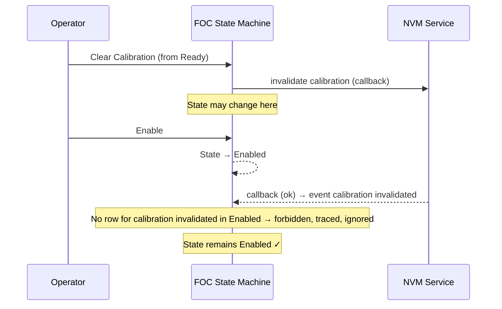

A matching race with a hardware fault that arrives between the Clear Calibration command and the invalidation
callback:

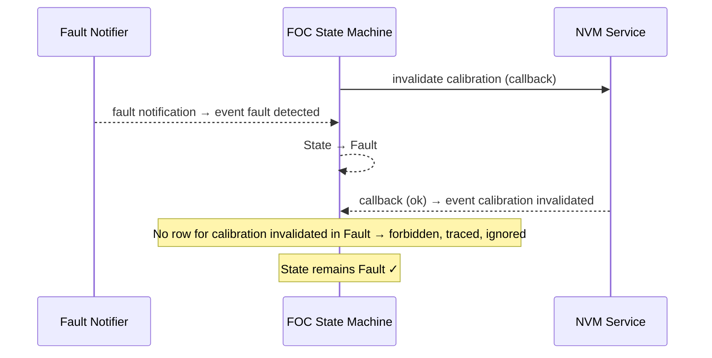

### Driving the Transitions

The state machines register no terminal commands. Their owner drives the transitions programmatically. The
control-mode state machine drives the torque, speed and position machines it owns from the CAN message handlers.
The unit tests drive them directly ([Service: Command-Line Interface (CLI)](service-cli.md), Part A).

### Mechanical Identification and Control Mode

The calibration sequence adds a mechanical identification step for the speed and position control modes. This step
estimates rotor inertia and viscous friction, then computes initial velocity-loop PID gains.

For **both speed and position mode**, the speed and position machines construct the mechanical identification
service themselves when the calibration services supply no external override. The two modes share that path.
Position mode does not require an override and does not fail calibration for the lack of one. An override is a test
and integration seam, not a configuration requirement.

### Boot-Time NVM Check

On construction, the state machine checks asynchronously whether valid calibration data exists in NVM. If the data
is found and loads successfully, the electrical parameters (R, L, pole pairs, current-loop bandwidth) are applied to
the FOC controller. The machine **stays in Idle**, unless the record carries an index angle (next section). The
rotor reference (encoder zero offset) is held in RAM only and is lost on every reset. A live alignment must
therefore re-establish it before the motor can be enabled. If the check fails or the data is absent, the machine
starts in Idle with no parameters applied.

The one exception is a machine built by a control-mode switch out of an aligned Ready (C4). At construction, it is
told that the rotor reference is kept. The load can succeed with a record that is complete for its mode. The machine then applies the record exactly as
above, and the load's completion moves it from Idle to Ready with a valid rotor reference.
A record that is incomplete for the new mode, or a load that fails, leaves it in Idle as at power-on.

### Referencing the Rotor from the Encoder Index

An encoder with an index channel lets the drive keep its rotor reference across a reset without a new alignment
(REQ-CMS-005, [Service: Encoder Index Search](service-index-search.md)). It works in two halves.

**Commissioning.** The full calibration, a re-alignment and an external calibration each include an alignment.
Right after the alignment succeeds, the calibration searches the index in the frame that the alignment has just set. It stores the reading
at the pulse with the record as its index angle. The step stays *alignment* on CAN. A search that finds nothing, and
a drive whose encoder has no index channel, store no index angle; neither fails the calibration. A mechanical retry
that aligns again also searches again, so the stored angle always belongs to the latest alignment. An edit of the
pole-pair count drops the index angle together with the cogging map.

**Power-up.** Consider a record that is complete for the mode and carries an index angle, on a drive whose encoder
has an index channel. It boots to Ready without a valid rotor reference. Over CAN, that state is Ready. The first Enable measures the
current offsets as before (Refreshing the current offsets at enable). It then runs one index search with the stored
angle as its target. The search sets the encoder so that it reads that angle at the pulse. The search marks the rotor
reference valid, and the Enable completes into Enabled. A failed search refuses the Enable with *calibration failed*
and leaves Ready without a reference, so the next Enable searches again. Align is always accepted and measures the
index again.

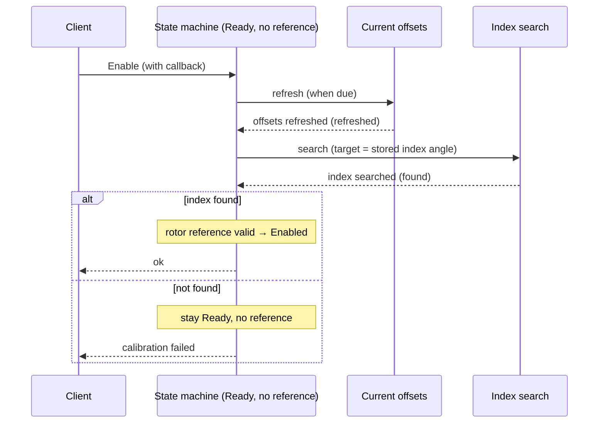

While the search runs, the pending-work check is true. Disable abandons the search and refuses the Enable with
*rejected*. An emergency stop or a fault aborts it, which stops the inverter and leaves the encoder untouched. Both
the offset refresh and the search are internal transitions of Ready. Their completion events, *offsets refreshed*
and *index searched*, decide them.

### Homed State and the Homing Requirement

The state machine tracks whether a rotor reference exists. It also tracks whether the position frame is the
commissioned one ([FOC Position Control](foc-position.md), Homing and the Position Reference). The *homed* state is
set when a full calibration completes and when an index restore finds the index. An alignment-only run (Re-align,
the external calibration) clears it. Every loss of the rotor reference, Clear Calibration, a pole-pair change and
every boot also clear it. A machine built by a control-mode switch out of a Ready that is aligned and homed boots
homed. A machine built out of a Ready that is only aligned boots aligned and not homed.

The stored setting *homing required* ([Service: Non-Volatile Memory](service-nvm.md)) goes to the position-mode
machine only; the speed and torque machines never see it. With it on, the Enable guard of a position-mode machine
refuses after its other checks when the drive is not homed. It does not refuse when an index restore is due. A restore that is due
counts, because it runs during the preparation of the Enable and homes the drive. If the search finds nothing, the
Enable is refused with *calibration failed* as before. The guard refusal is answered *rejected* and traced as
"position mode requires homing; calibrate or restore the reference from the encoder index".

The stored setting *circular position* ([Service: Non-Volatile Memory](service-nvm.md)) goes to the position-mode
machine with the travel limits, on every activation and every change. The speed and torque machines never see it
either. The cascade latches it at each Enable, so a change takes effect at the next Start
([FOC Position Control](foc-position.md), Multi-Turn Position).

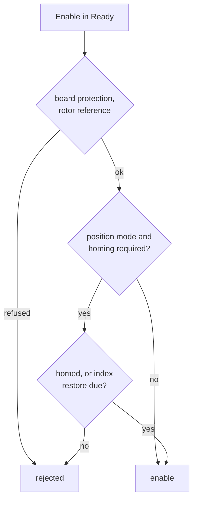

### Alignment-Only Recovery

Re-align re-establishes the rotor reference without the full identification chain. It requires the machine to be in
Idle or Ready with valid electrical calibration already loaded (non-zero pole pairs and positive phase resistance).
The procedure:

1. The machine enters Calibrating at the alignment sub-step and copies the stored electrical parameters into the
   pending record.
2. The machine calls the motor alignment service with the stored pole pairs.
3. On success, the machine marks the rotor reference valid and saves the updated offset to NVM through the same
   completion path as a full calibration. It then applies the mode-specific calibration from the stored parameters
   and transitions to Ready.
4. On failure, the machine enters Fault with one of these codes:
   - phase missing, when the alignment found a phase that carries no current
     ([Service: Motor Alignment](service-alignment.md), phase continuity check);
   - encoder loss, when the encoder did not follow the field
     ([Service: Motor Alignment](service-alignment.md), encoder follow check);
   - calibration failed, in all other cases.

A re-alignment does not wait for the rotor to come to rest. The alignment holds the rotor until its position
settles. In simulation, a re-alignment issued 30 ms after disabling at 500 rpm aligned and ran every reference motor
and the motor of the reference board.

Over CAN, a re-alignment is the Align command. Because it uses the same completion path, the speed and position
loop parameters are also re-applied from the stored calibration. Mechanical identification therefore does not need
to run again after an alignment-only recovery.

### Online Parameter Estimation (Speed/Position Modes)

For the speed and position control modes, the state machine creates and manages two online parameter estimators
alongside the main control loop:

- **Online Mechanical Estimator** — continuously refines rotor inertia (J) and viscous friction (B) with a Recursive
  Least Squares estimator that runs at the outer-loop rate (1 kHz).
- **Online Electrical Estimator** — continuously refines phase resistance (R) and d-axis inductance (Ld) with a
  d-axis voltage-model RLS estimator that runs at the same rate.

**Lifecycle of online estimators:**

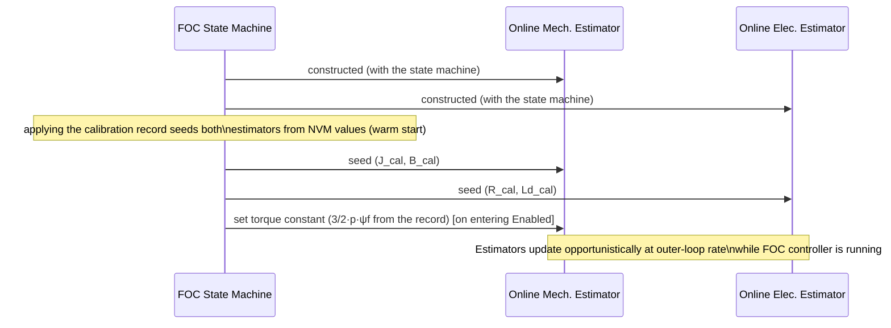

**Seeding from calibration data:** The machine applies the calibration record after a calibration completes and on
the NVM boot load. Each time, it seeds both estimators with the values of the record. This warm-starts the RLS
parameter vector at the known-good calibration values, not at zero. The estimators thus produce physically
meaningful outputs from the first update.

The electrical estimator is seeded with the d-axis inductance, because the underlying model assumes a non-salient
motor ($L_d \approx L_q$). An interior PMSM would need a 3-parameter model with separate Ld and Lq. This is a known
limitation.

**Estimates reach the loops only while the drive is stopped.** The gains are never redesigned while Enabled.
There, neither the current nor the speed loop design is interrupt-safe. Online recalibration
([Online Recalibration](online-recalibration.md)) decides when a settled estimate replaces the model that the loops
are designed from. It applies that estimate on entry to Ready from Enabled (automatic mode), or on a Recalibrate
command in a stopped state. The current loop is redesigned from the resistance and inductance in use. The speed loop
is redesigned from the inertia and friction in use. It uses the bandwidth-based rule of the speed-loop PI theory
([speed-loop PI](../theory/speed-loop-pi.md), "What the implementation uses"). The rule is
$k_p = 2 J \omega_{bw} / K_t$ and $k_i = k_p \max(B_f/J,\ \omega_{bw}/4)\, T_s$. Here $T_s$ is the outer-loop sample
period and $K_t = \tfrac{3}{2} p \psi_f$ comes from the calibration record. The operator's loop settings are applied
again afterwards, so the bandwidths do not change. The estimators are not seeded again. A stored recalibration
([Online Recalibration](online-recalibration.md), Part F) is applied the same way on the first Ready after power-up.
The Reset Model command redesigns both loops from the calibration record again, in a stopped state only.

The online estimates are read over CAN (`0x90`–`0x93`) and adopted with the Recalibrate command
([Online Recalibration](online-recalibration.md)).

### Control Mode Selection

The control-mode state machine is a higher-level coordinator. It owns one mode machine per supported control mode
(torque, speed, position), held in one storage slot that holds one mode machine at a time. At any given time exactly
one mode's state machine is the **active** instance; the others are idle. This section documents three behavioural
invariants that make runtime mode switching safe and predictable.

The coordinator delegates each concern to one part:

| Part                | Concern                                                                                         |
|---------------------|-------------------------------------------------------------------------------------------------|
| Active drive        | The mode machines, the active machine and its controller interfaces, calibration reads          |
| Drive commands      | Setpoints for the active mode, and the current, bus-voltage and configured limits applied to it |
| Mode selection      | Select: the persisted default mode, the activation and the rollback (C2)                        |
| Setting transaction | The gate every setting passes and the one setting whose callback is pending                     |
| Tuning settings     | Loop bandwidths and tunings, stored and effective, and motor parameters                         |
| Algorithm settings  | Selection and persistence of the current, speed and position laws                               |
| Model recalibration | Online observation, commissioning, the recalibration decision, its storage and the redesign     |

The control-mode state machine itself owns the configuration record and its writer. It activates a mode, which keeps
the rotor reference and re-applies the limits. It restores the persisted algorithms, tunings and model when the new
machine is Ready.

#### C1 — CAN Wire-Scale Convention

The control-mode state machine receives setpoints from the CAN bridge in physical units (A, rad/s, rad). The
e-foc-protocol wire contract, Part A, specifies the fixed-point wire encoding once: the scale constants, and
round-to-nearest with saturation.

#### C2 — Re-entrancy Guard for In-Flight Selection

A switch of control mode includes an asynchronous NVM write that persists the new default. A second Select issued
while this write is still outstanding must wait until the first operation completes. The NVM driver does not
support concurrent write requests.

Behavioural rule: a Select called before the callback of a previous Select has fired immediately returns *busy*.
It does nothing else. The caller must retry.

The same guard covers the active mode's own asynchronous work. The application of a selection destroys the active
mode machine, while its outstanding NVM and identification callbacks still capture that machine. Select therefore
also returns *busy* while the pending-work check of the active machine is true. The check is true while a command
callback is pending, any NVM operation is in flight or a calibration step is running. It is also true while a
fault latched in an interrupt still owes its transition. This adds to the existing check that the active machine is stopped. Without
the last condition, the machine, its latch and the queued transition would all be destroyed between the interrupt
and the dispatcher turn. The machine built in its place would start unlatched. The NVM activity count covers every
NVM operation from the call until its callback. A save or invalidation still outstanding after an emergency stop
thus keeps the machine alive until it completes.

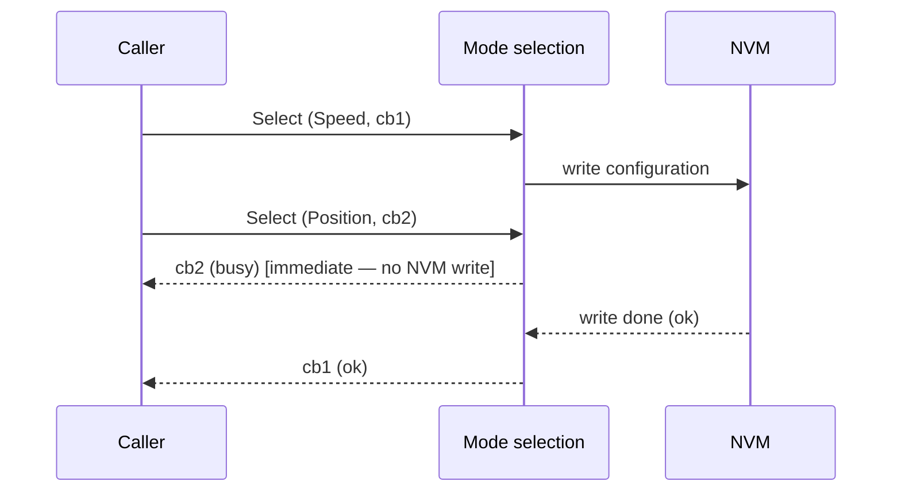

#### C2a — One NVM Activity Count for Every Writer of the Shared NVM

The non-volatile memory service serves one operation at a time. It answers a concurrent call with *busy* and does
not queue it. The control-mode state machine, which outlives every mode switch, therefore owns the NVM activity
count. Every writer of the shared non-volatile memory brackets its operation with it:

| Writer                                                    | Accounting                                                                 |
|-----------------------------------------------------------|----------------------------------------------------------------------------|
| Calibration, maintenance and boot flows                   | A reference to the shared counter in the lifecycle environment             |
| The configuration write of Select, and its rollback write | Raised before and released after each write                                |
| The configuration writer, for every other write           | Raised before the first attempt, released once no write or rewrite is left |

The pending-work check is therefore true while any of them is outstanding. Every guard built on it refuses and does
not collide: Calibrate, Enable, Clear Calibration and Select.

The control-mode state machine owns the one configuration record and one configuration writer for it. Algorithm
selections, loop tunings and the CAN bridge's start-up settings change the record in place and ask the writer to
store it. A request made while a write is outstanding is folded into one more write of the record as it then is. A
write that started earlier thus loses no change. When the NVM answers a store with *busy*, the writer retries every
10 ms. When a write finishes, the writer answers its requester before the folded-in rewrite takes its copy of the
record. A requester that takes its change back after a failed write is thus not stored by the rewrite. Select writes
the record itself. The CAN bridge answers *busy* to a start-up setting while a selection or a configuration write is
outstanding.

#### C2b — Algorithm Selection Is Refused While Busy

The selection of the current, speed and position algorithm applies the same guard as Select. The active machine
must be Idle or Ready and have no pending asynchronous work. Otherwise the selection returns *busy*. Selection is therefore
refused while Calibrating, Enabled or Fault, and while any NVM operation is outstanding. The cascades' own refusal
while enabled stays as a second guard.

#### C2c — A Busy Calibration Save Is Retried

When the NVM answers the calibration save with *busy*, the calibration flow retries the save every 10 ms from a copy
of the record. It keeps the NVM activity count raised and reuses the completion captured at the epoch of the run.
The *calibration saved* event is thus dispatched only with the status of a write that actually ran. An abort while a
retry waits cancels the retry and releases the NVM activity count. An abort while a write is in flight drops the
completion. When that write answers, the calibration flow releases the NVM activity count and stops. It does not
retry a *busy* answer then, so an aborted run is not persisted.

#### C3 — Deferred Apply and Re-check Before Activate

Select does not switch the active state machine at once. It records the previous default control mode, writes the
new one into the configuration record and starts the asynchronous configuration write. The active machine stays
untouched until the write completes.

Select starts the write only when the active machine is stopped and has no pending asynchronous work. But that is a
snapshot: a fault, an emergency stop or a calibration can land while the write is outstanding. An activation of the
new mode would then destroy the machine that holds the fault and start the new one unlatched. When the write
completes, the mode selection therefore decides:

1. **Write failed**: restore the default control mode in the configuration record (NVM still holds the previous
   default). Report *busy* for a transient failure, or *NVM failed* otherwise. The active mode was never touched.
2. **Write succeeded and the guard still holds**: activate the pending mode and report *ok*.
3. **Write succeeded but the guard no longer holds**: keep the active mode, restore the default control mode in the
   configuration record and write it back, so that NVM agrees with the running mode. Report *busy* when that write
   completes, whatever its status. The pending callback stays set during the rollback write, so a Select in that
   window is refused with *busy* (C2).

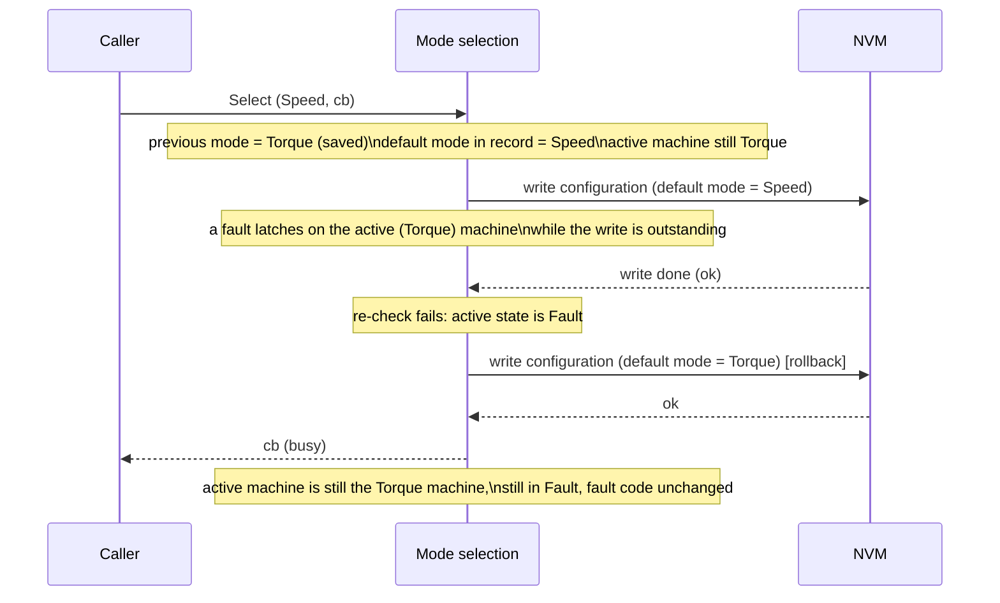

#### C4 — A Mode Switch Keeps the Rotor Reference

The alignment zeroes the encoder, which is hardware that every mode's machine shares. The destruction of the machine
that ran it does not move the rotor or the encoder. The activation therefore reads, before it stops and destroys the
active machine, whether that machine is in Ready with a valid rotor reference. If it is, the new machine is built
with the rotor reference kept. It boots to Ready once its stored record loads and is complete for the new mode
(Boot-Time NVM Check). The operator can then enable it without a new alignment. In every other case, the new machine
boots to Idle with no rotor reference, as at power-on, and needs Re-align or Calibrate. Examples are an active
machine in Idle, or a record that lacks the inertia and friction a speed or position machine needs.

Only Ready hands the reference over. In that state, the old machine itself would have accepted Enable. A switch
thus never makes a motor startable that was not startable before. Select is refused outside Idle and Ready (C2),
so a fault is never carried past.

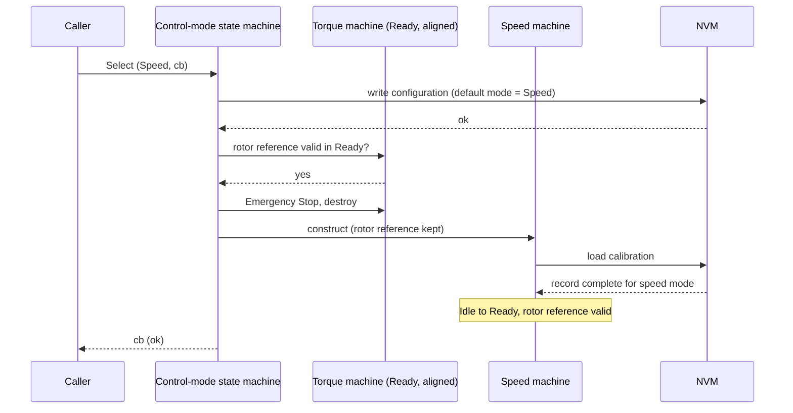

---

## Interfaces

### Provided

| Interface                 | Purpose                                                                            | Contract                                                                                                                                                                                                                                              |
|---------------------------|------------------------------------------------------------------------------------|-------------------------------------------------------------------------------------------------------------------------------------------------------------------------------------------------------------------------------------------------------|
| Lifecycle controller      | Abstract lifecycle controller — state query and command dispatch                   | Constructed once per application. All commands are safe to call from any state: a command without a row in the current state is rejected with a status and traced, never applied                                                                      |
| State query               | Returns the current state for inspection                                           | Valid for the lifetime of the state machine                                                                                                                                                                                                           |
| Last fault code           | Returns the most recent fault code                                                 | Returns *none* until the first fault occurs. Afterwards it keeps the last fault code, also after the fault is cleared                                                                                                                                 |
| Calibrate                 | Requests start of the full calibration sequence                                    | Only effective from Idle or Ready; ignored from all other states                                                                                                                                                                                      |
| Re-align                  | Re-establishes the rotor reference without R/L or mechanical identification        | Only effective from Idle or Ready with valid electrical calibration loaded. Enters Calibrating (alignment sub-step only), then Ready with a valid rotor reference on success, or Fault on failure                                                     |
| Enable                    | Requests enabling the FOC controller                                               | Only effective from Ready when the rotor reference is valid; rejected when the rotor reference has not been established since the last reset                                                                                                          |
| Disable                   | Requests disabling the FOC controller                                              | Only effective from Enabled and Stopping; ignored from all other states                                                                                                                                                                               |
| Clear Fault               | Clears the fault and returns to Ready if valid calibration is held, otherwise Idle | Only effective from Fault; ignored from all other states                                                                                                                                                                                              |
| Clear Calibration         | Invalidates NVM calibration and returns to Idle                                    | Only effective from Idle or Ready; ignored from Calibrating, Enabled and Fault. On NVM failure transitions to Fault                                                                                                                                   |
| Quick Stop                | Decelerates the rotor under control, then stops the power stage                    | From Enabled enters Stopping, *ok*; Ready below 2 rad/s or at the deadline. Rejected when the mode cannot brake and in Calibrating; no effect in Stopping, Idle, Ready, Fault                                                                         |
| Emergency Stop            | Stops the power stage immediately and leaves the active states                     | Accepted from every state and always returns *ok*. From Enabled, Stopping or Calibrating it goes to Ready when calibration data is valid, otherwise to Idle. Idle, Ready and Fault stay unchanged. Aborts any pending command with *aborted by fault* |
| Pending asynchronous work | Reports whether a service callback that captures the machine is outstanding        | True while a command callback is pending, any NVM operation is in flight, a calibration step is running, or a fault latched in an interrupt still owes its transition. The control-mode state machine uses it to refuse destroying the machine        |
| Partial calibration query | Reports whether Idle holds a non-empty but incomplete NVM record                   | True only in Idle, when the stage is not *complete* but pole pairs or resistance are non-zero (an old-schema or interrupted record). The CAN bridge uses it to broadcast the partial-calibration motor state instead of Idle                          |
| Apply online estimates    | Retunes speed and current PID gains from online estimators                         | Only effective from Enabled; silently ignored from all other states. Skips non-physical estimates (non-finite or <= 0). Speed/position modes only                                                                                                     |
| Apply model               | Redesigns the current and speed loops from a motor model                           | Only effective while stopped; returns false otherwise. Keeps the estimators' state. Speed/position modes only ([Online Recalibration](online-recalibration.md))                                                                                       |

### Required

| Interface                                  | Purpose                                                                               | Contract                                                                                                                                   |
|--------------------------------------------|---------------------------------------------------------------------------------------|--------------------------------------------------------------------------------------------------------------------------------------------|
| Non-volatile memory                        | Persists and retrieves calibration data across power cycles                           | Must stay valid for the lifetime of the state machine                                                                                      |
| Electrical parameters identification       | Estimates pole pairs, phase resistance, and dq inductances                            | Operations are asynchronous; callback fires on the same event loop                                                                         |
| Motor alignment                            | Forces rotor to a known angle and returns the encoder zero offset                     | Operation is asynchronous; result is optional (an empty result is a failure)                                                               |
| Index search (optional)                    | Finds the encoder index; re-references the encoder to a stored index angle            | Operation is asynchronous; result is optional (an empty result is not found); absent or unavailable without an index channel               |
| Mechanical parameters identification       | Estimates rotor inertia and viscous friction (speed/position modes only)              | Operation is asynchronous; result is optional (an empty result is a failure)                                                               |
| Fault notifier                             | Delivers hardware fault notifications to the state machine                            | Registration happens during construction; callback may fire at any time. On the target, the platform fault notifier implements it          |
| Three-phase inverter                       | Used by the FOC controller to apply the duty cycles and read phase currents           | Stopped immediately on any fault from the Enabled or Calibrating state                                                                     |
| Encoder                                    | Rotor position sensor; zero point established by the alignment step or the index      | Read-only for the state machine. The motor alignment sets its zero and the index search sets its reading, never the state machine itself   |
| Tracer                                     | Debug trace output for lifecycle events                                               | All state transitions and calibration steps are traced                                                                                     |
| Online friction and inertia estimator      | Online RLS estimator for rotor inertia and viscous friction (speed/position only)     | Seeded from calibration data; torque constant 3/2·p·ψf from the record set on entering Enabled; updates run while FOC outer loop is active |
| Online resistance and inductance estimator | Online RLS estimator for phase resistance and d-axis inductance (speed/position only) | Assumes non-salient motor (Ld ≈ Lq); seeded with the d-axis inductance from calibration                                                    |

---

## Data Model

| Entity             | Field                | Type / Unit             | Range     | Notes                                                                                                                                                                                              |
|--------------------|----------------------|-------------------------|-----------|----------------------------------------------------------------------------------------------------------------------------------------------------------------------------------------------------|
| Calibration record | Pole pairs           | count (uint8)           | 1–255     | Number of electrical pole pairs                                                                                                                                                                    |
| Calibration record | Phase resistance     | Ohm (float)             | > 0       | Phase resistance identified by electrical ident                                                                                                                                                    |
| Calibration record | d-axis inductance    | mH (float)              | > 0       | Phase inductance, used for both axes (anisotropy not estimated)                                                                                                                                    |
| Calibration record | Encoder index angle  | rad (float), mechanical | [−π, π)   | Reading at the encoder index in the aligned frame; NaN when none was found. Applied only at a live index pulse                                                                                     |
| Calibration record | Inertia              | N·m·s² (float)          | ≥ 0       | Rotor inertia; populated only for speed/position modes                                                                                                                                             |
| Calibration record | Viscous friction     | N·m·s/rad (float)       | ≥ 0       | Viscous friction coefficient; populated only for speed/position modes                                                                                                                              |
| Calibration record | Coulomb friction     | N·m (float)             | ≥ 0       | Dry friction measured by the cogging step; 0 when not measured, read as no friction feed-forward                                                                                                   |
| Calibration record | Speed-loop bandwidth | rad/s (float)           | ≥ 0       | Speed-loop bandwidth; not measured: the mechanical identification writes a fixed 100 rad/s, for speed/position modes only                                                                          |
| Fault code         | —                    | enumeration (uint8)     | 14 values | none, overcurrent, overvoltage, undervoltage, overtemperature, encoder loss, hardware fault, calibration failed, stall, phase missing, overspeed, following error, command timeout, position limit |

A watchdog expiry has no fault code. It cuts the power stage from the watchdog interrupt, and the hardware resets the
target. No dispatcher turn follows in which a latched fault code could be read or broadcast. The expiry is reported
after the reboot through the reset cause *watchdog* instead. The watchdog does not reach the state machine at all.
Every code is reported over CAN under its own wire code (contract 2.8, [CAN Service Layer Design](service-can.md)).
The bridge's mapping has no default, so a new code does not build until it is mapped. See
[Watchdog Design](watchdog.md).

---

## Error Handling

All calibration steps produce optional results. An empty result from any step immediately enters Fault with the code
calibration failed. There are two exceptions. An alignment that found a phase that carries no current enters Fault
with phase missing. An encoder that did not follow the field enters it with encoder loss. The step-failed event
carries the code. The entire calibration sequence is safe to retry: issue Calibrate after Clear Fault.

NVM operations (save, load, invalidate) are also asynchronous and report a status. On any status other than *ok*,
a failed save enters Fault and a failed load keeps the machine in Idle. Neither corrupts the application state.
