| Field     | Value                      |
|-----------|----------------------------|
| Title     | Service: FOC State Machine |
| Type      | design                     |
| Status    | draft                      |
| Version   | 0.13.0                     |
| Component | state-machine              |
| Date      | 2026-11-08                 |

> **IMPORTANT — Implementation-blind document**: This document describes *behavior, structure, and
> responsibilities* WITHOUT referencing code. **No code blocks using programming languages (C++, C,
> Python, CMake, shell, etc.) are allowed.** Use Mermaid diagrams to express behavior instead.
> Prose descriptions of algorithms are encouraged; source-level details are not.
>
> **Diagrams**: All visuals must be either a Mermaid fenced code block (` ```mermaid `) or ASCII art inline
> in the document. External image references (``) are **not allowed**.

---

## Responsibilities

**Is responsible for:**
- Owning the complete motor lifecycle: `Idle → Calibrating → Ready ⇄ Enabled`, and `Fault` as an escape state reachable from any active state
- Enforcing all transition guards so that the FOC controller can only be enabled after a successful calibration, and calibration can only be started from `Idle` or `Ready`
- Orchestrating the sequential calibration chain: waiting for the rotor to come to rest → current sensor offsets → pole-pair identification → resistance and inductance estimation → alignment → index search when the encoder has an index → (mechanical parameter identification for speed/position modes) → NVM persistence
- On successful boot with valid NVM data, loading electrical parameters (R, L, pole pairs) and remaining in `Idle` until a live alignment re-establishes the rotor reference; the motor cannot be enabled until `CmdReAlign()` or `CmdCalibrate()` succeeds. A record that carries an encoder index angle, on a drive with an index channel, boots to `Ready` instead, and the first `Enable` restores the reference from the index (see Referencing the Rotor from the Encoder Index)
- Keeping an established rotor reference across a control-mode switch: a machine built by a switch out of an aligned `Ready` boots straight to `Ready` when the stored record is complete for its mode (see C4)
- Intercepting hardware fault notifications from the fault notifier: stopping the inverter in the delivering context, then transitioning to `Fault` on the event dispatcher (see Fault Safety)

**Is NOT responsible for:**
- Executing FOC calculations — those remain the responsibility of the control-mode implementation (Torque, Speed, Position)
- Directly driving hardware peripherals — all hardware interaction is delegated to the calibration services and the FOC controller
- Storing persistent calibration data itself — that is the responsibility of the Non-Volatile Memory service
- Implementing the identification algorithms — those are encapsulated in the Electrical and Mechanical Parameters Identification services

---

## Component Details

### Motor Lifecycle States

The state machine has five named states:

| State         | Motor condition                                                                                                                       | Allowed transitions                                                                                                                                                                                                                                                                                                                                                                                                        |
|---------------|---------------------------------------------------------------------------------------------------------------------------------------|----------------------------------------------------------------------------------------------------------------------------------------------------------------------------------------------------------------------------------------------------------------------------------------------------------------------------------------------------------------------------------------------------------------------------|
| `Idle`        | No calibration data, or electrical parameters loaded but rotor reference not yet established; motor cannot be enabled                 | → `Calibrating` (CmdCalibrate, CmdReAlign with loaded parameters, or CmdReserveExternalCalibration), → `Ready` (boot load completes with a complete record and either a rotor reference kept by a control-mode switch or an index angle an index search can restore it from), → `Idle` (CmdClearCalibration), → `Fault` (hardware fault)                                                                                   |
| `Calibrating` | Calibration sequence in progress; motor is driven by identification services, under a provisional plant model for the mechanical step | → `Ready` (sequence complete + NVM saved, or CmdEmergencyStop / CmdReleaseExternalCalibration with previously valid calibration), → `Idle` (record saved but incomplete for this mode, or CmdEmergencyStop / CmdReleaseExternalCalibration without valid calibration), → `Fault` (any step or the NVM save fails, or hardware fault)                                                                                       |
| `Ready`       | Calibration data valid, rotor reference established or restorable from the encoder index; motor can be enabled                        | → `Enabled` (CmdEnable, only when `rotorReferenceValid` is true or the record's index angle can restore it; the first after power-up, a mode switch or a Fault re-measures the offsets, and one without a reference searches the index), → `Calibrating` (CmdCalibrate re-runs, CmdReAlign, or CmdReserveExternalCalibration), → `Idle` (CmdClearCalibration), → `Fault` (hardware fault, or the NVM invalidation failing) |
| `Enabled`     | FOC controller active; motor under closed-loop control                                                                                | → `Ready` (CmdDisable, or CmdEmergencyStop with valid calibration), → `Idle` (CmdEmergencyStop without valid calibration), → `Fault` (hardware fault)                                                                                                                                                                                                                                                                      |
| `Fault`       | Safe state; inverter stopped; fault code recorded and latched                                                                         | → `Ready` (CmdClearFault with valid calibration held), → `Idle` (CmdClearFault without it); at most 3 consecutive times. A further fault re-enters `Fault` but keeps the code that first tripped the drive                                                                                                                                                                                                                 |

### State Diagram

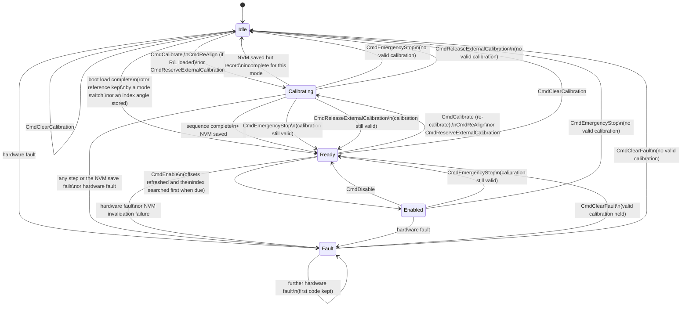

### Transition Table

The graph above is not a description of hand-written command handlers; it is the
transition table the FOC state machine is built from. Every operator command, every
service completion and every fault notification is an **event**, and every arrow in the
diagram is a **row** of the table: source state, event, target state, an optional guard and
the action that builds the target state. Rows that must be accepted in a state without
leaving it (a calibration sub-step changing, a motor-parameter save completing) are declared
as internal rows.

The table is a compile-time constant. Its rows are `constexpr` values whose guards and
actions are captureless functions receiving the state machine as their context, so the
whole table lives in flash; the machine itself only holds the current state and a bounded
queue of events. That is what keeps the lifecycle within the RAM of the 32 KB targets.

The queue depth is budgeted, not rounded up: each slot costs a whole `Event`, and overflowing
it is an assertion failure rather than a dropped event. The deepest run of nested dispatches is
a calibration sequence whose identification services report inline — the four steps the
orchestrator announces plus the alignment result that follows the last one — which peaks at five.
The friction-and-inertia step is not among them, because the control mode sets that step directly
instead of announcing it, and the events that follow the alignment are pushed only once the queue
has drained again. The remaining slot absorbs a command chained from a completion callback, giving
the six the machine reserves. Adding a calibration step that announces itself therefore costs a
slot, and on the 32 KB targets a slot has to be paid for out of a RAM budget the linker now guards.

The table is the single source of truth for what the machine accepts:

- An event that arrives in a state with no row for it is **forbidden**: nothing changes, the
  command reports `rejected`, and the trace shows which event was refused in which state.
- An event whose rows exist but whose guards all refuse it is **rejected** in the same way;
  the guard is where conditions such as "asynchronous work is outstanding" or "the rotor
  reference is not established" live.
- The table is checked when the firmware is compiled, not when it runs: the machine can only
  be constructed from `services::Validated<FocLifecycleTable>()`, which evaluates the table with
  `static_assert`. Duplicate rows, rows that can never be selected because an unguarded row
  precedes them, states that no sequence of rows reaches from `Idle`, events that no row
  handles, states that no row leaves, and rows from any state that can never fire all stop the
  build, naming the offending row. A malformed lifecycle therefore never produces a binary.
- `FocLifecycleTable::Rules()` declares which state changes the lifecycle may make, separately
  from the rows: `Idle` → `Calibrating`, `Ready` or `Idle`; `Ready` → `Calibrating`, `Enabled` or
  `Idle`; `Calibrating`, `Enabled` and `Fault` → `Ready` or `Idle`; and any state → `Fault`.
  `Enabled` is forbidden from every state except `Ready`, and `Fault` never leads straight
  back to `Calibrating`. A row that makes any other transition, or an allowed transition that
  no row makes, is a compile error.

Events are handled to completion. An event dispatched while another is being handled, for
instance a service that completes synchronously inside the action that started it, or a
fault raised while the drive is being started, is queued and handled once the current
transition has been committed and announced. Actions therefore always observe a consistent
state, and the target state is committed before its side effects (starting the drive,
completing the pending command, notifying the ready handler) run, in that order.

Every operator command that starts asynchronous work (`Calibrate`, `ReAlign`,
`ReserveExternalCalibration`, `ClearCalibration`, `SetMotorParameter`) and `Enable` are guarded by
`HasPendingAsyncWork()`: they are rejected while a command is pending, while any NVM operation
is in flight, including the boot-time check and load, while an identification service is
running, while a firmware pack is being received (`service-firmware-upgrade.md` Part G), or while a fault latched in
an interrupt still owes its transition. One request therefore owns the machine at a time. A save still outstanding after an
emergency stop cannot be overlapped by the save of a new run, a clear or a motor-parameter change
in progress cannot be interrupted by `Enable`, whose transition would discard the completion
and leave the command pending forever, and the boot-time load cannot overwrite the record of a
calibration that started before it answered. The command is completed with `rejected` and the
client retries once the outstanding work has completed.

A command issued from inside a completion callback is such a queued event, and it reports
`CommandResult::queued`, which is distinct from `ok`: the event was accepted for processing,
the table has not yet decided it, and the caller must not read it as "applied". Callers that
translate a command outcome onward — the CAN bridge turns it into `busy` — therefore never
report success for work whose outcome is still unknown. A command that carries a callback is
not left dangling when the table then refuses it: `CommandRejections` observes every forbidden
or rejected event and completes that command's callback with `rejected`, whether the event was
dispatched directly or from the queue.

The transition table is observable: a tracer prints every transition as
`fsm: <from> --<event>--> <to>` next to the existing `[SM]` lines, and every forbidden,
rejected or discarded event with its state. Every entry into `Fault` also traces
`[SM] Fault: <code>` with the code it was entered for, which the transition line does not carry:
on the bench that line is the only record of why a run ended, short of a CAN telemetry request.

### Structure

`FocStateMachineCommon` is a composition root, not the place where the lifecycle logic lives.
It owns the table-driven machine and hands the rows a `LifecycleContext`: references to the
collaborators that carry out the work, each with one responsibility.

| Collaborator            | Responsibility                                                                                                                                                                       |
|-------------------------|--------------------------------------------------------------------------------------------------------------------------------------------------------------------------------------|
| `FocLifecycleTable`     | The 49 `constexpr` rows and the entered hooks; the only place that knows which event is legal in which state                                                                         |
| `CalibrationFlow`       | Full calibration, re-alignment and external calibration: running the orchestrator, saving the record and completing the command                                                      |
| `MaintenanceFlow`       | Clearing the stored calibration and editing the motor parameters it holds                                                                                                            |
| `BootSequence`          | The boot-time validity check and load of the stored record, and the move to `Ready` when a control-mode switch kept the rotor reference                                              |
| `OperationFlow`         | Enable and disable, faults and emergency stop, and the post-commit work of every state                                                                                               |
| `PendingCommand`        | The one outstanding operator command, and the result held back until the target state has been committed                                                                             |
| `CommandRejections`     | The observer that completes a queued command's callback with `rejected` when the table refuses it, so no callback is left dangling                                                   |
| `NvmActivity`           | The count of NVM operations whose callbacks still capture the machine; part of `HasPendingAsyncWork()`. Owned by `ControlModeStateMachine`, not by `FocStateMachineCommon` — see C2a |
| `CalibrationContext`    | The calibration record in RAM and its application to the controller                                                                                                                  |
| `CommissioningCommands` | Re-alignment, the external-calibration reservation and completion, and motor-parameter edits, each dispatched as its event (`Commissioning()`)                                       |
| `ModeHooks`             | The interface through which the flows reach the control mode: the controller, its tunables and the mode-specific calibration steps                                                   |
| `DefaultModeHooks`      | The mode-specific hooks a control mode need not override; `FocStateMachineCommon` derives from it                                                                                    |

`TorqueStateMachine`, `SpeedStateMachine` and `PositionStateMachine` derive from
`FocStateMachineCommon` and implement `ModeHooks`; nothing else in the lifecycle depends on the
concrete control mode.

### Emergency Stop

`CmdEmergencyStop` is the unconditional safety command: it is accepted from **every** state and always returns `CommandResult::ok`. Its first action is to stop the FOC controller and therefore the PWM output, before any state evaluation takes place. The stop is not left to that entry point alone: every `EmergencyStop` row stops the controller in its own action as well, so the PWM output is cut by the table itself and an `EmergencyStop` reaching the machine by any other route cannot transition out of `Enabled` with the bridge still switching. Stopping twice is harmless because the call is idempotent. Any command callback still outstanding (a running calibration or a pending `CmdClearCalibration`) is completed with `CommandResult::abortedByFault`.

The resulting state depends on the state the command was issued from:

| Issued from                | Resulting state | Rationale                                                                          |
|----------------------------|-----------------|------------------------------------------------------------------------------------|
| `Enabled` or `Calibrating` | `Ready`         | Calibration data in memory and NVM is still valid; the motor stays enableable      |
| `Enabled` or `Calibrating` | `Idle`          | No valid calibration data is held, so the motor must be calibrated before enabling |
| `Idle`, `Ready`            | unchanged       | The machine is already stopped; only the inverter stop is (re)issued               |
| `Fault`                    | `Fault`         | The fault state is safe and must be cleared explicitly with `CmdClearFault`        |

`CmdClearFault` returns to `Ready` when valid calibration is held and to `Idle` when it is not — it
does not unconditionally return to `Idle`. Clearing releases the latch, so the following `CmdEnable`
is accepted rather than refused.

Calibration data is considered valid when the applied record's `stage` is `CalibrationStage::complete`, it
holds a non-zero pole-pair count and a positive phase resistance, and the active mode's own requirements are
met: torque mode adds no further requirement, while speed and position modes additionally require a finite,
positive rotor inertia and a finite, non-negative viscous friction (`HasValidModeSpecificCalibration`,
overridden by `OuterLoopStateMachine`). This mode-aware check is why a torque-only calibration record cannot
silently be reused to reach `Ready` in speed or position mode. An aborted calibration run never commits its
results — the in-progress values live in `Calibrating::pendingData` and are only copied out after the NVM
save succeeds — so a previously valid calibration survives an emergency stop during a re-calibration and the
machine returns to `Ready`.

Dropping to `Idle` on every emergency stop would force a full recalibration after each safety intervention, which is why the transition is conditional on calibration validity rather than unconditional.

### Calibration Sequence

When `CmdCalibrate` is issued from `Idle` or `Ready`, the state machine enters `Calibrating` and executes a sequential chain of identification steps. Each step is asynchronous: the state machine calls a service and awaits a callback before proceeding to the next step. If any step returns a failure result, the machine immediately enters `Fault`.

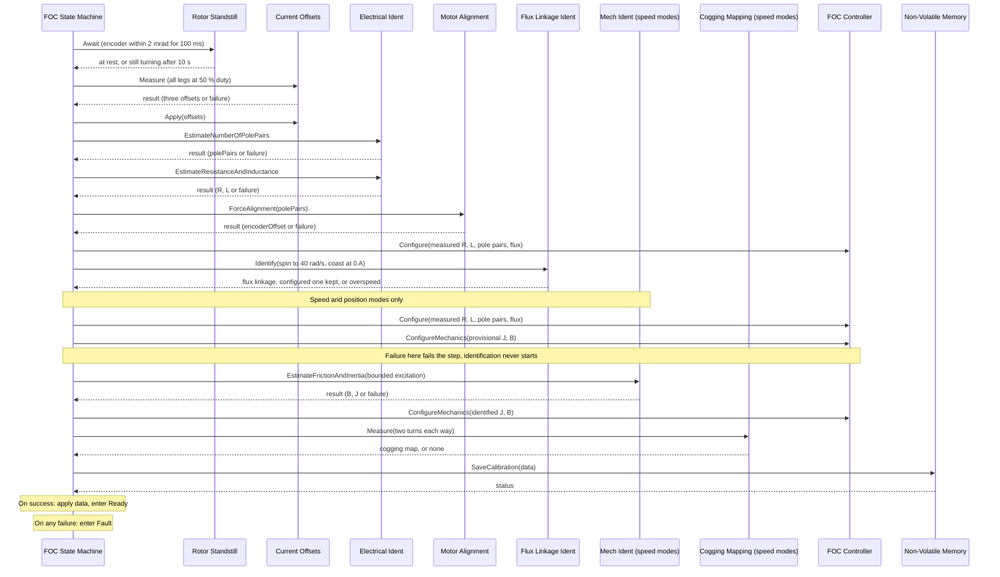

**Steps and data produced:**

| Step                                           | Service             | Data stored                                                          |
|------------------------------------------------|---------------------|----------------------------------------------------------------------|
| Rotor at rest (`service-standstill.md`)        | Rotor Standstill    | Nothing; fails the calibration after 10 s                            |
| 0. Current sensor offsets                      | Current Offsets     | `currentOffsetA`, `currentOffsetB`, `currentOffsetC`                 |
| 1. Pole pairs                                  | Electrical Ident    | `polePairs`                                                          |
| 2. Resistance and inductance                   | Electrical Ident    | `rPhase`, `lD`                                                       |
| 3. Alignment                                   | Motor Alignment     | Nothing; the rotor reference is held in RAM                          |
| 3b. Index search (encoder with an index)       | Index Search        | `encoderIndexAngle`; none when no index is found                     |
| 3a. Flux linkage (every mode)                  | Flux Linkage Ident  | `fluxLinkage`; the configured value when not identified              |
| 4. Apply measured model + provisional plant    | FOC controller      | Nothing persisted; makes the loops able to move the rotor            |
| 5. Mechanical parameters (speed/position only) | Mechanical Ident    | `inertia`, `frictionViscous`, `speedLoopBandwidth` (fixed 100 rad/s) |
| 6. Cogging map (speed/position only)           | Cogging Mapping     | `coggingTorque`, `coggingTorqueScale`, `frictionCoulomb`             |
| 7. NVM persist                                 | Non-Volatile Memory | All of the above written to EEPROM                                   |

The sequence starts only once the rotor is at rest: the encoder must stay within 2 mrad of where a
100 ms window began, which bounds the speed to 0.02 rad/s, and a rotor still turning after 10 s fails
the calibration with `[SM] The rotor did not come to rest`. The offset step holds all three legs at
50 % duty, which shorts the windings, so a turning rotor drives current through the sensors. A rotor
that slows to a stop inside the averaging window leaves part of that current in the stored offsets. In
simulation, a calibration started 25 ms after disabling the bench motor at 500 rpm stored offsets 5 to
15 mA off in five runs out of five, against the 5 mA REQ-CMS-001 allows, and 4 to 9 mA off from 100 rpm
(REQ-CMS-001). The wait is measured from the window's start rather than from poll to poll, so a slow
creep cannot pass one encoder count at a time. A rotor already at rest costs the 100 ms window.

The offsets apply as soon as they are measured, so the identification and alignment steps after
them read corrected currents (`service-current-offsets.md`). An electrical identification that
arrives over CAN measures them too: the CAN bridge waits for the rotor to come to rest, measures and
applies the offsets before it estimates resistance and inductance, and the record it completes
carries them. Without that step a drive commissioned over CAN after a cleared calibration ran on
zero offsets, which on the bench board left +25, −17 and +45 mA uncorrected, both in the current
loop and in the phase-A current the resistance estimate is computed from. It keeps the cogging
map, the mechanical parameters and the loop bandwidths of the record: it measures none of them, and
replacing an inertia entered or identified earlier with nothing would leave a speed or position mode
uncalibrated again.

The cogging map is measured with the speed loop configured from the identified mechanics, and a
run that measures no map does not fail the calibration (`service-cogging-compensation.md`). The same two-direction run
measures the dry friction, kept even when the map is refused; an estimate that is negative, not finite or missing is stored
as 0 and traced as none, and 0 means no friction feed-forward. In speed and position modes the friction is applied with the
mechanics and the cogging map, and cleared with the map before the mechanical identification and the cogging step, so
neither measures through an earlier calibration's compensation. Torque mode applies none. A Coulomb friction written as a motor parameter (contract 2.20) is stored first and then re-applied the same way, so a value of 0 removes the feed-forward.

After saving, calibration data is applied to the FOC controller (current PID gains computed from R/L/bandwidth, velocity PID gains applied for speed modes), and the state machine transitions to `Ready`. The encoder zero offset is not written back to the encoder at this point; it is established only by the alignment step itself during the calibration sequence.

Every record handed to the NVM is traced first as `[SM] Calibration record: R=… L_mH=… p=… psi_mWb=… J_uNms2=… B_uNms=… Ia_mA=… Ib_mA=… Ic_mA=… In_mA=… cog_mNm=… fc_mNm=…`, where `In_mA` is the measured current noise, 0 when not measured, `cog_mNm` is the peak of the cogging map, 0 when there is none, and `fc_mNm` is the Coulomb friction, 0 when there is none. Inertia and viscous friction are traced in micro-units because the tracer prints three decimals, which cannot show values around 1e-6 and 1e-5; the same convention applies to the `[EST]` lines and the `[SM] Applying mechanical estimates` line below.

The calibration record line is what an external observer, the software-in-the-loop suite included, compares against the plant it configured.

The torque constant every mechanical consumer uses — the identification service, the online inertia estimator and the speed-loop gain design — is not configured per target. It is derived from the record as $K_t = \tfrac{3}{2} p \psi_f$ (`core/foc/interfaces/MotorModel.hpp`), the factor the plant model itself applies.

A motor whose flux linkage is set as the motor parameter `fluxLinkage` therefore gets a consistent torque constant without a second number to keep in step.

### Editing motor parameters

The seven motor parameters of the record — phase resistance, inductance (written to both axes), pole
pairs, flux linkage, inertia, viscous friction and Coulomb friction — can also be entered, one at a time, with
`SetMotorParameter`, from CAN (`service-can.md`). The command is accepted in `Idle` and `Ready` with no work outstanding, for a
value inside the parameter's range; a record need not exist yet, so a motor can be commissioned
from its datasheet (REQ-CMS-004).

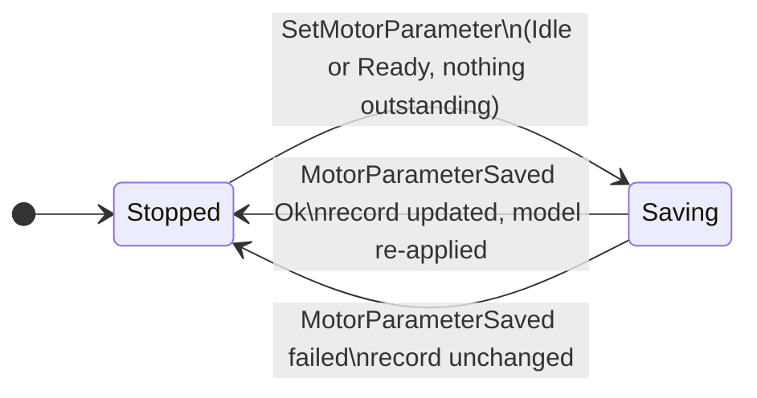

The edited record is stored first and adopted only when the write has landed, so RAM never holds a
value the NVM does not. Its stage is recomputed: a record that was complete stays complete, and an
incomplete one becomes complete once it holds pole pairs, a positive resistance and inductance and
whatever the active mode needs on top (inertia for speed and position). Once complete, the
electrical model and the mode-specific calibration are applied as at boot. A completed record does
not move the machine out of `Idle`: a rotor whose reference was never established still has to be
aligned before it can be enabled, exactly as after boot.

Changing the pole-pair count invalidates the rotor reference, because the encoder offset was
measured in electrical angle for the old count: `Enable` is refused until the rotor is aligned again.
It also drops the cogging map, which is binned per electrical period and would compensate other
positions after the change. Inertia and friction identified with the old count were derived through
the old torque constant; the record keeps them, and they should be identified again. No other
parameter touches the reference or the map, and none of them moves the rotor.

While the save is outstanding the command owns the machine like any other NVM operation; a fault or an
emergency stop in that window aborts the command but not the write, and the stored value is adopted
when it lands. The command is therefore answered `aborted` (`abortedByFault` over CAN) rather than
`busy`, and a client reads the value back.

Two consequences of entering parameters by hand are left to the operator. A record completed by hand
has no measured current offsets — they are measured only by `Calibrate` and by an electrical
identification over CAN — so a drive commissioned from its datasheet should be calibrated once before it is relied on. And a motor
parameter is stored even when the active speed LQI or position LQR/LQI law cannot be designed from it
with the operator's settings: that law keeps the design derived from the automatic settings, the drive
traces `Speed settings not applied` or `Position settings not applied`, and the settings read back are
still the operator's. Refusing such a parameter needs a design check of the edited model before it is
stored, which the cascades do not offer yet.

### Identifying the flux linkage

The flux linkage sets the back-EMF feedforward of the decoupled, deadbeat and sliding current laws and,
through $K_t = \tfrac{3}{2} p \psi_f$, every mechanical consumer. Until this step it was only ever the
target's configured value, which on the bench motor was 7.0 mWb against the motor's 4.6 mWb. Identified
inertia, viscous friction and the cogging map all scale with that ratio, and the deadbeat law settled
with a current offset that grew with speed.

After alignment, and before mechanical identification, the state machine applies the electrical model it
has just measured to the live current loop and asks the flux linkage service to spin the rotor with a
small q-axis current, release it to a 0 A setpoint and fit the q-axis voltage against the electrical speed
while it coasts (`service-flux-linkage-ident.md`). The step runs in every control mode, torque included,
since the current loop is all it needs.

| Outcome        | Effect on the calibration                                                          |
|----------------|------------------------------------------------------------------------------------|
| Identified     | `fluxLinkage` of the pending record is replaced, and later steps use it            |
| Not identified | The configured value is kept, the reason is traced, and the calibration carries on |
| Overspeed      | The step fails and the machine enters `Fault`, as for any failed step              |

The step runs once per calibration: a mechanical run that aligns again for a second attempt does not
spin it a second time. A re-alignment and an electrical identification over CAN do not run it, since
neither may move the rotor beyond the alignment. The step is traced as `[SM] Identifying flux linkage`
and then `[SM] Flux linkage: psi_mWb=… c_mV=… n=… se_pct=…`, or `[SM] Flux linkage not identified (…),
keeping psi_mWb=…` (REQ-CMS-001).

### Making the loops live before mechanical identification

Mechanical identification commands a speed trajectory and identifies the plant from the motion that
results; with the flux-linkage step it is one of two calibration steps that move the rotor. Every earlier
step injects current into a stationary rotor and needs no closed loop at all.

Until a model is applied, the current loop holds inert gains — it is configured from resistance, inductance
and pole pairs, none of which are known before the electrical steps run — and the speed loop holds a zero
current envelope and no plant, so its controller refuses to produce a reference at all. Starting
identification in that state commands a speed no rotor ever reaches: the regressor carries no excitation,
the run reaches its timeout, and the calibration fails on hardware while passing against any test double
that publishes samples on demand.

Before starting identification the state machine therefore applies, to the live controller:

1. the **electrical model it has just measured** in this run — the pending resistance, inductance, pole-pair
   count and effective flux linkage, with the current-loop tunings that follow from them;
2. a **bounded provisional mechanical model** — a small placeholder inertia, zero viscous friction and a
   deliberately low speed-loop bandwidth. It is a stand-in that lets the speed loop act within its current
   envelope, not a measurement, and it is never persisted or reported as calibration.

Both are checked. If the pending electrical record is not usable, if the torque constant derived from the
pending pole pairs and effective flux linkage ($K_t = \tfrac{3}{2} p \psi_f$, the same factor the plant
model applies) is not positive, or if either configuration call is refused by the controller, identification
is **not started**:
the step fails and the machine enters `Fault`. A run that cannot move the rotor is a failed calibration, not
a run that silently produces nothing.

The excitation the service is given is bounded in current, speed and time. The current envelope is the
drive's own configured limit, with a small margin above it so that noise at the clamp does not read as a
runaway, and the service clamps that down again to what the inverter reports it supports. The speed limit
is derived from the commanded target rather than from any rated speed of the machine, because no
per-drive speed rating is configured anywhere in the system; it bounds the trajectory against a runaway,
not against a motor whose safe speed is below the commanded target.

### Restoring the controller after an aborted run

The provisional model must not outlive the run that needed it. Every way a calibration can end short of a
committed record reaches the same restore, because they all pass through the one place that aborts a
calibration run: a failed step, a refused configuration, a failed NVM save, a hardware fault, an emergency
stop, and the release of the machine's external resources when it is torn down. A record that saves but is
incomplete for this mode restores as well, since nothing was committed for the loops to keep.

| Situation                         | Restored state                                                                           |
|-----------------------------------|------------------------------------------------------------------------------------------|
| A valid calibration is still held | That record is re-applied: electrical model, current tunings, mechanics, estimator seeds |
| No valid calibration is held      | Nothing is re-applied; the motor stays un-enableable until a calibration succeeds        |

A committed calibration supersedes the provisional model instead of restoring over it: the record just
saved is applied in full, so there is nothing left to put back.

### Validating the identified mechanics

An identified pair is accepted only when it is finite and inside the physical band the mechanical
identification service and the online estimator share (see the Mechanical Parameters Identification design
document). A non-finite, non-positive or out-of-band inertia or friction fails the step through the normal
calibration-failure path — `CommandResult::calibrationFailed`, `FaultCode::calibrationFailed`, `Fault` — and
is never handed to the NVM service. The completeness check that stamps `CalibrationStage::complete` catches
zero and non-finite values but not a merely absurd one such as an inertia of 10^30, which is why the band is
applied at the point the estimate arrives.

### Retrying the mechanical step from a new alignment

The excitation starts from a rotor at rest, under provisional gains, and its outcome depends on the rotor reference the
alignment just set: a run that stalls or leaves its envelope does so again when it is repeated from the same
reference, and not when it is repeated from a new one. A run that yields no usable estimate therefore sends the
sequence back through alignment and then the mechanical step, up to three attempts in all, before the calibration is
given up through the failure path above. Each retry traces
`[SM] Aligning again for mechanical identification, attempt n of 3`. Electrical identification is not repeated.

### Confirming the estimate by agreement

A single run can converge on noise: on a rotor with no load, friction and cogging swamp the inertia signal, and an
isolated run occasionally reports an inertia an order of magnitude too low. The calibration therefore asks the
mechanical step for `CalibrationServices::agreeingMechanicalRuns` runs that agree (default 1, which accepts the first
usable run; the motor application asks for 2). Each usable run is kept; as soon as two inertia estimates differ by less
than 20 % of the larger (`services::EstimatesAgree`), their mean is the answer and the record is saved. Runs that do not
agree are repeated from a new alignment under the three-attempt limit above, so a lone outlier is outvoted by two
runs that agree, and three mutually disagreeing runs fail the calibration. An unconfirmed estimate traces
`[SM] Mechanical estimate J_uNms2=… not confirmed by a second run`.

### External Calibration (CAN-driven)

An external client (e.g. the CAN bridge) can supply pre-measured calibration data without running the internal identification chain. This uses a two-command protocol to ensure the FSM state is correct before any inverter interaction begins:

1. **`CmdReserveExternalCalibration()`** — synchronous. Checks that the machine is in `Idle` or `Ready` with no pending async work, like every command that starts asynchronous work, then transitions to `Calibrating` and returns `CommandResult::ok`. Returns `CommandResult::rejected` in any other state. The `Calibrating` state prevents a second request from being accepted concurrently.

2. **`CmdCompleteExternalCalibration(data, onDone)`** — async. Called by the external client after its own estimation is finished. Stores `data`, the current-sensor offsets the client measured included, in the pending `Calibrating` slot and runs the alignment step, so an externally supplied record still gets a live rotor frame before it can be used. Its guard refuses the command while another command is still pending, so a second completion sent while the first is aligning is rejected instead of overwriting the pending record. If a fault occurred between the two calls, the machine is in `Fault`, where the completion command has no row and is rejected; the client observes the failure through its own estimation callback.

The two-command split ensures the FSM enters `Calibrating` before any open-loop PWM is applied, and that the state guard lives entirely inside the state machine rather than in the calling layer.

3. **`CmdReleaseExternalCalibration()`** — synchronous. Gives up a reservation whose estimation failed, or whose completion was rejected, so the node does not stay in `Calibrating` until an emergency stop. It returns to `Ready` when a valid calibration is held and to `Idle` otherwise, and is accepted only while the reservation came from `CmdReserveExternalCalibration` (`Calibrating::externalReservation`), no command is pending and no run is in flight — a calibration started with `Calibrate` cannot be released this way, and a completion that is already aligning finishes first.

The CAN liveness watchdog emergency-stops a reservation like an `Enabled` drive when the client is lost.

The external path stops after alignment; it does not chain into mechanical identification. `OnIdentifyElectrical` covers the electrical steps only, so it must not drive the mechanical estimator. The NVM save therefore stamps `stage = complete` only when the record satisfies the active mode's own validity requirements. Torque mode is satisfied by electrical parameters plus alignment and transitions to `Ready`. Speed and position still lack inertia and friction, so their record is persisted with `stage = none` and the machine returns to `Idle` holding a partial record, reported over CAN as `FocMotorState::partialCalibration`. Completing those modes requires the internal `CmdCalibrate` chain, which runs mechanical identification.

### Refreshing the current offsets at enable

The current sensors' offsets drift after the calibration that measured them
(`service-current-offsets.md` Part D), so the first `Enable` after power-up, after a control-mode
switch and after every `Fault` measures them again before the drive is enabled. The machine stays in
`Ready` while it does: the `Enable` is accepted, the rotor is awaited at rest and the offsets are
measured, and a completion event then decides the command.

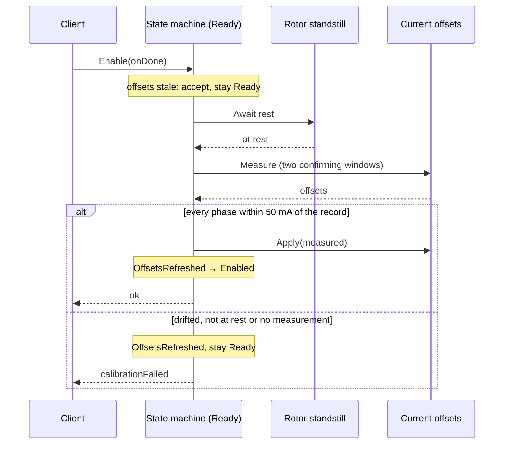

- The offsets are stale when the machine is constructed, which is at power-up and at every
  control-mode switch, and whenever it enters `Fault`. A refresh that ends in `Enabled` makes them
  fresh, and every later `Enable` goes straight to `Enabled` as before. A drive built without an
  offset measurement never refreshes.
- While the refresh runs, `HasPendingAsyncWork()` is true, so a second `Enable`, a calibration, a
  mode switch or a maintenance command is rejected. `Disable` abandons the refresh and refuses the
  `Enable` with `rejected`; an emergency stop or a fault abandons it with `abortedByFault`. The
  stored offsets stay in force in every refusal.
- `CmdEnable()` returns as soon as the `Enable` is accepted, with `ok`, for the model in the loop,
  which watches the state. `CmdEnableAsync(onDone)` reports the outcome when the
  `Enable` is decided, and the CAN bridge acknowledges `Start` from it (`service-can.md` Part D), so
  a client sees the acknowledgement once the drive is running or has refused.

### Fault Safety

**Event-dispatcher path.** The `FaultDetected` event has a row from every state to `Fault`. Its action
records the code, latches the fault controller, stops the inverter if the machine was in `Enabled` or
`Calibrating`, and aborts the calibration services; only then is `Fault` committed. Any event raised while
that happens, a further fault from inside the stop or a calibration completion the abort could not
suppress, is queued and handled only after `Fault` has been committed, so it cannot observe the state
being left. A further fault does re-enter `Fault`, but the recorded code is the one that first tripped the
drive: the fault raised while shutting down is a consequence, and overwriting the root cause with it would
lose the only diagnostic the operator has. The new code is recorded again once the fault has been cleared.

The clear budget is spent where the transition commits, not where the command is issued. `CmdClearFault`
only reads whether a clear is still allowed; the row action is what consumes one of the three attempts and
releases the latch, so a `ClearFault` that is queued and then refused does not silently cost an attempt.

**Interrupt path (board protection, CAN bus-off).** When a fault is delivered in interrupt context, the
platform stops the FOC controller bridge immediately within that interrupt — before any state mutation or
tracing. The `FaultDetected` event, its trace output and any pending-command completion are posted to the event
dispatcher and execute on the next dispatcher turn. This ensures no multi-word state write, tracing call or
non-volatile-memory access runs from an interrupt context (see REQ-LCY-003).

Stopping the inverter is not on its own enough to cut the PWM output. The identification services drive the
bridge through their own timers and phase-current callbacks, and one left running writes duty cycles on its
next tick — `ThreePhasePwmOutput` re-arms the peripheral that `Stop()` just disabled. So the transition to
`Fault` and `CmdEmergencyStop` both call `Abort()` on the electrical identification, the alignment and (in speed and
position modes) the mechanical identification. `Abort()` stops injection, cancels the service's timers, and
drops the pending completion **without invoking it**: the state machine owns the outcome, and a late
calibration result must not overwrite the fault that interrupted it. A service that has been aborted or has
completed ignores any further phase-current sample it is handed, rather than reclaiming the inverter's
callback slot — reassigning that slot from inside its own invocation would destroy the closure being executed.

The `Runner` releases the inverter's phase-current callback in `Disable()` for the same reason: a callback left
pointing at a stopped control loop is another path back to `ThreePhasePwmOutput`.

The transition to `Enabled` commits the state **before** the FOC controller is started: the start runs as a
post-commit effect of the transition, and a fault raised while it runs is queued behind it. A fault raised in the window where current first flows would otherwise observe `Ready`, skip the
stop, and then be overwritten by the pending assignment to `Enabled` — leaving an energised bridge on faulted
hardware with the machine reporting `Enabled`. Because the state is committed first, such a fault stops the
drive.

Committing the state first is not on its own enough for a fault delivered from an interrupt, because that path
dispatches `FaultDetected` on the event dispatcher, not in the interrupt: reading the lifecycle state around
the start would still see `Enabled`. The latch is therefore set **in the interrupt**, and the `Enabled` entry
hook consults the latch rather than the state — before `Start()`, so the cutoff the interrupt performed is not
undone, and again after it, for a fault raised while `Start()` ran. Either check turns the latched fault into a
`FaultDetected` dispatch, which the table queues and drains before the `Enable` dispatch returns; the whole
enable sequence is therefore atomic with respect to the fault and `CmdEnable` reports `abortedByFault`.

The same reasoning applies one level down, inside `Runner`. The phase-current slot is what connects the
control loop to the bridge, so the runner holds it only while the bridge runs: `Enable()` clears the slot,
enables the control law, starts the inverter and takes the slot last; `Disable()` releases the slot first,
then stops the inverter and the control law. A conversion that lands while the slot is clear does nothing, so
no per-sample flag is needed, and once `Disable()` has released the slot no sample can write a duty — on the
TI PWM, a duty written to a stopped generator would restart it. The steps of `Enable()` are individually
interruptible, and a `Stop()` from the faulting context between any two of them would be undone by the steps
that follow it, re-arming the bridge on hardware that has just faulted. `Enable()` therefore clears a
`stopRequested` flag that `Disable()` sets, re-checks it after every step, and unwinds through `Disable()`
once it is set. A stop landing after the last check needs no unwinding: it runs after every write the
sequence makes. The flag is written from the faulting context as well as the mainline, so it
is set and cleared outright rather than counted — a read-modify-write shared with an interrupt is exactly what
REQ-LCY-003 excludes.

#### Announcing a Fault

Each entry into `Fault` that starts an episode — from any state but `Fault`, with the code the machine keeps — is
announced to an observer the control-mode state machine registers for every mode it activates, so the observer
survives a mode switch. A further fault of the same episode is not announced. The application hands the
announcement to the fault history (`service-fault-history.md`), which records it.

#### Fault Latching

A fault is latched. `CmdEnable` is refused while the latch is set, so the only path out of `Fault` is an explicit `CmdClearFault`.

Clearing is gated twice: on the hardware condition, and on a retry budget. `FaultController::EvaluateClear()`
reports the first gate that refuses, condition before budget, so the operator is told the physical cause rather
than the accounting.

**The condition gate.** `PlatformFactory::BoardProtectionStatus()` reports `asserted`, `clear` or `unknown`.
While a fault is held, `FaultController` polls it every `conditionPollInterval` (50 ms) on the event
dispatcher — on its own schedule rather than only when a command arrives, because a condition that asserts and
clears between two operator commands would otherwise never be observed as asserted at all. A clear is accepted
only once the condition has been seen to leave `asserted` and to have stayed `clear` for `conditionDwell`
(250 ms); the dwell is stamped on the `asserted → clear` transition, so any asserted sample inside the window
restarts it and a condition chattering around its threshold cannot be cleared on one favourable reading.
`IsEnableAllowed` refuses independently while the condition reads `asserted`, so a clear granted during a
momentary deassertion still cannot arm the bridge.

```text
  asserted ──clear sample──> settling ──dwell elapsed──> ready ──CmdClearFault──> cleared
      ^                          │
      └────asserted sample───────┘
```

`unknown` is the honest answer from a platform that cannot interrogate its protection hardware, and it neither
blocks a clear nor satisfies the verification — such a platform behaves exactly as it did before the gate
existed. Reporting `clear` instead would assert a verification the hardware never made, and a fault on those
platforms comes from software (calibration failure, CAN bus-off, watchdog) rather than from a physical
condition anything could hold. The TI protection comparators are ADC digital comparators on a
PWM-triggered ADC, which stops converting once the bridge is stopped, so the comparators cannot be read while
faulted. TI and the NUCLEO-G474RE therefore answer from their latched trips and a fresh bus-voltage reading
(`core/platform_abstraction/BoardProtection.hpp`, `documentation/design/error-handling.md`), QEMU from its
simulated protection, and only the NUCLEO-H563ZI and a platform with no protection report
`unknown`.

**The budget.** Each accepted `CmdClearFault` increments a counter; once `maxConsecutiveFaultClears` (3) clears
have happened without an intervening clean run, further clears are refused and a reset is required. Two
things count as a clean run and reset the counter: `CmdDisable` from `Enabled`, the drive running and being
stopped deliberately rather than by the same condition re-tripping; and `cleanRunDuration` (10 s) spent in
`Enabled` without a fault. The second is what keeps three faults spread over a long life of a drive that is
only ever stopped by faults or emergency stops from needing a power cycle. `OperationFlow` starts the clean-run
timer once `Enabled` has started without a pending fault and cancels it on entering any other state;
`FaultController::EnterFault` cancels it too. A condition that re-faults within 10 s of every enable therefore
still exhausts the budget. The budget supplements
the condition gate rather than replacing it: it bounds the platforms that cannot verify, and it bounds a
condition that happens to read clear between attempts on those that can. A clear the condition refused does not
spend from it.

`FaultController::Clear()` asserts on the budget alone. It runs where the transition commits, not where the
command was issued, and a condition that re-asserts in that window must refuse the clear — asserting on it
there would reset a board whose hardware is still faulted, turning a fault into a reset loop.

The last fault code is preserved in `LastFaultCode()` and remains readable even after the fault is cleared via `CmdClearFault`. Before any fault has occurred it reads `FaultCode::none`, so a client can distinguish "no fault yet" from a real hardware fault.

#### Faults raised in interrupt context

`PlatformFaultNotifier`'s primary path runs in the PWM fault interrupt (board protection) or the CAN interrupt
(bus-off). Neither is a context in which the transition itself can be taken: the transition to `Fault` traces,
writes a multi-word `std::variant` that the CAN bridge reads concurrently, and completes a pending
command that reaches non-volatile memory.

The split is therefore: **latch and cut the bridge in the interrupt, record the fault in the dispatcher.** The
registered handler latches the fault and calls `Stop()` on the FOC controller synchronously — unconditionally,
without consulting the state, because hardware saying "fault" outranks the state machine's belief about what
it was doing — and then hands the `FaultDetected` event to `infra::EventDispatcher`. The secondary handler,
which broadcasts the fault over CAN, already worked this way.

Latching is an atomic compare-and-set of `pendingCode` from `none` and a write of `faultLatched`, which is all
an interrupt may do here: the tracing, the multi-word `std::variant` write and the pending-command completion
stay on the dispatcher. `faultLatched` says a fault is in force and is what commands consult; a `pendingCode`
other than `none` says the `FaultDetected` transition it owes has not been taken yet, and is consumed by
whichever context takes it. The compare-and-set keeps the first code when a second source (the PWM trip and
CAN bus-off both latch) fires before the transition is taken, so the root cause is the code reported.
`FaultController` keeps a third, dispatcher-only flag, `faultRecorded`, for "the transition has been taken" —
the distinction `faultLatched` carried before latching moved into the interrupt, and what decides whether an
arriving fault is the one that tripped the drive or a further one whose code is kept out of `LastFaultCode()`.

`TakePendingFault()` claims the code with one atomic exchange to `none` and hands it back, so an interrupt
landing mid-claim either is claimed with it or stays pending for its own transition — it cannot be wiped.
Claiming is the *only* thing that clears `pendingCode`: taking the transition does not, or a fault latched while that
transition ran would be wiped before its own dispatcher turn reached it and would never be recorded at all.
For the same reason `CmdClearFault` is refused while a fault is pending — clearing there would drop the latch
of a fault that has already tripped the drive, and spend one of the three permitted clears on a state the
next dispatcher turn immediately undoes. A fault whose
transition is still owed also counts as pending asynchronous work, which is what stops a control-mode switch
from destroying the state machine — and with it the latch and the queued `FaultDetected` — in that window.

A consequence worth knowing when reading the code or the tests: between the interrupt and the dispatcher turn,
the bridge is off and the latch is set, but `CurrentState()` still reports the pre-fault state. Commands
consult the latch, not the state, so an enable arriving in that window is refused rather than acted on. The
transition is taken exactly once — whichever of the dispatcher turn or the enable sequence reaches it first
takes the pending fault, and the other finds nothing left to record.

#### Registration lifetime

A `FaultNotifier` outlives the state machines that register with it — a control-mode switch destroys one state
machine and constructs the next in the same `std::variant` — so each state machine releases its registration
and aborts its calibration services in its destructor. Without that, the notifier's `infra::Function` and the
services' pending callbacks both point into freed storage.

Hardware protection events reach the state machine through `PlatformFaultNotifier`, the production `FaultNotifier`. It registers a callback with `PlatformFactory::RegisterBoardProtection()` during construction and translates each `BoardProtectionReason` into the matching `FaultCode`:

| `BoardProtectionReason` | `FaultCode`       |
|-------------------------|-------------------|
| `overCurrent`           | `overcurrent`     |
| `overVoltage`           | `overvoltage`     |
| `underVoltage`          | `undervoltage`    |
| `overTemperature`       | `overtemperature` |

The fault supervisor (`fault-supervision.md`) raises `encoderLoss`, `stall`, `phaseMissing`, `overspeed`, `followingError`, `positionLimit` and
`overtemperature`, and `overvoltage` and `undervoltage` at the operator's bus-voltage limits (Part L), through the same notifier,
as the CAN command timeout (`service-can.md` Part F) raises `commandTimeout`,
from the event loop, so the state machine handles them as it handles a board protection trip.

The control-mode state machine hands the overspeed limit of the configuration record (`fault-supervision.md` Part G)
to the torque cascade's speed limiter (`foc-torque.md`) whenever it activates a mode and whenever the record is
written, in any state, and holds a speed setpoint beyond the limit at the limit before it reaches the speed cascade.
It hands the speed ramp of the record to the speed cascade the same way, and keeps the latest current limit of the
motor overload model (`fault-supervision.md` Part I), handing it to the active cascade whenever the model changes it
and whenever a mode is activated.

A protection event raised before the state machine has registered its handler is discarded by the
state machine. A platform whose protection reflects a *standing* condition rather than an edge is
expected to re-raise it once a handler exists, so a motor does not enable into a condition the
board had already detected.

### Async-Callback State Invariant

A hardware fault, an operator command, or a second calibration attempt may move the state
machine between the moment a service call is issued and the moment its callback fires. The
invariant is: **a callback may only apply its result if the state machine is still in the
state that issued the service call.**

This invariant is no longer a convention that every callback re-implements. Each callback
translates its result into an event and dispatches it; whether the result is applied is
decided by the transition table:

- Results from calibration steps (`EstimateNumberOfPolePairs`, `EstimateResistanceAndInductance`,
  `ForceAlignment`, `EstimateFrictionAndInertia`) become the events `CalibrationStepChanged`,
  `AlignmentSucceeded`, `MechanicalParametersIdentified` and `CalibrationStepFailed`, which only
  have rows in `Calibrating`. The mechanical result additionally carries a guard on the active
  sub-step. The calibration orchestrator also drops results of a run that was aborted.
- The `SaveCalibration` completion becomes `CalibrationSaved`, which only has rows in
  `Calibrating`, and only ever carries a non-`Busy` status: `CalibrationFlow` retries a `Busy`
  response internally (see C2c) rather than dispatching it. The callback also carries the epoch
  of the transition that issued the save, so a save completing after an emergency stop and a
  fresh `CmdCalibrate` is discarded instead of being consumed by the new run.
- The boot-time NVM completion becomes `BootCalibrationLoaded`, which only has rows in `Idle`. The
  load reports whether the record is intact, so boot reads the calibration region once.
- The `InvalidateCalibration` completion becomes `CalibrationInvalidated`, with rows in `Idle`
  and `Ready`, leading to `Idle` on success, to `Fault` on failure, and completing the command
  with `rejected` when the NVM is busy. It needs no request identity: the guard on every
  command that starts NVM work means one invalidation at most is outstanding.
- The motor-parameter save completion becomes `MotorParameterSaved`, handled in `Idle` and
  `Ready` and completing the pending command without a transition.
- Both NVM completions also have rows in `Fault`, because a fault or an emergency stop while
  the operation is in flight aborts the command but not the erase or the write. The RAM record
  follows the NVM outcome whatever happened to the command: a successful invalidation drops the
  record, so a later `CmdClearFault` returns to `Idle` rather than restoring a calibration that
  no longer exists in NVM, and a stored motor parameter is adopted. An invalidation that fails
  while already in `Fault` is ignored; the fault is already latched.

Any of these events arriving in a state without a row for it is **forbidden**, and the save
completion arriving after a transition is **discarded** before it reaches the table. Either
way it is traced, and it never overwrites a later state such as `Enabled` or `Fault` with a
stale result.

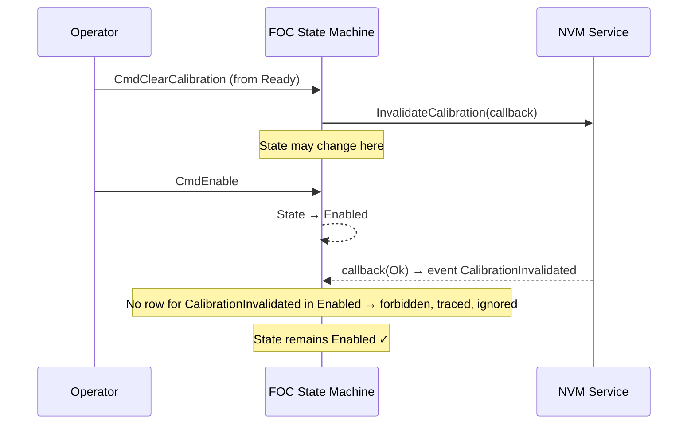

A matching race with a hardware fault that arrives between the `CmdClearCalibration` call and the `InvalidateCalibration` callback:

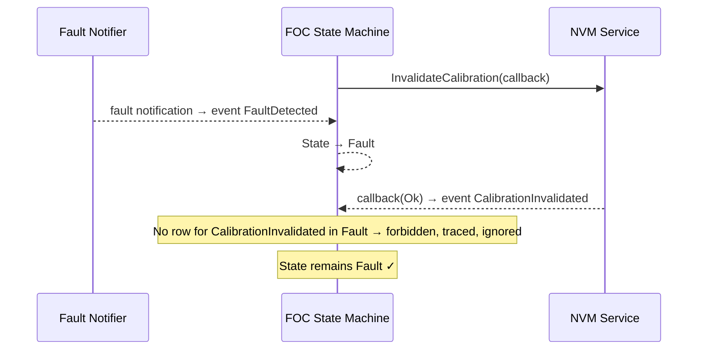

### Driving the Transitions

The state machines register no terminal commands. Their owner drives the transitions
programmatically: the `ControlModeStateMachine` for the torque, speed and position machines it owns,
from the CAN message handlers, and the unit tests directly (`service-cli.md`, Part A).

### Mechanical Identification and Control Mode

The calibration sequence extends with a mechanical identification step for speed and position control modes. This step estimates rotor inertia and viscous friction, then computes initial velocity-loop PID gains.

For **both speed and position mode**, the mechanical identification service is constructed by
`OuterLoopStateMachine::ResolveMechIdent` when no external override is supplied in
`CalibrationServices`. The two modes share that path; position mode does not require an override and
does not fail calibration for the lack of one. An override is a test and integration seam, not a
configuration requirement.

### Boot-Time NVM Check

On construction, the state machine asynchronously checks whether valid calibration data exists in NVM. If data is found and loads successfully, the electrical parameters (R, L, pole pairs, current-loop bandwidth) are applied to the FOC controller, but the machine **remains in `Idle`** unless the record carries an index angle (next section) — the rotor-reference (encoder zero offset) is RAM-only and is lost on every reset, so it must be re-established by a live alignment before the motor can be enabled. If the check fails or the data is absent, the machine starts in `Idle` with no parameters applied.

The one exception is a machine built by a control-mode switch out of an aligned `Ready` (C4). It is told
at construction that the rotor reference is kept; when the load succeeds and the record is complete for
its mode, the load's completion moves it from `Idle` to `Ready` with the rotor reference valid, after
applying the record exactly as above. A record that is incomplete for the new mode, or a load that fails,
leaves it in `Idle` as at power-on.

### Referencing the Rotor from the Encoder Index

An encoder with an index channel lets the drive keep its rotor reference across a reset without
aligning again (REQ-CMS-005, `service-index-search.md`). It works in two halves.

**Commissioning.** Right after the alignment succeeds — in the full calibration, a re-alignment and
an external calibration — the calibration searches the index in the frame the alignment has just
set, and stores the reading at the pulse with the record as its index angle. The step
stays `alignment` on CAN. A search that finds nothing, and a drive whose encoder has no index channel,
store no index angle; neither fails the calibration. A mechanical retry that aligns again searches
again, so the stored angle always belongs to the latest alignment. Editing the pole-pair count drops
the index angle together with the cogging map.

**Power-up.** A record that is complete for the mode and carries an index angle boots to `Ready`
with `rotorReferenceValid` false, when the drive's encoder has an index channel; over CAN that is
`ready`. The first `Enable` measures the current offsets as before (Refreshing the current offsets
at enable), then runs one index search with the stored angle as its target, which sets the encoder
so it reads that angle at the pulse. The search marks the rotor reference valid and the `Enable`
completes into `Enabled`. A failed search refuses the `Enable` with `calibrationFailed` and leaves
`Ready` without a reference, so the next `Enable` searches again; `Align` is always accepted and
measures the index anew.

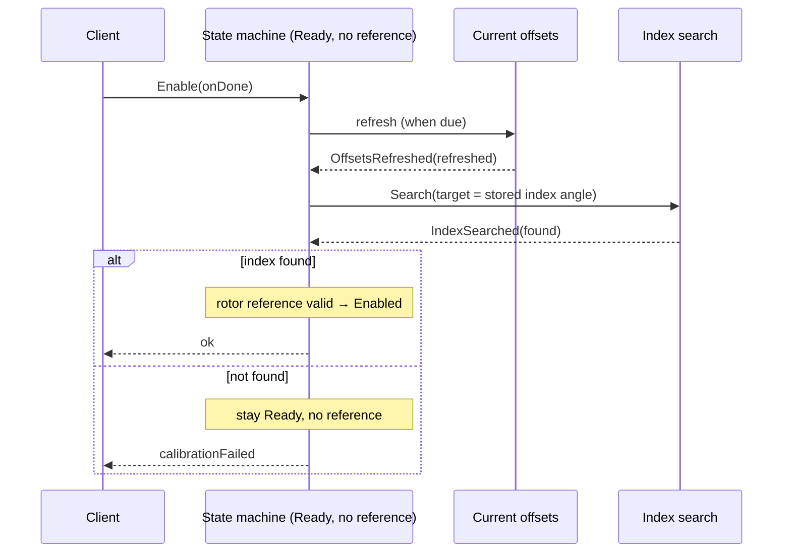

While the search runs, `HasPendingAsyncWork()` is true. `Disable` abandons it and refuses the `Enable`
with `rejected`; an emergency stop or a fault aborts it, which stops the inverter and leaves the
encoder untouched. Both the offset refresh and the search are internal transitions of `Ready`, decided
by their completion events `OffsetsRefreshed` and `IndexSearched`.

### Homed State and the Homing Requirement

Besides whether a rotor reference exists, the state machine tracks whether the position frame is the commissioned
one (`foc-position.md`, Homing and the Position Reference). The *homed* state is set when a full calibration
completes and when an index restore finds the index; an alignment-only run (`CmdReAlign()`, the external
calibration) clears it, as does every loss of the rotor reference, `CmdClearCalibration()`, a pole-pair change and
every boot. A machine built by a control-mode switch out of a `Ready` that is aligned and homed boots homed; one out
of a `Ready` that is only aligned boots aligned and not homed.

The stored setting `homingRequired` (`service-nvm.md`) is handed to the position-mode machine only; the speed
and torque machines never see it. With it on, the `Enable` guard of a position-mode machine refuses, after its
other checks, when the drive is not homed and no index restore is due. A restore that is due counts because it
runs during the preparation of the `Enable` and homes the drive; if the search finds nothing, the `Enable` is
refused with `calibrationFailed` as before. The guard refusal is answered `rejected` and traced as "position mode
requires homing; calibrate or restore the reference from the encoder index".

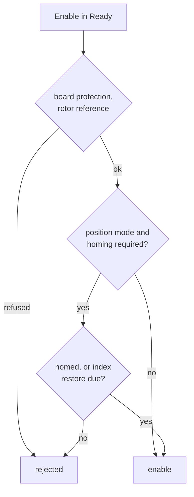

### Alignment-Only Recovery

`CmdReAlign()` re-establishes the rotor reference without re-running the full identification chain. It requires the machine to be in `Idle` or `Ready` with valid electrical calibration already loaded (non-zero pole pairs and positive phase resistance). The procedure:

1. Enters `Calibrating` at the alignment sub-step, copying the stored electrical parameters into `pendingData`.
2. Calls the Motor Alignment service using the stored pole pairs.
3. On success: marks `rotorReferenceValid`, saves the updated offset to NVM through the same completion path as a full calibration, applies mode-specific calibration from the stored parameters, and transitions to `Ready`.
4. On failure: enters `Fault` with code `calibrationFailed`, `phaseMissing` when the alignment found a phase that carries no current (`service-alignment.md`, phase continuity check), or `encoderLoss` when the encoder did not follow the field (`service-alignment.md`, encoder follow check).

A re-alignment does not wait for the rotor to come to rest. The alignment holds the rotor until its
position settles, and in simulation a re-alignment issued 30 ms after disabling at 500 rpm aligned and
ran every reference motor and the bench motor.

Over CAN a re-alignment is the `Align` command. Because the same completion path is used, the speed and position loop parameters are also re-applied from the stored calibration, so mechanical identification does not need to be re-run after an alignment-only recovery.

### Online Parameter Estimation (Speed/Position Modes)

For speed and position control modes, the state machine creates and manages two online parameter estimators alongside the main control loop:

- **Online Mechanical Estimator** — continuously refines rotor inertia (J) and viscous friction (B) using a Recursive Least Squares estimator that runs at the outer-loop rate (1 kHz).
- **Online Electrical Estimator** — continuously refines phase resistance (R) and d-axis inductance (Ld) using a d-axis voltage-model RLS estimator running at the same rate.

**Lifecycle of online estimators:**

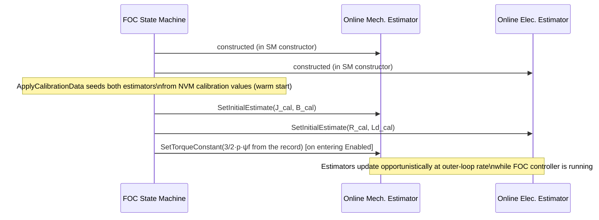

**Seeding from calibration data:** When `ApplyCalibrationData` is called (either after calibration completes or on NVM boot load), both estimators are seeded with the values from `CalibrationData`. This warm-starts the RLS theta vector at the known-good calibration values rather than zero, ensuring the estimators produce physically meaningful outputs from the first update.

The electrical estimator is seeded using `lD` (d-axis inductance), as the underlying model assumes a non-salient motor ($L_d \approx L_q$). For interior PMSMs, a 3-parameter model with separate Ld and Lq would be required; this is a known limitation.

**Estimates reach the loops only while the drive is stopped:** the gains are never redesigned while `Enabled`,
where neither the current nor the speed loop design is interrupt-safe. Online recalibration
(`online-recalibration.md`) decides when a settled estimate replaces the model the loops are designed from and
applies it on entering `Ready` from `Enabled` (automatic mode) or on a Recalibrate command in a stopped state. The
current loop is redesigned from the resistance and inductance in use, the speed loop from the inertia and friction
in use with the bandwidth-based rule of `documentation/theory/speed-loop-pi.md` ("What the implementation uses"):
$k_p = 2 J \omega_{bw} / K_t$, $k_i = k_p \max(B_f/J,\ \omega_{bw}/4)\, T_s$ with $T_s$ the outer-loop sample
period and $K_t = \tfrac{3}{2} p \psi_f$ from the calibration record; the operator's loop settings are applied
again afterwards, so the bandwidths do not change. The estimators are not seeded again. A stored recalibration
(`online-recalibration.md`, Part F) is applied the same way on the first `Ready` after power-up, and the Reset Model
command redesigns both loops from the calibration record again, in a stopped state only.

The online estimates are read over CAN (`0x90`–`0x93`) and adopted with the `Recalibrate` command
(`online-recalibration.md`).

### Control Mode Selection (`ControlModeStateMachine`)

`ControlModeStateMachine` is a higher-level coordinator that owns one `FocStateMachineCommon` subclass per
supported control mode (`TorqueStateMachine`, `SpeedStateMachine`, `PositionStateMachine`), held in a
`std::variant`. At any given time exactly one mode's state machine is the **active** instance; the others are
idle. This section documents three behavioral invariants introduced to make runtime mode switching safe and
predictable.

The coordinator delegates each concern to one part and exposes it through an accessor:

| Part (accessor)                          | Concern                                                                                           |
|------------------------------------------|---------------------------------------------------------------------------------------------------|
| `ActiveDrive` (`Drive()`)                | The variant of mode machines, the active machine and its controller interfaces, calibration reads |
| `DriveCommands` (`Commands()`)           | Setpoints for the active mode, and the current, bus-voltage and configured limits applied to it   |
| `ModeSelection` (`Modes()`)              | `Select()`: the persisted default mode, the activation and the rollback (C2)                      |
| `SettingTransaction` (`Settings()`)      | The gate every setting passes and the one setting whose callback is pending                       |
| `TuningSettings` (`Tunings()`)           | Loop bandwidths and tunings, stored and effective, and motor parameters                           |
| `AlgorithmSettings` (`Algorithms()`)     | Selection and persistence of the current, speed and position laws                                 |
| `ModelRecalibration` (`Recalibration()`) | Online observation, commissioning, the recalibration decision, its storage and the redesign       |

`ControlModeStateMachine` itself owns the configuration record and its writer, activates a mode (keeping the rotor
reference, re-applying limits) and restores the persisted algorithms, tunings and model when the new machine is Ready.

#### C1 — CAN Wire-Scale Convention

`ControlModeStateMachine` receives setpoints from the CAN bridge in physical unit types (`foc::Ampere`,
`foc::RadiansPerSecond`, `foc::Radians`). The fixed-point wire encoding (scale constants in
`core/can/FocMotorMessages.hpp`, round-to-nearest with saturation) is specified once, in
`documentation/design/service-can.md` Part A.

#### C2 — Re-entrancy Guard for In-Flight Selection

Switching control mode involves an asynchronous NVM write to persist the new default. A second `Select()` call issued while this write is still outstanding must not be applied until the first operation completes, since the NVM driver does not support concurrent write requests.

Behavioral rule: if a `Select()` is called while a previous `Select()` callback has not yet fired, the call returns `SelectResult::busy` immediately and takes no other action. The caller is responsible for retrying.

The same guard covers the active mode's own asynchronous work. Applying a selection destroys the active
`FocStateMachineCommon` instance, while its outstanding NVM and identification callbacks still capture that
instance. `Select()` therefore also returns `SelectResult::busy` when
`ActiveStateMachine().HasPendingAsyncWork()` is true — that is, while a command callback is pending, any
NVM operation is in flight, a calibration step is running, or a fault latched in an interrupt still owes its
transition — in addition to the existing check that the active machine is stopped. Without that last
condition the machine, its latch and the queued transition would all be destroyed in the window between the
interrupt and the dispatcher turn, and the machine built in its place would start unlatched. `NvmActivity` counts every NVM operation from the call until its callback, so a
save or invalidation still outstanding after an emergency stop keeps the machine alive until it completes.

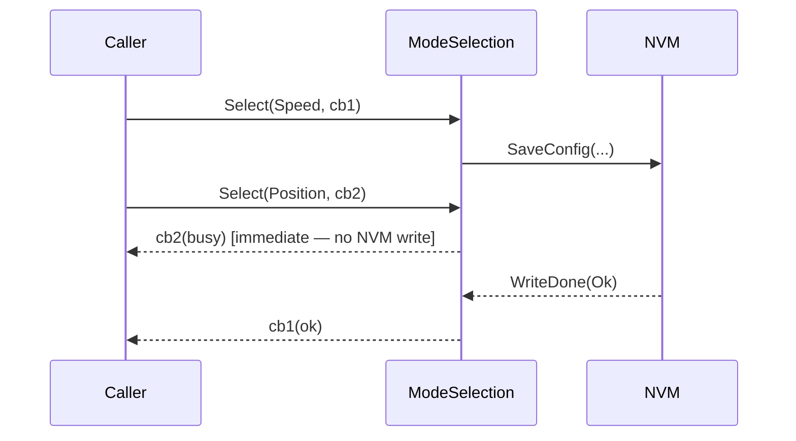

#### C2a — One `NvmActivity` for Every Writer of the Shared NVM

`NonVolatileMemoryImpl` serves one operation at a time and answers a concurrent call with `Busy`,
without queueing. `NvmActivity` is therefore owned by `ControlModeStateMachine`, which outlives every
mode switch, and every writer of the shared instance brackets its operation with it:

| Writer                                                                                   | Accounting                                                               |
|------------------------------------------------------------------------------------------|--------------------------------------------------------------------------|
| Calibration, maintenance and boot (`CalibrationFlow`, `MaintenanceFlow`, `BootSequence`) | `LifecycleEnvironment::nvmActivity`, a reference to the shared counter   |
| `Select`'s `SaveConfig` and its rollback write                                           | `Begin`/`End` around each write                                          |
| `ConfigWriter`, for every other write of the configuration record                        | `Begin` before the first attempt, `End` once no write or rewrite is left |

`HasPendingAsyncWork()` is therefore true while any of them is outstanding, and every guard built on
it — `CmdCalibrate`, `CmdEnable`, `CmdClearCalibration`, `Select` — refuses instead of colliding.

`ControlModeStateMachine` owns the one configuration record and one `ConfigWriter` for it. Algorithm
selections, loop tunings and the CAN bridge's start-up settings change the record in place and ask
the writer to store it. A request made while a write is outstanding is folded into one more write of
the record as it then is, so no change is lost to a write that started before it; a store answered
`Busy` by the NVM is retried every 10 ms. When a write finishes, its requester is answered before the
folded-in rewrite takes its copy of the record, so a requester that takes its change back after a
failed write is not stored by the rewrite. `Select` writes the record itself, and the CAN bridge
answers `busy` to a start-up setting while a selection or a configuration write is outstanding.

#### C2b — Algorithm Selection Is Refused While Busy

`SelectCurrentAlgorithm`, `SelectSpeedAlgorithm` and `SelectPositionAlgorithm` apply the same guard as
`Select` — the active machine is `Idle` or `Ready` and has no pending asynchronous work — and return
`busy` otherwise. Selection is therefore refused while `Calibrating`, `Enabled` or `Fault`, and while
any NVM operation is outstanding. The cascades' own refusal while enabled remains as a second guard.

#### C2c — A Busy Calibration Save Is Retried

`CalibrationFlow` retries a `SaveCalibration` answered with `Busy` every 10 ms from a copy of the
record, keeping `NvmActivity` raised and reusing the completion captured at the epoch of the run, so
`CalibrationSaved` is only dispatched with the status of a write that actually ran. An abort while a
retry is waiting cancels it and releases `NvmActivity`. An abort while a write is in flight drops the
completion; when that write answers, `OnSaved` releases `NvmActivity` and stops — a `Busy` answer is not
retried — so an aborted run is not persisted.

#### C3 — Deferred Apply and Re-check Before Activate

`Select()` does not switch the active state machine up front. It records the previous
`defaultControlMode`, writes the new one into `configData` and starts the asynchronous `SaveConfig`;
`activeSm` is untouched until `OnSaveConfigDone` runs.

`Select()` starts the write only when the active machine is stopped and has no pending asynchronous
work, but that is a snapshot: a fault, an emergency stop or a calibration can land while the write is
outstanding. Activating the new mode then would destroy the machine that holds the fault and start the
new one unlatched. `OnSaveConfigDone` therefore decides:

1. **Write failed**: restore `configData.defaultControlMode` (NVM still holds the previous default) and
   report `busy` for a transient failure or `nvmFailed` otherwise. The active mode was never touched.
2. **Write succeeded and the guard still holds**: `Activate(pendingSelectMode)` and report `ok`.
3. **Write succeeded but the guard no longer holds**: keep the active mode, restore
   `configData.defaultControlMode` and write it back so NVM agrees with the running mode, then report
   `busy` when that write completes, whatever its status. The pending callback stays set during the
   rollback write, so a `Select()` in that window is refused with `busy` (C2).

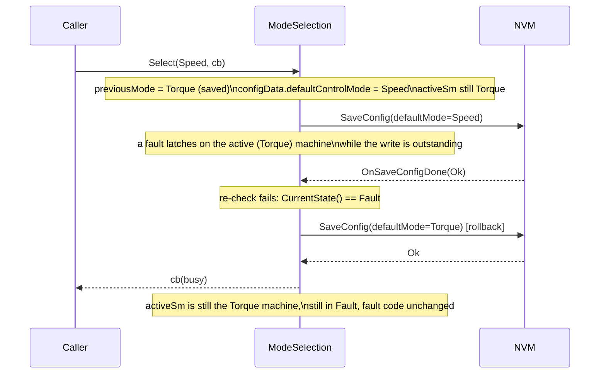

#### C4 — A Mode Switch Keeps the Rotor Reference

The alignment zeroes the encoder, which is hardware every mode's machine shares; destroying the machine
that ran it does not move the rotor or the encoder. `Activate()` therefore reads, before it stops and
destroys the active machine, whether that machine is in `Ready` with `rotorReferenceValid`. If it is, the
new machine is built with the rotor reference kept and boots to `Ready` once its stored record loads and is
complete for the new mode (Boot-Time NVM Check), so the operator can enable it without aligning again.
In every other case — the active machine was in `Idle`, or the record lacks the inertia and friction a
speed or position machine needs — the new machine boots to `Idle` with no rotor reference, as at power-on,
and needs `CmdReAlign()` or `CmdCalibrate()`.

Only `Ready` hands the reference over: it is the state in which the old machine itself would have accepted
`CmdEnable`, so a switch never makes a motor startable that was not startable before it. `Select()` is
refused outside `Idle` and `Ready` (C2), so a fault is never carried past.

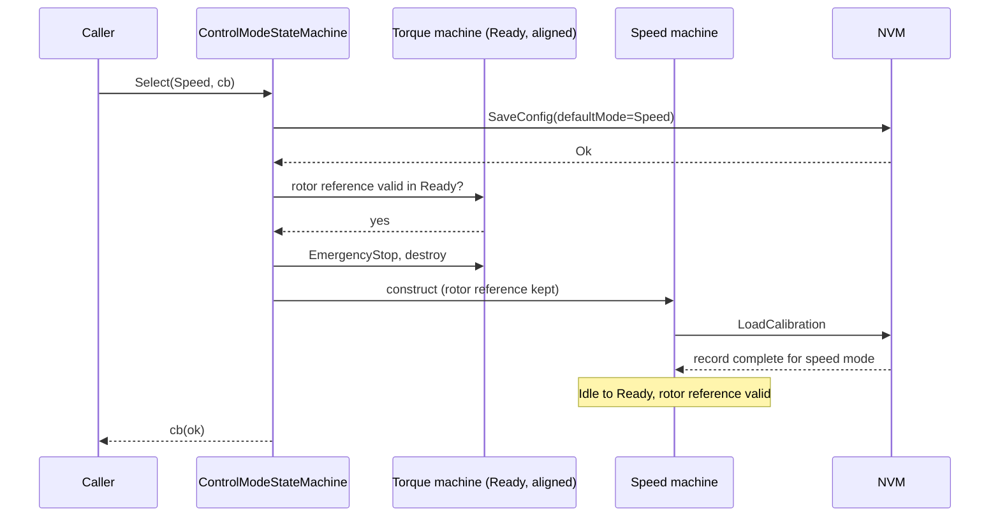

---

## Interfaces

### Provided

| Interface                 | Purpose                                                                                | Contract                                                                                                                                                                                                                                                     |
|---------------------------|----------------------------------------------------------------------------------------|--------------------------------------------------------------------------------------------------------------------------------------------------------------------------------------------------------------------------------------------------------------|
| `FocStateMachineBase`     | Abstract lifecycle controller — state query and command dispatch                       | Constructed once per application; all command methods are safe to call from any state (a command without a row in the current state is rejected with a status and traced, never applied)                                                                     |
| `CurrentState()`          | Returns the current `State` variant for inspection                                     | Returns a const reference; valid for the lifetime of the state machine                                                                                                                                                                                       |
| `LastFaultCode()`         | Returns the most recent fault code                                                     | Returns `FaultCode::none` until the first fault occurs; afterwards it retains the last fault code, also after the fault is cleared                                                                                                                           |
| `CmdCalibrate()`          | Requests start of full calibration sequence                                            | Only effective from `Idle` or `Ready`; ignored from all other states                                                                                                                                                                                         |
| `CmdReAlign()`            | Re-establishes the rotor reference without re-running R/L or mechanical identification | Only effective from `Idle` or `Ready` with valid electrical calibration loaded; enters `Calibrating` (alignment sub-step only), then `Ready` with `rotorReferenceValid` on success, or `Fault` on failure                                                    |
| `CmdEnable()`             | Requests enabling the FOC controller                                                   | Only effective from `Ready` when `rotorReferenceValid` is true; rejected when the rotor reference has not been established since the last reset                                                                                                              |
| `CmdDisable()`            | Requests disabling the FOC controller                                                  | Only effective from `Enabled`; ignored from all other states                                                                                                                                                                                                 |
| `CmdClearFault()`         | Clears the fault and returns to `Ready` if valid calibration is held, otherwise `Idle` | Only effective from `Fault`; ignored from all other states                                                                                                                                                                                                   |
| `CmdClearCalibration()`   | Invalidates NVM calibration and returns to `Idle`                                      | Only effective from `Idle` or `Ready`; ignored from `Calibrating`, `Enabled`, and `Fault`. On NVM failure transitions to `Fault`.                                                                                                                            |
| `CmdEmergencyStop()`      | Stops PWM immediately and leaves the active states                                     | Accepted from every state and always returns `ok`. From `Enabled` or `Calibrating` it goes to `Ready` when calibration data is valid, otherwise to `Idle`. `Idle`, `Ready` and `Fault` are left unchanged. Aborts any pending command with `abortedByFault`. |
| `HasPendingAsyncWork()`   | Reports whether a service callback capturing the machine is outstanding                | True while a command callback is pending, any NVM operation is in flight, a calibration step is running, or a fault latched in an interrupt still owes its transition. Used by `ControlModeStateMachine` to refuse destroying the machine.                   |
| `HasPartialCalibration()` | Reports whether `Idle` holds a non-empty but incomplete NVM record                     | True only in `Idle`, when `stage != complete` but pole pairs or resistance are non-zero (an old-schema or interrupted record). Used by the CAN bridge to broadcast `FocMotorState::partialCalibration` instead of `idle`.                                    |
| `ApplyModel(model)`       | Redesigns the current and speed loops from a motor model                               | Only effective while stopped; returns false otherwise. Keeps the estimators' state. Speed/position modes only (`online-recalibration.md`).                                                                                                                   |

### Required

| Interface                                  | Purpose                                                                               | Contract                                                                                                                                                  |
|--------------------------------------------|---------------------------------------------------------------------------------------|-----------------------------------------------------------------------------------------------------------------------------------------------------------|
| `NonVolatileMemory`                        | Persists and retrieves calibration data across power cycles                           | Must remain valid for the lifetime of the state machine                                                                                                   |
| `ElectricalParametersIdentification`       | Estimates pole pairs, phase resistance, and dq inductances                            | Operations are asynchronous; callback fires on the same event loop                                                                                        |
| `MotorAlignment`                           | Forces rotor to a known angle and returns the encoder zero offset                     | Operation is asynchronous; result is optional (nullopt = failure)                                                                                         |
| `IndexSearch` (optional)                   | Finds the encoder index; re-references the encoder to a stored index angle            | Operation is asynchronous; result is optional (nullopt = not found); absent or unavailable without an index channel                                       |
| `MechanicalParametersIdentification`       | Estimates rotor inertia and viscous friction (speed/position modes only)              | Operation is asynchronous; result is optional (nullopt = failure)                                                                                         |
| `FaultNotifier`                            | Delivers hardware fault notifications to the state machine                            | `Register()` must be called during construction; callback may fire at any time. Production implementation is `PlatformFaultNotifier`.                     |
| `ThreePhaseInverter`                       | Used by the FOC controller to issue PWM and read phase currents                       | Stopped immediately on any fault from `Enabled` or `Calibrating` state                                                                                    |
| `Encoder`                                  | Rotor position sensor; zero point established by the alignment step or the index      | Read-only from the state machine's perspective; `SetZero()` is called by `MotorAlignment` and `Set()` by `IndexSearch`, never by the state machine itself |
| `Tracer`                                   | Debug trace output for lifecycle events                                               | All state transitions and calibration steps are traced                                                                                                    |
| `RealTimeFrictionAndInertiaEstimator`      | Online RLS estimator for rotor inertia and viscous friction (speed/position only)     | Seeded from calibration data; torque constant 3/2·p·ψf from the record set on entering `Enabled`; updates run while FOC outer loop is active              |
| `RealTimeResistanceAndInductanceEstimator` | Online RLS estimator for phase resistance and d-axis inductance (speed/position only) | Assumes non-salient motor (Ld ≈ Lq); seeded using `lD` from calibration                                                                                   |

---

## Data Model

| Entity            | Field                  | Type / Unit                    | Range     | Notes                                                                                                                                                                                                                   |
|-------------------|------------------------|--------------------------------|-----------|-------------------------------------------------------------------------------------------------------------------------------------------------------------------------------------------------------------------------|
| `CalibrationData` | `polePairs`            | count (uint8)                  | 1–255     | Number of electrical pole pairs                                                                                                                                                                                         |
| `CalibrationData` | `rPhase`               | Ohm (float)                    | > 0       | Phase resistance identified by electrical ident                                                                                                                                                                         |
| `CalibrationData` | `lD`                   | mH (float)                     | > 0       | Phase inductance, used for both axes (anisotropy not estimated)                                                                                                                                                         |
| `CalibrationData` | `encoderIndexAngle`    | rad (float), mechanical        | [−π, π)   | Reading at the encoder index in the aligned frame; NaN when none was found. Applied only at a live index pulse                                                                                                          |
| `CalibrationData` | `inertia`              | N·m·s² (float)                 | ≥ 0       | Rotor inertia; populated only for speed/position modes                                                                                                                                                                  |
| `CalibrationData` | `frictionViscous`      | N·m·s/rad (float)              | ≥ 0       | Viscous friction coefficient; populated only for speed/position modes                                                                                                                                                   |
| `CalibrationData` | `frictionCoulomb`      | N·m (float)                    | ≥ 0       | Dry friction measured by the cogging step; 0 when not measured, read as no friction feed-forward                                                                                                                        |
| `CalibrationData` | `speedLoopBandwidth`   | rad/s (float)                  | ≥ 0       | Speed-loop bandwidth; not measured: the mechanical identification writes a fixed 100 rad/s, for speed/position modes only                                                                                               |
| `FaultCode`       | —                      | enum (uint8)                   | 14 values | `none`, `overcurrent`, `overvoltage`, `undervoltage`, `overtemperature`, `encoderLoss`, `hardwareFault`, `calibrationFailed`, `stall`, `phaseMissing`, `overspeed`, `followingError`, `commandTimeout`, `positionLimit` |

A watchdog expiry has no fault code. It cuts the power stage from the watchdog interrupt and the hardware
resets the target, so there is no dispatcher turn in which a latched fault code could be read or broadcast; the
expiry is reported after reboot through `ResetCause::watchdog` instead. The watchdog does not reach the state
machine at all. Every code is reported over CAN under its own wire code (contract 2.8, `service-can.md`); the
bridge's mapping has no default, so a new code does not build until it is mapped. See
[Watchdog Design](watchdog.md).

---

## Error Handling

All calibration steps produce `std::optional` results. A `nullopt` from any step immediately enters `Fault` with
code `calibrationFailed`, except an alignment that found a phase carrying no current, which enters it with
`phaseMissing`, or an encoder that did not follow the field, which enters it with `encoderLoss`
(`CalibrationStepFailed` carries the code). The entire calibration sequence is safe to retry by issuing
`CmdCalibrate` after `CmdClearFault`.

NVM operations (save, load, invalidate) are also asynchronous and report a `NvmStatus`. On any non-`Ok` status during save or load, the machine enters `Fault` or remains in `Idle`, respectively, without corrupting application state.
