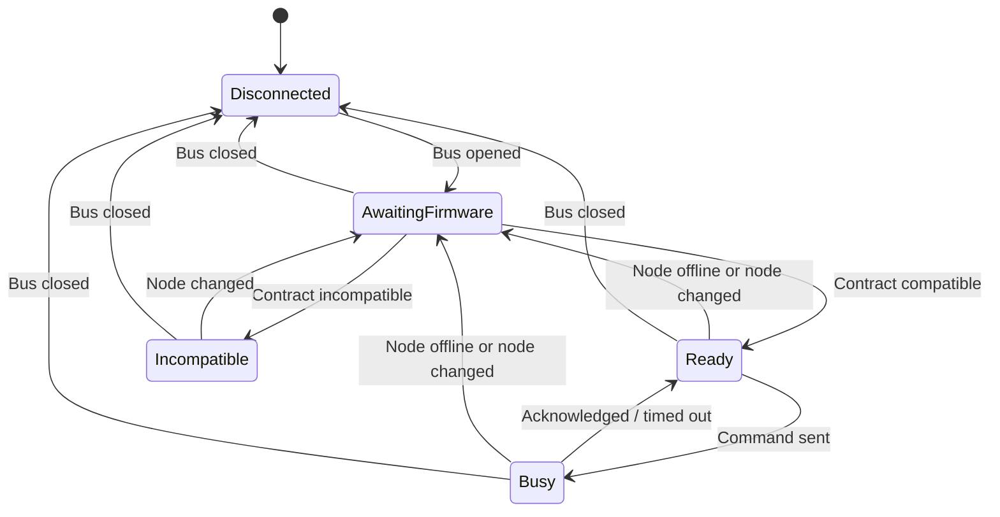
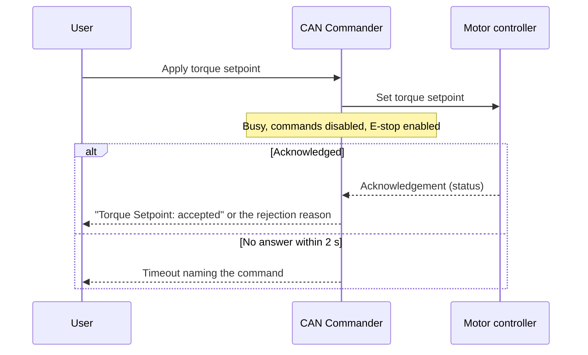

| Field     | Value                |
|-----------|----------------------|
| Title     | CAN Commander Design |
| Type      | design               |
| Status    | draft                |
| Version   | 0.1.0                |
| Component | tool-can-commander   |
| Date      | 2026-10-24           |

---

## Responsibilities

**Is responsible for:**
- Letting a bench engineer open a CAN interface, address one motor controller by node ID and command it:
  start, stop, emergency stop, control mode, torque/speed/position setpoints and loop bandwidths.
- Showing the controller's state as the controller reports it: node heartbeat, firmware contract
  compatibility, motor state and fault, measurements and identified motor parameters.
- Keeping a persistent issue log per user, and turning it into a pre-filled bug report on request.
- Telling the user when a newer release exists, without ever blocking the tool.
- Shipping as a branded, installable product ("e-foc CAN Commander") for Windows and Debian-based Linux.

**Is NOT responsible for:**
- Deciding whether a command is safe. The firmware validates every setpoint and state transition; the tool
  only keeps its input ranges inside what the firmware accepts.
- Replacing the hardware emergency stop. The on-screen emergency stop is a CAN command and needs a working bus.
- Sending anything to the network on its own other than the release check. Bug reports open in the
  browser for the user to review and submit.
- Downloading or installing updates. It links to the installer for the running platform.

---

## Component Details

### Part A — logic, support and presentation layers

The tool is split so that everything but widget layout can be tested without a display:

- **Adapter** — the CAN bus per platform: SocketCAN on Linux; PCAN, Kvaser or CANable on Windows.
- **Logic** — the command client. It encodes commands with the firmware's wire contract, decodes telemetry,
  tracks one pending command ("busy") and reports two separate facts: the *bus* opened or closed, and the
  selected *node's heartbeat* appeared or timed out. Losing a heartbeat never closes the bus.
- **Support** — application identity, the issue log, the bug-report builder, the release feed reader, the
  update checker, and the bridge that runs the embedded-infrastructure event loop and timers on the GUI thread.
- **Presentation** — the window, panels and status bar. Widgets only display; they do not decide.

### Part B — state the user can see at all times

| Element | Shows | Source |
|---------|-------|--------|
| Connection panel | interface, bitrate, node ID, connected or not | bus adapter |
| Status bar — node | no heartbeat yet / online / offline | node heartbeat |
| Status bar — firmware | unknown / contract *major.minor* / incompatible | contract version response |
| Status bar — activity | the command waiting for its acknowledgement | command client |
| Control mode | *requested…* until acknowledged, then *active* | mode acknowledgement |
| Motor status | state and fault, coloured by severity | telemetry |
| Measurements, identified parameters | values, or "—" when nothing live is known | telemetry, responses |

A displayed state always comes from the controller. Values are cleared when the bus closes, the node goes
offline or another node is selected, so stale numbers never read as live.

### Part C — commands and the emergency stop

Commands are enabled only when the bus is open, the firmware contract is compatible and no command is
pending. When disabled, every command explains why (tooltip), and the persistent reasons — not connected,
incompatible firmware, waiting for the firmware version — also appear as an inline hint.

The emergency stop is outside that rule. It is a large, always-visible button with the Esc shortcut and is
enabled whenever the bus is open and the firmware is not known to be incompatible, including while another
command is pending.

Input ranges and decimal places follow the wire contract: the limit is the smaller of the firmware's
command limit and what the 16-bit wire field can carry, and the decimals match the wire resolution, so the
tool never offers precision that the frame drops.

Each command outcome is logged in words: accepted, or the plain-language reason for a rejection; a
command that was refused locally and never sent; a command that received no acknowledgement in time.

### Part D — issue log

- One log per user in the platform's per-user application data folder, under `e-foc/CAN Commander/logs`.
- Every line is one entry: UTC timestamp, severity (INFO, WARN, ERROR), message.
- The current file rotates at 1 MiB; three files are kept.
- Recorded: session start with version, operating system and Qt version; connect and disconnect; adapter
  errors; command outcomes; firmware contract result; changes of motor state and fault (not every frame);
  release check results; warnings that Qt itself raises (for example a missing TLS backend).
- Raw CAN frames are not recorded; they are shown, on request, in the bounded on-screen event log only.
- The newest entries are also kept in memory for the bug report.

### Part E — reporting an issue

Help → Report Issue opens the project's new-issue page with the title prefixed "[CAN Commander]" and a body
holding: a prompt for what happened, the version, operating system, architecture and Qt version, the
newest log entries, and where the full log file lives (with the home folder shown as "~"). Older entries
are dropped until the address fits the length the issue tracker accepts. Nothing is sent until the user
submits the page. Help → Open Log Folder shows the files.

### Part F — update check

At startup (unless switched off in the Help menu or by the no-update-check option) and on Help → Check for
Updates, the tool reads the project's latest-release document over HTTPS, honouring the system proxy. The
release tag is compared with the tool's own version as three numbers.

- Newer release: a dismissible banner names the version and offers the installer for this platform (the
  release asset whose name ends in the platform's installer suffix) and the release notes.
- Same or older: nothing is shown at startup; a manual check confirms the tool is current.
- Offline, rate-limited or unreadable: nothing is shown at startup; the failure is logged; a manual check
  explains it and links to the releases page.

### Part G — installers

| Platform | Package | Installs | Notes |
|----------|---------|----------|-------|
| Windows x86-64 | `e_foc-can_commander-<tag>-windows-x86_64-setup.exe` | Program Files\e-foc CAN Commander, Start-menu and desktop shortcuts, uninstaller, Add/Remove Programs entry | Qt runtime included, MSVC runtime installed when bundled; an existing installation is removed first |
| Debian/Ubuntu x86-64 | `e_foc-can_commander-<tag>-linux-x86_64.deb` | the `e-foc-can-commander` command, a desktop entry and icons | Qt libraries declared as package dependencies |

The portable archives (Windows zip, Linux tar.gz) stay alongside the installers. The release workflow
installs each package on a clean runner, checks the reported version against the project version, launches
the tool, and uninstalls it before the release is published.

---

## Interfaces

### Provided

| Interface | Purpose | Contract |
|-----------|---------|----------|
| Desktop application | Command and monitor one motor controller | Usable without a bus: logs, report and update functions work when the CAN driver is missing |
| Command line | Scripted checks of an installation | Version and help are answered without a display; the no-update-check option skips the startup check |
| Issue log files | Evidence for bug reports | Plain UTF-8 text, one entry per line, rotated, per user |

### Required

| Interface | Purpose | Contract |
|-----------|---------|----------|
| CAN adapter driver | Bus access | SocketCAN kernel modules on Linux; PCAN, Kvaser or CANable driver on Windows |
| Firmware wire contract | Command and telemetry encoding | Commands are enabled only when the major contract version matches |
| Release feed | Update check | The project's latest-release document; release asset names follow the installer suffixes in Part G |
| Web browser | Issue reporting, downloads | Opened through the desktop's default handler |

---

## State Machine

Commands are enabled in **Ready** only. The emergency stop is enabled in **AwaitingFirmware**, **Ready**
and **Busy**.

---

## Sequence Diagrams

### Startup with update check

### Command with acknowledgement

---

## Constraints & Limitations

| Constraint | Value / Description |
|------------|---------------------|
| Command acknowledgement timeout | 2 s |
| On-screen event log | newest 5000 lines |
| Issue log | 1 MiB per file, 3 files, UTC timestamps |
| Bug report size | address kept within 7000 characters by dropping the oldest log entries |
| Release check | one request at a time, 10 s transfer timeout, unauthenticated (shared hourly rate limit per address) |
| Version format | releases tagged *v*major.minor.patch; pre-release tags are never offered |
| Linux package | Debian-based x86-64 with Qt 6 from the distribution |

---

## Open Questions

| # | Question | Options | Status |
|---|----------|---------|--------|
| 1 | Should the theme dim role-coloured buttons when disabled, so Start/Stop can carry their colours again? | Change the shared theme / keep default buttons | open |
| 2 | Should the torque setpoint limit follow the board's maximum current from telemetry instead of the firmware command limit? | Decode the maximum current field / keep the static limit | open |
