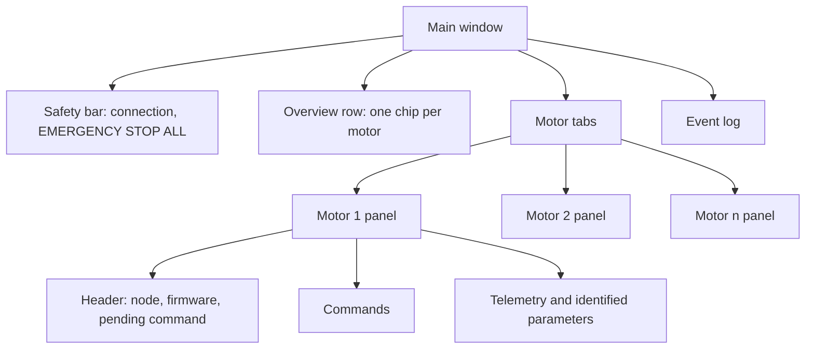
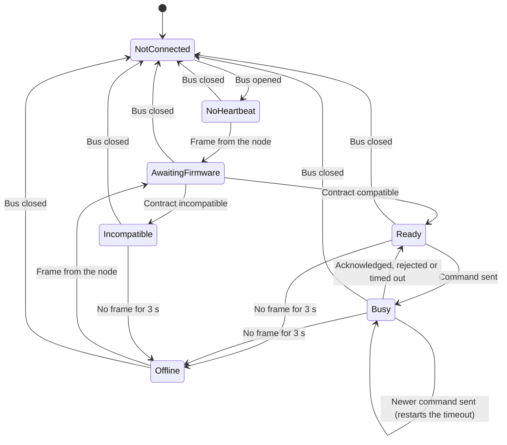
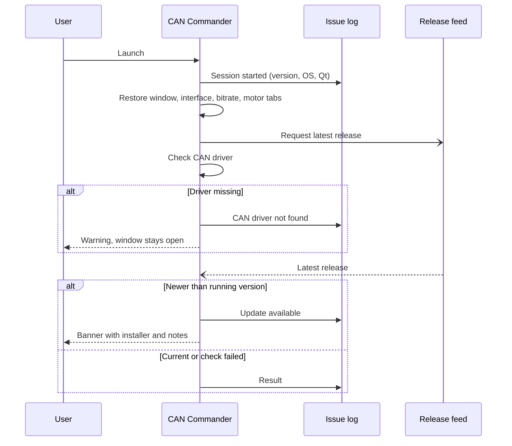
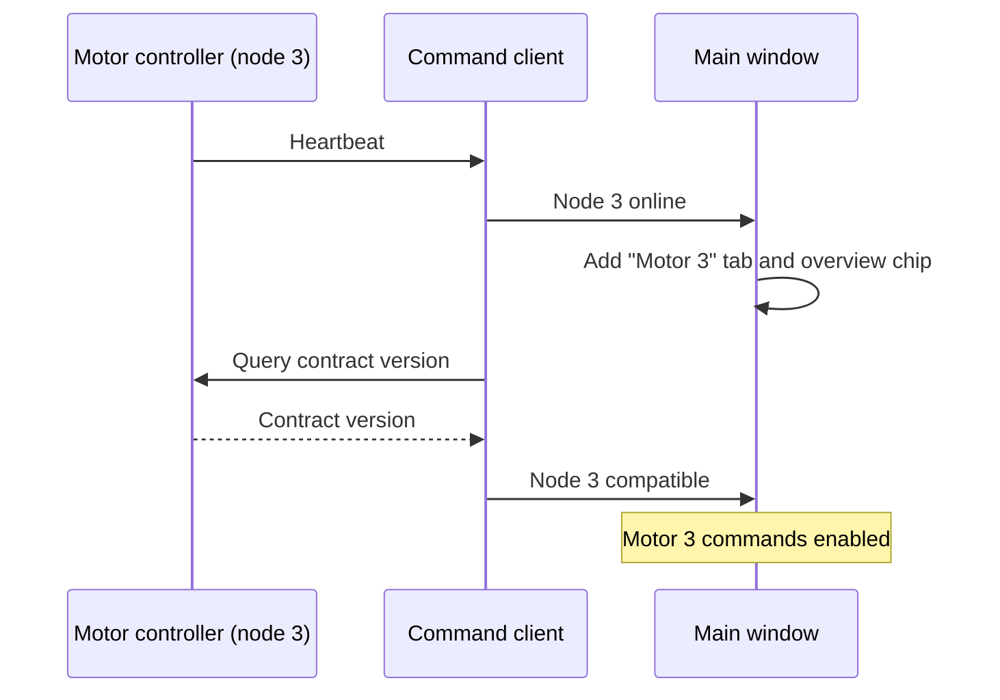
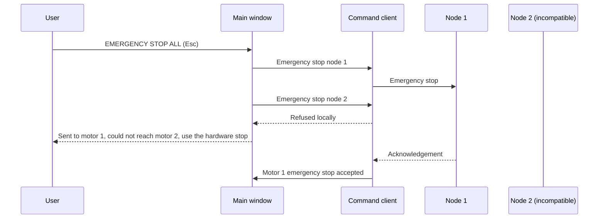

| Field     | Value                |
|-----------|----------------------|
| Title     | CAN Commander Design |
| Type      | design               |
| Status    | draft                |
| Version   | 0.2.0                |
| Component | tool-can-commander   |
| Date      | 2026-10-24           |

---

## Responsibilities

**Is responsible for:**
- Letting a bench engineer open one CAN interface and command every e-foc motor controller on it, each
  addressed by its CAN node ID (its board ID): start, stop, control mode, torque/speed/position setpoints
  and loop bandwidths, plus one emergency stop that reaches all of them.
- Showing each controller's state as that controller reports it: heartbeat, firmware contract
  compatibility, motor state and fault, measurements and identified motor parameters.
- Keeping a persistent issue log per user, and turning it into a pre-filled bug report on request.
- Telling the user when a newer release exists, without ever blocking the tool.
- Shipping as a branded, installable product ("e-foc CAN Commander") for Windows and Debian-based Linux.

**Is NOT responsible for:**
- Deciding whether a command is safe. The firmware validates every setpoint and state transition; the tool
  only keeps its input ranges inside what the firmware accepts.
- Replacing the hardware emergency stop. The on-screen emergency stop is a CAN command and needs a working bus.
- Coordinating motors with each other (synchronised moves, shared setpoints). Each motor is commanded on its own.
- Sending anything to the network on its own other than the release check. Bug reports open in the
  browser for the user to review and submit.
- Downloading or installing updates. It links to the installer for the running platform.

---

## Component Details

### Part A — logic, support and presentation layers

The tool is split so that everything but widget layout can be tested without a display:

- **Adapter** — the CAN bus per platform: SocketCAN on Linux; PCAN, Kvaser or CANable on Windows. It shows
  every received frame to its observers before handing it to the protocol client.
- **Logic** — the command client, one for the whole bus. Every command names its node and every report says
  which node sent it. Per node it tracks: online (a frame was seen; offline after the protocol's 3 s server
  timeout or when the bus closes), firmware compatibility, and the last command sent until that command is
  acknowledged, rejected or times out after 2 s. A newer command — typically the emergency stop — takes over
  the slot and restarts the timeout; an acknowledgement of an older command no longer ends it. A command the
  client refuses locally leaves the slot untouched. Closing the bus ends every pending command and reports
  every node offline at once.
- **Support** — application identity, the issue log, the bug-report builder, the release feed reader, the
  update checker, and the bridge that runs the embedded-infrastructure event loop and timers on the GUI thread.
- **Presentation** — the window, one panel per motor, the overview row and the status bar. Widgets only
  display; they do not decide.

### Part B — motors, tabs and discovery

- A tab appears automatically for every node whose frames are seen on the bus. The user can also add a tab
  by node ID (Motor → Add Motor, or the "+ Add Motor" button) before that node comes online, and close tabs.
  Closing a tab does not stop the motor.
- The list of tabs is restored on the next start, so a known rig reopens with its motors in place.
- At most eight motors are followed, the number of servers `can-lite` tracks liveness and sequence numbers
  for. A further node is logged and left without a tab.
- With no motors, the motor area explains how motors appear and offers Add Motor.

### Part C — state the user can see at all times

| Element                                           | Shows                                                                                 | Source                              |
|---------------------------------------------------|---------------------------------------------------------------------------------------|-------------------------------------|
| Connection panel                                  | interface, bitrate, connected or not                                                  | bus adapter                         |
| Overview row                                      | every motor's summary (running, idle, fault, offline, incompatible) with a status dot | each node                           |
| Tab                                               | status dot and tooltip of that motor                                                  | each node                           |
| Motor header                                      | node state, firmware contract, the command waiting for an answer                      | that node                           |
| Control mode                                      | *requested…* until acknowledged, then *active*                                        | that node's mode response           |
| Motor status, measurements, identified parameters | values, or "—" when nothing live is known                                             | that node's telemetry and responses |
| Status bar                                        | motors online out of motors shown, and how many are in fault                          | all nodes                           |

A displayed state always comes from the controller. A motor's values are cleared when the bus closes or
that node goes offline, so stale numbers never read as live. A fault on one motor stays visible in the
overview row and on its tab while another motor is being commanded.

### Part D — commands and the emergency stop

A motor's commands are enabled only when the bus is open, the node is online, its firmware contract is
compatible and it has no command pending. When disabled, every command explains why (tooltip); the
persistent reasons — not connected, node not on the bus, incompatible firmware, waiting for the firmware
version — also appear as an inline hint in that motor's panel.

The emergency stop is outside that rule. One large button (and Esc, also in the Motor menu) sends an
emergency stop to every motor that has a tab and every node currently online, whether or not a command is
pending on it. It is enabled while the bus is open and at least one of those motors can receive it. The log
names the motors it reached and, separately, those it could not reach (incompatible firmware or a refused
frame) with the advice to use the hardware stop.

Input ranges and decimal places follow the wire contract: the limit is the smaller of the firmware's
command limit and what the 16-bit wire field can carry, and the decimals match the wire resolution, so the
tool never offers precision that the frame drops.

Each command outcome is logged in words and prefixed with its motor: accepted, the plain-language reason
for a rejection (for example "not valid in the active control mode"), a command that was refused locally
and never sent, or a command that received no answer in time.

### Part E — issue log

- One log per user in the platform's per-user application data folder, under `e-foc/CAN Commander/logs`.
- Every line is one entry: UTC timestamp, severity (INFO, WARN, ERROR), message.
- The current file rotates at 1 MiB; three files are kept. A log folder that disappears while the tool runs
  stops file output; the tool keeps running and keeps the newest entries in memory.
- Recorded: session start with version, operating system and Qt version; connect and disconnect; motor
  discovery; per motor, online and offline, command outcomes, firmware contract result, changes of motor
  state and fault (not every frame); emergency stops; release check results; warnings Qt itself raises.
- Raw CAN frames are not recorded; they are shown, on request, in the bounded on-screen event log only.
- The newest entries are also kept in memory for the bug report.

### Part F — reporting an issue

Help → Report Issue opens the project's new-issue page with the title prefixed "[CAN Commander]" and a body
holding: a prompt for what happened, the version, operating system, architecture and Qt version, the
newest log entries, and where the full log file lives (with the home folder shown as "~"). Older entries
are dropped until the address fits the length the issue tracker accepts. Nothing is sent until the user
submits the page. Help → Open Log Folder shows the files.

### Part G — update check

At startup (unless switched off in the Help menu or by the no-update-check option) and on Help → Check for
Updates, the tool reads the project's latest-release document over HTTPS, honouring the system proxy. The
release tag is compared with the tool's own version as three numbers.

- Newer release: a dismissible banner names the version and offers the installer for this platform (the
  release asset whose name ends in the platform's installer suffix) and the release notes.
- Same or older: nothing is shown at startup; a manual check confirms the tool is current.
- Offline, rate-limited or unreadable: nothing is shown at startup; the failure is logged; a manual check
  explains it and links to the releases page.

### Part H — installers

| Platform             | Package                                              | Installs                                                                                                      | Notes                                                                                                                                             |
|----------------------|------------------------------------------------------|---------------------------------------------------------------------------------------------------------------|---------------------------------------------------------------------------------------------------------------------------------------------------|
| Windows x86-64       | `e_foc-can_commander-<tag>-windows-x86_64-setup.exe` | `Program Files\e-foc CAN Commander`, Start-menu and desktop shortcuts, uninstaller, Add/Remove Programs entry | Qt runtime included, MSVC runtime installed when bundled; an existing installation is removed first                                               |
| Debian/Ubuntu x86-64 | `e_foc-can_commander-<tag>-linux-x86_64.deb`         | the `e-foc-can-commander` command, a desktop entry and icons                                                  | Qt libraries and platform plugins declared as package dependencies; built on Ubuntu 24.04, so it needs a distribution of that generation or newer |

The portable archives (Windows zip, Linux tar.gz) stay alongside the installers. The release workflow
installs each package on a clean runner, checks the reported version against the project version, launches
the tool, and uninstalls it before the release is published.

---

## Interfaces

### Provided

| Interface           | Purpose                                                      | Contract                                                                                                                                             |
|---------------------|--------------------------------------------------------------|------------------------------------------------------------------------------------------------------------------------------------------------------|
| Desktop application | Command and monitor up to eight motor controllers on one bus | Usable without a bus: logs, report and update functions work when the CAN driver is missing                                                          |
| Command line        | Scripted checks of an installation                           | Version and help are answered without a display (on Windows, in the console it was started from); the no-update-check option skips the startup check |
| Issue log files     | Evidence for bug reports                                     | Plain UTF-8 text, one entry per line, rotated, per user                                                                                              |

### Required

| Interface              | Purpose                                                      | Contract                                                                                             |
|------------------------|--------------------------------------------------------------|------------------------------------------------------------------------------------------------------|
| CAN adapter driver     | Bus access                                                   | SocketCAN kernel modules on Linux; PCAN, Kvaser or CANable driver on Windows                         |
| Firmware wire contract | Command and telemetry encoding                               | A node's commands are enabled only when its major contract version matches (REQ-CAN-003, per server) |
| CAN service client     | Per-node attribution of responses and per-node compatibility | See the frame-origin tracker in the CAN service design                                               |
| Release feed           | Update check                                                 | The project's latest-release document; release asset names follow the installer suffixes in Part H   |
| Web browser            | Issue reporting, downloads                                   | Opened through the desktop's default handler                                                         |

---

## State Machine

Each motor panel follows its own node:

A node that comes back after being offline is asked for its firmware version again; its previous verdict
holds until the answer arrives. Commands are enabled in **Ready** only. The emergency stop reaches a motor
in every state except **NotConnected** and **Incompatible**.

---

## Sequence Diagrams

### Startup with update check

### Discovering a motor

### Emergency stop with several motors

---

## Constraints & Limitations

| Constraint             | Value / Description                                                                                  |
|------------------------|------------------------------------------------------------------------------------------------------|
| Motors per bus         | 8 (the servers `can-lite` tracks)                                                                    |
| Command answer timeout | 2 s per node, restarted by every newer command                                                       |
| Node offline after     | 3 s without a frame (`can-lite` server timeout)                                                      |
| On-screen event log    | newest 5000 lines                                                                                    |
| Issue log              | 1 MiB per file, 3 files, UTC timestamps                                                              |
| Bug report size        | address kept within 7000 characters by dropping the oldest log entries                               |
| Release check          | one request at a time, 10 s transfer timeout, unauthenticated (shared hourly rate limit per address) |
| Version format         | releases tagged *v*major.minor.patch; pre-release tags are never offered                             |
| Linux package          | Debian-based x86-64, Ubuntu 24.04 generation or newer, Qt 6 from the distribution                    |

---

## Open Questions

| # | Question                                                                                                                    | Options                                                  | Status |
|---|-----------------------------------------------------------------------------------------------------------------------------|----------------------------------------------------------|--------|
| 1 | Should the theme dim role-coloured buttons when disabled, so Start/Stop can carry their colours again?                      | Change the shared theme / keep default buttons           | open   |
| 2 | Should the torque setpoint limit follow each board's maximum current from telemetry instead of the firmware command limit?  | Decode the maximum current field / keep the static limit | open   |
| 3 | Should the emergency stop also go out as one broadcast frame, so motors without a tab are reached in a single transmission? | Broadcast plus per-node commands / per-node only         | open   |
