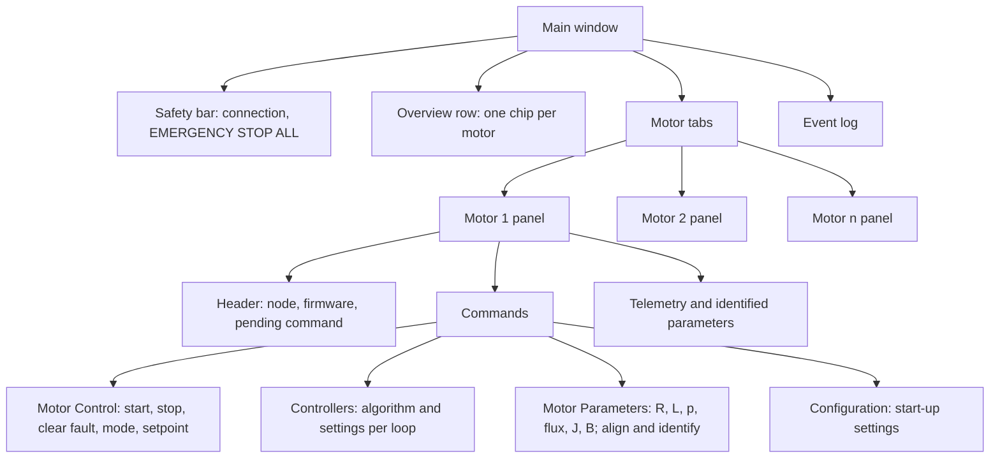
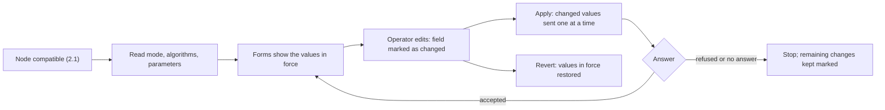
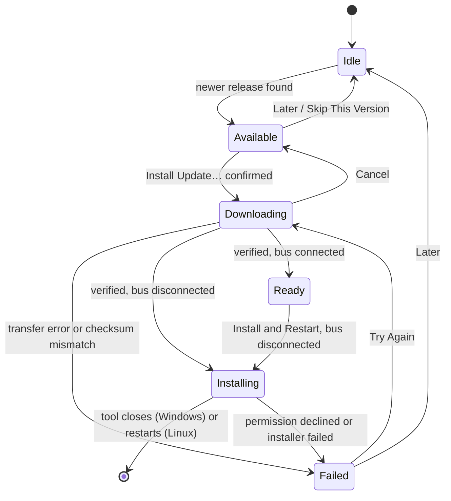
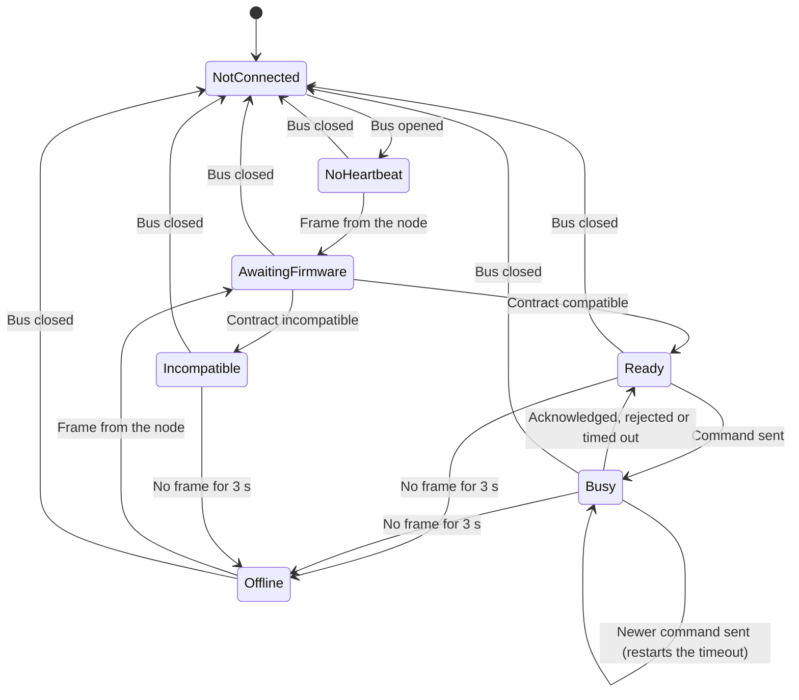
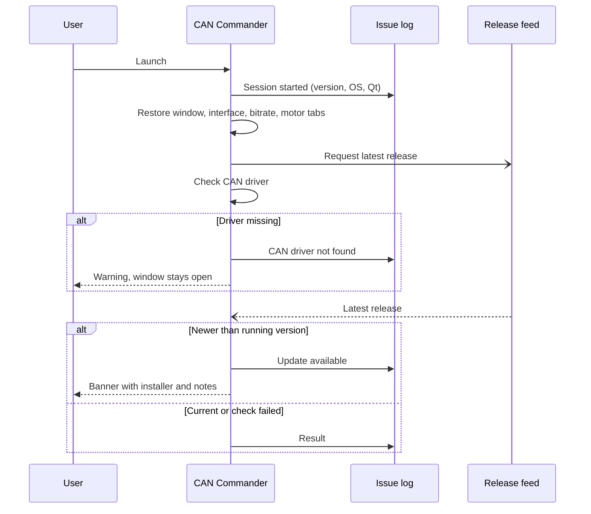
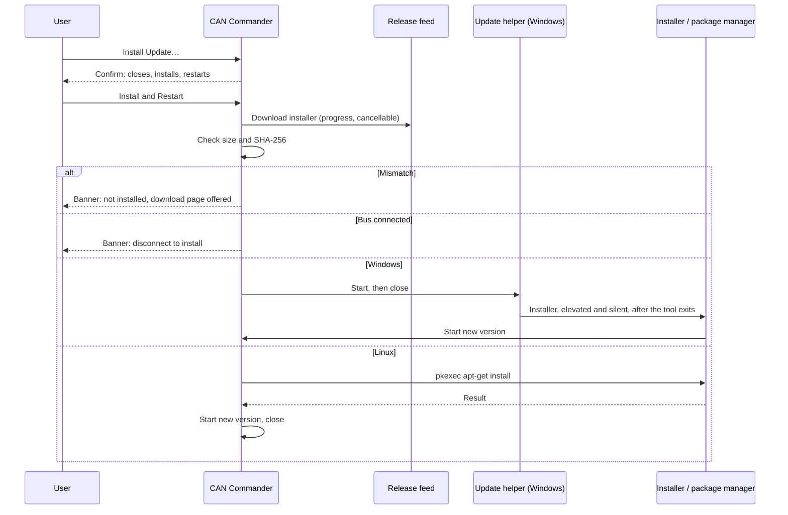
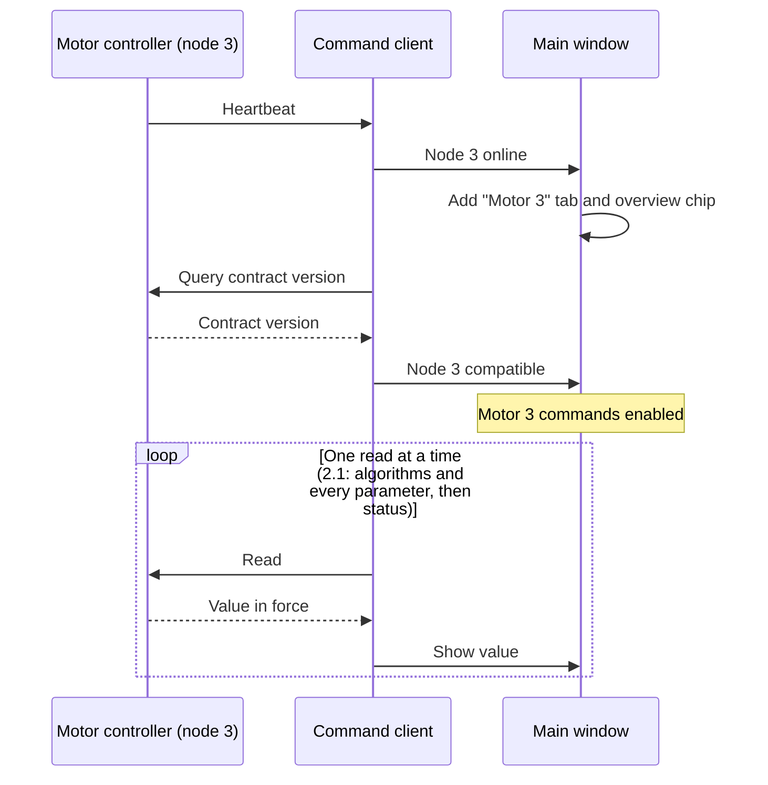
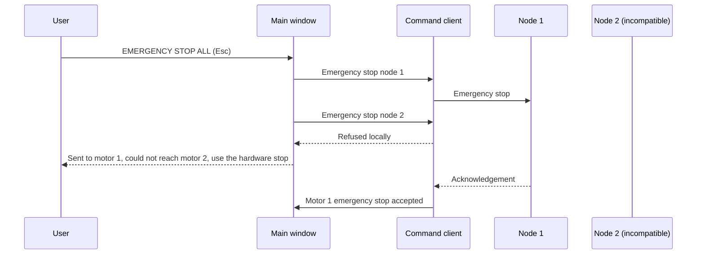

| Field     | Value                |
|-----------|----------------------|
| Title     | CAN Commander Design |
| Type      | design               |
| Status    | draft                |
| Version   | 0.5.0                |
| Component | tool-can-commander   |
| Date      | 2026-10-25           |

---

## Responsibilities

**Is responsible for:**
- Letting a bench engineer open one CAN interface and command every e-foc motor controller on it, each
  addressed by its CAN node ID (configured base plus the board's ID jumpers): start, stop, clear fault,
  control mode, torque/speed/position setpoints, the controller of each loop and its settings, the motor
  parameters, the start-up settings, alignment and identification, plus one emergency stop that reaches all
  of them.
- Showing each controller's state as that controller reports it: heartbeat, firmware contract
  compatibility, motor state and fault, active control mode, measurements, identified motor parameters and
  every setting it holds.
- Keeping a persistent issue log per user, and turning it into a pre-filled bug report on request.
- Telling the user when a newer release exists, without ever blocking the tool.
- Shipping as a branded, installable product ("e-foc CAN Commander") for Windows and Debian-based Linux.

**Is NOT responsible for:**
- Deciding whether a command is safe. The firmware validates every setpoint and state transition; the tool
  only keeps its input ranges inside what the firmware accepts.
- Replacing the hardware emergency stop. The on-screen emergency stop is a CAN command and needs a working bus.
- Coordinating motors with each other (synchronised moves, shared setpoints). Each motor is commanded on its own.
- Sending anything to the network on its own other than the release check. Bug reports open in the
  browser for the user to review and submit.
- Downloading or installing updates. It links to the installer for the running platform.

---

## Component Details

### Part A — logic, support and presentation layers

The tool is split so that everything but widget layout can be tested without a display:

- **Adapter** — the CAN bus, provided by can-lite's host drivers (Part I). It shows every received frame to its
  observers before handing it to the protocol client.
- **Logic** — the command client, one for the whole bus. Every command names its node and every report says
  which node sent it. Per node it tracks: online (a frame was seen; offline after the protocol's 3 s server
  timeout or when the bus closes), firmware compatibility, and the last command sent until that command is
  acknowledged, rejected or times out after 2 s (two minutes for alignment and identification). A newer
  command — typically the emergency stop — takes over the slot and restarts the timeout; an acknowledgement
  of an older command no longer ends it. A command the client refuses locally leaves the slot untouched.
  Closing the bus ends every pending command and reports every node offline at once. The client also reads
  each compatible node: its status every second and after every accepted command, because the controller
  sends its status only when asked, and its settings (Part J).
- **Support** — application identity, the issue log, the bug-report builder, the release feed reader, the
  update checker, and the bridge that runs the embedded-infrastructure event loop and timers on the GUI thread.
- **Presentation** — the window, one panel per motor, the overview row and the status bar. Widgets only
  display; they do not decide.

### Part B — motors, tabs and discovery

- A tab appears automatically for every node whose frames are seen on the bus. The user can also add a tab
  by node ID (Motor → Add Motor, or the "+ Add Motor" button) before that node comes online, and close tabs.
  Closing a tab does not stop the motor.
- The list of tabs is restored on the next start, so a known rig reopens with its motors in place.
- At most eight motors are followed, the number of servers `can-lite` tracks liveness and sequence numbers
  for. A further node is logged and left without a tab.
- With no motors, the motor area explains how motors appear and offers Add Motor.

### Part C — state the user can see at all times

| Element                                           | Shows                                                                                 | Source                                  |
|---------------------------------------------------|---------------------------------------------------------------------------------------|-----------------------------------------|
| Connection panel                                  | interface, bitrate, connected or not                                                  | bus adapter                             |
| Overview row                                      | every motor's summary (running, idle, fault, offline, incompatible) with a status dot | each node                               |
| Tab                                               | status dot and tooltip of that motor                                                  | each node                               |
| Motor header                                      | node state, firmware contract, the command waiting for an answer                      | that node                               |
| Control mode                                      | *requested…* until acknowledged, then *active*                                        | that node's mode or algorithms response |
| Controllers, motor parameters, configuration      | the values in force; an edited value is marked until it is applied or reverted        | that node's parameter responses         |
| Motor status, measurements, identified parameters | values, or "—" when nothing live is known                                             | that node's status (read every second)  |
| Status bar                                        | motors online out of motors shown, and how many are in fault                          | all nodes                               |

A displayed state always comes from the controller. A motor's values are cleared when the bus closes or
that node goes offline, so stale numbers never read as live. A fault on one motor stays visible in the
overview row and on its tab while another motor is being commanded.

### Part D — commands and the emergency stop

A motor's commands are enabled only when the bus is open, the node is online, its firmware contract is
compatible and it has no command pending. When disabled, every command explains why (tooltip); the
persistent reasons — not connected, node not on the bus, incompatible firmware, waiting for the firmware
version — also appear as an inline hint in that motor's panel.

The emergency stop is outside that rule. One large button (and Esc, also in the Motor menu) sends an
emergency stop to every motor that has a tab and every node currently online, whether or not a command is
pending on it. It is enabled while the bus is open and at least one of those motors can receive it. The log
names the motors it reached and, separately, those it could not reach (incompatible firmware or a refused
frame) with the advice to use the hardware stop.

Input ranges and decimal places follow the wire contract: the limit is the smaller of the firmware's
command limit and what the 16-bit wire field can carry, and the decimals match the wire resolution, so the
tool never offers precision that the frame drops.

Each command outcome is logged in words and prefixed with its motor: accepted, the plain-language reason
for a rejection (for example "not valid in the active control mode"), a command that was refused locally
and never sent, or a command that received no answer in time.

Align, Identify Electrical and Identify Mechanical move the rotor and answer only when they finish, so the
tool waits up to two minutes for them instead of two seconds; the panel says the rotor will move before the
button is pressed. The emergency stop takes over their slot like any other command, and also ends an Apply
in progress (Part J). A controller that answers Identify Mechanical with "not implemented" gets that button
disabled, with the reason, until its tab is closed.

### Part J — controllers, motor parameters and configuration

The settings tabs show what the node holds, not what was last typed. A node whose firmware contract is 2.1
or newer is read completely when it is found compatible, and again after a mode change (accepted or
refused), a controller change, an identification, an alignment, applied motor parameters, a refused
setting or a Revert: the active mode and the algorithm of every loop, then every numbered parameter. Reads
go one at a time, because the CAN send queue holds six frames; they do not make the node busy and are not
logged one by one. A read that is not answered leaves "—".

- **Controllers** shows the loops the active control mode runs: the current loop in torque mode, current and
  speed in speed mode, all three in position mode. Each loop has its algorithm and the settings that
  algorithm uses; the other settings of the loop are hidden, not deleted. A bandwidth can be left
  *Automatic*, in which case the field shows the bandwidth the firmware derived.
- **Motor Parameters** holds resistance, inductance, pole pairs, flux linkage (or the platform default),
  inertia and viscous friction, and the commissioning actions Align, Identify Electrical and Identify
  Mechanical. Changing the pole pairs says that the rotor has to be aligned again before it can start.
- **Configuration** holds the settings read at start-up: encoder resolution, CAN node ID base and bitrate.
  They are stored at once and take effect when the controller restarts; a new node ID or bitrate means the
  motor appears under another tab, or only after reconnecting at the new bitrate, and the tab says so.

Apply sends only the changed values, one at a time, each after the previous one was accepted, and stops at
the first refusal or missing answer; the log names the refused value and why, and the values not sent stay
marked. Within a loop the settings go before the algorithm, so a law is designed with the settings it was
chosen with — unless the new law is one that never refuses a setting (all but speed LQI and position LQR and
LQI), which then goes first, so the law it replaces does not judge settings it will no longer run. Of the
sliding-mode pair the one that keeps the switching gain below the boundary layer goes first, and a pair that
would end with the switching gain at or above the boundary layer is refused before anything is sent. Revert
drops the edits and reads the values in force again.

Controllers and motor parameters change only while the motor is stopped: their Apply is disabled, with the
reason, while the last status says the motor runs or calibrates. Start-up settings can be stored at any time.

A node on contract 2.0 has none of the 2.1 messages. Its Controllers tab offers the loop bandwidths alone,
sent with the 2.0 bandwidth commands and not read back; the motor parameter fields are disabled with the
reason; the commissioning actions and the encoder resolution work as on 2.1.

### Part E — issue log

- One log per user in the platform's per-user application data folder, under `e-foc/CAN Commander/logs`.
- Every line is one entry: UTC timestamp, severity (INFO, WARN, ERROR), message.
- The current file rotates at 1 MiB; three files are kept. A log folder that disappears while the tool runs
  stops file output; the tool keeps running and keeps the newest entries in memory.
- Recorded: session start with version, operating system and Qt version; connect and disconnect; motor
  discovery; per motor, online and offline, command outcomes, firmware contract result, changes of motor
  state and fault (not every frame); emergency stops; release check results; warnings Qt itself raises.
- Raw CAN frames are not recorded; they are shown, on request, in the bounded on-screen event log only.
- The newest entries are also kept in memory for the bug report.

### Part F — reporting an issue

Help → Report Issue opens the project's new-issue page with the title prefixed "[CAN Commander]" and a body
holding: a prompt for what happened, the version, operating system, architecture and Qt version, the
newest log entries, and where the full log file lives (with the home folder shown as "~"). Older entries
are dropped until the address fits the length the issue tracker accepts. Nothing is sent until the user
submits the page. Help → Open Log Folder shows the files.

### Part G — update check and self-upgrade

At startup and every 24 hours while running (unless automatic checks are switched off in the Help menu or by
the no-update-check option), and on Help → Check for Updates, the tool reads the project's latest-release
document over HTTPS, honouring the system proxy. The release tag is compared with the tool's own version as
three numbers.

- Newer release: a dismissible banner names the version and offers to install it, plus the release notes.
  *Skip This Version* hides that version from automatic checks (a manual check still offers it); *Later*
  hides the banner until the next check.
- Same or older: nothing is shown; a manual check confirms the tool is current.
- Offline, rate-limited or unreadable: nothing is shown; the failure is logged; a manual check explains it
  and links to the releases page.

The installer is the release asset whose name ends in the platform's installer suffix (Part H). Installing
it from inside the tool needs the tool to run from an installed package (not a portable archive), the
release to publish the asset's SHA-256 digest and, on Linux, `pkexec` and `apt-get` to be present.
When any of them is missing, the banner offers the installer download, or the release page, instead.

Installing always starts with the user: *Install Update…* asks for confirmation and says what happens next.
The tool then downloads the installer with visible progress, which the user can cancel, and checks the
received file's size and SHA-256 against the values published with the release. A file that does not match
is deleted and never run. Downloading may happen while a bus is open, but installing closes or restarts the
tool, so it waits until the bus is disconnected: the banner says so, and installation continues on request
once the bus is closed.

- Windows: the tool hands over to a helper and closes. The helper waits until the tool has exited, then
  starts the installer elevated, which shows the Windows permission prompt for the installer itself, silently
  into the current installation folder. The installer starts the new version as the signed-in user when it
  finishes. If the permission prompt is declined, the helper starts the old version again.
- Linux: the tool asks for the administrator password through `pkexec` and installs the package with
  `apt-get`, keeping its window open meanwhile. On success it starts the new version and closes. A dismissed
  password prompt or a failed installation is reported in the banner, and the tool keeps running.

Every step and failure is written to the issue log.

### Part H — installers

| Platform             | Package                                              | Installs                                                                                                      | Notes                                                                                                                                             |
|----------------------|------------------------------------------------------|---------------------------------------------------------------------------------------------------------------|---------------------------------------------------------------------------------------------------------------------------------------------------|
| Windows x86-64       | `e_foc-can_commander-<tag>-windows-x86_64-setup.exe` | `Program Files\e-foc CAN Commander`, Start-menu and desktop shortcuts, uninstaller, Add/Remove Programs entry | Qt runtime included, MSVC runtime installed when bundled; an existing installation is removed first                                               |
| Debian/Ubuntu x86-64 | `e_foc-can_commander-<tag>-linux-x86_64.deb`         | the `e-foc-can-commander` command, a desktop entry and icons                                                  | Qt libraries and platform plugins declared as package dependencies; built on Ubuntu 24.04, so it needs a distribution of that generation or newer |

The portable archives (Windows zip, Linux tar.gz) stay alongside the installers. The release workflow
installs each package on a clean runner, checks the reported version against the project version, launches
the tool, and uninstalls it before the release is published.

Every release asset carries a build-provenance attestation, signed through Sigstore by the release
workflow, so anyone can check that a file was built from this repository by its release workflow. Once the
project's code signing is configured, the Windows executable is Authenticode-signed before packaging, so the
portable archive and the installer carry the same signed binary, and the installer itself is signed too; the
release check then requires both signatures to be valid. Until then the signing steps are skipped and releases
are published unsigned.

---

### Part I — CAN adapters

The tool does not implement bus access itself. It uses the platform composition from can-lite's host drivers
(can-lite design booklet, chapter 3), which puts every adapter the platform supports behind one name space:

| Platform | Adapter                        | Name in the Interface box |
|----------|--------------------------------|---------------------------|
| Linux    | SocketCAN                      | `can0`, `vcan0`, …        |
| Linux    | slcan: CANable and compatibles | `slcan:/dev/ttyACM0`      |
| Windows  | PEAK PCAN-USB                  | `PCAN:1` to `PCAN:16`     |
| Windows  | Kvaser                         | `Kvaser:0`, `Kvaser:1`, … |
| Windows  | slcan: CANable and compatibles | `slcan:COM3`              |
| Windows  | candleLight (gs_usb firmware)  | `candleLight:1`, …        |

`CANable:` is accepted as an alias of `slcan:`. The Interface box lists every name the adapters enumerate
and stays editable; with nothing to list it explains how to get an entry. The PCAN and Kvaser libraries are
loaded when needed, so the tool installs and starts on a machine without them.

- **Connect failure** — the adapter's own reason (port not found, in use, access denied, unsupported
  bitrate, missing vendor library) goes to the log, followed by a next step chosen from the name's prefix.
- **No usable adapter at startup** — when no adapter has both its driver and at least one interface, a
  dialog lists every missing driver with what to install; while any adapter works, nothing is shown.
- **Polling** — on Linux the tool waits on the adapter's descriptor; on Windows it polls the adapter every
  millisecond while connected.
- **Frames** — only 29-bit frames reach the tool and its frame log; standard-identifier frames stop at the
  driver.

## Interfaces

### Provided

| Interface           | Purpose                                                      | Contract                                                                                                                                            |
|---------------------|--------------------------------------------------------------|-----------------------------------------------------------------------------------------------------------------------------------------------------|
| Desktop application | Command and monitor up to eight motor controllers on one bus | Usable without a bus: logs, report and update functions work when the CAN driver is missing                                                         |
| Command line        | Scripted checks of an installation                           | Version and help are answered without a display (on Windows, in the console it was started from); the no-update-check option skips automatic checks |
| Issue log files     | Evidence for bug reports                                     | Plain UTF-8 text, one entry per line, rotated, per user                                                                                             |

### Required

| Interface              | Purpose                                                      | Contract                                                                                             |
|------------------------|--------------------------------------------------------------|------------------------------------------------------------------------------------------------------|
| CAN adapter driver     | Bus access                                                   | can-lite host drivers; the operating-system or vendor driver each adapter needs (Part I)             |
| Firmware wire contract | Command and telemetry encoding                               | A node's commands are enabled only when its major contract version matches (REQ-CAN-003, per server) |
| CAN service client     | Per-node attribution of responses and per-node compatibility | See the frame-origin tracker in the CAN service design                                               |
| Release feed           | Update check                                                 | The project's latest-release document; release asset names follow the installer suffixes in Part H   |
| Elevation              | Self-upgrade                                                 | Windows permission prompt; on Linux `pkexec` with `apt-get`                                          |
| Web browser            | Issue reporting, downloads                                   | Opened through the desktop's default handler                                                         |

---

## State Machine

Each motor panel follows its own node:

A node that comes back after being offline is asked for its firmware version again; its previous verdict
holds until the answer arrives. Commands are enabled in **Ready** only. The emergency stop reaches a motor
in every state except **NotConnected** and **Incompatible**.

---

## Sequence Diagrams

### Startup with update check

### Installing an update

### Discovering a motor

### Emergency stop with several motors

---

## Constraints & Limitations

| Constraint             | Value / Description                                                                                  |
|------------------------|------------------------------------------------------------------------------------------------------|
| Motors per bus         | 8 (the servers `can-lite` tracks)                                                                    |
| Command answer timeout | 2 s per node, restarted by every newer command; 120 s for Align and identification                   |
| Parameter reads        | one outstanding per node, 1 s each, never marking the node busy                                      |
| Status reads           | each compatible node every 1 s and after every accepted command                                      |
| Node offline after     | 3 s without a frame (`can-lite` server timeout)                                                      |
| On-screen event log    | newest 5000 lines                                                                                    |
| Issue log              | 1 MiB per file, 3 files, UTC timestamps                                                              |
| Bug report size        | address kept within 7000 characters by dropping the oldest log entries                               |
| Release check          | one request at a time, 10 s transfer timeout, unauthenticated (shared hourly rate limit per address) |
| Version format         | releases tagged *v*major.minor.patch; pre-release tags are never offered                             |
| Automatic checks       | at startup and every 24 h while running                                                              |
| Self-upgrade           | installed packages only; never while a bus is open; SHA-256 and size must match the release          |
| Linux package          | Debian-based x86-64, Ubuntu 24.04 generation or newer, Qt 6 from the distribution                    |

---

## Open Questions

| # | Question                                                                                                                    | Options                                                  | Status |
|---|-----------------------------------------------------------------------------------------------------------------------------|----------------------------------------------------------|--------|
| 1 | Should the theme dim role-coloured buttons when disabled, so Start/Stop can carry their colours again?                      | Change the shared theme / keep default buttons           | open   |
| 2 | Should the torque setpoint limit follow each board's maximum current from telemetry instead of the firmware command limit?  | Decode the maximum current field / keep the static limit | open   |
| 3 | Should the emergency stop also go out as one broadcast frame, so motors without a tab are reached in a single transmission? | Broadcast plus per-node commands / per-node only         | open   |
