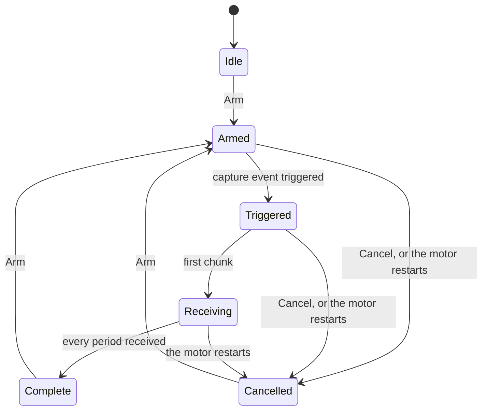

| Field     | Value                    |
|-----------|--------------------------|
| Title     | Virtual Motor App Design |
| Type      | design                   |
| Status    | draft                    |
| Version   | 0.3.0                    |
| Component | tool-virtual-motor       |
| Date      | 2026-11-10               |

> **IMPORTANT — Implementation-blind document**: This document describes *behavior, structure, and
> responsibilities* WITHOUT referencing code. **No code blocks using programming languages (C++, C,
> Python, CMake, shell, etc.) are allowed.** Use Mermaid diagrams to express behavior instead.
>
> **Diagrams**: All visuals must be Mermaid or ASCII art. External image references are **not allowed**.

---

## Responsibilities

**Is responsible for:**
- Starting, pausing, power-cycling and powering off virtual motors (`virtual-motor.md`), each a CAN
  node on a virtual bus, and restoring the set of motors on the next start
- Hosting the virtual CAN hub, and showing which buses exist and who is on them
- Showing, per motor, what bench instruments would show: phase currents, leg voltages and the
  modulation hexagon, the rotor and the current and voltage space vectors turning, the encoder against
  the true angle, speed and torque, supply and winding temperature, the board LEDs and the debug log
- Injecting load and disturbance torque and sensor noise while a motor runs, and making every active
  change visible and removable in one action
- Shipping inside the e-foc CAN Commander installers, as "e-foc Virtual Motor"

**Is NOT responsible for:**
- Commanding the drive. Start, stop, modes, setpoints, calibration and settings are the CAN
  Commander's, over the virtual bus, as for a real board; this app sends nothing on the bus
- Showing the drive's internal state. What the drive reports (state, fault, its measured Id and Iq,
  identified parameters) is read in the CAN Commander
- Recording or reporting test verdicts

---

## Component Details

### Part A — logic, support and presentation layers

As in the CAN Commander (`tool-can-commander.md` Part A), everything but widget layout is testable
without a display:

- **Engine client** — starts and stops virtual motor processes, holds each one's plant port, and turns
  the port's stream and captures into per-signal sample buffers. The app listens for plant ports on one
  loopback port it picks itself; each motor runs as an `e-foc-virtual-motor` process, installed next to
  the app, in a folder of its own under the user's application data (`<bus>-<node>`), which keeps its
  memory file. It joins the app's hub and connects to the app's plant port.
- **Hub** — the virtual CAN hub, run in this process while the app is open. When another hub already
  holds the port, the app's motors join that one and the header says so.
- **Logic** — the motor list and its persistence, the active-disturbance list per motor, capture
  requests and trigger settings, profile files.
- **Presentation** — the manager window and one window per motor. Widgets only display.

### Part B — the manager window

```text
+----------------------------------------------------------------------------------+
|  e-foc Virtual Motor                                   [ Open CAN Commander ]    |
|  Bus: default   ● hub running on port 29536                                       |
+----------------------------------------------------------------------------------+
|  Node | Plant    | State    | Real time | Disturbances | LEDs      |             |
|  1    | Teknic   | Running  | 1.00      | 2 active     | ● ○ ○     | [Open]      |
|  2    | Anaheim  | Paused   | —         | none         | ○ ● ○     | [Open]      |
|  3    | Teknic   | Crashed  | —         | —            | —         | [Log]       |
+----------------------------------------------------------------------------------+
|  [ + Add Motor ]  [ Power Off ]  [ Power Cycle ]  [ Pause ]  [ Clear Disturbances ] |
+----------------------------------------------------------------------------------+
```

- **Add Motor** asks for the node, the plant (Teknic, Anaheim, or a description file, which is where
  non-idealities and wiring faults are set) and how it starts: keep its memory or factory-fresh. Starting
  calibrated for the plant is offered once a virtual motor can (`virtual-motor.md` Open Question 4). A
  node already in the list is refused with the reason.
- **State** is the process's (`virtual-motor.md` Part H), never what the user last clicked: *Starting…*
  until the motor introduces itself on the plant port, then *Running* or *Paused* as its status says;
  *Restarting* while a motor that reset reconnects; *Stopped* once powered off; *Crashed* when its process
  ends unasked. A crashed motor keeps its row with its last log lines one click away; the row explains that
  the CAN Commander will report it offline.
- **Real time** shows the real-time factor; below 0.98 it is a warning with the overrun count in the
  tooltip, because the drive is then running late.
- **Open CAN Commander** starts the CAN Commander installed next to the app; its Interface box lists
  `virtual:default` while the hub runs (`tool-can-commander.md` Part N).
- The motor list, with each motor's node, plant and start mode, is restored on the next start; restored
  motors start again, keeping their memory.
- The bus row offers drop probability, added latency and taking a node off the bus (`virtual-motor.md`
  Part G), each listed under *Disturbances* while active.
- Closing the app powers every motor off, after a confirmation that names the motors and says the CAN
  Commander will see them go offline.

### Part C — the motor window

One window per motor, titled with node and plant, and marked **VIRTUAL** in its header, so it is never
mistaken for a bench instrument on real hardware.

```text
+------------------------------------------------------------------------------------------+
| VIRTUAL  Node 1 · Teknic M-2310P   Running  t = 00:01:42.315  RT 1.00   LEDs ● ○ ○  Prot: ok |
| [Pause] [Step 1 period] [Step 1 ms] [Power Cycle] [Power Off]  Disturbances: 2 [Clear All] |
+-----------------------------------------------------------+------------------------------+
| Tabs: Currents | Voltages | Rotor | Encoder | Mechanics | Supply | Log | Torque & Noise    |
|                                                           |  Torque                      |
|   (selected view)                                         |    load, external            |
|                                                           |  Noise                       |
|                                                           |    current, encoder          |
|                                                           |  Profiles                    |
|                                                           |  Motor (read-only)           |
|                                                           |                              |
+-----------------------------------------------------------+------------------------------+
| Capture: trigger [Ia ▾] [rising ▾] level [ 2.00 A ]  pre 25 %  length 4096  [Arm] [Now]    |
+------------------------------------------------------------------------------------------+
```

The header is always in view: motor state, virtual time, real-time factor, the three LEDs as the board
would light them (with their meaning in text: operational, warning, failure), the board protection
state, and the number of active disturbances with **Clear All** beside it.

| View      | Shows                                                                                                                         |
|-----------|-------------------------------------------------------------------------------------------------------------------------------|
| Currents  | True phase currents a, b, c with the measured ones overlaid, so the sensor's noise and bias are visible; true Id and Iq below |
| Voltages  | Duties and leg voltages a, b, c; the modulation hexagon with the stator voltage vector and its trail                          |
| Rotor     | The animated motor of Part E                                                                                                  |
| Encoder   | The monitor of Part F                                                                                                         |
| Mechanics | Speed, true angle, electrical torque against load and external torque                                                         |
| Supply    | Bus voltage and current, winding temperature                                                                                  |
| Log       | The debug log, timestamped in virtual time, bounded, with filter, Clear and Save                                              |

### Part D — scopes

Every trace view is a scope on the continuous stream (`virtual-motor.md` Part F), drawn as the
minimum-maximum envelope of each 2 kHz window, so ripple and noise are seen at a glance without a full
rate stream.

| View      | Panels, top to bottom, each with its own vertical range and unit                              |
|-----------|-----------------------------------------------------------------------------------------------|
| Currents  | Phase currents a, b, c with the measured ones overlaid (A); true d and q currents (A)         |
| Voltages  | Duties a, b, c (1); leg voltages a, b, c (V); stator voltage α and β (V)                      |
| Mechanics | Rotor speed (rad/s); true and encoder angle (rad); electrical, load and external torque (N·m) |
| Supply    | Bus voltage (V); bus current (A); winding temperature (°C)                                    |

- **Stream on demand.** A motor's window asks for the stream while it is open and shows a trace view,
  and turns it off when it is closed, minimised or shows the log, so a motor nobody watches samples
  nothing. After a motor restarts the window asks again.
- **History.** The app keeps the last 10 s of windows per motor. The time axis shows the chosen span,
  10 ms to 10 s, ending at the newest window and labelled in time before it. A window the motor dropped
  breaks the trace instead of joining across the gap, and the toolbar counts the windows dropped since
  the stream was turned on. History starts over when the motor restarts, because its virtual time does.
- **Drawing.** Each panel fits its vertical range to what it shows, with its unit on the axis and a
  legend in the trace colours. When the span holds more windows than the panel has pixels, the
  windows that share a pixel column are drawn as one envelope, their lowest minimum to their highest
  maximum, so no peak is lost. Only the visible view repaints, at most 25 times a second.
- **Run and freeze.** **Freeze** keeps the traces on screen while the motor runs on, and the toolbar
  says *Frozen*; **Run** follows the newest window again.
- **Cursors.** In a frozen trace or a capture, a left click places cursor A and a right click cursor B;
  a double click removes both. Each panel reads, for each of its traces, the value at A and at B and
  their difference, and the toolbar reads both times, their difference and its inverse. A value in a
  frozen trace is the middle of its envelope at that time; in a capture it is the sample.
- **Captures.** The capture bar arms a full-rate capture: trigger (immediately, rising, falling, either,
  board protection, LEDs), the trigger signal and level in that signal's unit for an edge, the LEDs
  for an LED trigger, the pre-trigger share and the length in control periods. Its state reads *Armed…*
  until the trigger fires, then *Triggered*, *Receiving n of m* while the chunks arrive, and
  *Complete*; **Cancel** stops an armed or recording capture, and arming again replaces it. A complete
  capture opens in the view of its trigger signal, or the current view when the trigger has none, at
  every control period, with the time axis at zero on the trigger; **Back to Live** returns to the
  stream. A motor that restarts cancels its capture.
- **Pause and step.** While the motor is paused the trace stays at the paused instant. **Step 1
  period** and **Step 1 ms** advance it; the trace moves when a step completes a 10-period window,
  and a capture armed before stepping records every period stepped through.
- **Export.** **Save CSV…** writes the capture shown: one row per control period, the first columns
  the time from the trigger in seconds and the control period, then every Data Model signal in its
  order, each column headed with its name and unit.



### Part E — the rotor

A cross-section of the motor, drawn at the true mechanical angle:

- The stator with its three phase axes, each winding shaded by the sign and size of its current.
- The rotor with its pole pairs, the d axis marked.
- The current space vector and the voltage space vector, drawn from the centre in the stationary frame,
  with the d and q axes turning with the rotor, so the angle between current and q shows the field
  weakening or a misalignment.
- The encoder's angle as a second marker on the rotor rim, which separates from the true one when the
  encoder is noisy, biased or stuck.

The drawing repaints at most 25 times a second and shows the true speed beside it; above the speed at
which the rotor would turn more than a quarter turn between frames it shows the angle in the rotor frame
instead, and says so, rather than drawing an aliased rotation.

### Part F — the encoder monitor

- The true angle and the encoder's angle, and their difference in electrical degrees, over time.
- A histogram of the difference, with its mean (bias) and standard deviation (noise).
- Counts per revolution, the index pulses seen, and a *stuck* indicator when the reported angle stopped
  while the rotor turns.

### Part G — torque and noise

The side panel holds the changes of `virtual-motor.md` Part E: **Torque** (load torque, and external
torque as a constant, a step, a ramp or a sine) and **Noise** (current noise, encoder noise).
Below them, the motor's parameters are shown read-only from its plant description, with a note that
another motor means another description and a restart. Values are typed or
dragged but **apply only on Apply** or Enter, never while typing; each group shows what is in force.
Every active change appears in the header count and in a list with its own remove button; **Clear All**
returns the plant to its description.

**Profiles** are loaded, saved, started and stopped from the panel; a running profile shows its time
and next step, and stopping it clears what it applied.

### Part H — the CAN Commander side

The CAN Commander needs no knowledge of the plant. A node whose board kind is *virtual* is marked
**Virtual** in its tab and overview chip, so a bench engineer never confuses it with hardware
(`tool-can-commander.md` Part N). Its Motor menu offers **Launch Virtual Motor…**, which starts this app.

### Part I — installers

The app and the virtual motor program ship in the CAN Commander's Windows and Debian installers, with
their own start-menu entry and icon. The installers' asset names stay unchanged, so the update check
finds them as before.

---

## Interfaces

### Provided

| Interface        | Purpose                                     | Contract                                                    |
|------------------|---------------------------------------------|-------------------------------------------------------------|
| Virtual CAN hub  | Buses for virtual motors and CAN Commanders | `virtual-motor.md` Part G, while the app is open            |
| Persisted motors | The rig reopens with its motors             | Node, plant, start mode and memory file per motor, per user |

### Required

| Interface        | Purpose                                       | Contract                                         |
|------------------|-----------------------------------------------|--------------------------------------------------|
| Virtual motor    | The motors themselves                         | `virtual-motor.md`: start options, plant port    |
| Theme and scopes | Look, status colours, scope and hexagon views | The shared tool UI library, as the CAN Commander |

---

## Constraints & Limitations

| Constraint    | Value / Description                                                   |
|---------------|-----------------------------------------------------------------------|
| Motors        | Eight per bus                                                         |
| Repaint rate  | At most 25 Hz per view; only the visible view of each window repaints |
| Log           | Bounded per motor; the full log stays in the motor's folder           |
| Trace history | The last 10 s of stream windows per motor                             |
| Capture       | One per motor, up to 16,384 control periods, kept until replaced      |
| Bus commands  | None: the app never sends a CAN frame                                 |

---

## Open Questions

| # | Question                                                           | Options                                           | Status           |
|---|--------------------------------------------------------------------|---------------------------------------------------|------------------|
| 1 | Should the CAN Commander show a virtual node's plant views itself? | No, this app only; or a read-only plant tab later | open, leaning no |
