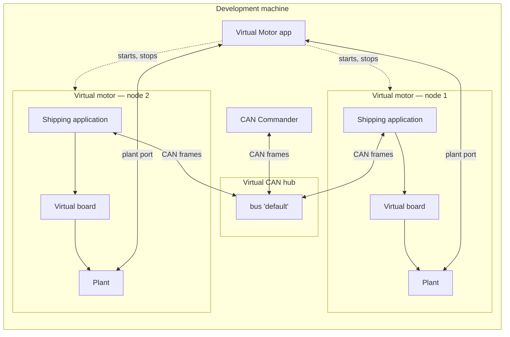
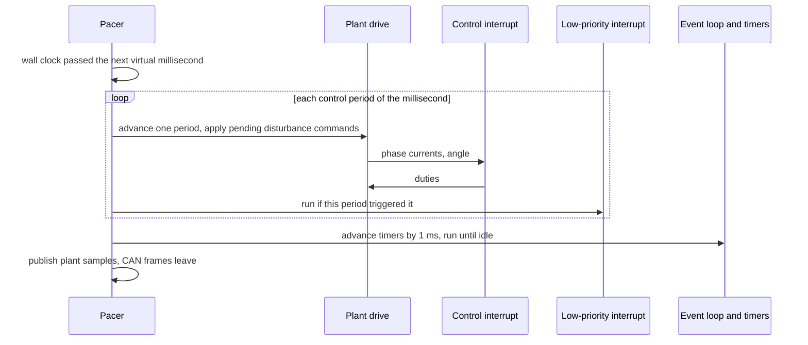
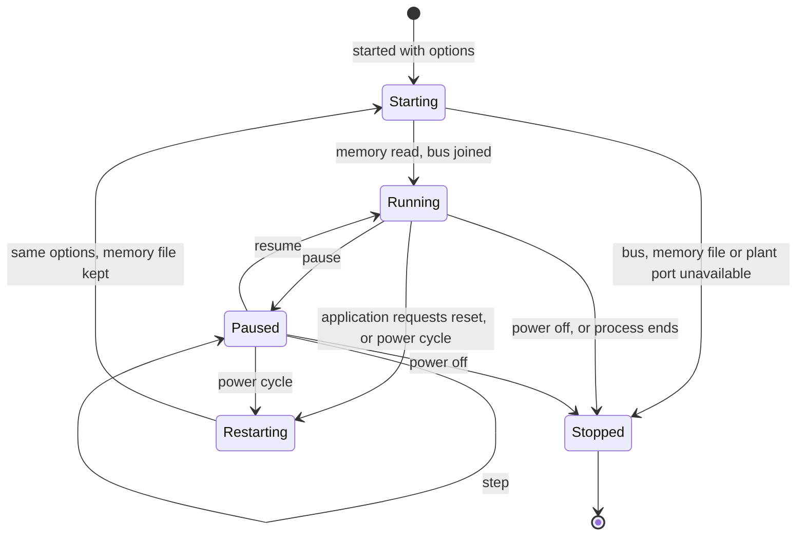

| Field     | Value                |
|-----------|----------------------|
| Title     | Virtual Motor Design |
| Type      | design               |
| Status    | draft                |
| Version   | 0.4.0                |
| Component | virtual-motor        |
| Date      | 2026-11-10           |

> **IMPORTANT — Implementation-blind document**: This document describes *behavior, structure, and
> responsibilities* WITHOUT referencing code. **No code blocks using programming languages (C++, C,
> Python, CMake, shell, etc.) are allowed.** Use Mermaid diagrams to express behavior instead.
>
> **Diagrams**: All visuals must be Mermaid or ASCII art. External image references are **not allowed**.

---

## Overview

A virtual motor is a motor controller that exists only on the development machine. It runs the
**shipping application** — the state machine, the control cascades, the calibration services, the
non-volatile memory stack and the CAN server, composed exactly as the board composes them — compiled
for the host, on a virtual board whose power stage, encoder, supply and protection are the simulation
plant that the software-in-the-loop suite and the model-in-the-loop tests already use.

It speaks CAN on a **virtual CAN bus**, so the CAN Commander connects to it as it connects to a real
board: through an interface name, without knowing that the motor is simulated. Beside the bus, each
virtual motor opens a **plant port** through which the Virtual Motor app (`tool-virtual-motor.md`)
watches what a bench instrument would watch — phase currents, leg voltages, the true and the reported
rotor angle, the supply and the winding temperature — and injects load and disturbance torque and
sensor noise while the motor runs. The motor itself — its parameters, its non-idealities and any wiring
fault — is fixed by the plant description it starts with.

It replaces the former desktop simulator, which ran the control loops in isolation against the plant
without the application, the CAN surface or the non-volatile memory.

---

## Responsibilities

**Is responsible for:**
- Running the shipping application against the simulation plant, in real time, as one CAN node
- Presenting itself on a virtual CAN bus that any number of virtual motors and CAN Commanders share
- Keeping its non-volatile memory between runs, so a calibrated virtual motor stays calibrated
- Publishing the plant's signals through the plant port, continuously and as triggered captures
- Applying the load and disturbance torque and the sensor noise the plant port asks for, at a
  control-period boundary, while the motor runs
- Running headless, so a script or a CI job can start virtual motors without a display

**Is NOT responsible for:**
- Verifying the firmware. Software-in-the-loop (the shipping binary under an emulator), the
  model-in-the-loop sweeps and hardware-in-the-loop remain the verification tiers; a virtual motor
  is a bench, not a test oracle (Part I)
- Exposing the firmware's internal variables. The drive's own view leaves it over CAN, as a real
  board's does; the plant port shows only what an instrument on the bench could measure
- Firmware update. A virtual motor runs the application it was built with (Part B)
- Changing the motor's intrinsic parameters while it runs (Part E)
- Modelling CAN physical-layer faults beyond what Part G lists

---

## Component Details

### Part A — One motor, one process

Each virtual motor is a process of its own. The application relies on one event loop, one timer
service and one trace output per program, as a board has one of each, and it is constructed once and
never destroyed; one process per motor keeps all of that true without changing the application.

The process boundary also gives the bench behaviour the user expects: a virtual motor that stops —
crashed, killed, or powered off from the app — goes silent on the bus like a board that lost power,
and the CAN Commander reports it offline after its usual timeout. Nothing else on the bus is affected.

A virtual motor is started with:

| Start option | Meaning                                                                    | Default                   |
|--------------|----------------------------------------------------------------------------|---------------------------|
| Bus          | Name of the virtual CAN bus to join: letters, digits, `-` and `_`          | `default`                 |
| Node         | The board ID the CAN node address is built from (`service-can.md` Part I)  | 0                         |
| Plant        | A reference motor preset (`teknic`, `anaheim`) or a plant description file | `teknic`                  |
| Memory       | The file holding its non-volatile memory, a name in the working directory  | one file per bus and node |
| Start from   | Keep the memory file, or start factory-fresh                               | keep                      |
| Seed         | Seed of every noise source, so a run replays exactly                       | fixed                     |
| Host the bus | Open the hub for the named bus if no hub is listening yet                  | off                       |
| Plant port   | The loopback port the Virtual Motor app's plant port listens on (Part F)   | none: no plant port       |

### Part B — The virtual board

To the application the virtual board is one more platform, behind the same platform interfaces as the
boards. What each service of the platform is on the virtual board:

| Platform service        | On the virtual board                                                                                                                         |
|-------------------------|----------------------------------------------------------------------------------------------------------------------------------------------|
| Power stage and encoder | The shared plant drive (Part D)                                                                                                              |
| Board protection        | The same simulated comparators the emulated target uses (`software-in-the-loop.md` Part E), armed with the inverter                          |
| Supply voltage          | The plant's supply model                                                                                                                     |
| CAN bus                 | A participant of the virtual CAN bus (Part G), at the bit rate the application configures                                                    |
| Non-volatile memory     | The memory file of the start options; every write reaches the file before it completes                                                       |
| Status LEDs             | Three pins whose state the plant port publishes                                                                                              |
| Terminal and trace      | The debug log, on the engine's standard output and, once the app attaches, through the plant port; there is no command line, as on the board |
| Board ID                | The node of the start options                                                                                                                |
| Board kind              | *virtual*, kind 6 (`service-can.md` Part A), which no release carries a firmware pack for                                                    |
| Reset                   | The process ends and is started again with the same options; the memory file survives                                                        |
| Watchdog                | None: a stalled application is seen as a stalled real-time factor (Part C)                                                                   |

**Firmware update.** Does not apply. A virtual motor's firmware is the application it was built with,
and a newer one comes with a newer tool; the virtual board has no bootloader and no staging slot. The
CAN Commander shows its version and board kind and offers no update for it (`tool-can-commander.md`
Part N).

**Memory file.** The memory is 512 bytes, the size the boards' EEPROM regions are laid out in, kept in a
file named after the bus and the node in the engine's working directory unless the start options name
another. The memory file is always in the working directory: its name is letters, digits, `.`, `-` and `_`,
not starting with `.`, and an engine given a path elsewhere refuses to start, so a start option never
reads, overwrites or deletes a file outside the motor's own folder. A missing or short file is a factory-fresh board. *Start factory-fresh* replaces the file with
an erased memory, so the motor needs calibrating from the CAN Commander, as a new board does.

### Part C — Time

The application runs on **virtual time**: its timers, its control interrupt and its low-priority
interrupt advance with the plant, never with the wall clock. The order inside each millisecond of
virtual time is that of the model-in-the-loop tests (`software-in-the-loop.md` Part N), which is the
order a board sees:

1. For each control period of the millisecond (twenty at 20 kHz): the plant drive advances the plant
   one period, then the control interrupt runs with the measured currents and angle, and its duties
   are applied, one period late when the plant description says so.
2. The low-priority interrupt runs right after the control interrupt that triggered it, as it would on
   the board, where it pre-empts nothing but runs before the next control period.
3. The timers due in that millisecond fire.
4. The event loop runs until it is idle.

**Pacing.** A pacer locks virtual time to the wall clock at a ratio of one. Each time it wakes it runs
whole virtual milliseconds until virtual time has caught up with the wall clock. When it falls more
than 50 ms behind it does not try to catch up: it drops the backlog, counts an overrun and continues
from the present, so a slow machine produces a motor that runs late, never one that runs in bursts.
The plant port publishes the real-time factor and the overrun count.

**Pause and step.** Pausing stops virtual time. A paused motor sends nothing and discards the frames that
reach it, so the CAN Commander sees it go offline after its liveness timeout, exactly as when a board's
cable is pulled; resuming continues from the paused instant without catching up and without counting an
overrun. While paused, the app can advance one control period or
one millisecond at a time to inspect a capture. There is no slow motion or fast forward while on a
bus: the CAN Commander's timeouts run on the wall clock, and a motor whose clock ran at another rate
would read as faulty.

### Part D — The plant is shared

Three users drive the same plant model through the same **plant drive**: the emulated target of the
software-in-the-loop suite, the host model-in-the-loop tests and the virtual board. The plant drive
owns the plant model, steps it once per control period, applies the duties a period late when asked,
keeps the low-side shunts readable, fires scheduled torque steps and encoder freezes, and records the
trajectory. It is configured from one plant description format, so a plant field added for one user
reaches the others.

Moving the plant drive out of its two former copies left every metric of the host suite as it was
(`software-in-the-loop.md` Part O).

### Part E — Torque and noise while running

While the motor runs, the plant port changes only what acts on the motor from outside: torque on the
shaft and noise on the sensors. A change is queued and applied at the start of the next control period,
never inside one; the pacer is the only writer of the plant's state.

| Group         | Change                                                               | Plant part       |
|---------------|----------------------------------------------------------------------|------------------|
| Torque        | Load torque; external torque as a constant, a step, a ramp or a sine | Mechanical plant |
| Current noise | Noise standard deviation, the same on the three phases               | Current sensor   |
| Encoder noise | Noise standard deviation                                             | Encoder          |

Load torque opposes the rotation, whichever way the rotor turns; external torque has a sign of its own.
The forms of external torque, each timed from the control period it takes effect in:

| Form     | Torque over time                                                                      |
|----------|---------------------------------------------------------------------------------------|
| Constant | The value, from then on                                                               |
| Step     | The initial value until the delay has passed, then the final value                    |
| Ramp     | From the start value to the end value, linearly over the duration, then the end value |
| Sine     | The offset plus the amplitude times the sine of 2π times the frequency times the time |

A change is refused, and the plant left as it was, when a value is not finite, a standard deviation is
negative, a delay is negative, a duration is not positive, or a frequency is not between zero and a
tenth of the control rate. While an external torque is in force it replaces the torque steps the plant
description schedules.

The motor's intrinsic parameters — resistance, inductances, flux linkage, pole pairs, inertia,
friction, cogging — and its non-idealities and wiring faults (sensor bias, encoder resolution, a stuck
encoder, an open phase, a weak supply) never change while it runs. They come from the plant
description it starts with; another motor is another description and a restart. An identification
then always has one right answer, the description's.

Every active change is listed by the plant port, and one request clears all of them, returning the
plant to its description.

**Disturbance profiles.** A profile is a timed list of torque and noise changes, relative to its start
or to a trigger (a speed or current threshold, the drive entering a state the LEDs show). It is the bench
counterpart of the scheduled disturbances of the scenarios (`software-in-the-loop.md` Part H): with
the same seed and profile a run replays exactly. Profiles are files the app loads and saves.

### Part F — The plant port

The plant port is a local connection between one virtual motor and the Virtual Motor app. It carries
three things.

**Continuous stream.** Every 10 control periods (2 kHz at 20 kHz) the virtual motor publishes, for each
signal of the Data Model, the minimum and the maximum over the window, so a 2 kHz trace still shows the
PWM ripple's envelope and the noise's spread. A reader that falls behind loses whole windows, counted in
a sequence number, and never delays the pacer.

**Captures.** On request the virtual motor records every control period's signals, up to 16,384
periods, around a trigger: a signal crossing a level in a direction, a protection trip, a fault the LEDs
show, or immediately. The request names the share of the capture before the trigger. A capture is
delivered once complete.

**Control and status.** Pause, resume, step, the torque and noise changes of Part E, profiles, and the
status: virtual time, real-time factor, overruns, LED states, board protection state and the debug log
lines.

**Connection.** The app listens on one loopback port for all its motors. A virtual motor started with a
plant port connects to it before it joins the bus and introduces itself; one it cannot reach does not
start. When the connection ends, the motor carries on without it, and a paused motor resumes, so a
motor whose app has gone never hangs.

**Frames.** Each message is one frame: its type in one byte, the length of its payload in two bytes, then
the payload. Numbers are little-endian, reals are single-precision IEEE 754, and a text is its length in
one byte followed by that many characters. A frame of a type the reader does not know is skipped by its
length, so either side may add types; a frame of a known type whose payload is shorter than its fields
ends the connection.

Motor to app:

| Type   | Message  | Payload                                                                                                                                      | Sent                                                                       |
|--------|----------|----------------------------------------------------------------------------------------------------------------------------------------------|----------------------------------------------------------------------------|
| `0x01` | Hello    | Protocol version (2 bytes), node, bus name, plant name, control rate in hertz (4 bytes)                                                      | Once, first                                                                |
| `0x02` | Status   | Control periods run (8 bytes), real-time factor, overruns (4 bytes), run state, LEDs, board protection state                                 | Every 100 ms of virtual time, and on every pause, resume and finished step |
| `0x03` | Changes  | Load torque, external torque form and its four parameters, current noise, encoder noise, and which of them differ from the plant description | Once after Hello, and after every accepted change                          |
| `0x04` | Refused  | The type of the refused request, the reason                                                                                                  | For every refused request                                                  |
| `0x05` | Log line | The text of one debug log line                                                                                                               | For every line the debug log writes                                        |

App to motor:

| Type   | Request         | Payload                                                                                    |
|--------|-----------------|--------------------------------------------------------------------------------------------|
| `0x81` | Pause           | None                                                                                       |
| `0x82` | Resume          | None                                                                                       |
| `0x83` | Step            | Unit (control period or millisecond), count (2 bytes); only while paused                   |
| `0x84` | Load torque     | Torque in N·m                                                                              |
| `0x85` | External torque | Form (none, constant, step, ramp, sine) and four parameters in the order of Part E's table |
| `0x86` | Current noise   | Standard deviation in A                                                                    |
| `0x87` | Encoder noise   | Standard deviation in rad                                                                  |
| `0x88` | Clear all       | None: the plant returns to its description                                                 |

The run state is running or paused; the LEDs are one bit each, operational, warning and failure from the
lowest; the board protection state is clear, asserted or unknown, as the drive reads it. A refusal names
one reason: a value out of range, a step while running, or a form the motor does not know. The stream
and capture frames take the types from `0x10` up, and their requests from `0x90` up.

### Part G — The virtual CAN bus

A hub on the local machine carries the frames of every virtual bus. It listens on the loopback
interface only. A participant — a virtual motor or a CAN Commander — joins one named bus at one bit
rate.

- **Delivery.** Every frame a participant sends reaches every other participant on the same bus, in
  the order the hub put it on the bus. A sender never receives its own frame. A send completes when
  the frame has been put on the bus, which is the acknowledgement a controller would see.
- **Timing.** The hub puts frames on a bus at that bus's bit rate, taking each frame's length with
  stuffing into account, so bus load and latency are those of a real bus of that speed. Frames waiting
  for the bus are put on it lowest identifier first, which is CAN arbitration.
- **Bit rate.** A participant that joins at another bit rate than the bus's receives nothing and sees
  its frames fail, as on a real bus with a mismatched node.
- **Faults.** For each bus the app can set a frame drop probability and an added latency, and take one
  participant off the bus (bus-off) and back.
- **Hosting.** The Virtual Motor app hosts the hub. A virtual motor started with *host the bus* hosts it
  when no hub is listening, so headless runs need no app. When the hub stops, every participant sees
  its bus closed; the CAN Commander reports the disconnect as for an unplugged adapter.

The participant side is an adapter of can-lite's host adapter composition, beside SocketCAN and slcan,
so the CAN Commander reaches a virtual bus as `virtual:<bus name>` in its Interface box
(`tool-can-commander.md` Part I) with no adapter code of its own.

### Part H — Lifecycle

A process that ends without being asked to is reported by the app as *crashed*, with the last lines of
its debug log.

### Part I — Fidelity, and what a virtual motor is not

A virtual motor is the shipping application, but not the shipping binary. It is compiled for the host,
without the target's floating-point options; its control interrupt never pre-empts the low-priority
interrupt or the event loop part-way; and its CAN latency is the hub's model, not a controller's. A
behaviour seen only on a virtual motor is a lead to reproduce under software-in-the-loop or on hardware,
never a verdict. A small set of scenarios runs against virtual motors in CI (`integration-testing.md`)
so that the virtual board cannot drift from the emulated one unnoticed.

---

## Interfaces

### Provided

| Interface       | Purpose                                           | Contract                                                                          |
|-----------------|---------------------------------------------------|-----------------------------------------------------------------------------------|
| CAN node        | The drive's whole command and telemetry surface   | The FOC motor CAN category, unchanged (`service-can.md`), on the virtual bus      |
| Virtual CAN hub | Shared buses for virtual motors and commanders    | Part G; loopback only                                                             |
| Plant port      | Plant signals, captures, torque and noise, status | Part F; one reader; a slow reader loses windows, never slows the motor            |
| Start options   | Headless start by a script, a CI job or the app   | Part A; an invalid option ends the process with a message before it joins the bus |

### Required

| Interface                 | Purpose                             | Contract                                                               |
|---------------------------|-------------------------------------|------------------------------------------------------------------------|
| Application composition   | The drive itself                    | The same composition the board runs, against the platform interfaces   |
| Plant drive and model     | Motor, power stage, sensors, supply | Part D; one description format shared with the emulated target and MIL |
| Calibration image builder | *Start from a calibration*          | The records the model-in-the-loop tests build for a plant              |

---

## Data Model

Signals of the continuous stream and of a capture, per control period:

| Signal                   | Unit  | Notes                                                                     |
|--------------------------|-------|---------------------------------------------------------------------------|
| Phase currents a, b, c   | A     | True winding currents                                                     |
| Measured phase currents  | A     | What the current-sense chain reports, with its noise, bias and conversion |
| Duties a, b, c           | 1     | As applied to the legs, after the duty delay                              |
| Leg voltages a, b, c     | V     | After dead time and the bus voltage                                       |
| Stator voltage α, β      | V     | Amplitude-invariant Clarke of the leg voltages                            |
| True d, q currents       | A     | Park of the true currents at the true electrical angle                    |
| Rotor angle              | rad   | True mechanical angle                                                     |
| Encoder angle            | rad   | What the encoder reports, with its resolution, noise, bias or stuck state |
| Rotor speed              | rad/s | Mechanical                                                                |
| Electrical torque        | N·m   | From the true currents                                                    |
| Load and external torque | N·m   | Including friction and cogging                                            |
| Bus voltage, bus current | V, A  | From the supply model                                                     |
| Winding temperature      | °C    | From the thermal model                                                    |

---

## Constraints & Limitations

| Constraint            | Value / Description                                                                        |
|-----------------------|--------------------------------------------------------------------------------------------|
| Motors per bus        | Eight, the number of servers the CAN Commander follows                                     |
| Real-time ratio       | One; pause and single step only while on a bus (Part C)                                    |
| Catch-up limit        | 50 ms behind the wall clock, beyond which the backlog is dropped and counted as an overrun |
| Continuous stream     | 2 kHz windows with minimum and maximum per signal                                          |
| Capture length        | Up to 16,384 control periods (0.82 s at 20 kHz)                                            |
| Network               | Loopback only; a virtual bus never reaches another machine                                 |
| Firmware update       | Not offered (Part B)                                                                       |
| Changes while running | Torque and sensor noise only (Part E)                                                      |
| Platforms             | Linux and Windows, the platforms the CAN Commander ships for                               |

---

## Open Questions

| # | Question                                     | Options                                                                                                     | Status                                                                      |
|---|----------------------------------------------|-------------------------------------------------------------------------------------------------------------|-----------------------------------------------------------------------------|
| 1 | Where does the `virtual:` adapter live?      | In can-lite's host adapter composition; or in the CAN Commander only                                        | resolved: can-lite (Part G)                                                 |
| 2 | Does a virtual motor take a firmware update? | Refuse a download; or offer none                                                                            | resolved: none offered (Part B)                                             |
| 3 | What may change while the motor runs?        | Torque and noise only; or intrinsic parameters too                                                          | resolved: torque and noise (Part E)                                         |
| 4 | When can a virtual motor start calibrated?   | Once the calibration image builder leaves the test harness for a library the engine can link on Windows too | open: until then a factory-fresh motor is calibrated from the CAN Commander |
