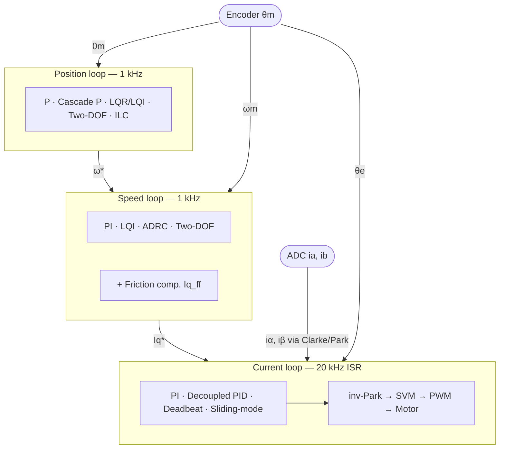
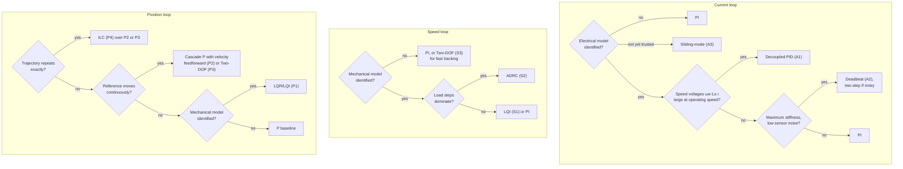

| Field     | Value                                |
|-----------|--------------------------------------|
| Title     | FOC Controllers — Map and Trade-offs |
| Type      | theory                               |
| Status    | draft                                |
| Version   | 0.4.0                                |
| Component | foc-controllers                      |
| Date      | 2026-10-29                           |

---

## Overview

This chapter covers the controller algorithms available for the three nested FOC loops: what each one
assumes, what it gains, what it costs, and what happens when its assumptions fail. Each loop exposes a
runtime-selectable controller slot configured via CLI or CAN without a firmware rebuild. Per-algorithm
chapters contain the full mathematical foundation and design equations.

The loop structure, the $S + T = 1$ trade, the bandwidth limits that delay and sampling impose, and
anti-windup are in [closed-loop control](closed-loop-control.md); every algorithm below lives inside those
limits. The shared plant models (dq current, mechanical speed, position) and discretisation are in
`documentation/theory/foc-plant-models.md`.

The runtime selection mechanism — heap-free variant storage, type-aware dispatch, state gating,
NVM persistence, and CLI/CAN interface — is in `documentation/design/controller-selection.md`.

---

## Algorithm Map

---

## Mathematical Foundation

All controllers derive from three plant models established in
`documentation/theory/foc-plant-models.md`:

| Plant                              | States                 | Input                   | Loop rate |
|------------------------------------|------------------------|-------------------------|-----------|
| PMSM current (per axis, decoupled) | $i_d$, $i_q$           | normalised voltage $v'$ | 20 kHz    |
| Mechanical speed                   | $\omega_m$             | $i_q^*$                 | 1 kHz     |
| Position (double integrator)       | $\theta_m$, $\omega_m$ | $i_q^*$                 | 1 kHz     |

Full derivations, ZOH discretisation, and parameter sources are in
`documentation/theory/foc-plant-models.md`. Per-algorithm design equations are in the
individual chapters listed in *Algorithm Index* below.

### 1. Bandwidth versus Noise

A faster loop has larger gains, and every gain multiplies the noise of the signal it acts on. In the current
loop the proportional gain of a pole-zero-cancelling PI is $K_p = L_s\,\omega_{bw}$, so a sensor noise
$\sigma_i$ becomes a voltage-command noise

$$
\sigma_v \approx L_s\, \omega_{bw}\, \sigma_i
$$

e-foc bounds this at 0.08 V RMS when it chooses the bandwidth itself
(`documentation/design/controller-selection.md`): on the bench board and motor, not one of the reference motors,
38.5 mA of sensor noise at the PWM-derived 8378 rad/s gave 0.40 V and an audible hiss. A deadbeat law has the largest gain of all,
$1/B_d^i \approx L_s/T_s^i$: 4 V/A for the Teknic, 12.8 V/A for the Anaheim, against 1 V/A for a 5000 rad/s
PI on the Teknic. In the speed loop the speed quantum (1.57 rad/s per count per window) plays the role of
the noise, and $K_p = 2J\omega_{bw}/K_t$ turns it into current-reference steps.

### 2. Stiffness versus Robustness

Model-based laws invert the plant: deadbeat computes the exact voltage that reaches the reference in one
step, LQR the optimal gains for the identified $J$ and $B_f$. With the right model they reject disturbances
faster than anything else. With the wrong one they lose that performance first and, if the error is large,
stability. Model-free laws (PI, sliding mode, the baseline position law) give up some speed and gain
tolerance: an integral removes any constant error whatever the parameters, a sliding-mode switching gain
covers any disturbance up to its size. The sensitivity peak $M_s = \max_\omega \lvert S(j\omega)\rvert$ measures
the margin: $M_s \le 1.3$ guarantees at least 45° of phase margin, $M_s \le 2$ at least 29° and a gain margin
of 2. A loop that relies on cancellation has its $M_s$ set by how good the cancellation is.

### 3. Tracking versus Disturbance Rejection

In a single-degree-of-freedom loop the same gains decide how the output follows the reference and how it
rejects load. A stiff loop overshoots reference steps; a gentle one sags under load. The speed PI shows it
directly: the integral zero that sets load recovery also enters the reference path and sets the step
overshoot (`documentation/theory/speed-loop-pi.md`, *What the implementation uses*). Two-DOF laws (S3, P3)
add a reference pre-filter so the feedback can be tuned for rejection alone; feedforward (velocity in P2,
decoupling in A1) removes the predictable part of the tracking error before feedback sees it.

### 4. Model-Based versus Model-Free

| Needs                    | Algorithms                                      | Parameters come from                               |
|--------------------------|-------------------------------------------------|----------------------------------------------------|
| Nothing beyond the gains | PI (current, speed), P, Cascade P, Two-DOF, ILC | Bandwidth settings                                 |
| Electrical model         | Decoupled PID, Deadbeat, Sliding-mode           | Electrical identification ($R_s$, $L_s$), $\psi_f$ |
| Mechanical model         | LQI, ADRC, LQR/LQI                              | Mechanical identification ($J$, $B_f$, $K_t$)      |

Parameters drift: $R_s$ rises about 0.39 %/K with winding temperature and $\psi_f$ falls about 0.1 %/K with
magnet temperature ([disturbances and noise](disturbances-and-noise.md)). A model-based law tuned on a cold
motor is running on a mismatched model once the motor is warm, unless an online estimator follows it.

### 5. Cost versus Rate

Every current-loop algorithm runs inside the 20 kHz interrupt, whose inner-loop budget is 4500 cycles
(37.5 µs at 120 MHz). The measured inner loop takes 1074–1353 cycles on the TM4C1294
(`documentation/performance-optimization/README.md`), so none of the algorithms below is limited by
computation; the limit on all of them is the 1.5-period loop delay of
[closed-loop control](closed-loop-control.md) §7. The outer loops run at 1 kHz with a 20 000-cycle budget,
where even a stored ILC array is cheap.

---

## Numerical Properties

Summary comparison across all loops — see each per-algorithm chapter for full detail.

**Current loop** — 20 kHz ISR:

| ID | Algorithm     | ISR cost | Robustness          | Requires RLS | Relies on                       | When the model is wrong                                                                        | Noise sensitivity                        | Best for                                            |
|----|---------------|----------|---------------------|--------------|---------------------------------|------------------------------------------------------------------------------------------------|------------------------------------------|-----------------------------------------------------|
| —  | PI (baseline) | ~6 MACs  | High (integral)     | No           | $L_s$, $R_s$ for the gains only | $L_s$ error scales the bandwidth; the integral still removes all error                         | $K_p = L_s\omega_{bw}$                   | Default; any motor, before identification           |
| A1 | Decoupled PID | ~10 MACs | Low (model-dep.)    | Partial      | $L_s$, $\psi_f$, measured speed | 20 % $L_s$ error leaves 20 % of the coupling; integral takes the rest                          | PI plus speed noise via feedforward      | High electrical speed, large $\omega_e L_s i$       |
| A2 | Deadbeat      | ~4 MACs  | Low (exact model)   | Yes (tight)  | $A_d^i$, $B_d^i$ exactly        | Most sensitive: overshoot, then limit cycle; stable for $L_s$ within 0.5–1.5× up to 8378 rad/s | Highest: $L_s/T_s^i$; two-step halves it | Maximum stiffness with a converged model            |
| A3 | Sliding-mode  | ~12 MACs | High (gain-bounded) | Partial      | Disturbance bound $K_{sw}$      | Tolerated while the mismatch stays inside $K_{sw}$                                             | Boundary layer $\phi$ sets the band      | Before identification converges; thermal transients |

**Speed loop** — 1 kHz handler:

| ID | Algorithm     | Ops/cycle | Disturbance rejection | Requires RLS | Relies on                | When the model is wrong                                  | Noise sensitivity                                          | Best for                               |
|----|---------------|-----------|-----------------------|--------------|--------------------------|----------------------------------------------------------|------------------------------------------------------------|----------------------------------------|
| —  | PI (baseline) | ~6 MACs   | Integral quality      | No           | $J$, $K_t$ for the gains | $J$ error scales the bandwidth                           | $K_p$ × speed quantum                                      | Default                                |
| S1 | LQI           | 2 MACs    | Integral quality      | Yes (J, Bf)  | $J$, $B_f$               | Weights keep their meaning only for the identified plant | As PI                                                      | Systematic tuning by weights           |
| S2 | ADRC          | 6 MACs    | Explicit cancellation | Yes (Kt, J)  | $b_0 = K_t/J$            | Observer absorbs moderate error; large error oscillates  | Grows with observer bandwidth $\omega_o$ ($\le 0.4/T_s^o$) | Load steps; unknown, changing loads    |
| S3 | Two-DOF       | ~8 MACs   | Integral quality      | No           | Pre-filter time constant | As PI                                                    | As PI                                                      | Fast tracking without losing stiffness |

**Position loop** — 1 kHz handler:

| ID | Algorithm    | Ops/cycle      | Steady-state error  | Requires RLS | Relies on                       | When the model is wrong                         | Noise sensitivity                                           | Best for                            |
|----|--------------|----------------|---------------------|--------------|---------------------------------|-------------------------------------------------|-------------------------------------------------------------|-------------------------------------|
| —  | P (baseline) | 2 MACs         | Zero at rest        | No           | Speed loop ≥ 5 × bandwidth      | —                                               | Encoder angle                                               | Point-to-point holding              |
| P1 | LQR / LQI    | 4 MACs         | Zero (LQI)          | Yes (J, Bf)  | $J$, $B_f$, $K_t$               | Optimality lost; current-loop delay unmodelled  | Angle and its derivative                                    | Principled $\theta$/$\omega$ trade  |
| P2 | Cascade P    | 2 MACs         | Speed-loop dep.     | No           | $K_v \le \omega_{speed}/5$      | —                                               | Encoder angle; velocity feedforward needs a clean reference | Industrial servo; moving references |
| P3 | Two-DOF      | ~8 MACs        | Configurable        | No           | Pre-filter faster than the loop | —                                               | As P2                                                       | Tracking and stiffness tuned apart  |
| P4 | ILC          | 2 MACs + array | Near-zero (learned) | No           | A strictly repeated trajectory  | A changed trajectory replays the old correction | Learns the repeatable part only                             | Repetitive moves                    |

---

## Choosing a Controller

The baselines (PI current, PI speed, P position) are what a drive runs before any identification and what
every other algorithm is measured against. Change one loop at a time, from the inside out: a speed
controller tuned against a current loop that later changes is tuned against the wrong plant.

---

## Algorithm Index

| Loop     | ID | Algorithm                   | File                                                           |
|----------|----|-----------------------------|----------------------------------------------------------------|
| Current  | —  | PI (baseline)               | [current-loop-pi.md](current-loop-pi.md)                       |
| Current  | A1 | Decoupled PID + Feedforward | [current-loop-decoupled-pid.md](current-loop-decoupled-pid.md) |
| Current  | A2 | Deadbeat                    | [current-loop-deadbeat.md](current-loop-deadbeat.md)           |
| Current  | A3 | Sliding-Mode                | [current-loop-sliding-mode.md](current-loop-sliding-mode.md)   |
| Speed    | —  | PI (baseline)               | [speed-loop-pi.md](speed-loop-pi.md)                           |
| Speed    | S1 | LQI                         | [speed-loop-lqi.md](speed-loop-lqi.md)                         |
| Speed    | S2 | ADRC                        | [speed-loop-adrc.md](speed-loop-adrc.md)                       |
| Speed    | S3 | Two-DOF                     | [speed-loop-two-dof.md](speed-loop-two-dof.md)                 |
| Position | —  | P (baseline)                | [position-loop-pid.md](position-loop-pid.md)                   |
| Position | P1 | LQR / LQI                   | [position-loop-lqr-lqi.md](position-loop-lqr-lqi.md)           |
| Position | P2 | Cascade P→PI                | [position-loop-cascade-p.md](position-loop-cascade-p.md)       |
| Position | P3 | Two-DOF                     | [position-loop-two-dof.md](position-loop-two-dof.md)           |
| Position | P4 | Iterative Learning Control  | [position-loop-ilc.md](position-loop-ilc.md)                   |
| Any      | —  | Friction Compensation       | [position-loop-friction.md](position-loop-friction.md)         |

Friction compensation is the one entry that is theory only today: the mechanical estimator fits a Coulomb
term internally but does not output it, and no cascade applies a friction feed-forward. Cogging, the other low-speed
torque disturbance, is compensated (`documentation/design/service-cogging-compensation.md`).

---

## Parameter Sources

| Source                  | Parameters                                                      | Available after                 |
|-------------------------|-----------------------------------------------------------------|---------------------------------|
| Motor datasheet         | Pole pairs $p$, flux linkage $\psi_f$, peak current $I_{q,max}$ | Before first run                |
| Electrical RLS          | $R_s$, $L_s$, $V_{dc}$                                          | After electrical identification |
| Mechanical RLS          | $J$, $B_f$, $K_t$                                               | After mechanical identification |
| Friction identification | $T_c$, $T_s$, $\omega_{st}$                                     | After dedicated friction sweep  |

Current-loop algorithms A1–A3 become selectable after electrical identification. Speed and position
algorithms S1, S2, P1 additionally require mechanical identification. P2, P3, P4, and S3 require
neither and are always available once the motor is calibrated.

---

## References

Full reference lists are in each per-algorithm chapter. Foundational references:

1. Krishnan, R. — *Permanent Magnet Synchronous and Brushless DC Motor Drives*, CRC Press, 2010.
2. Åström, K.J. & Wittenmark, B. — *Computer-Controlled Systems*, 3rd ed., Prentice Hall, 1997.
3. Han, J. — "From PID to Active Disturbance Rejection Control", *IEEE Trans. Ind. Electron.*,
   56(3):900–906, 2009.
4. Bristow, D.A. et al. — "A Survey of Iterative Learning Control",
   *IEEE Control Systems Magazine*, 26(3):96–114, 2006.
5. Armstrong-Hélouvry, B. et al. — "A Survey of Models … for Machines with Friction",
   *Automatica*, 30(7):1083–1138, 1994.
6. Åström, K.J. & Murray, R.M. — *Feedback Systems*, 2nd ed., Princeton University Press, 2021.
