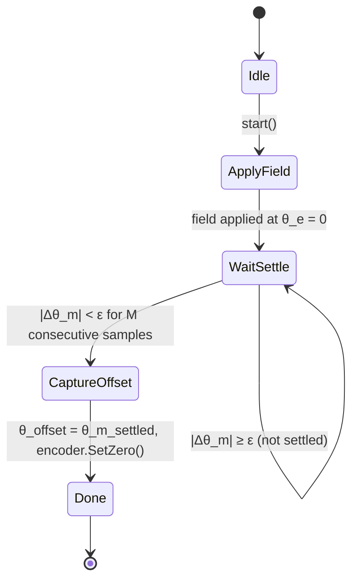
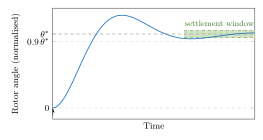

| Field     | Value                                            |
|-----------|--------------------------------------------------|
| Title     | Motor Alignment — Encoder Zero-Point Calibration |
| Type      | theory                                           |
| Status    | approved                                         |
| Version   | 1.1.0                                            |
| Component | service-alignment                                |
| Date      | 2026-11-06                                       |

## Overview

Motor alignment establishes the correspondence between the incremental encoder position and the
electrical rotor angle $\theta_e$. An incremental encoder measures mechanical shaft rotation from a
relative zero point that is arbitrary at power-on. FOC requires the absolute electrical angle to compute
the Clarke–Park transform correctly. Without calibration, the angle error $\Delta\theta$ between the
assumed and actual rotor position causes cross-coupling between the d and q axes, degrading torque
production and potentially causing instability.

The alignment procedure forces the rotor to a known electrical position by applying a stator field at
a fixed electrical angle (typically $\theta_e = 0$). The encoder reading at the settled position becomes
the **alignment offset** $\theta_{offset}$. All subsequent angle calculations subtract this offset:

$$
\theta_e = p \cdot (\theta_m - \theta_{offset})
$$

---

## Prerequisites

| Symbol            | Meaning                                                     | Unit      |
|-------------------|-------------------------------------------------------------|-----------|
| $p$               | Number of pole pairs                                        | —         |
| $\theta_m$        | Mechanical angle from encoder (raw counts / 2π or rad)      | rad       |
| $\theta_e$        | Electrical angle used by FOC                                | rad       |
| $\theta_{offset}$ | Encoder reading when rotor is at $\theta_e = 0$             | rad       |
| $\delta$          | Misalignment angle = $\theta_e - \theta_r$ (field vs rotor) | rad       |
| $K_T$             | Motor torque constant ($\tau = K_T \cdot i_q$)              | N·m/A     |
| $J$               | Rotor moment of inertia                                     | kg·m²     |
| $B$               | Viscous friction coefficient                                | N·m·s/rad |
| $N_{steps}$       | Number of alignment steps per revolution                    | —         |

---

## Mathematical Foundation

### 1. Physical Principle — Synchronising Torque at Start

A PMSM permanent magnet rotor experiences a torque whenever the stator magnetic field is not aligned
with the rotor d-axis. Applying a constant stator current at electrical angle $\theta_e^{field}$ produces a
stator MMF (magnetomotive force) at that electrical angle in the air gap. The interaction with the rotor's
permanent magnet flux creates a synchronising torque:

$$
\tau_{sync} = K_T \cdot I_d^{field} \cdot \sin(\theta_e^{field} - \theta_r)
= K_{mag} \cdot \sin(\delta)
$$

where $\delta = \theta_e^{field} - \theta_r$ is the angle between the stator field and the rotor d-axis
(the north pole of the permanent magnet), and $K_{mag} > 0$ is a motor-dependent constant.

This is the classical synchronising torque of a synchronous machine: $\tau = K_{mag}\sin(\delta)$, positive
while the field leads the rotor, so it always pulls the rotor towards the field.

**Equilibrium**: $\tau_{sync} = 0$ when $\delta = 0$ or $\delta = \pi$. The stable equilibrium is $\delta = 0$,
i.e. the rotor d-axis aligns with the applied stator field. The $\delta = \pi$ equilibrium is unstable.

### 2. Rotor Settling Dynamics

The rotor motion during alignment is governed by the Newton-Euler equation:

$$
J \ddot{\theta}_r + B \dot{\theta}_r = \tau_{sync} = K_{mag} \sin(\theta_e^{field} - \theta_r)
$$

Linearising around the equilibrium $\theta_r \rightarrow \theta_e^{field}$ (small $\delta$, $\sin\delta \approx \delta$):

$$
J \ddot{\delta} + B \dot{\delta} + K_{mag}\, \delta = 0
$$

This is a damped second-order system with:

$$
\omega_n = \sqrt{\frac{K_{mag}}{J}}, \qquad \zeta = \frac{B}{2\sqrt{K_{mag} J}}
$$

Typical PMSM rotor assemblies are underdamped ($\zeta < 1$), so the rotor overshoots and oscillates
before settling. The free response is:

$$
\delta(t) = \delta_0 \cdot e^{-\zeta\omega_n t}
\left[\cos(\omega_d t) + \frac{\zeta}{\sqrt{1-\zeta^2}}\sin(\omega_d t)\right],
\qquad \omega_d = \omega_n\sqrt{1-\zeta^2}
$$

The settling curve is drawn in *Block Diagrams* below (alignment settling).

### 3. Single-Step Alignment

The implementation applies a single fixed stator field at $\theta_e^{field} = 0$. The rotor d-axis is
attracted to this angle and settles there from any starting position that is not at the unstable
equilibrium ($\delta = \pi$). In practice, static friction and motor winding asymmetry prevent the
rotor from remaining at the unstable equilibrium, so the procedure reliably converges for
surface-mounted PMSM and BLDC motors. For interior PMSM motors with significant magnetic saliency,
a rotor that is already near the unstable equilibrium and is held by static friction may require the
`settledThreshold` to be tightened and the `testVoltage` to be increased to ensure movement.

The field is maintained continuously at a constant duty cycle until the rotor is detected as settled.
No stepping or sweeping is performed.

### 4. Settlement Detection

After applying the field at $\theta_e = 0$, the controller waits for the rotor to settle. Settlement
is detected by a **consecutive-sample position-change check**:

> "The rotor is considered settled when the absolute change in encoder position between successive
> samples is smaller than $\epsilon_{threshold}$ for $M$ consecutive samples."

Formally, let $\theta_m[n]$ be the encoder reading at sample $n$. Settlement is declared when:

$$
\left|\theta_m[n] - \theta_m[n-1]\right| < \epsilon_{threshold}
$$

holds for $M = \texttt{settledCount}$ consecutive samples. If the condition is not met, the counter
resets. The threshold $\epsilon_{threshold}$ must be larger than the encoder quantisation noise but
smaller than the expected motion during a half-period of the damped oscillation.

### 5. Alignment Offset Calculation

Once the motor has settled with the stator field at $\theta_e^{field} = 0$, the encoder reading
$\theta_m^{settled}$ corresponds to the rotor d-axis being at mechanical angle $\theta_m^{settled}$.
This reading is recorded as the alignment offset:

$$
\theta_{offset} = \theta_m^{settled}
$$

During normal FOC operation the corrected electrical angle is:

$$
\theta_e = p \cdot (\theta_m - \theta_{offset}) \pmod{2\pi}
$$

This ensures $\theta_e = 0$ when the rotor is at its original settled position.

### 6. Torque Production with Angle Error

If the alignment offset is incorrect by $\Delta\theta$ (in mechanical radians), then the electrical
angle error is $p \cdot \Delta\theta$. The effective torque is reduced:

$$
\tau_{actual} = K_T \cdot i_q \cdot \cos(p \cdot \Delta\theta)
$$

For example, a $10°$ mechanical offset with $p = 4$ gives a $40°$ electrical error, reducing torque
to $\cos(40°) \approx 77\%$ of its potential. The d-axis also receives unwanted excitation,
potentially demagnetising the permanent magnets under sustained high current.

### 7. Index Reference — Keeping the Offset Across a Reset

$\theta_{offset}$ is a reading of a counter that starts from an arbitrary value at every power-up, so
it cannot be stored. An encoder with an index channel also carries a fixed mark: one pulse per
revolution at a mechanical angle $\theta_m^{idx}$ that does not change with the power-up. Read in the
aligned frame, the pulse sits at

$$
\theta_{idx} = \theta_m^{idx} - \theta_{offset} \pmod{2\pi}
$$

which is a property of how the encoder is mounted on the rotor, so it can be measured once, right
after the alignment, and stored. After a reset the counter reads $\theta_m' = \theta_m + c$ for some
unknown $c$. Turning the rotor until the pulse passes gives the reading $r_{idx} = \theta_m^{idx} + c$
there, and shifting every later reading by $\theta_{idx} - r_{idx}$,

$$
\theta_m' - r_{idx} + \theta_{idx} = \theta_m - \theta_m^{idx} + \theta_{idx} = \theta_m - \theta_{offset}
$$

restores the aligned frame exactly: $c$ cancels, and so does the absolute position of the mark.

Two properties make this better than aligning again:

- **The reading is taken at the pulse, not at the field.** A rotor dragged by a turning field lags it
  by the load angle that balances friction, cogging and load (§2), but the encoder reading at the
  pulse is the same however far it lags. The alignment's settled position, by contrast, carries that
  balance as an error.
- **The pulse has a width.** It spans one count or one line, and a pulse met from the other side is
  read one width away. Both the commissioning and the power-up search therefore turn the rotor
  forward and are armed only after the rotor has snapped to the first field, so both meet the same edge.

The precision is the encoder count plus the motion within one control period at the search speed:
at half a revolution per second and 20 kHz that is 0.16 mrad, far below one count of a 4000-count
encoder (1.57 mrad). The search moves the rotor by at most 1.25 revolutions; one always passes the index.

The theory says nothing about the field the search uses: any field the rotor follows forward will do.
The firmware uses an open-loop vector sized from the calibrated resistance, as the alignment does
(`service-index-search.md`).

---

## Block Diagrams

### Alignment State Machine



### Settling Signal



```{=latex}
\input{alignment-settling.tex}
```

---

## Numerical Properties

| Property            | Value / Condition                                                                        |
|---------------------|------------------------------------------------------------------------------------------|
| Field application   | Single fixed stator field at $\theta_e^{field} = 0$ (§3); no stepping                    |
| Detection threshold | Position change $< \epsilon_{threshold}$ per check                                       |
| Consecutive checks  | $M$ samples below threshold before declaring settled                                     |
| Offset precision    | Limited by encoder resolution (e.g. ±0.5 count)                                          |
| Torque cost         | The d-axis field produces the synchronising torque of §2; no $i_q$ is commanded          |
| Worst-case duration | `AlignmentConfig::timeout` (default 2 s), or `maxSamples` samples if that elapses first  |
| Index reference     | Index angle $\theta_{idx}$ stored once; restored by one forward pass over the index (§7) |

---

## Limitations & Assumptions

- **Assumes**: The stator field is strong enough to overcome static friction and drag the rotor.
  For very low currents, the rotor may not follow.
- **Assumes**: The rotor reaches the stable equilibrium ($\delta = 0$), not the unstable one ($\delta = \pi$).
  Large initial misalignment or very low damping can cause incorrect convergence.
- **Assumes**: Negligible cogging torque relative to $K_{mag} \cdot I_{align}$. High cogging torque
  motors may require a higher alignment current.
- **Assumes** (§7): The index mark does not move relative to the rotor between commissioning and
  power-up; an encoder that is remounted needs a new alignment, which measures the index again.
- **Does not handle**: Repeated alignment without re-energising (thermal state must be considered).
- **Does not handle**: Distribution of alignment offset across multiple electrical periods for motors
  where $p > 1$ and the mechanical step may span more than one electrical revolution.

## References

1. Mohan, N. — *Advanced Electric Drives: Analysis, Control and Modeling using MATLAB/Simulink*, Wiley, 2014.
2. Schroedl, M. — "Sensorless control of AC machines at low speed and standstill based on the INFORM method",
   *Industry Applications Conference*, 1996.
